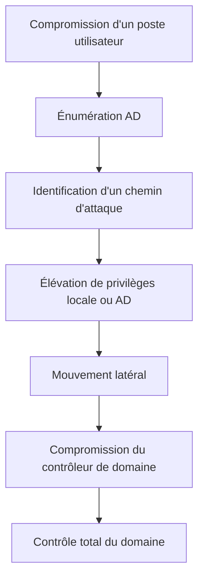

## Introduction

Active Directory est l'annuaire centralisé qui gère l'authentification et les autorisations dans la quasi-totalité des entreprises de taille moyenne à grande. En 2026, c'est encore le système le plus présent dans les systèmes d'information internes, et c'est précisément ce qui en fait la cible numéro un d'un test d'intrusion interne : compromettre Active Directory, c'est souvent compromettre toute l'organisation d'un seul coup.

Ce cours change de perspective par rapport au cours Administration Systèmes et Réseaux d'Entreprise. Là où celui-ci aborde Active Directory du point de vue de l'administrateur qui le configure, celui-ci l'aborde du point de vue de l'attaquant qui l'audite et l'exploite — la compétence la plus recherchée sur le marché du pentest interne, et le cœur des certifications CRTP, CRTE et CRTO d'Altered Security, ainsi que de l'OSCP+ d'OffSec.

À la fin de ce chapitre, tu sauras nommer précisément les briques d'un environnement Active Directory, expliquer comment l'authentification y circule, reconnaître les relations d'approbation entre domaines et leurs risques, et surtout comprendre la logique de chemin d'attaque qui structure tous les chapitres suivants.

## Les concepts fondamentaux d'Active Directory

Active Directory organise les ressources de l'entreprise dans une hiérarchie logique. Comprendre cette hiérarchie est le prérequis absolu avant toute énumération offensive, car chaque attaque cible un type d'objet précis à un niveau précis de cette structure.

<CompareTable
  titleA="Concept"
  titleB="Définition"
  rows={[
    { a: "Forêt (forest)", b: "Le plus haut niveau de la hiérarchie — peut contenir plusieurs domaines liés par des relations d'approbation. La forêt est la véritable frontière de sécurité d'Active Directory." },
    { a: "Domaine (domain)", b: "Une unité administrative avec sa propre base d'utilisateurs, groupes et politiques, identifiée par un nom DNS comme corp.local." },
    { a: "Contrôleur de domaine (DC)", b: "Le serveur qui héberge la base AD (le fichier ntds.dit) et traite toutes les demandes d'authentification." },
    { a: "Unité d'organisation (OU)", b: "Conteneur logique pour organiser les objets et appliquer des GPO — c'est sur l'OU que s'appliquent les stratégies de groupe." },
    { a: "Objet", b: "Utilisateur, ordinateur, groupe, GPO — chaque élément de l'annuaire est un objet décrit par des attributs." },
]}
/>

Un point souvent mal compris mérite d'être souligné dès maintenant : la véritable frontière de sécurité d'Active Directory est la forêt, pas le domaine. Microsoft l'affirme explicitement depuis des années. Autrement dit, compromettre un domaine d'une forêt peut, via les relations d'approbation internes et des techniques comme l'abus de l'historique de SID, permettre de compromettre les autres domaines de la même forêt.

### Le rôle central du contrôleur de domaine

Le contrôleur de domaine stocke l'intégralité de la base d'annuaire dans un fichier nommé `ntds.dit`. Ce fichier contient notamment les empreintes (hashes) de tous les mots de passe du domaine. Obtenir une copie de `ntds.dit`, ou extraire son contenu à distance, revient donc à posséder l'ensemble des identifiants du domaine — un objectif que plusieurs attaques des chapitres suivants cherchent précisément à atteindre.

### LDAP et Kerberos, les deux protocoles clés

<TipCallout>
Le protocole LDAP (Lightweight Directory Access Protocol) est le langage utilisé pour interroger et modifier l'annuaire Active Directory. Kerberos, lui, est le protocole d'authentification par défaut depuis Windows 2000. Comprendre les requêtes LDAP de base est un prérequis pour toute énumération offensive, abordée au chapitre 2, et le fonctionnement de Kerberos conditionne les attaques du chapitre 3.
</TipCallout>

LDAP écoute par défaut sur le port 389 (et 636 en version chiffrée LDAPS). Kerberos utilise le port 88. À côté d'eux, Active Directory s'appuie aussi sur DNS (port 53), indispensable pour localiser les contrôleurs de domaine, et sur SMB (port 445) pour le partage de fichiers et l'exécution distante. Un balayage de ports révélant 88, 389, 445 et 53 ouverts sur une même machine est un indice quasi certain qu'il s'agit d'un contrôleur de domaine.

## Pourquoi Active Directory est une cible de choix

Un environnement AD concentre, par conception, toutes les identités et tous les droits de l'entreprise en un seul système. Un attaquant n'a donc pas besoin de compromettre machine par machine : il lui suffit de remonter la chaîne des privilèges jusqu'au contrôleur de domaine.

<CehCallout>
Dans la majorité des tests d'intrusion internes réels, l'objectif final n'est pas de trouver une faille exotique sur le contrôleur de domaine lui-même, mais d'enchaîner des mauvaises configurations et des privilèges mal gérés. C'est cette logique de chemin d'attaque (attack path) que ce cours développe chapitre après chapitre, et que l'outil BloodHound, vu au chapitre 2, permet de cartographier automatiquement.
</CehCallout>

Cette logique explique pourquoi un pentest AD ne ressemble pas à la recherche d'une vulnérabilité unique. L'attaquant part d'un accès très limité — souvent un simple compte utilisateur standard, parfois même aucun identifiant — et remonte progressivement en exploitant des relations légitimes mal configurées : une appartenance de groupe trop large, un droit délégué par commodité, une session administrateur laissée ouverte sur un serveur.

## Les relations d'approbation (trusts)

Lorsqu'une entreprise possède plusieurs domaines, par exemple après une fusion ou le rachat d'une filiale, elle met en place des relations d'approbation pour que les utilisateurs d'un domaine puissent accéder aux ressources d'un autre. Ces relations sont pratiques, mais elles élargissent la surface d'attaque.

<Steps steps={[
  { title: "Trust unidirectionnel", description: "Le domaine A fait confiance au domaine B, mais pas l'inverse. Les utilisateurs de B peuvent accéder aux ressources de A, pas le contraire. Attention : le sens de la confiance est inverse du sens de l'accès." },
  { title: "Trust bidirectionnel", description: "Confiance mutuelle entre deux domaines, chacun faisant confiance à l'autre. C'est le cas courant entre domaines d'une même forêt." },
  { title: "Trust transitif", description: "La confiance s'étend implicitement : si A fait confiance à B qui fait confiance à C, alors A fait confiance à C. Les trusts intra-forêt sont transitifs par défaut." },
  { title: "Trust non transitif", description: "La confiance ne s'étend pas au-delà des deux domaines directement concernés. C'est souvent le cas des trusts externes établis vers une autre forêt." },
]} />

<WarningCallout>
Une relation d'approbation mal maîtrisée entre deux domaines, ou pire entre deux forêts, peut permettre à un attaquant ayant compromis le domaine le moins sensible de rebondir vers un domaine bien plus critique. L'audit des trusts, et notamment la vérification de la protection SID Filtering sur les trusts inter-forêts, est une étape essentielle de toute évaluation de sécurité AD.
</WarningCallout>

## Entra ID et l'environnement hybride moderne

En 2026, de nombreuses entreprises ont adopté un modèle hybride : l'Active Directory local traditionnel coexiste avec Entra ID (l'ancien Azure Active Directory, renommé en 2023), l'annuaire cloud de Microsoft. Les deux sont synchronisés, souvent par l'outil Entra Connect. Cette hybridation crée de nouveaux chemins d'attaque, par exemple la compromission d'un compte cloud qui donne accès à des ressources locales, ou inversement. Ce cours se concentre sur l'Active Directory local, cœur historique du pentest interne, mais garde à l'esprit qu'un environnement réel combine désormais presque toujours les deux mondes.

## Erreurs fréquentes

Plusieurs confusions reviennent systématiquement chez les débutants et il vaut mieux les corriger dès maintenant. On confond souvent forêt et domaine en les traitant comme des synonymes, alors que la forêt est le conteneur le plus large et la seule véritable frontière de sécurité. On croit parfois que compromettre un domaine n'a aucun impact sur les autres domaines de la forêt, ce qui est faux à cause des trusts transitifs internes. On inverse régulièrement le sens d'un trust unidirectionnel, en pensant que la confiance circule dans le même sens que l'accès. Enfin, on cherche spontanément une faille unique et spectaculaire sur le contrôleur de domaine, alors que la réalité d'un pentest interne est faite d'enchaînements de petites mauvaises configurations.

## Lab — Mise en pratique

**Environnement** : Réflexion guidée, sans terminal. L'objectif est de raisonner comme un auditeur avant de manipuler des outils.

<Steps steps={[
  { title: "Identifier la structure d'une forêt", description: "Une entreprise a une forêt avec deux domaines : corp.local au siège et filiale.corp.local pour une filiale rachetée. Détermine le type de trust le plus probable entre eux et explique quel risque cela représente si la filiale est moins bien sécurisée." },
  { title: "Reconnaître un contrôleur de domaine", description: "Un balayage de ports sur une machine révèle les ports 53, 88, 389 et 445 ouverts. Explique pourquoi cette combinaison trahit presque certainement un contrôleur de domaine." },
  { title: "Comprendre le fichier ntds.dit", description: "Explique en une phrase pourquoi obtenir le contenu du fichier ntds.dit équivaut à compromettre l'ensemble des comptes du domaine." },
  { title: "Situer un chemin d'attaque", description: "Explique pourquoi un attaquant préfère généralement enchaîner plusieurs mauvaises configurations plutôt que de chercher une vulnérabilité unique sur le contrôleur de domaine." },
  { title: "Analyser un sens de trust", description: "Le domaine A fait confiance au domaine B de façon unidirectionnelle. Précise quels utilisateurs peuvent accéder à quelles ressources, et dans quel sens circule réellement l'accès." },
]} />

## À retenir

- La forêt est le plus haut niveau de la hiérarchie Active Directory et constitue la véritable frontière de sécurité ; un domaine est une unité administrative à l'intérieur d'une forêt.
- Le contrôleur de domaine héberge la base d'annuaire dans le fichier ntds.dit, qui contient les empreintes de tous les mots de passe du domaine.
- LDAP sert à interroger et modifier l'annuaire, Kerberos assure l'authentification, et DNS permet de localiser les contrôleurs de domaine.
- Les relations d'approbation, surtout transitives ou mal protégées, créent des chemins d'attaque inter-domaines et inter-forêts.
- L'exploitation d'Active Directory repose typiquement sur l'enchaînement de mauvaises configurations plutôt que sur une vulnérabilité unique.
- Les environnements modernes sont souvent hybrides, combinant Active Directory local et Entra ID dans le cloud.

## Questions de révision

1. Quelle est la différence entre une forêt et un domaine dans Active Directory, et laquelle constitue la frontière de sécurité ?
2. Quel type de serveur héberge la base d'annuaire et traite les demandes d'authentification, et dans quel fichier cette base est-elle stockée ?
3. À quoi sert une unité d'organisation, et quel type d'élément s'applique à son niveau ?
4. Qu'est-ce qu'un trust transitif, et en quoi diffère-t-il d'un trust non transitif ?
5. Dans un trust unidirectionnel où A fait confiance à B, quels utilisateurs accèdent aux ressources de quel domaine ?
6. Quel protocole est utilisé pour interroger et modifier l'annuaire Active Directory, et sur quel port écoute-t-il ?
7. Pourquoi un attaquant cherche-t-il généralement un chemin d'attaque plutôt qu'une faille isolée sur le contrôleur de domaine ?
8. Pourquoi le rachat d'une filiale moins sécurisée, suivi de l'établissement d'un trust, peut-il représenter un risque pour le domaine principal ?
