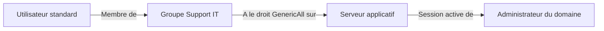

## Introduction

Une fois un premier pied posé dans le domaine, même avec un compte utilisateur standard sans privilège particulier, l'énumération est l'étape qui transforme cet accès limité en une carte exploitable. Par défaut, dans Active Directory, n'importe quel utilisateur authentifié peut lire la très grande majorité de l'annuaire : la liste des comptes, des groupes, des ordinateurs et les relations entre eux. Cette lisibilité est voulue par conception, car l'annuaire doit être interrogeable par tous les services, mais elle offre à l'attaquant une vue d'ensemble précieuse.

Ce chapitre explique, du point de vue de l'auditeur, ce que révèle l'énumération et pourquoi elle est si difficile à empêcher, puis comment un défenseur peut la détecter et en réduire l'impact. L'objectif n'est pas de dérouler une procédure d'attaque, mais de comprendre la mécanique pour mieux la repérer et la contenir. À la fin, tu sauras interpréter un graphe de chemin d'attaque, identifier les cibles prioritaires et mettre en place une surveillance de la reconnaissance.

## Ce que révèle l'énumération LDAP

LDAP (port 389, ou 636 en version chiffrée) est le langage d'interrogation de l'annuaire. Un attaquant l'utilise pour dresser un inventaire complet avant toute action, en quatre axes principaux.

<Steps steps={[
  { title: "Les comptes et leurs attributs", description: "La liste des utilisateurs, avec des attributs parfois révélateurs : un mot de passe laissé dans le champ Description, la date du dernier changement de mot de passe, les drapeaux de compte." },
  { title: "Les groupes à privilèges", description: "Les membres de Domain Admins, Enterprise Admins, Backup Operators, Account Operators ou DnsAdmins : ce sont les cibles finales d'un chemin d'attaque." },
  { title: "Les comptes avec SPN", description: "Les comptes de service portant un Service Principal Name, qui sont les cibles du Kerberoasting étudié au chapitre 3." },
  { title: "Les délégations Kerberos", description: "Les machines et comptes configurés en délégation, dont une délégation non contrainte mal placée est un vecteur majeur vu au chapitre 6." },
]} />

<TipCallout>
L'énumération dite « living off the land », qui s'appuie sur les outils natifs de Windows comme net, nltest ou les cmdlets ActiveDirectory, laisse beaucoup moins de traces qu'un binaire externe téléchargé puis exécuté. C'est aussi pourquoi, côté défense, un binaire inconnu déposé sur le disque reste un signal précieux : il distingue une partie des attaquants de l'administration légitime, que l'EDR surveille en priorité.
</TipCallout>

Les mêmes requêtes servent à l'administrateur pour auditer son propre annuaire. Repérer soi-même les comptes à risque avant un attaquant est l'un des gestes d'hygiène les plus rentables :

```powershell
# Audit défensif avec le module ActiveDirectory (RSAT) : repérer les comptes à risque
# Comptes de service exposés au Kerberoasting (présence d'un SPN)
Get-ADUser -Filter {ServicePrincipalName -like "*"} -Properties ServicePrincipalName, PasswordLastSet

# Comptes sans pré-authentification Kerberos (exposés à l'AS-REP Roasting)
Get-ADUser -Filter {DoesNotRequirePreAuth -eq $true} -Properties DoesNotRequirePreAuth

# Mots de passe oubliés en clair dans le champ Description
Get-ADUser -Filter {Description -like "*pass*"} -Properties Description
```

```text
Name            SamAccountName  PasswordLastSet       ServicePrincipalName
----            --------------  ---------------       --------------------
svc_sql         svc_sql         2019-03-12 09:41:55   {MSSQLSvc/db01.corp.local}
svc_backup      svc_backup      2020-11-02 14:08:21   {AGPMServer/agpm01.corp.local}
```

La sortie ci-dessus est un signal d'alerte : un compte de service dont le mot de passe n'a pas changé depuis 2019 est une cible idéale pour les attaques du chapitre 3.

## BloodHound — cartographier les chemins d'attaque

BloodHound collecte les relations entre objets AD, à savoir les appartenances de groupe, les droits délégués et les sessions actives, puis les représente sous forme de graphe. Il révèle ainsi des chemins d'attaque invisibles à l'œil nu dans une simple liste d'utilisateurs. Depuis 2023, la version de référence est BloodHound Community Edition (BloodHound CE), qui remplace l'ancienne version « legacy » désormais abandonnée.



<CehCallout>
Ce graphe illustre un chemin d'attaque classique révélé par BloodHound : un simple utilisateur, membre d'un groupe support disposant de droits excessifs (GenericAll) sur un serveur où une session administrateur est active, peut in fine atteindre les privilèges du domaine, sans qu'aucune étape individuelle ne semble critique isolément. C'est exactement ce qu'une liste plate d'utilisateurs et de groupes ne révèle jamais.
</CehCallout>

BloodHound est tout aussi précieux pour le défenseur : exécuté en amont, il permet de découvrir et de couper ces chemins avant qu'un attaquant ne les trouve. Le flux de travail comporte trois temps.

<Steps steps={[
  { title: "Collecte des données", description: "Un collecteur interroge le domaine et exporte les relations au format JSON. SharpHound s'exécute sur une machine Windows ; d'autres collecteurs font la collecte à distance. Le collecteur récupère les données, il ne les analyse pas." },
  { title: "Import dans BloodHound CE", description: "Les fichiers JSON sont chargés dans la base graphe Neo4j de l'outil pour analyse. BloodHound CE s'installe facilement via Docker Compose." },
  { title: "Analyse des chemins", description: "BloodHound propose des requêtes prêtes à l'emploi : plus court chemin vers Domain Admins, comptes Kerberoastables, comptes AS-REP Roastables, machines en délégation non contrainte. Côté défense, chaque chemin trouvé est une correction à planifier." },
]} />

<WarningCallout>
Une collecte exhaustive génère un volume important de requêtes LDAP et de connexions SMB, détectable par un SOC bien instrumenté. C'est une bonne nouvelle pour le défenseur : une reconnaissance massive laisse des traces. Surveiller un pic de requêtes LDAP inhabituelles depuis un poste utilisateur, ou l'énumération soudaine de nombreux objets, permet de repérer une collecte de type BloodHound en cours.
</WarningCallout>

## Prioriser les cibles et les corrections

Énumérer produit beaucoup de données ; tout l'art, pour l'attaquant comme pour l'auditeur, consiste à repérer les éléments à fort rendement. Pour chaque cible offensive correspond une mesure défensive directe.

<AttackDefenseTable rows={[
  { phase: "Découverte des comptes", attack: "Lister tous les utilisateurs et repérer les SPN et drapeaux de compte", defense: "Supprimer les SPN inutiles et nettoyer les mots de passe oubliés dans les descriptions" },
  { phase: "Découverte des groupes", attack: "Identifier les membres des groupes Tier 0 (Domain et Enterprise Admins)", defense: "Réduire au strict minimum les membres des groupes à privilèges" },
  { phase: "Cartographie des droits", attack: "Collecter les ACL pour trouver un chemin vers les privilèges", defense: "Auditer régulièrement les ACL avec BloodHound CE en mode défensif" },
  { phase: "Collecte des sessions", attack: "Repérer où un compte à privilèges a une session ouverte", defense: "Appliquer le modèle de tiering (chapitre 8) pour cloisonner les sessions" },
]} />

<AuditCallout>
La détection d'une reconnaissance LDAP relève des contrôles A.8.15 (journalisation) et A.8.16 (activités de surveillance) de la norme ISO/IEC 27001:2022. Côté Windows, l'activation de la journalisation des accès à l'annuaire et l'analyse des événements d'authentification 4624 et 4768 permettent de repérer des comportements d'énumération anormaux.
</AuditCallout>

## Erreurs fréquentes

On croit souvent qu'il faut des privilèges élevés pour énumérer un domaine, alors qu'un simple compte authentifié suffit à lire l'essentiel de l'annuaire. On confond parfois le collecteur SharpHound avec l'interface d'analyse BloodHound, alors que l'un récupère les données et l'autre les visualise. Côté défense, on réserve BloodHound aux attaquants, alors que l'exécuter soi-même régulièrement est l'un des meilleurs moyens de couper les chemins d'attaque à l'avance. Enfin, on néglige l'audit des partages réseau, qui est pourtant l'une des sources les plus fréquentes de mots de passe en clair.

## Lab — Mise en pratique

**Environnement** : Réflexion guidée et audit sur le lab AD (poste Windows d'administration ou données BloodHound fournies). L'objectif est d'observer, d'auditer et de repérer, pas d'attaquer.

<Steps steps={[
  { title: "Auditer les comptes à SPN", description: "Depuis un poste d'administration, liste les comptes de service disposant d'un SPN et note ceux dont le mot de passe n'a pas changé depuis longtemps.", code: "Get-ADUser -Filter {ServicePrincipalName -like '*'} -Properties ServicePrincipalName, PasswordLastSet" },
  { title: "Repérer les comptes sans pré-authentification", description: "Identifie les comptes vulnérables à l'AS-REP Roasting et vérifie s'ils sont encore justifiés.", code: "Get-ADUser -Filter {DoesNotRequirePreAuth -eq $true} -Properties DoesNotRequirePreAuth" },
  { title: "Chasser les secrets dans les descriptions", description: "Recherche les mots de passe oubliés dans le champ Description des comptes.", code: "Get-ADUser -Filter {Description -like '*pass*'} -Properties Description" },
  { title: "Analyser un chemin dans BloodHound CE", description: "À partir des données fournies, exécute la requête du plus court chemin vers Domain Admins et décris le chemin trouvé en une phrase." },
  { title: "Interpréter un droit dangereux", description: "Dans le graphe, repère un droit WriteDacl détenu par un utilisateur standard sur un objet sensible et explique ce qu'il permettrait concrètement, puis propose la correction." },
  { title: "Concevoir une détection", description: "Explique quel signal (type de requête, volume, source) permettrait de repérer une collecte BloodHound en cours sur le réseau." },
  { title: "Prioriser trois corrections", description: "À partir des cibles identifiées, propose trois corrections classées par rapport impact/effort et justifie l'ordre." },
]} />

## À retenir

- N'importe quel utilisateur authentifié peut lire l'essentiel de l'annuaire Active Directory : l'énumération ne nécessite aucun privilège particulier.
- L'énumération « living off the land » avec les outils natifs est plus discrète ; un binaire externe déposé sur disque reste un bon signal de détection.
- BloodHound Community Edition révèle des chemins d'attaque invisibles dans une liste plate, en reliant appartenances de groupe, droits ACL et sessions ; c'est aussi un outil défensif de premier plan.
- Le collecteur SharpHound récupère les données, l'interface BloodHound les visualise : ce sont deux rôles distincts.
- Une collecte exhaustive est bruyante et donc détectable : un pic de requêtes LDAP depuis un poste utilisateur mérite investigation.
- Les comptes de service avec SPN, les comptes sans pré-authentification et les mots de passe oubliés dans les descriptions sont des cibles prioritaires à corriger.

## Questions de révision

1. Pourquoi un simple compte authentifié, sans privilège, suffit-il pour énumérer la majeure partie d'un domaine Active Directory ?
2. Pourquoi l'énumération avec des outils natifs Windows est-elle généralement plus discrète qu'avec un outil externe ?
3. Que révèle un graphe BloodHound qu'une simple liste d'utilisateurs et de groupes ne révèle pas ?
4. Quelle est la différence de rôle entre le collecteur SharpHound et l'interface BloodHound ?
5. Pourquoi un compte de service avec un SPN constitue-t-il une cible d'énumération particulièrement intéressante ?
6. En quoi l'exécution régulière de BloodHound par le défenseur réduit-elle le risque ?
7. Pourquoi une collecte BloodHound exhaustive est-elle plus facile à détecter qu'une énumération ciblée et lente ?
8. Que permettrait concrètement à un attaquant un droit WriteDacl détenu sur l'objet d'un groupe à privilèges, et comment le corriger ?
