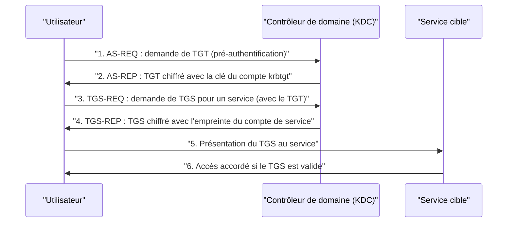

## Introduction

Kerberos est le protocole d'authentification par défaut d'Active Directory depuis Windows 2000. Sa conception, robuste sur le papier, dissimule deux faiblesses structurelles massivement exploitées en pentest interne : le Kerberoasting et l'AS-REP Roasting. Leur force vient de ce qu'elles n'exploitent aucune vulnérabilité logicielle à corriger par un correctif : elles abusent du fonctionnement normal du protocole. Elles restent donc exploitables en 2026 sur des environnements mal durcis.

Ce chapitre explique le mécanisme de ces deux attaques pour que tu comprennes précisément d'où vient le risque, puis se concentre sur la détection et la remédiation. L'objectif est de savoir repérer un compte vulnérable avant un attaquant, reconnaître une attaque dans les journaux, et appliquer les bonnes contre-mesures.

## Le fonctionnement de Kerberos

Kerberos repose sur un tiers de confiance appelé KDC (Key Distribution Center), rôle tenu par le contrôleur de domaine. L'authentification se déroule en deux grandes phases : l'utilisateur obtient d'abord un ticket d'authentification général (le TGT), puis il l'échange contre des tickets d'accès aux services (les TGS).



Deux détails de ce schéma sont la source directe des deux attaques du chapitre. Le TGT est chiffré avec la clé du compte krbtgt : c'est ce qui permettra le Golden Ticket du chapitre 7. Le TGS, lui, est chiffré avec l'empreinte du mot de passe du compte de service visé.

<TipCallout>
L'étape clé à retenir pour ce chapitre : le TGS est chiffré avec l'empreinte du mot de passe du compte de service, et non avec une clé partagée aléatoire. C'est précisément ce détail qui rend le Kerberoasting possible. Lors de l'émission du TGT, à l'inverse, c'est la clé du compte krbtgt qui est utilisée.
</TipCallout>

### Le rôle de la pré-authentification

À l'étape 1, l'utilisateur prouve normalement qu'il connaît son mot de passe en chiffrant un horodatage avec l'empreinte de celui-ci : c'est la pré-authentification Kerberos, activée par défaut. Sans elle, le KDC émet une réponse AS-REP à quiconque la demande, et cette réponse contient une portion chiffrée avec l'empreinte du compte visé. C'est la faille exploitée par l'AS-REP Roasting.

## Kerberoasting — pourquoi les comptes de service sont exposés

<CehCallout>
N'importe quel utilisateur authentifié du domaine, même sans privilège particulier, peut demander un TGS pour n'importe quel compte disposant d'un SPN (Service Principal Name). Ce TGS étant chiffré avec l'empreinte du mot de passe du compte de service, il devient possible de tenter de retrouver ce mot de passe hors ligne, sans aucune interaction supplémentaire avec le domaine. C'est la technique T1558.003 du référentiel MITRE ATT&CK.
</CehCallout>

Le déroulement conceptuel tient en quatre temps : l'attaquant identifie les comptes avec SPN, demande un TGS pour chacun (opération parfaitement légitime du point de vue du protocole), extrait la portion chiffrée du ticket, puis tente de retrouver le mot de passe hors ligne par dictionnaire ou force brute. Cette dernière étape se fait sur la machine de l'attaquant, sans générer d'alerte côté domaine. À titre de repère technique, l'empreinte TGS extraite correspond au mode 13100 de l'outil hashcat.

<WarningCallout>
Les comptes de service ont historiquement des mots de passe rarement changés, parfois jamais depuis leur création, et souvent plus faibles que ceux des comptes utilisateurs, car « personne ne les tape au clavier ». Cette croyance est précisément ce qui rend le Kerberoasting redoutablement efficace. Par ailleurs, un ticket émis en chiffrement RC4 (type 23) se craque bien plus vite qu'un ticket AES (type 18) : forcer AES sur les comptes de service ralentit fortement l'attaquant.
</WarningCallout>

## AS-REP Roasting — l'autre faiblesse Kerberos

<CompareTable
  titleA="Kerberoasting"
  titleB="AS-REP Roasting"
  rows={[
    { a: "Cible les comptes de service disposant d'un SPN", b: "Cible les comptes avec la pré-authentification Kerberos désactivée" },
    { a: "Nécessite un compte authentifié pour demander le TGS", b: "Ne nécessite pas d'authentification préalable valide" },
    { a: "Exploite le chiffrement du ticket de service (TGS)", b: "Exploite la réponse AS-REP émise sans vérification préalable" },
    { a: "Repère technique : mode hashcat 13100", b: "Repère technique : mode hashcat 18200" },
]}
/>

<CehCallout>
La pré-authentification Kerberos est activée par défaut. Un compte l'ayant désactivée, souvent par erreur de configuration ou pour compatibilité avec une application ancienne, permet d'obtenir directement une réponse AS-REP chiffrée avec l'empreinte de son mot de passe, sans disposer d'identifiants valides au préalable. C'est la technique T1558.004 de MITRE ATT&CK. La particularité de l'AS-REP Roasting est donc l'absence de besoin d'authentification préalable, contrairement au Kerberoasting.
</CehCallout>

## Détecter ces attaques

Ces deux attaques laissent des traces exploitables par un défenseur bien instrumenté.

<AttackDefenseTable rows={[
  { phase: "Kerberoasting", attack: "Demande massive de TGS, souvent en chiffrement RC4", defense: "Surveiller l'événement 4769 : un compte demandant de nombreux TGS en RC4 en peu de temps est suspect" },
  { phase: "AS-REP Roasting", attack: "Demandes AS-REQ sans pré-authentification", defense: "Surveiller l'événement 4768 avec type de pré-authentification 0 sur des comptes sensibles" },
  { phase: "Préparation", attack: "Énumération des comptes à SPN ou sans pré-authentification", defense: "Auditer régulièrement ces comptes avec le module ActiveDirectory et corriger en amont" },
]} />

```powershell
# Audit défensif : repérer les comptes exposés avant un attaquant
# Comptes de service avec SPN et mot de passe ancien
Get-ADUser -Filter {ServicePrincipalName -like "*"} -Properties ServicePrincipalName, PasswordLastSet |
  Where-Object { $_.PasswordLastSet -lt (Get-Date).AddYears(-1) }

# Comptes sans pré-authentification (exposés à l'AS-REP Roasting)
Get-ADUser -Filter {DoesNotRequirePreAuth -eq $true} -Properties DoesNotRequirePreAuth
```

```text
SamAccountName  PasswordLastSet       ServicePrincipalName
--------------  ---------------       --------------------
svc_sql         2019-03-12 09:41:55   {MSSQLSvc/db01.corp.local}
```

<AuditCallout>
La surveillance des événements 4768 et 4769 relève des contrôles A.8.15 (journalisation) et A.8.16 (activités de surveillance) de la norme ISO/IEC 27001:2022. Un audit de maturité AD vérifie que ces événements sont collectés dans le SIEM et qu'une règle de corrélation alerte sur les demandes de tickets anormales.
</AuditCallout>

## Se protéger contre ces deux attaques

<Steps steps={[
  { title: "Mots de passe longs pour les comptes de service", description: "Vingt-cinq caractères aléatoires ou plus rendent le craquage hors ligne impraticable, même avec un GPU puissant, car l'espace de recherche devient trop vaste pour une attaque par dictionnaire ou force brute." },
  { title: "Utiliser des comptes de service gérés (gMSA)", description: "Les Group Managed Service Accounts ont un mot de passe de plus de cent caractères généré et renouvelé automatiquement par Active Directory, jamais manipulé manuellement : le Kerberoasting devient inutile sur eux." },
  { title: "Forcer le chiffrement AES", description: "Désactiver RC4 sur les comptes de service ralentit considérablement le craquage d'un éventuel ticket extrait." },
  { title: "Ne jamais désactiver la pré-authentification sans raison impérieuse", description: "Vérifier régulièrement, par une requête ciblée, qu'aucun compte ne l'a désactivée par erreur ou héritage historique, et réactiver la pré-authentification partout où c'est possible." },
]} />

## Erreurs fréquentes

On croit souvent que le Kerberoasting nécessite des privilèges élevés, alors qu'un compte standard authentifié suffit. On confond parfois la clé qui chiffre le TGT (celle du compte krbtgt) et celle qui chiffre le TGS (l'empreinte du compte de service) : c'est pourtant la distinction centrale du chapitre. On pense que changer une fois le mot de passe d'un compte de service suffit, alors qu'un mot de passe court même renouvelé reste craquable. Enfin, on néglige l'AS-REP Roasting car il paraît marginal, alors qu'il ne demande même pas d'authentification valide et se repère en quelques secondes par audit.

## Lab — Mise en pratique

**Environnement** : Audit et détection sur le lab AD (poste d'administration et journaux fournis). L'objectif est d'auditer, détecter et durcir, pas d'attaquer.

<Steps steps={[
  { title: "Auditer les comptes Kerberoastables", description: "Liste les comptes de service disposant d'un SPN et repère ceux dont le mot de passe est ancien.", code: "Get-ADUser -Filter {ServicePrincipalName -like '*'} -Properties ServicePrincipalName, PasswordLastSet" },
  { title: "Auditer les comptes sans pré-authentification", description: "Identifie les comptes vulnérables à l'AS-REP Roasting et évalue s'ils sont encore justifiés.", code: "Get-ADUser -Filter {DoesNotRequirePreAuth -eq $true} -Properties DoesNotRequirePreAuth" },
  { title: "Analyser un journal Kerberos", description: "À partir d'un extrait d'événements 4769 fourni, repère un compte ayant demandé de nombreux TGS en RC4 et explique pourquoi c'est un indicateur de Kerberoasting." },
  { title: "Vérifier le chiffrement des comptes", description: "Détermine quels comptes de service acceptent encore RC4 et proposent une migration vers AES." },
  { title: "Planifier une migration gMSA", description: "Pour un compte de service craquable identifié, explique en une phrase pourquoi un passage en gMSA éliminerait le risque de Kerberoasting." },
  { title: "Rédiger une règle de détection", description: "Formule en une phrase la condition d'alerte SIEM qui repérerait une demande massive de TGS en RC4 par un même compte." },
]} />

## À retenir

- Kerberos repose sur un KDC (le contrôleur de domaine) qui émet un TGT puis des TGS ; le TGT est chiffré avec la clé du compte krbtgt, le TGS avec l'empreinte du compte de service.
- Le Kerberoasting (T1558.003) permet à tout utilisateur authentifié d'obtenir un TGS craquable hors ligne pour n'importe quel compte disposant d'un SPN ; le repère hashcat est le mode 13100.
- L'AS-REP Roasting (T1558.004) exploite les comptes ayant désactivé la pré-authentification, sans authentification préalable ; le repère hashcat est le mode 18200.
- Un mot de passe de service de vingt-cinq caractères aléatoires rend le craquage hors ligne impraticable.
- Les comptes de service gérés (gMSA) éliminent pratiquement le risque de Kerberoasting grâce à un mot de passe long, généré et renouvelé automatiquement.
- Les événements Windows 4769 (demande de TGS) et 4768 (demande de TGT) permettent de détecter ces attaques, surtout en présence de chiffrement RC4.

## Questions de révision

1. Lors de l'émission du TGT par le KDC, avec quelle clé ce ticket est-il chiffré ?
2. Pourquoi n'importe quel utilisateur authentifié du domaine peut-il réaliser un Kerberoasting sans privilège particulier ?
3. Quel mode hashcat correspond à une empreinte TGS issue d'un Kerberoasting ?
4. Quelle configuration spécifique rend un compte vulnérable à l'AS-REP Roasting ?
5. En quoi l'AS-REP Roasting diffère-t-il du Kerberoasting concernant l'authentification préalable requise ?
6. Pourquoi un mot de passe de service de vingt-cinq caractères aléatoires rend-il le Kerberoasting quasiment impraticable ?
7. Pourquoi un compte de service géré (gMSA) élimine-t-il pratiquement le risque de Kerberoasting ?
8. Quel événement Windows, et quel indice de chiffrement, permettent de détecter un Kerberoasting en cours ?
