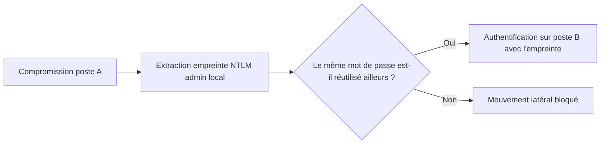

## Introduction

Une fois des identifiants ou des tickets obtenus sur une machine, le mouvement latéral consiste à réutiliser ce matériel d'authentification pour accéder à d'autres machines du domaine, sans jamais avoir besoin du mot de passe en clair. C'est l'étape qui transforme la compromission d'un poste isolé en compromission progressive du parc, jusqu'au contrôleur de domaine.

Le point commun de toutes les techniques de ce chapitre est qu'elles abusent d'un fonctionnement légitime de Windows : son modèle d'authentification unique et ses protocoles d'administration distante. C'est ce qui les rend difficiles à distinguer d'une activité d'administration normale, et c'est pourquoi la défense repose moins sur un correctif que sur du cloisonnement et de la détection comportementale. Ce chapitre explique le mécanisme de chaque technique pour mieux la reconnaître, puis détaille comment la détecter et la contenir.

## Pass-the-Hash — réutiliser une empreinte NTLM sans la craquer

<CehCallout>
Le principe du Pass-the-Hash tient en une phrase : Windows accepte une empreinte NTLM directement comme preuve d'authentification, sans nécessiter de la déchiffrer d'abord. Un attaquant disposant de l'empreinte d'un compte peut donc s'authentifier partout où ce compte a des droits, sans jamais connaître le mot de passe réel. C'est la technique T1550.002 de MITRE ATT&CK.
</CehCallout>

L'empreinte NTLM provient typiquement de la mémoire du processus LSASS ou de la base SAM locale d'une machine déjà compromise. Le danger ne vient pas de l'empreinte elle-même, mais de la réutilisation des mots de passe.

<WarningCallout>
La réutilisation du même mot de passe administrateur local sur plusieurs machines d'un parc, pratique historiquement très répandue pour simplifier la gestion, transforme la compromission d'une seule machine en un accès potentiel à l'ensemble du parc via Pass-the-Hash. C'est l'une des mauvaises configurations les plus fréquemment exploitées en pentest interne : une seule empreinte extraite ouvre alors des centaines de postes identiques.
</WarningCallout>

## Pass-the-Ticket — réutiliser un ticket Kerberos

Plutôt qu'une empreinte NTLM, le Pass-the-Ticket réutilise un ticket Kerberos déjà émis, un TGT ou un TGS, récupéré en mémoire sur une machine compromise.

<CompareTable
  titleA="Pass-the-Hash"
  titleB="Pass-the-Ticket"
  rows={[
    { a: "Réutilise une empreinte NTLM", b: "Réutilise un ticket Kerberos (TGT ou TGS) déjà émis" },
    { a: "Fonctionne tant que le mot de passe n'est pas changé", b: "Le ticket a une durée de vie limitée (TGT valide 10 heures par défaut)" },
    { a: "S'authentifie via le protocole NTLM", b: "S'authentifie via le protocole Kerberos, souvent moins surveillé" },
    { a: "Technique T1550.002", b: "Technique T1550.003" },
]}
/>

<TipCallout>
Un ticket TGT volé permet de générer de nouveaux TGS pour n'importe quel service accessible par le compte compromis, tant que le ticket original n'a pas expiré. Sa durée de vie par défaut est de dix heures, ce qui limite la fenêtre d'exploitation, contrairement à une empreinte NTLM utilisable tant que le mot de passe n'est pas changé. D'où l'intérêt, côté défense, de ne pas allonger inutilement cette durée.
</TipCallout>

Une variante, l'overpass-the-hash (ou pass-the-key), convertit une empreinte en ticket Kerberos pour basculer de NTLM vers Kerberos et rester plus discret, puisque le trafic Kerberos est souvent moins surveillé que NTLM.

## Exécution distante — comment l'attaquant agit sur la machine cible

Disposer d'une empreinte ou d'un ticket ne suffit pas : encore faut-il exécuter des commandes sur la cible, et seulement là où le compte correspondant est administrateur. Trois protocoles d'administration légitimes sont détournés à cette fin.

<Steps steps={[
  { title: "WinRM (Windows Remote Management)", description: "Protocole d'administration distante, souvent activé, écoutant sur les ports 5985 et 5986. Il ouvre une session PowerShell distante avec des identifiants valides." },
  { title: "PsExec", description: "Outil historique de Sysinternals qui exécute des commandes à distance via le partage administratif ADMIN$, où il dépose un service temporaire : c'est cette trace sur disque qui le rend plus détectable." },
  { title: "WMI (Windows Management Instrumentation)", description: "Permet l'exécution de commandes à distance, souvent moins surveillée que PsExec car largement utilisée pour l'administration légitime et ne déposant aucun binaire sur le disque." },
]} />

<CehCallout>
Ces trois techniques détournent des outils d'administration légitimes. C'est précisément ce qui les rend difficiles à distinguer d'une activité normale pour un SOC mal réglé, et pourquoi la corrélation d'événements (cours Analyse SOC) est essentielle. WMI est souvent moins surveillé que PsExec parce qu'il est omniprésent dans l'administration quotidienne et ne laisse ni service ni binaire sur le disque de la cible.
</CehCallout>

## Détecter le mouvement latéral

Le mouvement latéral s'appuyant sur des outils légitimes, la détection repose sur l'anomalie comportementale plutôt que sur une signature.

<AttackDefenseTable rows={[
  { phase: "Pass-the-Hash", attack: "Authentification NTLM d'un compte local sur plusieurs machines", defense: "Surveiller l'événement 4624 de type 3 avec des comptes locaux identiques sur plusieurs postes" },
  { phase: "Exécution PsExec", attack: "Création d'un service temporaire via ADMIN$", defense: "Surveiller l'événement 7045 (installation de service) sur les postes" },
  { phase: "Exécution WinRM / WMI", attack: "Session distante depuis un poste inhabituel", defense: "Alerter sur une session WinRM ou WMI initiée depuis un poste qui n'en a jamais lancé" },
]} />

<WarningCallout>
Une session WinRM ou WMI initiée depuis un poste qui n'en a jamais lancé auparavant est un signal fort à investiguer, même avec des identifiants valides : c'est le comportement, et non la validité des identifiants, qui trahit le mouvement latéral. C'est pourquoi un SOC efficace construit d'abord une base de comportement normal avant d'alerter sur les écarts.
</WarningCallout>

## Se défendre contre le mouvement latéral

<Steps steps={[
  { title: "Mots de passe administrateur locaux uniques avec LAPS", description: "Windows LAPS, intégré à Windows depuis la mise à jour d'avril 2023, génère un mot de passe unique et aléatoire par machine, stocké dans Active Directory. Il neutralise le Pass-the-Hash à grande échelle : une empreinte volée ne fonctionne plus que sur une seule machine." },
  { title: "Segmentation et modèle de tiering", description: "Séparer postes utilisateurs, serveurs et contrôleurs de domaine en niveaux d'administration distincts, pour qu'un compte à privilèges ne laisse jamais son empreinte sur un poste exposé (approfondi au chapitre 8)." },
  { title: "Activer Credential Guard et le groupe Protected Users", description: "Credential Guard isole les secrets d'authentification dans un environnement virtualisé ; placer les comptes sensibles dans le groupe Protected Users empêche l'usage de NTLM et la mise en cache des identifiants." },
  { title: "Surveiller les connexions administratives inhabituelles", description: "Construire une base de comportement normal et alerter sur les écarts : une connexion administrative depuis une source jamais vue est un signal prioritaire." },
]} />

<AuditCallout>
LAPS répond directement au contrôle A.5.17 (informations d'authentification) de la norme ISO/IEC 27001:2022, et la surveillance des connexions anormales aux contrôles A.8.15 et A.8.16. Un audit de sécurité AD vérifie systématiquement que LAPS est déployé sur l'ensemble du parc, et non seulement sur quelques machines, car une seule machine oubliée suffit à relancer le mouvement latéral.
</AuditCallout>

## Erreurs fréquentes

On croit souvent qu'il faut craquer l'empreinte NTLM avant de s'en servir, alors que le Pass-the-Hash la rejoue directement. On confond parfois Pass-the-Hash et Pass-the-Ticket, alors que le premier utilise NTLM et le second Kerberos, avec une fenêtre de temps limitée. On oublie que l'exécution distante ne donne un accès administratif que là où le compte réutilisé est administrateur. Enfin, on déploie LAPS sur une partie seulement du parc, ce qui laisse les machines oubliées comme tremplin pour le mouvement latéral.

## Lab — Mise en pratique

**Environnement** : Audit, détection et durcissement sur le lab AD (poste d'administration et journaux fournis). L'objectif est d'observer, détecter et durcir, pas d'attaquer.

<Steps steps={[
  { title: "Vérifier le déploiement de LAPS", description: "Contrôle que les machines du parc disposent bien d'un mot de passe administrateur local géré par LAPS, et repère celles qui en sont dépourvues.", code: "Get-ADComputer -Filter * -Properties ms-Mcs-AdmPwdExpirationTime" },
  { title: "Détecter un mot de passe local partagé", description: "Explique quel symptôme, dans les journaux d'authentification, trahirait la réutilisation d'un même mot de passe administrateur local sur plusieurs postes." },
  { title: "Analyser un événement d'installation de service", description: "À partir d'un extrait d'événements 7045 fourni, identifie une exécution PsExec probable et justifie." },
  { title: "Repérer une session distante anormale", description: "Dans un journal WinRM fourni, repère une session initiée depuis un poste inhabituel et explique pourquoi elle mérite investigation malgré des identifiants valides." },
  { title: "Analyser un risque de mot de passe partagé", description: "Une entreprise déploie le même mot de passe administrateur local sur 200 postes via une image système. Explique le risque concret si un seul poste est compromis." },
  { title: "Proposer la contre-mesure adaptée", description: "Explique comment Windows LAPS neutralise spécifiquement ce risque, et pourquoi il doit couvrir la totalité du parc." },
  { title: "Durcir les comptes sensibles", description: "Explique l'effet d'ajouter les comptes d'administration au groupe Protected Users sur la faisabilité du Pass-the-Hash." },
]} />

## À retenir

- Le mouvement latéral réutilise du matériel d'authentification (empreinte ou ticket) pour accéder à d'autres machines sans connaître le mot de passe en clair.
- Le Pass-the-Hash (T1550.002) rejoue une empreinte NTLM directement acceptée par Windows comme preuve d'authentification.
- Le Pass-the-Ticket (T1550.003) réutilise un ticket Kerberos, dont le TGT a une durée de vie par défaut de dix heures, ce qui limite la fenêtre d'exploitation.
- WinRM, PsExec (via le partage ADMIN$) et WMI sont des outils d'administration légitimes détournés ; WMI est souvent le plus discret car il ne dépose rien sur disque.
- La réutilisation d'un même mot de passe administrateur local sur tout un parc transforme une compromission unique en compromission massive.
- Windows LAPS neutralise le Pass-the-Hash à grande échelle ; Credential Guard et le groupe Protected Users compliquent l'extraction et l'usage des secrets.

## Questions de révision

1. Pourquoi le Pass-the-Hash ne nécessite-t-il jamais de connaître le mot de passe en clair d'un compte ?
2. Qu'est-ce qui limite dans le temps l'exploitabilité d'un Pass-the-Ticket, contrairement au Pass-the-Hash ?
3. Quelle est la durée de vie par défaut d'un TGT, et en quoi cela concerne-t-il la défense ?
4. Par quel partage administratif l'outil PsExec exécute-t-il des commandes à distance, et pourquoi est-il plus détectable que WMI ?
5. Pourquoi l'exécution distante via WMI est-elle souvent moins surveillée que via PsExec ?
6. Quelle est la différence fondamentale entre Pass-the-Hash et Pass-the-Ticket concernant le protocole d'authentification utilisé ?
7. Comment Windows LAPS neutralise-t-il le Pass-the-Hash à grande échelle sur un parc de machines ?
8. Pourquoi une session WinRM ou WMI initiée depuis un poste qui n'en a jamais lancé constitue-t-elle un signal fort pour un SOC ?
