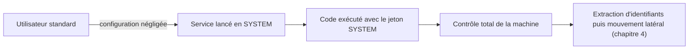

## Introduction

Avant de se déplacer dans le domaine (chapitre 4) ou d'exploiter Kerberos (chapitre 3), un attaquant qui accède à un poste avec un compte non privilégié cherche d'abord à obtenir des droits administrateur locaux sur cette machine. C'est l'équivalent Windows de l'escalade de privilèges Linux vue dans le TP dédié du cours Linux : passer d'un accès standard à un contrôle total de la machine, point de départ de toute la suite.

Ce chapitre explique les vecteurs d'élévation les plus courants pour que tu comprennes pourquoi ils fonctionnent, puis montre comment les auditer, les corriger et les détecter. Un administrateur averti fait tourner les mêmes outils d'énumération que l'attaquant, mais en amont, pour fermer ces portes avant qu'un incident ne les révèle.

## Le modèle de privilèges de Windows

Pour comprendre une élévation de privilèges, il faut d'abord savoir ce qu'on élève. Windows distingue plusieurs niveaux de pouvoir sur une machine. Un utilisateur standard peut lancer des programmes et modifier ses propres fichiers, mais pas toucher à la configuration du système. Un membre du groupe local Administrateurs peut tout configurer, mais ses programmes s'exécutent par défaut avec un jeton restreint grâce au contrôle de compte d'utilisateur (UAC), qui demande une confirmation avant toute action administrative. Enfin, le compte SYSTEM, utilisé par le système d'exploitation et de nombreux services, dispose de droits encore plus étendus que l'administrateur local.

### Jetons d'accès et niveaux d'intégrité

Chaque processus Windows porte un jeton d'accès (access token) qui décrit l'identité sous laquelle il s'exécute, ses groupes et ses privilèges. Ce jeton porte aussi un niveau d'intégrité, faible, moyen, élevé ou système, qui empêche un processus de faible intégrité de modifier un processus de niveau supérieur. Une élévation de privilèges consiste toujours, au fond, à obtenir l'exécution de code avec un jeton plus puissant que celui de départ.

### Pourquoi les services sont la cible favorite

Les services Windows sont des programmes lancés automatiquement, très souvent sous le compte SYSTEM. Toute faiblesse qui permet d'influencer ce qu'un service exécute, que ce soit son binaire, son chemin, sa configuration ou les bibliothèques qu'il charge, se traduit donc directement par une exécution en SYSTEM. C'est pourquoi la majorité des vecteurs du tableau suivant tournent autour des services.

## Vecteurs d'élévation de privilèges Windows courants

La plupart des élévations locales n'exploitent pas une faille du noyau, mais une configuration négligée : un service lançable ou modifiable par un utilisateur standard, un privilège accordé trop largement, un secret laissé en clair.

<CompareTable
  titleA="Vecteur"
  titleB="Mécanisme"
  rows={[
    { a: "Services mal configurés", b: "Un service tourne en compte SYSTEM mais son binaire est modifiable par un utilisateur standard, qui peut le remplacer" },
    { a: "Chemins de service non quotés", b: "Windows interprète mal un chemin contenant des espaces sans guillemets (technique T1574.009)" },
    { a: "AlwaysInstallElevated", b: "Une clé de registre mal configurée autorise l'installation d'un paquet MSI avec des droits SYSTEM (technique T1548.002)" },
    { a: "Jetons d'accès mal gérés", b: "Un processus disposant de SeImpersonatePrivilege peut usurper le jeton d'un compte plus privilégié pour obtenir SYSTEM" },
    { a: "Informations sensibles en clair", b: "Mots de passe stockés dans des scripts, fichiers de configuration ou l'historique PowerShell" },
]}
/>

<CehCallout>
Un chemin de service non quoté comme `C:\Program Files\Mon Service\service.exe` peut être interprété par Windows comme une tentative d'exécuter d'abord `C:\Program.exe`, puis `C:\Program Files\Mon.exe`. Si un attaquant dispose des droits d'écriture sur l'un de ces emplacements intermédiaires, un exécutable qu'il y place serait lancé avec les privilèges du service. L'exécutable testé en premier est donc `C:\Program.exe`.
</CehCallout>

### Le cas des jetons d'accès

Le privilège `SeImpersonatePrivilege` autorise un processus à agir au nom d'un autre compte. Il est légitimement détenu par certains comptes de service. S'il est présent dans un contexte compromis, il peut être détourné pour amener un processus privilégié à s'authentifier localement, puis en usurper le jeton pour obtenir SYSTEM. C'est le principe de la famille d'outils dite « potato ». La leçon défensive est de limiter strictement les comptes disposant de ce privilège.

## Auditer avec les outils de l'attaquant

L'énumération automatisée accélère énormément la recherche de vecteurs, pour l'auditeur comme pour l'attaquant.

<Steps steps={[
  { title: "Lancer un énumérateur", description: "winPEAS (maintenu dans le projet PEASS-ng) ou PrivescCheck énumèrent automatiquement services, tâches planifiées, permissions de fichiers et secrets en clair. PowerUp reste une référence en PowerShell." },
  { title: "Trier les résultats par criticité", description: "Ces outils mettent en évidence les vecteurs les plus probables, souvent par un code couleur, mais chaque piste doit être vérifiée manuellement avant toute conclusion." },
  { title: "Corriger plutôt qu'exploiter", description: "En audit défensif, chaque vecteur signalé devient un ticket de correction : quoter le chemin, restreindre une permission, supprimer un secret." },
]} />

<CompareTable
  titleA="Fonction PowerUp"
  titleB="Ce qu'elle recherche"
  rows={[
    { a: "Get-ServiceUnquoted", b: "Services avec un chemin non quoté contenant un espace" },
    { a: "Get-ModifiableServiceFile", b: "Services dont le binaire est modifiable par l'utilisateur courant" },
    { a: "Get-RegistryAlwaysInstallElevated", b: "Vérifie si la clé AlwaysInstallElevated est activée" },
]}
/>

<WarningCallout>
Les outils d'énumération automatisée produisent de nombreux faux positifs : un service signalé comme suspect n'est pas automatiquement exploitable. La vérification manuelle des permissions réelles reste indispensable avant de conclure, sans quoi un rapport d'audit se remplit de risques inexistants et perd en crédibilité.
</WarningCallout>

## Détecter et se défendre

<AttackDefenseTable rows={[
  { phase: "Chemin non quoté", attack: "Déposer un exécutable sur un chemin intermédiaire écrivable", defense: "Quoter tous les chemins de service et retirer les droits d'écriture sur les dossiers concernés" },
  { phase: "Binaire de service modifiable", attack: "Remplacer le binaire lancé en SYSTEM", defense: "Restreindre les ACL des binaires de service aux seuls administrateurs" },
  { phase: "AlwaysInstallElevated", attack: "Installer un MSI malveillant en SYSTEM", defense: "Désactiver la stratégie AlwaysInstallElevated par GPO" },
  { phase: "Abus de SeImpersonatePrivilege", attack: "Usurper le jeton d'un compte privilégié", defense: "Limiter les comptes dotés de ce privilège et surveiller la création de processus SYSTEM anormale" },
]} />

### Les traces laissées par une élévation

Même lorsqu'elle réussit, une élévation laisse des traces exploitables. L'installation d'un nouveau service produit l'événement 7045 dans le journal Système et l'événement 4697 dans le journal Sécurité. La création de processus est journalisée par l'événement 4688, à condition d'activer l'audit correspondant et l'inclusion de la ligne de commande. Sysmon, l'outil gratuit de Sysinternals, enrichit cette visibilité avec la création de processus (événement 1) et la création de fichiers (événement 11). Un processus enfant lancé en SYSTEM par un service qui n'en lance jamais, ou un exécutable apparu à la racine du disque `C:\`, sont des signaux typiques.

| Signal | Source | Ce qu'il peut révéler |
| --- | --- | --- |
| Événement 7045 ou 4697 | Journaux Système et Sécurité | Installation d'un service inattendu |
| Événement 4688 avec ligne de commande | Journal Sécurité | Processus suspect lancé en SYSTEM |
| Sysmon événement 11 | Journal Sysmon | Exécutable déposé dans un dossier intermédiaire d'un chemin de service |
| Installation MSI par un utilisateur standard | Journal Application (MsiInstaller) | Abus possible d'AlwaysInstallElevated |

<AuditCallout>
Ces mesures relèvent du contrôle A.8.9 (gestion des configurations) et A.8.2 (droits d'accès privilégiés) de la norme ISO/IEC 27001:2022, ainsi que des CIS Benchmarks Windows. Un durcissement reproductible, vérifié périodiquement, vaut mieux qu'une correction ponctuelle après incident.
</AuditCallout>

## Erreurs fréquentes

On croit souvent qu'une élévation locale exige une faille du noyau, alors que la plupart viennent d'une configuration négligée. On exploite ou on signale un vecteur sans vérifier les permissions réelles, et on se retrouve avec des faux positifs. On corrige un seul chemin de service non quoté alors qu'un parc en contient souvent plusieurs, hérités d'installeurs tiers. Enfin, on oublie que les secrets en clair, dans les scripts et l'historique PowerShell, sont l'un des vecteurs les plus fréquents et les plus faciles à corriger.

## Lab — Mise en pratique

**Environnement** : Audit et durcissement sur une machine du lab (poste d'administration). L'objectif est d'auditer, corriger et détecter, pas d'exploiter.

<Steps steps={[
  { title: "Rechercher les chemins de service non quotés", description: "Liste les services dont le chemin contient un espace sans guillemets, et identifie lesquels sont lancés en SYSTEM.", code: "wmic service get name, pathname, startname | findstr /i /v \"\\\"\" | findstr /i \"Program Files\"" },
  { title: "Analyser un chemin vulnérable", description: "Pour un service au chemin `C:\\Program Files\\App Securite\\service.exe` non quoté, indique quel exécutable Windows tenterait de lancer en premier et pourquoi c'est exploitable si un dossier intermédiaire est écrivable." },
  { title: "Vérifier AlwaysInstallElevated", description: "Contrôle l'état de la stratégie dans le registre et explique le risque si elle est activée des deux côtés (machine et utilisateur)." },
  { title: "Auditer les secrets en clair", description: "Recherche des mots de passe dans l'historique PowerShell et les fichiers de configuration courants, et explique pourquoi ce vecteur est si fréquent." },
  { title: "Lister les détenteurs de SeImpersonatePrivilege", description: "Identifie les comptes dotés de ce privilège et évalue s'ils en ont réellement besoin." },
  { title: "Proposer un plan de correction", description: "Pour les vecteurs identifiés, propose la correction adaptée à chacun et classe-les par rapport impact/effort." },
]} />

## À retenir

- La plupart des élévations de privilèges locales exploitent une mauvaise configuration, pas une faille du noyau.
- Un chemin de service non quoté contenant des espaces fait tester `C:\Program.exe` en premier, exploitable si un dossier intermédiaire est écrivable (T1574.009).
- La clé AlwaysInstallElevated, si activée, permet d'installer un MSI en SYSTEM (T1548.002).
- Le privilège SeImpersonatePrivilege, mal distribué, permet d'usurper un jeton plus privilégié pour obtenir SYSTEM.
- winPEAS, PrivescCheck et PowerUp automatisent l'énumération, mais chaque piste doit être vérifiée manuellement pour écarter les faux positifs.
- Quoter les chemins de service, restreindre les ACL des binaires, désactiver AlwaysInstallElevated et supprimer les secrets en clair ferment ces vecteurs.

## Questions de révision

1. Pourquoi un chemin de service non quoté contenant des espaces peut-il être exploité pour une élévation de privilèges ?
2. Quel exécutable Windows tenterait de lancer en premier pour le chemin non quoté `C:\Program Files\Mon Service\service.exe` ?
3. Que permet une clé de registre AlwaysInstallElevated mal configurée ?
4. Comment le privilège SeImpersonatePrivilege peut-il être détourné par un attaquant ?
5. Que recherche la fonction PowerUp Get-ModifiableServiceFile ?
6. Pourquoi faut-il toujours vérifier manuellement les résultats de winPEAS avant de conclure à une vulnérabilité ?
7. Où retrouve-t-on le plus souvent des mots de passe en clair lors d'un audit de privesc Windows ?
8. Quelle correction élimine mécaniquement toute une classe de vulnérabilités liées aux chemins de service non quotés ?
