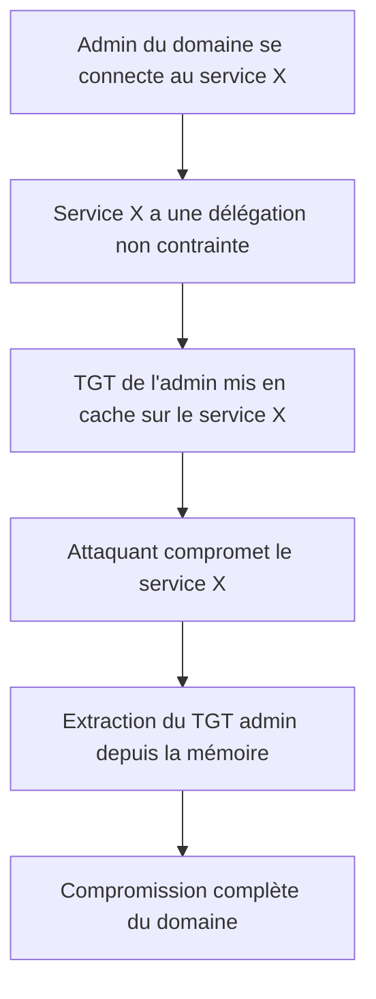

## Introduction

Ce chapitre approfondit des vecteurs plus subtils que le Kerberoasting ou le Pass-the-Hash, mais tout aussi redoutables une fois identifiés via BloodHound (chapitre 2) : l'abus de délégation Kerberos, l'abus de droits ACL et l'abus de GPO. On y ajoute un vecteur devenu incontournable depuis 2021, l'abus des services de certificats Active Directory (ADCS). Ce sont typiquement les vecteurs recherchés dans les certifications CRTP et CRTE.

L'approche de ce chapitre est de comprendre pourquoi chaque configuration est dangereuse, puis de savoir l'auditer et la corriger. Ces vecteurs ont un point commun : ils résultent presque toujours de droits accordés par commodité, puis jamais revus.

## Les trois types de délégation Kerberos

La délégation permet à un service d'agir au nom d'un utilisateur pour accéder à d'autres ressources en son nom. C'est utile, par exemple pour un serveur web qui doit interroger une base de données avec l'identité de l'utilisateur connecté, mais chaque type comporte un risque propre.

<CompareTable
  titleA="Type de délégation"
  titleB="Risque"
  rows={[
    { a: "Délégation non contrainte (unconstrained)", b: "Le service peut réutiliser le TGT de tout utilisateur qui s'y connecte : le compromettre expose potentiellement le TGT d'un administrateur du domaine" },
    { a: "Délégation contrainte (constrained)", b: "Le service ne peut usurper l'identité d'un utilisateur que vers des services spécifiques listés : risque réduit mais toujours abusable si mal ciblé" },
    { a: "Délégation contrainte basée sur les ressources (RBCD)", b: "Configurable par le propriétaire de l'objet cible lui-même : un attaquant disposant de droits d'écriture sur un objet ordinateur peut s'auto-déléguer un accès" },
]}
/>

<CehCallout>
La délégation non contrainte est le cas le plus dangereux : si un administrateur du domaine se connecte, même une seule fois, à un service disposant de ce type de délégation, son TGT reste en mémoire sur ce serveur et devient récupérable. Compromettre ce serveur, même s'il ne semble pas critique, peut alors suffire à compromettre tout le domaine. La délégation contrainte réduit ce risque en limitant les services cibles, mais ne l'élimine pas.
</CehCallout>

La délégation RBCD a une particularité importante : c'est le propriétaire de l'objet cible qui peut la configurer. Un attaquant disposant d'un droit d'écriture sur un objet ordinateur peut donc, en principe, se désigner lui-même comme autorisé à agir au nom d'autrui vers cette machine.

## Les droits ACL dangereux sur les objets AD

Chaque objet AD (utilisateur, groupe, ordinateur, GPO) porte une liste de contrôle d'accès (ACL) définissant qui peut le lire, le modifier ou agir en son nom. Certains droits, mal attribués, ouvrent des chemins d'attaque directs.

<CompareTable
  titleA="Droit ACL"
  titleB="Ce qu'il permet"
  rows={[
    { a: "GenericAll", b: "Contrôle total de l'objet, y compris réinitialiser le mot de passe d'un utilisateur cible ou ajouter un membre à un groupe" },
    { a: "GenericWrite", b: "Modifier des attributs de l'objet, parfois suffisant pour forcer une authentification, ajouter un SPN ou modifier un script de connexion" },
    { a: "WriteDacl", b: "Modifier les permissions elles-mêmes de l'objet, donc s'auto-accorder GenericAll ensuite" },
    { a: "ForceChangePassword", b: "Réinitialiser le mot de passe d'un utilisateur cible sans connaître l'ancien" },
]}
/>

<WarningCallout>
Ces droits sont souvent accordés par commodité : une équipe support ayant besoin de réinitialiser des mots de passe reçoit ForceChangePassword sur une OU entière, sans que personne ne vérifie ensuite si un utilisateur à privilèges élevés se trouve dans le périmètre. C'est exactement ce que BloodHound révèle en reliant droits ACL et appartenance aux groupes sensibles. À noter : GenericWrite permet de modifier des attributs, tandis que WriteDacl permet de modifier les permissions elles-mêmes, ce qui est strictement plus puissant.
</WarningCallout>

## L'abus de GPO comme vecteur de compromission

Les stratégies de groupe s'appliquent automatiquement aux machines d'une OU. Un droit d'écriture sur une GPO est donc un droit d'exécution sur toutes les machines qu'elle couvre.

<Steps steps={[
  { title: "Un droit d'écriture sur une GPO", description: "Un attaquant disposant d'un droit de modification sur une GPO appliquée à une OU contenant des postes ou serveurs sensibles." },
  { title: "Une configuration malveillante", description: "La GPO peut, par exemple, déployer une tâche planifiée ou un script exécuté sur les machines concernées au prochain rafraîchissement." },
  { title: "Le rafraîchissement automatique", description: "Les GPO se rafraîchissent par défaut toutes les 90 à 120 minutes sur les machines du domaine, déclenchant l'application sans action supplémentaire." },
]} />

<CehCallout>
Contrairement au Kerberoasting, qui nécessite de craquer une empreinte hors ligne, l'abus de GPO donne un contrôle direct et quasi immédiat sur toutes les machines couvertes par la GPO : il n'y a pas d'étape de craquage. C'est l'un des vecteurs les plus puissants une fois un accès en écriture obtenu, mais aussi l'un des plus rares à trouver en pratique, car les droits sur les GPO sont normalement restreints.
</CehCallout>

## Le cas des services de certificats (ADCS)

Depuis 2021, l'abus des services de certificats Active Directory s'est imposé comme un vecteur majeur. Des modèles de certificats mal configurés peuvent permettre à un utilisateur standard de demander un certificat usurpant l'identité d'un compte à privilèges, ouvrant la voie à une élévation jusqu'au domaine. Ces configurations sont cataloguées sous les identifiants ESC1 à ESC16. Côté défense, l'outil Certipy possède un mode d'audit qui liste les modèles vulnérables, et BloodHound CE intègre désormais ces chemins. La remédiation consiste à corriger les droits d'inscription et les drapeaux des modèles concernés.

## Détecter et se défendre

<AttackDefenseTable rows={[
  { phase: "Délégation", attack: "Compromettre un serveur en délégation non contrainte pour voler un TGT admin", defense: "Éliminer les délégations non contraintes, placer les comptes sensibles dans Protected Users" },
  { phase: "ACL", attack: "Abuser de GenericAll, WriteDacl ou ForceChangePassword sur une cible sensible", defense: "Auditer les ACL avec BloodHound CE et retirer les droits excessifs" },
  { phase: "GPO", attack: "Modifier une GPO pour exécuter du code sur les machines couvertes", defense: "Restreindre les droits de modification des GPO à un groupe réduit et surveillé" },
  { phase: "ADCS", attack: "Demander un certificat usurpant un compte privilégié (ESC1-ESC16)", defense: "Auditer les modèles avec Certipy et corriger les droits d'inscription" },
]} />

<AuditCallout>
L'audit des délégations, des ACL, des GPO et des modèles ADCS relève du contrôle A.8.2 (droits d'accès privilégiés) et A.5.18 (droits d'accès) de la norme ISO/IEC 27001:2022. Ces revues ne sont pas ponctuelles : elles doivent être répétées, car un seul droit ajouté par commodité peut rouvrir un chemin d'attaque fermé la veille.
</AuditCallout>

## Erreurs fréquentes

On considère parfois la délégation contrainte comme sûre, alors qu'elle reste abusable si les services cibles sont mal choisis. On confond GenericWrite et WriteDacl, alors que le second permet de réécrire les permissions et donc de s'octroyer tout le reste. On croit les GPO protégées par nature, alors que leurs ACL sont parfois trop larges. Enfin, on néglige complètement ADCS, pourtant devenu l'un des chemins d'élévation les plus fréquents depuis 2021.

## Lab — Mise en pratique

**Environnement** : Audit et durcissement sur le lab AD (données BloodHound et poste d'administration fournis). L'objectif est d'auditer, corriger et prioriser, pas d'exploiter.

<Steps steps={[
  { title: "Auditer les délégations", description: "Liste les comptes et machines configurés en délégation non contrainte et évalue le risque de chacun.", code: "Get-ADComputer -Filter {TrustedForDelegation -eq $true} -Properties TrustedForDelegation" },
  { title: "Évaluer un risque de délégation", description: "Un serveur d'impression a une délégation non contrainte et un administrateur du domaine y imprime occasionnellement. Explique le risque exact que cela représente." },
  { title: "Analyser un chemin ACL", description: "Dans BloodHound, un utilisateur standard a GenericWrite sur le compte d'un administrateur du domaine. Décris ce qu'un attaquant pourrait tenter et la correction appropriée." },
  { title: "Comparer GenericWrite et WriteDacl", description: "Explique en une phrase ce que WriteDacl permet et que GenericWrite ne permet pas directement." },
  { title: "Vérifier les droits sur les GPO", description: "Identifie qui peut modifier les GPO appliquées aux OU sensibles et détermine si ce périmètre est trop large." },
  { title: "Auditer les modèles ADCS", description: "Explique pourquoi un modèle de certificat autorisant un utilisateur standard à spécifier librement le sujet est dangereux, et quelle correction s'impose." },
  { title: "Prioriser le durcissement", description: "Classe les vecteurs trouvés par rapport impact/effort et justifie l'ordre de correction." },
]} />

## À retenir

- La délégation non contrainte est le vecteur de délégation le plus dangereux : elle expose le TGT de tout utilisateur s'y connectant, y compris un administrateur du domaine.
- La délégation RBCD se configure par le propriétaire de l'objet cible, ce qui la rend abusable via un droit d'écriture sur un objet ordinateur.
- Des droits ACL comme GenericAll, GenericWrite, WriteDacl ou ForceChangePassword, mal attribués, ouvrent des chemins d'attaque révélés par BloodHound ; WriteDacl est plus puissant que GenericWrite.
- L'abus de GPO donne un contrôle quasi immédiat sur toutes les machines couvertes, via le rafraîchissement automatique qui a lieu toutes les 90 à 120 minutes.
- L'abus d'ADCS (ESC1 à ESC16) est devenu un vecteur d'élévation majeur depuis 2021 ; Certipy en mode audit et BloodHound CE aident à le détecter.
- Toutes ces configurations à risque doivent être auditées régulièrement, car elles résultent de droits accordés par commodité et jamais revus.

## Questions de révision

1. Pourquoi la délégation Kerberos non contrainte est-elle considérée comme la plus dangereuse des trois types ?
2. En quoi la délégation contrainte réduit-elle le risque par rapport à la délégation non contrainte ?
3. Qui peut configurer une délégation contrainte basée sur les ressources (RBCD), et pourquoi est-ce un problème ?
4. Que permet le droit ACL GenericAll sur un objet utilisateur ?
5. Que permet le droit ACL WriteDacl qu'un simple GenericWrite ne permet pas directement ?
6. Tous les combien de temps, environ, les GPO se rafraîchissent-elles par défaut sur les machines du domaine ?
7. Pourquoi l'abus de GPO est-il considéré comme plus direct que le Kerberoasting, bien que plus rare en pratique ?
8. Pourquoi l'abus d'ADCS est-il devenu un vecteur d'élévation à surveiller, et quel outil permet d'auditer les modèles vulnérables ?
