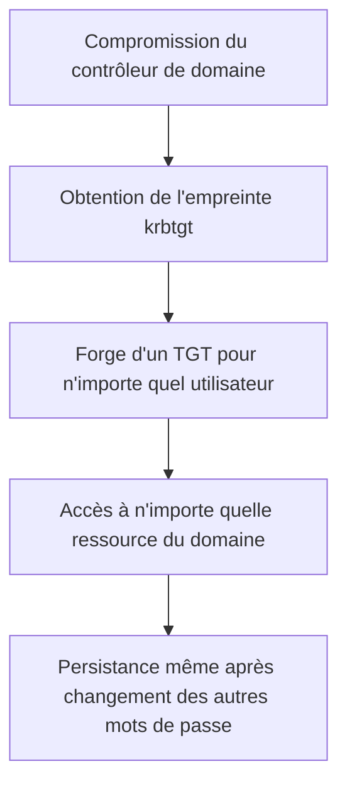

## Introduction

Une fois le domaine compromis, c'est-à-dire le contrôle du contrôleur de domaine obtenu même temporairement, un attaquant cherche généralement à établir une persistance durable : un accès qui survit même si les mots de passe des comptes initialement compromis sont changés. Ce chapitre couvre les trois techniques de persistance AD les plus documentées, le Golden Ticket, le Silver Ticket et DCSync.

Comprendre ces techniques est indispensable pour le défenseur, car elles conditionnent toute la réponse à incident sur un domaine compromis : tant que la persistance n'est pas éliminée, réinitialiser les mots de passe des utilisateurs ne suffit pas. L'accent est mis ici sur le mécanisme, la détection et la remédiation, et non sur la mise en œuvre.

## Le compte krbtgt — la clé de voûte de Kerberos

Le chapitre 3 a montré que le TGT est chiffré avec la clé du compte krbtgt. Ce compte système, désactivé pour la connexion interactive, existe dans chaque domaine et n'a qu'un rôle : fournir la clé qui protège tous les TGT émis.

<CehCallout>
Le compte krbtgt est un compte système dont l'empreinte de mot de passe sert à chiffrer et signer tous les TGT émis par le domaine. Un attaquant qui obtient cette empreinte peut forger lui-même des TGT que le contrôleur de domaine acceptera comme authentiques, pour n'importe quel utilisateur, sans passer par l'étape normale d'authentification.
</CehCallout>

## Golden Ticket — un TGT forgé



Le Golden Ticket (technique T1558.001 de MITRE ATT&CK) est un TGT fabriqué de toutes pièces avec l'empreinte du krbtgt. Comme il est chiffré avec la bonne clé, le KDC le considère valide. L'attaquant peut y inscrire l'identité et les appartenances de groupe de son choix, ainsi qu'une durée de vie arbitraire.

<WarningCallout>
Un Golden Ticket reste valide même après le changement de mot de passe de tous les comptes utilisateurs du domaine, car il ne dépend que de la clé du krbtgt. Seule la rotation du mot de passe krbtgt invalide les Golden Tickets déjà émis, et elle doit être faite deux fois de suite : Active Directory conserve l'ancienne et la nouvelle clé du krbtgt pour ne pas casser les tickets en cours, si bien qu'une seule rotation laisse l'ancienne clé encore acceptée.
</WarningCallout>

### Mener la double rotation sans casser le domaine

La double rotation doit être espacée : il faut laisser la première se répliquer sur tous les contrôleurs de domaine et attendre au moins la durée de vie maximale d'un ticket, dix heures par défaut, avant la seconde. Une double rotation immédiate invaliderait brutalement tous les tickets légitimes et provoquerait des pannes d'authentification. Microsoft publie un script dédié, New-KrbtgtKeys.ps1, qui encadre cette opération et vérifie la réplication. En dehors de tout incident, une rotation régulière, par exemple annuelle, limite la durée de vie d'une éventuelle empreinte volée.

## Silver Ticket — une persistance plus ciblée et plus discrète

<CompareTable
  titleA="Golden Ticket"
  titleB="Silver Ticket"
  rows={[
    { a: "Forgé avec l'empreinte du compte krbtgt", b: "Forgé avec l'empreinte d'un compte de service spécifique" },
    { a: "Donne accès à tout service du domaine", b: "Donne accès uniquement au service dont l'empreinte a été utilisée" },
    { a: "Nécessite d'avoir compromis le contrôleur de domaine", b: "Nécessite seulement d'avoir compromis le compte de service ciblé" },
    { a: "Utilisé auprès du KDC pour obtenir des TGS, donc journalisé sur le DC", b: "Présenté directement au service, sans passer par le KDC" },
]}
/>

<CehCallout>
Le Silver Ticket (technique T1558.002) est un TGS forgé. Il est souvent plus discret que le Golden Ticket parce qu'il est présenté directement au service cible, qui fait généralement confiance au ticket sans le revalider systématiquement auprès du contrôleur de domaine : aucune demande de TGS n'apparaît alors dans les journaux du KDC. Il suffit pour cela d'avoir compromis l'empreinte du compte de service concerné, par exemple après un Kerberoasting réussi.
</CehCallout>

La défense principale contre le Silver Ticket passe par la validation du PAC (le bloc d'autorisation contenu dans le ticket) auprès du contrôleur de domaine, et surtout par la protection des comptes de service eux-mêmes : un compte gMSA, dont le mot de passe est long et renouvelé automatiquement, rend une empreinte volée rapidement obsolète.

## DCSync — se faire passer pour un contrôleur de domaine

<Steps steps={[
  { title: "Principe", description: "DCSync (technique T1003.006) abuse du protocole de réplication AD, utilisé normalement entre contrôleurs de domaine légitimes, pour demander la transmission des empreintes de mots de passe de n'importe quel compte, y compris krbtgt." },
  { title: "Condition d'exploitation", description: "Le compte utilisé doit disposer des droits de réplication, Replicating Directory Changes et Replicating Directory Changes All, normalement réservés aux contrôleurs de domaine et à un nombre restreint de comptes à privilèges." },
  { title: "Résultat", description: "Extraction des empreintes sans jamais se connecter au contrôleur de domaine ni y exécuter de code : une simple requête réseau suffit." },
]} />

<WarningCallout>
DCSync ne nécessite aucun accès direct (RDP, exécution de commande) au contrôleur de domaine : seulement un compte disposant des droits de réplication. C'est ce qui en fait une technique discrète, et c'est aussi pourquoi l'attribution de ces droits à un compte non contrôleur de domaine, parfois laissée par un ancien outil de synchronisation, est un constat critique d'audit.
</WarningCallout>

## Détecter ces techniques

<AttackDefenseTable rows={[
  { phase: "DCSync", attack: "Demande de réplication depuis une machine qui n'est pas un DC", defense: "Surveiller l'événement 4662 mentionnant les droits de réplication pour un compte non DC, et le trafic de réplication depuis une IP inhabituelle" },
  { phase: "Golden Ticket", attack: "Utilisation d'un TGT forgé à durée de vie arbitraire", defense: "Repérer des tickets dont la durée de vie dépasse la politique du domaine, ou des demandes de TGS sans demande de TGT préalable (4769 sans 4768)" },
  { phase: "Silver Ticket", attack: "Présentation d'un TGS forgé directement au service", defense: "Activer la validation du PAC, protéger les comptes de service (gMSA), corréler les connexions au service sans TGS correspondant" },
  { phase: "Préparation", attack: "Obtention de droits de réplication par un compte compromis", defense: "Auditer régulièrement qui détient les droits de réplication sur la racine du domaine" },
]} />

```powershell
# Audit défensif : qui détient les droits de réplication sur la racine du domaine ?
# Les GUID ci-dessous correspondent à DS-Replication-Get-Changes et -Get-Changes-All
$acl = Get-Acl "AD:\DC=corp,DC=local"
$acl.Access | Where-Object {
  $_.ObjectType -in @('1131f6aa-9c07-11d1-f79f-00c04fc2dcd2','1131f6ad-9c07-11d1-f79f-00c04fc2dcd2')
} | Select-Object IdentityReference, ObjectType
```

```text
IdentityReference                  ObjectType
-----------------                  ----------
CORP\Domain Controllers            1131f6ad-9c07-11d1-f79f-00c04fc2dcd2
CORP\Enterprise Domain Controllers 1131f6aa-9c07-11d1-f79f-00c04fc2dcd2
CORP\svc_sync_legacy               1131f6ad-9c07-11d1-f79f-00c04fc2dcd2
```

Dans cette sortie, la dernière ligne est le constat critique : un ancien compte de synchronisation détient encore le droit de réplication complet, ce qui en fait une porte d'entrée directe vers DCSync.

<AuditCallout>
La gestion des droits de réplication relève du contrôle A.8.2 (droits d'accès privilégiés) de la norme ISO/IEC 27001:2022, et la détection des événements 4662 et 4769 des contrôles A.8.15 et A.8.16. Dans le cadre d'une réponse à incident, NIST SP 800-61r3 rappelle que l'éradication doit éliminer tous les mécanismes de persistance avant de déclarer un incident clos.
</AuditCallout>

## Remédiation après une compromission du domaine

Une compromission du domaine se traite comme un incident majeur. Les étapes clés sont d'identifier et retirer les droits de réplication illégitimes, de mener la double rotation du krbtgt de façon espacée, de réinitialiser les mots de passe des comptes à privilèges et des comptes de service (en privilégiant leur migration vers des gMSA), puis de rechercher les autres mécanismes de persistance : ACL modifiées, comptes créés, GPO altérées, certificats émis. Dans les cas les plus graves, la reconstruction de la forêt peut être la seule option fiable.

## Erreurs fréquentes

On croit souvent qu'une réinitialisation générale des mots de passe utilisateurs suffit à expulser un attaquant, alors qu'un Golden Ticket y survit. On effectue une seule rotation du krbtgt, ce qui laisse l'ancienne clé valide, ou à l'inverse deux rotations immédiates qui cassent l'authentification. On pense que DCSync exige un accès direct au contrôleur de domaine, alors qu'un compte avec les droits de réplication suffit. Enfin, on oublie que le Silver Ticket ne laisse pas de trace sur le KDC, et on cherche des preuves au mauvais endroit.

## Lab — Mise en pratique

**Environnement** : Audit et réponse à incident sur le lab AD (poste d'administration et journaux fournis). L'objectif est de détecter et de remédier.

<Steps steps={[
  { title: "Auditer les droits de réplication", description: "Liste les comptes disposant des droits de réplication sur la racine du domaine et repère tout compte qui n'est pas un contrôleur de domaine.", code: "(Get-Acl 'AD:\\DC=corp,DC=local').Access | Where-Object { $_.ObjectType -like '1131f6a*' } | Select-Object IdentityReference" },
  { title: "Vérifier l'âge du mot de passe krbtgt", description: "Contrôle la date du dernier changement de mot de passe du compte krbtgt et évalue si une rotation est nécessaire.", code: "Get-ADUser krbtgt -Properties PasswordLastSet" },
  { title: "Analyser un événement 4662", description: "À partir d'un extrait fourni, identifie une demande de réplication émise par un compte non contrôleur de domaine et explique pourquoi c'est un indicateur de DCSync." },
  { title: "Repérer un ticket anormal", description: "Dans un extrait de journaux, repère un ticket dont la durée de vie dépasse la politique du domaine et explique pourquoi c'est un indicateur de Golden Ticket." },
  { title: "Planifier la double rotation", description: "Explique pourquoi la rotation du krbtgt doit être faite deux fois, et pourquoi il faut attendre la réplication et au moins dix heures entre les deux." },
  { title: "Comparer Golden et Silver Ticket", description: "Explique pourquoi un Silver Ticket est plus discret malgré un accès plus limité, et où chercher ses traces." },
  { title: "Rédiger un plan d'éradication", description: "Liste dans l'ordre les actions de remédiation après la découverte d'un DCSync réussi." },
]} />

## À retenir

- Le compte krbtgt chiffre tous les TGT du domaine ; son empreinte compromise permet de forger un Golden Ticket valide pour n'importe quel utilisateur.
- Seule une double rotation du mot de passe krbtgt, espacée d'au moins la durée de vie d'un ticket, invalide réellement les Golden Tickets déjà forgés.
- Le Silver Ticket, forgé avec l'empreinte d'un compte de service, offre un accès limité à ce service mais reste plus discret, car il ne passe pas par le KDC.
- DCSync exige uniquement les droits de réplication (Replicating Directory Changes) et aucun accès direct au contrôleur de domaine.
- L'événement 4662 avec les droits de réplication, un ticket à durée de vie anormale ou un 4769 sans 4768 préalable sont des indicateurs de compromission clés.
- Une compromission du domaine exige d'éliminer toute la persistance avant de déclarer l'incident clos.

## Questions de révision

1. Que chiffre l'empreinte du compte krbtgt, et pourquoi sa compromission est-elle si grave ?
2. Pourquoi faut-il changer le mot de passe krbtgt deux fois pour invalider un Golden Ticket, et pourquoi pas immédiatement l'une après l'autre ?
3. Quel élément spécifique un attaquant doit-il compromettre pour forger un Silver Ticket ?
4. Pourquoi un Silver Ticket est-il souvent plus discret qu'un Golden Ticket ?
5. Quelle condition précise permet à un attaquant de réaliser une attaque DCSync ?
6. Quel type d'accès au contrôleur de domaine une attaque DCSync nécessite-t-elle ?
7. Donne un indicateur de compromission classique permettant de détecter l'usage d'un Golden Ticket forgé.
8. Pourquoi réinitialiser tous les mots de passe utilisateurs ne suffit-il pas à expulser un attaquant disposant de l'empreinte krbtgt ?
