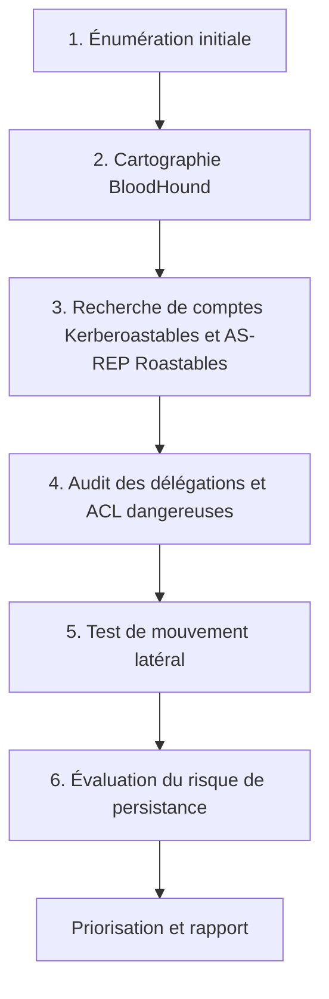
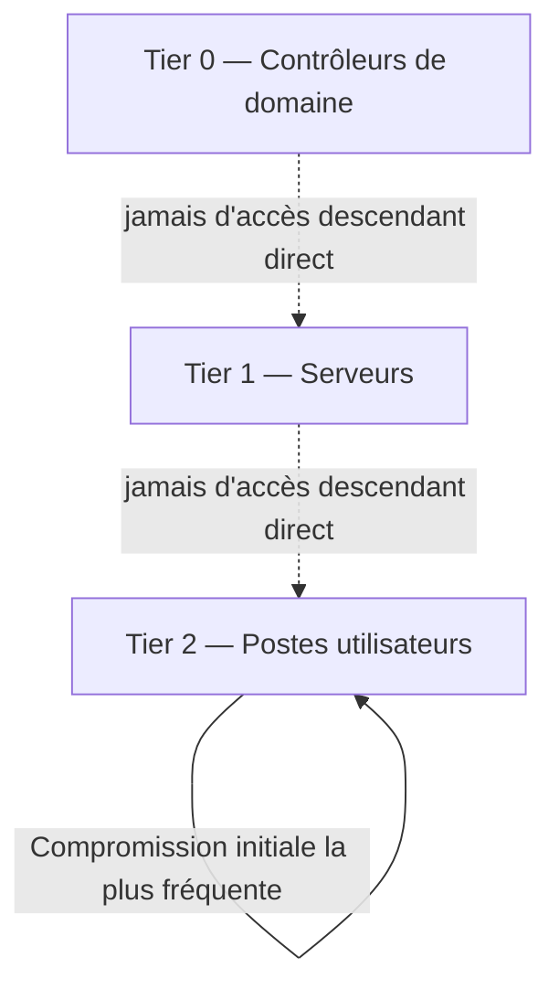

## Introduction

Ce dernier chapitre referme le cours en réunissant les vecteurs vus précédemment (énumération, Kerberos, mouvement latéral, élévation locale, délégation et ACL, persistance) dans une méthodologie d'audit structurée, puis en présentant le modèle de défense le plus recommandé pour Active Directory : le modèle de tiering.

Un audit AD n'a de valeur que s'il débouche sur un plan de remédiation réaliste. À la fin de ce chapitre, tu sauras dérouler un audit dans un ordre logique, expliquer la règle d'or du tiering et ses raisons, et construire un plan de durcissement qui équilibre gains rapides et chantiers structurants.

## Méthodologie d'audit Active Directory complète

Un audit AD suit un enchaînement logique où chaque phase alimente la suivante. Dans un cadre de test d'intrusion, il se déroule toujours sous convention signée, avec un périmètre et des règles d'engagement définis.



<CompareTable
  titleA="Phase"
  titleB="Chapitres de ce cours associés"
  rows={[
    { a: "Énumération et cartographie", b: "Chapitre 2" },
    { a: "Faiblesses Kerberos", b: "Chapitre 3" },
    { a: "Mouvement latéral et élévation locale", b: "Chapitres 4 et 5" },
    { a: "Délégation, ACL, GPO et ADCS", b: "Chapitre 6" },
    { a: "Persistance", b: "Chapitre 7" },
]}
/>

La cartographie BloodHound vient directement après l'énumération initiale : c'est elle qui transforme les données brutes en chemins d'attaque et oriente toutes les phases suivantes vers les cibles qui comptent vraiment.

### Les outils d'audit défensif

Un défenseur dispose d'outils conçus pour évaluer la posture d'un domaine sans passer par une démarche offensive. PingCastle produit un rapport de santé AD avec un score de risque et des recommandations. Purple Knight de Semperis propose une évaluation comparable. BloodHound CE révèle les chemins d'attaque, et Certipy en mode audit liste les modèles de certificats vulnérables. En France, l'ANSSI publie des points de contrôle Active Directory qui servent de référentiel pour classer les constats par niveau de criticité.

```powershell
# Audit de santé AD avec PingCastle (exécuté depuis un poste du domaine)
PingCastle.exe --healthcheck --server corp.local
```

```text
Domain Risk Level: 62 / 100
  Stale Objects     : 18
  Privileged Groups : 25
  Trusts            :  4
  Anomalies         : 15
Report: ad_hc_corp.local.html
```

<TipCallout>
Une méthodologie d'audit complète, une fois les vulnérabilités documentées, s'appuie directement sur les compétences du cours Rédaction de Rapports pour produire un livrable exploitable par l'équipe d'administration du client. Un bon rapport classe chaque constat par criticité, explique son impact concret et propose une remédiation actionnable.
</TipCallout>

## Le modèle de tiering — la référence en défense AD

Le modèle de tiering, popularisé par Microsoft, segmente les comptes et systèmes en niveaux hermétiques, empêchant qu'une compromission d'un niveau inférieur ne remonte vers un niveau supérieur.

<CompareTable
  titleA="Niveau"
  titleB="Contenu"
  rows={[
    { a: "Tier 0", b: "Contrôleurs de domaine, comptes Domain Admins et Enterprise Admins, ADCS et tout système contrôlant l'identité : le contrôle total du domaine" },
    { a: "Tier 1", b: "Serveurs applicatifs et leurs administrateurs : comptes ne devant jamais se connecter à un poste Tier 2" },
    { a: "Tier 2", b: "Postes de travail utilisateurs : le niveau le plus exposé, mais aussi celui qui doit être le plus isolé du reste" },
]}
/>

<CehCallout>
La règle d'or du tiering : un compte à privilèges d'un niveau donné ne doit jamais se connecter à une machine d'un niveau inférieur. C'est précisément la violation de cette règle, par exemple un administrateur Tier 1 qui dépanne un poste utilisateur avec son compte à privilèges, qui laisse son empreinte sur un poste exposé et permet le Pass-the-Hash et le mouvement latéral étudiés au chapitre 4.
</CehCallout>



Le Tier 2 est le plus exposé car c'est là que les utilisateurs ouvrent des courriels, naviguent sur le web et branchent des clés USB : c'est le point d'entrée habituel d'un attaquant. Il doit donc être le plus isolé, pour qu'une compromission y reste confinée. Aucun compte d'administration de niveau supérieur ne doit y laisser de trace.

### Les outils du tiering en pratique

Le tiering s'appuie sur des mécanismes concrets : des comptes d'administration séparés par niveau (un administrateur possède un compte standard et un compte Tier 1 distincts), des stations d'administration dédiées appelées PAW (Privileged Access Workstations), des restrictions de connexion par GPO interdisant aux comptes d'un niveau de se connecter aux machines d'un autre, et le groupe Protected Users pour les comptes Tier 0. Microsoft fait évoluer ce modèle sous le nom d'Enterprise Access Model, qui raisonne en plans (contrôle, gestion, données) et étend la logique au cloud, mais le principe de cloisonnement reste identique.

## Prioriser le durcissement selon l'impact réel

<Steps steps={[
  { title: "Éliminer les délégations non contraintes", description: "Impact maximal pour un effort de configuration généralement faible : quelques comptes ou machines à reconfigurer (chapitre 6)." },
  { title: "Déployer Windows LAPS sur l'ensemble du parc", description: "Neutralise le Pass-the-Hash à grande échelle via les mots de passe locaux partagés (chapitre 4)." },
  { title: "Renforcer les comptes de service", description: "Mots de passe longs, chiffrement AES et migration vers des gMSA neutralisent le Kerberoasting (chapitre 3)." },
  { title: "Nettoyer les ACL et les droits de réplication", description: "Retirer les droits excessifs révélés par BloodHound CE et tout droit de réplication illégitime (chapitres 6 et 7)." },
  { title: "Appliquer strictement le modèle de tiering", description: "Le changement le plus structurant, mais aussi le plus coûteux organisationnellement : souvent un projet à part entière." },
]} />

<AttackDefenseTable rows={[
  { phase: "Énumération", attack: "Cartographier les chemins vers Tier 0", defense: "BloodHound CE et PingCastle en continu pour couper les chemins" },
  { phase: "Accès aux identifiants", attack: "Kerberoasting et extraction d'empreintes", defense: "gMSA, AES, Credential Guard, Protected Users" },
  { phase: "Mouvement latéral", attack: "Pass-the-Hash avec mot de passe local partagé", defense: "Windows LAPS et tiering" },
  { phase: "Persistance", attack: "Golden Ticket et DCSync", defense: "Rotation krbtgt, audit des droits de réplication, surveillance 4662" },
]} />

<WarningCallout>
Le modèle de tiering, bien que la mesure la plus structurante contre le mouvement latéral, est aussi la plus difficile à déployer dans une organisation existante, car il impose de revoir des habitudes d'administration ancrées depuis des années : comptes séparés, stations dédiées, interdictions de connexion. Un audit réaliste doit donc le recommander comme objectif, sans pour autant retarder les mesures à impact immédiat, comme LAPS ou la rotation du krbtgt, qui se déploient bien plus vite.
</WarningCallout>

<AuditCallout>
Le modèle de tiering met en œuvre les contrôles A.8.2 (droits d'accès privilégiés), A.8.22 (cloisonnement des réseaux) et A.5.15 (contrôle d'accès) de la norme ISO/IEC 27001:2022. Il s'inscrit aussi dans la fonction Protect du NIST CSF 2.0, tandis que la fonction Govern couvre la définition des rôles et responsabilités d'administration.
</AuditCallout>

## Erreurs fréquentes

On produit un rapport qui liste des dizaines de constats sans les prioriser, ce qui paralyse l'équipe qui doit corriger. On recommande le tiering complet comme seule mesure, en oubliant les gains rapides qui réduisent le risque dès la première semaine. On sépare les comptes d'administration mais on continue à les utiliser depuis le poste bureautique, ce qui annule le bénéfice du cloisonnement. Enfin, on traite l'audit comme un événement ponctuel, alors qu'Active Directory dérive en permanence : chaque nouveau droit accordé peut rouvrir un chemin fermé.

## Lab — Mise en pratique

**Environnement** : Audit et planification sur le lab AD (poste d'administration, rapport PingCastle et données BloodHound fournis).

<Steps steps={[
  { title: "Lancer un audit de santé", description: "Génère un rapport PingCastle sur le domaine du lab et relève le score de risque et les trois catégories les plus pénalisantes.", code: "PingCastle.exe --healthcheck --server corp.local" },
  { title: "Croiser avec BloodHound CE", description: "À partir des données fournies, liste les chemins menant aux comptes Tier 0 et rattache chacun à un chapitre du cours." },
  { title: "Identifier une violation de tiering", description: "Un administrateur Tier 1 se connecte régulièrement avec son compte à privilèges sur des postes utilisateurs pour du support. Indique la règle violée et le risque concret qui en découle." },
  { title: "Classer les actifs par niveau", description: "Range les éléments suivants dans le bon tier : contrôleur de domaine, serveur de fichiers, poste de comptabilité, serveur ADCS, serveur web interne." },
  { title: "Prioriser un plan de durcissement", description: "Pour un audit ayant révélé une délégation non contrainte, des mots de passe de service faibles et l'absence de LAPS, propose un ordre de correction et justifie chaque mesure en une phrase." },
  { title: "Rédiger un constat de rapport", description: "Rédige un constat complet pour l'absence de LAPS : description, impact, criticité et remédiation." },
]} />

## À retenir

- Une méthodologie d'audit AD complète enchaîne six phases : énumération, cartographie BloodHound, recherche de comptes Kerberoastables et AS-REP Roastables, audit des délégations et ACL, test de mouvement latéral et évaluation du risque de persistance.
- PingCastle, Purple Knight, BloodHound CE, Certipy en mode audit et les points de contrôle de l'ANSSI outillent l'audit défensif.
- Le modèle de tiering (Tier 0, 1, 2) segmente comptes et systèmes pour empêcher qu'une compromission remonte vers le niveau le plus critique.
- La règle d'or : un compte à privilèges ne se connecte jamais à une machine d'un niveau inférieur.
- Le Tier 0 contient les contrôleurs de domaine et les comptes Domain et Enterprise Admins ; le Tier 2 est le plus exposé et doit être le plus isolé.
- La priorisation équilibre les mesures rapides et rentables (délégations non contraintes, LAPS, comptes de service) et les chantiers structurants mais coûteux comme le tiering complet.

## Questions de révision

1. Cite les six phases d'une méthodologie d'audit Active Directory complète, dans l'ordre.
2. Quelle étape suit directement l'énumération initiale, et pourquoi à ce moment-là ?
3. Que contient le Tier 0 dans le modèle de tiering ?
4. Quelle est la règle d'or du modèle de tiering concernant les comptes à privilèges ?
5. Pourquoi le Tier 2 est-il à la fois le niveau le plus exposé et celui qui doit être le plus isolé ?
6. Quelle mesure de durcissement a un impact maximal pour un effort de configuration généralement faible ?
7. Pourquoi le déploiement complet du modèle de tiering est-il souvent plus difficile organisationnellement que celui de LAPS ?
8. Pourquoi un audit Active Directory ne doit-il pas être un événement ponctuel ?

Félicitations, tu viens de terminer le cours **Active Directory & Windows** ! Ces compétences sont directement alignées sur les certifications CRTP et CRTE. Direction le cours Cybersécurité Offensive pour intégrer AD dans un parcours de pentest complet, ou vers Forensics & DFIR pour apprendre à investiguer ces mêmes attaques après coup.
