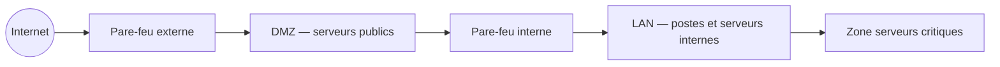

## Introduction

Avant d'attaquer ou de défendre un système d'information, il faut comprendre comment il est construit. Ce cours adopte le point de vue de celui qui le fait fonctionner au quotidien : l'administrateur système et réseau. C'est lui qui crée les comptes, ouvre les ports, applique les correctifs et restaure les sauvegardes, et c'est donc lui qui, par ses décisions quotidiennes, détermine en grande partie le niveau de sécurité réel de l'entreprise.

Ce premier chapitre pose la carte d'ensemble d'un SI d'entreprise typique, socle indispensable pour situer ensuite chaque compétence technique du cours. À la fin, tu sauras nommer les briques d'un SI, expliquer pourquoi on découpe un réseau en zones, lire une matrice de flux et reconnaître les décisions d'administration qui créent ou réduisent le risque.

## Les briques constitutives d'un SI d'entreprise

Un système d'information (SI) est l'ensemble des ressources, matérielles, logicielles et humaines, qui permettent à une organisation de collecter, stocker, traiter et diffuser ses informations. Malgré la diversité des entreprises, on retrouve presque toujours les mêmes briques.

<CompareTable
  titleA="Brique"
  titleB="Rôle typique"
  rows={[
    { a: "Annuaire (Active Directory / LDAP)", b: "Authentification centralisée, gestion des identités et des droits" },
    { a: "Serveurs applicatifs et de fichiers", b: "Hébergement des applications métier, partage de documents" },
    { a: "Infrastructure réseau (commutateurs, routeurs, pare-feu)", b: "Interconnexion et segmentation des différentes zones" },
    { a: "Postes de travail et périphériques", b: "Points d'accès utilisateurs, souvent le maillon le plus exposé" },
    { a: "Supervision et sauvegarde", b: "Continuité de service et capacité de restauration en cas d'incident" },
]}
/>

### Pourquoi les postes de travail sont le maillon le plus exposé

Les postes de travail sont l'endroit où le SI rencontre le monde extérieur de la façon la moins contrôlée : un utilisateur y ouvre ses courriels, navigue sur le web, télécharge des pièces jointes et branche parfois des clés USB. C'est donc là que se produisent la plupart des compromissions initiales, par hameçonnage ou par téléchargement malveillant. Un SI bien conçu part du principe qu'un poste finira par être compromis, et limite ce que cette compromission permet d'atteindre.

### L'annuaire, cœur de l'identité

L'annuaire centralise l'authentification : un seul compte par personne, valable sur toutes les ressources, avec des droits gérés en un point unique. C'est une simplification considérable pour l'administration, mais c'est aussi un point de concentration du risque : quiconque contrôle l'annuaire contrôle l'accès à tout le reste. C'est pourquoi il fait l'objet d'un chapitre dédié, et d'un cours entier côté offensif.

<TipCallout>
Chacune de ces briques sera approfondie dans un chapitre dédié de ce cours : Active Directory au chapitre 2, Linux au chapitre 3, virtualisation au chapitre 4, sauvegarde au chapitre 5, supervision au chapitre 6, gestion des identités au chapitre 7 et durcissement au chapitre 8.
</TipCallout>

### Le SI moderne est hybride

En 2026, peu de SI sont entièrement hébergés dans les locaux de l'entreprise. On trouve presque toujours un mélange de serveurs sur site, de services cloud en mode SaaS (messagerie, bureautique, CRM), d'infrastructures cloud en mode IaaS, et d'utilisateurs en télétravail. Cette hybridation déplace le périmètre : il n'y a plus une frontière unique entre « l'intérieur de confiance » et « l'extérieur hostile », ce qui explique l'essor du modèle Zero Trust présenté plus loin.

## Le zonage réseau — segmenter pour limiter la casse

Le zonage consiste à découper le réseau en zones de niveaux de confiance différents, séparées par des équipements de filtrage. L'objectif est simple : si une zone est compromise, l'attaquant ne doit pas pouvoir atteindre librement les autres.



Dans ce schéma, c'est le pare-feu interne qui sépare la DMZ du LAN : même si un serveur de la DMZ est compromis, il doit franchir ce second filtrage pour atteindre le réseau interne.

<Steps steps={[
  { title: "DMZ (zone démilitarisée)", description: "Héberge les services exposés à Internet (serveur web public, relais de messagerie, reverse proxy), isolée du reste du réseau interne." },
  { title: "LAN (réseau interne)", description: "Postes de travail, imprimantes, services internes, avec un accès restreint depuis l'extérieur." },
  { title: "Zone serveurs critiques", description: "Bases de données, contrôleurs de domaine : l'accès le plus restreint, souvent dans un VLAN dédié avec un filtrage strict." },
  { title: "Environnements séparés", description: "Production, pré-production et développement ne sont jamais interconnectés directement, pour éviter qu'un test ou une erreur ne perturbe la production, et pour que des données de production ne fuient pas vers des environnements moins protégés." },
]} />

### Pourquoi isoler la DMZ

La DMZ héberge, par définition, les machines les plus exposées : celles qui répondent à n'importe qui sur Internet. Ce sont donc les plus susceptibles d'être compromises un jour. Les isoler du reste du réseau interne limite l'accès dont disposerait un attaquant ayant compromis un service public exposé. Un serveur web compromis dans une DMZ bien filtrée ne donne pas un accès direct aux bases de données ou aux contrôleurs de domaine.

<CehCallout>
Un attaquant qui compromet un serveur web en DMZ ne doit, si le zonage est correctement configuré, disposer d'aucun accès direct vers la zone serveurs critiques. Le franchissement de cette frontière, appelé mouvement latéral, est précisément ce qu'étudie le cours Active Directory & Windows. En examen CEH, retiens que la segmentation est une mesure de confinement : elle ne prévient pas la compromission initiale, elle en limite la portée.
</CehCallout>

### Les VLAN, outil de base de la segmentation

Un VLAN (Virtual LAN) découpe logiquement un même réseau physique en plusieurs réseaux isolés. Deux machines branchées sur le même commutateur mais dans deux VLAN différents ne peuvent communiquer qu'en passant par un routeur ou un pare-feu, où l'on applique les règles de filtrage. Sous Linux, on peut observer la configuration réseau d'une machine avec la commande moderne `ip`, qui remplace l'ancien `ifconfig` :

```bash
# Adresses et interfaces (remplace ifconfig)
ip -br addr
# Table de routage : par où sortent les paquets
ip route
# Ports en écoute (remplace netstat -tlnp)
ss -tlnp
```

```text
lo        UNKNOWN  127.0.0.1/8
eth0      UP       10.20.30.15/24
default via 10.20.30.1 dev eth0
10.20.30.0/24 dev eth0 proto kernel scope link src 10.20.30.15
State   Recv-Q  Send-Q  Local Address:Port  Peer Address:Port  Process
LISTEN  0       511     0.0.0.0:443         0.0.0.0:*          users:(("nginx",pid=812))
```

## La matrice de flux — documenter ce qui est autorisé

Le zonage n'a de sens que si l'on sait quels flux doivent traverser chaque frontière. La matrice de flux documente, pour chaque paire de zones, les communications autorisées : source, destination, port, protocole et justification métier. Tout ce qui n'y figure pas est interdit par défaut.

| Source | Destination | Port / protocole | Justification |
| --- | --- | --- | --- |
| Internet | DMZ (serveur web) | 443/TCP | Accès public au site |
| DMZ (serveur web) | Zone critique (base de données) | 5432/TCP | Requêtes applicatives |
| LAN (postes) | DMZ (serveur web) | 443/TCP | Consultation interne du site |
| LAN (postes) | Zone critique (contrôleurs de domaine) | 88, 389, 445/TCP | Authentification au domaine |
| Internet | Zone critique | aucun | Interdit |

<AuditCallout>
La segmentation réseau correspond au contrôle A.8.22 (cloisonnement des réseaux) de la norme ISO/IEC 27001:2022, et la matrice de flux est la preuve documentaire qu'un auditeur demande en premier. La directive européenne NIS2, transposée dans les États membres, impose aussi aux entités essentielles et importantes des mesures de gestion des risques qui incluent la sécurité des réseaux.
</AuditCallout>

## Zero Trust — quand le périmètre ne suffit plus

Le zonage classique suppose qu'une fois à l'intérieur d'une zone, on peut faire confiance. Le modèle Zero Trust, formalisé par le NIST dans la publication SP 800-207, part du principe inverse : aucune confiance implicite n'est accordée selon l'emplacement réseau. Chaque accès est vérifié, en tenant compte de l'identité, de l'état de l'appareil et du contexte, et n'accorde que le minimum nécessaire.

<CompareTable
  titleA="Modèle périmétrique classique"
  titleB="Modèle Zero Trust"
  rows={[
    { a: "Confiance accordée selon la zone réseau", b: "Aucune confiance implicite, vérification à chaque accès" },
    { a: "Défense concentrée sur la frontière externe", b: "Contrôles au plus près de chaque ressource" },
    { a: "Un attaquant à l'intérieur circule facilement", b: "Le mouvement latéral est limité par des contrôles systématiques" },
]}
/>

Zero Trust ne remplace pas le zonage : il le complète. En pratique, une entreprise combine une segmentation réseau solide et des contrôles d'identité forts, comme l'authentification multifacteur étudiée au chapitre 7.

## L'administrateur et la sécurité — un même métier, deux réflexes

<WarningCallout>
Une erreur de perception fréquente consiste à penser que la sécurité est le travail d'une équipe séparée de l'administration système. En pratique, la majorité des vulnérabilités exploitées en entreprise, comme les mots de passe par défaut, les correctifs non appliqués ou les comptes de service surprivilégiés, relèvent directement de décisions d'administration quotidienne, pas d'attaques sophistiquées. C'est pourquoi sécurité et administration sont difficiles à séparer.
</WarningCallout>

<CompareTable
  titleA="Réflexe d'exploitation (faire fonctionner)"
  titleB="Réflexe de sécurisation (limiter le risque)"
  rows={[
    { a: "Ouvrir un port pour qu'un service fonctionne", b: "Restreindre ce port à la plage IP strictement nécessaire" },
    { a: "Créer un compte de service pour une application", b: "Lui accorder uniquement les droits minimaux requis (moindre privilège)" },
    { a: "Reporter une mise à jour pour éviter une interruption", b: "Planifier une fenêtre de maintenance régulière pour appliquer les correctifs" },
    { a: "Laisser la configuration par défaut d'un équipement", b: "Changer les identifiants par défaut et désactiver les fonctions inutiles" },
]}
/>

Le bon administrateur cultive les deux réflexes en même temps. Il ne refuse pas d'ouvrir un port, il l'ouvre à qui en a besoin. Il ne repousse pas indéfiniment les mises à jour, il les planifie. Cette double posture est le fil conducteur de tout ce cours.

## Erreurs fréquentes

On construit un réseau « plat » où toutes les machines communiquent librement, ce qui transforme la moindre compromission en compromission générale. On place un serveur exposé à Internet directement dans le LAN, faute de DMZ. On autorise des flux « temporaires » entre production et développement qui ne sont jamais retirés. On segmente le réseau sans tenir de matrice de flux, si bien que plus personne ne sait pourquoi une règle de pare-feu existe. Enfin, on considère la sécurité comme l'affaire d'une autre équipe, alors qu'elle se joue dans chaque décision d'administration.

## Lab — Mise en pratique

**Environnement** : Kali Linux (terminal Nyx Shell) pour l'observation, puis réflexion guidée.

<Steps steps={[
  { title: "Observer la configuration réseau", description: "Affiche les interfaces et adresses de ta machine avec la commande moderne ip et note le sous-réseau auquel elle appartient.", code: "ip -br addr" },
  { title: "Lire la table de routage", description: "Identifie la passerelle par défaut : c'est l'équipement par lequel sortent les flux vers les autres zones.", code: "ip route" },
  { title: "Lister les services exposés", description: "Repère les ports en écoute et demande-toi, pour chacun, s'il devrait être accessible depuis toutes les zones.", code: "ss -tlnp" },
  { title: "Zoner un SI simplifié", description: "Pour un site e-commerce comprenant un serveur web public, une base de données clients et les postes des développeurs, propose un zonage en trois zones et justifie l'emplacement de chaque élément." },
  { title: "Construire une matrice de flux", description: "Pour le zonage proposé, rédige une matrice de flux de quatre lignes indiquant source, destination, port et justification, et précise ce qui est interdit." },
  { title: "Identifier un réflexe manquant", description: "Un administrateur crée un compte de service avec des droits d'administrateur du domaine pour une application qui n'a besoin que de lire un dossier partagé. Quel principe est ignoré, et quel est le risque concret ?" },
]} />

## À retenir

- Un SI d'entreprise s'articule autour de l'annuaire, des serveurs, du réseau, des postes de travail, et de la supervision et des sauvegardes.
- L'annuaire assure l'authentification centralisée et la gestion des identités ; les postes de travail sont souvent le maillon le plus exposé.
- Le zonage réseau (DMZ, LAN, zone critique) limite la propagation d'une compromission ; le pare-feu interne sépare la DMZ du LAN.
- Production, pré-production et développement ne doivent jamais être interconnectés directement.
- La matrice de flux documente les communications autorisées entre zones ; tout le reste est interdit par défaut.
- Le modèle Zero Trust (NIST SP 800-207) complète le zonage en supprimant la confiance implicite liée à l'emplacement réseau.
- Administration système et sécurité ne sont pas deux métiers séparés : la majorité des vulnérabilités relèvent de décisions d'administration quotidienne.

## Questions de révision

1. Pourquoi une DMZ est-elle isolée du reste du réseau interne plutôt que directement connectée au LAN ?
2. Dans le schéma de zonage présenté, quel équipement sépare la DMZ du LAN interne ?
3. Cite les cinq briques constitutives d'un SI d'entreprise typique et le rôle de l'annuaire.
4. Pourquoi les postes de travail sont-ils considérés comme le maillon le plus exposé ?
5. Pourquoi les environnements de production, pré-production et développement ne doivent-ils pas être interconnectés directement ?
6. Qu'est-ce qu'une matrice de flux, et pourquoi un auditeur la demande-t-il ?
7. En quoi le modèle Zero Trust diffère-t-il du modèle périmétrique classique ?
8. Quel réflexe de sécurisation accompagne la décision d'ouvrir un port pour qu'un service fonctionne ?
