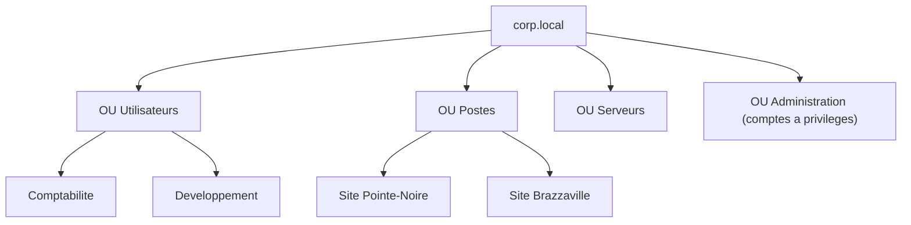

## Introduction

Active Directory (AD) reste, en 2026, l'épine dorsale de la quasi-totalité des systèmes d'information d'entreprise de taille moyenne à grande. Même dans les organisations qui ont adopté le cloud, l'AD local coexiste généralement avec Entra ID, l'annuaire cloud de Microsoft, et continue d'authentifier les postes, les serveurs et les applications internes.

Ce chapitre aborde AD du point de vue de celui qui l'administre au quotidien, un point de vue complémentaire à celui du cours Active Directory & Windows, plus centré sur son audit. À la fin, tu sauras expliquer ce que fournit un contrôleur de domaine, organiser l'annuaire, gérer utilisateurs et groupes en PowerShell, appliquer des GPO et éviter les erreurs d'administration qui ouvrent des chemins d'attaque.

## Rôle du contrôleur de domaine

Un contrôleur de domaine (DC) est un serveur Windows Server sur lequel on a installé le rôle AD DS (Active Directory Domain Services). Il ne se contente pas de stocker un annuaire : il fournit tout un ensemble de services indispensables.

<CompareTable
  titleA="Fonction"
  titleB="Ce qu'elle apporte"
  rows={[
    { a: "Annuaire LDAP", b: "Base centralisée des utilisateurs, groupes, ordinateurs et de leurs attributs" },
    { a: "Authentification Kerberos", b: "Authentification unique (SSO) sur l'ensemble des ressources du domaine" },
    { a: "DNS intégré", b: "Résolution de noms indispensable au fonctionnement du domaine lui-même, notamment pour localiser les DC" },
    { a: "Stratégies de groupe (GPO)", b: "Application centralisée de configurations sur postes et serveurs" },
]}
/>

### Pourquoi toujours au moins deux contrôleurs de domaine

Si l'unique contrôleur de domaine tombe en panne, plus personne ne peut s'authentifier : les utilisateurs ne peuvent plus ouvrir de session, les applications ne peuvent plus vérifier les identités. C'est pourquoi un domaine de production dispose presque toujours d'au moins deux contrôleurs de domaine. Ils se répliquent mutuellement l'annuaire, si bien que chacun peut prendre le relais de l'autre. On parle de réplication multi-maître : une modification faite sur un DC est propagée aux autres.

<TipCallout>
Un domaine AD dispose presque toujours d'au moins deux contrôleurs de domaine en production, jamais un seul, pour garantir la disponibilité de l'authentification si l'un d'eux tombe en panne. Certaines opérations particulières restent toutefois attribuées à un seul DC, via les rôles FSMO : il faut savoir lesquels avant de retirer un serveur.
</TipCallout>

### Les rôles FSMO

Bien que la réplication soit multi-maître, cinq opérations sensibles ne peuvent être réalisées que par un seul contrôleur à la fois, appelé détenteur du rôle FSMO (Flexible Single Master Operations). Le plus connu est l'émulateur PDC, référence de l'heure du domaine et des changements de mot de passe. Avant de mettre hors service un DC, on vérifie et on transfère ses rôles.

```powershell
# Afficher les détenteurs des rôles FSMO
netdom query fsmo

# Lister les contrôleurs de domaine du domaine
Get-ADDomainController -Filter * | Select-Object Name, IPv4Address, OperatingSystem
```

```text
Name   IPv4Address  OperatingSystem
----   -----------  ---------------
DC01   10.20.0.10   Windows Server 2025 Standard
DC02   10.20.0.11   Windows Server 2022 Standard
```

## Administrer les objets courants

<Steps steps={[
  { title: "Unités d'organisation (OU)", description: "Elles structurent l'annuaire de façon hiérarchique, par service ou par site. C'est sur les OU que s'appliquent les GPO, pas directement sur les utilisateurs." },
  { title: "Groupes de sécurité et groupes de distribution", description: "Un groupe de sécurité porte des droits d'accès ; un groupe de distribution ne sert qu'à la messagerie. Les confondre est une erreur fréquente de conception." },
  { title: "Comptes de service", description: "Ce sont des comptes dédiés aux applications, jamais un compte utilisateur réel, afin que le départ ou le changement de mot de passe d'une personne ne casse pas l'application, et que les droits restent limités à la seule fonction." },
  { title: "Délégation d'administration", description: "Elle permet d'accorder à une équipe, par exemple le support de niveau 1, le droit de réinitialiser des mots de passe sans lui donner les droits d'administrateur du domaine." },
]} />

### Concevoir l'arborescence des OU

Une bonne arborescence sépare clairement les types d'objets, car c'est elle qui détermine où l'on applique les GPO et où l'on délègue des droits. Une structure courante distingue les utilisateurs, les postes, les serveurs et les comptes d'administration, puis subdivise par site ou par service.



### Gérer utilisateurs et groupes en PowerShell

Le module ActiveDirectory de PowerShell permet d'automatiser toutes les opérations courantes, ce qui est plus fiable et plus traçable que des clics répétés dans la console graphique.

```powershell
# Créer un utilisateur dans l'OU Comptabilité
New-ADUser -Name "Awa Mabiala" -SamAccountName a.mabiala `
  -Path "OU=Comptabilite,OU=Utilisateurs,DC=corp,DC=local" `
  -AccountPassword (Read-Host -AsSecureString "Mot de passe") -Enabled $true

# Ajouter l'utilisateur à un groupe de sécurité global
Add-ADGroupMember -Identity "GG_Compta_Lecture" -Members a.mabiala

# Désactiver un compte lors d'un départ
Disable-ADAccount -Identity a.mabiala
```

Une convention éprouvée, souvent appelée AGDLP, recommande d'ajouter les comptes (A) dans des groupes globaux (G) représentant un métier, eux-mêmes ajoutés à des groupes de domaine locaux (DL) qui portent les permissions (P) sur une ressource. Ainsi, quand une personne change de poste, on modifie seulement son appartenance aux groupes globaux, sans toucher aux permissions des ressources.

<WarningCallout>
Ajouter un compte à Domain Admins pour résoudre rapidement un problème ponctuel est une pratique dangereuse et très répandue. Ces comptes surprivilégiés, une fois oubliés, deviennent des cibles de choix en cas de compromission, notamment par le Kerberoasting étudié dans le cours Active Directory & Windows lorsqu'il s'agit de comptes de service. Le groupe Domain Admins doit contenir le moins de membres possible.
</WarningCallout>

### Les comptes de service gérés

Plutôt que de créer un compte de service classique avec un mot de passe que quelqu'un doit gérer, Windows Server propose des comptes de service gérés de groupe (gMSA). Leur mot de passe, très long, est généré et renouvelé automatiquement par AD, et personne n'a besoin de le connaître. C'est aujourd'hui la solution recommandée dès que l'application la supporte.

## Les GPO — standardiser sans repasser partout

Les stratégies de groupe (Group Policy Objects) permettent d'appliquer une configuration à tous les postes ou serveurs d'une OU en une seule opération, au lieu de la répéter manuellement machine par machine.

```text
Exemples de GPO courantes en entreprise :

- Politique de mot de passe (longueur minimale, complexité, expiration)
- Verrouillage d'écran automatique après inactivité
- Restriction d'exécution de logiciels non autorisés (AppLocker ou App Control for Business)
- Déploiement automatique d'un antivirus ou d'un EDR
- Désactivation de l'exécution de scripts PowerShell non signés
- Configuration de Windows LAPS pour les mots de passe administrateur locaux
```

### Ordre d'application et diagnostic

Les GPO s'appliquent dans un ordre précis, résumé par l'acronyme LSDOU : stratégie locale, puis site, puis domaine, puis OU, de la plus haute à la plus imbriquée. En cas de conflit, c'est la dernière appliquée qui l'emporte. Les machines rafraîchissent leurs stratégies périodiquement, environ toutes les 90 minutes avec un décalage aléatoire, mais on peut forcer et vérifier l'application :

```powershell
# Forcer l'application immédiate des stratégies
gpupdate /force

# Afficher les GPO effectivement appliquées à la machine et à l'utilisateur
gpresult /r
```

```text
Objets Strategie de groupe appliques
-------------------------------------
    Postes - Verrouillage ecran
    Postes - Windows LAPS
    Default Domain Policy
```

<CehCallout>
Une GPO mal restreinte peut elle-même devenir un vecteur d'attaque : un attaquant disposant de droits d'écriture sur une GPO appliquée à l'ensemble du domaine peut y injecter une configuration exécutée automatiquement sur tous les postes concernés. La sécurisation des GPO elles-mêmes, c'est-à-dire la liste des personnes autorisées à les modifier, est un axe d'audit à part entière.
</CehCallout>

## Sécuriser l'administration au quotidien

<AttackDefenseTable rows={[
  { phase: "Comptes à privilèges", attack: "Cibler les membres surnuméraires de Domain Admins", defense: "Limiter le groupe au strict minimum et utiliser des comptes d'administration séparés" },
  { phase: "Comptes de service", attack: "Exploiter le mot de passe faible d'un compte de service", defense: "Migrer vers des gMSA ou imposer des mots de passe très longs" },
  { phase: "GPO", attack: "Modifier une GPO appliquée à tout un parc", defense: "Restreindre et auditer les droits de modification des GPO" },
  { phase: "Mots de passe locaux", attack: "Réutiliser un mot de passe administrateur local identique", defense: "Déployer Windows LAPS par GPO" },
]} />

<AuditCallout>
La gestion des comptes à privilèges correspond au contrôle A.8.2 (droits d'accès privilégiés) de la norme ISO/IEC 27001:2022, et la gestion des configurations par GPO au contrôle A.8.9. Les CIS Benchmarks Windows Server fournissent une liste détaillée de paramètres recommandés, applicables directement par GPO.
</AuditCallout>

## Erreurs fréquentes

On déploie un seul contrôleur de domaine, et la moindre panne bloque toute l'entreprise. On utilise un compte utilisateur réel comme compte de service, si bien que l'application tombe le jour où la personne quitte l'entreprise. On crée des groupes de distribution en pensant qu'ils accordent des droits. On applique des GPO directement à la racine du domaine plutôt qu'aux OU concernées, ce qui rend leurs effets imprévisibles. Enfin, on ajoute des comptes à Domain Admins « temporairement » sans jamais les retirer.

## Lab — Mise en pratique

**Environnement** : Poste d'administration Windows du lab avec le module ActiveDirectory, puis réflexion guidée.

<Steps steps={[
  { title: "Inventorier les contrôleurs de domaine", description: "Liste les contrôleurs de domaine et les détenteurs des rôles FSMO, puis vérifie qu'il y en a au moins deux.", code: "Get-ADDomainController -Filter * | Select-Object Name, IPv4Address\nnetdom query fsmo" },
  { title: "Auditer le groupe Domain Admins", description: "Liste les membres du groupe et repère tout compte qui ne devrait pas y figurer.", code: "Get-ADGroupMember 'Domain Admins' | Select-Object Name, SamAccountName" },
  { title: "Créer un utilisateur et un groupe", description: "Crée un utilisateur dans une OU de service, un groupe de sécurité global, et ajoute l'utilisateur au groupe en suivant la logique AGDLP." },
  { title: "Vérifier l'application des GPO", description: "Force l'application des stratégies et affiche celles réellement appliquées au poste.", code: "gpupdate /force\ngpresult /r" },
  { title: "Concevoir une structure d'OU", description: "Pour une entreprise avec trois services (Comptabilité, Développement, Direction) répartis sur deux sites, propose une arborescence d'OU permettant d'appliquer des GPO différenciées." },
  { title: "Corriger un sur-privilège", description: "Un compte de service utilisé par une application de sauvegarde est membre de Domain Admins. Indique le principe violé, le droit minimal qui suffirait probablement, et pourquoi un gMSA serait préférable." },
]} />

## À retenir

- Le contrôleur de domaine fournit l'annuaire LDAP, l'authentification Kerberos, le DNS intégré et les stratégies de groupe.
- Un domaine de production dispose d'au moins deux contrôleurs de domaine pour garantir la disponibilité de l'authentification.
- Les GPO s'appliquent aux unités d'organisation, dans l'ordre local, site, domaine puis OU.
- Un groupe de sécurité porte des droits d'accès, un groupe de distribution ne sert qu'à la messagerie.
- Un compte de service est un compte dédié, jamais un compte utilisateur réel ; les gMSA sont la solution recommandée.
- La délégation d'administration permet, par exemple, au support de niveau 1 de réinitialiser des mots de passe sans être administrateur du domaine.
- Les comptes surprivilégiés et les GPO mal sécurisées comptent parmi les vecteurs d'attaque AD les plus exploités.

## Questions de révision

1. Pourquoi une entreprise dispose-t-elle presque toujours d'au moins deux contrôleurs de domaine ?
2. Outre l'annuaire LDAP, quels services un contrôleur de domaine fournit-il ?
3. Sur quel type d'objet de l'annuaire applique-t-on les GPO ?
4. Quelle est la différence entre un groupe de sécurité et un groupe de distribution ?
5. Que permet la délégation d'administration à une équipe de support de niveau 1 ?
6. Pourquoi un compte de service ne doit-il jamais être un compte utilisateur réel ?
7. Parmi les exemples de GPO courantes, laquelle restreint l'exécution de logiciels non autorisés ?
8. Pourquoi une GPO mal sécurisée peut-elle devenir un vecteur d'attaque à l'échelle de tout un domaine ?
