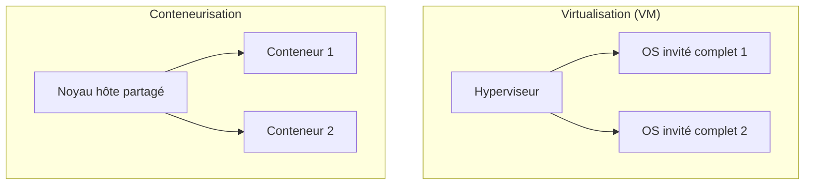

## Introduction

La virtualisation et la conteneurisation, souvent confondues par les débutants, répondent à des besoins différents et présentent des surfaces de risque distinctes. Ce chapitre les distingue clairement. Les labs Nyx eux-mêmes reposent sur Docker, ce qui rend cette distinction directement concrète pour toi : chaque session de lab est une démonstration vivante des concepts abordés ici.

À la fin de ce chapitre, tu sauras expliquer ce qui différencie une machine virtuelle d'un conteneur au niveau de l'isolation, pourquoi cette différence a des conséquences de sécurité, comment sécuriser une infrastructure de conteneurs, et quand préférer l'une ou l'autre approche.

## Deux niveaux d'isolation très différents

La différence fondamentale tient à ce qui est partagé avec la machine hôte. Une machine virtuelle embarque son propre système d'exploitation complet, noyau compris, tandis qu'un conteneur partage le noyau de l'hôte.



<CompareTable
  titleA="Virtualisation (VM)"
  titleB="Conteneurisation (Docker)"
  rows={[
    { a: "Chaque VM embarque son propre noyau et son OS complet", b: "Les conteneurs partagent le noyau de la machine hôte" },
    { a: "Isolation forte, au niveau du matériel virtualisé", b: "Isolation plus légère, au niveau du noyau (namespaces, cgroups)" },
    { a: "Démarrage en dizaines de secondes, empreinte lourde", b: "Démarrage en millisecondes, empreinte légère" },
    { a: "Adaptée à l'isolation de charges hétérogènes ou sensibles", b: "Adaptée au déploiement rapide d'applications et de microservices" },
]}
/>

### Comment fonctionne l'isolation d'un conteneur

Un conteneur n'est pas une machine : c'est un processus de l'hôte, cloisonné par deux mécanismes du noyau Linux. Les namespaces lui donnent sa propre vue des ressources (ses propres processus, son propre réseau, son propre système de fichiers), si bien qu'il ne voit pas le reste de l'hôte. Les cgroups (control groups) limitent les ressources qu'il peut consommer : mémoire, CPU, entrées-sorties. Ces deux mécanismes, combinés, donnent l'illusion d'une machine isolée, mais le noyau, lui, reste commun.

<CehCallout>
C'est précisément parce que les conteneurs partagent le noyau de l'hôte que l'isolation Docker est plus fragile qu'une VM. Une faille d'échappement de conteneur (container escape) donne potentiellement accès directement à l'hôte, alors qu'une faille d'échappement de VM, beaucoup plus rare, serait nécessaire pour le même résultat en virtualisation classique. En examen, retiens que la surface d'attaque partagée d'un conteneur est le noyau de l'hôte.
</CehCallout>

## Sécuriser une infrastructure de conteneurs

La commodité des conteneurs s'accompagne de pièges de configuration qui, mal gérés, réduisent à néant leur isolation. Depuis 2026, l'outillage standard est Docker Compose v2, invoqué par `docker compose` (en deux mots) et non plus par l'ancien `docker-compose`.

<Steps steps={[
  { title: "Ne jamais lancer un conteneur en mode privilégié", description: "L'option --privileged désactive quasiment toute l'isolation de sécurité normalement apportée par les namespaces et les capacités, à réserver à des cas très spécifiques et maîtrisés." },
  { title: "Limiter les ressources", description: "Toujours borner CPU et mémoire, comme le fait Nyx pour ses labs, pour éviter qu'un conteneur compromis ou buggé n'épuise les ressources de l'hôte et ne provoque un déni de service." },
  { title: "Images minimalistes et vérifiées", description: "Préférer des images officielles ou distroless, qui réduisent la surface d'attaque par rapport à une image généraliste complète, et vérifier leur provenance." },
  { title: "Ne jamais monter le socket Docker dans un conteneur non maîtrisé", description: "Un accès au socket Docker (/var/run/docker.sock) depuis l'intérieur d'un conteneur équivaut souvent à un accès root sur l'hôte." },
  { title: "Faire tourner le conteneur sans root", description: "Spécifier un utilisateur non privilégié dans l'image et activer les modes user namespace ou rootless pour réduire l'impact d'une compromission." },
]} />

<WarningCallout>
Monter le socket Docker de l'hôte à l'intérieur d'un conteneur est une pratique fréquente pour des outils d'orchestration, mais un attaquant qui compromet ce conteneur peut alors créer, depuis l'intérieur, un nouveau conteneur privilégié montant le disque de l'hôte, ce qui revient à un accès root complet sur la machine physique. C'est l'une des mauvaises configurations les plus dangereuses d'une infrastructure de conteneurs.
</WarningCallout>

### Exemple de configuration durcie

Un fichier Docker Compose durci illustre plusieurs de ces principes à la fois.

```yaml
services:
  app:
    image: mon-app:1.4.2          # version épinglée, jamais "latest"
    user: "10001:10001"           # utilisateur non privilégié
    read_only: true               # système de fichiers en lecture seule
    cap_drop:
      - ALL                       # retrait de toutes les capacités Linux
    security_opt:
      - no-new-privileges:true    # interdit l'élévation de privilèges
    mem_limit: 512m               # limite mémoire (cgroups)
    cpus: 0.5                     # limite CPU
```

### Analyser les vulnérabilités des images

Une image contient des bibliothèques qui peuvent comporter des vulnérabilités connues. Les analyser avant la mise en production fait partie de l'hygiène de base. L'outil Trivy, largement utilisé, examine une image et liste ses failles.

```bash
# Analyser une image à la recherche de vulnérabilités connues
trivy image mon-app:1.4.2
```

```text
mon-app:1.4.2 (debian 12.7)
Total: 3 (CRITICAL: 1, HIGH: 2)
  libssl3   CVE-2024-XXXXX   CRITICAL   fixed in 3.0.14
```

## Orchestration et montée en charge

Quand les conteneurs se comptent par dizaines ou par centaines, on les orchestre avec Kubernetes, qui répartit les conteneurs sur plusieurs machines, les redémarre en cas de panne et gère la montée en charge. Les mêmes principes de sécurité s'y appliquent, enrichis de notions propres comme les politiques réseau, qui cloisonnent les communications entre conteneurs, et les contextes de sécurité des pods, qui interdisent l'exécution en root. L'orchestration est approfondie dans le cours DevOps.

## Quand choisir quoi

<CompareTable
  titleA="Besoin"
  titleB="Choix recommandé"
  rows={[
    { a: "Isoler fortement des charges sensibles (labs, environnements clients distincts)", b: "Virtualisation, ou conteneurs à l'intérieur de VM dédiées" },
    { a: "Déployer rapidement de nombreux microservices", b: "Conteneurisation (Docker, orchestrée par Kubernetes)" },
    { a: "Faire tourner plusieurs OS différents (Windows et Linux) sur un même hôte", b: "Virtualisation : un conteneur Linux ne peut pas faire tourner un noyau Windows" },
]}
/>

<TipCallout>
Nyx combine les deux niveaux dans ses labs : chaque session utilise des conteneurs Docker isolés par un réseau dédié, avec des limites de ressources strictes et sans mode privilégié. C'est un compromis pragmatique entre rapidité de déploiement et isolation raisonnable pour un usage pédagogique, où l'on sait exactement ce que contient chaque conteneur.
</TipCallout>

## Erreurs fréquentes

On croit qu'un conteneur isole aussi bien qu'une VM, alors qu'il partage le noyau de l'hôte. On lance un conteneur en mode privilégié « pour que ça marche », sans mesurer qu'on désactive l'isolation. On monte le socket Docker dans un conteneur sans réaliser que c'est un accès root à l'hôte. On utilise l'étiquette d'image `latest`, ce qui rend les déploiements non reproductibles et masque les mises à jour de sécurité. Enfin, on ne limite pas les ressources, exposant l'hôte au déni de service par un seul conteneur emballé.

## Lab — Mise en pratique

**Environnement** : Réflexion guidée et observation sur l'environnement Docker du lab. L'objectif est d'analyser et de durcir.

<Steps steps={[
  { title: "Observer l'isolation d'un conteneur", description: "Dans un conteneur, liste les processus visibles et compare avec ceux de l'hôte pour constater l'effet des namespaces." },
  { title: "Identifier un risque de configuration", description: "Un conteneur applicatif est lancé avec l'option --privileged et un montage du socket Docker de l'hôte. Décris le scénario d'attaque que cela ouvre en cas de compromission de l'application." },
  { title: "Durcir un fichier Compose", description: "À partir d'un service Docker Compose sans restriction, ajoute une version épinglée, un utilisateur non privilégié, le retrait des capacités et des limites de ressources." },
  { title: "Analyser une image", description: "Lance une analyse de vulnérabilités sur une image et classe les failles trouvées par criticité.", code: "trivy image mon-app:1.4.2" },
  { title: "Choisir la bonne isolation", description: "Une entreprise veut proposer à ses clients des environnements de test totalement isolés les uns des autres, y compris au niveau du noyau. Indique s'il faut de la virtualisation ou de la conteneurisation seule, et justifie." },
  { title: "Expliquer un risque de socket", description: "Explique en deux phrases pourquoi monter /var/run/docker.sock dans un conteneur équivaut à un accès root sur l'hôte." },
]} />

## À retenir

- La virtualisation isole au niveau du matériel : chaque VM a son propre noyau. La conteneurisation isole au niveau du noyau partagé, via les namespaces et les cgroups.
- Le partage du noyau rend un échappement de conteneur potentiellement plus dangereux qu'un échappement de VM.
- Le mode --privileged et le montage du socket Docker sont les deux points de configuration les plus dangereux à protéger.
- Les images doivent être minimalistes, à version épinglée (jamais latest), vérifiées et analysées pour leurs vulnérabilités.
- Limiter CPU et mémoire protège l'hôte du déni de service par un conteneur emballé.
- La virtualisation reste préférable pour une isolation forte ou pour faire tourner plusieurs systèmes d'exploitation différents sur un même hôte.

## Questions de révision

1. Qu'est-ce qui distingue fondamentalement une VM d'un conteneur au niveau de l'isolation ?
2. Pourquoi une faille d'échappement de conteneur est-elle potentiellement plus dangereuse qu'une faille d'échappement de VM ?
3. Quels deux mécanismes du noyau Linux assurent l'isolation et la limitation des ressources d'un conteneur ?
4. Pourquoi le mode --privileged est-il déconseillé pour un conteneur ?
5. Que risque-t-on à monter le socket Docker de l'hôte à l'intérieur d'un conteneur non maîtrisé ?
6. Que recommande-t-on concernant le choix et l'étiquetage des images de conteneurs ?
7. Dans quel cas la virtualisation reste-t-elle préférable à la conteneurisation seule ?
8. Comment Nyx applique-t-il un compromis pragmatique entre rapidité et isolation dans ses labs ?
