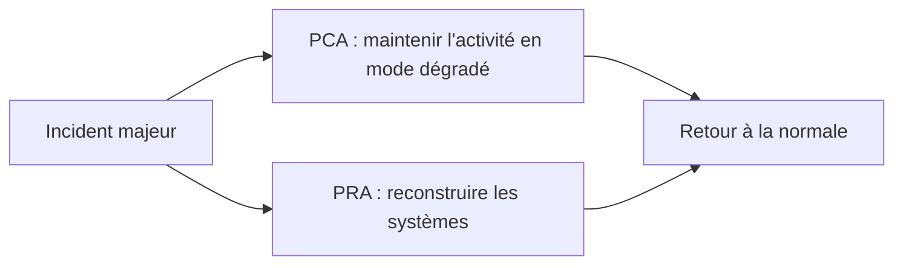

## Introduction

Une sauvegarde qui n'a jamais été testée en restauration n'est pas une sauvegarde : c'est une hypothèse non vérifiée. Ce chapitre couvre les fondamentaux de la résilience, c'est-à-dire la capacité d'un système d'information à se remettre d'un incident majeur, qu'il s'agisse d'une panne matérielle, d'un ransomware ou d'une catastrophe physique.

À la fin de ce chapitre, tu sauras concevoir une stratégie de sauvegarde solide, distinguer un plan de reprise d'un plan de continuité, et quantifier les objectifs de résilience d'un système à l'aide du RTO et du RPO. Ces notions sont au cœur des exigences réglementaires récentes comme NIS2 et DORA.

## La règle 3-2-1

La règle 3-2-1 est le point de départ universel d'une stratégie de sauvegarde. Elle tient en trois chiffres faciles à retenir.

<Steps steps={[
  { title: "3 copies des données", description: "L'original plus au moins deux copies, jamais une seule copie de sauvegarde, pour qu'une défaillance d'une copie ne soit jamais fatale." },
  { title: "2 supports différents", description: "Par exemple un disque local et un stockage cloud ou une bande, pour éviter qu'une même panne matérielle ne détruise toutes les copies à la fois." },
  { title: "1 copie hors site (offsite)", description: "Au moins une copie physiquement éloignée, qui protège contre un sinistre local comme un incendie, une inondation ou un vol de matériel." },
]} />

Le « 1 » de la règle, souvent négligé, est celui qui protège contre les sinistres physiques : deux disques dans la même salle serveur comptent pour un seul emplacement, et brûleraient ensemble.

### La variante moderne 3-2-1-1-0

Face aux ransomwares, la règle s'est enrichie. La variante 3-2-1-1-0 ajoute « 1 » copie immuable ou hors ligne (air-gapped), et « 0 » erreur lors des tests de restauration. Autrement dit : au moins une copie que rien ne peut modifier ou supprimer, et des restaurations vérifiées sans échec.

<CehCallout>
Un ransomware moderne cible spécifiquement les sauvegardes accessibles depuis le réseau compromis, avant même de chiffrer les données de production : son objectif est de vous priver de toute possibilité de restauration pour vous forcer à payer. Une copie de sauvegarde immuable (write-once, que rien ne peut modifier) ou physiquement déconnectée (air-gapped) est la seule protection réellement fiable contre ce scénario, car elle reste hors d'atteinte de l'attaquant.
</CehCallout>

## Tester la restauration — l'étape la plus souvent négligée

<WarningCallout>
De nombreuses organisations découvrent qu'une sauvegarde est corrompue, incomplète ou inutilisable au moment précis où elles en ont besoin, pendant un incident réel. Un test de restauration régulier et documenté est aussi important que la sauvegarde elle-même, et doit être planifié comme n'importe quelle tâche de maintenance récurrente. C'est le « 0 » de la règle 3-2-1-1-0 : zéro erreur constatée lors des tests.
</WarningCallout>

Tester une restauration, c'est vérifier qu'on peut réellement reconstruire les données et que l'application redémarre dessus. Un test complet va plus loin qu'ouvrir un fichier restauré : il reconstitue le service et contrôle son bon fonctionnement, idéalement dans un environnement isolé pour ne pas perturber la production.

## PRA et PCA — deux plans complémentaires

Quand un incident majeur survient, deux questions se posent en parallèle : comment reconstruire l'informatique, et comment l'entreprise continue-t-elle de fonctionner entre-temps. Ce sont deux plans distincts.

<CompareTable
  titleA="PRA (Plan de Reprise d'Activité)"
  titleB="PCA (Plan de Continuité d'Activité)"
  rows={[
    { a: "Comment reconstruire l'infrastructure après un sinistre", b: "Comment l'activité métier continue pendant le sinistre" },
    { a: "Centré sur les systèmes informatiques", b: "Centré sur les processus métier (mode dégradé, procédures temporaires)" },
    { a: "Exemple : restaurer le serveur de facturation depuis une sauvegarde", b: "Exemple : comment le service commercial continue à facturer sans le système habituel" },
]}
/>

<TipCallout>
Un PRA sans PCA laisse l'entreprise sans réponse à la question « que fait-on en attendant que le PRA soit exécuté ? ». Les deux plans doivent être pensés ensemble, pas l'un en remplacement de l'autre. Le PCA prévoit, par exemple, des procédures papier temporaires ou un basculement vers un prestataire, le temps que le PRA rétablisse les systèmes.
</TipCallout>



## RTO et RPO — quantifier la résilience

On ne peut pas dimensionner une stratégie de sauvegarde sans objectifs chiffrés. Deux indicateurs les expriment.

<CompareTable
  titleA="Indicateur"
  titleB="Ce qu'il mesure"
  rows={[
    { a: "RTO (Recovery Time Objective)", b: "La durée maximale acceptable d'indisponibilité avant reprise du service" },
    { a: "RPO (Recovery Point Objective)", b: "Le volume maximal de données qu'il est acceptable de perdre, exprimé en temps" },
]}
/>

```text
Exemple concret :

RTO = 4 heures  → le service de facturation doit être de nouveau disponible
                   au maximum 4 heures après le début de l'incident.

RPO = 1 heure   → au pire, l'entreprise accepte de perdre les données
                   de la dernière heure précédant l'incident, donc des
                   sauvegardes au moins toutes les heures sont nécessaires.
```

<CehCallout>
Un RPO de 1 heure impose une fréquence de sauvegarde d'au moins une fois par heure pour le système concerné : c'est le RPO cible qui détermine la fréquence de sauvegarde à mettre en œuvre, et non l'inverse. De même, un RPO de 15 minutes impose une sauvegarde au moins toutes les 15 minutes, ce qui oriente vers des techniques de journalisation continue plutôt que de simples sauvegardes nocturnes.
</CehCallout>

Le RTO, lui, détermine l'architecture de reprise : un RTO de quelques minutes exige des systèmes redondants prêts à prendre le relais, alors qu'un RTO de plusieurs jours peut se contenter d'une restauration depuis une bande. Plus le RTO et le RPO sont courts, plus la solution coûte cher : on les fixe donc en fonction de la criticité réelle de chaque système, pas uniformément.

## Le cadre réglementaire

<AuditCallout>
La continuité d'activité correspond au contrôle A.5.29 (sécurité de l'information pendant une perturbation) et A.5.30 (préparation des TIC à la continuité d'activité) de la norme ISO/IEC 27001:2022. Le règlement européen DORA, applicable au secteur financier depuis janvier 2025, impose des exigences strictes de résilience opérationnelle, et la directive NIS2 étend des obligations de continuité à de nombreux secteurs essentiels et importants.
</AuditCallout>

## Erreurs fréquentes

On conserve deux copies dans la même salle serveur en croyant respecter la règle 3-2-1, alors qu'il manque le « 1 » hors site. On sauvegarde fidèlement mais on ne teste jamais la restauration, et on découvre le problème pendant l'incident. On laisse les sauvegardes accessibles depuis le réseau de production, où un ransomware les détruira avant de chiffrer. On confond PRA et PCA, ou on néglige le second. Enfin, on applique le même RPO et le même RTO à tous les systèmes, ce qui coûte trop cher pour les uns et pas assez pour les autres.

## Lab — Mise en pratique

**Environnement** : Réflexion guidée.

<Steps steps={[
  { title: "Appliquer la règle 3-2-1", description: "Une entreprise sauvegarde ses données chaque nuit sur un second disque dans la même salle serveur. Indique quel(s) élément(s) de la règle 3-2-1 manque(nt) et quel risque concret cela laisse ouvert." },
  { title: "Renforcer contre le ransomware", description: "Pour la même entreprise, propose une évolution vers la règle 3-2-1-1-0 et explique le rôle de la copie immuable ou air-gapped." },
  { title: "Calculer un RPO nécessaire", description: "Une base de données e-commerce ne doit jamais perdre plus de 15 minutes de commandes. Détermine le RPO imposé et la fréquence de sauvegarde minimale qui en découle." },
  { title: "Dimensionner un RTO", description: "Pour un système dont l'indisponibilité maximale acceptable est de 30 minutes, indique quel type d'architecture de reprise cela impose et pourquoi." },
  { title: "Distinguer PRA et PCA", description: "Pour une panne totale du serveur de facturation, rédige une action relevant du PRA et une action relevant du PCA." },
  { title: "Concevoir un test de restauration", description: "Décris en trois étapes un test de restauration qui vérifie réellement que le service redémarre, et non seulement qu'un fichier s'ouvre." },
]} />

## À retenir

- La règle 3-2-1 (3 copies, 2 supports, 1 hors site) reste la base d'une stratégie de sauvegarde solide ; le « 1 » protège contre les sinistres physiques.
- La variante 3-2-1-1-0 ajoute une copie immuable ou air-gapped et des restaurations testées sans erreur, pour résister aux ransomwares.
- Une sauvegarde jamais testée en restauration n'offre aucune garantie réelle.
- Le PRA reconstruit l'informatique, le PCA maintient l'activité métier pendant l'incident ; ils sont complémentaires.
- Le RPO cible détermine la fréquence de sauvegarde nécessaire ; le RTO cible détermine l'architecture de reprise.
- Plus le RTO et le RPO sont courts, plus la solution coûte cher : on les fixe selon la criticité de chaque système.

## Questions de révision

1. Que signifie la règle 3-2-1 en sauvegarde, et que signifie précisément son « 1 » ?
2. Pourquoi une sauvegarde immuable ou air-gapped est-elle la seule protection réellement fiable contre un ransomware moderne ?
3. Selon le chapitre, qu'est-ce qu'une sauvegarde qui n'a jamais été testée en restauration ?
4. Quelle est la différence fondamentale entre un PRA et un PCA ?
5. Si le RPO cible d'un système est de 15 minutes, quelle fréquence de sauvegarde minimale cela impose-t-il ?
6. Que mesure le RTO (Recovery Time Objective) ?
7. Pourquoi ne fixe-t-on pas le même RTO et le même RPO pour tous les systèmes d'une entreprise ?
8. Qu'ajoute la variante 3-2-1-1-0 à la règle 3-2-1 classique ?
