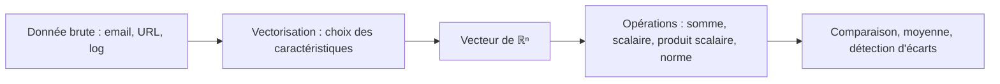

## Introduction

L'algèbre linéaire est le socle mathématique de la data science et du machine learning, deux domaines abordés dans les cours suivants de cette roadmap. Quand un filtre anti-phishing décide qu'un email est suspect, quand un SIEM repère une connexion qui ne ressemble à aucune autre, ou quand un moteur de recherche sémantique retrouve des rapports d'incident proches, les calculs effectués sont presque toujours des opérations sur des vecteurs.

Ce premier chapitre repart d'une notion familière — le vecteur — pour la reconnecter à un usage très concret : représenter des données. À la fin, tu sauras transformer une donnée brute en vecteur, effectuer les opérations fondamentales à la main puis avec NumPy, interpréter un produit scalaire comme une mesure de ressemblance, et expliquer ce qu'est un espace vectoriel et sa dimension. Tout le reste du cours s'appuie sur ces bases.

## Un vecteur n'est pas qu'une flèche

<CehCallout>
En physique, un vecteur est une flèche avec une direction et une magnitude. En data science et en cybersécurité, un vecteur est simplement une liste ordonnée de nombres — par exemple, les caractéristiques d'un email (nombre de liens, présence de pièces jointes, longueur du texte) peuvent former un vecteur à 3 dimensions, exploité par un modèle de détection de phishing.
</CehCallout>

### Deux points de vue complémentaires

Le point de vue géométrique est utile pour l'intuition : en deux dimensions, le vecteur [3, 4] est une flèche qui part de l'origine et va trois unités vers la droite puis quatre vers le haut. Le point de vue informatique est utile pour le calcul : [3, 4] est un tableau de deux nombres, dans un ordre précis. Les deux représentations désignent exactement le même objet mathématique, et on passe constamment de l'une à l'autre.

Chaque nombre du vecteur s'appelle une **composante** (ou coordonnée). Le nombre de composantes est la **dimension** du vecteur. L'ordre est essentiel : [15, 2, 1] et [2, 15, 1] sont deux vecteurs différents, car la première position signifie toujours « nombre de liens » et la deuxième « taille en kilo-octets ». Un vecteur n'a de sens que si l'on sait ce que représente chaque position : c'est ce qu'on appelle le **schéma de caractéristiques** (feature schema).

```text
Exemple : représenter un email comme un vecteur

Email = [nombre_liens, taille_ko, contient_piece_jointe]
Email_suspect = [15, 2, 1]
Email_normal   = [2, 45, 0]
```

On note souvent un vecteur avec une lettre en gras ou surmontée d'une flèche, et on écrit ses composantes v₁, v₂, …, vₙ. L'ensemble de tous les vecteurs à n composantes réelles se note ℝⁿ (« R n »).

### Vectoriser une donnée brute

La **vectorisation** est l'étape qui transforme une donnée brute (un texte, une URL, une ligne de log) en vecteur de nombres. C'est la porte d'entrée de tout modèle de machine learning : un algorithme ne sait pas lire une URL, mais il sait comparer des vecteurs. Voici un exemple exécutable qui transforme des URL en vecteurs de cinq caractéristiques, du type de celles qu'utilisent les détecteurs d'URL malveillantes.

```python
import numpy as np
from urllib.parse import urlparse, parse_qs

def vectoriser_url(url: str) -> np.ndarray:
    """Transforme une URL en vecteur de 5 caractéristiques numériques."""
    p = urlparse(url)
    return np.array([
        len(url),                                   # longueur totale
        url.count("."),                             # nombre de points
        len(parse_qs(p.query)),                     # nombre de paramètres
        sum(not c.isalnum() for c in url),          # caractères spéciaux
        int(p.hostname.replace(".", "").isdigit()), # hôte = adresse IP ?
    ])

urls = [
    "https://www.example.com/index.html",
    "http://192.168.12.7/login.php?user=admin&redirect=paypal.com.secure-check.ru",
]
for u in urls:
    print(vectoriser_url(u), u[:45])
```

```text
[34  3  0  7  0] https://www.example.com/index.html
[76  7  2 16  1] http://192.168.12.7/login.php?user=admin&redi
```

La seconde URL, typique d'une page de phishing hébergée sur une adresse IP, a un vecteur très différent de la première : elle est plus longue, contient davantage de points et de caractères spéciaux, et sa dernière composante vaut 1. Ce sont ces écarts numériques qu'un modèle apprendra à exploiter.

## Opérations de base sur les vecteurs

<Steps steps={[
  { title: "Addition de vecteurs", description: "Additionner composante par composante : [1,2] + [3,4] = [4,6]." },
  { title: "Multiplication par un scalaire", description: "Multiplier chaque composante par un même nombre : 2 × [1,2] = [2,4]." },
  { title: "Produit scalaire (dot product)", description: "Multiplier les composantes correspondantes puis sommer : [1,2]·[3,4] = 1×3 + 2×4 = 11." },
  { title: "Norme (longueur) d'un vecteur", description: "Racine carrée de la somme des carrés des composantes — généralise le théorème de Pythagore à n dimensions." },
]} />

### Addition et soustraction

On additionne deux vecteurs de même dimension composante par composante. Par exemple, [3, 5] + [2, -1] = [3+2, 5+(-1)] = [5, 4]. Géométriquement, on place la flèche du second vecteur au bout de la première : c'est la règle du parallélogramme. La soustraction suit la même logique et donne le vecteur qui va d'un point à l'autre, ce qui servira à calculer des distances au chapitre 6. On ne peut pas additionner deux vecteurs de dimensions différentes : l'opération n'a aucun sens.

### Multiplication par un scalaire

Un **scalaire** est un simple nombre, par opposition à un vecteur. Multiplier un vecteur par un scalaire multiplie chaque composante : 3 × [2, -1] = [6, -3]. Géométriquement, le vecteur garde sa direction et change de longueur ; avec un scalaire négatif, il change de sens. En pratique, c'est ce qu'on fait quand on convertit des octets en kilo-octets (multiplication par 1/1024) ou quand on calcule une moyenne : la moyenne de deux vecteurs est leur somme multipliée par 1/2.

### Le produit scalaire

Le **produit scalaire** de deux vecteurs de même dimension multiplie les composantes correspondantes, puis additionne le tout. Le résultat est un nombre, pas un vecteur. Calculons pas à pas le produit scalaire de [2, 3, 1] et [1, 0, 4] : on obtient 2×1 + 3×0 + 1×4, soit 2 + 0 + 4, donc 6.

```text
a · b = a₁×b₁ + a₂×b₂ + … + aₙ×bₙ

[2, 3, 1] · [1, 0, 4] = 2×1 + 3×0 + 1×4 = 6
```

Le produit scalaire possède aussi une formule géométrique : a · b = norme(a) × norme(b) × cos(θ), où θ est l'angle entre les deux vecteurs. C'est cette formule qui lui donne tout son intérêt : à normes égales, plus les vecteurs pointent dans la même direction, plus le cosinus est proche de 1 et plus le produit scalaire est grand. Si le produit scalaire est nul, les vecteurs sont **orthogonaux** (perpendiculaires) : ils ne partagent aucune direction commune.

### La norme

La **norme** d'un vecteur est sa longueur. Elle généralise le théorème de Pythagore : on additionne les carrés des composantes, puis on prend la racine carrée. Pour [5, 12], on obtient la racine de 25 + 144, soit la racine de 169, donc 13. On remarque que la norme est la racine du produit scalaire du vecteur avec lui-même. Le chapitre 6 présentera d'autres façons de mesurer une longueur, comme la norme L1.

<TipCallout>
Le produit scalaire mesure à quel point deux vecteurs "pointent dans la même direction" — un produit scalaire élevé (relativement aux normes des vecteurs) indique une forte similarité, un principe directement utilisé pour comparer des documents ou des comportements réseau dans les cours Data Science et IA & Cybersécurité.
</TipCallout>

### Les mêmes opérations avec NumPy

NumPy (version 2.x) est la bibliothèque de calcul numérique de référence en Python. Ses tableaux `ndarray` appliquent les opérations composante par composante, sans boucle explicite : c'est la **vectorisation du code**, bien plus rapide qu'une boucle Python.

```python
import numpy as np

# Deux emails décrits par [nombre_liens, taille_ko, contient_piece_jointe]
email_suspect = np.array([15, 2, 1])
email_normal = np.array([2, 45, 0])

print("Dimension :", email_suspect.shape)
print("Somme     :", email_suspect + email_normal)
print("Différence:", email_suspect - email_normal)
print("3 × normal:", 3 * email_normal)
print("Moyenne   :", (email_suspect + email_normal) / 2)
print("Produit scalaire :", np.dot(email_suspect, email_normal))
print("Avec @          :", email_suspect @ email_normal)
print("Norme suspect   :", np.linalg.norm(email_suspect))
print("Norme [5, 12]   :", np.linalg.norm([5, 12]))
```

```text
Dimension : (3,)
Somme     : [17 47  1]
Différence: [ 13 -43   1]
3 × normal: [  6 135   0]
Moyenne   : [ 8.5 23.5  0.5]
Produit scalaire : 120
Avec @          : 120
Norme suspect   : 15.165750888103101
Norme [5, 12]   : 13.0
```

L'attribut `shape` vaut `(3,)` : un tableau à une seule dimension contenant trois éléments. L'opérateur `@` est la notation Python moderne du produit scalaire et du produit matriciel ; il est équivalent à `np.dot` pour deux vecteurs. Enfin, `np.linalg.norm` calcule par défaut la norme euclidienne.

### Interpréter le produit scalaire avec le cosinus

Le produit scalaire brut dépend de la taille des vecteurs. Pour juger d'une ressemblance de direction, on le divise par le produit des normes, ce qui donne le cosinus de l'angle.

```python
import numpy as np

u = np.array([1, 2])
v = np.array([3, 4])
w = np.array([2, 4])   # w = 2 × u : même direction

def cos_angle(a, b):
    return a @ b / (np.linalg.norm(a) * np.linalg.norm(b))

print(f"u·v = {u @ v}, cos = {cos_angle(u, v):.4f}, angle = {np.degrees(np.arccos(cos_angle(u, v))):.2f}°")
print(f"u·w = {u @ w}, cos = {cos_angle(u, w):.4f}")
print(f"[1,0]·[0,1] = {np.array([1,0]) @ np.array([0,1])}")
```

```text
u·v = 11, cos = 0.9839, angle = 10.30°
u·w = 10, cos = 1.0000
[1,0]·[0,1] = 0
```

Observe un point subtil : u·v vaut 11 alors que u·w vaut 10, pourtant w est parfaitement aligné avec u (cosinus égal à 1) tandis que v fait un angle d'environ 10 degrés. Le produit scalaire seul est donc influencé par les longueurs ; c'est pourquoi on dit qu'il indique une similarité « relativement aux normes ». Cette normalisation, appelée similarité cosinus, sera étudiée en détail au chapitre 6.

## Espace vectoriel — le cadre qui contient les vecteurs

<CehCallout>
Un espace vectoriel est simplement l'ensemble de tous les vecteurs possibles d'une certaine dimension, muni des opérations d'addition et de multiplication par un scalaire — l'ensemble des emails représentés par 3 caractéristiques numériques forme un espace vectoriel de dimension 3, que l'on peut se représenter comme un espace à 3 axes.
</CehCallout>

### Les règles du jeu

Plus formellement, un **espace vectoriel** est un ensemble dans lequel on peut additionner deux éléments et multiplier un élément par un scalaire, en restant toujours dans l'ensemble, et où ces opérations respectent quelques règles naturelles : l'addition est commutative et associative, il existe un vecteur nul (que des zéros) qui ne change rien quand on l'ajoute, chaque vecteur possède un opposé, et la multiplication par un scalaire se distribue sur l'addition. ℝ² (le plan), ℝ³ (l'espace) et plus généralement ℝⁿ sont les exemples que tu manipuleras en permanence.

### Combinaison linéaire et sous-espace engendré

Une **combinaison linéaire** de vecteurs est une somme de ces vecteurs, chacun multiplié par un scalaire, par exemple 2u − 3v. L'ensemble de toutes les combinaisons linéaires possibles d'une famille de vecteurs s'appelle le **sous-espace engendré** (en anglais span). Deux vecteurs non alignés de ℝ³ engendrent un plan ; un seul vecteur non nul engendre une droite.

Cette idée est très concrète : une prédiction de régression linéaire est une combinaison linéaire des caractéristiques, et le profil de trafic « moyen » d'un serveur est une combinaison linéaire des profils observés, chacun pondéré par 1/n.

### Famille libre, base et dimension

Une famille de vecteurs est **libre** (ou linéairement indépendante) si aucun de ses vecteurs ne peut s'écrire comme combinaison linéaire des autres. Elle est **liée** dans le cas contraire. Une **base** est une famille libre qui engendre tout l'espace ; la **dimension** de l'espace est le nombre de vecteurs d'une base. La base la plus simple de ℝ³ est formée de [1, 0, 0], [0, 1, 0] et [0, 0, 1].

NumPy permet de tester l'indépendance grâce au **rang**, c'est-à-dire le nombre maximal de vecteurs linéairement indépendants dans une famille.

```python
import numpy as np

famille_libre = np.array([[1, 0, 0], [0, 1, 0], [1, 1, 1]])
famille_liee = np.array([[1, 2, 3], [2, 4, 6], [0, 1, 1]])   # ligne 2 = 2 × ligne 1
print("Rang famille 1 :", np.linalg.matrix_rank(famille_libre))
print("Rang famille 2 :", np.linalg.matrix_rank(famille_liee))
```

```text
Rang famille 1 : 3
Rang famille 2 : 2
```

La seconde famille n'a que deux directions réellement indépendantes. En data science, c'est l'équivalent de deux colonnes redondantes, par exemple « taille en octets » et « taille en kilo-octets » : la seconde n'apporte aucune information nouvelle et peut même déstabiliser certains calculs, comme on le verra au chapitre 3.



<CompareTable
  titleA="Dimension"
  titleB="Exemple concret"
  rows={[
    { a: "2D", b: "Un point sur un graphique (x, y)" },
    { a: "3D", b: "Un email représenté par 3 caractéristiques" },
    { a: "N-D (des centaines/milliers)", b: "Un document texte représenté par la fréquence de chaque mot du vocabulaire" },
]}
/>

Dans l'exemple de la dernière ligne, si le vocabulaire compte 10 000 mots, chaque document est un vecteur de dimension 10 000 : une composante par mot. La plupart de ces composantes valent zéro, d'où le nom de vecteurs **creux** (sparse). Les modèles de langage modernes utilisent plutôt des **plongements** (embeddings) : des vecteurs denses de quelques centaines à quelques milliers de dimensions, dans lesquels deux textes de sens proche ont des vecteurs proches.

<WarningCallout>
Au-delà de 3 dimensions, il devient impossible de visualiser directement un vecteur — mais les mêmes opérations mathématiques (addition, produit scalaire, norme) restent parfaitement valables et calculables, même pour des vecteurs à plusieurs milliers de dimensions comme ceux utilisés en traitement du langage naturel.
</WarningCallout>

## Applications en cybersécurité

Les vecteurs sont partout dans les outils de sécurité modernes. Un classifieur de phishing représente chaque email par un vecteur de caractéristiques : nombre de liens, présence de domaines récemment enregistrés, ratio de majuscules, réputation de l'expéditeur. Un système de détection d'intrusion réseau représente chaque flux par sa durée, ses volumes d'octets entrants et sortants, son nombre de paquets et ses ports. Un moteur de **recherche sémantique** sur une base de rapports d'incident ou de règles de détection convertit chaque texte en embedding, puis renvoie les textes dont le produit scalaire normalisé avec la requête est le plus élevé. Enfin, en analyse de malwares, on vectorise un exécutable par ses imports, ses sections et l'entropie de ses octets, afin de regrouper les échantillons d'une même famille.

Dans tous ces cas, la qualité du système dépend d'abord du choix des composantes. Un attaquant qui connaît les caractéristiques utilisées peut tenter de les manipuler, par exemple en raccourcissant ses URL ou en ajoutant du texte légitime à un email : c'est l'une des raisons pour lesquelles les modèles de détection doivent être régulièrement réévalués.

## Erreurs fréquentes

La première erreur consiste à mélanger l'ordre des composantes entre deux vecteurs : si un email est codé [liens, taille] et un autre [taille, liens], tous les calculs deviennent faux sans qu'aucune erreur ne s'affiche. La deuxième est d'additionner ou de comparer des vecteurs de dimensions différentes ; NumPy lève alors une erreur de forme, mais il peut aussi, avec le mécanisme de broadcasting, produire silencieusement un résultat inattendu si l'une des dimensions vaut 1. La troisième est d'interpréter un produit scalaire brut comme une similarité sans tenir compte des normes : un vecteur très long aura de grands produits scalaires avec presque tout. Enfin, beaucoup d'apprenants confondent l'opérateur `*` de NumPy, qui multiplie composante par composante et renvoie un vecteur, avec le produit scalaire `@`, qui renvoie un nombre.

## Lab — Mise en pratique

**Environnement** : calculs à la main, puis Python 3.12+ avec NumPy (`pip install numpy`) dans un terminal Kali ou un notebook.

<Steps steps={[
  { title: "Calculer un produit scalaire à la main", description: "Calcule le produit scalaire de [2, 3, 1] et [1, 0, 4], puis vérifie avec NumPy. Tu dois obtenir 6.", code: "import numpy as np\nprint(np.array([2, 3, 1]) @ np.array([1, 0, 4]))" },
  { title: "Additionner et mettre à l'échelle", description: "Calcule [3, 5] + [2, -1] puis 3 × [2, -1] à la main, et vérifie. Observe que la multiplication par un scalaire conserve la direction.", code: "a = np.array([3, 5]); b = np.array([2, -1])\nprint(a + b, 3 * b)" },
  { title: "Calculer une norme", description: "Calcule la norme de [5, 12] avec la formule de Pythagore, puis avec np.linalg.norm. Les deux résultats doivent valoir 13.", code: "print(np.sqrt(5**2 + 12**2), np.linalg.norm([5, 12]))" },
  { title: "Représenter une donnée en vecteur", description: "Propose un vecteur à 4 dimensions pour représenter une tentative de connexion réseau (par exemple : port, taille du paquet, protocole codé en nombre, heure). Crée trois connexions et calcule leur moyenne.", code: "c = np.array([[22, 60, 6, 3], [443, 1500, 6, 14], [53, 80, 17, 14]])\nprint(c.mean(axis=0))" },
  { title: "Mesurer une ressemblance", description: "Calcule le cosinus entre la connexion SSH et chacune des deux autres. Laquelle lui ressemble le plus en direction ? Remarque l'influence de la composante « taille », bien plus grande que les autres : c'est un avant-goût du problème de mise à l'échelle traité plus loin.", code: "def cos(a, b):\n    return a @ b / (np.linalg.norm(a) * np.linalg.norm(b))\nprint(cos(c[0], c[1]), cos(c[0], c[2]))" },
  { title: "Tester l'indépendance linéaire", description: "Construis une famille de trois vecteurs dont l'un est la somme des deux autres, et vérifie que son rang vaut 2.", code: "f = np.array([[1, 0, 2], [0, 1, 1], [1, 1, 3]])\nprint(np.linalg.matrix_rank(f))" },
]} />

## À retenir

- Un vecteur est une liste ordonnée de nombres, pas seulement une flèche géométrique — c'est la façon la plus naturelle de représenter des données.
- La vectorisation transforme une donnée brute en vecteur ; le sens de chaque composante doit être fixé et constant.
- L'addition, la multiplication par un scalaire et le produit scalaire sont les opérations de base ; la norme mesure la longueur d'un vecteur.
- Le produit scalaire vaut norme(a) × norme(b) × cos(θ) : élevé relativement aux normes, il traduit une forte similarité de direction ; nul, il signale des vecteurs orthogonaux.
- Un espace vectoriel contient tous les vecteurs d'une dimension donnée ; au-delà de 3 dimensions, on ne peut plus le visualiser mais les calculs restent valables.
- Une famille libre ne contient aucun vecteur redondant ; le rang compte les directions réellement indépendantes.

## Questions de révision

1. Pourquoi un email peut-il être représenté comme un vecteur, et que se passe-t-il si l'ordre des caractéristiques change d'un email à l'autre ?
2. Calcule le produit scalaire de [1, 1, 1] et [2, 2, 2], puis le cosinus de l'angle entre ces deux vecteurs. Que constates-tu ?
3. Quelle est la norme du vecteur [6, 8] ? Détaille le calcul.
4. Pourquoi peut-on continuer à faire des calculs sur des vecteurs à 1000 dimensions même s'ils ne sont pas visualisables ?
5. Un jeu de documents décrits par la fréquence de 10 000 mots forme un espace de quelle dimension ? Pourquoi ces vecteurs sont-ils dits creux ?
6. Deux colonnes d'un jeu de données donnent la taille d'un fichier en octets et en kilo-octets. En quoi est-ce un exemple de famille liée ?
7. Comment un attaquant pourrait-il tenter de tromper un détecteur d'URL malveillantes fondé sur le vecteur présenté dans ce chapitre ?
