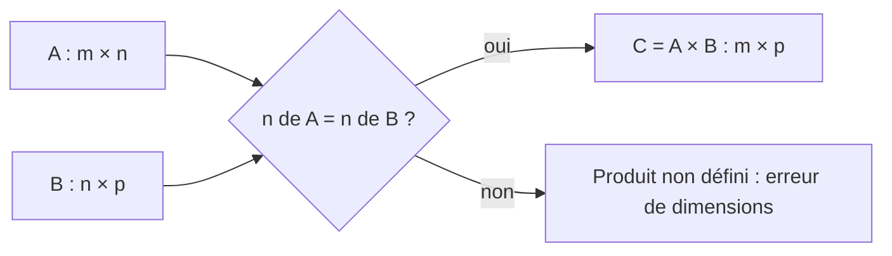

## Introduction

Une matrice n'est qu'un tableau de nombres organisé en lignes et colonnes — mais cette structure simple permet de représenter et manipuler efficacement des ensembles entiers de données, une capacité exploitée massivement en data science et en machine learning. Un export CSV de logs de pare-feu, une table de flux réseau ou un jeu d'emails étiquetés deviennent, une fois chargés en mémoire, des matrices.

Ce chapitre te donne les outils pour manipuler ces tableaux. À la fin, tu sauras lire les dimensions d'une matrice, extraire une ligne ou une colonne, additionner et transposer des matrices, et surtout calculer un produit matriciel à la main comme avec NumPy. Ce produit est l'opération la plus importante du cours : c'est lui qui calcule des scores de suspicion pour des milliers d'événements à la fois, et c'est lui qu'exécutent les cartes graphiques lors de l'entraînement des réseaux de neurones.

## Une matrice comme tableau de vecteurs

<CehCallout>
Une matrice peut se voir comme un empilement de vecteurs lignes (ou colonnes) : un tableau de 100 emails, chacun représenté par un vecteur de 3 caractéristiques (chapitre 1), forme naturellement une matrice de 100 lignes et 3 colonnes.
</CehCallout>

```text
Matrice de 3 emails (lignes) x 3 caractéristiques (colonnes) :

[ 15   2   1 ]   ← email 1
[  2  45   0 ]   ← email 2
[  8  12   1 ]   ← email 3
```

### Vocabulaire et notations

Une matrice de m lignes et n colonnes est dite de **dimension** (ou de taille) m×n, et on lit toujours les lignes en premier. La matrice ci-dessus est donc de dimension 3×3 : trois emails, trois caractéristiques. On note souvent l'élément situé à la ligne i et à la colonne j sous la forme aᵢⱼ. Dans notre exemple, l'élément de la ligne 3 et de la colonne 2 vaut 12 : c'est la taille du troisième email.

Une matrice qui a autant de lignes que de colonnes est dite **carrée**. Une matrice à une seule colonne est un vecteur colonne, une matrice à une seule ligne un vecteur ligne. La **diagonale** d'une matrice carrée regroupe les éléments aᵢᵢ, de haut à gauche à bas à droite.

### La convention des jeux de données

En data science, la convention universelle est la suivante : **chaque ligne est une observation** (un email, un flux réseau, un événement de log) et **chaque colonne est une caractéristique** (feature). On note souvent cette matrice X, de dimension n×p, avec n observations et p caractéristiques. scikit-learn attend exactement ce format pour toutes ses méthodes `fit` et `predict`.

```python
import numpy as np

# 3 emails (lignes) × 3 caractéristiques (colonnes) : [liens, taille_ko, piece_jointe]
X = np.array([[15,  2, 1],
              [ 2, 45, 0],
              [ 8, 12, 1]])
print("shape :", X.shape)
print("email 2 :", X[1])          # une ligne = un vecteur observation
print("colonne liens :", X[:, 0]) # une colonne = une caractéristique
print("élément (3, 2) :", X[2, 1])
print("transposée :\n", X.T)
```

```text
shape : (3, 3)
email 2 : [ 2 45  0]
colonne liens : [15  2  8]
élément (3, 2) : 12
transposée :
 [[15  2  8]
 [ 2 45 12]
 [ 1  0  1]]
```

Attention : NumPy numérote à partir de zéro. L'élément mathématique de la ligne 3, colonne 2, s'obtient donc avec `X[2, 1]`. La syntaxe `X[:, 0]` signifie « toutes les lignes, colonne 0 ».

### La transposée

La **transposée** d'une matrice, notée Aᵀ, s'obtient en échangeant lignes et colonnes : la ligne i devient la colonne i. Une matrice m×n devient n×m. Dans l'exemple ci-dessus, la première ligne de la transposée regroupe le nombre de liens des trois emails. La transposée intervient partout : dans le calcul des covariances au chapitre 5, dans les équations de la régression linéaire, et dans la propriété utile (AB)ᵀ = BᵀAᵀ, où l'ordre s'inverse.

## Addition et multiplication par un scalaire

<Steps steps={[
  { title: "Addition de matrices", description: "Additionner terme à terme, comme pour les vecteurs — les deux matrices doivent avoir les mêmes dimensions." },
  { title: "Multiplication par un scalaire", description: "Multiplier chaque élément de la matrice par le même nombre." },
]} />

L'addition fonctionne exactement comme pour les vecteurs : on additionne les éléments situés à la même position. Elle n'est définie que si les deux matrices ont les mêmes dimensions. Un cas d'usage typique consiste à cumuler deux matrices de comptage, par exemple le nombre de connexions par heure (lignes) et par port (colonnes) observé lundi et mardi : la somme donne le total sur les deux jours. Multiplier une matrice par un scalaire multiplie chacun de ses éléments, ce qui sert notamment à changer d'unité pour toute une table d'un seul coup.

## La multiplication matricielle

<CehCallout>
La multiplication de deux matrices A (m×n) et B (n×p) donne une matrice C (m×p), où chaque élément de C est un produit scalaire (chapitre 1) entre une ligne de A et une colonne de B — c'est l'opération centrale qui permet, par exemple, à un réseau de neurones de transformer une entrée en sortie à chaque couche.
</CehCallout>

### Le calcul pas à pas

Pour obtenir l'élément de la ligne i et de la colonne j du produit, on prend la ligne i de A, la colonne j de B, et on calcule leur produit scalaire. Pour un produit 2×2, il y a donc quatre produits scalaires à calculer.

```text
Exemple de multiplication matricielle simple (2x2) :

A = [1 2]      B = [5 6]
    [3 4]          [7 8]

A × B = [1×5+2×7  1×6+2×8]   =  [19 22]
        [3×5+4×7  3×6+4×8]      [43 50]
```

Reprenons le premier élément : la ligne 1 de A est [1, 2], la colonne 1 de B est [5, 7], leur produit scalaire vaut 1×5 + 2×7 = 5 + 14 = 19. Le deuxième élément de la première ligne combine [1, 2] avec la colonne [6, 8], soit 6 + 16 = 22. On procède de même pour la deuxième ligne.

Faisons un second exemple, plus court : le produit de [[2,0],[1,3]] par [[1,1],[0,2]]. La première ligne donne [2×1+0×0, 2×1+0×2], soit [2, 2]. La seconde ligne donne [1×1+3×0, 1×1+3×2], soit [1, 7]. Le résultat est donc [[2,2],[1,7]].

### La règle des dimensions

<TipCallout>
La condition pour multiplier deux matrices : le nombre de colonnes de la première doit être égal au nombre de lignes de la seconde. Une matrice (2×3) ne peut être multipliée qu'avec une matrice ayant 3 lignes — vérifier cette compatibilité de dimensions est le premier réflexe avant toute multiplication.
</TipCallout>

Un moyen mnémotechnique consiste à écrire les dimensions côte à côte : (m×**n**) fois (**n**×p). Les deux dimensions intérieures doivent être égales, et elles « disparaissent » ; les dimensions extérieures donnent la taille du résultat, m×p. Ainsi une matrice 3×2 multipliée par une matrice 2×4 donne une matrice 3×4, alors qu'une matrice 3×2 ne peut pas être multipliée par une autre matrice 3×2.



### Non-commutativité

<WarningCallout>
La multiplication matricielle n'est PAS commutative : A × B est en général différent de B × A, contrairement à la multiplication de nombres classiques. C'est une source d'erreurs fréquente pour qui découvre l'algèbre linéaire — l'ordre des matrices dans une multiplication compte toujours.
</WarningCallout>

Pourquoi ? Parce que A × B combine les lignes de A avec les colonnes de B, alors que B × A combine les lignes de B avec les colonnes de A : ce ne sont tout simplement pas les mêmes produits scalaires. Parfois, l'un des deux produits n'est même pas défini : une matrice 3×2 fois une matrice 2×4 existe, mais l'inverse (2×4 fois 3×2) n'existe pas. En revanche, le produit matriciel est **associatif** : (AB)C = A(BC), et **distributif** sur l'addition : A(B + C) = AB + AC.

### Vérifier avec NumPy

```python
import numpy as np

A = np.array([[1, 2], [3, 4]])
B = np.array([[5, 6], [7, 8]])
print("A @ B =\n", A @ B)
print("B @ A =\n", B @ A)
print("A * B (terme à terme) =\n", A * B)
print("A + B =\n", A + B)
print("10 * A =\n", 10 * A)
I = np.eye(2, dtype=int)
print("A @ I == A :", np.array_equal(A @ I, A))
```

```text
A @ B =
 [[19 22]
 [43 50]]
B @ A =
 [[23 34]
 [31 46]]
A * B (terme à terme) =
 [[ 5 12]
 [21 32]]
A + B =
 [[ 6  8]
 [10 12]]
10 * A =
 [[10 20]
 [30 40]]
A @ I == A : True
```

La sortie confirme que A @ B et B @ A diffèrent. Elle montre aussi un piège classique : en NumPy, l'opérateur `*` réalise un produit **terme à terme** (appelé produit de Hadamard), qui n'a rien à voir avec le produit matriciel. Le produit matriciel s'écrit `@` ou `np.matmul`.

## Le produit matrice-vecteur : calculer des milliers de scores d'un coup

Un cas particulier très fréquent est le produit d'une matrice de données X (n×p) par un vecteur de poids w (p composantes). Le résultat est un vecteur de n nombres : chaque nombre est le produit scalaire d'une observation avec les poids. C'est exactement ce que calcule un modèle linéaire, comme la régression linéaire ou la partie linéaire d'une régression logistique.

```python
import numpy as np

X = np.array([[15,  2, 1],
              [ 2, 45, 0],
              [ 8, 12, 1]])
w = np.array([0.5, -0.02, 2.0])   # poids d'un score de suspicion
print("scores :", X @ w)

W = np.ones((2, 4))
try:
    X @ W
except ValueError as e:
    print("Erreur :", e)
print("Produit X (3×3) @ M (3×2) ->", (X @ np.ones((3, 2))).shape)
```

```text
scores : [9.46 0.1  5.76]
Erreur : matmul: Input operand 1 has a mismatch in its core dimension 0, with gufunc signature (n?,k),(k,m?)->(n?,m?) (size 2 is different from 3)
Produit X (3×3) @ M (3×2) -> (3, 2)
```

Vérifions le premier score à la main : 15×0,5 + 2×(−0,02) + 1×2 = 7,5 − 0,04 + 2 = 9,46. Le premier email, avec beaucoup de liens et une pièce jointe, obtient le score le plus élevé. Sur un million d'emails, la même ligne de code calcule un million de scores en une fraction de seconde, car NumPy délègue le calcul à des bibliothèques optimisées (BLAS). Le message d'erreur, lui, montre ce qui se passe quand la règle des dimensions n'est pas respectée : la dimension intérieure vaut 3 d'un côté et 2 de l'autre.

### Le produit X Xᵀ : comparer toutes les observations entre elles

Multiplier une matrice de données par sa transposée donne une matrice carrée n×n, appelée **matrice de Gram**, dont l'élément (i, j) est le produit scalaire entre l'observation i et l'observation j. On compare ainsi toutes les paires d'emails en une seule opération.

```python
import numpy as np
import pandas as pd

df = pd.DataFrame(
    {"liens": [15, 2, 8], "taille_ko": [2, 45, 12], "piece_jointe": [1, 0, 1]},
    index=["mail_a", "mail_b", "mail_c"],
)
X = df.to_numpy()
G = X @ X.T          # matrice de Gram : produits scalaires entre emails
print(df)
print(G)
```

```text
        liens  taille_ko  piece_jointe
mail_a     15          2             1
mail_b      2         45             0
mail_c      8         12             1
[[ 230  120  145]
 [ 120 2029  556]
 [ 145  556  209]]
```

On remarque que cette matrice est **symétrique** (elle est égale à sa transposée) et que sa diagonale contient le carré de la norme de chaque email. On voit aussi que la colonne `taille_ko` écrase les autres : le produit entre mail_b et mail_c est dominé par 45×12. C'est un premier signal qu'il faudra mettre les caractéristiques à la même échelle avant de comparer des observations, comme le montreront le chapitre 6 et le cours Data Science. La méthode `to_numpy()` de pandas est la façon recommandée de passer d'un DataFrame à une matrice NumPy.

## La matrice identité

<CehCallout>
La matrice identité (des 1 sur la diagonale, des 0 ailleurs) joue le rôle du nombre 1 dans la multiplication classique : multiplier n'importe quelle matrice par l'identité la laisse inchangée. Elle sert de référence pour définir l'inverse d'une matrice, abordé au chapitre suivant.
</CehCallout>

On la note I, ou Iₙ pour préciser sa taille n×n. Pour une matrice A de dimension m×n, on a A × Iₙ = A et Iₘ × A = A. En NumPy, on la crée avec `np.eye(n)`. D'autres matrices particulières reviendront souvent : la **matrice nulle** (que des zéros), les **matrices diagonales** (des valeurs quelconques sur la diagonale, des zéros ailleurs), qui étirent chaque axe indépendamment, et les **matrices symétriques**, comme la matrice de Gram ou la matrice de covariance.

## Récapitulatif des opérations

| Opération | Condition | Taille du résultat | NumPy |
| --- | --- | --- | --- |
| Addition A + B | mêmes dimensions | celle de A | `A + B` |
| Scalaire k × A | aucune | celle de A | `k * A` |
| Transposée | aucune | n×m pour A de taille m×n | `A.T` |
| Produit A × B | colonnes de A = lignes de B | m×p | `A @ B` |
| Produit terme à terme | mêmes dimensions | celle de A | `A * B` |

<CompareTable
  titleA="Produit matriciel (@)"
  titleB="Produit terme à terme (*)"
  rows={[
    { a: "Combine lignes et colonnes par produits scalaires", b: "Multiplie les éléments situés à la même position" },
    { a: "Exige colonnes de A = lignes de B", b: "Exige des dimensions identiques (ou compatibles par broadcasting)" },
    { a: "Non commutatif", b: "Commutatif" },
    { a: "Sert aux modèles linéaires et aux couches de réseaux", b: "Sert aux masques, pondérations et normalisations élément par élément" },
]}
/>

## Applications en cybersécurité

Toute la chaîne d'analyse de données de sécurité repose sur des matrices. Une **matrice de comptage** heure × port permet de repérer qu'un poste ouvre soudainement des connexions vers le port 445 à trois heures du matin. Une **matrice d'adjacence**, où l'élément (i, j) vaut 1 si la machine i a contacté la machine j, décrit un réseau d'entreprise ; ses puissances successives révèlent les chemins de mouvement latéral possibles, une idée proche de celle qu'exploitent les outils de graphe d'attaque Active Directory. En cryptographie, le chiffre de Hill chiffre des blocs de lettres par produit matrice-vecteur, comme on le verra au chapitre 3. Enfin, les modèles de détection en production évaluent des lots entiers d'événements par un seul produit matriciel, ce qui permet de suivre le débit d'un SIEM.

## Erreurs fréquentes

L'erreur la plus courante est de confondre `*` et `@` en NumPy : le code s'exécute sans erreur mais calcule autre chose. La deuxième est d'inverser l'ordre des facteurs, en écrivant `w @ X` au lieu de `X @ w`, ce qui échoue ou, pire, réussit avec une matrice carrée et donne un résultat faux. La troisième est d'oublier la convention lignes = observations : si tu transposes accidentellement ta matrice, scikit-learn croira avoir trois observations de mille caractéristiques au lieu de mille observations de trois caractéristiques. Enfin, les vecteurs NumPy à une dimension, de forme `(3,)`, ne sont ni des lignes ni des colonnes : `v.T` ne les change pas, et il faut utiliser `v.reshape(-1, 1)` pour obtenir un vrai vecteur colonne.

## Lab — Mise en pratique

**Environnement** : calculs à la main, puis Python 3.12+ avec NumPy et pandas.

<Steps steps={[
  { title: "Vérifier la compatibilité de dimensions", description: "Une matrice A de dimension (3×2) peut-elle être multipliée par une matrice B de dimension (2×4) ? Et par une matrice de dimension (3×2) ? Vérifie tes réponses en observant la forme du résultat ou le message d'erreur.", code: "import numpy as np\nA = np.ones((3, 2))\nprint((A @ np.ones((2, 4))).shape)\nA @ np.ones((3, 2))  # doit lever ValueError" },
  { title: "Multiplier deux matrices 2x2", description: "Calcule à la main le produit de [[2,0],[1,3]] par [[1,1],[0,2]], puis vérifie. Le résultat attendu est [[2,2],[1,7]].", code: "print(np.array([[2, 0], [1, 3]]) @ np.array([[1, 1], [0, 2]]))" },
  { title: "Constater la non-commutativité", description: "Calcule maintenant le produit dans l'autre sens. Les deux résultats sont-ils égaux ?", code: "print(np.array([[1, 1], [0, 2]]) @ np.array([[2, 0], [1, 3]]))" },
  { title: "Vérifier le rôle de l'identité", description: "Multiplie une matrice quelconque par np.eye de la bonne taille, à gauche puis à droite, et vérifie qu'elle reste inchangée.", code: "M = np.array([[1, 2, 3], [4, 5, 6]])\nprint(np.eye(2) @ M)\nprint(M @ np.eye(3))" },
  { title: "Calculer des scores de suspicion", description: "Construis une matrice de 4 connexions décrites par [octets_sortants_mo, nb_ports_distincts, heure_nocturne] et un vecteur de poids. Calcule les scores avec un seul produit et identifie la connexion la plus suspecte.", code: "X = np.array([[0.2, 1, 0], [850, 3, 1], [1.5, 40, 1], [3, 2, 0]])\nw = np.array([0.01, 0.2, 1.5])\nscores = X @ w\nprint(scores, scores.argmax())" },
  { title: "Passer de pandas à NumPy", description: "Charge les mêmes données dans un DataFrame avec des noms de colonnes, convertis-le avec to_numpy(), puis calcule la matrice de Gram. Vérifie qu'elle est symétrique.", code: "import pandas as pd\ndf = pd.DataFrame(X, columns=['mo_out', 'ports', 'nuit'])\nG = df.to_numpy() @ df.to_numpy().T\nprint(np.allclose(G, G.T))" },
]} />

## À retenir

- Une matrice est un tableau de nombres, souvent interprété comme un empilement de vecteurs (par exemple, un jeu de données entier avec une observation par ligne).
- Une matrice m×n a m lignes et n colonnes ; la transposée échange lignes et colonnes.
- L'addition se fait terme à terme et exige des dimensions identiques.
- La multiplication matricielle combine des produits scalaires ligne par colonne et exige que le nombre de colonnes de A égale le nombre de lignes de B ; le résultat est m×p.
- La multiplication matricielle n'est pas commutative — l'ordre des matrices compte toujours.
- La matrice identité joue le rôle du nombre 1 ; en NumPy, `@` est le produit matriciel et `*` le produit terme à terme.

## Questions de révision

1. Pourquoi une matrice de 100 lignes et 3 colonnes peut-elle représenter un jeu de 100 emails à 3 caractéristiques chacun ?
2. Quelle condition de dimensions faut-il vérifier avant de multiplier deux matrices, et quelle sera la taille du résultat d'un produit (3×2) par (2×4) ?
3. Calcule le produit de [[1,0],[2,1]] par [[3,4],[0,1]] en détaillant chaque produit scalaire.
4. Pourquoi A × B n'est-il généralement pas égal à B × A ?
5. Quelle est la différence entre `A @ B` et `A * B` en NumPy ? Donne un cas d'usage de chacun.
6. Que contient la diagonale de la matrice de Gram X Xᵀ, et pourquoi cette matrice est-elle symétrique ?
7. Dans l'exemple des scores de suspicion, pourquoi la colonne exprimée en kilo-octets risque-t-elle de dominer les autres ?
