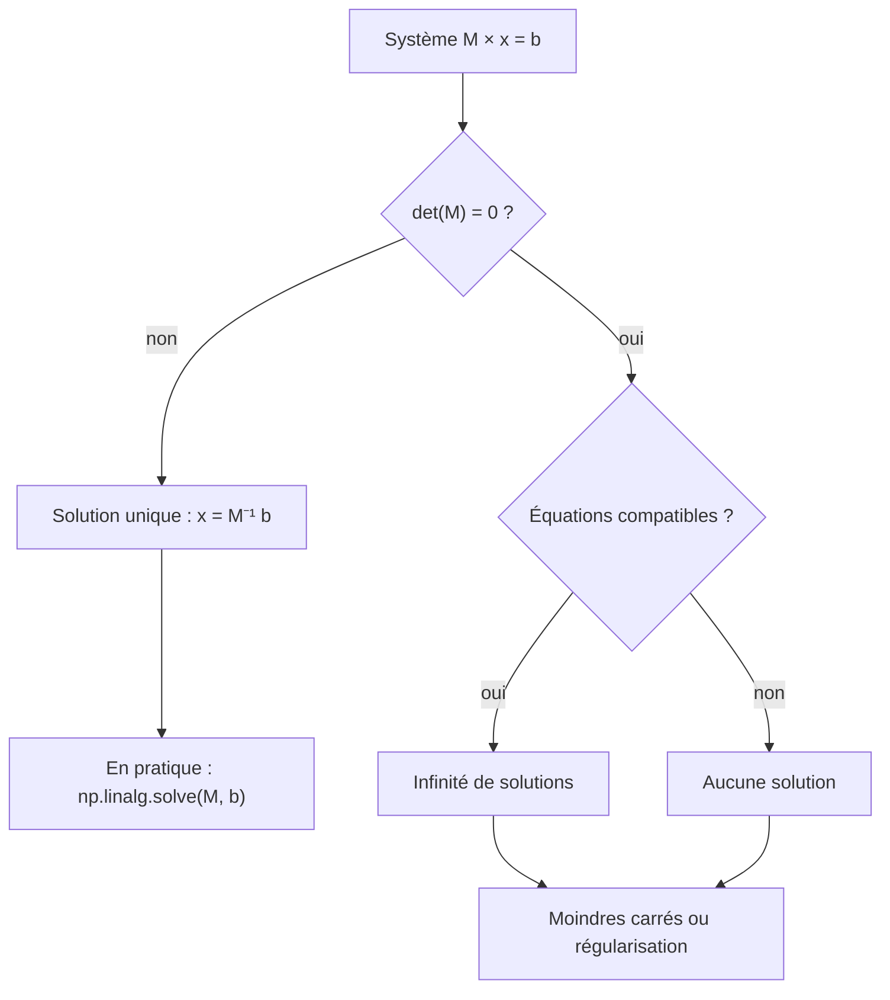

## Introduction

Ce chapitre couvre deux notions étroitement liées : le déterminant, qui indique si une matrice est "inversible", et l'inverse lui-même, qui permet d'annuler l'effet d'une transformation matricielle — un concept qui réapparaît directement en cryptographie (certains schémas de chiffrement historiques comme le chiffre de Hill reposent sur l'inversion de matrices).

Ces notions ont aussi un intérêt très pratique en data science. La régression linéaire se ramène à la résolution d'un système d'équations ; des colonnes redondantes dans un jeu de données rendent ce système impossible à résoudre proprement ; et une matrice « presque » non inversible peut faire exploser les erreurs numériques. À la fin de ce chapitre, tu sauras calculer un déterminant et un inverse, résoudre un système à la main et avec NumPy, diagnostiquer une matrice mal conditionnée, et chiffrer puis casser un message avec le chiffre de Hill.

## Le déterminant — une mesure de "dégénérescence"

<CehCallout>
Le déterminant d'une matrice carrée est un unique nombre qui indique si la matrice "écrase" l'espace (déterminant nul) ou le préserve (déterminant non nul). Une matrice de déterminant nul n'est pas inversible — c'est une information cruciale avant de tenter de résoudre un système d'équations.
</CehCallout>

### Le cas 2×2

Le déterminant n'est défini que pour les matrices **carrées**. Pour une matrice 2×2, la formule tient en une ligne : on multiplie les éléments de la diagonale principale, puis on soustrait le produit des éléments de l'autre diagonale.

```text
Déterminant d'une matrice 2x2 :

Pour M = [a b]
         [c d]

det(M) = a×d - b×c

Exemple : M = [2 3]     det(M) = 2×5 - 3×4 = 10 - 12 = -2
              [4 5]
```

Deux autres exemples à refaire de tête. Pour [[3,1],[2,4]], on obtient 3×4 − 1×2 = 12 − 2 = 10 : la matrice est inversible. Pour [[2,4],[1,2]], on obtient 2×2 − 4×1 = 4 − 4 = 0 : la matrice n'est pas inversible, et on remarque que la première ligne [2, 4] est exactement le double de la seconde [1, 2].

### L'interprétation géométrique

Le déterminant a une signification visuelle précise. En deux dimensions, sa valeur absolue est le **facteur par lequel la matrice multiplie les aires**. Le carré unité, formé par les vecteurs [1, 0] et [0, 1], est transformé en un parallélogramme dont l'aire vaut exactement la valeur absolue du déterminant. En trois dimensions, il s'agit du facteur de multiplication des volumes. Le signe indique si la transformation conserve l'orientation (positif) ou la retourne comme un miroir (négatif).

Un déterminant nul signifie donc que l'aire est écrasée à zéro : le plan entier est aplati sur une droite, voire sur un point. Une fois aplati, impossible de savoir d'où venait chaque point, et c'est exactement pour cela qu'aucun inverse n'existe.

<TipCallout>
Un déterminant nul signifie que les lignes (ou colonnes) de la matrice sont linéairement dépendantes — l'une peut être obtenue à partir des autres par combinaison — ce qui correspond géométriquement à un "écrasement" de l'espace en une dimension inférieure.
</TipCallout>

Ce lien rejoint la notion de rang vue au chapitre 1 : une matrice carrée n×n a un déterminant non nul si et seulement si son rang vaut n, c'est-à-dire si ses colonnes forment une famille libre.

### Le cas 3×3 et les propriétés utiles

Pour une matrice 3×3, on utilise le **développement par cofacteurs** selon la première ligne : chaque élément de cette ligne est multiplié par le déterminant 2×2 obtenu en supprimant sa ligne et sa colonne, avec des signes alternés plus, moins, plus.

```text
T = [2 1 0]
    [1 3 1]
    [0 1 4]

det(T) = 2 × det([3 1],[1 4]) − 1 × det([1 1],[0 4]) + 0 × det([1 3],[0 1])
       = 2 × (12 − 1)        − 1 × (4 − 0)          + 0
       = 22 − 4 = 18
```

Au-delà de 3×3, ce calcul devient vite très long, et les logiciels utilisent plutôt une décomposition LU, bien plus efficace. Quelques propriétés sont à connaître : le déterminant d'un produit est le produit des déterminants, det(AB) = det(A) × det(B) ; le déterminant de la transposée est égal à celui de la matrice ; le déterminant de l'identité vaut 1 ; et si A est inversible, det(A⁻¹) = 1 / det(A). La première propriété explique au passage pourquoi un produit de matrices est inversible seulement si chacune l'est.

## L'inverse d'une matrice

<Steps steps={[
  { title: "Condition d'existence", description: "Une matrice carrée n'admet un inverse que si son déterminant est non nul." },
  { title: "Définition", description: "L'inverse M⁻¹ d'une matrice M est tel que M × M⁻¹ = matrice identité (vue au chapitre 2)." },
  { title: "Utilité", description: "L'inverse permet d''annuler' une transformation matricielle, un peu comme la division annule une multiplication en arithmétique classique." },
]} />

### La formule 2×2

Pour une matrice 2×2 inversible, l'inverse s'obtient en trois gestes : on échange les deux éléments de la diagonale principale, on change le signe des deux autres, et on divise le tout par le déterminant.

```text
Si M = [a b]   et det(M) = ad − bc ≠ 0, alors   M⁻¹ = 1/(ad − bc) × [ d  −b]
       [c d]                                                        [−c   a]

Exemple : M = [2 3], det = −2   →   M⁻¹ = −1/2 × [ 5 −3]  =  [−2.5  1.5]
              [4 5]                              [−4  2]     [ 2   −1 ]
```

On vérifie toujours le résultat en calculant M × M⁻¹, qui doit redonner l'identité. Note aussi que (AB)⁻¹ = B⁻¹A⁻¹ : pour annuler « A puis B », on annule d'abord B, puis A, exactement comme on enlève ses chaussures avant ses chaussettes.

## Résoudre un système d'équations avec les matrices

<CompareTable
  titleA="Système d'équations classique"
  titleB="Écriture matricielle équivalente"
  rows={[
    { a: "2x + 3y = 8\n4x + 5y = 14", b: "M × [x,y] = [8,14], où M = [[2,3],[4,5]]" },
]}
/>

<Steps steps={[
  { title: "Écrire le système sous forme matricielle", description: "Regrouper les coefficients dans une matrice M et les résultats dans un vecteur." },
  { title: "Calculer l'inverse de M (si elle existe)", description: "Vérifier d'abord que le déterminant est non nul." },
  { title: "Multiplier l'inverse par le vecteur résultat", description: "La solution du système est directement donnée par M⁻¹ × résultat." },
]} />

Déroulons l'exemple à la main. Le déterminant de M vaut −2, il est non nul, donc le système a une solution unique. L'inverse calculé plus haut est [[−2.5, 1.5], [2, −1]]. On multiplie par le vecteur [8, 14] : la première composante vaut −2,5×8 + 1,5×14 = −20 + 21 = 1, la seconde vaut 2×8 − 1×14 = 16 − 14 = 2. La solution est donc x = 1 et y = 2. Vérification dans le système d'origine : 2×1 + 3×2 = 8 et 4×1 + 5×2 = 14. C'est juste.

Quand le déterminant est nul, le système a soit une infinité de solutions (les équations sont redondantes), soit aucune (elles sont contradictoires), mais jamais une solution unique.



### Avec NumPy

Le module `numpy.linalg` fournit toutes ces opérations.

```python
import numpy as np

M = np.array([[2, 3], [4, 5]])
print("det(M)  =", np.linalg.det(M))
print("M⁻¹     =\n", np.linalg.inv(M))
print("M @ M⁻¹ =\n", M @ np.linalg.inv(M))

b = np.array([8, 14])
print("solve   :", np.linalg.solve(M, b))

S = np.array([[2, 4], [1, 2]])
print("det(S)  =", np.linalg.det(S))
try:
    np.linalg.inv(S)
except np.linalg.LinAlgError as e:
    print("LinAlgError :", e)

T = np.array([[2, 1, 0], [1, 3, 1], [0, 1, 4]])
print("det 3x3 =", round(np.linalg.det(T), 6))
```

```text
det(M)  = -2.0
M⁻¹     =
 [[-2.5  1.5]
 [ 2.  -1. ]]
M @ M⁻¹ =
 [[1. 0.]
 [0. 1.]]
solve   : [1. 2.]
det(S)  = 0.0
LinAlgError : Singular matrix
det 3x3 = 18.0
```

La fonction `np.linalg.solve(M, b)` résout directement le système sans jamais former l'inverse. Pour une matrice singulière, NumPy lève une exception `LinAlgError`. Garde en tête que `np.linalg.det` travaille en nombres flottants : sur d'autres matrices, il peut renvoyer une valeur comme 1e-16 au lieu d'un zéro exact. On ne teste donc jamais `det == 0`, mais plutôt le rang ou le conditionnement.

<WarningCallout>
En pratique (notamment en machine learning), on évite de calculer explicitement l'inverse d'une grande matrice — coûteux en calcul et numériquement instable — au profit de méthodes de résolution plus robustes. La notion d'inverse reste néanmoins essentielle pour comprendre CE QUE ces méthodes calculent réellement.
</WarningCallout>

### Le conditionnement : quand « presque singulier » devient dangereux

Une matrice peut avoir un déterminant non nul mais minuscule. Elle est alors **mal conditionnée** : une infime variation des données d'entrée provoque une énorme variation de la solution. Le **nombre de conditionnement**, donné par `np.linalg.cond`, mesure cette sensibilité ; plus il est grand, plus le système est fragile.

```python
import numpy as np

# Matrice presque singulière : la 2e ligne est presque le double de la 1re
A = np.array([[1.0, 2.0], [2.0, 4.0001]])
print("det   :", np.linalg.det(A))
print("cond  :", f"{np.linalg.cond(A):.3e}")
print("x     :", np.linalg.solve(A, [3.0, 6.0001]))
print("x'    :", np.linalg.solve(A, [3.0, 6.0002]))   # second membre à peine modifié
```

```text
det   : 9.999999999976704e-05
cond  : 2.500e+05
x     : [1. 1.]
x'    : [-1.  2.]
```

Une modification d'un dix-millième dans le second membre fait passer la solution de [1, 1] à [−1, 2]. En data science, ce phénomène s'appelle la **multicolinéarité** : deux caractéristiques presque proportionnelles, comme « octets envoyés » et « paquets envoyés » sur un lien où la taille des paquets varie peu, rendent les coefficients d'une régression linéaire instables et impossibles à interpréter. Les remèdes classiques sont de supprimer une des colonnes redondantes, de réduire la dimension (chapitre 5) ou d'ajouter une **régularisation**, comme le fait la régression Ridge de scikit-learn, qui ajoute un multiple de l'identité à la matrice pour l'éloigner de la singularité.

## Le chiffre de Hill : l'inversion au service du chiffrement

<CehCallout>
Le chiffre de Hill, un schéma de chiffrement classique par blocs, chiffre un message en le multipliant par une matrice clé — déchiffrer revient alors à multiplier par l'inverse de cette matrice. Si la matrice clé n'est pas inversible (déterminant nul, ou non premier avec la taille de l'alphabet), le déchiffrement est impossible : un lien direct entre cette notion mathématique et une application cryptographique concrète.
</CehCallout>

### Le principe

Inventé par Lester Hill en 1929, ce chiffre code chaque lettre par un nombre de 0 à 25 (A vaut 0, B vaut 1, et ainsi de suite), découpe le message en blocs de n lettres, et multiplie chaque bloc par une matrice clé K de taille n×n, en calculant **modulo 26** : on ne garde que le reste de la division par 26. Pour déchiffrer, on multiplie par l'inverse de K modulo 26.

L'inverse modulaire impose une condition plus forte que « déterminant non nul » : le déterminant doit être **premier avec 26**, c'est-à-dire n'avoir aucun diviseur commun avec 26 autre que 1. Comme 26 = 2 × 13, le déterminant modulo 26 ne doit être ni pair, ni multiple de 13. La formule 2×2 reste valable, à condition de remplacer la division par le déterminant par une multiplication par son inverse modulo 26.

```python
import numpy as np

ALPHA = 26

def texte_vers_nombres(t):  return [ord(c) - ord("A") for c in t]
def nombres_vers_texte(v):  return "".join(chr(int(x) + ord("A")) for x in v)

def inverse_mod(K, m=ALPHA):
    """Inverse d'une matrice 2x2 modulo m (formule de l'adjointe)."""
    a, b, c, d = K.ravel()
    det = int(a * d - b * c) % m
    det_inv = pow(det, -1, m)          # lève ValueError si pgcd(det, m) != 1
    adj = np.array([[d, -b], [-c, a]])
    return (det_inv * adj) % m

def hill(texte, K):
    v = np.array(texte_vers_nombres(texte)).reshape(-1, 2).T   # blocs en colonnes
    return nombres_vers_texte(((K @ v) % ALPHA).T.ravel())

K = np.array([[3, 3], [2, 5]])
print("det K mod 26 :", int(round(np.linalg.det(K))) % 26)
K_inv = inverse_mod(K)
print("K⁻¹ mod 26 :\n", K_inv)
c = hill("HELP", K)
print("chiffré :", c, "| déchiffré :", hill(c, K_inv))

try:
    inverse_mod(np.array([[2, 4], [3, 1]]))     # det = -10 ≡ 16, pgcd(16, 26) = 2
except ValueError as e:
    print("Clé invalide :", e)
```

```text
det K mod 26 : 9
K⁻¹ mod 26 :
 [[15 17]
 [20  9]]
chiffré : HIAT | déchiffré : HELP
Clé invalide : base is not invertible for the given modulus
```

Le déterminant de la clé vaut 3×5 − 3×2 = 9, et 9 est premier avec 26 ; son inverse modulo 26 est 3, puisque 9 × 3 = 27, qui vaut 1 modulo 26. La seconde clé a un déterminant de −10, soit 16 modulo 26 : il est pair, donc partage le facteur 2 avec 26, et la fonction `pow(det, -1, 26)` de Python 3.8 et plus refuse de calculer l'inverse. Avec une telle clé, plusieurs messages clairs différents donneraient le même chiffré, et le déchiffrement serait ambigu.

### Pourquoi le chiffre de Hill est cassé

Le chiffre de Hill est entièrement **linéaire**, et c'est sa faiblesse fatale. Si un attaquant connaît quelques blocs de texte clair et leurs chiffrés correspondants (une **attaque à clair connu**), il les range en colonnes dans deux matrices P et C. Comme C = K × P modulo 26, il lui suffit de calculer K = C × P⁻¹ modulo 26, à condition que P soit inversible modulo 26.

```python
# Suite du script précédent : l'attaquant connaît « HELP » et son chiffré « HIAT »
P = np.array(texte_vers_nombres("HELP")).reshape(-1, 2).T   # [[7, 11], [4, 15]]
C = np.array(texte_vers_nombres("HIAT")).reshape(-1, 2).T
K_retrouvee = (C @ inverse_mod(P)) % 26
print(K_retrouvee)
```

```text
[[3 3]
 [2 5]]
```

Quatre lettres connues ont suffi à retrouver la clé complète. C'est pourquoi les chiffrements modernes comme AES combinent des étapes linéaires (l'étape MixColumns d'AES est précisément une multiplication matricielle, dans un corps fini) avec des étapes **non linéaires** (les S-boxes), qui empêchent ce type de résolution algébrique.

<AttackDefenseTable rows={[
  { phase: "Chiffrement", attack: "Clé de Hill choisie sans vérifier son déterminant modulo 26", defense: "Vérifier que pgcd(det(K), 26) = 1 avant toute utilisation" },
  { phase: "Cryptanalyse", attack: "Attaque à clair connu : K = C × P⁻¹ mod 26 avec quelques blocs connus", defense: "Ne jamais utiliser de chiffrement purement linéaire ; utiliser AES-GCM ou ChaCha20-Poly1305" },
  { phase: "Analyse de données", attack: "Colonnes redondantes rendant un modèle instable ou manipulable", defense: "Contrôler le rang et le conditionnement, régulariser (Ridge)" },
]} />

## Erreurs fréquentes

On essaie parfois de calculer le déterminant d'une matrice non carrée : il n'existe pas. Une autre erreur courante est de tester `np.linalg.det(M) == 0` alors que les flottants produisent des résidus comme 1e-17 ; il vaut mieux examiner `np.linalg.matrix_rank` ou `np.linalg.cond`. Beaucoup oublient aussi de diviser par le déterminant dans la formule de l'inverse 2×2, ou inversent les signes au mauvais endroit : on échange la diagonale principale et on change le signe de l'autre diagonale. Dans le chiffre de Hill, l'erreur typique est de croire qu'un déterminant non nul suffit, alors qu'il doit être premier avec 26. Enfin, écrire `np.linalg.inv(A) @ b` au lieu de `np.linalg.solve(A, b)` fonctionne sur de petits exemples mais est plus lent et moins précis sur de vraies données.

## Lab — Mise en pratique

**Environnement** : calculs à la main, puis Python 3.12+ avec NumPy.

<Steps steps={[
  { title: "Calculer un déterminant", description: "Calcule le déterminant de [[3,1],[2,4]]. Cette matrice est-elle inversible ? Vérifie avec NumPy : tu dois obtenir 10, à un arrondi flottant près.", code: "import numpy as np\nprint(np.linalg.det(np.array([[3, 1], [2, 4]])))" },
  { title: "Identifier une matrice non inversible", description: "Calcule le déterminant de [[2,4],[1,2]]. Que remarques-tu sur la relation entre les deux lignes ? Observe l'exception levée par np.linalg.inv et le rang de la matrice.", code: "S = np.array([[2, 4], [1, 2]])\nprint(np.linalg.matrix_rank(S))\nnp.linalg.inv(S)" },
  { title: "Résoudre un système", description: "Résous 2x + 3y = 8 et 4x + 5y = 14 à la main avec l'inverse, puis avec np.linalg.solve. La solution attendue est x = 1, y = 2.", code: "print(np.linalg.solve([[2, 3], [4, 5]], [8, 14]))" },
  { title: "Observer un mauvais conditionnement", description: "Résous le système presque singulier du chapitre avec deux seconds membres très proches. Note le nombre de conditionnement et l'écart entre les deux solutions.", code: "A = np.array([[1.0, 2.0], [2.0, 4.0001]])\nprint(np.linalg.cond(A))\nprint(np.linalg.solve(A, [3, 6.0001]), np.linalg.solve(A, [3, 6.0002]))" },
  { title: "Chiffrer avec Hill", description: "Recopie les fonctions du chapitre et chiffre le mot « ATTACK » (6 lettres, donc 3 blocs) avec la clé [[3,3],[2,5]], puis déchiffre-le avec l'inverse modulo 26.", code: "K = np.array([[3, 3], [2, 5]])\nc = hill('ATTACK', K)\nprint(c, hill(c, inverse_mod(K)))" },
  { title: "Tester une clé invalide", description: "Essaie la clé [[2,4],[3,1]]. Calcule son déterminant modulo 26 et explique pourquoi l'inverse modulaire n'existe pas.", code: "print((2*1 - 4*3) % 26)\ninverse_mod(np.array([[2, 4], [3, 1]]))" },
  { title: "Casser la clé par clair connu", description: "À partir de « HELP » et de son chiffré, retrouve la clé avec K = C × P⁻¹ mod 26. Vérifie que tu retrouves [[3,3],[2,5]].", code: "P = np.array(texte_vers_nombres('HELP')).reshape(-1, 2).T\nC = np.array(texte_vers_nombres(hill('HELP', K))).reshape(-1, 2).T\nprint((C @ inverse_mod(P)) % 26)" },
]} />

## À retenir

- Le déterminant d'une matrice carrée indique si elle est inversible (déterminant non nul) ou non (déterminant nul) ; sa valeur absolue est le facteur de multiplication des aires ou des volumes.
- Pour une matrice 2×2 [[a,b],[c,d]], le déterminant vaut ad − bc et l'inverse s'obtient en échangeant a et d, en changeant le signe de b et c, puis en divisant par le déterminant.
- L'inverse d'une matrice M vérifie M × M⁻¹ = identité, et permet d'annuler une transformation matricielle.
- Avant de résoudre un système par la méthode matricielle, on vérifie que le déterminant est non nul ; en pratique, on utilise `np.linalg.solve` plutôt que l'inverse explicite.
- Une matrice presque singulière est mal conditionnée : c'est la multicolinéarité en data science, corrigée par suppression de colonnes ou régularisation.
- Le chiffre de Hill exige un déterminant premier avec 26 ; sa linéarité le rend vulnérable à une attaque à clair connu.

## Questions de révision

1. Que signifie un déterminant nul pour une matrice, algébriquement et géométriquement ?
2. Pourquoi une matrice de déterminant nul n'admet-elle pas d'inverse ?
3. Calcule le déterminant de [[5,2],[3,4]], puis l'inverse de cette matrice.
4. Quelle est la première étape avant de résoudre le système 2x + 3y = 8, 4x + 5y = 14 par la méthode matricielle, et pourquoi ?
5. Pourquoi évite-t-on de calculer explicitement l'inverse d'une grande matrice en machine learning ?
6. En quoi le chiffre de Hill illustre-t-il une application concrète de l'inversion matricielle, et pourquoi une clé de déterminant 16 modulo 26 est-elle inutilisable ?
7. Explique comment une attaque à clair connu permet de retrouver la clé de Hill. Qu'est-ce qui protège AES contre ce type d'attaque ?
