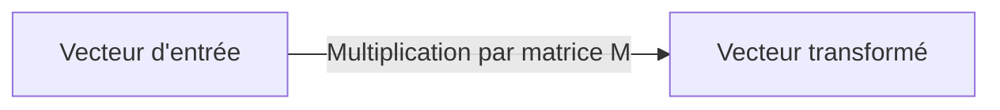

## Introduction

Ce chapitre change de perspective sur la matrice : plutôt qu'un simple tableau de nombres, une matrice peut être vue comme une fonction qui transforme un vecteur en un autre — une idée centrale pour comprendre le fonctionnement des réseaux de neurones, abordés au cours IA & Agents en Cybersécurité.

Ce changement de regard est très puissant. Il explique pourquoi la standardisation d'un jeu de données ne change pas la « forme » d'un nuage de points, pourquoi la réduction de dimension perd de l'information, et comment un réseau de neurones transforme progressivement un flux réseau brut en une probabilité d'intrusion. À la fin du chapitre, tu sauras lire l'effet géométrique d'une matrice, construire les matrices de rotation, de projection et de mise à l'échelle, composer plusieurs transformations dans le bon ordre et coder la propagation avant d'un petit réseau de neurones avec NumPy.

## Une matrice comme fonction

<CehCallout>
Multiplier un vecteur par une matrice produit un nouveau vecteur — c'est exactement la définition d'une fonction (une entrée, une sortie). On dit que la matrice réalise une "transformation linéaire" : elle respecte l'addition et la multiplication par un scalaire (transformer la somme de deux vecteurs équivaut à sommer leurs transformations respectives).
</CehCallout>



### La définition précise

Une fonction T qui envoie des vecteurs de ℝⁿ vers des vecteurs de ℝᵐ est une **transformation linéaire** (on dit aussi application linéaire) si elle respecte deux règles : T(u + w) = T(u) + T(w) pour tous vecteurs u et w, et T(k × u) = k × T(u) pour tout scalaire k. Autrement dit, transformer une combinaison linéaire revient à combiner les transformés. Une conséquence immédiate est que le vecteur nul est toujours envoyé sur le vecteur nul.

Le résultat fondamental est le suivant : **toute transformation linéaire de ℝⁿ vers ℝᵐ est une multiplication par une matrice m×n**, et réciproquement. Une matrice 3×5 est donc une fonction qui prend un vecteur de dimension 5 et renvoie un vecteur de dimension 3.

### Lire une matrice par ses colonnes

Il existe une astuce qui rend toute matrice lisible : **les colonnes de la matrice sont les images des vecteurs de base**. La première colonne indique où est envoyé [1, 0], la seconde où est envoyé [0, 1]. Comme tout vecteur [x, y] s'écrit x × [1, 0] + y × [0, 1], la linéarité impose que son image soit x fois la première colonne plus y fois la seconde. Connaître l'image de la base suffit donc à connaître toute la transformation.

Par exemple, la matrice [[0,−1],[1,0]] a pour première colonne [0, 1] et pour seconde colonne [−1, 0]. Elle envoie l'axe horizontal sur l'axe vertical, et l'axe vertical sur l'axe horizontal négatif : c'est une rotation d'un quart de tour dans le sens inverse des aiguilles d'une montre.

### Linéaire ou affine ?

Une **translation**, qui ajoute un vecteur constant b à chaque vecteur, n'est pas linéaire, car elle n'envoie pas le vecteur nul sur lui-même. La combinaison d'une transformation linéaire et d'une translation, de la forme x devient Mx + b, s'appelle une **transformation affine**. C'est exactement ce que fait une couche de réseau de neurones avec son biais, et c'est aussi ce que fait la standardisation d'une caractéristique, qui soustrait une moyenne puis divise par un écart-type.

## Transformations géométriques courantes

<CompareTable
  titleA="Transformation"
  titleB="Effet sur un vecteur"
  rows={[
    { a: "Mise à l'échelle (scaling)", b: "Étire ou compresse le vecteur selon chaque axe" },
    { a: "Rotation", b: "Fait pivoter le vecteur d'un certain angle, sans changer sa longueur" },
    { a: "Projection", b: "Écrase le vecteur sur un axe ou un plan (perd de l'information)" },
    { a: "Cisaillement (shear)", b: "Incline l'espace, comme pousser le haut d'un livre pendant que le bas reste fixe" },
]}
/>

### Les matrices correspondantes

| Transformation | Matrice 2×2 | Déterminant | Inversible ? |
| --- | --- | --- | --- |
| Mise à l'échelle par sx et sy | [[sx, 0], [0, sy]] | sx × sy | si sx et sy non nuls |
| Mise à l'échelle uniforme ×2 | [[2, 0], [0, 2]] | 4 | oui |
| Rotation d'angle θ | [[cos θ, −sin θ], [sin θ, cos θ]] | 1 | oui |
| Rotation de 90° | [[0, −1], [1, 0]] | 1 | oui |
| Projection sur l'axe x | [[1, 0], [0, 0]] | 0 | non |
| Cisaillement horizontal | [[1, k], [0, 1]] | 1 | oui |

La colonne déterminant relie ce chapitre au précédent : une rotation et un cisaillement conservent les aires (déterminant égal à 1), la mise à l'échelle uniforme par 2 les multiplie par 4, et la projection les écrase à zéro, ce qui explique qu'on ne puisse pas l'inverser.

<TipCallout>
Chacune de ces transformations correspond à une matrice spécifique — une matrice de rotation de 90°, par exemple, a une forme mathématique bien définie et reconnaissable ([[0,-1],[1,0]] en 2D), ce qui permet de composer plusieurs transformations en multipliant simplement leurs matrices entre elles.
</TipCallout>

### Observer les effets avec NumPy

```python
import numpy as np

v = np.array([3.0, 1.0])
S = np.array([[2, 0], [0, 2]])          # mise à l'échelle ×2
R = np.array([[0, -1], [1, 0]])         # rotation de 90°
P = np.array([[1, 0], [0, 0]])          # projection sur l'axe x
H = np.array([[1, 1], [0, 1]])          # cisaillement horizontal

for nom, M in [("échelle", S), ("rotation", R), ("projection", P), ("cisaillement", H)]:
    w = M @ v
    print(f"{nom:13s} {w}  norme {np.linalg.norm(w):.3f}  det {np.linalg.det(M):+.1f}")
print("norme de v :", round(np.linalg.norm(v), 3))
```

```text
échelle       [6. 2.]  norme 6.325  det +4.0
rotation      [-1.  3.]  norme 3.162  det +1.0
projection    [3. 0.]  norme 3.000  det +0.0
cisaillement  [4. 1.]  norme 4.123  det +1.0
norme de v : 3.162
```

La mise à l'échelle uniforme double chaque composante : [3, 1] devient [6, 2]. La rotation conserve exactement la norme (3,162), ce qui confirme qu'elle ne fait que pivoter le vecteur. La projection supprime la composante verticale : le vecteur [3, 1] et le vecteur [3, 57] auraient la même image [3, 0], ce qui montre concrètement la perte d'information.

### Noyau et image : ce qui est perdu, ce qui reste

Deux ensembles caractérisent une transformation. Le **noyau** regroupe tous les vecteurs envoyés sur le vecteur nul ; pour la projection sur l'axe x, c'est tout l'axe vertical. L'**image** regroupe tous les vecteurs qu'on peut obtenir en sortie ; pour la même projection, c'est l'axe horizontal. Le **théorème du rang** relie les deux : la dimension de l'image (le rang) plus la dimension du noyau est égale à la dimension de l'espace de départ. Quand le noyau contient autre chose que le vecteur nul, des entrées différentes donnent la même sortie, et l'information correspondante est définitivement perdue. C'est exactement ce qui se passe lorsqu'on réduit 50 caractéristiques à 3 composantes principales au chapitre 5.

## Composer des transformations

<Steps steps={[
  { title: "Appliquer une première transformation", description: "Multiplier le vecteur par une première matrice A." },
  { title: "Appliquer une seconde transformation", description: "Multiplier le résultat par une seconde matrice B." },
  { title: "Équivalent à une seule transformation combinée", description: "Cette séquence équivaut exactement à multiplier le vecteur original par la matrice produit B × A (dans cet ordre précis)." },
]} />

Pourquoi B × A et non A × B ? Appliquer A puis B s'écrit B × (A × v). Par associativité du produit matriciel, c'est égal à (B × A) × v. La matrice appliquée en premier se trouve donc **à droite**, la plus proche du vecteur, comme pour une composition de fonctions f(g(x)), où g est appliquée d'abord.

<WarningCallout>
L'ordre des transformations composées compte, exactement comme la multiplication matricielle n'est pas commutative (chapitre 2) — faire d'abord une rotation puis une mise à l'échelle ne donne pas le même résultat que l'inverse. Un point de vigilance fréquent en infographie comme en machine learning.
</WarningCallout>

```python
import numpy as np

v = np.array([1.0, 0.0])
R = np.array([[0, -1], [1, 0]])     # rotation 90°
D = np.array([[3, 0], [0, 1]])      # étire l'axe x par 3

print("rotation puis étirement :", (D @ R) @ v)   # A = R d'abord, puis B = D -> D × R
print("étirement puis rotation :", (R @ D) @ v)

def rotation(theta_deg):
    t = np.radians(theta_deg)
    return np.array([[np.cos(t), -np.sin(t)], [np.sin(t), np.cos(t)]])

print("rot(30) @ rot(60) == rot(90) :", np.allclose(rotation(30) @ rotation(60), rotation(90)))

# Linéarité : T(a·u + b·w) == a·T(u) + b·T(w)
u, w = np.array([1.0, 2.0]), np.array([-3.0, 0.5])
M = np.array([[2.0, -1.0], [0.5, 3.0]])
print("linéaire :", np.allclose(M @ (2*u + 5*w), 2*(M @ u) + 5*(M @ w)))
```

```text
rotation puis étirement : [0. 1.]
étirement puis rotation : [0. 3.]
rot(30) @ rot(60) == rot(90) : True
linéaire : True
```

Suivons le vecteur [1, 0]. Si on le fait d'abord pivoter, il devient [0, 1], vertical, et l'étirement horizontal ne le modifie plus : résultat [0, 1]. Si on l'étire d'abord, il devient [3, 0], puis la rotation le place en [0, 3]. Les deux ordres donnent des vecteurs de longueurs différentes. Le script vérifie aussi que deux rotations successives de 30 et 60 degrés équivalent à une rotation de 90 degrés : pour les rotations du plan autour d'un même point, et seulement pour elles, l'ordre n'a pas d'importance. La fonction `np.allclose` compare des tableaux de flottants avec une tolérance, ce qui est indispensable à cause des arrondis de sinus et cosinus.

L'inverse d'une composition suit la même logique : pour annuler « A puis B », on applique B⁻¹ puis A⁻¹, ce qui correspond à la matrice A⁻¹ × B⁻¹.

## Le lien avec les réseaux de neurones

<CehCallout>
Chaque couche d'un réseau de neurones applique typiquement une transformation linéaire (multiplication par une matrice de poids, appris pendant l'entraînement) suivie d'une fonction non linéaire — comprendre les transformations linéaires est donc un prérequis direct pour comprendre comment un réseau "transforme" progressivement une donnée d'entrée (par exemple, du texte ou du trafic réseau) en une décision de sortie (spam ou non, intrusion ou non), approfondi au cours IA & Agents en Cybersécurité.
</CehCallout>

### Pourquoi la non-linéarité est indispensable

Si un réseau n'enchaînait que des transformations linéaires, la composition de toutes ses couches serait elle-même une seule matrice, comme on vient de le voir. Un réseau de cent couches linéaires ne serait pas plus expressif qu'une seule couche ! On intercale donc des **fonctions d'activation** non linéaires, appliquées composante par composante. La plus courante est ReLU, qui remplace les valeurs négatives par zéro ; la sigmoïde, qui écrase tout nombre entre 0 et 1, sert souvent en sortie pour produire une probabilité.


### Une propagation avant en NumPy

Voici un réseau minuscule à une couche cachée de cinq neurones, appliqué à un lot de quatre flux réseau. Les poids sont tirés au hasard et non entraînés : l'objectif est uniquement de voir les transformations à l'œuvre.

```python
import numpy as np

rng = np.random.default_rng(seed=42)

# Lot de 4 flux réseau, 3 caractéristiques standardisées : [durée, octets_out, nb_ports]
X = np.array([[ 0.1, -0.3,  0.0],
              [ 2.5,  3.1,  0.2],
              [-0.4, -0.2,  4.0],
              [ 0.0,  0.1, -0.1]])

W1 = rng.normal(0, 0.5, size=(3, 5))   # couche cachée : 3 -> 5 neurones
b1 = np.zeros(5)
W2 = rng.normal(0, 0.5, size=(5, 1))   # couche de sortie : 5 -> 1 score
b2 = np.zeros(1)

def relu(z):    return np.maximum(z, 0)
def sigmoid(z): return 1 / (1 + np.exp(-z))

H = relu(X @ W1 + b1)          # transformation linéaire (+ biais) puis non-linéarité
p = sigmoid(H @ W2 + b2)       # probabilité d'attaque (poids aléatoires, non entraînés)
print("forme de H :", H.shape)
print("scores     :", p.ravel().round(3))
```

```text
forme de H : (4, 5)
scores     : [0.472 0.583 0.6   0.5  ]
```

Remarque la convention : comme les observations sont en lignes (chapitre 2), on écrit `X @ W1` et non `W1 @ x`. Les deux écritures décrivent la même transformation, l'une étant la transposée de l'autre. Un seul produit matriciel transforme les quatre flux d'un coup ; sur un GPU, PyTorch 2.x applique exactement le même principe à des lots de milliers d'exemples. L'entraînement, étudié dans les cours Machine Learning et Deep Learning, consiste à ajuster W1, b1, W2 et b2 pour que les scores des flux malveillants se rapprochent de 1. Le générateur `np.random.default_rng` est l'API recommandée de NumPy pour les nombres aléatoires ; la graine rend le résultat reproductible.

## Applications en cybersécurité

Au-delà des réseaux de neurones, les transformations linéaires et affines sont partout dans la chaîne de détection. La **standardisation** des caractéristiques, réalisée par `StandardScaler` de scikit-learn, est une transformation affine appliquée à chaque colonne. La **PCA** (chapitre 5) est une rotation suivie d'une projection. Les **projections aléatoires**, disponibles dans `sklearn.random_projection`, réduisent la dimension de vecteurs très grands, comme des empreintes de fichiers ou des n-grammes d'octets de malwares, tout en préservant approximativement les distances. En cryptographie, la couche de diffusion d'AES est une transformation linéaire, ce qui rappelle que la linéarité seule est dangereuse, comme on l'a vu avec le chiffre de Hill au chapitre 3.

Enfin, comprendre qu'un modèle est une suite de transformations aide à comprendre les **attaques adverses** : un attaquant qui connaît les poids peut calculer dans quelle direction modifier légèrement une entrée pour faire basculer la sortie, par exemple ajouter quelques octets inoffensifs à un malware pour qu'il soit classé bénin. L'OWASP Top 10 for LLM Applications 2025 et le référentiel MITRE ATLAS recensent ce type de menaces contre les systèmes d'IA.

## Erreurs fréquentes

La confusion la plus répandue porte sur l'ordre de composition : pour « A puis B », on écrit B × A, pas A × B. Vient ensuite l'oubli que la translation n'est pas linéaire, ce qui conduit à croire qu'une couche avec biais est une simple matrice. Une autre erreur consiste à mélanger les conventions vecteur colonne (`M @ v`) et lignes d'observations (`X @ W`), et à obtenir des erreurs de dimensions ou des matrices transposées par erreur. Beaucoup pensent aussi qu'une projection peut être annulée : son déterminant est nul et son noyau non trivial, l'information perdue ne revient jamais. Enfin, comparer des flottants avec `==` après une rotation échoue souvent à cause des arrondis ; on utilise `np.allclose`.

## Lab — Mise en pratique

**Environnement** : calculs à la main, puis Python 3.12+ avec NumPy.

<Steps steps={[
  { title: "Identifier une transformation", description: "La matrice [[2,0],[0,2]] appliquée à un vecteur produit quel type de transformation géométrique ? Applique-la à [3, 1] et compare les normes avant et après : le rapport doit valoir 2.", code: "import numpy as np\nv = np.array([3, 1])\nw = np.array([[2, 0], [0, 2]]) @ v\nprint(w, np.linalg.norm(w) / np.linalg.norm(v))" },
  { title: "Lire une matrice par ses colonnes", description: "Applique la rotation [[0,-1],[1,0]] aux vecteurs de base [1,0] et [0,1]. Vérifie que tu obtiens exactement les colonnes de la matrice.", code: "R = np.array([[0, -1], [1, 0]])\nprint(R @ [1, 0], R @ [0, 1])" },
  { title: "Construire une rotation quelconque", description: "Écris une fonction rotation(theta) et vérifie que rotation(45) appliquée deux fois équivaut à rotation(90), et que la norme est conservée.", code: "def rotation(d):\n    t = np.radians(d)\n    return np.array([[np.cos(t), -np.sin(t)], [np.sin(t), np.cos(t)]])\nprint(np.allclose(rotation(45) @ rotation(45), rotation(90)))" },
  { title: "Réfléchir à l'ordre des transformations", description: "Pourquoi appliquer une rotation puis une mise à l'échelle peut-il donner un résultat différent de l'ordre inverse ? Vérifie avec la rotation de 90° et l'étirement [[3,0],[0,1]] sur le vecteur [1,0].", code: "D = np.array([[3, 0], [0, 1]])\nprint((D @ R) @ [1, 0], (R @ D) @ [1, 0])" },
  { title: "Constater la perte d'information d'une projection", description: "Projette [3, 1] et [3, 57] sur l'axe x. Les images sont-elles différentes ? Calcule le rang de la matrice de projection.", code: "P = np.array([[1, 0], [0, 0]])\nprint(P @ [3, 1], P @ [3, 57], np.linalg.matrix_rank(P))" },
  { title: "Montrer qu'un empilement linéaire se réduit à une matrice", description: "Multiplie trois matrices aléatoires 3×3 entre elles, et vérifie que leur application successive à un vecteur donne le même résultat qu'une seule matrice produit.", code: "rng = np.random.default_rng(0)\nA, B, C = rng.normal(size=(3, 3, 3))\nx = rng.normal(size=3)\nprint(np.allclose(C @ (B @ (A @ x)), (C @ B @ A) @ x))" },
  { title: "Coder une couche de réseau", description: "Reprends le réseau du chapitre et change la graine du générateur. Observe que les scores changent : sans entraînement, les poids ne contiennent aucune connaissance.", code: "rng = np.random.default_rng(7)\nW1 = rng.normal(0, 0.5, (3, 5)); W2 = rng.normal(0, 0.5, (5, 1))\nH = np.maximum(X @ W1, 0)\nprint((1 / (1 + np.exp(-(H @ W2)))).ravel())" },
]} />

## À retenir

- Une matrice peut être interprétée comme une fonction qui transforme un vecteur en un autre ; toute transformation linéaire est une multiplication par une matrice.
- Une transformation linéaire respecte l'addition et la multiplication par un scalaire ; ajouter un biais la rend affine.
- Les colonnes d'une matrice sont les images des vecteurs de base : c'est la clé pour lire son effet géométrique.
- Les transformations géométriques courantes (mise à l'échelle, rotation, projection, cisaillement) correspondent chacune à une forme matricielle spécifique ; la rotation de 90° en 2D s'écrit [[0,-1],[1,0]].
- Appliquer A puis B équivaut à multiplier par B × A ; l'ordre compte.
- Une projection écrase l'espace (déterminant nul, noyau non trivial) et perd de l'information.
- Chaque couche d'un réseau de neurones applique une transformation linéaire suivie d'une fonction non linéaire, sans laquelle l'empilement se réduirait à une seule matrice.

## Questions de révision

1. En quel sens une matrice peut-elle être vue comme une fonction ? Quelles sont les deux propriétés qui définissent une transformation linéaire ?
2. Quelle transformation réalise la matrice [[2,0],[0,2]], et par quel facteur multiplie-t-elle les aires ?
3. Pourquoi une translation n'est-elle pas une transformation linéaire ?
4. Si on applique d'abord A puis B à un vecteur v, quelle matrice unique équivaut à cette séquence, et pourquoi dans cet ordre ?
5. Pourquoi la composition de deux transformations dépend-elle de l'ordre dans lequel elles sont appliquées ? Donne un exemple chiffré.
6. Pourquoi une projection fait-elle perdre de l'information ? Relie ta réponse au déterminant et au noyau.
7. Quel rôle jouent les transformations linéaires dans un réseau de neurones, et que se passerait-il sans fonction d'activation non linéaire ?
