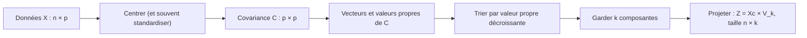

## Introduction

Les valeurs et vecteurs propres forment l'une des notions les plus puissantes — et les plus utilisées en pratique — de l'algèbre linéaire appliquée aux données. Elles sont au cœur de l'Analyse en Composantes Principales (PCA), une technique de réduction de dimension omniprésente en data science.

Les applications dépassent largement la PCA. Le classement PageRank des pages web est un vecteur propre ; l'analyse spectrale des graphes permet de repérer des communautés de machines qui communiquent anormalement entre elles ; la stabilité d'un algorithme itératif dépend des valeurs propres de sa matrice. Dans ce chapitre, tu construiras l'intuition géométrique, tu calculeras des valeurs propres à la main, puis tu réaliseras une PCA complète sur du trafic réseau simulé et tu t'en serviras pour repérer un flux anormal qu'aucune règle simple n'aurait détecté.

## L'intuition — des directions privilégiées

<CehCallout>
Un vecteur propre d'une matrice M est un vecteur qui, après transformation par M (chapitre 4), garde exactement la même direction — il est seulement étiré ou compressé, jamais tourné. Le facteur d'étirement associé est la valeur propre correspondante.
</CehCallout>

```text
Définition mathématique :

M × v = λ × v

où v est un vecteur propre (non nul) et λ (lambda) sa valeur propre associée.
```

<TipCallout>
Concrètement : si tu appliques une transformation (rotation, étirement...) à des milliers de vecteurs différents, la plupart changeront de direction — mais quelques directions très particulières (les vecteurs propres) resteront inchangées, seulement mises à l'échelle par leur valeur propre.
</TipCallout>

### Lire la valeur propre

La valeur propre λ dit ce qui arrive le long de la direction propre. Si λ vaut 3, les vecteurs de cette direction sont étirés trois fois. Si λ est compris entre 0 et 1, ils sont compressés. Si λ est négative, ils changent de sens. Si λ vaut 0, ils sont écrasés sur le vecteur nul : la matrice a alors un déterminant nul, et cette direction fait partie de son noyau (chapitre 4). On exige que v soit non nul, car le vecteur nul vérifierait l'équation pour n'importe quel λ.

Un vecteur propre n'est défini qu'à un facteur près : si v est un vecteur propre, 2v ou −v le sont aussi, avec la même valeur propre. C'est la *direction* qui compte. Les logiciels renvoient généralement des vecteurs propres de norme 1.

### Un premier exemple : la matrice diagonale

Prenons M = [[2,0],[0,3]]. Calculons M × [1,0] : on obtient [2×1+0×0, 0×1+3×0], soit [2, 0], c'est-à-dire 2 × [1, 0]. Donc [1, 0] est un vecteur propre de valeur propre 2. De même, M × [0,1] = [0, 3] = 3 × [0, 1] : [0, 1] est un vecteur propre de valeur propre 3. Pour une matrice diagonale, les vecteurs propres sont les axes et les valeurs propres sont lisibles sur la diagonale. Avec [[4,0],[0,1]], le vecteur [1,0] aurait de la même façon la valeur propre 4.

À l'inverse, la rotation de 90° [[0,−1],[1,0]] fait tourner *tous* les vecteurs du plan : elle n'a aucun vecteur propre réel. Ses valeurs propres sont des nombres complexes, ce que NumPy affiche avec la notation `1j`.

### Calculer les valeurs propres à la main

Si M × v = λ × v avec v non nul, alors (M − λI) × v = 0 : la matrice M − λI envoie un vecteur non nul sur zéro, elle n'est donc pas inversible, et son déterminant est nul. Les valeurs propres sont donc les solutions de l'**équation caractéristique** det(M − λI) = 0.

```text
M = [2 1]        M − λI = [2−λ   1 ]
    [1 2]                 [ 1   2−λ]

det(M − λI) = (2−λ)×(2−λ) − 1×1 = λ² − 4λ + 3 = (λ − 1)(λ − 3)

Valeurs propres : λ₁ = 3 et λ₂ = 1

Pour λ = 3 : (M − 3I) v = 0  →  −x + y = 0  →  v₁ = [1, 1]
Pour λ = 1 : (M − I) v = 0   →   x + y = 0  →  v₂ = [1, −1]
```

Vérifions : M × [1, 1] = [2+1, 1+2] = [3, 3] = 3 × [1, 1]. La matrice étire la diagonale principale par 3 et laisse l'autre diagonale inchangée. Remarque aussi deux contrôles rapides : la somme des valeurs propres (3 + 1 = 4) est égale à la **trace** de la matrice, c'est-à-dire la somme de sa diagonale (2 + 2), et leur produit (3 × 1 = 3) est égal au déterminant (2×2 − 1×1).

### Avec NumPy

```python
import numpy as np

M = np.array([[2.0, 1.0], [1.0, 2.0]])
valeurs, vecteurs = np.linalg.eig(M)
print("valeurs propres :", valeurs)
print("vecteurs propres (en colonnes) :\n", vecteurs.round(4))
v = vecteurs[:, 0]
print("M @ v      :", (M @ v).round(4))
print("λ × v      :", (valeurs[0] * v).round(4))

D = np.array([[2.0, 0.0], [0.0, 3.0]])
print("diag :", np.linalg.eig(D).eigenvalues)
```

```text
valeurs propres : [3. 1.]
vecteurs propres (en colonnes) :
 [[ 0.7071 -0.7071]
 [ 0.7071  0.7071]]
M @ v      : [2.1213 2.1213]
λ × v      : [2.1213 2.1213]
diag : [2. 3.]
```

Les vecteurs propres sont rangés **en colonnes** : le premier, associé à λ = 3, est [0,7071 ; 0,7071], c'est-à-dire [1, 1] normalisé à une longueur de 1. Le second correspond à [−1, 1], qui est bien colinéaire à [1, −1]. Depuis NumPy 2.0, le résultat de `eig` est aussi accessible par les attributs `eigenvalues` et `eigenvectors`.

### Diagonalisation et matrices symétriques

Quand une matrice n×n possède n vecteurs propres indépendants, on peut l'écrire M = P D P⁻¹, où les colonnes de P sont les vecteurs propres et D est la matrice diagonale des valeurs propres. C'est la **diagonalisation** : dans la base des vecteurs propres, la transformation n'est plus qu'une mise à l'échelle axe par axe. Elle rend par exemple les puissances faciles à calculer, puisque Mᵏ = P Dᵏ P⁻¹.

Les **matrices symétriques**, comme la matrice de Gram ou la matrice de covariance, ont des propriétés particulièrement agréables, garanties par le théorème spectral : leurs valeurs propres sont toujours réelles et leurs vecteurs propres peuvent être choisis orthogonaux entre eux. Pour elles, on utilise `np.linalg.eigh`, plus rapide et plus stable que `eig`, qui renvoie les valeurs propres triées par ordre croissant.

## Pourquoi c'est utile pour les données

<CehCallout>
En analyse de données, la matrice de covariance d'un jeu de données mesure comment ses différentes variables varient ensemble. Ses vecteurs propres indiquent les directions de variance maximale dans les données — les axes le long desquels les données sont le plus "étalées" — et ses valeurs propres indiquent l'importance (la quantité de variance) de chacune de ces directions.
</CehCallout>

### La matrice de covariance

La **variance** d'une variable mesure sa dispersion autour de la moyenne. La **covariance** entre deux variables mesure si elles varient ensemble : positive si elles augmentent ensemble, négative si l'une augmente quand l'autre diminue, proche de zéro si elles n'ont pas de lien linéaire. Pour un jeu de données centré Xc (chaque colonne a été diminuée de sa moyenne) de n lignes, la **matrice de covariance** vaut Xcᵀ Xc / (n − 1). C'est une matrice p×p symétrique : sa diagonale contient les variances, et l'élément (i, j) la covariance entre les variables i et j.

## L'Analyse en Composantes Principales (PCA)

<Steps steps={[
  { title: "Calculer la matrice de covariance des données", description: "Mesure comment chaque paire de variables du jeu de données varie ensemble." },
  { title: "Calculer les vecteurs et valeurs propres de cette matrice", description: "Les vecteurs propres deviennent les nouveaux axes (composantes principales), ordonnés par leur valeur propre décroissante." },
  { title: "Ne garder que les premières composantes principales", description: "Celles associées aux plus grandes valeurs propres, qui capturent l'essentiel de la variance des données." },
  { title: "Projeter les données sur ces nouveaux axes", description: "Réduit le nombre de dimensions tout en conservant le maximum d'information possible." },
]} />



### Une PCA pas à pas avec NumPy

Simulons 500 flux réseau « normaux » décrits par trois caractéristiques : le nombre de paquets, le volume en kilo-octets (fortement corrélé au nombre de paquets) et la durée (indépendante des deux autres).

```python
import numpy as np

rng = np.random.default_rng(seed=0)
n = 500
# Trafic « normal » simulé : paquets et octets très corrélés, durée indépendante
paquets = rng.normal(100, 20, n)
octets = 1.2 * paquets + rng.normal(0, 5, n)          # ~ 1,2 ko par paquet
duree = rng.normal(30, 3, n)
X = np.column_stack([paquets, octets, duree])

Xc = X - X.mean(axis=0)                 # 1. centrer
C = np.cov(Xc, rowvar=False)            # 2. matrice de covariance 3×3
valeurs, vecteurs = np.linalg.eigh(C)   # 3. eigh : pour matrices symétriques
ordre = np.argsort(valeurs)[::-1]       #    tri décroissant
valeurs, vecteurs = valeurs[ordre], vecteurs[:, ordre]

print("covariance :\n", C.round(1))
print("valeurs propres :", valeurs.round(2))
print("part de variance :", (valeurs / valeurs.sum()).round(4))
print("1re composante  :", vecteurs[:, 0].round(3))
Z = Xc @ vecteurs[:, :2]                # 4. projection sur 2 composantes
print("forme après projection :", Z.shape)
```

```text
covariance :
 [[411.8 494.6   1.6]
 [494.6 616.2   1.5]
 [  1.6   1.5   9.2]]
valeurs propres : [1019.08    9.34    8.76]
part de variance : [0.9825 0.009  0.0084]
1re composante  : [-0.632 -0.775 -0.002]
forme après projection : (500, 2)
```

La matrice de covariance confirme la structure simulée : une forte covariance (494,6) entre paquets et octets, presque rien avec la durée. La première composante principale combine paquets et octets avec des poids voisins et ignore la durée : c'est la direction « volume du flux ». Son signe négatif n'a aucune importance, puisqu'un vecteur propre est défini au signe près. Elle porte à elle seule 98 % de la variance.

Mais attention : ce chiffre est trompeur. La durée varie beaucoup moins en valeur absolue (variance de 9,2 contre plus de 400), donc la PCA la juge négligeable simplement parce qu'elle est exprimée dans une unité plus petite. C'est pourquoi on **standardise** presque toujours les variables avant une PCA, comme dans la version scikit-learn ci-dessous. Le paramètre `rowvar=False` indique à `np.cov` que les variables sont en colonnes.

### La même chose avec scikit-learn, et le choix de k

En pratique, on utilise la classe `PCA` de scikit-learn (versions 1.5 et suivantes), précédée d'un `StandardScaler`. L'attribut `explained_variance_ratio_` donne la part de variance de chaque composante ; on choisit souvent le nombre de composantes k pour atteindre 90 à 95 % de variance cumulée. On peut aussi passer directement une fraction, par exemple `PCA(n_components=0.95)`.

<CompareTable
  titleA="Avant PCA"
  titleB="Après PCA"
  rows={[
    { a: "Un jeu de données réseau avec 50 caractéristiques par connexion", b: "Réduit à 2-3 composantes principales capturant l'essentiel de la variance" },
    { a: "Impossible à visualiser directement (trop de dimensions)", b: "Visualisable sur un graphique 2D ou 3D" },
    { a: "Calcul de détection d'anomalies coûteux sur 50 dimensions", b: "Calcul bien plus rapide sur les quelques composantes retenues" },
]}
/>

<WarningCallout>
La réduction de dimension par PCA n'est pas sans perte : les composantes principales écartées contiennent une part de variance (donc d'information) qui n'est plus disponible ensuite — un compromis à assumer consciemment entre simplicité de calcul/visualisation et fidélité complète aux données originales.
</WarningCallout>

Il faut aussi savoir que les composantes principales sont des combinaisons de toutes les variables d'origine : « 0,63 × paquets + 0,78 × octets » est moins parlant pour un analyste SOC que « octets sortants ». La PCA gagne en compacité ce qu'elle perd en interprétabilité. Signalons enfin qu'en pratique, scikit-learn ne diagonalise pas la covariance mais utilise la **décomposition en valeurs singulières** (SVD) des données centrées, mathématiquement équivalente et numériquement plus stable.

## Application à la détection d'anomalies en sécurité

<CehCallout>
Le trafic réseau normal se concentre généralement autour de quelques directions principales dans l'espace des caractéristiques (volume, fréquence, ports utilisés...) — une connexion dont la représentation s'écarte fortement de ces directions principales peut signaler une anomalie, un principe utilisé par certains outils de détection statistique évoqués au cours IA & Agents en Cybersécurité.
</CehCallout>

### L'erreur de reconstruction

L'idée est la suivante : on apprend la PCA sur du trafic normal, on projette chaque nouveau flux sur les k composantes retenues, puis on le **reconstruit** dans l'espace d'origine. Un flux normal est bien résumé par les composantes principales, donc sa reconstruction est fidèle. Un flux qui viole la structure habituelle, par exemple beaucoup de paquets mais très peu d'octets, se trouve en partie hors de ce sous-espace, et l'écart entre le flux et sa reconstruction, appelé **erreur de reconstruction**, devient grand.

```python
import numpy as np
from sklearn.decomposition import PCA
from sklearn.preprocessing import StandardScaler

rng = np.random.default_rng(seed=0)
n = 500
paquets = rng.normal(100, 20, n)
octets = 1.2 * paquets + rng.normal(0, 5, n)
duree = rng.normal(30, 3, n)
X = np.column_stack([paquets, octets, duree])

scaler = StandardScaler().fit(X)
pca = PCA(n_components=2).fit(scaler.transform(X))
print("variance expliquée :", pca.explained_variance_ratio_.round(4))
print("cumulée            :", pca.explained_variance_ratio_.sum().round(4))

def erreur_reconstruction(points):
    Z = pca.transform(scaler.transform(points))     # projeter
    X_rec = pca.inverse_transform(Z)                # revenir dans l'espace d'origine
    return np.linalg.norm(scaler.transform(points) - X_rec, axis=1)

seuil = np.percentile(erreur_reconstruction(X), 99)
nouveaux = np.array([[105, 127, 31],    # flux ordinaire
                     [130,  90, 29]])   # beaucoup de paquets, peu d'octets
print("seuil (99e centile) :", seuil.round(3))
print("erreurs             :", erreur_reconstruction(nouveaux).round(3))
```

```text
variance expliquée : [0.661 0.333]
cumulée            : 0.994
seuil (99e centile) : 0.349
erreurs             : [0.036 1.894]
```

Après standardisation, la durée retrouve sa place : la deuxième composante lui correspond et porte un tiers de la variance. Le flux ordinaire est reconstruit presque parfaitement (erreur 0,036). Le second flux a pourtant des valeurs individuellement plausibles : 130 paquets et 90 ko restent dans la plage habituelle de chaque variable prise isolément. C'est leur *combinaison* qui est anormale, car elle correspond à des paquets beaucoup plus petits que d'habitude, un motif qui peut évoquer du balayage de ports ou des balises de commande et contrôle. Son erreur de 1,894 dépasse largement le seuil fixé au 99e centile du trafic normal. Une règle simple sur chaque variable n'aurait rien vu.

<AttackDefenseTable rows={[
  { phase: "Exfiltration lente", attack: "Envoyer des données par petits paquets réguliers pour rester sous les seuils de volume", defense: "Erreur de reconstruction PCA sur le couple paquets / octets, qui révèle des tailles de paquets inhabituelles" },
  { phase: "Évasion du modèle", attack: "Imiter les corrélations du trafic normal pour rester dans le sous-espace principal", defense: "Combiner la PCA avec d'autres détecteurs (règles, Isolation Forest, réputation) et réentraîner régulièrement" },
  { phase: "Empoisonnement", attack: "Injecter du trafic malveillant pendant la période d'apprentissage pour qu'il devienne « normal »", defense: "Apprendre sur une fenêtre vérifiée, surveiller la dérive des valeurs propres dans le temps" },
]} />

## Erreurs fréquentes

L'erreur la plus fréquente est de lancer une PCA sans standardiser : la variable exprimée dans la plus grande unité accapare la première composante. Une autre est de lire les vecteurs propres de NumPy en lignes alors qu'ils sont rangés en colonnes, ce qui associe chaque valeur propre au mauvais vecteur. On oublie aussi que `np.linalg.eigh` trie les valeurs propres par ordre croissant, alors que la PCA a besoin de l'ordre décroissant. Beaucoup interprètent le signe d'une composante comme significatif, alors qu'il est arbitraire. Enfin, ajuster le `StandardScaler` et la PCA sur l'ensemble des données, test compris, provoque une fuite d'information : on les ajuste uniquement sur les données d'entraînement, idéalement dans un `Pipeline` scikit-learn.

## Lab — Mise en pratique

**Environnement** : calculs à la main, puis Python 3.12+ avec NumPy et scikit-learn (`pip install numpy scikit-learn`).

<Steps steps={[
  { title: "Vérifier un vecteur propre", description: "Pour la matrice [[2,0],[0,3]], vérifie que le vecteur [1,0] est un vecteur propre, et détermine sa valeur propre associée. Fais de même pour [0,1].", code: "import numpy as np\nD = np.array([[2, 0], [0, 3]])\nprint(D @ [1, 0], D @ [0, 1])" },
  { title: "Calculer des valeurs propres à la main", description: "Pose l'équation caractéristique de [[2,1],[1,2]], résous-la, puis compare avec np.linalg.eig. Vérifie que la somme des valeurs propres vaut la trace et leur produit le déterminant.", code: "M = np.array([[2.0, 1.0], [1.0, 2.0]])\nr = np.linalg.eig(M)\nprint(r.eigenvalues, np.trace(M), np.linalg.det(M))" },
  { title: "Observer une rotation sans vecteur propre réel", description: "Calcule les valeurs propres de la rotation de 90°. Pourquoi sont-elles complexes ?", code: "print(np.linalg.eigvals(np.array([[0, -1], [1, 0]])))" },
  { title: "Construire une matrice de covariance", description: "Génère le jeu de 500 flux du chapitre, calcule sa covariance avec np.cov et repère la paire de variables la plus corrélée.", code: "rng = np.random.default_rng(0)\np = rng.normal(100, 20, 500)\nX = np.column_stack([p, 1.2 * p + rng.normal(0, 5, 500), rng.normal(30, 3, 500)])\nprint(np.cov(X, rowvar=False).round(1))" },
  { title: "Comparer PCA brute et PCA standardisée", description: "Calcule la part de variance expliquée sans puis avec StandardScaler. Explique pourquoi la durée semble négligeable dans le premier cas.", code: "from sklearn.decomposition import PCA\nfrom sklearn.preprocessing import StandardScaler\nprint(PCA().fit(X).explained_variance_ratio_.round(3))\nprint(PCA().fit(StandardScaler().fit_transform(X)).explained_variance_ratio_.round(3))" },
  { title: "Choisir k automatiquement", description: "Demande à scikit-learn de garder assez de composantes pour 95 % de variance, et affiche le nombre retenu.", code: "pca = PCA(n_components=0.95).fit(StandardScaler().fit_transform(X))\nprint(pca.n_components_)" },
  { title: "Détecter une anomalie par reconstruction", description: "Reprends la fonction erreur_reconstruction du chapitre, puis invente trois flux suspects (par exemple très peu de paquets mais beaucoup d'octets). Lesquels dépassent le seuil ? Explique pourquoi en termes de corrélation.", code: "suspects = np.array([[40, 160, 30], [100, 120, 60], [90, 108, 29]])\nprint(erreur_reconstruction(suspects).round(3), seuil.round(3))" },
]} />

## À retenir

- Un vecteur propre d'une matrice garde la même direction après transformation, seulement mis à l'échelle par sa valeur propre : M × v = λ × v.
- Les valeurs propres sont les solutions de det(M − λI) = 0 ; leur somme vaut la trace et leur produit le déterminant.
- Les matrices symétriques, comme la covariance, ont des valeurs propres réelles et des vecteurs propres orthogonaux ; on les traite avec `np.linalg.eigh`.
- La PCA utilise les vecteurs propres de la matrice de covariance pour identifier les directions de variance maximale ; les valeurs propres mesurent la variance portée par chaque direction.
- On standardise les données avant une PCA, et on choisit k à partir de la variance expliquée cumulée.
- Réduire la dimension via PCA facilite la visualisation et accélère les calculs, au prix d'une perte partielle d'information et d'interprétabilité.
- L'erreur de reconstruction révèle les observations qui violent la structure de corrélation du trafic normal.

## Questions de révision

1. Que signifie qu'un vecteur reste "dans la même direction" après une transformation matricielle ? Que représente λ dans M × v = λ × v ?
2. Pour la matrice [[4,0],[0,1]], quelle est la valeur propre associée au vecteur [1,0] ? Justifie par le calcul.
3. Calcule les valeurs propres de [[3,1],[0,2]] à l'aide de l'équation caractéristique.
4. Que représentent les vecteurs propres et les valeurs propres de la matrice de covariance en PCA ?
5. Quel rôle jouent les valeurs propres dans le choix des composantes principales à conserver, et que perd-on en écartant les autres ?
6. Pourquoi faut-il standardiser les variables avant une PCA ? Illustre avec l'exemple de la durée des flux.
7. Pourquoi une connexion dont les valeurs sont individuellement normales peut-elle avoir une forte erreur de reconstruction, et en quoi cela peut-il signaler une anomalie ?
