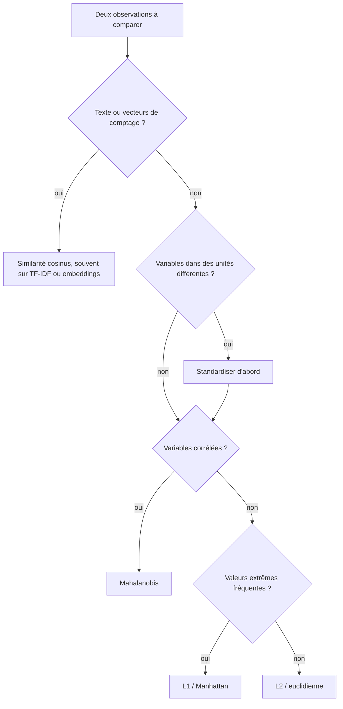

## Introduction

Ce chapitre approfondit une notion introduite au chapitre 1 (la norme d'un vecteur) et l'étend à la comparaison entre vecteurs — une opération omniprésente dès qu'on veut savoir si deux données (deux emails, deux comportements réseau, deux documents) se ressemblent.

Choisir une mesure de distance n'est jamais neutre. La même paire de connexions peut sembler proche ou éloignée selon la norme utilisée et selon que les variables ont été mises à l'échelle ou non ; deux emails de phishing identiques mais de longueurs différentes peuvent paraître très éloignés en distance euclidienne et parfaitement similaires en cosinus. À la fin du chapitre, tu sauras calculer les normes et distances usuelles, tu auras mesuré concrètement l'effet de la standardisation sur un classifieur k-NN, et tu sauras quand préférer la similarité cosinus ou la distance de Mahalanobis.

## Les normes vectorielles courantes

Une **norme** est une fonction qui associe à chaque vecteur une longueur positive ou nulle. Pour mériter ce nom, elle doit respecter trois règles : seule la norme du vecteur nul vaut zéro ; multiplier un vecteur par k multiplie sa norme par la valeur absolue de k ; et l'**inégalité triangulaire**, qui dit que la norme d'une somme est toujours inférieure ou égale à la somme des normes. Cette dernière règle traduit l'idée qu'un détour n'est jamais plus court que le chemin direct.

<CompareTable
  titleA="Norme"
  titleB="Calcul et usage"
  rows={[
    { a: "Norme L1 (Manhattan)", b: "Somme des valeurs absolues des composantes — mesure une distance 'en escalier', comme se déplacer dans une ville en grille" },
    { a: "Norme L2 (Euclidienne)", b: "Racine carrée de la somme des carrés — la distance 'à vol d'oiseau', la plus intuitive" },
    { a: "Norme L∞ (maximum)", b: "Plus grande valeur absolue parmi les composantes — utile quand seul l'écart le plus grand compte" },
]}
/>

```text
Pour le vecteur v = [3, -4] :

Norme L1 = |3| + |-4| = 7
Norme L2 = √(3² + 4²) = √25 = 5
Norme L∞ = max(|3|, |-4|) = 4

Pour le vecteur [5, -12] : L1 = 5 + 12 = 17 et L2 = √(25 + 144) = 13
```

Ces trois normes sont des cas particuliers de la famille des normes Lp, où l'on élève les valeurs absolues à la puissance p, on les additionne, puis on prend la racine p-ième. Plus p est grand, plus la norme est dominée par la plus grande composante ; à la limite, on obtient la norme L∞.

<TipCallout>
La norme L2 correspond exactement au théorème de Pythagore généralisé — c'est la distance la plus intuitive et la plus utilisée par défaut, mais la norme L1 est parfois préférée car elle est moins sensible aux valeurs extrêmes (outliers) dans certains contextes d'analyse de données.
</TipCallout>

Pourquoi L1 est-elle plus robuste ? Parce que L2 **élève les écarts au carré** avant de les additionner. Un écart de 10 sur une seule composante pèse 100 dans la somme des carrés, autant que cent écarts de 1. Avec L1, il ne pèse que 10. Une seule valeur aberrante, comme un compteur d'octets corrompu, domine donc beaucoup moins un calcul en L1. C'est aussi pour cette raison que la régression régularisée L1 (Lasso) et L2 (Ridge) se comportent différemment, un sujet traité dans le cours Machine Learning.

```python
import numpy as np

v = np.array([3, -4])
print("L1   :", np.linalg.norm(v, ord=1))
print("L2   :", np.linalg.norm(v))          # ord=2 par défaut
print("Linf :", np.linalg.norm(v, ord=np.inf))

a, b = np.array([1, 2]), np.array([4, 6])
print("euclidienne :", np.linalg.norm(a - b))
print("manhattan   :", np.linalg.norm(a - b, ord=1))
```

```text
L1   : 7.0
L2   : 5.0
Linf : 4.0
euclidienne : 5.0
manhattan   : 7.0
```

## La distance euclidienne entre deux vecteurs

<CehCallout>
La distance entre deux vecteurs (deux points dans l'espace des caractéristiques) se calcule comme la norme de leur différence : distance(A, B) = norme(A - B). C'est le principe de base de nombreux algorithmes de classification, comme celui des k plus proches voisins (k-NN), qui classe une nouvelle donnée selon les données les plus "proches" déjà connues.
</CehCallout>

Calculons pas à pas la distance euclidienne entre [1, 2] et [4, 6]. La différence vaut [4 − 1, 6 − 2] = [3, 4]. Sa norme L2 vaut la racine de 9 + 16, soit la racine de 25, donc 5. Sa norme L1 vaut 3 + 4 = 7 : c'est la distance de Manhattan, celle d'un taxi qui ne peut circuler que le long des rues d'un quadrillage.

### Le piège de l'échelle

Une distance additionne des écarts mesurés dans des unités différentes. Si une connexion est décrite par ses octets envoyés (de l'ordre de 50 000) et son nombre de ports distincts (de l'ordre de 3), un écart de 1 000 octets, insignifiant, pèsera des centaines de fois plus qu'un écart de 37 ports, pourtant caractéristique d'un balayage. L'expérience suivante entraîne un classifieur k-NN (k = 5) à distinguer du trafic normal de scans de ports, avec et sans standardisation.

```python
import numpy as np
from sklearn.neighbors import KNeighborsClassifier
from sklearn.pipeline import make_pipeline
from sklearn.preprocessing import StandardScaler
from sklearn.model_selection import train_test_split

rng = np.random.default_rng(seed=1)
n = 400
# Connexions : [octets_envoyes, nb_ports_distincts]
normal = np.column_stack([rng.normal(50_000, 15_000, n), rng.poisson(3, n)])
scan = np.column_stack([rng.normal(52_000, 15_000, n // 4), rng.poisson(40, n // 4)])
X = np.vstack([normal, scan])
y = np.array([0] * n + [1] * (n // 4))         # 1 = scan de ports
X_tr, X_te, y_tr, y_te = train_test_split(X, y, test_size=0.3, random_state=0, stratify=y)

brut = KNeighborsClassifier(n_neighbors=5).fit(X_tr, y_tr)
standardise = make_pipeline(StandardScaler(), KNeighborsClassifier(n_neighbors=5)).fit(X_tr, y_tr)
print(f"k-NN sans standardisation : {brut.score(X_te, y_te):.3f}")
print(f"k-NN avec standardisation : {standardise.score(X_te, y_te):.3f}")
```

```text
k-NN sans standardisation : 0.780
k-NN avec standardisation : 1.000
```

Sans standardisation, les voisins sont choisis presque uniquement selon le volume d'octets, qui ne distingue pas les deux classes ; le modèle ne fait guère mieux que de prédire toujours « normal », qui donnerait déjà 80 % d'exactitude. Une fois chaque variable ramenée à une moyenne de 0 et un écart-type de 1, le nombre de ports retrouve son poids, et la séparation devient parfaite sur ces données simulées. Le `Pipeline` garantit que la standardisation est apprise uniquement sur les données d'entraînement.

## La similarité cosinus — une mesure différente

<WarningCallout>
La distance euclidienne peut être trompeuse pour comparer des documents textes : deux documents de longueurs très différentes mais traitant du même sujet peuvent avoir une grande distance euclidienne, alors que leurs vecteurs "pointent" dans la même direction — c'est précisément ce que mesure la similarité cosinus, insensible à la magnitude des vecteurs.
</WarningCallout>

```text
Similarité cosinus entre A et B :

similarité = (A · B) / (norme(A) × norme(B))

Résultat entre -1 (opposés) et 1 (identiques en direction),
0 signifiant une absence de relation (vecteurs orthogonaux).
```

Exemple chiffré : pour A = [1, 2] et B = [2, 4], le produit scalaire vaut 2 + 8 = 10, la norme de A vaut la racine de 5 et celle de B la racine de 20 ; leur produit vaut la racine de 100, soit 10. La similarité vaut donc 10 / 10 = 1 : même direction, alors que la distance euclidienne entre A et B, égale à la racine de 5, n'est pas nulle. Pour des vecteurs de comptage de mots, qui n'ont que des composantes positives, la similarité cosinus est toujours comprise entre 0 et 1. On définit souvent la **distance cosinus** comme 1 moins la similarité.

### Démonstration sur des emails

```python
from sklearn.feature_extraction.text import CountVectorizer
from sklearn.metrics.pairwise import cosine_similarity, euclidean_distances

docs = [
    "votre compte est suspendu cliquez ici pour verifier votre compte",
    "votre compte est suspendu cliquez ici pour verifier votre compte "
    "votre compte est suspendu cliquez ici pour verifier votre compte",   # même texte, doublé
    "reunion equipe securite jeudi ordre du jour revue des incidents",
]
counts = CountVectorizer().fit_transform(docs)
print("euclidienne (comptages) :\n", euclidean_distances(counts).round(2))
print("cosinus (comptages) :\n", cosine_similarity(counts).round(2))
```

```text
euclidienne (comptages) :
 [[0.   3.74 4.9 ]
 [3.74 0.   8.12]
 [4.9  8.12 0.  ]]
cosinus (comptages) :
 [[1. 1. 0.]
 [1. 1. 0.]
 [0. 0. 1.]]
```

`CountVectorizer` transforme chaque email en vecteur de comptage de mots (un vecteur creux, chapitre 1). En distance euclidienne, le message de phishing doublé se trouve à 3,74 de l'original, presque aussi loin que l'email de réunion (4,9), qui n'a pourtant aucun mot en commun avec lui ; et il est bien plus loin de l'email de réunion (8,12) que ne l'est l'original, uniquement parce qu'il est plus long. La similarité cosinus, elle, reconnaît que les deux premiers emails sont identiques en direction (1,0) et sans rapport avec le troisième (0,0, aucun mot commun). En pratique, on pondère souvent les mots avec `TfidfVectorizer`, qui donne moins de poids aux mots présents partout ; les vecteurs TF-IDF de scikit-learn sont normalisés en L2 par défaut, si bien que leur produit scalaire est directement leur similarité cosinus.

<CehCallout>
La similarité cosinus est directement utilisée en recherche d'information et en détection de plagiat : deux documents représentés par leurs fréquences de mots (vecteurs à plusieurs milliers de dimensions) sont jugés similaires si leur similarité cosinus est proche de 1, indépendamment de leur longueur respective.
</CehCallout>

Les bases de données vectorielles et les systèmes de génération augmentée par récupération (RAG) reposent sur le même principe : les textes sont convertis en embeddings, et la recherche renvoie ceux dont la similarité cosinus avec la requête est la plus élevée.

## La distance de Mahalanobis : tenir compte des corrélations

La distance euclidienne traite chaque direction de la même façon. Or, au chapitre 5, on a vu que le trafic normal s'étale beaucoup le long de certaines directions et très peu le long d'autres. La **distance de Mahalanobis** mesure l'écart à la moyenne en tenant compte de la matrice de covariance : elle « dilate » les directions où les données varient peu et « contracte » celles où elles varient beaucoup. Sa formule est la racine de (x − μ)ᵀ C⁻¹ (x − μ), où μ est la moyenne et C⁻¹ l'inverse de la covariance, ce qui relie au passage ce chapitre au chapitre 3.

```python
import numpy as np
from scipy.spatial.distance import mahalanobis, euclidean

rng = np.random.default_rng(seed=0)
paquets = rng.normal(100, 20, 500)
X = np.column_stack([paquets, 1.2 * paquets + rng.normal(0, 5, 500)])
mu = X.mean(axis=0)
VI = np.linalg.inv(np.cov(X, rowvar=False))   # inverse de la covariance

for flux in ([140, 168], [130, 90]):
    print(flux, f"euclid = {euclidean(flux, mu):6.2f}   mahalanobis = {mahalanobis(flux, mu, VI):6.2f}")
```

```text
[140, 168] euclid =  63.59   mahalanobis =   2.00
[130, 90] euclid =  42.12   mahalanobis =  14.07
```

Le premier flux est un gros flux, mais il respecte la relation habituelle d'environ 1,2 ko par paquet : il est loin en distance euclidienne, mais à seulement deux « écarts-types » en Mahalanobis. Le second est plus proche du centre en euclidien, mais il viole la corrélation : sa distance de Mahalanobis de 14 le signale clairement comme anormal. C'est le même diagnostic que l'erreur de reconstruction du chapitre 5. Scikit-learn propose une version robuste aux valeurs aberrantes de ce principe avec `sklearn.covariance.EllipticEnvelope`.

## La malédiction de la dimension

Quand la dimension augmente, les distances perdent leur pouvoir discriminant : tous les points finissent par être presque à la même distance les uns des autres.

```python
import numpy as np
from sklearn.metrics import pairwise_distances

rng = np.random.default_rng(seed=0)
for d in (2, 10, 100, 1000):
    X = rng.random((200, d))
    D = pairwise_distances(X[:1], X[1:])[0]     # distances du point 0 aux 199 autres
    print(f"d = {d:4d}   min/max = {D.min() / D.max():.2f}")
```

```text
d =    2   min/max = 0.07
d =   10   min/max = 0.30
d =  100   min/max = 0.72
d = 1000   min/max = 0.90
```

En dimension 2, le plus proche voisin est 14 fois plus près que le plus lointain ; en dimension 1000, le rapport est de 0,9, et « le plus proche » ne veut presque plus rien dire. C'est l'une des raisons pour lesquelles on réduit la dimension (chapitre 5) ou on sélectionne les caractéristiques avant d'appliquer un k-NN ou un clustering fondé sur les distances.

## Choisir la bonne mesure selon le contexte

<CompareTable
  titleA="Contexte"
  titleB="Mesure recommandée"
  rows={[
    { a: "Comparer des positions géographiques ou des valeurs numériques brutes", b: "Distance euclidienne (norme L2)" },
    { a: "Comparer des documents texte de longueurs variables", b: "Similarité cosinus" },
    { a: "Détecter des anomalies robustes aux valeurs extrêmes", b: "Norme L1 (Manhattan)" },
    { a: "Détecter des anomalies dans des variables corrélées", b: "Distance de Mahalanobis" },
    { a: "Comparer des empreintes binaires de même longueur", b: "Distance de Hamming (nombre de bits différents)" },
]}
/>



## Applications en cybersécurité

Les distances sont au cœur de nombreux outils de défense. Le k-NN et le clustering regroupent des connexions ou des échantillons de malwares similaires ; la similarité cosinus sur TF-IDF ou sur embeddings retrouve des emails de phishing issus d'une même campagne malgré de petites variations de texte, ou des rapports de menace proches dans une base de renseignement. La distance de Hamming compare des empreintes perceptuelles, par exemple pour retrouver des logos de marque copiés sur des pages de phishing. Les hachages flous comme ssdeep ou TLSH fournissent leur propre score de similarité entre fichiers, utile pour relier des variantes d'un même malware. Côté offensif, un attaquant qui sait qu'un filtre repose sur la similarité cosinus peut diluer son message avec du texte légitime pour en changer la direction : c'est pourquoi on combine toujours plusieurs signaux.

## Erreurs fréquentes

L'erreur numéro un est d'appliquer un k-NN, un k-means ou une distance euclidienne sur des variables non standardisées, comme on l'a mesuré plus haut. Une autre est de confondre similarité et distance : une similarité cosinus de 1 signifie « identiques », alors qu'une distance de 0 signifie « identiques ». On oublie aussi que la similarité cosinus n'est pas définie pour un vecteur nul, par exemple un email vide après filtrage des mots courants. Beaucoup supposent que L1 est toujours meilleure en présence de valeurs aberrantes, alors que le bon choix dépend de la question posée. Enfin, la distance de Mahalanobis exige une matrice de covariance inversible : avec des colonnes redondantes ou plus de variables que d'observations, il faut régulariser ou réduire la dimension.

## Lab — Mise en pratique

**Environnement** : calculs à la main, puis Python 3.12+ avec NumPy, SciPy et scikit-learn.

<Steps steps={[
  { title: "Calculer des normes", description: "Calcule à la main les normes L1, L2 et L∞ de [3, -4] et de [5, -12], puis vérifie avec np.linalg.norm et son paramètre ord.", code: "import numpy as np\nfor v in ([3, -4], [5, -12]):\n    print(np.linalg.norm(v, 1), np.linalg.norm(v), np.linalg.norm(v, np.inf))" },
  { title: "Calculer une distance euclidienne", description: "Calcule la distance euclidienne entre les vecteurs [1, 2] et [4, 6], puis la distance de Manhattan. Résultats attendus : 5 et 7.", code: "a, b = np.array([1, 2]), np.array([4, 6])\nprint(np.linalg.norm(a - b), np.linalg.norm(a - b, 1))" },
  { title: "Calculer une similarité cosinus", description: "Calcule la similarité cosinus entre [1, 2] et [2, 4], puis entre [1, 0] et [0, 1]. Interprète les deux résultats.", code: "def cos(a, b):\n    a, b = np.asarray(a), np.asarray(b)\n    return a @ b / (np.linalg.norm(a) * np.linalg.norm(b))\nprint(cos([1, 2], [2, 4]), cos([1, 0], [0, 1]))" },
  { title: "Choisir la bonne mesure", description: "Pour comparer deux mails de tailles très différentes selon la fréquence des mots qu'ils contiennent, la distance euclidienne ou la similarité cosinus serait-elle plus adaptée ? Vérifie avec le script des trois emails du chapitre et ajoute un quatrième email de phishing reformulé.", code: "from sklearn.feature_extraction.text import TfidfVectorizer\nfrom sklearn.metrics.pairwise import cosine_similarity\ndocs.append('votre compte sera suspendu verifier ici votre identifiant')\nprint(cosine_similarity(TfidfVectorizer().fit_transform(docs)).round(2))" },
  { title: "Mesurer l'effet de la standardisation", description: "Reprends l'expérience k-NN du chapitre, puis fais varier n_neighbors de 1 à 15 avec et sans StandardScaler. Note les scores et explique l'écart.", code: "for k in (1, 5, 15):\n    p = make_pipeline(StandardScaler(), KNeighborsClassifier(n_neighbors=k)).fit(X_tr, y_tr)\n    print(k, p.score(X_te, y_te))" },
  { title: "Comparer euclidienne et Mahalanobis", description: "Avec le jeu paquets / octets du chapitre, calcule les deux distances pour trois flux de ton choix. Trouve un flux proche en euclidien mais lointain en Mahalanobis.", code: "for f in ([100, 120], [100, 70], [160, 192]):\n    print(f, euclidean(f, mu).round(1), mahalanobis(f, mu, VI).round(2))" },
  { title: "Observer la malédiction de la dimension", description: "Relance le script de la malédiction de la dimension avec 5000 dimensions. Que devient le rapport entre la plus petite et la plus grande distance ?", code: "X = np.random.default_rng(0).random((200, 5000))\nD = pairwise_distances(X[:1], X[1:])[0]\nprint(D.min() / D.max())" },
]} />

## À retenir

- Les normes L1, L2 et L∞ mesurent la "longueur" d'un vecteur de façons différentes ; L1 est la somme des valeurs absolues, L2 la racine de la somme des carrés.
- La distance entre deux vecteurs est la norme de leur différence ; la distance euclidienne est la base de nombreux algorithmes comme le k-NN.
- L2 élève les écarts au carré et réagit donc fortement aux valeurs extrêmes ; L1 y est moins sensible.
- Sans standardisation, la variable à la plus grande échelle domine les distances et peut ruiner un classifieur.
- La similarité cosinus mesure l'orientation plutôt que la magnitude des vecteurs : 1 pour une même direction, 0 pour des vecteurs orthogonaux ; elle convient aux documents de longueurs variables.
- La distance de Mahalanobis tient compte des corrélations et repère les observations qui violent la structure habituelle des données.
- En grande dimension, les distances se concentrent et perdent leur pouvoir discriminant.

## Questions de révision

1. Quelle est la différence entre la norme L1 et la norme L2 ? Calcule les deux pour [3, -4].
2. Comment calcule-t-on la distance euclidienne entre deux vecteurs ? Applique la formule à [1, 2] et [4, 6].
3. Pourquoi la norme L2 est-elle plus sensible aux valeurs extrêmes que la norme L1 ?
4. Pourquoi la similarité cosinus est-elle préférée à la distance euclidienne pour comparer des documents de longueurs très différentes ?
5. Que signifie une similarité cosinus de 0 entre deux vecteurs ?
6. Explique pourquoi le k-NN sans standardisation échoue à détecter les scans de ports dans l'expérience du chapitre.
7. Dans quelle situation la distance de Mahalanobis détecte-t-elle une anomalie que la distance euclidienne manque ?
