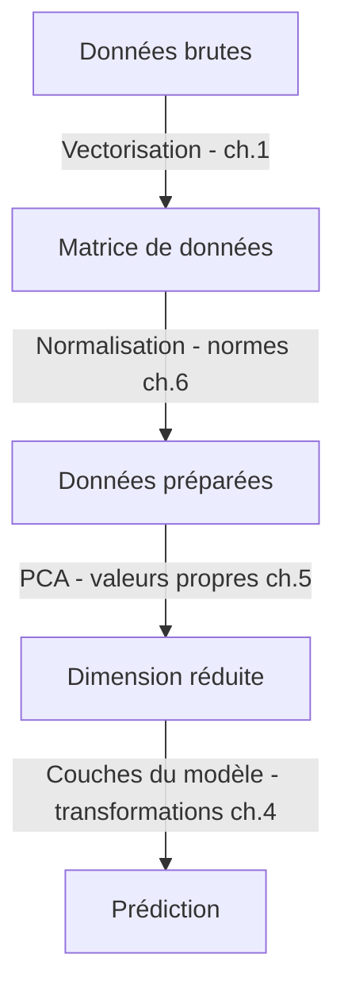
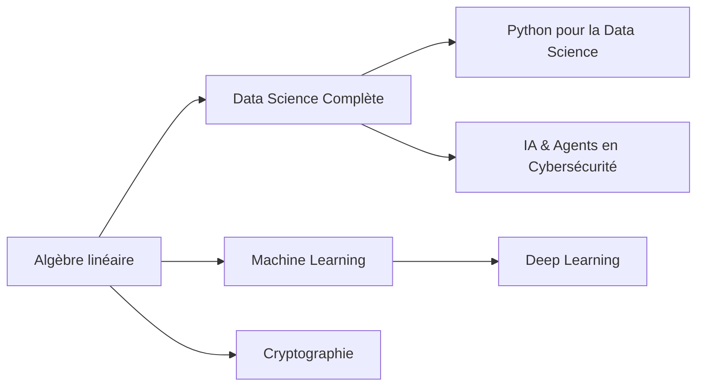

## Introduction

Ce dernier chapitre referme le cours en reliant explicitement chaque notion vue aux six chapitres précédents à sa place concrète dans un pipeline de données ou de machine learning — le même exercice de synthèse déjà réalisé au cours Mathématiques Appliquées, appliqué ici spécifiquement à l'algèbre linéaire.

L'objectif n'est pas d'ajouter de nouvelles notions, mais de montrer qu'elles forment un tout cohérent. Tu vas construire un détecteur de scans de ports avec scikit-learn, puis ouvrir la « boîte noire » et refaire sa prédiction à la main, ligne par ligne, avec les opérations vues dans le cours. Si tu y parviens, tu sauras exactement ce que calcule un modèle, ce qui est une compétence précieuse pour l'auditer, l'expliquer à un responsable SOC ou comprendre comment un attaquant pourrait le contourner.

## Panorama des liens établis

<CompareTable
  titleA="Notion"
  titleB="Usage concret"
  rows={[
    { a: "Vecteurs (ch.1)", b: "Représentation numérique de toute donnée (email, connexion réseau, document)" },
    { a: "Matrices (ch.2)", b: "Représentation d'un jeu de données entier (lignes = observations, colonnes = caractéristiques)" },
    { a: "Déterminant et inverse (ch.3)", b: "Résolution de systèmes d'équations, chiffre de Hill en cryptographie" },
    { a: "Transformations linéaires (ch.4)", b: "Fonctionnement des couches d'un réseau de neurones" },
    { a: "Valeurs/vecteurs propres (ch.5)", b: "Réduction de dimension (PCA), détection d'anomalies" },
    { a: "Normes et distances (ch.6)", b: "Classification (k-NN), similarité de documents, détection d'anomalies" },
]}
/>

### Ce qu'il faut retenir de chaque chapitre

Le **chapitre 1** a posé la brique de base : toute donnée devient un vecteur dès qu'on fixe un schéma de caractéristiques, et le produit scalaire mesure une ressemblance de direction. Le **chapitre 2** a empilé ces vecteurs en matrices, avec la convention « une ligne par observation », et a introduit le produit matriciel, qui calcule des milliers de scores en une seule opération. Le **chapitre 3** a montré quand une transformation peut être annulée, comment résoudre un système, pourquoi les matrices presque singulières rendent un modèle instable, et comment la linéarité du chiffre de Hill le rend vulnérable. Le **chapitre 4** a fait de la matrice une fonction, et a expliqué qu'une couche de réseau de neurones est une transformation affine suivie d'une non-linéarité. Le **chapitre 5** a identifié, grâce aux vecteurs propres de la covariance, les directions principales des données, base de la PCA et de la détection d'anomalies par reconstruction. Le **chapitre 6** a enfin donné les outils pour mesurer des écarts, et a montré que la mise à l'échelle conditionne tout calcul de distance.

## Où ces notions apparaissent dans un pipeline de machine learning



<CehCallout>
Ce pipeline simplifié illustre que l'algèbre linéaire n'intervient pas à une seule étape isolée, mais tout au long du traitement d'une donnée — de sa représentation initiale (vectorisation) jusqu'à la prédiction finale d'un modèle, en passant par la préparation et la réduction de dimension.
</CehCallout>

Détaillons chaque flèche. La **vectorisation** transforme des logs, des emails ou des captures réseau en vecteurs (chapitre 1), qu'on empile dans une matrice de données (chapitre 2). La **normalisation** ramène les colonnes à des échelles comparables ; elle est indispensable pour que les normes et distances du chapitre 6 aient un sens. La **réduction de dimension** projette les données sur les directions principales trouvées par les valeurs propres (chapitre 5). Enfin, les **couches du modèle** appliquent des transformations linéaires et affines (chapitre 4), dont le cœur est un produit scalaire entre les caractéristiques et des poids appris. Le chapitre 3 intervient en coulisses : l'entraînement d'une régression linéaire résout un système d'équations, et le conditionnement de ce système détermine la stabilité du modèle.

## Un pipeline complet, puis démonté à la main

### Construire le détecteur

On simule 1 000 flux réseau à six caractéristiques, dont 10 % de scans de ports qui touchent beaucoup de ports distincts avec de petits paquets. Le pipeline enchaîne standardisation, PCA à trois composantes et régression logistique, un modèle linéaire qui transforme un score en probabilité grâce à la fonction sigmoïde.

```python
import numpy as np
from sklearn.pipeline import make_pipeline
from sklearn.preprocessing import StandardScaler
from sklearn.decomposition import PCA
from sklearn.linear_model import LogisticRegression
from sklearn.model_selection import train_test_split

rng = np.random.default_rng(seed=7)
n = 1000
# 6 caractéristiques par flux : paquets, octets_out, duree, ports_distincts, octets_in, heure_nuit
paquets = rng.normal(100, 20, n)
X = np.column_stack([
    paquets, 1.2 * paquets + rng.normal(0, 5, n), rng.normal(30, 3, n),
    rng.poisson(3, n), 0.8 * paquets + rng.normal(0, 8, n), rng.integers(0, 2, n),
]).astype(float)
y = np.zeros(n, dtype=int)
attaques = rng.choice(n, size=100, replace=False)            # 10 % de scans
X[attaques, 3] += rng.poisson(35, 100)                        # beaucoup de ports
X[attaques, 1] *= 0.4                                         # petits paquets
y[attaques] = 1

X_tr, X_te, y_tr, y_te = train_test_split(X, y, test_size=0.3, random_state=0, stratify=y)
pipe = make_pipeline(StandardScaler(), PCA(n_components=3), LogisticRegression())
pipe.fit(X_tr, y_tr)
print("variance gardée :", pipe[1].explained_variance_ratio_.sum().round(3))
print("score test      :", round(pipe.score(X_te, y_te), 3))
```

```text
variance gardée : 0.813
score test      : 1.0
```

Les trois composantes conservent 81 % de la variance, et le modèle sépare parfaitement les deux classes sur ces données simulées, volontairement faciles. Sur des données réelles, on n'obtiendrait jamais un tel score, et l'exactitude seule serait d'ailleurs une mauvaise métrique sur des classes aussi déséquilibrées : le cours Data Science Complète y consacre un chapitre entier.

### Refaire la prédiction avec l'algèbre linéaire du cours

```python
# Suite du script : on démonte le pipeline
scaler, pca, clf = pipe
idx = [0, 1, np.flatnonzero(y_te == 1)[0]]       # deux flux normaux, une attaque
x = X_te[idx]
z = (x - scaler.mean_) / scaler.scale_          # ch.2 et ch.6 : opérations terme à terme
z = (z - pca.mean_) @ pca.components_.T         # ch.5 : projection sur les composantes
logit = z @ clf.coef_.ravel() + clf.intercept_  # ch.1 et ch.4 : produit scalaire + biais
proba = 1 / (1 + np.exp(-logit))
print("à la main  :", proba.round(4))
print("scikit-learn:", pipe.predict_proba(x)[:, 1].round(4))
```

```text
à la main  : [4.000e-04 8.000e-04 9.853e-01]
scikit-learn: [4.000e-04 8.000e-04 9.853e-01]
```

Les deux calculs coïncident exactement. Le modèle, si sophistiqué qu'il paraisse, n'est qu'une suite de quatre opérations du cours : une soustraction et une division terme à terme pour standardiser, un produit matriciel par la matrice des composantes principales (de taille 3×6, chaque ligne étant un vecteur propre), un produit scalaire avec les poids plus un biais, et enfin la sigmoïde, seule étape non linéaire. Le flux d'attaque obtient une probabilité de 0,985, les flux normaux moins de 0,001. L'attribut `components_` de scikit-learn contient les vecteurs propres en **lignes**, contrairement à `np.linalg.eig` qui les range en colonnes : d'où la transposée `.T`.

### Ce que ce démontage apporte en sécurité

Savoir refaire le calcul permet d'**expliquer** une alerte : en multipliant chaque caractéristique standardisée par sa contribution au score, on identifie celles qui ont fait basculer la décision, ce qui facilite le travail de l'analyste. Cela permet aussi d'**auditer** le modèle, par exemple pour vérifier qu'une caractéristique sensible n'a pas un poids démesuré. Enfin, cela fait comprendre la menace d'**évasion** : un attaquant qui connaît les poids sait exactement dans quelle direction pousser ses caractéristiques pour faire baisser son score, par exemple en étalant son scan dans le temps et en grossissant artificiellement ses paquets. Le règlement européen sur l'IA (AI Act), entré en vigueur en 2024 avec une application progressive, renforce d'ailleurs les exigences de transparence et de robustesse de certains systèmes d'IA, ce qui rend cette capacité d'explication de plus en plus attendue.

<AttackDefenseTable rows={[
  { phase: "Vectorisation", attack: "Manipuler les champs mesurés (URL raccourcie, padding de paquets) pour modifier le vecteur", defense: "Choisir des caractéristiques difficiles à falsifier et les combiner avec des signaux de réputation" },
  { phase: "Normalisation", attack: "Exploiter un scaler figé : envoyer des valeurs extrêmes qui écrasent l'échelle après un réentraînement automatique", defense: "Scalers robustes (RobustScaler), contrôle des données avant réentraînement" },
  { phase: "Réduction de dimension", attack: "Cacher l'attaque dans les directions écartées par la PCA", defense: "Surveiller aussi l'erreur de reconstruction, pas seulement les composantes gardées" },
  { phase: "Modèle linéaire", attack: "Déplacer son vecteur à l'opposé des poids pour faire baisser le score (évasion)", defense: "Défense en profondeur, modèles variés, réévaluation régulière et tests adverses" },
]} />

## Les pièges transversaux du cours

Certains pièges reviennent dans presque tous les chapitres. Le premier est l'**échelle des variables** : il fausse les produits scalaires (chapitre 2), la PCA (chapitre 5) et les distances (chapitre 6), et se corrige par la standardisation, apprise uniquement sur les données d'entraînement. Le deuxième est la **redondance** entre caractéristiques : elle se traduit par un rang incomplet (chapitre 1), un déterminant presque nul et un mauvais conditionnement (chapitre 3), et se traite par suppression de colonnes, PCA ou régularisation. Le troisième est l'**ordre des opérations** : le produit matriciel n'est pas commutatif (chapitre 2), la composition de transformations s'écrit de droite à gauche (chapitre 4). Le quatrième est l'**arithmétique flottante** : on ne compare jamais des flottants avec `==`, on utilise `np.allclose`, et on préfère `np.linalg.solve` à l'inverse explicite. Le dernier est la **perte d'information** : une projection ne s'inverse pas, et ce que la PCA écarte peut justement contenir l'attaque.

| Piège | Où il apparaît | Symptôme | Remède |
| --- | --- | --- | --- |
| Échelles différentes | ch.2, ch.5, ch.6 | une variable domine tout | StandardScaler dans un Pipeline |
| Colonnes redondantes | ch.1, ch.3 | coefficients instables, matrice singulière | supprimer, PCA, Ridge |
| Ordre des produits | ch.2, ch.4 | erreur de dimensions ou résultat faux | écrire les tailles, B × A pour « A puis B » |
| Flottants | ch.3, ch.4 | det égal à 1e-17 au lieu de 0 | rang, cond, np.allclose |
| Information perdue | ch.4, ch.5 | anomalie invisible après projection | erreur de reconstruction |

## Où aller ensuite selon ton objectif

<Steps steps={[
  { title: "Vers la data science appliquée", description: "Le cours Data Science Complète met en pratique directement ces notions sur des jeux de données réels de sécurité." },
  { title: "Vers l'IA et les agents en cybersécurité", description: "Les transformations linéaires (ch.4) et les valeurs propres (ch.5) sont le socle conceptuel des réseaux de neurones et de la détection d'anomalies par ML." },
  { title: "Vers la cryptographie approfondie", description: "Le déterminant et l'inverse (ch.3) éclairent des schémas historiques comme le chiffre de Hill, et complètent l'arithmétique modulaire du cours Mathématiques Appliquées." },
]} />



Les cours Machine Learning et Deep Learning approfondissent les mêmes outils : la descente de gradient manipule des vecteurs de gradients, la rétropropagation enchaîne des produits matriciels transposés, et le mécanisme d'attention des Transformers repose sur des produits scalaires entre vecteurs de requêtes et de clés, normalisés puis passés dans une fonction softmax.

<TipCallout>
Comme pour le cours Mathématiques Appliquées, il n'est pas nécessaire de maîtriser parfaitement chaque calcul avant de continuer — reviens à ces notions dès qu'elles réapparaissent dans un cours plus appliqué (PCA en Data Science, couches de réseaux de neurones en IA & Cybersécurité).
</TipCallout>

## Erreurs fréquentes

Dans un projet complet, l'erreur la plus coûteuse est d'appliquer la standardisation ou la PCA avant de séparer entraînement et test : le modèle « voit » alors des informations du test, et ses performances sont surestimées. Le `Pipeline` de scikit-learn évite ce piège en enchaînant les étapes et en les ajustant uniquement sur les données d'entraînement. Une autre erreur fréquente est de se fier à un score parfait sur des données simulées ou trop propres. On oublie aussi souvent de conserver le schéma de caractéristiques avec le modèle : en production, une colonne ajoutée ou réordonnée rend toutes les prédictions fausses sans aucun message d'erreur. Enfin, beaucoup d'équipes considèrent un modèle comme une boîte noire, alors qu'un modèle linéaire, comme on vient de le voir, se lit et s'explique entièrement.

## Lab — Mise en pratique

**Environnement** : Python 3.12+ avec NumPy et scikit-learn.

<Steps steps={[
  { title: "Relier une notion à une étape du pipeline", description: "Pour chacune des étapes suivantes d'un pipeline de détection de phishing par ML — vectorisation des emails, réduction de dimension, classification finale — identifie la notion d'algèbre linéaire la plus directement liée, et le chapitre correspondant." },
  { title: "Construire le pipeline", description: "Recopie le script du détecteur de scans et vérifie la variance gardée et le score de test. Fais varier n_components de 1 à 6 et observe la variance expliquée.", code: "for k in range(1, 7):\n    p = make_pipeline(StandardScaler(), PCA(n_components=k), LogisticRegression()).fit(X_tr, y_tr)\n    print(k, p[1].explained_variance_ratio_.sum().round(3), p.score(X_te, y_te))" },
  { title: "Refaire la prédiction à la main", description: "Reproduis le calcul manuel standardisation, projection, produit scalaire, sigmoïde, et vérifie avec np.allclose qu'il coïncide avec predict_proba sur tout le jeu de test.", code: "z = ((X_te - scaler.mean_) / scaler.scale_ - pca.mean_) @ pca.components_.T\np = 1 / (1 + np.exp(-(z @ clf.coef_.ravel() + clf.intercept_)))\nprint(np.allclose(p, pipe.predict_proba(X_te)[:, 1]))" },
  { title: "Expliquer une alerte", description: "Pour le flux d'attaque, calcule la contribution de chaque composante principale au score (produit terme à terme de z par les poids). Laquelle pèse le plus ? Regarde ensuite quelles variables d'origine dominent cette composante dans pca.components_.", code: "contrib = z[np.flatnonzero(y_te == 1)[0]] * clf.coef_.ravel()\nprint(contrib.round(2))\nprint(pca.components_.round(2))" },
  { title: "Simuler une évasion", description: "Prends le flux d'attaque, réduis progressivement son nombre de ports distincts et augmente ses octets sortants. À partir de quand la probabilité passe-t-elle sous 0,5 ? Qu'en déduis-tu pour la défense ?", code: "a = X_te[np.flatnonzero(y_te == 1)[0]].copy()\nfor ports in (40, 25, 15, 8):\n    a[3] = ports; a[1] = 1.2 * a[0]\n    print(ports, pipe.predict_proba(a.reshape(1, -1))[0, 1].round(3))" },
  { title: "Choisir sa prochaine étape", description: "Si ton objectif est de comprendre le fonctionnement d'un détecteur d'anomalies réseau basé sur le ML, quel cours choisirais-tu en priorité après celui-ci : Data Science Complète ou Cryptographie Avancée ? Justifie." },
]} />

## À retenir

- Chaque notion de ce cours (vecteurs, matrices, déterminant/inverse, transformations, valeurs propres, normes) intervient à une étape précise d'un pipeline de traitement de données ou de machine learning.
- L'algèbre linéaire n'est pas cantonnée à une seule étape isolée mais traverse tout le pipeline, de la représentation initiale des données (vectorisation) à la prédiction finale.
- Dans le pipeline, la vectorisation précède la matrice de données, la normalisation s'appuie sur les normes, la réduction de dimension sur les valeurs propres, et les couches du modèle sur les transformations linéaires.
- Un pipeline scikit-learn standardisation, PCA, régression logistique se réécrit entièrement avec quelques opérations NumPy, ce qui permet de l'expliquer et de l'auditer.
- Les pièges transversaux sont l'échelle des variables, la redondance, l'ordre des produits, les flottants et la perte d'information.
- Les cours Data Science Complète et IA & Agents en Cybersécurité mettent directement en pratique ces notions sur des cas concrets de sécurité.

## Questions de révision

1. Quelle notion d'algèbre linéaire est directement liée à la vectorisation d'une donnée brute (comme un email) ?
2. D'après le pipeline, quelle étape suit directement la vectorisation, et quelle notion est associée à la normalisation ?
3. Pourquoi les valeurs propres sont-elles centrales dans une étape de réduction de dimension ?
4. Quelle notion du cours explique le fonctionnement des couches d'un modèle, et quel chapitre relie l'algèbre linéaire au chiffre de Hill ?
5. Décris les quatre opérations qui permettent de refaire à la main la prédiction du pipeline standardisation, PCA, régression logistique.
6. Comment la connaissance des poids d'un modèle linéaire aide-t-elle à la fois l'analyste et l'attaquant ?
7. Cite deux cours de la roadmap Nyx qui mettent en pratique directement les notions vues dans ce cours.

Félicitations, tu viens de terminer le cours **Algèbre Linéaire** ! Ce socle mathématique nourrit directement les cours Data Science Complète et IA & Agents en Cybersécurité — continue vers **Data Science Complète** pour mettre ces notions en pratique sur des cas concrets.
