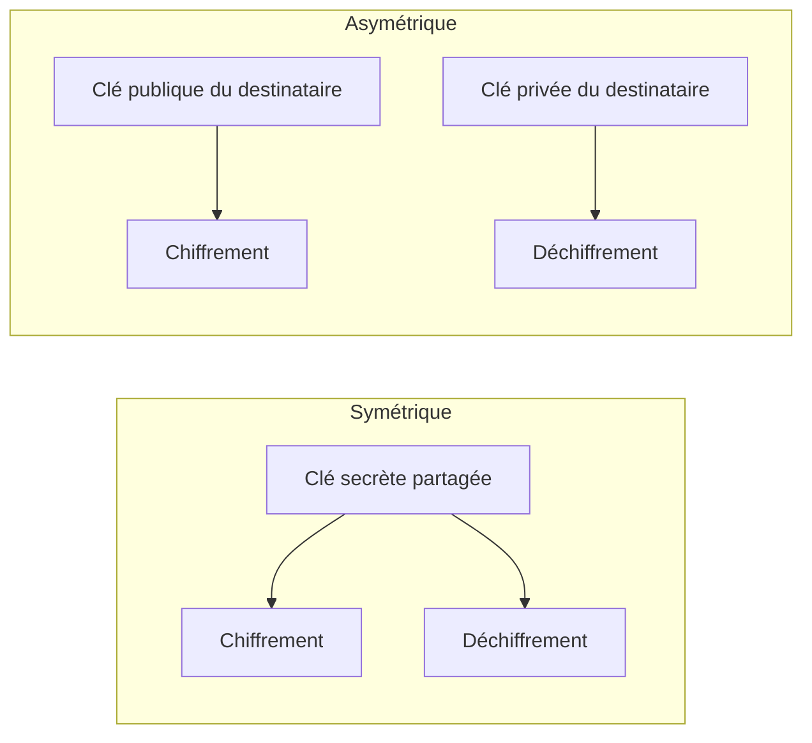
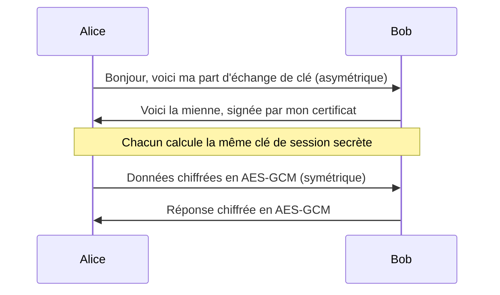

## Introduction

La cryptographie n'est pas une affaire de mathématiciens isolés : c'est l'une des briques les plus utilisées au quotidien en cybersécurité. Chaque fois que tu ouvres un site en HTTPS, que tu te connectes à un serveur en SSH, que tu déverrouilles un téléphone chiffré, que tu installes un paquet Debian signé ou que tu rejoins un réseau Wi-Fi WPA3, plusieurs algorithmes cryptographiques travaillent en coulisses.

Pour un pentesteur, comprendre la cryptographie permet de repérer des configurations faibles : un serveur qui accepte encore TLS 1.0, une application qui stocke les mots de passe avec MD5, un jeton signé avec une clé prévisible. Pour un défenseur, c'est la base de toute politique de protection des données : choisir les bons algorithmes, gérer correctement les clés, et savoir ce qu'un mécanisme garantit vraiment, et surtout ce qu'il ne garantit pas.

Ce chapitre pose le vocabulaire et les grands principes utilisés dans tout le reste du cours. À la fin, tu sauras associer chaque besoin de sécurité à la bonne famille d'outils, expliquer pourquoi les systèmes modernes combinent chiffrement symétrique et asymétrique, et reconnaître les erreurs qui transforment un algorithme solide en protection illusoire.

## Le vocabulaire de base

Avant d'aller plus loin, fixons quelques termes qui reviendront dans chaque chapitre.

- Le **texte clair** (plaintext) est le message lisible que l'on veut protéger. Ce peut être du texte, un fichier, un paquet réseau ou une clé.
- Le **texte chiffré** (ciphertext) est le résultat de la transformation : une suite d'octets qui ne doit rien révéler du clair à qui ne possède pas la clé.
- La **clé** est le paramètre secret qui personnalise l'algorithme. Deux personnes utilisant le même algorithme avec des clés différentes obtiennent des chiffrés totalement différents.
- Le **chiffrement** transforme le clair en chiffré avec une clé ; le **déchiffrement** fait l'opération inverse avec la bonne clé. Le mot « décrypter » désigne, au sens strict, le fait de retrouver le clair **sans** posséder la clé, c'est-à-dire casser le chiffrement. Le terme « crypter » n'existe pas en français correct.
- La **cryptanalyse** est l'étude des moyens de casser un système cryptographique. La **cryptologie** regroupe la cryptographie, qui construit, et la cryptanalyse, qui attaque.
- Une **primitive** est une brique de base : un algorithme de chiffrement par blocs, une fonction de hachage, un schéma de signature. Un **protocole** comme TLS assemble plusieurs primitives pour atteindre un objectif complet.

### Mesurer la sécurité en bits

On exprime la robustesse d'un algorithme par son **niveau de sécurité en bits** : un niveau de n bits signifie que la meilleure attaque connue demande de l'ordre de 2 puissance n opérations. Un niveau de 128 bits représente environ 3,4 fois 10 puissance 38 opérations, ce qui dépasse de très loin toute capacité de calcul imaginable. C'est aujourd'hui le minimum recommandé pour un système neuf ; 112 bits reste toléré pour l'existant, et tout ce qui est inférieur à 100 bits doit être considéré comme cassable par un adversaire déterminé.

Attention : la taille de clé n'est pas toujours égale au niveau de sécurité. Une clé AES de 128 bits offre environ 128 bits de sécurité, mais une clé RSA de 3072 bits n'en offre qu'environ 128, parce que les attaques contre RSA (la factorisation) sont bien plus efficaces que l'essai exhaustif. Tu verras cette correspondance au chapitre 3.

## Les quatre objectifs fondamentaux de la cryptographie

La cryptographie ne sert pas qu'à cacher. Elle poursuit quatre objectifs distincts, et chaque primitive n'en couvre qu'une partie.

<CompareTable
  titleA="Objectif"
  titleB="Ce qu'il garantit et la primitive typique"
  rows={[
    { a: "Confidentialité", b: "Seul le destinataire légitime peut lire le message. Primitive : chiffrement (AES, ChaCha20)." },
    { a: "Intégrité", b: "Le message n'a pas été altéré en chemin. Primitives : hachage, MAC (HMAC), chiffrement authentifié (AES-GCM)." },
    { a: "Authentification", b: "L'expéditeur est bien celui qu'il prétend être. Primitives : MAC avec clé partagée, signature numérique, certificats." },
    { a: "Non-répudiation", b: "L'expéditeur ne peut pas nier avoir envoyé le message. Primitive : signature numérique, car lui seul détient la clé privée." },
]}
/>

Prenons un exemple concret. Un virement bancaire en ligne doit rester confidentiel (personne ne doit lire le montant ni le destinataire), intègre (personne ne doit pouvoir changer le montant), authentifié (la banque doit être sûre que c'est bien toi) et non répudiable (tu ne dois pas pouvoir prétendre ensuite ne jamais l'avoir ordonné). Un seul algorithme ne suffit pas : il faut combiner plusieurs primitives.

### Ce qu'un MAC apporte, et ce qu'une signature apporte en plus

Un **MAC** (Message Authentication Code), comme HMAC-SHA256, est une empreinte calculée avec une clé secrète partagée. Il prouve que le message vient de quelqu'un qui connaît la clé et qu'il n'a pas été modifié. Mais comme les deux parties connaissent la même clé, le destinataire pourrait lui-même fabriquer le MAC : un MAC ne permet donc pas la non-répudiation vis-à-vis d'un tiers.

Une **signature numérique** utilise une clé privée que seul le signataire possède, et une clé publique que tout le monde peut utiliser pour vérifier. Elle garantit l'intégrité, l'authentification et, en plus, la non-répudiation : un juge peut vérifier la signature sans que personne d'autre que le signataire n'ait pu la produire.

<TipCallout>
Le chiffrement seul ne garantit que la confidentialité : un message chiffré peut être intercepté et modifié sans que le destinataire s'en aperçoive si aucun mécanisme d'intégrité (comme une signature ou un MAC) n'est associé au chiffrement. C'est pour cela que les modes modernes dits AEAD, comme AES-GCM ou ChaCha20-Poly1305, intègrent l'intégrité directement dans le chiffrement.
</TipCallout>

## Une brève histoire, de César aux algorithmes post-quantiques

L'histoire de la cryptographie aide à comprendre pourquoi les règles actuelles existent.

- **Le chiffre de César** (Antiquité) décale chaque lettre d'un nombre fixe de positions. Il n'existe que 25 décalages utiles : on le casse en les essayant tous, ce qu'on appelle une attaque par force brute.
- **Le chiffre de Vigenère** (16e siècle) utilise un mot-clé pour varier le décalage. Il a été réputé incassable pendant trois siècles, jusqu'aux travaux de Babbage et Kasiski au 19e siècle, qui exploitent la répétition de la clé.
- **Enigma** (Seconde Guerre mondiale) a été cassée par les cryptanalystes polonais puis britanniques de Bletchley Park, en exploitant des faiblesses de procédure et des messages au contenu prévisible plutôt qu'une faille purement mathématique.
- **DES** (1977) est le premier standard public de chiffrement. Sa clé effective de 56 bits a été cassée par force brute en 1998 par une machine dédiée de l'EFF, en quelques jours.
- **Diffie-Hellman** (1976) et **RSA** (1977) inventent la cryptographie à clé publique et résolvent le problème de l'échange de clé.
- **AES** (2001) remplace DES après un concours public international organisé par le NIST.
- **Les standards post-quantiques** ML-KEM, ML-DSA et SLH-DSA sont publiés par le NIST en août 2024 (FIPS 203, 204 et 205) pour anticiper l'ordinateur quantique. Ils sont détaillés au chapitre 8.

La leçon commune : presque tous les systèmes historiques sont tombés non parce que l'idée était absurde, mais parce que leurs concepteurs avaient surestimé leur secret et sous-estimé la créativité des attaquants.

## Chiffrement symétrique, asymétrique et hybride

En **chiffrement symétrique**, la même clé sert à chiffrer et à déchiffrer. C'est extrêmement rapide : un processeur moderne doté des instructions AES-NI chiffre plusieurs gigaoctets par seconde. Le problème est logistique : comment transmettre la clé secrète au correspondant sans qu'elle soit interceptée ? Et avec cent correspondants, il faut gérer une clé par paire, soit près de cinq mille clés.

En **chiffrement asymétrique**, chaque participant possède une paire de clés : une clé publique, diffusée librement, et une clé privée, gardée secrète. Ce qui est chiffré avec la clé publique ne peut être déchiffré qu'avec la clé privée correspondante. Plus besoin de canal secret pour échanger une clé, mais les calculs sont des centaines à des milliers de fois plus lents, et on ne chiffre directement que de petites données.

<CompareTable
  titleA="Chiffrement symétrique"
  titleB="Chiffrement asymétrique"
  rows={[
    { a: "Une seule clé, partagée entre les deux parties", b: "Une paire de clés : publique (partagée) et privée (secrète)" },
    { a: "Très rapide, adapté aux gros volumes de données", b: "Beaucoup plus lent, adapté aux petits volumes (clés, signatures)" },
    { a: "Problème : comment échanger la clé secrète en sécurité ?", b: "Résout le problème d'échange de clé, la clé publique peut circuler librement" },
    { a: "Exemples : AES, ChaCha20", b: "Exemples : RSA, ECC (ECDH, ECDSA, Ed25519), ML-KEM, ML-DSA" },
]}
/>

### Le chiffrement hybride, la solution utilisée partout

En pratique, on combine les deux : un mécanisme asymétrique sert uniquement à établir ou transporter une **clé de session** aléatoire, puis tout le volume de données est chiffré avec un algorithme symétrique rapide sous cette clé. C'est le schéma de TLS, SSH, PGP, Signal ou des outils de chiffrement de fichiers comme `age`.

<CehCallout>
En pratique, HTTPS combine les deux : un échange de clé asymétrique (ECDHE, et depuis 2024 souvent l'hybride X25519MLKEM768) établit une clé de session partagée, puis toute la session utilise un chiffrement symétrique (AES-GCM ou ChaCha20-Poly1305) bien plus rapide. C'est le meilleur des deux mondes, approfondi au chapitre 7. L'examen CEH v13 attend que tu saches expliquer ce rôle de chaque famille.
</CehCallout>

### Les fonctions de hachage, troisième famille

À côté du chiffrement, les **fonctions de hachage** (SHA-256, SHA-3) transforment une donnée de taille quelconque en une empreinte de taille fixe, sans clé et sans retour possible. Elles servent à l'intégrité, aux signatures (on signe l'empreinte, pas le document entier) et, sous des formes spécialisées comme Argon2, au stockage des mots de passe. Le chapitre 4 leur est consacré.

## Le principe de Kerckhoffs et le refus de la sécurité par l'obscurité

En 1883, Auguste Kerckhoffs publie dans *La Cryptographie militaire* une série de principes, dont le plus célèbre affirme qu'un système cryptographique doit rester sûr même si l'ennemi en connaît tout le fonctionnement : seule la clé doit rester secrète. Claude Shannon le reformulera plus tard ainsi : « l'adversaire connaît le système ».

Les raisons sont pratiques. Un algorithme est implémenté dans des milliers de logiciels et d'équipements : il finira par être rétro-conçu. Une clé, elle, se change en quelques secondes si elle fuit ; un algorithme compromis impose de remplacer tout le parc. Enfin, seul un algorithme public peut être analysé par la communauté des cryptanalystes.

<CehCallout>
Le principe de Kerckhoffs, formulé au 19e siècle, reste la règle d'or de la cryptographie moderne : un système cryptographique doit rester sûr même si tout son fonctionnement est public, à condition que la clé reste secrète. C'est exactement l'inverse de la sécurité par l'obscurité.
</CehCallout>

Les contre-exemples sont nombreux. Le système de protection des DVD (CSS), gardé secret, a été cassé en 1999. Les algorithmes propriétaires A5/1 et A5/2 du GSM ont été rétro-conçus puis cassés. Le chiffrement Crypto-1 des cartes MIFARE Classic a été reconstitué en 2008 à partir de l'analyse du circuit, et ces cartes se clonent aujourd'hui en quelques minutes.

## Ne jamais inventer sa propre cryptographie

<WarningCallout>
Concevoir son propre algorithme de chiffrement, même avec de bonnes intentions, est presque toujours une erreur grave en sécurité : les algorithmes standards (AES, RSA, les courbes elliptiques) ont survécu à des décennies d'analyse cryptographique publique par des milliers de chercheurs, ce qu'aucun algorithme « maison » ne peut égaler. Le danger concerne aussi les protocoles maison et les implémentations maison d'algorithmes standards.
</WarningCallout>

La règle va plus loin que l'algorithme. Même en utilisant AES, tu peux te tromper de mode, réutiliser un nonce, oublier l'intégrité ou comparer des MAC avec une fonction non constante en temps. Voici les bonnes pratiques à suivre.

<Steps steps={[
  { title: "Utiliser des bibliothèques éprouvées", description: "OpenSSL 3.x, libsodium, BoringSSL, la bibliothèque standard de Go, le paquet Python cryptography ou les API natives de la plateforme, jamais une implémentation artisanale." },
  { title: "Préférer les API de haut niveau", description: "Des interfaces comme crypto_secretbox de libsodium ou Fernet et AESGCM en Python choisissent pour toi les paramètres sûrs. Moins tu as de choix à faire, moins tu peux te tromper." },
  { title: "Suivre les recommandations d'organismes reconnus", description: "Le NIST (SP 800-57, SP 800-131A, standards FIPS) et l'ANSSI (guide des mécanismes cryptographiques) publient des recommandations sur les algorithmes et tailles de clés, mises à jour régulièrement." },
  { title: "Se méfier de la sécurité par l'obscurité", description: "Un algorithme dont la sécurité repose sur le secret de son fonctionnement, plutôt que sur la robustesse mathématique de sa clé, est fragile par construction." },
  { title: "Prévoir l'agilité cryptographique", description: "Concevoir les systèmes pour pouvoir changer d'algorithme sans tout réécrire : c'est indispensable pour la migration post-quantique en cours." },
]} />

## L'aléatoire, fondation invisible

Toute la sécurité d'une clé repose sur son imprévisibilité. Une clé AES-256 générée à partir de l'heure courante n'offre pas 256 bits de sécurité, mais seulement les quelques dizaines de bits correspondant aux secondes possibles. Il faut donc un **générateur de nombres aléatoires cryptographiquement sûr** (CSPRNG). Sous Linux, c'est le noyau qui le fournit via `/dev/urandom` ou l'appel système `getrandom()` ; en Python, c'est le module `secrets`, jamais le module `random`, qui est prévisible.

L'histoire en donne un exemple célèbre : en 2008, on a découvert qu'une modification du paquet OpenSSL de Debian, introduite en 2006, réduisait l'aléa à l'identifiant du processus, soit au plus 32 768 valeurs. Toutes les clés SSH et SSL générées sur ces systèmes pendant deux ans étaient devinables.

## Ce qui est obsolète et ce qui est recommandé fin 2026

| Usage | À proscrire ou retirer | Recommandé |
| --- | --- | --- |
| Chiffrement symétrique | DES, 3DES, RC4, Blowfish, mode ECB | AES-128 ou AES-256 en GCM, ChaCha20-Poly1305 |
| Hachage | MD5, SHA-1 | SHA-256, SHA-384, SHA-3 |
| Mots de passe | MD5, SHA-1 ou SHA-256 sans sel ni coût | Argon2id, scrypt, bcrypt |
| Échange de clé | RSA statique, Diffie-Hellman sur 1024 bits | ECDHE (X25519), hybride X25519MLKEM768 |
| Signature | RSA 1024, DSA | RSA 3072 et plus, ECDSA P-256, Ed25519, puis ML-DSA |
| Protocoles | SSL 2 et 3, TLS 1.0 et 1.1 | TLS 1.3, TLS 1.2 avec suites AEAD uniquement |

<AuditCallout>
L'ISO/IEC 27001:2022 traite la cryptographie dans le contrôle A.8.24 « Utilisation de la cryptographie » de l'Annexe A, qui exige des règles définies pour l'usage de la cryptographie et la gestion des clés. Lors d'un audit, on attend une politique cryptographique écrite, un inventaire des algorithmes utilisés et un processus de gestion du cycle de vie des clés.
</AuditCallout>

## Angle offensif et défensif

<AttackDefenseTable rows={[
  { phase: "Reconnaissance", attack: "Énumérer les suites TLS et versions acceptées avec nmap ou testssl.sh pour repérer RC4, 3DES ou TLS 1.0", defense: "Désactiver les protocoles et suites obsolètes, auditer régulièrement la configuration" },
  { phase: "Exploitation d'implémentation", attack: "Exploiter un nonce réutilisé, un aléa faible ou un mode ECB plutôt que l'algorithme lui-même", defense: "Bibliothèques de haut niveau, revue de code par des spécialistes, tests de conformité" },
  { phase: "Vol de clé", attack: "Récupérer une clé codée en dur dans un dépôt Git ou un binaire", defense: "Gestion de secrets (coffre, HSM, KMS), scan des dépôts, rotation des clés" },
  { phase: "Algorithme maison", attack: "Rétro-concevoir l'algorithme propriétaire puis le casser par cryptanalyse", defense: "Uniquement des algorithmes standards et publics, conformément au principe de Kerckhoffs" },
]} />

## Erreurs fréquentes

- **Confondre encodage, hachage et chiffrement.** Base64 n'est pas un chiffrement : c'est un simple encodage réversible par n'importe qui. Un hash n'est pas un chiffrement non plus : il ne se déchiffre pas.
- **Croire que chiffrer suffit.** Sans intégrité, un attaquant peut modifier un chiffré, parfois de façon contrôlée, sans être détecté.
- **Utiliser un générateur aléatoire non cryptographique** comme `random` en Python ou `Math.random()` en JavaScript pour produire des clés ou des jetons.
- **Coder une clé en dur** dans le code source ou un fichier de configuration versionné.
- **Garder des algorithmes obsolètes par compatibilité** sans plan de retrait.

## Lab — Mise en pratique

**Environnement** : Kali Linux (terminal Nyx Shell) avec Python 3.12 ou plus récent.

<Steps steps={[
  { title: "Identifier ta version d'OpenSSL", description: "Vérifie que tu disposes d'OpenSSL 3.x. Observe la version et la date de compilation affichées.", code: "openssl version -a | head -3" },
  { title: "Générer de l'aléa cryptographique", description: "Génère 32 octets aléatoires (256 bits) en hexadécimal, puis en Base64. Relance la commande : la sortie change à chaque fois.", code: "openssl rand -hex 32\nopenssl rand -base64 32\nhead -c 32 /dev/urandom | xxd -p -c 32" },
  { title: "Comparer random et secrets en Python", description: "Observe que random devient entièrement prévisible avec une graine connue, alors que secrets utilise l'aléa du système d'exploitation.", code: "python3 -c \"import random; random.seed(42); print(random.getrandbits(64))\"\npython3 -c \"import random; random.seed(42); print(random.getrandbits(64))\"\npython3 -c \"import secrets; print(secrets.token_hex(16))\"" },
  { title: "Casser un chiffre de César par force brute", description: "Le message est chiffré par décalage. Les 25 essais s'affichent ; repère la ligne lisible. Tu viens d'appliquer une attaque exhaustive sur un espace de clés minuscule.", code: "python3 -c \"c='Shofjqdqboiu'; [print(k, ''.join(chr((ord(x)-(65 if x.isupper() else 97)-k)%26+(65 if x.isupper() else 97)) for x in c)) for k in range(1,26)]\"" },
  { title: "Distinguer encodage et chiffrement", description: "Encode puis décode une chaîne en Base64 sans aucune clé : n'importe qui peut le faire, ce n'est donc pas une protection.", code: "echo -n 'mot de passe admin' | base64\necho -n 'bW90IGRlIHBhc3NlIGFkbWlu' | base64 -d" },
  { title: "Associer objectifs et primitives", description: "Pour chacun de ces besoins, indique l'objectif visé et la primitive adaptée : vérifier qu'une ISO téléchargée est intacte ; chiffrer un disque de 1 To ; prouver devant un tiers qu'un contrat a été approuvé par toi ; échanger une clé avec un correspondant jamais rencontré." },
]} />

Pour le chiffre de César, le message clair est un mot du domaine de la cybersécurité ; la clé utilisée est 16.

## À retenir

- La cryptographie poursuit quatre objectifs distincts : confidentialité, intégrité, authentification et non-répudiation, et chaque primitive n'en couvre qu'une partie.
- Le chiffrement seul n'assure que la confidentialité ; l'intégrité demande un MAC, une signature ou un mode AEAD.
- La signature numérique est la seule primitive courante qui apporte la non-répudiation, car seul le signataire détient la clé privée.
- Le symétrique est rapide mais pose le problème de l'échange de clé ; l'asymétrique le résout mais reste lent : les protocoles réels sont hybrides.
- Le principe de Kerckhoffs impose qu'un système reste sûr même si son fonctionnement est public : jamais de sécurité par l'obscurité, jamais d'algorithme maison.
- Une clé n'est forte que si elle est générée par un générateur aléatoire cryptographiquement sûr.
- Les recommandations évoluent : MD5, SHA-1, DES, RC4 et TLS 1.0 sont obsolètes, et la migration post-quantique a commencé avec les standards NIST de 2024.

## Questions de révision

1. Quels sont les quatre objectifs fondamentaux de la cryptographie, et quelle primitive sert chacun d'eux ?
2. Pourquoi un MAC ne permet-il pas la non-répudiation, alors qu'une signature numérique le permet ?
3. Pourquoi HTTPS combine-t-il chiffrement asymétrique et symétrique plutôt que d'utiliser l'un ou l'autre seul ?
4. Que signifie le principe de Kerckhoffs, et pourquoi s'oppose-t-il à la sécurité par l'obscurité ? Donne un exemple historique.
5. Une clé RSA de 3072 bits et une clé AES de 128 bits offrent-elles le même niveau de sécurité ? Explique la différence entre taille de clé et niveau de sécurité.
6. Pourquoi une clé AES-256 générée à partir de l'horloge système est-elle faible, malgré sa longueur ?
7. Un développeur affirme que ses données sont protégées parce qu'elles sont stockées en Base64. Que lui réponds-tu ?
