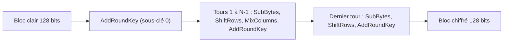
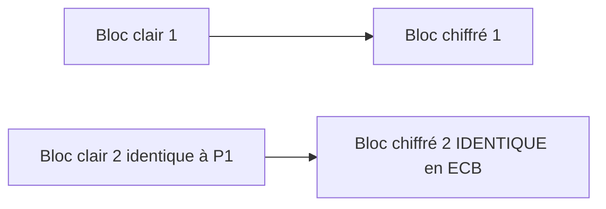

## Introduction

AES (Advanced Encryption Standard) est aujourd'hui l'algorithme de chiffrement symétrique de référence. On le trouve partout : dans le Wi-Fi WPA2 et WPA3, dans le chiffrement de disque BitLocker, FileVault ou LUKS, dans la quasi-totalité des connexions TLS, dans les VPN IPsec et WireGuard (qui lui préfère ChaCha20), dans les coffres de mots de passe et les sauvegardes chiffrées.

Pourtant, un algorithme robuste mal utilisé reste vulnérable. Les failles réelles ne viennent presque jamais d'AES lui-même, mais du **mode opératoire** choisi, d'un vecteur d'initialisation réutilisé, d'une absence de contrôle d'intégrité ou d'une clé dérivée d'un mot de passe faible. Ce chapitre couvre donc autant l'algorithme que la manière de l'employer correctement. À la fin, tu sauras lire une configuration de chiffrement, repérer un mode dangereux et écrire du code qui chiffre de façon sûre.

## Chiffrement par blocs et chiffrement par flot

Il existe deux grandes familles d'algorithmes symétriques.

Un **chiffrement par blocs** transforme un bloc de taille fixe (128 bits pour AES) en un autre bloc de même taille, sous le contrôle d'une clé. Pour un message plus long, il faut une règle d'enchaînement : c'est le rôle du mode opératoire.

Un **chiffrement par flot** génère, à partir de la clé et d'un nonce, une longue suite d'octets pseudo-aléatoires appelée **flux de clé** (keystream), puis la combine au message par XOR, octet par octet. ChaCha20 est le chiffrement par flot moderne de référence ; RC4, l'ancien, est cassé et interdit dans TLS depuis 2015 (RFC 7465).

Point important : certains modes, comme CTR et GCM, transforment AES en chiffrement par flot. Ils héritent alors de sa règle d'or : un même couple clé et nonce ne doit jamais servir deux fois.

## AES en détail

<Steps steps={[
  { title: "Un algorithme par blocs", description: "AES chiffre des blocs de 128 bits à la fois, quelle que soit la taille de clé utilisée (128, 192 ou 256 bits)." },
  { title: "Plusieurs tours de transformation", description: "Chaque bloc subit une série de transformations répétées (substitution, permutation, mélange) : 10 tours pour une clé de 128 bits, 12 pour 192 bits, 14 pour 256 bits." },
  { title: "Standardisé par le NIST", description: "AES a été sélectionné en 2001 (FIPS 197) après un concours public international remporté par l'algorithme Rijndael des Belges Joan Daemen et Vincent Rijmen, remplaçant l'ancien DES devenu trop faible." },
]} />

### Ce qui se passe dans un tour

Le bloc de 16 octets est vu comme une grille de 4 lignes sur 4 colonnes, appelée l'**état**. Chaque tour applique quatre opérations :

1. **SubBytes** remplace chaque octet par un autre grâce à une table de substitution fixe, la S-box. C'est la seule opération non linéaire : elle empêche de résoudre le chiffrement comme un simple système d'équations.
2. **ShiftRows** décale circulairement chaque ligne de la grille d'un nombre différent de positions, ce qui mélange les colonnes entre elles.
3. **MixColumns** combine les quatre octets de chaque colonne par une multiplication dans un corps fini. Après deux tours, chaque bit de sortie dépend de chaque bit d'entrée : c'est la **diffusion**.
4. **AddRoundKey** combine l'état par XOR avec une **sous-clé de tour**, dérivée de la clé principale par l'algorithme de **cadencement de clé** (key schedule).

Le dernier tour omet MixColumns. Le déchiffrement applique les opérations inverses dans l'ordre inverse. Ces notions de confusion (relation complexe entre clé et chiffré) et de diffusion (propagation de chaque bit) ont été formalisées par Claude Shannon en 1949.



### Pourquoi DES a dû être remplacé

DES chiffrait des blocs de 64 bits avec une clé effective de 56 bits. En 1998, la machine Deep Crack de l'EFF a retrouvé une clé DES par force brute en 56 heures. Le palliatif 3DES (trois passes de DES) est lent, et ses blocs de 64 bits le rendent vulnérable à l'attaque Sweet32 de 2016, qui exploite les collisions de blocs après environ 32 Go de données chiffrées sous la même clé. Le NIST a retiré 3DES : son usage pour chiffrer est interdit après 2023.

<CehCallout>
AES-256 n'est pas « plus sûr » qu'AES-128 dans un sens pratique immédiat : les deux sont considérés comme sûrs contre toute attaque connue avec les moyens de calcul actuels. AES-256 offre une marge de sécurité supplémentaire face à d'éventuelles avancées futures (dont l'informatique quantique et l'algorithme de Grover, vu au chapitre 8), au prix d'une performance légèrement inférieure due à ses 14 tours au lieu de 10.
</CehCallout>

### Performances et instructions matérielles

Depuis 2010, les processeurs x86 disposent des instructions **AES-NI**, et les processeurs ARMv8 d'extensions équivalentes. Elles exécutent un tour d'AES en une seule instruction, ce qui rend AES à la fois très rapide et résistant aux attaques temporelles sur les tables de substitution. Sur un matériel sans accélération AES, comme certains microcontrôleurs ou anciens téléphones, ChaCha20 est plus rapide en logiciel pur et plus facile à implémenter en temps constant.

```bash
# Vérifier la présence d'AES-NI sur un processeur Linux
grep -o -m1 -w aes /proc/cpuinfo
# Mesurer le débit d'AES-256-GCM pendant 3 secondes
openssl speed -seconds 3 -evp aes-256-gcm
```

## Les modes opératoires, aussi importants que l'algorithme

Un algorithme par blocs comme AES doit être combiné à un mode opératoire pour chiffrer des données plus longues qu'un seul bloc de 128 bits. Le mode détermine si des motifs du clair transparaissent, si l'intégrité est protégée et ce qui se passe en cas de réutilisation d'un paramètre.

<CompareTable
  titleA="Mode"
  titleB="Caractéristique"
  rows={[
    { a: "ECB (Electronic Codebook)", b: "Chiffre chaque bloc indépendamment : des blocs identiques en clair produisent des blocs identiques chiffrés" },
    { a: "CBC (Cipher Block Chaining)", b: "Chaque bloc est combiné au bloc chiffré précédent avant chiffrement, via un vecteur d'initialisation (IV) pour le premier bloc" },
    { a: "CTR (Counter)", b: "Chiffre un compteur pour produire un flux de clé combiné au clair par XOR : parallélisable, pas de remplissage" },
    { a: "GCM (Galois/Counter Mode)", b: "Mode moderne combinant chiffrement CTR ET authentification (AEAD) en une seule opération" },
    { a: "XTS", b: "Mode conçu pour le chiffrement de disque (BitLocker, LUKS), où chaque secteur est chiffré sans place pour un tag" },
]}
/>

### ECB, le mode à ne jamais utiliser

En ECB, chaque bloc est chiffré seul, avec la même clé. Le résultat est donc une table de correspondance fixe : un bloc clair donné produit toujours le même bloc chiffré.

<WarningCallout>
Le mode ECB ne doit JAMAIS être utilisé en pratique : parce que des blocs de données identiques produisent des blocs chiffrés identiques, des motifs du fichier original restent visibles malgré le chiffrement. Le célèbre exemple du manchot Tux chiffré en ECB montre une image toujours parfaitement reconnaissable. L'illusion de sécurité est totale, mais la confidentialité réelle est largement compromise.
</WarningCallout>



Tu peux le constater toi-même. Voici 48 octets de « A », soit trois blocs identiques, chiffrés en ECB puis en CBC avec la même clé :

```bash
python3 -c "print('A'*48, end='')" > blocs.txt
openssl enc -aes-128-ecb -K 000102030405060708090a0b0c0d0e0f -in blocs.txt | xxd
openssl enc -aes-128-cbc -K 000102030405060708090a0b0c0d0e0f -iv "$(openssl rand -hex 16)" -in blocs.txt | xxd
```

```text
00000000: dd4b 1a0b 47da a706 7d0b 59d9 5d58 a6ae  .K..G...}.Y.]X..
00000010: dd4b 1a0b 47da a706 7d0b 59d9 5d58 a6ae  .K..G...}.Y.]X..
00000020: dd4b 1a0b 47da a706 7d0b 59d9 5d58 a6ae  .K..G...}.Y.]X..
00000030: 954f 64f2 e4e8 6e9e ee82 d202 1668 4899  .Od...n......hH.
00000000: 7681 d051 1dc3 e88e de6e 9d28 034b 061b  v..Q.....n.(.K..
00000010: b631 fcca f6a2 68a3 6281 f344 63f3 2a7b  .1....h.b..Dc.*{
00000020: ef7b 1527 c6d7 9d7b 32a9 e9b2 f90a 490d  .{.'...{2.....I.
00000030: 061c e6b8 a835 6f8f b6a2 556b 2e46 a988  .....5o...Uk.F..
```

En ECB, les trois premières lignes sont identiques ; la quatrième correspond au bloc de remplissage PKCS#7 ajouté automatiquement. En CBC, chaque ligne est différente.

### CBC et l'importance du vecteur d'initialisation

En CBC, chaque bloc clair est combiné par XOR avec le bloc chiffré précédent avant d'être chiffré. Pour le premier bloc, on utilise un **vecteur d'initialisation** (IV) de 128 bits. L'IV n'est pas secret : il est transmis avec le chiffré. En revanche, en CBC, il doit être **imprévisible**, donc tiré aléatoirement. L'attaque BEAST de 2011 contre TLS 1.0 exploitait justement des IV prévisibles.

CBC impose un **remplissage** (padding) : le dernier bloc est complété jusqu'à 16 octets selon la norme PKCS#7. Si un serveur révèle, par un message d'erreur ou un temps de réponse différent, que le remplissage d'un chiffré reçu est invalide, il devient un **oracle de padding** : un attaquant peut alors déchiffrer n'importe quel message octet par octet sans la clé, en envoyant des chiffrés modifiés. Cette attaque, décrite par Serge Vaudenay en 2002, a frappé ASP.NET en 2010, puis TLS avec POODLE en 2014 (sur SSL 3.0) et Lucky Thirteen en 2013.

### CTR et GCM

En mode CTR, on chiffre un compteur (nonce suivi d'un numéro de bloc) et on combine le résultat au clair par XOR. Le mode est parallélisable et ne demande pas de remplissage. GCM ajoute à CTR un calcul d'authentification nommé GHASH, qui produit un **tag** de 128 bits.

<CehCallout>
GCM appartient à la famille des modes AEAD (Authenticated Encryption with Associated Data) : il produit à la fois un texte chiffré ET un tag d'authentification, garantissant simultanément confidentialité et intégrité en une seule opération. C'est pourquoi TLS 1.3 n'accepte plus que des suites AEAD, en particulier AES-GCM et ChaCha20-Poly1305.
</CehCallout>

Les **données associées** (le AD de AEAD) sont des informations authentifiées mais non chiffrées : un en-tête de paquet, un identifiant de version, un numéro de facture. Le destinataire peut les lire en clair, mais toute modification fait échouer la vérification du tag.

<CompareTable
  titleA="CBC seul"
  titleB="GCM (AEAD)"
  rows={[
    { a: "Garantit uniquement la confidentialité", b: "Garantit confidentialité ET intégrité simultanément" },
    { a: "Nécessite un mécanisme d'intégrité séparé (HMAC, appliqué après le chiffrement) pour être sûr", b: "Le mécanisme d'intégrité est intégré nativement" },
    { a: "Vulnérable à des attaques de padding si mal implémenté", b: "Pas de remplissage, donc pas d'oracle de padding" },
    { a: "IV aléatoire et imprévisible de 128 bits", b: "Nonce de 96 bits qui doit être unique, jamais réutilisé" },
]}
/>

### La règle d'or du nonce

<TipCallout>
L'importance du vecteur d'initialisation (IV) est souvent sous-estimée : un IV réutilisé avec la même clé, en mode CBC comme en GCM, peut compromettre gravement la sécurité du chiffrement. Un IV doit être unique (et aléatoire en CBC) pour chaque opération de chiffrement, même avec la même clé.
</TipCallout>

En GCM, la réutilisation est particulièrement grave. Comme GCM repose sur CTR, deux messages chiffrés avec le même couple clé et nonce utilisent le même flux de clé : le XOR des deux chiffrés est égal au XOR des deux clairs, ce qui permet souvent de les retrouver. Pire, la répétition révèle la clé d'authentification interne de GHASH, et l'attaquant peut alors fabriquer des messages falsifiés acceptés comme authentiques. Des chercheurs ont trouvé en 2016 des serveurs HTTPS réels qui réutilisaient leurs nonces GCM (attaque dite « nonce-disrespecting »).

Avec des nonces aléatoires de 96 bits, le NIST recommande de ne pas dépasser 2 puissance 32 messages sous la même clé, pour garder négligeable le risque de collision. Quand on ne peut pas garantir l'unicité, on choisit **AES-GCM-SIV** (RFC 8452), qui limite les dégâts en cas de répétition, ou **XChaCha20-Poly1305**, dont le nonce de 192 bits peut être tiré au hasard sans souci.

## ChaCha20-Poly1305, l'alternative moderne

ChaCha20-Poly1305 (RFC 8439), conçu à partir des travaux de Daniel J. Bernstein, combine le chiffrement par flot ChaCha20 et l'authentificateur Poly1305. C'est l'autre suite AEAD obligatoire de TLS 1.3, l'unique chiffrement de WireGuard, et le choix par défaut de libsodium et d'`age`. Il est aussi sûr qu'AES-GCM, plus rapide sans accélération matérielle, et naturellement résistant aux attaques temporelles.

## Dériver une clé à partir d'un mot de passe

Une clé AES doit contenir 128 ou 256 bits d'aléa. Un mot de passe humain en contient beaucoup moins. On utilise donc une **fonction de dérivation de clé** (KDF) volontairement coûteuse, qui combine le mot de passe et un **sel** aléatoire : PBKDF2 avec de nombreuses itérations (l'OWASP recommande 600 000 itérations pour PBKDF2-HMAC-SHA256), scrypt ou, mieux, Argon2id. Quand on part au contraire d'un secret déjà fort, comme le résultat d'un échange Diffie-Hellman, on utilise **HKDF** (RFC 5869), rapide et prévue pour cet usage.

```bash
# Chiffrer un fichier avec une clé dérivée d'un mot de passe par PBKDF2
openssl enc -aes-256-cbc -pbkdf2 -iter 600000 -salt -in secret.txt -out secret.enc -pass pass:motdepasse_fort
xxd secret.enc | head -1          # l'en-tête « Salted__ » est suivi des 8 octets de sel
openssl enc -d -aes-256-cbc -pbkdf2 -iter 600000 -in secret.enc -pass pass:motdepasse_fort
```

```text
00000000: 5361 6c74 6564 5f5f 9ef3 7813 6605 a0ff  Salted__..x.f...
donnee confidentielle
```

<WarningCallout>
La commande `openssl enc` ne prend pas en charge les modes AEAD : `openssl enc -aes-256-gcm` échoue avec le message « AEAD ciphers not supported ». Le fichier produit ci-dessus en CBC n'est donc protégé qu'en confidentialité, sans contrôle d'intégrité. Pour chiffrer des fichiers en production, utilise un outil conçu pour cela comme `age` ou GnuPG, ou une bibliothèque AEAD comme dans l'exemple Python qui suit. Sans l'option `-pbkdf2`, OpenSSL utilise une ancienne dérivation à une seule itération, très faible.
</WarningCallout>

## Pratique : AES-GCM en Python

Le paquet `cryptography` propose une API AEAD simple. Enregistre ce script sous le nom `gcm.py` :

```python
import os
from cryptography.hazmat.primitives.ciphers.aead import AESGCM
from cryptography.exceptions import InvalidTag

key = AESGCM.generate_key(bit_length=256)   # clé aléatoire de 256 bits
aead = AESGCM(key)
nonce = os.urandom(12)                       # nonce de 96 bits, unique par message
aad = b"en-tete:facture-2026-117"            # données associées : authentifiées, non chiffrées
ct = aead.encrypt(nonce, b"Virement de 500 EUR vers FR76...", aad)
print("chiffré + tag :", len(ct), "octets")  # longueur du clair + 16 octets de tag
print("déchiffré     :", aead.decrypt(nonce, ct, aad))

falsifie = bytearray(ct)
falsifie[13] ^= 0x01                          # on inverse un seul bit
try:
    aead.decrypt(nonce, bytes(falsifie), aad)
except InvalidTag:
    print("falsification détectée : InvalidTag")
```

```text
chiffré + tag : 48 octets
déchiffré     : b'Virement de 500 EUR vers FR76...'
falsification détectée : InvalidTag
```

Le message clair fait 32 octets ; le chiffré en fait 48, car GCM ajoute le tag de 16 octets. Un seul bit modifié suffit à faire rejeter le message entier : la bibliothèque ne renvoie jamais de clair non authentifié.

## Angle offensif et défensif

<AttackDefenseTable rows={[
  { phase: "Analyse de motifs", attack: "Repérer des blocs chiffrés répétés pour reconnaître un mode ECB et deviner le contenu (cookies, images)", defense: "Proscrire ECB, utiliser un mode AEAD" },
  { phase: "Oracle de padding", attack: "Envoyer des chiffrés CBC modifiés et observer les erreurs pour déchiffrer octet par octet (outil padbuster)", defense: "AEAD, ou encrypt-then-MAC avec vérification du MAC avant tout déchiffrement, messages d'erreur uniformes" },
  { phase: "Manipulation de bits", attack: "Inverser des bits d'un chiffré CTR ou CBC pour modifier le clair de façon prévisible (par exemple un rôle utilisateur)", defense: "Contrôle d'intégrité systématique, rejet de tout message au tag invalide" },
  { phase: "Réutilisation de nonce", attack: "Combiner deux chiffrés partageant le même nonce pour retrouver les clairs et forger des tags GCM", defense: "Compteurs gérés côté émetteur, AES-GCM-SIV ou XChaCha20-Poly1305, rotation des clés" },
  { phase: "Clé dérivée d'un mot de passe", attack: "Attaque par dictionnaire hors ligne sur un fichier chiffré avec une dérivation faible", defense: "Argon2id ou PBKDF2 avec un grand nombre d'itérations, mots de passe longs" },
]} />

## Erreurs fréquentes

- **Utiliser ECB**, parfois sans le savoir : certaines bibliothèques, comme d'anciennes versions de l'API Java avec la chaîne `AES` seule, choisissent ECB par défaut.
- **Réutiliser un IV ou un nonce**, ou en coder un en dur dans le programme.
- **Chiffrer sans authentifier** en CBC ou CTR, ou appliquer le MAC avant le chiffrement plutôt qu'après.
- **Utiliser un mot de passe directement comme clé**, ou le dériver par un simple SHA-256.
- **Comparer un tag avec une comparaison classique** plutôt qu'en temps constant (par exemple `hmac.compare_digest` en Python).
- **Croire qu'AES-256 compense un mauvais mode** : un mode faible annule la robustesse de la clé.

## Lab — Mise en pratique

**Environnement** : Kali Linux (terminal Nyx Shell), OpenSSL 3.x, Python 3.12 avec le paquet `cryptography`.

<Steps steps={[
  { title: "Vérifier l'accélération matérielle", description: "Contrôle la présence d'AES-NI puis mesure le débit d'AES-256-GCM. Note le nombre d'octets traités par seconde pour des blocs de 16 Ko.", code: "grep -o -m1 -w aes /proc/cpuinfo\nopenssl speed -seconds 3 -evp aes-256-gcm" },
  { title: "Observer le défaut d'ECB", description: "Chiffre trois blocs identiques en ECB et observe les lignes répétées dans la sortie hexadécimale.", code: "python3 -c \"print('A'*48, end='')\" > blocs.txt\nopenssl enc -aes-128-ecb -K 000102030405060708090a0b0c0d0e0f -in blocs.txt | xxd" },
  { title: "Comparer avec CBC", description: "Chiffre le même fichier en CBC avec un IV aléatoire, deux fois de suite. Les blocs ne se répètent plus, et les deux chiffrés diffèrent entièrement.", code: "for i in 1 2; do openssl enc -aes-128-cbc -K 000102030405060708090a0b0c0d0e0f -iv \"$(openssl rand -hex 16)\" -in blocs.txt | xxd | head -2; echo; done" },
  { title: "Constater la limite d'openssl enc", description: "Tente un chiffrement GCM avec openssl enc et lis le message d'erreur. Retiens qu'il faut un autre outil pour le chiffrement authentifié de fichiers.", code: "echo test > s.txt\nopenssl enc -aes-256-gcm -pbkdf2 -in s.txt -out s.enc -pass pass:x" },
  { title: "Chiffrer et falsifier en AES-GCM", description: "Exécute le script gcm.py de la section Pratique. Vérifie que la longueur inclut le tag de 16 octets et que le bit inversé déclenche InvalidTag.", code: "python3 gcm.py" },
  { title: "Chiffrer un fichier avec age", description: "Si l'outil age est installé, génère une identité puis chiffre un fichier pour cette clé publique. Observe qu'age utilise ChaCha20-Poly1305 sans aucun paramètre à choisir.", code: "age-keygen -o cle.txt\nage -r \"$(grep -o 'age1[0-9a-z]*' cle.txt)\" -o secret.age secret.txt\nage -d -i cle.txt secret.age" },
]} />

## À retenir

- AES chiffre des blocs de 128 bits en 10, 12 ou 14 tours selon que la clé fait 128, 192 ou 256 bits ; il a remplacé DES en 2001.
- Le mode opératoire est aussi critique que l'algorithme : ECB ne doit jamais être utilisé, car il laisse transparaître les motifs du clair.
- CBC seul n'assure que la confidentialité et expose aux oracles de padding s'il n'est pas complété par un MAC.
- Les modes AEAD comme AES-GCM et ChaCha20-Poly1305 garantissent confidentialité et intégrité en une seule opération ; ce sont les seuls acceptés par TLS 1.3.
- Un IV ou un nonce ne doit jamais être réutilisé avec la même clé ; en GCM, une répétition permet de retrouver les clairs et de forger des messages.
- Une clé issue d'un mot de passe doit être dérivée avec une fonction lente et salée comme Argon2id ou PBKDF2 avec de nombreuses itérations.

## Questions de révision

1. Combien de tours AES effectue-t-il selon la taille de clé, et quel est le rôle de l'opération SubBytes ?
2. Pourquoi le mode ECB est-il dangereux même si l'algorithme AES sous-jacent est robuste ?
3. Qu'est-ce qu'un mode AEAD, et que représentent les données associées ?
4. Explique comment un oracle de padding permet de déchiffrer un message CBC sans connaître la clé.
5. Pourquoi la réutilisation d'un nonce est-elle encore plus grave en GCM qu'en CBC ?
6. Dans quel contexte choisirais-tu ChaCha20-Poly1305 plutôt qu'AES-GCM ?
7. Un collègue chiffre des sauvegardes avec `openssl enc -aes-256-cbc` sans option `-pbkdf2`. Quels problèmes identifies-tu et que proposes-tu ?
