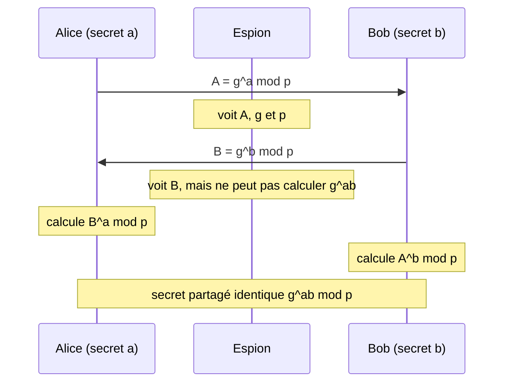

## Introduction

La cryptographie asymétrique est ce qui permet à deux inconnus de communiquer secrètement sur un réseau hostile. Sans elle, il faudrait se rencontrer physiquement pour échanger chaque clé. Elle sert à trois usages : **établir une clé secrète** partagée (échange de clé), **chiffrer** une petite donnée pour un destinataire, et **signer** pour prouver l'origine et l'intégrité d'un message.

RSA a longtemps été le standard du domaine. Il reste massivement utilisé pour les certificats et les signatures, mais il est progressivement concurrencé par la **cryptographie sur courbes elliptiques** (ECC), plus performante à sécurité équivalente. En pentest, tu rencontreras des clés RSA trop courtes, des exposants mal choisis, des clés générées avec un aléa défaillant : ce chapitre t'apprend à les reconnaître. À la fin, tu sauras dérouler RSA à la main sur de petits nombres, expliquer pourquoi ECC est préféré sur mobile et dans TLS, et générer des clés correctes avec OpenSSL.

## Le principe mathématique de RSA

RSA, du nom de Rivest, Shamir et Adleman (1977), repose sur une **fonction à sens unique à trappe** : multiplier deux grands nombres premiers est instantané, mais retrouver ces deux nombres à partir de leur produit est extrêmement difficile, sauf si l'on connaît un secret (la trappe).

<CehCallout>
La sécurité de RSA repose sur un problème mathématique simple à énoncer mais très difficile à résoudre à grande échelle : étant donné un très grand nombre produit de deux nombres premiers, retrouver ces deux nombres premiers (factorisation) est extrêmement coûteux en temps de calcul dès que le nombre dépasse quelques centaines de chiffres. Le record public de factorisation est RSA-250, un nombre de 829 bits, factorisé en 2020.
</CehCallout>

<Steps steps={[
  { title: "Génération de la paire de clés", description: "Deux grands nombres premiers p et q sont choisis au hasard et multipliés pour former le module n, utilisé dans les clés publique et privée." },
  { title: "Clé publique", description: "Le couple formé du module n et de l'exposant public e peut être diffusé librement : il sert à chiffrer un message ou vérifier une signature." },
  { title: "Clé privée", description: "L'exposant privé d est dérivé des nombres premiers originaux p et q ; il doit rester strictement secret et sert à déchiffrer ou signer." },
  { title: "Sécurité du système", description: "Elle repose entièrement sur la difficulté de factoriser le module pour retrouver les nombres premiers d'origine sans connaître la clé privée." },
]} />

### Exemple chiffré pas à pas

Déroulons RSA avec de tout petits nombres, pour comprendre le mécanisme. Les notions d'arithmétique modulaire et d'inverse modulaire sont détaillées dans le cours Mathématiques Appliquées.

1. **Choisir deux nombres premiers** : p vaut 61 et q vaut 53.
2. **Calculer le module** : n égale p fois q, soit 61 fois 53, c'est-à-dire 3233.
3. **Calculer l'indicatrice d'Euler** : phi(n) égale (p moins 1) fois (q moins 1), soit 60 fois 52, c'est-à-dire 3120. Ce nombre n'est calculable facilement que si l'on connaît p et q.
4. **Choisir l'exposant public** e, premier avec 3120 : prenons 17. En pratique, on utilise presque toujours 65537.
5. **Calculer l'exposant privé** d, inverse de e modulo 3120, c'est-à-dire le nombre tel que e fois d laisse un reste de 1 dans la division par 3120. On trouve d égal à 2753 : en effet 17 fois 2753 égale 46 801, soit 15 fois 3120 plus 1.
6. **Chiffrer** le message m égal à 65 : c égale m puissance e modulo n, soit 65 puissance 17 modulo 3233, ce qui donne 2790.
7. **Déchiffrer** : m égale c puissance d modulo n, soit 2790 puissance 2753 modulo 3233, ce qui redonne bien 65.

```python
p, q = 61, 53
n = p * q                    # 3233, le module public
phi = (p - 1) * (q - 1)      # 3120, secret car il exige de connaître p et q
e = 17                       # exposant public
d = pow(e, -1, phi)          # 2753, inverse modulaire (Python 3.8+)
c = pow(65, e, n)            # chiffrement du message 65
print(n, phi, d, c, pow(c, d, n))
```

```text
3233 3120 2753 2790 65
```

L'attaquant connaît n et e. Pour trouver d, il lui faut phi(n), donc p et q, donc factoriser n. Avec 3233, c'est immédiat ; avec un module de 3072 bits, soit environ 925 chiffres décimaux, c'est hors de portée de tout calcul classique.

### Signer avec RSA

La signature utilise les clés dans l'autre sens : le signataire calcule l'empreinte du document, puis l'élève à la puissance d modulo n avec sa clé privée. N'importe qui peut vérifier en élevant la signature à la puissance e avec la clé publique et en comparant le résultat à l'empreinte. Seul le détenteur de d a pu produire cette valeur : c'est la base de la non-répudiation.

### Le RSA réel a besoin d'un remplissage

Le RSA « manuel » de l'exemple, appelé textbook RSA, est dangereux. Il est déterministe (le même message donne toujours le même chiffré) et malléable (multiplier un chiffré par une valeur connue multiplie le clair de façon prévisible). On ajoute donc toujours un **remplissage** aléatoire structuré :

- **OAEP** pour le chiffrement (PKCS#1 v2) ;
- **PSS** pour la signature ;
- l'ancien **PKCS#1 v1.5** reste répandu pour les signatures, mais en chiffrement il est vulnérable à l'attaque de Bleichenbacher (1998), réapparue en 2017 sous le nom de ROBOT sur de nombreux serveurs TLS.

## Diffie-Hellman et le logarithme discret

En 1976, Whitfield Diffie et Martin Hellman publient une méthode permettant à deux personnes de calculer un secret commun en n'échangeant que des valeurs publiques. On fixe publiquement un grand nombre premier p et un générateur g. Alice choisit un secret a et envoie g puissance a modulo p ; Bob choisit un secret b et envoie g puissance b modulo p. Chacun élève la valeur reçue à son propre secret, et tous deux obtiennent g puissance ab modulo p.

Prenons un exemple minuscule : p égale 23 et g égale 5. Alice choisit a égal à 6 et envoie 5 puissance 6 modulo 23, soit 8. Bob choisit b égal à 15 et envoie 5 puissance 15 modulo 23, soit 19. Alice calcule 19 puissance 6 modulo 23 et Bob calcule 8 puissance 15 modulo 23 : les deux trouvent 2, le secret partagé.

Un espion qui voit passer 8 et 19 devrait résoudre le **problème du logarithme discret** : retrouver l'exposant a à partir de g puissance a modulo p. Pour de grands nombres, c'est aussi difficile que la factorisation.



Diffie-Hellman seul ne vérifie pas l'identité du correspondant : un attaquant placé au milieu peut faire un échange séparé avec chacun. C'est pourquoi on authentifie l'échange par une signature et un certificat, ce que fait TLS. Quand les secrets a et b sont tirés à nouveau à chaque session puis détruits, on parle de Diffie-Hellman **éphémère** (DHE, ou ECDHE sur courbes elliptiques), source de la confidentialité persistante vue au chapitre 7.

## La cryptographie sur courbes elliptiques

Une **courbe elliptique** est l'ensemble des points vérifiant une équation de la forme y au carré égale x au cube plus a x plus b, calculée ici modulo un grand nombre premier. On sait « additionner » deux points de la courbe pour en obtenir un troisième. Multiplier un point G par un entier k, c'est l'additionner k fois à lui-même, ce qui se calcule très vite. Mais retrouver k à partir de G et de k fois G, le **logarithme discret sur courbe elliptique**, est bien plus difficile que son équivalent classique : les meilleures attaques connues sont génériques. On obtient donc la même sécurité avec des clés beaucoup plus courtes.

Les courbes et schémas que tu rencontreras :

- **P-256, P-384** (courbes du NIST, aussi appelées secp256r1 et secp384r1), utilisées avec ECDSA pour les signatures et ECDH pour l'échange de clé ;
- **Curve25519**, conçue par Daniel J. Bernstein, utilisée pour l'échange de clé sous le nom **X25519** (TLS 1.3, SSH, Signal, WireGuard) ;
- **Ed25519**, schéma de signature EdDSA sur une courbe équivalente, standard par défaut des clés SSH modernes et accepté par le NIST depuis FIPS 186-5 (2023) ;
- **secp256k1**, utilisée par Bitcoin et Ethereum.

## RSA contre ECC, à sécurité équivalente

<CompareTable
  titleA="Niveau de sécurité (bits)"
  titleB="Taille de clé RSA équivalente / ECC équivalente"
  rows={[
    { a: "112 bits", b: "RSA 2048 bits / ECC 224 bits" },
    { a: "128 bits", b: "RSA 3072 bits / ECC 256 bits" },
    { a: "192 bits", b: "RSA 7680 bits / ECC 384 bits" },
    { a: "256 bits", b: "RSA 15360 bits (impraticable) / ECC 512 bits" },
]}
/>

Cette correspondance est celle du NIST (SP 800-57 partie 1). RSA 2048 offre 112 bits de sécurité : il reste acceptable pour l'existant, mais le NIST prévoit d'interdire ce niveau après 2030, et un nouveau déploiement devrait viser au moins 3072 bits, ou mieux, une courbe elliptique. Toutes ces tailles ne protègent cependant que contre les ordinateurs classiques : RSA comme ECC seront cassés par un ordinateur quantique suffisamment puissant, ce qui motive la migration vers ML-KEM et ML-DSA (chapitre 8).

<TipCallout>
À sécurité équivalente, une clé ECC est considérablement plus petite qu'une clé RSA : 32 octets pour une clé publique X25519 contre 384 octets pour un module RSA 3072. C'est un avantage décisif pour les environnements contraints (mobile, IoT) et pour la performance des connexions TLS à grande échelle, ce qui explique la migration de nombreux services vers ECC, notamment ECDSA, ECDHE et Ed25519.
</TipCallout>

| Critère | RSA 3072 | ECC (P-256, X25519, Ed25519) |
| --- | --- | --- |
| Taille de clé publique | 384 octets | 32 à 64 octets |
| Taille de signature | 384 octets | 64 octets |
| Génération de clé | lente (recherche de grands premiers) | quasi instantanée |
| Signature | lente | rapide |
| Vérification | très rapide | rapide |
| Chiffrement direct | possible avec OAEP | non, on passe par ECDH puis un chiffrement symétrique |

## Erreurs classiques d'implémentation

<WarningCallout>
Utiliser des nombres premiers trop petits, générés de façon prévisible, ou réutiliser le même nombre premier entre plusieurs paires de clés (arrivé plusieurs fois en pratique sur des équipements embarqués mal configurés) permet de casser RSA bien plus facilement qu'en attaquant l'algorithme lui-même. La faiblesse vient presque toujours de l'implémentation, jamais des mathématiques sous-jacentes.
</WarningCallout>

<CompareTable
  titleA="Erreur d'implémentation"
  titleB="Conséquence"
  rows={[
    { a: "Nombres premiers générés par un générateur aléatoire faible", b: "Les clés deviennent prévisibles et factorisables" },
    { a: "Réutilisation d'un nombre premier entre deux clés différentes", b: "Le PGCD des deux modules révèle le facteur commun, cassant les deux clés" },
    { a: "Exposant public trop petit mal utilisé (e=3 sans padding)", b: "Attaque de Håstad permettant de retrouver le message clair" },
    { a: "Absence de padding sécurisé (ex: OAEP)", b: "Vulnérabilité à des attaques adaptatives sur le texte chiffré (Bleichenbacher, ROBOT)" },
    { a: "Premiers générés avec une structure particulière", b: "Factorisation rapide, comme la faille ROCA (CVE-2017-15361) des puces Infineon" },
    { a: "Même nonce réutilisé pour deux signatures ECDSA", b: "La clé privée se calcule directement à partir des deux signatures" },
]}
/>

### L'attaque par PGCD sur des premiers partagés

Si deux modules n1 et n2 ont été générés avec un même facteur p, alors le PGCD de n1 et n2 vaut p. L'algorithme d'Euclide le calcule en une fraction de seconde, même sur des nombres de 2048 bits, et il suffit ensuite de diviser chaque module par p pour obtenir l'autre facteur.

```python
import math
p, q1, q2 = 1000000007, 998244353, 1000000009   # p partagé par erreur
n1, n2 = p * q1, p * q2                          # deux modules publics distincts
g = math.gcd(n1, n2)
print(g, n1 // g, n2 // g)                       # facteurs retrouvés
```

```text
1000000007 998244353 1000000009
```

<CehCallout>
L'attaque par PGCD (plus grand commun diviseur) entre deux modules RSA générés avec un nombre premier partagé par erreur est une découverte réelle documentée en 2012 sur des millions de clés publiques exposées sur Internet (travaux de Heninger et al. et de Lenstra et al.), provenant d'équipements embarqués aux générateurs aléatoires insuffisamment initialisés au démarrage. Environ 0,5 % des clés TLS analysées étaient ainsi cassables.
</CehCallout>

### L'attaque de Håstad avec e égal à 3

Si le même message m, sans remplissage aléatoire, est chiffré avec e égal à 3 pour trois destinataires différents, l'attaquant obtient m au cube modulo trois modules distincts. Le théorème des restes chinois lui donne m au cube exactement, sans modulo, et une simple racine cubique entière révèle m. Plus simplement encore, si m au cube est inférieur à n, le chiffré est m au cube lui-même et la racine cubique suffit. Le remplissage OAEP et l'exposant 65537 éliminent ces scénarios.

### Le nonce ECDSA

Chaque signature ECDSA utilise un nombre aléatoire secret appelé nonce. S'il est réutilisé, ou même seulement biaisé de quelques bits, la clé privée peut être retrouvée. En 2010, des chercheurs ont extrait ainsi la clé de signature de la PlayStation 3, dont le nonce était constant. En 2013, un générateur défaillant d'Android a permis de vider des portefeuilles Bitcoin. Ed25519 et la variante déterministe d'ECDSA (RFC 6979) dérivent le nonce du message et de la clé, ce qui supprime ce risque.

## Angle offensif et défensif

<AttackDefenseTable rows={[
  { phase: "Collecte", attack: "Récupérer en masse les clés publiques (certificats TLS, clés SSH) pour chercher des modules à facteurs partagés ou des clés trop courtes", defense: "Inventaire des clés, rejet automatique des tailles inférieures à 2048 bits, génération sur des systèmes à l'aléa correctement initialisé" },
  { phase: "Cryptanalyse d'implémentation", attack: "Exploiter un oracle Bleichenbacher sur un serveur TLS acceptant l'échange de clé RSA", defense: "TLS 1.3, désactivation de l'échange de clé RSA statique, OAEP pour tout chiffrement RSA" },
  { phase: "Signatures", attack: "Retrouver une clé privée ECDSA à partir de nonces répétés ou biaisés", defense: "Ed25519 ou ECDSA déterministe (RFC 6979), bibliothèques maintenues" },
  { phase: "Vol de clé privée", attack: "Lire une clé privée non protégée sur disque ou dans un dépôt de code", defense: "Clés chiffrées par phrase de passe, stockage en HSM ou TPM, permissions 600, détection de secrets dans le code" },
]} />

## Erreurs fréquentes

- **Utiliser RSA pour chiffrer de gros volumes** au lieu de chiffrer une clé de session symétrique.
- **Signer et chiffrer avec la même paire de clés**, ce qui mélange les usages et complique la révocation.
- **Générer des clés RSA de 1024 bits** par habitude ou par défaut d'un vieil outil.
- **Implémenter RSA soi-même** avec `pow()` comme dans l'exemple pédagogique, sans remplissage.
- **Croire que la taille de clé ECC se compare directement à RSA** : une clé ECC de 256 bits n'est pas plus faible qu'une clé RSA de 2048 bits, elle est plus forte.

## Lab — Mise en pratique

**Environnement** : Kali Linux (terminal Nyx Shell), OpenSSL 3.x, Python 3.12.

<Steps steps={[
  { title: "Dérouler RSA à la main", description: "Exécute l'exemple avec p égal à 61 et q égal à 53. Change le message 65 en 1000 et vérifie que le déchiffrement le restitue.", code: "python3 -c \"p,q=61,53; n=p*q; phi=(p-1)*(q-1); e=17; d=pow(e,-1,phi); c=pow(1000,e,n); print(n,d,c,pow(c,d,n))\"" },
  { title: "Générer une paire de clés RSA 3072", description: "Génère une clé avec la commande moderne genpkey, extrais la clé publique et repère dans la sortie le module, l'exposant public 65537 et les deux premiers prime1 et prime2.", code: "openssl genpkey -algorithm RSA -pkeyopt rsa_keygen_bits:3072 -out cle_privee.pem\nopenssl pkey -in cle_privee.pem -pubout -out cle_publique.pem\nopenssl pkey -in cle_privee.pem -text -noout | grep -E '^[a-zA-Z]'" },
  { title: "Générer une clé Ed25519 et signer", description: "Crée une clé Ed25519, signe un document puis vérifie la signature. Note que la signature ne fait que 64 octets.", code: "openssl genpkey -algorithm ED25519 -out ed.pem\nopenssl pkey -in ed.pem -pubout -out ed.pub\necho 'contrat v1' > doc.txt\nopenssl pkeyutl -sign -inkey ed.pem -rawin -in doc.txt -out doc.sig\nopenssl pkeyutl -verify -pubin -inkey ed.pub -rawin -in doc.txt -sigfile doc.sig\nwc -c doc.sig" },
  { title: "Modifier le document signé", description: "Change une lettre du document et relance la vérification : OpenSSL affiche « Signature Verification Failure ».", code: "echo 'contrat v2' > doc.txt\nopenssl pkeyutl -verify -pubin -inkey ed.pub -rawin -in doc.txt -sigfile doc.sig" },
  { title: "Casser deux clés par PGCD", description: "Exécute le script de l'attaque par PGCD. Remplace ensuite les nombres par d'autres premiers de ton choix en gardant un facteur commun, et vérifie que les deux factorisations tombent.", code: "python3 -c \"import math; p,q1,q2=1000000007,998244353,1000000009; n1,n2=p*q1,p*q2; g=math.gcd(n1,n2); print(g, n1//g, n2//g)\"" },
  { title: "Inspecter les clés SSH d'un hôte", description: "Liste les types et tailles de clés d'hôte de ta machine. Repère les clés RSA de moins de 3072 bits et la présence d'une clé Ed25519.", code: "for k in /etc/ssh/ssh_host_*_key.pub; do ssh-keygen -l -f \"$k\"; done" },
  { title: "Choisir entre RSA et ECC", description: "Pour un service mobile avec des contraintes fortes de bande passante et de batterie, RSA ou ECC serait-il préférable, et pourquoi ? Rédige ta réponse en citant les tailles de clé et de signature." },
]} />

## À retenir

- RSA repose sur la difficulté de factoriser un grand nombre produit de deux nombres premiers ; la clé privée est dérivée de ces deux premiers.
- La clé publique sert à chiffrer et à vérifier une signature ; la clé privée sert à déchiffrer et à signer.
- RSA doit toujours être utilisé avec un remplissage : OAEP pour chiffrer, PSS pour signer.
- Diffie-Hellman permet d'établir un secret commun sur un canal public grâce au logarithme discret, mais doit être authentifié.
- À sécurité équivalente, ECC utilise des clés bien plus petites que RSA : 256 bits ECC correspondent à RSA 3072 pour 128 bits de sécurité.
- La quasi-totalité des failles pratiques viennent d'erreurs d'implémentation : génération faible, premiers partagés, e égal à 3 sans padding, nonce ECDSA réutilisé.
- RSA et ECC sont vulnérables à un futur ordinateur quantique ; leur remplacement est planifié.

## Questions de révision

1. Sur quel problème mathématique repose la sécurité de RSA, et pourquoi connaître phi(n) revient à connaître la clé privée ?
2. Avec p égal à 5, q égal à 11 et e égal à 3, calcule n, phi(n) et d. Chiffre ensuite le message 7.
3. Pourquoi le RSA « manuel » sans remplissage est-il dangereux ? Cite deux propriétés problématiques.
4. Explique pourquoi Diffie-Hellman non authentifié est vulnérable à une attaque de l'homme du milieu.
5. Pourquoi ECC est-il de plus en plus préféré à RSA dans les environnements contraints (mobile, IoT) ?
6. Pourquoi la réutilisation d'un même nombre premier entre deux paires de clés RSA est-elle catastrophique, et comment le détecte-t-on ?
7. Quelle est la conséquence de la réutilisation d'un nonce en ECDSA, et quelle solution apporte Ed25519 ?
