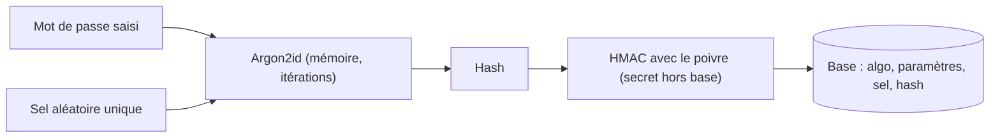

## Introduction

Les fonctions de hachage sont partout en sécurité. Elles servent à vérifier qu'une image ISO téléchargée n'a pas été altérée, à produire les empreintes de preuves numériques en investigation (vues au cours Forensics & DFIR), à identifier des malwares par leur empreinte dans VirusTotal, à construire les signatures numériques, les certificats, les commits Git, les blockchains, et à stocker les mots de passe.

Ce dernier usage est le plus mal compris. Chaque année, des fuites de bases de données révèlent des millions de mots de passe hachés avec MD5 ou SHA-1, retrouvés en quelques heures par les attaquants. Ce chapitre explique ce que garantit une fonction de hachage, pourquoi certaines sont cassées, comment authentifier un message avec un HMAC, et surtout comment stocker des mots de passe correctement. À la fin, tu sauras auditer le choix d'un algorithme de hachage et estimer la résistance d'une base de mots de passe volée.

## Qu'est-ce qu'une fonction de hachage

Une **fonction de hachage** prend une entrée de taille quelconque, d'un octet à plusieurs téraoctets, et produit une sortie de taille fixe appelée **empreinte**, **condensat** ou **hash**. SHA-256 produit toujours 256 bits, soit 32 octets, affichés en 64 caractères hexadécimaux. Contrairement au chiffrement, il n'y a ni clé ni opération inverse : on ne « déchiffre » pas un hash.

Une fonction de hachage **cryptographique** doit en plus résister à un adversaire qui cherche à la tromper.

<CompareTable
  titleA="Propriété"
  titleB="Ce qu'elle garantit"
  rows={[
    { a: "Déterminisme", b: "La même entrée produit toujours la même sortie" },
    { a: "Effet avalanche", b: "Un changement minime de l'entrée (un seul bit) change radicalement la sortie, environ la moitié des bits" },
    { a: "Résistance aux collisions", b: "Extrêmement difficile de trouver deux entrées différentes produisant le même hash" },
    { a: "Sens unique (irréversibilité)", b: "Impossible de retrouver l'entrée à partir du seul hash (résistance à la préimage)" },
]}
/>

Les cryptographes distinguent trois niveaux de résistance :

- la **résistance à la préimage** : à partir d'un hash h, impossible de trouver une entrée qui donne h ;
- la **résistance à la seconde préimage** : à partir d'une entrée donnée, impossible d'en trouver une autre de même hash ;
- la **résistance aux collisions** : impossible de trouver une paire quelconque d'entrées de même hash.

### Le paradoxe des anniversaires

Dans une classe de 23 élèves, la probabilité que deux d'entre eux partagent la même date d'anniversaire dépasse 50 %, alors qu'il existe 365 jours. Ce résultat contre-intuitif vient du fait qu'on compare toutes les paires possibles, et il y en a 253. Appliqué aux hashs : pour une empreinte de n bits, trouver une préimage demande environ 2 puissance n essais, mais trouver une collision n'en demande qu'environ 2 puissance n divisé par 2, c'est-à-dire la racine carrée. SHA-256 offre donc 256 bits de résistance à la préimage, mais 128 bits de résistance aux collisions. MD5, avec ses 128 bits, n'offrait au mieux que 64 bits contre les collisions, et les attaques réelles font bien mieux que cela.

## Pourquoi MD5 et SHA-1 sont cassés

<CehCallout>
MD5 et SHA-1, autrefois standards, sont aujourd'hui considérés cassés pour un usage de sécurité : des collisions ont été démontrées publiquement, permettant de produire deux fichiers différents avec le même hash. SHA-256 (famille SHA-2) est aujourd'hui la référence pour l'intégrité et les usages généraux. Pour l'examen, retiens aussi les tailles : MD5 produit 128 bits, SHA-1 160 bits, SHA-256 256 bits.
</CehCallout>

Les étapes marquantes :

- **2004** : Xiaoyun Wang et son équipe publient les premières collisions MD5.
- **2008** : des chercheurs fabriquent un faux certificat d'autorité de certification accepté par les navigateurs, grâce à une collision MD5.
- **2012** : le malware d'espionnage Flame exploite une collision MD5 pour signer de faux correctifs Windows Update.
- **2017** : l'attaque SHAttered de Google et du CWI produit deux fichiers PDF différents ayant le même SHA-1.
- **2020** : l'attaque « SHA-1 is a Shambles » réalise une collision à préfixe choisi sur SHA-1 pour environ 45 000 dollars de calcul, et l'applique à des clés PGP.

MD5 reste acceptable pour un usage non sécuritaire, comme détecter une corruption accidentelle de fichier ou dédupliquer des données, mais jamais face à un adversaire. Le NIST a annoncé le retrait complet de SHA-1 d'ici fin 2030.

### Les familles recommandées

| Famille | Exemples | Remarques |
| --- | --- | --- |
| SHA-2 (2001) | SHA-256, SHA-384, SHA-512 | Référence actuelle, construction de Merkle-Damgård, accélérée matériellement sur les processeurs récents |
| SHA-3 (2015, FIPS 202) | SHA3-256, SHAKE128, SHAKE256 | Construction en éponge (Keccak), totalement différente de SHA-2 : une alternative si SHA-2 tombait un jour |
| BLAKE2 et BLAKE3 | BLAKE2b, BLAKE3 | Très rapides en logiciel, utilisés par libsodium, WireGuard et de nombreux outils |

### L'attaque par extension de longueur

SHA-256, comme MD5 et SHA-1, repose sur la construction de **Merkle-Damgård** : le message est découpé en blocs, et l'état interne final est directement l'empreinte. Conséquence : si un développeur calcule une signature naïve sous la forme SHA-256 de (secret concaténé au message), un attaquant qui connaît l'empreinte et la longueur du secret peut calculer l'empreinte de (secret, message, remplissage, données ajoutées) sans connaître le secret. Cette **attaque par extension de longueur** a touché l'API de Flickr en 2009. SHA-3 et BLAKE2 n'y sont pas sensibles, et la solution générale est le HMAC.

## Hachage pour l'intégrité

```bash
# Vérifier qu'un fichier téléchargé n'a pas été altéré
sha256sum fichier_telecharge.iso
# Comparer automatiquement avec le fichier de sommes publié par la source
sha256sum -c SHA256SUMS --ignore-missing
```

```text
kali-linux-2025.3-installer-amd64.iso: OK
```

<TipCallout>
Ce cas d'usage, vérifier qu'un fichier n'a pas été modifié, est exactement celui vu au chapitre 2 du cours Forensics & DFIR pour l'acquisition de preuves : le hash sert de preuve d'intégrité, pas de mécanisme de confidentialité. Attention : si l'attaquant contrôle le site, il peut remplacer à la fois le fichier et le hash. C'est pourquoi les distributions signent aussi le fichier SHA256SUMS avec GnuPG.
</TipCallout>

L'effet avalanche se constate immédiatement :

```bash
echo -n "motdepasse" | sha256sum
echo -n "motdepasse1" | sha256sum
```

```text
967520ae23e8ee14888bae72809031b98398ae4a636773e18fff917d77679334  -
15cbf0d3fcb06da3bdf98d0370a38f00343d0747eecdf416d27556c0f3812fd6  -
```

L'option `-n` d'`echo` évite d'ajouter un retour à la ligne, qui ferait partie de l'entrée et changerait totalement le hash : c'est une source classique de confusion.

## Authentifier un message avec HMAC

Un hash seul ne prouve pas l'origine d'un message : n'importe qui peut recalculer l'empreinte d'un message modifié. Le **HMAC** (RFC 2104) combine une clé secrète et une fonction de hachage en deux passes imbriquées, ce qui le rend résistant à l'extension de longueur. Il sert à signer les jetons JWT de type HS256, les webhooks de GitHub ou Stripe, les cookies de session, et à dériver des clés dans HKDF et TLS.

```bash
echo -n "message" | openssl dgst -sha256 -hmac "cle_secrete"
```

```text
SHA2-256(stdin)= 33165643e9a3959e82f934f6da171f0a370938511a765f8cea997397a429e994
```

Le destinataire, qui connaît la même clé, recalcule le HMAC et le compare à celui reçu. Cette comparaison doit se faire en **temps constant**, par exemple avec `hmac.compare_digest` en Python. Une comparaison classique s'arrête au premier octet différent, et le temps de réponse révèle alors combien d'octets sont corrects : c'est une attaque temporelle, détaillée au chapitre 6.

## Pourquoi un hash simple ne suffit pas pour les mots de passe

<WarningCallout>
Hacher un mot de passe avec SHA-256 seul, bien que déterministe et résistant aux collisions, reste dangereusement rapide à calculer : un attaquant disposant d'une base de hashs volée peut tester des milliards de mots de passe par seconde sur du matériel grand public (GPU), rendant les mots de passe faibles ou communs cassables en quelques minutes malgré un hachage « correct ».
</WarningCallout>

Le problème n'est pas la robustesse de SHA-256, mais sa vitesse. Une fonction de hachage générale est conçue pour être rapide ; un mot de passe humain a peu d'entropie, souvent moins de 40 bits. L'attaquant n'inverse pas la fonction : il **devine** des candidats, les hache et compare. Plus le calcul est rapide, plus il peut deviner. Un GPU récent calcule des dizaines de milliards de MD5 par seconde, plusieurs milliards de SHA-256, mais seulement quelques dizaines de milliers de bcrypt avec un facteur de coût raisonnable.

<CompareTable
  titleA="SHA-256 seul (à éviter pour les mots de passe)"
  titleB="Fonctions dédiées (Argon2id, scrypt, bcrypt)"
  rows={[
    { a: "Conçu pour être rapide : mauvais pour ce cas d'usage précis", b: "Conçu pour être délibérément lent et coûteux en calcul, avec un coût réglable" },
    { a: "Pas de sel intégré par défaut", b: "Sel intégré automatiquement, unique par mot de passe" },
    { a: "Vulnérable aux rainbow tables si pas de sel", b: "Résistant aux rainbow tables grâce au sel systématique" },
    { a: "Facilement parallélisable sur GPU", b: "Argon2 et scrypt sont gourmands en mémoire, ce qui résiste spécifiquement au calcul GPU massif" },
]}
/>

### Les fonctions recommandées et leurs paramètres

- **Argon2id**, vainqueur de la Password Hashing Competition en 2015 et normalisé dans la RFC 9106, est le premier choix. L'OWASP recommande au minimum 19 Mio de mémoire, 2 itérations et un degré de parallélisme de 1. La mémoire exigée par chaque calcul limite le nombre de tentatives simultanées sur un GPU.
- **scrypt** est également gourmand en mémoire ; un paramètre N de 2 puissance 17 avec r égal à 8 est un point de départ courant.
- **bcrypt** reste acceptable avec un facteur de coût d'au moins 10 ; il tronque les mots de passe à 72 octets.
- **PBKDF2-HMAC-SHA256**, exigé dans certains contextes de conformité FIPS, demande au moins 600 000 itérations selon l'OWASP.
- Sous Linux, le fichier `/etc/shadow` des Debian et Kali récentes utilise **yescrypt**, reconnaissable au préfixe `$y$`.

Le format stocké contient tout ce qu'il faut pour vérifier : l'algorithme, les paramètres, le sel et le hash. Par exemple, une empreinte Argon2id commence par `$argon2id$v=19$m=19456,t=2,p=1$` suivie du sel et du hash en Base64. Cela permet d'augmenter les paramètres au fil du temps : à la prochaine connexion réussie, on recalcule le hash avec les nouveaux paramètres.

## Le rôle du sel et du poivre

<Steps steps={[
  { title: "Génération d'un sel unique", description: "Une valeur aléatoire différente, d'au moins 16 octets, est générée pour chaque mot de passe, avant hachage." },
  { title: "Combinaison avant hachage", description: "Le sel est combiné au mot de passe dans l'opération de hachage elle-même." },
  { title: "Stockage du sel avec le hash", description: "Le sel n'a pas besoin d'être secret, seulement unique : il est stocké en clair à côté du hash résultant." },
]} />

<CehCallout>
Sans sel, deux utilisateurs partageant le même mot de passe (« 123456 ») produisent exactement le même hash : un attaquant peut alors utiliser une rainbow table (base précalculée de hashs courants) pour retrouver instantanément le mot de passe. Avec un sel unique par utilisateur, le même mot de passe produit un hash totalement différent pour chaque compte, rendant les rainbow tables inefficaces et obligeant à attaquer chaque compte séparément.
</CehCallout>

Le **poivre** (pepper) est un secret supplémentaire, identique pour tous les comptes, conservé hors de la base de données, par exemple dans un HSM ou un coffre de secrets. Si seule la base fuit, l'attaquant ne peut rien tester sans le poivre. On l'applique en général sous forme de HMAC du hash, ou en chiffrant le hash stocké.



## Angle offensif : casser une base de hashs volée

Dans un pentest autorisé ou un exercice de récupération, l'outil de référence est **hashcat**. On choisit le type de hash avec l'option `-m` (0 pour MD5, 100 pour SHA-1, 1400 pour SHA-256, 1000 pour NTLM, 3200 pour bcrypt) et le mode d'attaque avec `-a` (0 pour un dictionnaire, 3 pour un masque de force brute). John the Ripper est l'alternative historique.

```bash
echo -n "123456" | md5sum | cut -d' ' -f1 > hash.txt
hashcat -m 0 -a 0 hash.txt /usr/share/wordlists/rockyou.txt
hashcat -m 0 hash.txt --show
```

```text
e10adc3949ba59abbe56e057f20f883e:123456
```

Le mot de passe est retrouvé instantanément, car il figure en tête de la liste rockyou, issue d'une fuite réelle de 2009. Sur Kali, la liste est livrée compressée : décompresse-la d'abord avec `sudo gunzip /usr/share/wordlists/rockyou.txt.gz`.

<AttackDefenseTable rows={[
  { phase: "Exfiltration", attack: "Voler la table des utilisateurs par injection SQL ou sauvegarde exposée", defense: "Moindre privilège sur la base, chiffrement des sauvegardes, poivre conservé hors base" },
  { phase: "Identification", attack: "Reconnaître le type de hash par sa longueur et son préfixe (32 caractères hexadécimaux pour MD5, $2b$ pour bcrypt)", defense: "Utiliser Argon2id dont le coût rend l'identification inutile" },
  { phase: "Cassage hors ligne", attack: "Dictionnaire, règles de mutation et masques avec hashcat sur GPU", defense: "Fonction lente et gourmande en mémoire, sel unique, politique de longueur minimale et contrôle contre les listes de mots de passe compromis" },
  { phase: "Réutilisation", attack: "Tester les mots de passe retrouvés sur d'autres services (credential stuffing)", defense: "Authentification multifacteur, détection des connexions anormales" },
]} />

## Erreurs fréquentes

- **Hacher les mots de passe avec MD5, SHA-1 ou SHA-256 sans sel ni coût**, ou en itérant SHA-256 quelques fois seulement.
- **Utiliser un sel identique pour tous les comptes**, ce qui revient à ne pas en avoir pour l'attaquant.
- **Construire un MAC sous la forme hash(secret + message)** au lieu d'un HMAC.
- **Comparer des hashs ou des MAC avec une égalité classique** au lieu d'une comparaison en temps constant.
- **Chiffrer les mots de passe de façon réversible** « pour pouvoir les renvoyer à l'utilisateur ».
- **Faire confiance à un hash publié sur le même serveur que le fichier**, sans signature.

## Lab — Mise en pratique

**Environnement** : Kali Linux (terminal Nyx Shell), OpenSSL 3.x, Python 3.12, hashcat.

<Steps steps={[
  { title: "Calculer et comparer des hashs", description: "Observe l'effet avalanche en modifiant un seul caractère, puis compare les longueurs des empreintes MD5, SHA-1, SHA-256 et SHA3-256.", code: "echo -n \"motdepasse\" | sha256sum\necho -n \"motdepasse1\" | sha256sum\nfor a in md5 sha1 sha256 sha3-256; do echo -n abc | openssl dgst -$a; done" },
  { title: "Mesurer l'effet du retour à la ligne", description: "Compare le hash avec et sans l'option -n : un seul caractère invisible change toute l'empreinte.", code: "echo \"motdepasse\" | sha256sum\necho -n \"motdepasse\" | sha256sum" },
  { title: "Calculer un HMAC", description: "Calcule le HMAC d'un message avec deux clés différentes et vérifie que seule la clé correcte reproduit la valeur.", code: "echo -n \"message\" | openssl dgst -sha256 -hmac \"cle_secrete\"\necho -n \"message\" | openssl dgst -sha256 -hmac \"autre_cle\"" },
  { title: "Hacher un mot de passe avec Argon2id", description: "Avec l'outil argon2 de Kali, hache le même mot de passe avec deux sels différents. Repère dans la ligne Encoded l'algorithme, les paramètres et le sel, et constate que les hashs diffèrent.", code: "echo -n motdepasse | argon2 selunique01 -id -t 2 -m 15 -p 1\necho -n motdepasse | argon2 selunique02 -id -t 2 -m 15 -p 1" },
  { title: "Observer le format de /etc/shadow", description: "Affiche le préfixe de l'empreinte de ton compte sans révéler le hash complet. Le préfixe $y$ indique yescrypt.", code: "sudo awk -F: -v u=\"$USER\" '$1==u {print substr($2,1,4)}' /etc/shadow" },
  { title: "Casser un MD5 avec hashcat", description: "Dans ton lab uniquement, casse le MD5 de 123456 avec rockyou, puis essaie avec un mot de passe aléatoire de 12 caractères : l'attaque par dictionnaire échoue.", code: "echo -n \"123456\" | md5sum | cut -d' ' -f1 > hash.txt\nhashcat -m 0 -a 0 hash.txt /usr/share/wordlists/rockyou.txt\nhashcat -m 0 hash.txt --show" },
  { title: "Comparer les vitesses", description: "Lance le banc d'essai de hashcat pour MD5 puis pour bcrypt et compare les vitesses affichées en hashs par seconde. Explique en une phrase ce que ce rapport signifie pour un attaquant.", code: "hashcat -b -m 0\nhashcat -b -m 3200" },
]} />

## À retenir

- Une fonction de hachage cryptographique doit être déterministe, avec effet avalanche, résistante aux collisions et à sens unique ; SHA-256 produit 256 bits, soit 32 octets.
- Le paradoxe des anniversaires divise par deux la sécurité contre les collisions : SHA-256 offre 128 bits de résistance aux collisions.
- MD5 et SHA-1 sont cassés par des collisions démontrées publiquement ; SHA-2, SHA-3 et BLAKE2 sont les choix actuels.
- Pour authentifier un message avec une clé, on utilise un HMAC, jamais hash(secret + message).
- Les mots de passe se stockent avec une fonction délibérément lente et salée : Argon2id d'abord, puis scrypt, bcrypt ou PBKDF2 avec un grand nombre d'itérations.
- Le sel, unique par compte et non secret, neutralise les rainbow tables ; le poivre, secret et hors base, protège en cas de fuite de la seule base.

## Questions de révision

1. Quelles sont les quatre propriétés attendues d'une fonction de hachage cryptographique, et quelle différence fais-tu entre préimage et collision ?
2. Pourquoi une empreinte de 128 bits n'offre-t-elle que 64 bits de sécurité contre les collisions ?
3. Pourquoi SHA-256, bien que robuste pour l'intégrité, est-il un mauvais choix pour hacher des mots de passe seul ?
4. Explique l'attaque par extension de longueur et comment le HMAC l'évite.
5. À quoi sert le sel dans le hachage de mots de passe, et pourquoi n'a-t-il pas besoin d'être secret ? Quelle est la différence avec un poivre ?
6. Pourquoi le caractère gourmand en mémoire d'Argon2 gêne-t-il particulièrement les attaques sur GPU ?
7. Tu découvres lors d'un audit une base où les mots de passe sont stockés en SHA-1 sans sel. Quel plan de migration proposes-tu sans forcer tous les utilisateurs à changer immédiatement de mot de passe ?
