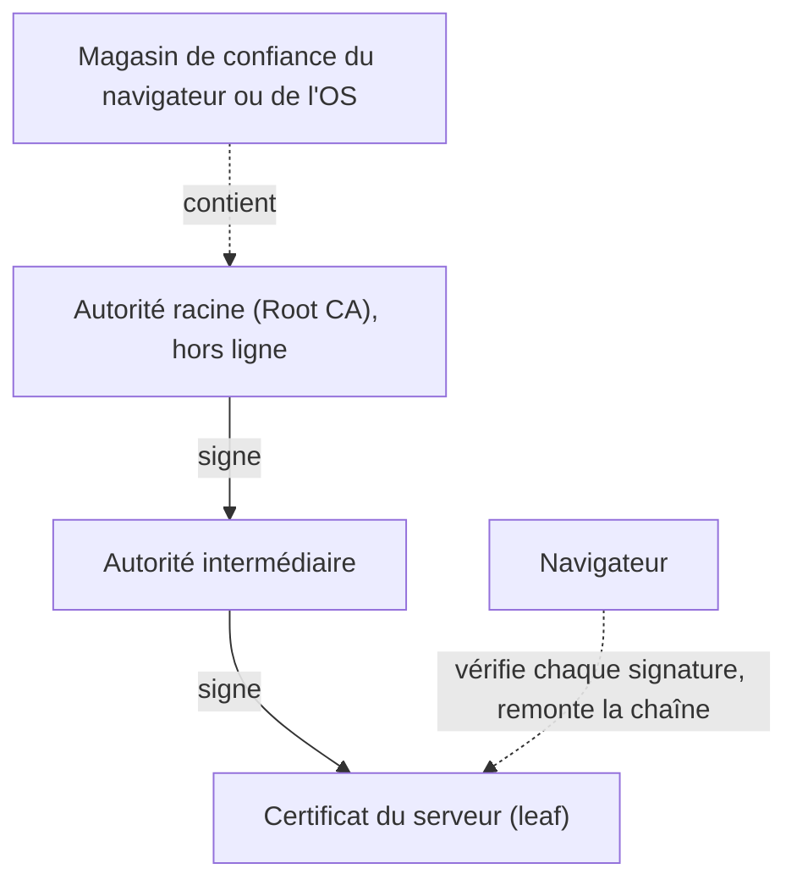

## Introduction

Une clé publique résout le problème de l'échange de clé vu au chapitre 3, mais soulève une nouvelle question : comment être certain qu'une clé publique appartient réellement à la personne ou au serveur qu'elle prétend représenter ? Si un attaquant placé entre toi et ta banque te présente **sa** clé publique en prétendant être la banque, tout le chiffrement du monde ne te protège pas : tu chiffres pour l'attaquant.

La **PKI** (Public Key Infrastructure, infrastructure à clés publiques) répond à ce problème de confiance. C'est l'ensemble des rôles, des politiques, des logiciels et des procédures qui permettent de lier une identité à une clé publique et de faire vérifier ce lien par n'importe qui. On la retrouve dans HTTPS, dans la signature de code, dans le courriel chiffré S/MIME, dans les cartes d'identité électroniques, dans l'authentification par certificat des postes et des VPN, et dans les PKI internes d'entreprise comme Active Directory Certificate Services.

À la fin de ce chapitre, tu sauras lire un certificat, expliquer comment un navigateur décide de lui faire confiance, monter une petite autorité de certification de laboratoire et reconnaître les attaques qui exploitent les failles de la PKI.

## Le rôle d'une autorité de certification

<CehCallout>
Une autorité de certification (Certificate Authority, CA) est un tiers de confiance qui vérifie l'identité d'une entité (souvent un domaine web) avant de signer numériquement un certificat liant cette identité à une clé publique. C'est cette signature qui permet à n'importe quel navigateur de faire confiance au certificat sans avoir vérifié l'identité lui-même.
</CehCallout>

Un **certificat** est donc un document électronique signé qui affirme : « la clé publique que voici appartient à telle identité, pendant telle période, pour tels usages ». Le format standard est **X.509 version 3**, défini pour Internet par la RFC 5280.

### Le cycle de vie d'un certificat

<Steps steps={[
  { title: "Génération d'une paire de clés", description: "L'entité (par exemple un serveur web) génère sa propre paire de clés publique et privée, idéalement sur la machine qui l'utilisera ou dans un HSM." },
  { title: "Demande de signature de certificat (CSR)", description: "L'entité envoie une CSR (Certificate Signing Request) contenant sa clé publique et ses informations d'identité à une CA, sans jamais transmettre sa clé privée. La CSR est signée avec la clé privée, ce qui prouve que le demandeur la possède." },
  { title: "Vérification par la CA", description: "La CA vérifie que le demandeur contrôle bien le domaine ou l'identité revendiquée, par exemple en lui faisant publier un jeton sur son site ou dans son DNS." },
  { title: "Signature du certificat", description: "La CA signe numériquement le certificat avec sa propre clé privée, créant un lien de confiance vérifiable par tous ceux qui possèdent la clé publique de la CA." },
  { title: "Renouvellement ou révocation", description: "Le certificat est renouvelé avant son expiration, ou révoqué avant terme si la clé privée est compromise ou si les informations deviennent fausses." },
]} />

### Les niveaux de validation

- **DV** (Domain Validation) : la CA vérifie seulement le contrôle du domaine. C'est le cas de Let's Encrypt et de la grande majorité des certificats web.
- **OV** (Organization Validation) : la CA vérifie aussi l'existence légale de l'organisation.
- **EV** (Extended Validation) : vérification approfondie. Les navigateurs ont cessé vers 2019 d'afficher la barre verte avec le nom de l'entreprise, car les études ont montré que les utilisateurs n'y prêtaient pas attention.

Pour un visiteur, ces trois niveaux offrent le même chiffrement. La différence porte uniquement sur ce que la CA a vérifié.

## Anatomie d'un certificat X.509

| Champ | Contenu | Exemple |
| --- | --- | --- |
| Subject | Identité du titulaire | CN=intranet.nyx.lab |
| Issuer | Identité de la CA qui a signé | CN=Nyx Lab Root CA |
| Validity | Dates de début et de fin (notBefore, notAfter) | 90 jours |
| Subject Public Key Info | Algorithme et clé publique | EC P-256 |
| Subject Alternative Name (SAN) | Noms de domaine ou adresses couverts | DNS:intranet.nyx.lab |
| Key Usage, Extended Key Usage | Usages autorisés | signature, authentification serveur |
| Basic Constraints | Le certificat peut-il signer d'autres certificats ? | CA:FALSE pour un serveur |
| Serial Number | Numéro unique attribué par la CA | utilisé pour la révocation |
| Signature | Signature de la CA sur tout ce qui précède | ecdsa-with-SHA256 |

Un point souvent mal connu : depuis 2017, les navigateurs ignorent le champ Common Name (CN) pour vérifier le nom de domaine et ne regardent que l'extension **SAN**. Un certificat sans SAN est rejeté par Chrome. Un **certificat générique** (wildcard) comme `*.exemple.fr` couvre un seul niveau de sous-domaine.

## La chaîne de confiance



Lorsque tu te connectes à un site, le serveur envoie son certificat et le ou les certificats intermédiaires. Le navigateur vérifie la signature du certificat serveur avec la clé publique de l'intermédiaire, puis celle de l'intermédiaire avec la clé de la racine. Il remonte ainsi jusqu'à une **autorité racine** préinstallée et connue de confiance dans son **magasin de confiance** (trust store). Mozilla, Microsoft, Apple et Google maintiennent chacun leur propre programme de racines, avec des exigences d'audit strictes.

<CompareTable
  titleA="Niveau"
  titleB="Rôle"
  rows={[
    { a: "Autorité racine (Root CA)", b: "Clé la plus sensible, gardée hors ligne dans un HSM, préinstallée dans les navigateurs et OS comme racine de confiance, valable 20 à 25 ans" },
    { a: "Autorité intermédiaire", b: "Signe les certificats au quotidien, révocable sans compromettre la racine en cas de problème" },
    { a: "Certificat serveur (leaf)", b: "Le certificat effectivement présenté par le site web visité, à durée de vie courte" },
]}
/>

<TipCallout>
L'utilisation d'autorités intermédiaires permet à une CA de révoquer une clé compromise sans devoir révoquer sa clé racine. C'est un compromis architectural essentiel, car la compromission ou la révocation d'une racine invaliderait instantanément tous les certificats qui en dépendent, y compris ceux parfaitement légitimes, et imposerait une mise à jour de tous les magasins de confiance. C'est pourquoi la racine reste hors ligne et ne sert qu'à signer, rarement, des intermédiaires.
</TipCallout>

En plus des signatures, le client vérifie que le certificat est dans sa période de validité, que le nom demandé figure dans le SAN, que les usages sont compatibles et que le certificat n'a pas été révoqué.

## Révocation : CRL, OCSP et la tendance aux certificats courts

Quand une clé privée est compromise, la CA doit pouvoir annoncer que le certificat ne doit plus être accepté, même s'il n'est pas expiré.

- La **CRL** (Certificate Revocation List) est une liste signée des numéros de série révoqués, publiée périodiquement par la CA.
- **OCSP** (Online Certificate Status Protocol) permet d'interroger la CA en temps réel sur un certificat précis. L'**agrafage OCSP** (OCSP stapling) permet au serveur de joindre lui-même une réponse OCSP récente au handshake.

Dans la pratique, la révocation a toujours mal fonctionné : si le serveur OCSP ne répond pas, la plupart des navigateurs acceptent quand même le certificat (échec « souple »), et l'interrogation révèle à la CA les sites que tu visites. Chrome n'interroge plus OCSP depuis longtemps et s'appuie sur des listes poussées par le navigateur. Le CA/Browser Forum a rendu OCSP facultatif en 2023, et Let's Encrypt a arrêté son service OCSP en 2025 au profit des CRL.

La réponse de l'écosystème est de **raccourcir la durée de vie** des certificats : un certificat compromis devient inutile plus vite. La durée maximale d'un certificat TLS public est passée de cinq ans à 398 jours en 2020. Le CA/Browser Forum a adopté en 2025 un calendrier de réduction : 200 jours à partir du 15 mars 2026, 100 jours en mars 2027, puis 47 jours en mars 2029. Ce rythme rend le renouvellement manuel impossible et impose l'automatisation.

### ACME et Let's Encrypt

Le protocole **ACME** (RFC 8555), créé par Let's Encrypt, automatise la validation du domaine et l'émission du certificat. Le client, par exemple `certbot`, prouve le contrôle du domaine par un défi HTTP-01 (un fichier sous `/.well-known/acme-challenge/`), DNS-01 (un enregistrement TXT, indispensable pour un certificat générique) ou TLS-ALPN-01. Let's Encrypt délivre des certificats de 90 jours et sécurise aujourd'hui la majorité des sites web.

## Certificate Transparency

Depuis 2018, Chrome exige que tout certificat public soit inscrit dans des **journaux de transparence** (Certificate Transparency, RFC 6962) : des registres publics, en ajout seul, dont l'intégrité est garantie par des arbres de Merkle. Le certificat contient des preuves d'inscription appelées SCT. Ainsi, un certificat frauduleux émis pour ton domaine finit forcément par apparaître publiquement.

Pour un défenseur, c'est un outil de surveillance : des services comme crt.sh ou les alertes de Cert Spotter signalent tout certificat émis pour tes domaines. Pour un pentesteur, c'est une mine d'or de reconnaissance passive, car les journaux révèlent des sous-domaines internes, de préproduction ou oubliés.

```bash
# Reconnaissance passive : sous-domaines vus dans les journaux CT (cadre autorisé)
curl -s "https://crt.sh/?q=%25.exemple.fr&output=json" | jq -r '.[].name_value' | sort -u
```

Les enregistrements DNS **CAA** (RFC 8659) complètent le dispositif : ils indiquent quelles CA ont le droit d'émettre pour un domaine, et les CA doivent les respecter.

## Scénarios d'attaque liés aux certificats

<Steps steps={[
  { title: "Certificat auto-signé accepté à tort", description: "Un utilisateur ignore un avertissement de certificat non fiable, ouvrant la porte à une interception de trafic (attaque de l'homme du milieu)." },
  { title: "Compromission d'une autorité de certification", description: "Un attaquant qui compromet une CA peut émettre de faux certificats valides pour n'importe quel domaine. C'est arrivé en 2011 avec DigiNotar : des certificats frauduleux pour Google ont servi à espionner des internautes iraniens, et la CA a été retirée de tous les navigateurs puis a fait faillite." },
  { title: "Certificat expiré ou révoqué non vérifié", description: "Un client qui ne vérifie pas la liste de révocation (CRL ou OCSP) peut continuer à faire confiance à un certificat compromis après sa révocation officielle." },
  { title: "Validation absente dans le code", description: "Une application mobile ou un script qui désactive la vérification TLS (par exemple verify=False avec Python requests, ou curl -k) accepte n'importe quel certificat, y compris celui de l'attaquant." },
  { title: "Abus d'une PKI interne", description: "Dans Active Directory, des modèles de certificats mal configurés dans AD CS permettent à un simple utilisateur d'obtenir un certificat au nom d'un administrateur (scénarios ESC1 à ESC16, outillés par Certipy), vus dans le cours Active Directory." },
]} />

<WarningCallout>
Ignorer un avertissement de certificat invalide dans un navigateur (« continuer quand même ») revient à désactiver soi-même la principale protection contre les attaques de l'homme du milieu. Ce réflexe, souvent pris par habitude face à des faux positifs, est exactement ce qu'un attaquant en position d'interception espère. De même, installer une racine inconnue dans ton magasin de confiance donne à son propriétaire le pouvoir d'usurper n'importe quel site.
</WarningCallout>

Les autorités elles-mêmes sont surveillées : Google et Mozilla ont retiré leur confiance à Symantec en 2018 après de multiples manquements, et Chrome a cessé de faire confiance aux nouveaux certificats d'Entrust à partir de novembre 2024 pour des raisons similaires.

<AttackDefenseTable rows={[
  { phase: "Reconnaissance", attack: "Énumérer les sous-domaines via les journaux Certificate Transparency", defense: "Surveiller CT pour ses propres domaines, éviter d'exposer des noms internes dans des certificats publics" },
  { phase: "Interception", attack: "Proxy d'interception (mitmproxy, Burp) présentant un certificat signé par une racine contrôlée par l'attaquant", defense: "Validation stricte, HSTS, épinglage dans les applications mobiles sensibles, contrôle des magasins de confiance par GPO ou MDM" },
  { phase: "Émission frauduleuse", attack: "Obtenir un certificat pour un domaine en détournant son DNS ou sa validation", defense: "Enregistrements CAA, DNSSEC, verrouillage du compte registrar, surveillance CT" },
  { phase: "PKI interne", attack: "Demander un certificat au nom d'un administrateur via un modèle AD CS vulnérable", defense: "Audit des modèles avec Certipy ou PSPKIAudit, approbation manuelle, suppression du flag permettant de fournir le sujet" },
  { phase: "Vol de clé", attack: "Récupérer la clé privée d'un serveur ou d'une CA interne", defense: "HSM, racine hors ligne, rotation et révocation rapide, certificats courts" },
]} />

<AuditCallout>
Dans l'ISO/IEC 27001:2022, la gestion des certificats relève du contrôle A.8.24 « Utilisation de la cryptographie », qui couvre la gestion du cycle de vie des clés. Un auditeur attend un inventaire des certificats avec leurs dates d'expiration, une procédure de renouvellement automatisée, une procédure de révocation testée et une protection documentée des clés des autorités internes. Les pannes par certificat expiré restent une cause fréquente d'indisponibilité.
</AuditCallout>

## Erreurs fréquentes

- **Désactiver la vérification TLS** dans le code « temporairement » pour contourner un problème, puis l'oublier en production.
- **Oublier d'envoyer le certificat intermédiaire** : le site fonctionne sur certains navigateurs qui le complètent seuls, et échoue ailleurs.
- **Générer la clé privée chez un tiers** ou l'envoyer par courriel à la CA ou à un prestataire.
- **Gérer les renouvellements à la main** avec un tableur, ce qui devient intenable avec des durées de 200 jours puis moins.
- **Utiliser des certificats auto-signés en production**, ce qui habitue les utilisateurs à cliquer sur « continuer ».
- **Confondre chiffrement et identité** : un site de phishing peut avoir un certificat DV parfaitement valide.

## Lab — Mise en pratique

**Environnement** : Kali Linux (terminal Nyx Shell), OpenSSL 3.x. Les commandes qui contactent Internet nécessitent un accès réseau.

<Steps steps={[
  { title: "Créer une autorité racine de laboratoire", description: "Génère une clé EC P-256 et un certificat racine auto-signé valable dix ans, marqué comme CA. Observe dans la sortie l'extension Basic Constraints avec CA:TRUE.", code: "openssl req -x509 -newkey ec -pkeyopt ec_paramgen_curve:P-256 -keyout racine.key -out racine.crt -days 3650 -nodes -subj \"/CN=Nyx Lab Root CA\" -addext \"basicConstraints=critical,CA:TRUE\" -addext \"keyUsage=critical,keyCertSign,cRLSign\"\nopenssl x509 -in racine.crt -noout -text | grep -A1 'Basic Constraints'" },
  { title: "Produire une CSR pour un serveur", description: "Génère la clé du serveur et sa CSR avec un SAN. Vérifie la signature de la CSR : elle prouve que le demandeur possède la clé privée, qui n'est jamais transmise.", code: "openssl req -new -newkey ec -pkeyopt ec_paramgen_curve:P-256 -keyout serveur.key -out serveur.csr -nodes -subj \"/CN=intranet.nyx.lab\" -addext \"subjectAltName=DNS:intranet.nyx.lab\"\nopenssl req -in serveur.csr -noout -verify -subject" },
  { title: "Signer la CSR avec la racine", description: "Émets un certificat de 90 jours en recopiant le SAN de la CSR, puis vérifie la chaîne. OpenSSL doit afficher serveur.crt: OK.", code: "openssl x509 -req -in serveur.csr -CA racine.crt -CAkey racine.key -CAcreateserial -out serveur.crt -days 90 -copy_extensions copyall\nopenssl verify -CAfile racine.crt serveur.crt\nopenssl x509 -in serveur.crt -noout -subject -issuer -dates -ext subjectAltName" },
  { title: "Constater l'échec sans la racine", description: "Vérifie le certificat sans fournir la racine : la vérification échoue, car ta racine de laboratoire n'est pas dans le magasin de confiance du système.", code: "openssl verify serveur.crt" },
  { title: "Examiner une vraie chaîne", description: "Récupère la chaîne d'un site public. Repère pour chaque certificat les lignes s: (sujet) et i: (émetteur) : l'émetteur de l'un est le sujet du suivant.", code: "openssl s_client -connect www.wikipedia.org:443 -servername www.wikipedia.org -showcerts < /dev/null 2>/dev/null | grep -E '^ *[0-9] s:|^ *i:'" },
  { title: "Lire les dates et le SAN d'un site", description: "Affiche la durée de validité et les noms couverts par le certificat d'un site. Calcule le nombre de jours entre notBefore et notAfter.", code: "openssl s_client -connect www.wikipedia.org:443 -servername www.wikipedia.org < /dev/null 2>/dev/null | openssl x509 -noout -dates -ext subjectAltName" },
  { title: "Interroger Certificate Transparency", description: "Liste les noms de certificats émis pour un domaine dont tu as la responsabilité ou un domaine de test public. Note les sous-domaines que tu ne connaissais pas.", code: "curl -s \"https://crt.sh/?q=%25.exemple.fr&output=json\" | jq -r '.[].name_value' | sort -u | head -20" },
]} />

Question de réflexion : pourquoi la compromission d'une autorité intermédiaire est-elle grave, mais moins catastrophique que la compromission de l'autorité racine dont elle dépend ?

## À retenir

- Une autorité de certification vérifie une identité avant de signer un certificat X.509, créant un lien entre identité et clé publique vérifiable par des tiers.
- La CSR contient la clé publique et l'identité ; la clé privée n'est jamais transmise.
- Le navigateur remonte la chaîne de confiance jusqu'à une racine préinstallée dans son magasin de confiance, et vérifie validité, nom (SAN), usages et révocation.
- Les intermédiaires permettent de révoquer une clé compromise sans invalider la racine, qui reste hors ligne.
- La révocation par CRL et OCSP est imparfaite ; l'écosystème raccourcit donc la durée des certificats (200 jours depuis mars 2026, 47 jours en 2029) et automatise avec ACME.
- Certificate Transparency rend publique toute émission, utile aux défenseurs comme aux pentesteurs pour la reconnaissance.
- Ignorer un avertissement de certificat ou désactiver la vérification TLS supprime la protection contre l'homme du milieu.

## Questions de révision

1. Quel problème de confiance la PKI résout-elle, au-delà du simple chiffrement asymétrique ?
2. Que contient une CSR, que ne contient-elle jamais, et comment la CA s'assure-t-elle que le demandeur possède la clé privée ?
3. Pourquoi une autorité racine est-elle gardée hors ligne, contrairement à une autorité intermédiaire ?
4. Pourquoi la vérification de révocation par OCSP est-elle souvent inefficace en pratique, et quelle tendance la remplace ?
5. Quels champs d'un certificat X.509 un navigateur vérifie-t-il pour décider que le certificat convient au site demandé ?
6. Comment Certificate Transparency aide-t-il à la fois un défenseur et un attaquant ?
7. Pourquoi ignorer un avertissement de certificat invalide dans un navigateur est-il particulièrement risqué ?
