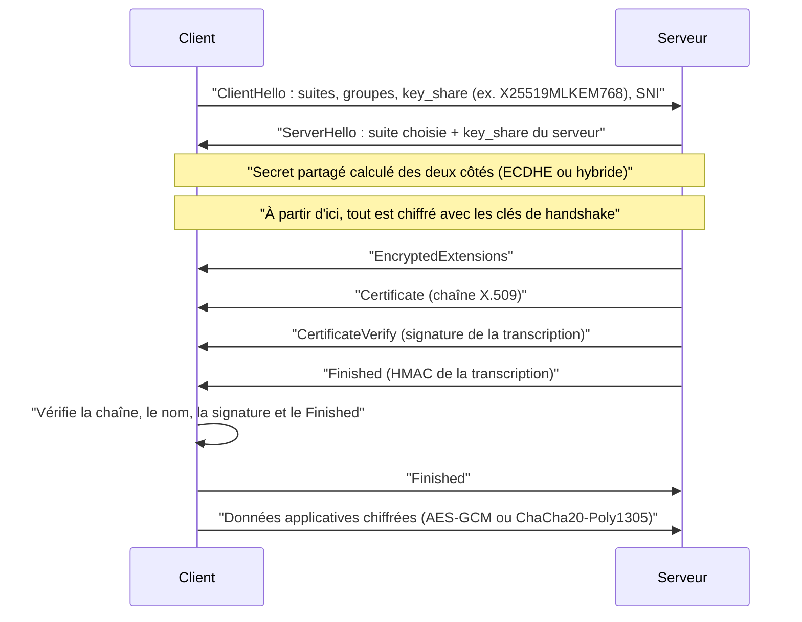

## Introduction

Ce chapitre réunit toutes les briques des chapitres précédents dans leur application la plus quotidienne. Le chiffrement symétrique du chapitre 2 protège les données, l'échange de clé Diffie-Hellman du chapitre 3 établit la clé, les fonctions de hachage et HMAC du chapitre 4 dérivent les clés et authentifient la négociation, et la PKI du chapitre 5 prouve l'identité du serveur. L'ensemble porte un nom : **TLS** (Transport Layer Security), le protocole qui sécurise la quasi-totalité du trafic web sous la forme **HTTPS**, mais aussi les courriels entre serveurs (SMTP avec STARTTLS), les API, les connexions aux bases de données, les VPN SSL et bien d'autres usages.

Pour un professionnel de la sécurité, TLS est un terrain d'audit permanent. Un pentesteur vérifie systématiquement les versions et suites acceptées par un service exposé, la validité du certificat et la présence des en-têtes de sécurité. Un administrateur doit savoir produire une configuration à la fois sûre et compatible.

À la fin de ce chapitre, tu sauras décrire le handshake TLS 1.3 message par message, expliquer pourquoi le forward secrecy est devenu obligatoire, lire une suite de chiffrement, reconnaître l'échange de clé hybride post-quantique dans une capture, écrire une configuration serveur conforme aux recommandations de Mozilla et auditer un serveur avec les outils standards.

## TLS en bref : versions et objectifs

TLS fournit trois garanties à la connexion qu'il protège. La **confidentialité**, grâce au chiffrement symétrique authentifié. L'**intégrité**, car toute modification d'un enregistrement est détectée par le tag d'authentification. L'**authentification du serveur**, grâce au certificat et à une signature, et optionnellement celle du client lorsqu'on utilise un certificat client, ce qu'on appelle le TLS mutuel ou mTLS.

Le protocole a connu plusieurs générations, et savoir lesquelles sont acceptables fait partie du métier.

| Version | Année | Statut fin 2026 |
| --- | --- | --- |
| SSL 2.0 et SSL 3.0 | 1995 et 1996 | Interdits, cassés (DROWN, POODLE) |
| TLS 1.0 et TLS 1.1 | 1999 et 2006 | Officiellement dépréciés par la RFC 8996 en 2021, à désactiver |
| TLS 1.2 | 2008 (RFC 5246) | Acceptable s'il est restreint aux suites ECDHE avec AEAD |
| TLS 1.3 | 2018 (RFC 8446) | Version recommandée, à activer partout |

Les recommandations institutionnelles convergent. Le NIST, dans la publication SP 800-52 révision 2, exige TLS 1.2 au minimum pour les systèmes fédéraux américains et demande le support de TLS 1.3. PCI DSS 4.0.1 interdit les versions anciennes de SSL et TLS pour protéger les données de carte. L'ANSSI publie ses propres recommandations de sécurité relatives à TLS, qui vont dans le même sens.

## Le handshake TLS 1.3 en détail

Le **handshake** est la phase de négociation qui précède l'échange de données. Il doit accomplir quatre choses : se mettre d'accord sur les algorithmes, établir un secret partagé que personne d'autre ne connaît, authentifier le serveur et vérifier que personne n'a modifié la négociation.

La grande innovation de TLS 1.3 est de faire tout cela en **un seul aller-retour**. Pour y parvenir, le client n'attend pas que le serveur choisisse un algorithme : il envoie d'emblée sa part de l'échange de clé, en pariant sur le groupe que le serveur acceptera.



### Étape 1 : le ClientHello

Le client envoie la liste des suites de chiffrement qu'il accepte, la liste des **groupes** d'échange de clé qu'il supporte (X25519, P-256, et désormais les groupes hybrides post-quantiques), les algorithmes de signature qu'il sait vérifier, et surtout une extension **key_share** qui contient déjà une ou plusieurs clés publiques éphémères. Il indique aussi, dans l'extension **SNI** (Server Name Indication), le nom du site qu'il veut joindre, ce qui permet à un même serveur d'héberger plusieurs certificats.

Le SNI circule en clair dans le ClientHello. C'est pour cela qu'un pare-feu ou un FAI peut voir quel site tu visites même en HTTPS. L'extension **ECH** (Encrypted Client Hello), en cours de déploiement chez certains navigateurs et hébergeurs, chiffre cette partie sensible.

### Étape 2 : le ServerHello et le calcul du secret

Le serveur choisit une suite et un groupe parmi ceux proposés, puis renvoie sa propre clé publique éphémère dans son key_share. À cet instant, **l'échange de clé est terminé** : chaque côté combine sa clé privée éphémère avec la clé publique de l'autre et obtient le même secret, exactement comme dans l'échange Diffie-Hellman du chapitre 3. Les deux parties dérivent ensuite des clés avec **HKDF**, une fonction de dérivation construite sur HMAC (chapitre 4).

Si le client a parié sur un groupe que le serveur refuse, le serveur répond par un **HelloRetryRequest** qui indique le groupe souhaité, et le client recommence. Cela coûte un aller-retour supplémentaire, mais reste rare.

### Étape 3 : l'authentification du serveur, déjà chiffrée

C'est une différence majeure avec TLS 1.2 : **le certificat du serveur est envoyé après l'échange de clé, et il est chiffré**. Un observateur passif ne voit donc plus quel certificat est présenté. Le serveur envoie :

- **Certificate**, sa chaîne de certificats X.509 ;
- **CertificateVerify**, une signature, avec la clé privée correspondant au certificat, de l'empreinte de toute la transcription du handshake jusque-là. Cette signature prouve que le serveur possède réellement la clé privée et qu'il a vu les mêmes messages que le client ;
- **Finished**, un HMAC de toute la transcription, qui garantit qu'aucun message n'a été modifié en route.

### Étape 4 : la vérification par le client

Le client vérifie alors la chaîne de confiance jusqu'à une racine de son magasin (chapitre 5), la période de validité, la correspondance entre le nom demandé et le champ **SAN** (Subject Alternative Name), l'usage autorisé de la clé, puis la signature CertificateVerify et le Finished. Si une seule vérification échoue, la connexion est abandonnée avec une alerte. Si tout est valide, il envoie son propre Finished et peut transmettre les données applicatives.

<CehCallout>
L'ordre des opérations diffère selon la version, et les examens aiment ce détail. En TLS 1.2 avec ECDHE, le serveur envoie son certificat en clair juste après le ServerHello, accompagné d'un message ServerKeyExchange signé ; le client vérifie la chaîne de confiance du certificat et cette signature avant d'envoyer sa propre part de l'échange de clé (ClientKeyExchange). En TLS 1.3, les parts d'échange de clé voyagent dès le ClientHello et le ServerHello, et le certificat, envoyé ensuite sous forme chiffrée, est vérifié avant que le client n'envoie son Finished. Dans les deux cas, aucune donnée applicative n'est envoyée avant que l'identité du serveur ait été vérifiée.
</CehCallout>

### Ce que TLS 1.3 a supprimé

TLS 1.3 n'est pas seulement plus rapide, il est surtout plus simple, et cette simplicité supprime des familles entières d'attaques :

- l'**échange de clé RSA statique**, où le client chiffrait le secret avec la clé publique RSA du serveur. Il n'offrait pas de forward secrecy et a donné lieu aux attaques de type Bleichenbacher, comme ROBOT en 2017 ;
- les **suites CBC** avec MAC séparé, responsables de BEAST, Lucky13 et POODLE. Seuls les modes **AEAD** restent ;
- RC4, 3DES, les groupes Diffie-Hellman faibles ou personnalisés (Logjam), la compression (CRIME) et la renégociation ;
- SHA-1 et MD5 dans les signatures du handshake.

Le protocole inclut aussi une protection contre la rétrogradation : un serveur TLS 1.3 forcé à négocier TLS 1.2 place une valeur spéciale dans les derniers octets de son nombre aléatoire, ce qui permet à un client moderne de détecter qu'un attaquant a supprimé l'offre TLS 1.3.

### La reprise de session et le 0-RTT

Pour accélérer les reconnexions, le serveur peut remettre au client un ticket qui permet de reprendre la session avec une clé pré-partagée (PSK). TLS 1.3 propose même le mode **0-RTT**, où le client envoie des données applicatives dès son premier message. Ces données « précoces » ne bénéficient pas d'une protection contre le **rejeu** (chapitre 6) : un attaquant peut les renvoyer telles quelles. Le 0-RTT ne doit donc être accepté que pour des requêtes idempotentes, comme un simple GET sans effet de bord, et beaucoup d'administrateurs le laissent désactivé.

## La confidentialité persistante (forward secrecy)

La **confidentialité persistante**, ou forward secrecy, garantit que la compromission future de la clé privée à long terme du serveur ne permet pas de déchiffrer les sessions passées.

<CompareTable
  titleA="Sans forward secrecy (échange de clé RSA statique, TLS 1.2)"
  titleB="Avec forward secrecy (ECDHE, obligatoire en TLS 1.3)"
  rows={[
    { a: "Le client chiffre le secret de session avec la clé publique RSA permanente du serveur", b: "Une nouvelle paire de clés éphémère est générée pour chaque session puis effacée" },
    { a: "La clé privée du serveur suffit à retrouver le secret de n'importe quelle session enregistrée", b: "La clé privée du serveur ne sert qu'à signer ; elle ne permet pas de recalculer le secret" },
    { a: "Si la clé privée du serveur est compromise plus tard, tout le trafic passé enregistré peut être déchiffré rétroactivement", b: "La compromission future de la clé privée du serveur ne permet pas de déchiffrer les sessions passées" },
  ]}
/>

La clé du raisonnement tient en une phrase : avec ECDHE, la clé privée du certificat **authentifie** mais ne **chiffre** rien. Le secret de session dépend uniquement des clés éphémères, qui disparaissent de la mémoire à la fin du handshake.

<WarningCallout>
Sans forward secrecy, un attaquant qui enregistre aujourd'hui du trafic chiffré et compromet des années plus tard la clé privée du serveur, par une intrusion, une sauvegarde mal protégée ou une saisie, peut déchiffrer rétroactivement toutes les conversations enregistrées. C'est précisément ce risque que l'échange de clé éphémère ECDHE élimine, raison pour laquelle TLS 1.3 l'impose systématiquement. Attention toutefois : le forward secrecy ne protège pas contre un futur ordinateur quantique capable de casser ECDHE lui-même, d'où l'échange hybride présenté plus loin.
</WarningCallout>

Un détail opérationnel compte : les tickets de session sont chiffrés avec une clé conservée par le serveur. Si cette clé n'est jamais renouvelée, elle devient un point faible équivalent à une clé statique. C'est pourquoi les recommandations demandent une rotation fréquente des clés de tickets, ou leur désactivation.

## Lire une suite de chiffrement

Une **suite de chiffrement** (cipher suite) est la combinaison d'algorithmes utilisée par la session. Sa syntaxe a beaucoup changé entre TLS 1.2 et TLS 1.3.

En TLS 1.2, le nom décrit tout. Prenons `TLS_ECDHE_RSA_WITH_AES_128_GCM_SHA256` : l'échange de clé est ECDHE, l'authentification se fait par un certificat RSA, le chiffrement est AES-128 en mode GCM, et SHA-256 sert à la fonction de dérivation. OpenSSL utilise ses propres noms pour les mêmes suites, ici `ECDHE-RSA-AES128-GCM-SHA256`, ce qui provoque souvent des confusions.

En TLS 1.3, l'échange de clé et la signature sont négociés séparément, par les extensions de groupes et d'algorithmes de signature. La suite ne décrit plus que le chiffrement AEAD et le hachage. Il n'en existe que cinq, dont trois sont utilisées en pratique sur le web.

| Suite TLS 1.3 | Chiffrement | Usage |
| --- | --- | --- |
| TLS_AES_128_GCM_SHA256 | AES-128-GCM | Obligatoire, la plus répandue |
| TLS_AES_256_GCM_SHA384 | AES-256-GCM | Très répandue, marge de sécurité supplémentaire |
| TLS_CHACHA20_POLY1305_SHA256 | ChaCha20-Poly1305 | Idéale sans accélération AES matérielle (mobiles, objets) |
| TLS_AES_128_CCM_SHA256 et TLS_AES_128_CCM_8_SHA256 | AES-CCM | Niche de l'embarqué, rarement activées sur un serveur web |

Une fois le handshake terminé, tout le trafic est chiffré avec l'algorithme symétrique de la suite, le plus souvent **AES-GCM**, rapide grâce aux instructions AES-NI et authentifié. Les algorithmes asymétriques ne servent qu'à établir la clé et à authentifier le serveur, car ils sont bien trop lents pour chiffrer un flux de données : c'est le chiffrement hybride vu au chapitre 1.

Pour TLS 1.2, une configuration saine n'accepte que des suites qui combinent ECDHE, pour le forward secrecy, et un mode AEAD, c'est-à-dire AES-GCM ou ChaCha20-Poly1305. Tout ce qui contient `RSA` sans `ECDHE` devant, `CBC`, `3DES`, `RC4`, `NULL`, `EXPORT` ou `anon` doit disparaître.

## L'échange de clé hybride X25519MLKEM768

Le chapitre 8 expliquera pourquoi un ordinateur quantique suffisamment puissant casserait ECDHE, et pourquoi le scénario « collecter maintenant, déchiffrer plus tard » rend cette menace actuelle. Ce qui nous intéresse ici, c'est la réponse déjà déployée dans TLS.

Le groupe **X25519MLKEM768** combine dans un même handshake deux échanges de clé : X25519, la courbe elliptique classique, et **ML-KEM-768**, le mécanisme d'encapsulation de clé post-quantique standardisé par le NIST dans FIPS 203 (anciennement connu sous le nom CRYSTALS-Kyber). Le client place les deux clés publiques dans son key_share, le serveur répond avec sa part X25519 et un chiffré ML-KEM, et les deux secrets obtenus sont concaténés avant la dérivation des clés. Un attaquant doit casser **les deux** pour retrouver le secret de session : si ML-KEM se révélait faible, X25519 protégerait toujours comme aujourd'hui, et si un ordinateur quantique cassait X25519, ML-KEM tiendrait.

Ce groupe est activé par défaut dans les versions récentes de Chrome, Edge, Firefox et Safari, chez de grands hébergeurs et CDN comme Cloudflare, et dans OpenSSL à partir de la version 3.5. Une part importante du trafic HTTPS mondial bénéficie donc déjà d'un échange de clé résistant au quantique. Le coût est modeste : le key_share du client grossit d'environ 1,2 kilo-octet, ce qui reste compatible avec la plupart des réseaux, même si certains équipements intermédiaires mal écrits ont dû être corrigés pour accepter un ClientHello plus volumineux.

L'hybridation ne concerne pour l'instant que l'échange de clé, qui protège la confidentialité contre l'enregistrement du trafic. Les certificats et les signatures du handshake restent classiques (ECDSA ou RSA) : une signature ne peut pas être falsifiée rétroactivement, l'urgence est donc moindre, et les certificats post-quantiques posent encore des problèmes de taille dans la PKI web.

## HSTS et la protection contre la rétrogradation vers HTTP

Un site HTTPS parfaitement configuré reste vulnérable si le premier contact se fait en HTTP. Quand un utilisateur tape `exemple.fr` dans sa barre d'adresse, le navigateur peut tenter d'abord `http://`, et le serveur le redirige vers `https://`. Un attaquant en position d'interception, sur un Wi-Fi public par exemple, peut intercepter cette première requête en clair et maintenir la victime en HTTP en relayant lui-même la version HTTPS du site. Cette attaque, popularisée sous le nom de **SSL stripping**, est un cas d'attaque de l'homme du milieu (chapitre 6) par rétrogradation.

L'en-tête **HSTS** (HTTP Strict Transport Security, RFC 6797) répond à ce problème. Lorsqu'un navigateur le reçoit sur une connexion HTTPS valide, il mémorise que ce domaine ne doit plus jamais être contacté autrement qu'en HTTPS, pendant la durée indiquée.

```http
Strict-Transport-Security: max-age=63072000; includeSubDomains; preload
```

- `max-age` est la durée de mémorisation en secondes ; 63072000 correspond à deux ans, la valeur proposée par le générateur de Mozilla.
- `includeSubDomains` étend la règle à tous les sous-domaines, ce qui empêche un attaquant d'exploiter un sous-domaine oublié en HTTP pour poser un cookie.
- `preload` signale que le propriétaire souhaite l'inscription dans la liste de préchargement.

HSTS a deux effets. Le navigateur transforme automatiquement tout lien `http://` vers ce domaine en `https://` avant d'émettre la moindre requête, et il **interdit à l'utilisateur de contourner** un avertissement de certificat, ce qui neutralise le réflexe dangereux de cliquer sur « continuer quand même » (chapitre 5).

### La liste de préchargement HSTS

HSTS a une faiblesse : il faut avoir visité le site une première fois pour recevoir l'en-tête. La **liste de préchargement**, gérée via le site hstspreload.org et intégrée dans le code de tous les grands navigateurs, comble ce trou : les domaines inscrits sont traités comme HSTS dès la toute première visite. Pour être accepté, un domaine doit servir un certificat valide, rediriger HTTP vers HTTPS, servir tous ses sous-domaines en HTTPS, et envoyer l'en-tête sur le domaine de base avec un `max-age` d'au moins un an, `includeSubDomains` et `preload`. Certains domaines de premier niveau, comme `.dev` ou `.app`, sont même entièrement préchargés.

<WarningCallout>
L'inscription en préchargement est difficilement réversible : un retrait peut mettre des mois à se propager dans les versions des navigateurs. Avant d'ajouter `includeSubDomains` et `preload`, vérifie que chaque sous-domaine, y compris les services internes, les outils hérités et les environnements de test exposés, fonctionne en HTTPS. Une bonne pratique consiste à déployer progressivement, avec un `max-age` court de quelques minutes, puis une semaine, puis un mois, avant de passer à la valeur définitive.
</WarningCallout>

## Configurer un serveur selon les recommandations Mozilla

La fondation Mozilla maintient des **recommandations de configuration TLS côté serveur** et un générateur en ligne, ssl-config.mozilla.org, qui produit une configuration pour Nginx, Apache, HAProxy, Caddy et d'autres. Trois profils existent :

| Profil | Versions | Pour qui |
| --- | --- | --- |
| Modern | TLS 1.3 uniquement | Services dont tous les clients sont récents (API internes, applications mobiles maîtrisées) |
| Intermediate | TLS 1.2 et TLS 1.3 | Recommandé par défaut pour un site public |
| Old | Jusqu'à TLS 1.0 | Uniquement pour des clients très anciens impossibles à mettre à jour, à éviter |

Voici une configuration Nginx inspirée du profil Intermediate, commentée. Elle suppose OpenSSL 3.5 ou plus récent pour le groupe hybride.

```nginx
server {
    listen 443 ssl;
    http2 on;
    server_name exemple.fr;

    ssl_certificate     /etc/ssl/exemple.fr/fullchain.pem;  # certificat + intermédiaires
    ssl_certificate_key /etc/ssl/exemple.fr/privkey.pem;

    # TLS 1.0 et 1.1 désactivés (RFC 8996)
    ssl_protocols TLSv1.2 TLSv1.3;

    # Suites TLS 1.2 : uniquement ECDHE + AEAD (les suites TLS 1.3 sont sûres par défaut)
    ssl_ciphers ECDHE-ECDSA-AES128-GCM-SHA256:ECDHE-RSA-AES128-GCM-SHA256:ECDHE-ECDSA-AES256-GCM-SHA384:ECDHE-RSA-AES256-GCM-SHA384:ECDHE-ECDSA-CHACHA20-POLY1305:ECDHE-RSA-CHACHA20-POLY1305;
    ssl_prefer_server_ciphers off;   # toutes les suites sont fortes : on laisse le client choisir

    # Groupes d'échange de clé : hybride post-quantique d'abord, classiques en repli
    ssl_ecdh_curve X25519MLKEM768:X25519:prime256v1;

    # Les tickets non renouvelés affaiblissent le forward secrecy
    ssl_session_tickets off;

    add_header Strict-Transport-Security "max-age=63072000; includeSubDomains; preload" always;
}

server {
    listen 80;
    server_name exemple.fr;
    return 301 https://$host$request_uri;   # redirection permanente vers HTTPS
}
```

Les directives exactes varient selon les versions de Nginx et d'OpenSSL : génère toujours ta base avec l'outil de Mozilla pour ta version précise, plutôt que de recopier une configuration trouvée en ligne.

<AuditCallout>
ISO/IEC 27001:2022 traite de ce sujet dans le contrôle A.8.24 « Utilisation de la cryptographie », qui exige des règles définies et appliquées pour l'usage du chiffrement et la gestion des clés, et dans A.8.20 et A.8.21 pour la sécurité des réseaux et des services réseau. En audit, on attend une politique TLS écrite (versions et suites autorisées, durée des certificats, HSTS), un inventaire des points de terminaison TLS, et des preuves de contrôle régulier, par exemple des rapports testssl.sh archivés. Le CIS Benchmark de chaque serveur web et le guide NIST SP 800-52 révision 2 fournissent des critères vérifiables.
</AuditCallout>

## Auditer une configuration TLS

L'audit TLS fait partie de toute évaluation de sécurité d'un service exposé. Il est passif du point de vue de la cible : on se contente d'ouvrir des connexions et d'observer ce que le serveur accepte. Il reste soumis à autorisation pour un système qui ne t'appartient pas.

### openssl s_client, le couteau suisse

`openssl s_client` ouvre une connexion TLS et affiche les détails de la négociation. L'option `-servername` envoie le SNI, indispensable sur un serveur mutualisé, et `-brief` produit un résumé lisible.

```bash
# Résumé de la négociation avec un client OpenSSL 3.5 (groupes hybrides proposés par défaut)
openssl s_client -connect www.cloudflare.com:443 -servername www.cloudflare.com -brief < /dev/null
```

```text
CONNECTION ESTABLISHED
Protocol version: TLSv1.3
Ciphersuite: TLS_AES_256_GCM_SHA384
Peer certificate: CN=www.cloudflare.com
Hash used: SHA256
Signature type: ecdsa_secp256r1_sha256
Verification: OK
Negotiated TLS1.3 group: X25519MLKEM768
DONE
```

On lit ici que TLS 1.3 a été négocié, avec la suite AES-256-GCM, un certificat ECDSA P-256 vérifié avec succès, et le groupe hybride post-quantique. Sur un serveur qui ne supporte que l'échange classique, la sortie détaillée affiche plutôt une ligne `Peer Temp Key: X25519, 253 bits`.

On peut aussi tester une version ou un groupe précis. Si le serveur refuse, la connexion échoue avec une alerte, ce qui est exactement ce qu'on veut vérifier.

```bash
# Le serveur accepte-t-il encore TLS 1.2 ? Avec quelle suite ?
openssl s_client -connect www.cloudflare.com:443 -servername www.cloudflare.com -tls1_2 -brief < /dev/null

# Le serveur supporte-t-il l'échange hybride post-quantique ?
openssl s_client -connect exemple.fr:443 -servername exemple.fr -groups X25519MLKEM768 -brief < /dev/null
```

```text
Protocol version: TLSv1.2
Ciphersuite: ECDHE-ECDSA-CHACHA20-POLY1305
Peer certificate: CN=www.cloudflare.com
Verification: OK
Peer Temp Key: X25519, 253 bits
```

Attention à un piège : les versions récentes d'OpenSSL refusent elles-mêmes TLS 1.0 et 1.1 avec leur niveau de sécurité par défaut. Un échec avec `-tls1_1` et le message « no protocols available » signifie que **ton client** refuse, pas que le serveur est correctement configuré. Les outils spécialisés ci-dessous embarquent leurs propres moyens de tester ces anciennes versions.

### testssl.sh, l'audit complet

**testssl.sh** est un script libre qui teste en une commande les protocoles, les suites, le forward secrecy, le certificat, les en-têtes HTTP et une longue liste de vulnérabilités connues, puis attribue une note inspirée de celle de SSL Labs. Il fonctionne hors ligne, ce qui permet d'auditer des services internes que les outils en ligne ne peuvent pas joindre.

```bash
# Audit complet avec export JSON pour l'archivage
testssl.sh --jsonfile audit-exemple.json https://exemple.fr

# Audits ciblés
testssl.sh --protocols https://exemple.fr        # versions SSL/TLS acceptées
testssl.sh --fs https://exemple.fr               # forward secrecy et groupes
testssl.sh --headers https://exemple.fr          # HSTS et autres en-têtes
testssl.sh --vulnerable https://exemple.fr       # Heartbleed, ROBOT, POODLE, SWEET32...
```

Chaque ligne porte un niveau de gravité : sur un serveur mal entretenu, testssl.sh signalerait par exemple TLS 1.0 encore proposé, des suites 3DES vulnérables à SWEET32 ou l'absence de HSTS. Le fichier JSON sert de preuve en audit de conformité et permet de comparer les audits dans le temps.

### nmap et les outils en ligne

Le script NSE `ssl-enum-ciphers` de nmap, lancé avec `nmap --script ssl-enum-ciphers -p 443 cible`, énumère les suites par version et leur attribue une lettre de A à F ; il s'intègre bien à un scan réseau plus large. Voici un extrait de sa sortie sur un serveur bien configuré.

```text
| ssl-enum-ciphers:
|   TLSv1.2:
|     ciphers:
|       TLS_ECDHE_ECDSA_WITH_AES_128_GCM_SHA256 (ecdh_x25519) - A
|       TLS_ECDHE_ECDSA_WITH_CHACHA20_POLY1305_SHA256 (ecdh_x25519) - A
|   TLSv1.3:
|     ciphers:
|       TLS_AKE_WITH_AES_128_GCM_SHA256 (ecdh_x25519) - A
|       TLS_AKE_WITH_CHACHA20_POLY1305_SHA256 (ecdh_x25519) - A
|_  least strength: A
```

Pour un site public, le **SSL Server Test de Qualys SSL Labs** donne une note de A+ à F avec le détail des points faibles.

## Angle offensif et défensif

Les attaques historiques contre TLS se répartissent en deux familles : les faiblesses du protocole ou des algorithmes, qu'on corrige par la configuration, et les failles d'implémentation, qu'on corrige par les mises à jour. Le tableau suivant les relie aux défenses, sans entrer dans l'exploitation.

<AttackDefenseTable rows={[
  { phase: "Rétrogradation vers HTTP", attack: "SSL stripping : maintenir la victime en HTTP en interceptant la première requête non chiffrée", defense: "HSTS avec includeSubDomains, inscription en préchargement, redirection 301 vers HTTPS" },
  { phase: "Rétrogradation de protocole", attack: "Forcer la négociation d'une version ancienne vulnérable (POODLE sur SSL 3.0, DROWN via SSLv2)", defense: "Désactiver SSL 2.0, SSL 3.0, TLS 1.0 et 1.1 ; TLS 1.3 détecte la rétrogradation" },
  { phase: "Algorithmes faibles", attack: "Exploiter des suites CBC (BEAST, Lucky13), 3DES (SWEET32), RC4 ou des groupes DH export (Logjam, FREAK)", defense: "Uniquement des suites ECDHE avec AEAD en TLS 1.2, TLS 1.3 activé" },
  { phase: "Échange de clé RSA", attack: "Oracle de type Bleichenbacher (ROBOT) et déchiffrement rétroactif après vol de la clé privée", defense: "Supprimer l'échange de clé RSA statique, imposer ECDHE pour le forward secrecy" },
  { phase: "Implémentation", attack: "Bug mémoire dans la bibliothèque TLS, comme Heartbleed (CVE-2014-0160) qui laissait lire la mémoire du serveur", defense: "Mises à jour d'OpenSSL et des serveurs, suivi des avis de sécurité et du catalogue CISA KEV, renouvellement des clés après une fuite" },
  { phase: "Collecte pour plus tard", attack: "Enregistrer le trafic chiffré pour le déchiffrer avec un futur ordinateur quantique", defense: "Échange de clé hybride X25519MLKEM768 côté serveur et client" },
]} />

Côté défense, garde aussi à l'esprit que TLS chiffre le contenu, pas les métadonnées. Le SNI (sauf avec ECH), les adresses IP, la taille et le rythme des échanges restent visibles. Les équipes de détection exploitent ces métadonnées, par exemple les empreintes de ClientHello de type **JA4**, pour repérer des outils malveillants sans déchiffrer le trafic. Inversement, l'inspection TLS par un proxy d'entreprise repose sur une racine interne installée sur les postes : c'est légitime si c'est encadré et documenté, mais c'est aussi un point de compromission majeur à protéger.

## Erreurs fréquentes

- **Laisser TLS 1.0 et 1.1 « par compatibilité »** : plus aucun navigateur moderne ne les utilise, et leur présence suffit à faire échouer un audit PCI DSS ou une notation SSL Labs.
- **Oublier les certificats intermédiaires** : le site fonctionne dans un navigateur de bureau, mais pas dans `curl`, sur Android ou dans une application, qui ne complètent pas la chaîne.
- **Laisser expirer le certificat** : avec des durées de validité qui raccourcissent (chapitre 5), seule l'automatisation par ACME est viable. Un certificat expiré pousse les utilisateurs à ignorer les avertissements.
- **Certificat auto-signé en production** : acceptable en laboratoire, jamais pour un service destiné à des visiteurs, qui ne peuvent pas le vérifier.
- **Désactiver la vérification côté client** : `curl -k`, `verify=False` en Python ou un `TrustManager` qui accepte tout dans une application mobile suppriment toute protection contre l'homme du milieu. C'est une des failles les plus courantes dans le code.
- **Activer HSTS preload trop vite** : un sous-domaine interne encore en HTTP devient inaccessible pour tous les utilisateurs pendant des mois.
- **Ne pas tester après chaque changement** : une mise à jour d'image Docker ou de répartiteur de charge peut réactiver silencieusement une ancienne configuration.

## Lab — Mise en pratique

**Environnement** : Kali Linux (terminal Nyx Shell) avec OpenSSL 3.5 ou plus récent ; testssl.sh et nmap sont disponibles dans les dépôts Kali. Les commandes contactent des sites publics : limite-toi à ces exemples ou à des serveurs dont tu as la responsabilité.

<Steps steps={[
  { title: "Vérifier ta version d'OpenSSL et les groupes disponibles", description: "Vérifie que ton client supporte l'échange hybride. La liste doit contenir X25519MLKEM768 ; sinon, ton OpenSSL est antérieur à la version 3.5.", code: "openssl version\nopenssl list -kem-algorithms | grep -i mlkem" },
  { title: "Observer une négociation TLS 1.3", description: "Lis le protocole, la suite, le type de signature et le groupe négocié. Relie chaque ligne à une étape du handshake : groupe pour l'échange de clé, signature pour CertificateVerify, suite pour le chiffrement des données.", code: "openssl s_client -connect www.cloudflare.com:443 -servername www.cloudflare.com -brief < /dev/null" },
  { title: "Comparer avec un échange classique", description: "Force le groupe X25519 seul et observe la ligne Peer Temp Key. Explique pourquoi cette session, bien qu'elle ait le forward secrecy, serait exposée au scénario « collecter maintenant, déchiffrer plus tard ».", code: "openssl s_client -connect www.wikipedia.org:443 -servername www.wikipedia.org -groups X25519 < /dev/null 2>/dev/null | grep -E 'Protocol|Cipher|Temp Key|Verif'" },
  { title: "Contrôler l'en-tête HSTS", description: "Affiche l'en-tête Strict-Transport-Security d'un site. Convertis max-age en jours et vérifie la présence de includeSubDomains et preload.", code: "curl -sI https://www.wikipedia.org | grep -i strict-transport-security" },
  { title: "Énumérer les suites avec nmap", description: "Liste les suites acceptées par version. Vérifie qu'aucune suite TLS 1.2 n'utilise CBC, 3DES ou l'échange de clé RSA statique, et que toutes les suites obtiennent la note A.", code: "nmap --script ssl-enum-ciphers -p 443 www.wikipedia.org" },
  { title: "Auditer avec testssl.sh", description: "Lance un audit ciblé des protocoles, du forward secrecy et des en-têtes. Note chaque élément signalé en orange ou en rouge et la correction que tu proposerais.", code: "testssl.sh --protocols --fs --headers https://www.wikipedia.org" },
  { title: "Rédiger une configuration de référence", description: "Sur ssl-config.mozilla.org, génère une configuration Intermediate pour Nginx et compare-la à celle du chapitre. Identifie les directives qui dépendent de ta version de Nginx et d'OpenSSL." },
]} />

## À retenir

- TLS 1.3 négocie en un aller-retour : les parts d'échange de clé voyagent dans le ClientHello et le ServerHello, puis le certificat, la signature CertificateVerify et le Finished sont envoyés chiffrés.
- Le client vérifie la chaîne de confiance, le nom, la validité et la signature avant tout envoi de données applicatives ; en TLS 1.2, cette vérification précède l'envoi du ClientKeyExchange.
- TLS 1.3 a supprimé l'échange de clé RSA statique, les suites CBC sans AEAD, RC4 et 3DES ; seules restent des suites AEAD comme AES-GCM et ChaCha20-Poly1305.
- ECDHE apporte le forward secrecy : la compromission future de la clé privée du serveur ne permet pas de déchiffrer les sessions passées.
- Le groupe hybride X25519MLKEM768, déjà activé par défaut dans les navigateurs récents et OpenSSL 3.5, protège l'échange de clé contre un futur ordinateur quantique.
- HSTS, avec includeSubDomains et la liste de préchargement, empêche la rétrogradation vers HTTP et le contournement des avertissements de certificat.
- Le profil Intermediate de Mozilla (TLS 1.2 et 1.3, suites ECDHE avec AEAD) est la base recommandée pour un site public.
- openssl s_client, testssl.sh, nmap et SSL Labs permettent d'auditer une configuration et d'en garder la preuve.

## Questions de révision

1. Décris dans l'ordre les messages d'un handshake TLS 1.3 complet et indique à partir de quel moment les échanges sont chiffrés.
2. À quel moment le client vérifie-t-il la chaîne de confiance du certificat en TLS 1.2 avec ECDHE, et en quoi cet ordre diffère-t-il en TLS 1.3 ?
3. Qu'est-ce que le forward secrecy, et pourquoi ECDHE l'apporte-t-il alors que l'échange de clé RSA statique ne le permet pas ?
4. Que signifie chaque partie du nom `TLS_ECDHE_RSA_WITH_AES_128_GCM_SHA256`, et pourquoi les suites TLS 1.3 sont-elles beaucoup plus courtes ?
5. Pourquoi l'absence de l'en-tête HSTS expose-t-elle un site à une attaque de rétrogradation, et quel problème la liste de préchargement résout-elle en plus ?
6. Pourquoi l'échange hybride X25519MLKEM768 combine-t-il un algorithme classique et un algorithme post-quantique plutôt que d'utiliser ML-KEM seul ?
7. Un audit testssl.sh signale TLS 1.0 activé et des suites 3DES. Quels risques cela représente-t-il et quelles directives modifierais-tu ?
8. Pourquoi un échec de `openssl s_client -tls1_1` ne prouve-t-il pas forcément que le serveur a désactivé TLS 1.1 ?
