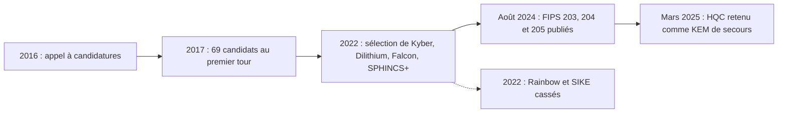
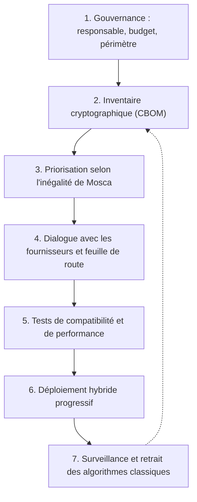

## Introduction

Ce dernier chapitre referme le cours en regardant vers l'avenir, mais un avenir qui a déjà commencé. Fin 2026, aucun ordinateur quantique n'est capable de casser RSA ou les courbes elliptiques, et personne ne sait dire avec certitude quand un tel ordinateur existera. Pourtant, le NIST a publié en août 2024 ses trois premiers standards de cryptographie post-quantique, les navigateurs utilisent déjà un échange de clé hybride par défaut (chapitre 7), OpenSSH a adopté un échange de clé post-quantique par défaut, et les autorités européennes et américaines ont fixé des calendriers de migration.

Pourquoi une telle mobilisation pour une machine qui n'existe pas encore ? Parce que les données chiffrées aujourd'hui peuvent être enregistrées et déchiffrées demain, et parce qu'une migration cryptographique à l'échelle d'une organisation prend des années. L'histoire l'a montré : il a fallu plus d'une décennie pour se débarrasser de SHA-1 et de TLS 1.0.

À la fin de ce chapitre, tu sauras expliquer ce que menace réellement un ordinateur quantique, reconnaître les nouveaux algorithmes sous leurs deux noms, l'ancien nom de candidat et le nouveau nom normalisé, comprendre pourquoi on les déploie en mode hybride, et proposer une démarche de migration réaliste pour une organisation.

## Ce que change un ordinateur quantique

Un ordinateur classique manipule des bits qui valent 0 ou 1. Un ordinateur quantique manipule des **qubits**, qui peuvent se trouver dans une superposition de ces deux états. Avec des opérations bien choisies, on fait interférer ces superpositions de façon que les mauvaises réponses s'annulent et que la bonne réponse soit amplifiée au moment de la mesure. Cela ne revient pas à « essayer toutes les solutions en parallèle », image trompeuse souvent répétée : un ordinateur quantique n'accélère que certains problèmes possédant une structure mathématique exploitable.

Le défi est physique. Les qubits sont extrêmement fragiles et accumulent des erreurs. Pour exécuter un long calcul, il faut de nombreux qubits physiques par qubit logique corrigé d'erreurs. On parle de **CRQC** (Cryptographically Relevant Quantum Computer) pour désigner une machine assez grande et assez fiable pour casser la cryptographie actuelle. Les estimations de ressources nécessaires baissent régulièrement : en 2019, Craig Gidney et Martin Ekerå estimaient qu'environ 20 millions de qubits physiques bruités suffiraient à factoriser une clé RSA-2048 en huit heures ; en 2025, Gidney a publié une estimation de moins d'un million de qubits bruités, en moins d'une semaine. Les machines existantes restent très loin de ces chiffres, mais la tendance justifie la prudence.

## Shor et Grover : deux menaces très différentes

### L'algorithme de Shor, fatal pour RSA et les courbes elliptiques

Publié par Peter Shor en 1994, cet algorithme ramène la factorisation d'un entier à la recherche de la **période** d'une fonction modulaire. Un ordinateur classique doit tâtonner pour trouver cette période, alors qu'un ordinateur quantique peut l'extraire efficacement grâce à la transformée de Fourier quantique. Une fois la période connue, quelques calculs classiques livrent les facteurs premiers. La même idée résout le **problème du logarithme discret**, y compris sur les courbes elliptiques.

Les conséquences sont radicales : le temps de calcul passe d'exponentiel à polynomial. Augmenter la taille des clés ne sert à rien, car l'effort de l'attaquant ne croît que modérément. RSA (chapitre 3), Diffie-Hellman, ECDH, ECDSA et Ed25519 seraient tous cassés, ce qui touche l'échange de clé et les signatures de TLS, SSH, des VPN, des PKI et de la signature de code.

### L'algorithme de Grover, simple affaiblissement du symétrique

Publié par Lov Grover en 1996, cet algorithme accélère la recherche dans un espace non structuré. Là où une recherche exhaustive classique d'une clé de n bits demande de l'ordre de 2 puissance n essais, Grover en demande de l'ordre de 2 puissance n sur 2. Concrètement, AES-128 offrirait une sécurité effective d'environ 64 bits, et AES-256 d'environ 128 bits, ce qui reste hors de portée.

Le gain est donc **quadratique**, pas exponentiel. En pratique il est même plus faible : les itérations de Grover sont séquentielles, longues, et se parallélisent mal, si bien que de nombreux experts, dont le NIST, considèrent qu'AES-128 restera probablement sûr. La recommandation prudente, reprise notamment par la NSA dans sa suite CNSA 2.0, est de passer à AES-256 pour les données sensibles à longue durée de vie. Pour les fonctions de hachage, le raisonnement est similaire : SHA-256 et SHA-384 restent utilisables, avec une marge accrue pour les sorties plus longues.

| Algorithme | Problème sous-jacent | Effet d'un ordinateur quantique suffisamment puissant | Réponse |
| --- | --- | --- | --- |
| RSA | Factorisation | Cassé par Shor | Remplacer par ML-KEM et ML-DSA |
| ECDH, ECDSA, Ed25519 | Logarithme discret sur courbe | Cassé par Shor | Remplacer par ML-KEM et ML-DSA |
| AES-128 | Recherche de clé | Affaibli par Grover, sécurité effective réduite de moitié | Préférer AES-256 pour le long terme |
| AES-256 | Recherche de clé | Environ 128 bits effectifs, reste sûr | Aucun changement |
| SHA-256, SHA-384 | Préimage, collision | Affaiblis modérément | Aucun changement à court terme |

<CehCallout>
Point d'examen classique : l'algorithme de Shor **casse** l'asymétrique (RSA, ECC) en résolvant efficacement la factorisation et le logarithme discret, alors que l'algorithme de Grover ne fait qu'**affaiblir** le symétrique en réduisant de moitié sa sécurité effective, ce que l'on compense en doublant la taille de clé. C'est cette asymétrie de la menace qui explique pourquoi la cryptographie post-quantique se concentre sur le remplacement de RSA et ECC, et non d'AES.
</CehCallout>

## « Harvest now, decrypt later » : une menace déjà actuelle

Le scénario **« harvest now, decrypt later »**, que l'on peut traduire par « collecter maintenant, déchiffrer plus tard », décrit un adversaire qui intercepte et stocke aujourd'hui du trafic chiffré, dans l'attente qu'un ordinateur quantique suffisamment puissant lui permette de le déchiffrer. Pour un service de renseignement doté de capacités d'interception, le coût du stockage est faible au regard de la valeur potentielle des secrets.

Le forward secrecy du chapitre 7 ne protège pas contre ce scénario : il empêche le vol ultérieur de la clé privée du serveur de compromettre le passé, mais l'échange ECDHE éphémère lui-même, enregistré, serait cassé par Shor. Seul un échange de clé post-quantique protège rétroactivement les données enregistrées à partir de son déploiement.

Le chercheur Michele Mosca a formulé une règle simple pour décider de l'urgence, connue sous le nom d'**inégalité de Mosca**. Notons X la durée pendant laquelle tes données doivent rester confidentielles, Y le temps nécessaire à ton organisation pour migrer, et Z le temps restant avant l'apparition d'un CRQC. Si X plus Y est supérieur à Z, tu es déjà en retard. Par exemple, avec des dossiers médicaux à protéger 25 ans et une migration de 5 ans, il faudrait être certain qu'aucun CRQC n'apparaîtra avant 30 ans, ce que personne ne peut garantir.

<WarningCallout>
Une organisation qui traite des données devant rester confidentielles pendant des décennies, comme des secrets d'État, des données de santé, des données biométriques ou de la propriété intellectuelle, fait déjà face à une menace concrète. Attendre l'arrivée effective d'un ordinateur quantique pour migrer serait trop tard pour tout ce qui aura été enregistré entre-temps. Les signatures sont moins urgentes, car une signature ne peut pas être falsifiée rétroactivement, sauf pour les ancres de confiance de très longue durée, comme les clés racines ou les clés de signature de micrologiciels d'équipements déployés pour quinze ans.
</WarningCallout>

## La standardisation NIST

Le NIST a lancé en 2016 un concours public international, sur le modèle de celui qui avait abouti à AES. Il a reçu 82 propositions, dont 69 ont été retenues pour le premier tour. Pendant plusieurs années, la communauté mondiale les a analysées, et certaines se sont effondrées : la signature **Rainbow** a été cassée en 2022 par Ward Beullens avec un simple ordinateur portable en un week-end, et l'échange de clé **SIKE**, fondé sur les isogénies, a été cassé la même année par Wouter Castryck et Thomas Decru en environ une heure sur un seul cœur. Ces chutes spectaculaires sont la meilleure justification de l'approche hybride.



En juillet 2022, le NIST a annoncé ses choix, puis, le 13 août 2024, il a publié trois standards définitifs. À cette occasion, les algorithmes ont changé de nom, ce qui crée beaucoup de confusion dans la documentation : il faut connaître les deux appellations.

| Standard | Nom normalisé | Ancien nom du candidat | Rôle | Fondement mathématique |
| --- | --- | --- | --- | --- |
| FIPS 203 | ML-KEM | CRYSTALS-Kyber | Encapsulation de clé, remplace l'échange RSA et ECDH | Réseaux euclidiens (Module-LWE) |
| FIPS 204 | ML-DSA | CRYSTALS-Dilithium | Signature numérique, remplace RSA et ECDSA | Réseaux euclidiens (Module-LWE et SIS) |
| FIPS 205 | SLH-DSA | SPHINCS+ | Signature de secours, sans état | Fonctions de hachage uniquement |
| FIPS 206, en préparation | FN-DSA | Falcon | Signature compacte | Réseaux euclidiens (NTRU) |

Le NIST a aussi retenu **HQC**, un mécanisme d'encapsulation fondé sur les codes correcteurs d'erreurs, comme alternative à ML-KEM, pour ne pas dépendre d'une seule famille mathématique ; son standard est attendu après celui de FN-DSA. Enfin, les signatures à base de hachage **avec état** LMS et XMSS, normalisées dès 2020 dans la publication SP 800-208, sont déjà utilisables pour la signature de micrologiciels, à condition de gérer rigoureusement l'état : réutiliser un état revient à compromettre la clé.

### Les réseaux euclidiens, intuition

**CRYSTALS-Kyber (ML-KEM) et CRYSTALS-Dilithium (ML-DSA) reposent tous deux sur les réseaux euclidiens**, en anglais lattice-based cryptography. Un réseau euclidien est un ensemble de points régulièrement espacés dans un espace à plusieurs centaines de dimensions, comme une grille infinie mais inclinée. Le problème central, appelé **LWE** (Learning With Errors, apprentissage avec erreurs), ressemble à la résolution d'un système d'équations linéaires modulaires auquel on aurait ajouté un petit bruit aléatoire à chaque équation. Sans bruit, la méthode de Gauss vue en algèbre linéaire résout le système instantanément. Avec le bruit, retrouver la solution revient à trouver un point du réseau proche d'une cible, un problème pour lequel on ne connaît aucun algorithme efficace, ni classique ni quantique. La variante « Module », utilisée par Kyber et Dilithium, structure ces équations par blocs de polynômes pour réduire la taille des clés.

### ML-KEM, un mécanisme d'encapsulation de clé

ML-KEM n'est pas un échange Diffie-Hellman, mais un **KEM** (Key Encapsulation Mechanism). Le fonctionnement comporte trois opérations. Le destinataire génère une paire de clés. L'expéditeur utilise la clé publique pour **encapsuler** : il obtient un secret partagé de 32 octets et un chiffré qu'il envoie. Le destinataire **décapsule** le chiffré avec sa clé privée et retrouve le même secret. Ce secret sert ensuite de clé pour AES-GCM ou une fonction de dérivation.

FIPS 203 définit trois jeux de paramètres, alignés sur les catégories de sécurité du NIST : la catégorie 1 équivaut à AES-128, la catégorie 3 à AES-192 et la catégorie 5 à AES-256.

| Jeu de paramètres | Catégorie NIST | Clé publique | Chiffré | Secret partagé |
| --- | --- | --- | --- | --- |
| ML-KEM-512 | 1 | 800 octets | 768 octets | 32 octets |
| ML-KEM-768 | 3 | 1 184 octets | 1 088 octets | 32 octets |
| ML-KEM-1024 | 5 | 1 568 octets | 1 568 octets | 32 octets |

À titre de comparaison, une clé publique X25519 tient en 32 octets. ML-KEM est en revanche très rapide : sur un processeur de bureau, une encapsulation prend quelques dizaines de microsecondes, souvent moins qu'une opération sur courbe elliptique. ML-KEM-768 est le choix par défaut sur le web, ML-KEM-1024 celui exigé par CNSA 2.0.

### ML-DSA, SLH-DSA et FN-DSA pour les signatures

**ML-DSA** est la signature généraliste recommandée. Ses jeux de paramètres ML-DSA-44, ML-DSA-65 et ML-DSA-87 correspondent aux catégories 2, 3 et 5. **SLH-DSA** repose uniquement sur la sécurité des fonctions de hachage, une hypothèse très étudiée et considérée comme la plus conservatrice ; en contrepartie, ses signatures sont grosses et lentes à produire. **FN-DSA** offre des signatures beaucoup plus compactes que ML-DSA, mais son implémentation exige de l'arithmétique en virgule flottante délicate à rendre résistante aux canaux auxiliaires (chapitre 6).

<CompareTable
  titleA="Signature classique"
  titleB="Signature post-quantique"
  rows={[
    { a: "ECDSA P-256 ou Ed25519 : clé publique de 32 à 64 octets, signature de 64 octets", b: "ML-DSA-44 (ex-Dilithium) : clé publique de 1 312 octets, signature de 2 420 octets" },
    { a: "RSA-2048 : clé publique d'environ 256 octets, signature de 256 octets", b: "ML-DSA-65 : clé publique de 1 952 octets, signature de 3 309 octets" },
    { a: "Cassées par l'algorithme de Shor", b: "SLH-DSA-SHA2-128s (ex-SPHINCS+) : clé publique de 32 octets, signature de 7 856 octets" },
  ]}
/>

Ces tailles expliquent pourquoi la migration des signatures est plus délicate que celle de l'échange de clé. Un handshake TLS transporte plusieurs signatures et clés publiques à travers la chaîne de certificats et les preuves de Certificate Transparency (chapitre 5) : passer tout cela en ML-DSA ajouterait une quinzaine de kilo-octets à chaque connexion. Des travaux de l'IETF explorent des formats de certificats plus compacts pour y remédier.

## L'approche hybride, stratégie de transition

Une construction **hybride** combine un algorithme classique éprouvé et un algorithme post-quantique, de façon que l'ensemble reste sûr tant que l'un des deux tient. Les nouveaux algorithmes ont été intensément analysés, mais ils n'ont pas trente ans de recul comme RSA ou les courbes elliptiques, et leurs implémentations sont jeunes. L'exemple de SIKE, cassé après des années d'étude, rappelle qu'une mauvaise surprise reste possible.

L'hybride est déjà la norme dans les déploiements grand public :

- **TLS** : le groupe X25519MLKEM768, qui combine X25519 et ML-KEM-768, est activé par défaut dans les navigateurs récents, chez de grands CDN et dans OpenSSL 3.5 (chapitre 7).
- **SSH** : OpenSSH utilise par défaut un échange hybride depuis la version 9.0 (sntrup761x25519-sha512), puis l'algorithme mlkem768x25519-sha256, introduit en version 9.9 et devenu le choix par défaut en version 10.0.
- **Messageries** : Signal a introduit le protocole PQXDH en 2023, et Apple le protocole PQ3 pour iMessage en 2024.

<CehCallout>
Retiens que l'approche hybride, qui combine par exemple ECDHE (X25519) et ML-KEM, anciennement CRYSTALS-Kyber, dans un même handshake TLS, est déjà déployée par les grands navigateurs et fournisseurs cloud. Elle protège contre le scénario « harvest now, decrypt later » tout en se prémunissant contre une faiblesse encore inconnue des nouveaux algorithmes. L'ANSSI et son homologue allemand, le BSI, recommandent l'hybridation pendant la transition ; la NSA, dans CNSA 2.0, accepte au contraire les algorithmes post-quantiques seuls.
</CehCallout>

On entend parfois parler de **distribution quantique de clés** (QKD) comme alternative. Il s'agit d'une technique physique qui exige du matériel spécialisé et des liaisons dédiées, et qui n'authentifie pas les parties par elle-même. L'ANSSI comme la NSA considèrent qu'elle ne remplace pas la cryptographie post-quantique, qui fonctionne sur les réseaux et le matériel existants.

## Crypto-agilité et plan de migration

La **crypto-agilité** est la capacité d'un système à changer d'algorithme cryptographique sans refonte majeure : algorithmes configurables plutôt que codés en dur, protocoles qui négocient les algorithmes, formats de données qui indiquent l'algorithme utilisé, bibliothèques centralisées et à jour. Le chapitre 1 l'a présentée comme un principe de conception ; la transition post-quantique en est la mise à l'épreuve.

### Les calendriers officiels

Plusieurs autorités ont fixé des échéances. Elles diffèrent dans le détail, mais convergent vers la période 2030 à 2035.

| Autorité | Document | Échéances principales |
| --- | --- | --- |
| NIST (États-Unis) | NIST IR 8547, projet initial publié fin 2024 | Algorithmes vulnérables au quantique dépréciés après 2030 pour le niveau 112 bits, interdits après 2035 |
| NSA (systèmes de sécurité nationale américains) | CNSA 2.0 (2022) | Signature de logiciels et micrologiciels post-quantique de préférence dès 2025, transition complète des systèmes visée pour 2035 |
| Union européenne | Feuille de route coordonnée des États membres (2025) | Premières étapes d'ici fin 2026, cas d'usage à haut risque migrés d'ici 2030, le plus possible d'ici 2035 |
| ANSSI (France) | Avis sur la migration post-quantique | Hybridation obligatoire pendant la transition, sauf signatures à base de hachage |

### Les étapes d'une migration



1. **Gouvernance** : nommer un responsable et rattacher le projet à la gestion des risques. Sous NIS2 et DORA, la gestion de la cryptographie fait partie des mesures de sécurité attendues des entités concernées.
2. **Inventaire** : on ne migre que ce que l'on connaît. Il faut recenser les certificats, les protocoles, les bibliothèques, les clés stockées dans des HSM, les algorithmes codés en dur dans les applications et ceux des équipements embarqués. Le format **CBOM** (Cryptography Bill of Materials), pris en charge par le standard CycloneDX depuis sa version 1.6, permet de documenter cet inventaire de façon structurée. Des outils de scan réseau, comme testssl.sh, et d'analyse de code aident à le construire.
3. **Priorisation** : traiter d'abord les flux qui transportent des données à longue durée de vie (le X de Mosca), les systèmes dont la migration sera la plus lente (le Y), et les ancres de confiance de longue durée.
4. **Fournisseurs** : demander à chaque éditeur et constructeur sa feuille de route post-quantique ; c'est souvent là que se trouve le chemin critique.
5. **Tests** : mesurer l'impact de la taille des clés et des signatures sur les protocoles, les MTU réseau, les équipements intermédiaires, les cartes à puce et les HSM.
6. **Déploiement hybride** : commencer par l'échange de clé, simple à activer côté serveur, puis les signatures quand l'écosystème PKI sera prêt.
7. **Surveillance** : suivre l'évolution des standards et retirer à terme les algorithmes classiques.

<AuditCallout>
Dans ISO/IEC 27001:2022, le contrôle A.8.24 « Utilisation de la cryptographie » exige des règles de cryptographie et de gestion des clés. Un auditeur attendra désormais qu'elles traitent de la menace quantique : existence d'un inventaire cryptographique, analyse de risque sur la durée de confidentialité des données, et feuille de route de migration. La fonction Govern du NIST CSF 2.0 couvre le pilotage de ce type de programme.
</AuditCallout>

## Pratique : ML-KEM et ML-DSA avec OpenSSL 3.5

Depuis la version 3.5, publiée en avril 2025, OpenSSL intègre nativement ML-KEM, ML-DSA et SLH-DSA. Tu peux donc manipuler ces algorithmes avec les mêmes commandes que pour RSA ou les courbes elliptiques.

```bash
# Lister les mécanismes d'encapsulation disponibles
openssl list -kem-algorithms | grep -i mlkem

# ML-KEM-768 : génération d'une paire de clés et extraction de la clé publique
openssl genpkey -algorithm ML-KEM-768 -out kem.pem
openssl pkey -in kem.pem -pubout -out kem.pub

# Expéditeur : encapsulation avec la clé publique -> chiffré + secret partagé
openssl pkeyutl -encap -pubin -inkey kem.pub -out chiffre.bin -secret secret_expediteur.bin

# Destinataire : décapsulation avec la clé privée -> même secret
openssl pkeyutl -decap -inkey kem.pem -in chiffre.bin -secret secret_destinataire.bin

# Vérifier les tailles et l'égalité des deux secrets
wc -c chiffre.bin secret_expediteur.bin
cmp secret_expediteur.bin secret_destinataire.bin && echo "Secrets identiques"
```

```text
  { 2.16.840.1.101.3.4.4.1, id-alg-ml-kem-512, ML-KEM-512, MLKEM512 } @ default
  { 2.16.840.1.101.3.4.4.2, id-alg-ml-kem-768, ML-KEM-768, MLKEM768 } @ default
  { 2.16.840.1.101.3.4.4.3, id-alg-ml-kem-1024, ML-KEM-1024, MLKEM1024 } @ default
  X25519MLKEM768 @ default
1088 chiffre.bin
  32 secret_expediteur.bin
1120 total
Secrets identiques
```

On retrouve les tailles du tableau : un chiffré de 1 088 octets et un secret de 32 octets. La liste montre aussi le groupe hybride X25519MLKEM768 utilisé par TLS.

```bash
# ML-DSA-65 : signer puis vérifier un fichier
openssl genpkey -algorithm ML-DSA-65 -out signature.pem
openssl pkey -in signature.pem -pubout -out signature.pub
echo "Rapport d'audit Nyx" > rapport.txt
openssl pkeyutl -sign -rawin -inkey signature.pem -in rapport.txt -out rapport.sig
wc -c < rapport.sig
openssl pkeyutl -verify -rawin -pubin -inkey signature.pub -in rapport.txt -sigfile rapport.sig
```

```text
3309
Signature Verified Successfully
```

L'option `-rawin` indique que l'on signe le message lui-même, et non une empreinte calculée au préalable : comme Ed25519, ML-DSA intègre son propre hachage.

## Angle offensif et défensif

Il n'existe pas d'attaque quantique opérationnelle contre la cryptographie actuelle, mais la transition elle-même ouvre des risques que l'on peut anticiper.

<AttackDefenseTable rows={[
  { phase: "Collecte", attack: "Enregistrer massivement du trafic chiffré par ECDHE ou RSA pour le déchiffrer avec un futur ordinateur quantique", defense: "Échange de clé hybride (X25519MLKEM768 en TLS, mlkem768x25519-sha256 en SSH) en priorité sur les flux sensibles" },
  { phase: "Falsification future", attack: "Forger des signatures avec une clé racine ou de micrologiciel classique une fois un CRQC disponible", defense: "Planifier des ancres de confiance post-quantiques (ML-DSA, LMS, XMSS, SLH-DSA) pour les équipements à longue durée de vie" },
  { phase: "Cryptanalyse classique", attack: "Exploiter une faiblesse mathématique découverte dans un nouvel algorithme, comme pour SIKE et Rainbow", defense: "Hybridation, et uniquement des algorithmes standardisés par le NIST" },
  { phase: "Implémentation", attack: "Attaques par canal auxiliaire sur des implémentations jeunes, temps d'exécution ou consommation électrique", defense: "Bibliothèques reconnues et à jour (OpenSSL 3.5 et plus, BoringSSL, liboqs pour l'expérimentation), implémentations à temps constant" },
  { phase: "Rétrogradation", attack: "Forcer la négociation d'un groupe classique en supprimant l'offre hybride", defense: "Protocoles qui authentifient la négociation (TLS 1.3), surveillance des groupes négociés" },
]} />

## Erreurs fréquentes

- **Croire que tout doit changer** : AES-256, SHA-256 et SHA-384 restent sûrs ; seuls l'échange de clé et les signatures asymétriques doivent migrer.
- **Attendre l'ordinateur quantique** : à cause du scénario « harvest now, decrypt later », c'est la date de déploiement de l'échange post-quantique qui détermine ce qui est protégé, pas la date d'apparition du CRQC.
- **Confondre les noms** : ML-KEM est le nom normalisé de CRYSTALS-Kyber, ML-DSA celui de CRYSTALS-Dilithium et SLH-DSA celui de SPHINCS+. Les versions des candidats et les versions standardisées ne sont pas interopérables : il faut exiger les versions FIPS.
- **Utiliser ML-KEM pour signer ou ML-DSA pour chiffrer** : l'un encapsule des clés, l'autre signe, comme on distingue ECDH et ECDSA.
- **Déployer des implémentations expérimentales en production** : les bibliothèques de recherche servent à tester, pas à protéger des données réelles.
- **Négliger l'inventaire** : sans liste des algorithmes et des clés en service, la migration est impossible à piloter.
- **Oublier les équipements embarqués** : un objet connecté ou un équipement industriel déployé aujourd'hui pour quinze ans doit déjà prévoir la mise à jour de ses algorithmes.

## Lab — Mise en pratique

**Environnement** : Kali Linux (terminal Nyx Shell) avec OpenSSL 3.5 ou plus récent ; les étapes 6 et 7 sont des exercices de réflexion.

<Steps steps={[
  { title: "Vérifier le support post-quantique", description: "Affiche la version d'OpenSSL et la liste des algorithmes de signature post-quantiques. Repère ML-DSA et SLH-DSA, et note leurs identifiants d'objet.", code: "openssl version\nopenssl list -signature-algorithms | grep -i -E 'ml-dsa|slh-dsa'" },
  { title: "Encapsuler une clé avec ML-KEM-768", description: "Génère une paire de clés, encapsule avec la clé publique puis décapsule avec la clé privée. Vérifie que le chiffré fait 1 088 octets et que les deux secrets de 32 octets sont identiques.", code: "openssl genpkey -algorithm ML-KEM-768 -out kem.pem\nopenssl pkey -in kem.pem -pubout -out kem.pub\nopenssl pkeyutl -encap -pubin -inkey kem.pub -out ct.bin -secret s1.bin\nopenssl pkeyutl -decap -inkey kem.pem -in ct.bin -secret s2.bin\nwc -c ct.bin s1.bin && cmp s1.bin s2.bin && echo identiques" },
  { title: "Comparer les tailles de signature", description: "Signe le même fichier avec Ed25519, ML-DSA-65 et SLH-DSA-SHA2-128s, puis compare la taille des signatures. Explique l'impact de ces tailles sur une chaîne de certificats TLS.", code: "echo test > m.txt\nfor a in ED25519 ML-DSA-65 SLH-DSA-SHA2-128s; do openssl genpkey -algorithm $a -out $a.pem; openssl pkeyutl -sign -rawin -inkey $a.pem -in m.txt -out $a.sig; echo \"$a : $(wc -c < $a.sig) octets\"; done" },
  { title: "Mesurer les performances", description: "Compare la vitesse de ML-KEM-768 à celle de X25519. Observe que la taille, et non le temps de calcul, est le principal coût du post-quantique.", code: "openssl speed -seconds 2 ML-KEM-768\nopenssl speed -seconds 2 ecdhx25519" },
  { title: "Observer l'hybride dans TLS", description: "Connecte-toi à un site qui supporte l'échange hybride et repère la ligne du groupe négocié. Fais le lien avec le scénario « harvest now, decrypt later ».", code: "openssl s_client -connect www.cloudflare.com:443 -servername www.cloudflare.com -brief < /dev/null 2>&1 | grep -i group" },
  { title: "Appliquer l'inégalité de Mosca", description: "Une entreprise pharmaceutique conserve des données de recherche qui doivent rester confidentielles 30 ans et estime sa migration à 6 ans. Explique pourquoi la menace quantique est déjà pertinente pour elle, même sans ordinateur quantique opérationnel, et quels flux elle doit protéger en premier." },
  { title: "Esquisser un inventaire cryptographique", description: "Pour un système que tu connais, comme ton serveur personnel ou le lab Nyx, liste chaque usage de cryptographie (TLS, SSH, VPN, sauvegardes, signatures), l'algorithme utilisé, la durée de vie des données et l'action post-quantique à prévoir." },
]} />

## À retenir

- L'algorithme de Shor casserait RSA et les courbes elliptiques en résolvant la factorisation et le logarithme discret ; l'algorithme de Grover ne fait que réduire de moitié la sécurité effective d'AES, ce que compense AES-256.
- Le scénario « harvest now, decrypt later » rend la menace actuelle pour toute donnée qui doit rester confidentielle longtemps, et l'inégalité de Mosca aide à mesurer l'urgence.
- Le NIST a publié en août 2024 FIPS 203 (ML-KEM, ex-CRYSTALS-Kyber) pour l'échange de clé, FIPS 204 (ML-DSA, ex-CRYSTALS-Dilithium) et FIPS 205 (SLH-DSA, ex-SPHINCS+) pour les signatures ; FN-DSA (ex-Falcon) et HQC suivront.
- ML-KEM et ML-DSA reposent sur les réseaux euclidiens, SLH-DSA uniquement sur les fonctions de hachage.
- L'approche hybride, comme X25519MLKEM768 dans TLS ou mlkem768x25519-sha256 dans OpenSSH, est déjà déployée par défaut et protège même si l'un des deux algorithmes tombe.
- La migration commence par la gouvernance et l'inventaire cryptographique, et s'appuie sur la crypto-agilité ; les calendriers officiels convergent vers 2030 à 2035.

## Questions de révision

1. Pourquoi l'algorithme de Shor menace-t-il RSA et ECC alors que l'algorithme de Grover ne fait qu'affaiblir AES ?
2. Qu'est-ce que la stratégie « harvest now, decrypt later », et pourquoi le forward secrecy d'ECDHE ne suffit-il pas à s'en protéger ?
3. Applique l'inégalité de Mosca à des données de santé à protéger 20 ans dans une organisation qui estime sa migration à 7 ans.
4. Quels algorithmes le NIST a-t-il standardisés en 2024, sous leurs deux noms, et à quel usage chacun est-il destiné ?
5. En quoi un mécanisme d'encapsulation de clé comme ML-KEM diffère-t-il d'un échange Diffie-Hellman ?
6. Pourquoi de nombreuses implémentations combinent-elles un algorithme classique et un algorithme post-quantique plutôt que de migrer entièrement vers ce dernier ?
7. Pourquoi la migration des signatures et des certificats est-elle plus difficile que celle de l'échange de clé ?
8. Quelles sont les premières actions concrètes d'un plan de migration post-quantique, et pourquoi l'inventaire vient-il avant tout ?

Félicitations, tu viens de terminer le cours **Cryptographie Avancée** ! Ces fondations mathématiques et pratiques s'appliquent directement aux cours Sécurité Web (TLS et HTTPS), Active Directory (Kerberos) et Droit et Réglementation (protection des données). Continue vers **Mathématiques Appliquées** pour renforcer les bases utilisées ici, notamment l'arithmétique modulaire et l'algèbre linéaire qui sous-tendent les réseaux euclidiens.
