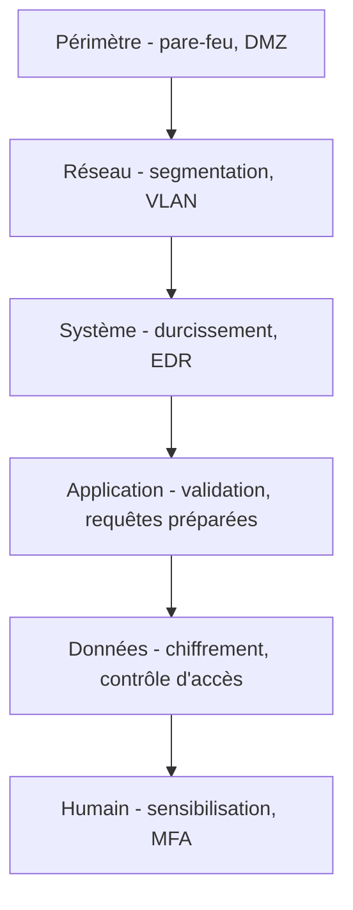
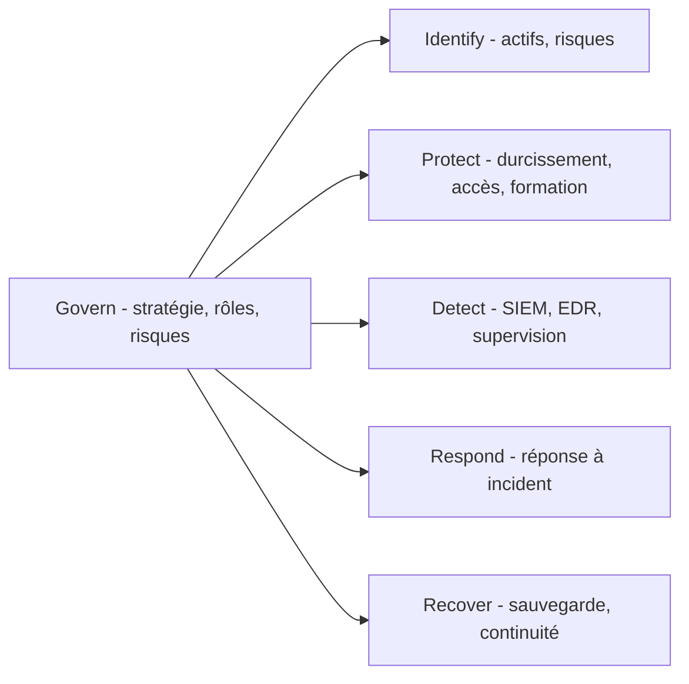

## Introduction

Ce cours referme le parcours cybersécurité de Nyx en adoptant le point de vue du défenseur. Après avoir appris à attaquer méthodiquement dans le cours Cybersécurité Offensive, il s'agit maintenant de construire une défense capable de résister à exactement ce type de mission. Le défenseur a une contrainte que l'attaquant n'a pas : il doit protéger l'ensemble du système d'information, tout le temps, alors que l'attaquant n'a besoin que d'une seule faille au bon moment. Cette asymétrie est la raison d'être de la défense en profondeur.

Concrètement, ce chapitre pose le cadre mental de tout le cours. Les chapitres suivants détaillent chaque brique : le durcissement des systèmes, la segmentation réseau et le Zero Trust, la gestion des identités, la détection, la réponse à incident, la sauvegarde, la threat intelligence, les exercices Red, Blue et Purple Team, et enfin l'amélioration continue. Ici, on apprend à penser ces briques comme un tout cohérent.

À la fin de ce chapitre, tu sauras expliquer ce qu'est la défense en profondeur et pourquoi elle fonctionne, nommer ses six couches dans l'ordre, distinguer les contrôles préventifs, détectifs et correctifs, et cartographier une chaîne d'attaque réelle pour repérer à quelle couche elle aurait dû être arrêtée. Tu sauras aussi rattacher cette démarche aux référentiels que les auditeurs et les régulateurs utilisent aujourd'hui.

## Le principe de la défense en profondeur

La défense en profondeur, en anglais *defense in depth*, consiste à superposer plusieurs couches de sécurité indépendantes. L'idée centrale tient en une phrase : la défaillance d'une seule couche ne doit pas compromettre l'ensemble du système. Une couche peut être un équipement, comme un pare-feu, une configuration, comme la désactivation d'un service inutile, un processus, comme la revue des droits d'accès, ou un comportement humain, comme le signalement d'un courriel suspect.

<CehCallout>
La défense en profondeur consiste à superposer plusieurs couches de sécurité indépendantes, de sorte que la défaillance d'une seule couche ne compromette pas l'ensemble du système — un principe directement inspiré des fortifications militaires historiques à plusieurs enceintes successives. C'est une notion d'examen récurrente du CEH v13 et de la Security+ : retiens la définition et l'exemple des couches successives.
</CehCallout>

L'analogie militaire est parlante. Un château médiéval ne comptait pas sur un seul mur : il y avait des douves, une première enceinte, une cour, une seconde enceinte, puis le donjon. Chaque obstacle ralentissait l'assaillant, l'exposait aux défenseurs et donnait du temps pour réagir. En cybersécurité, le principe est le même : chaque couche doit soit bloquer l'attaquant, soit le ralentir, soit le rendre visible.

### Les six couches du modèle

Le schéma suivant présente les six couches que ce cours utilise comme référence, de l'extérieur vers l'intérieur.



Le **périmètre** est la frontière entre ton système d'information et l'extérieur. On y trouve le pare-feu, la DMZ, c'est-à-dire la zone démilitarisée où vivent les services exposés à Internet, le proxy et la passerelle de messagerie qui filtre les pièces jointes.

Le **réseau** interne vient immédiatement après le périmètre. Sa protection repose sur la segmentation, par exemple en VLAN, ces réseaux locaux virtuels qui séparent logiquement les postes, les serveurs et les équipements d'administration. Le chapitre 3 y est entièrement consacré.

Le **système** regroupe les serveurs et les postes de travail. On les protège par le durcissement, qui consiste à retirer tout ce qui n'est pas nécessaire et à configurer le reste de façon sûre, et par un EDR, un outil de détection et de réponse sur le poste. Les chapitres 2 et 5 détaillent ces deux aspects.

L'**application** est le code métier : site web, API, progiciel. Les protections clés sont la validation des entrées et les requêtes préparées, qui empêchent l'injection SQL.

Les **données** sont la cible finale de la plupart des attaques. On les protège par le chiffrement, au repos et en transit, et par le contrôle d'accès, qui définit qui peut lire ou modifier quoi.

L'**humain**, enfin, est à la fois une cible privilégiée et une ligne de défense. La sensibilisation aide à reconnaître l'hameçonnage, et l'authentification multifacteur, ou MFA, limite l'impact d'un mot de passe volé.

<TipCallout>
L'ordre du schéma n'est pas une hiérarchie d'importance. La couche humaine apparaît en dernier dans la représentation, mais c'est souvent par elle que commence l'attaque, avec un courriel d'hameçonnage. Pense aux couches comme à des plans de contrôle superposés, pas comme à un couloir unique.
</TipCallout>

### Préventif, détectif, correctif

Une défense en profondeur mature ne se contente pas d'empiler des barrières. Sur chaque couche, elle combine trois familles de contrôles.

Un contrôle **préventif** empêche l'incident de se produire : un pare-feu qui bloque un port, une politique de mots de passe, une application non installée. Un contrôle **détectif** signale qu'un incident est en cours ou a eu lieu : une alerte du SIEM, un journal d'authentification, une détection de l'EDR. Un contrôle **correctif** limite les dégâts et rétablit la situation : l'isolement automatique d'un poste, la restauration depuis une sauvegarde, la révocation d'un jeton.

| Couche | Préventif | Détectif | Correctif |
| --- | --- | --- | --- |
| Périmètre | Filtrage des ports exposés | Journaux du pare-feu analysés par le SIEM | Blocage d'une adresse IP malveillante |
| Réseau | Segmentation en VLAN | Analyse des flux internes inhabituels | Isolement d'un segment compromis |
| Système | Durcissement, correctifs | Alertes comportementales de l'EDR | Isolement du poste par l'EDR |
| Application | Requêtes préparées | Journalisation applicative, WAF en mode détection | Correctif de code, rollback |
| Données | Chiffrement, droits minimaux | Alertes sur les accès massifs | Restauration depuis sauvegarde |
| Humain | MFA, sensibilisation | Signalement des courriels suspects | Réinitialisation des identifiants |

Une organisation qui n'investit que dans le préventif est aveugle le jour où une barrière cède. Une organisation qui n'a que du détectif voit tout mais ne peut rien arrêter. L'équilibre entre les trois est l'un des marqueurs de maturité étudiés au chapitre 10.

## Pourquoi aucune couche seule ne suffit

Chaque couche possède des faiblesses inévitables. Un pare-feu laisse forcément passer le trafic légitime, et un attaquant peut se cacher dedans. Un antivirus à signatures ne reconnaît pas un code malveillant qu'il n'a jamais vu. Une sensibilisation réussie fait baisser le taux de clics sur les courriels piégés, mais ne le ramène jamais à zéro. Un correctif n'existe pas encore pour une vulnérabilité inconnue, ce qu'on appelle une faille *zero-day*.

À cela s'ajoute une réalité opérationnelle : une attaque réelle est rarement une action isolée. C'est une chaîne d'étapes, et chaque étape exploite une couche différente.

<WarningCallout>
Rappel du cours Cybersécurité Offensive (chapitre 9) : une mission de pentest réussie combine souvent plusieurs techniques enchaînées — accès initial par phishing, élévation de privilèges, mouvement latéral. Une défense reposant sur une seule couche (par exemple, un antivirus seul) aurait échoué à stopper cette chaîne complète, alors qu'une défense en profondeur multiplie les occasions de détecter ou bloquer l'attaquant à chaque étape.
</WarningCallout>

### Une chaîne d'attaque vue par le défenseur

Reprenons cette mission de pentest. L'attaquant envoie un courriel d'hameçonnage, un utilisateur ouvre la pièce jointe, un code s'exécute sur son poste. L'attaquant obtient ensuite des droits administrateur locaux en exploitant une mauvaise configuration, récupère des identifiants en mémoire, puis se déplace de machine en machine dans l'Active Directory jusqu'au contrôleur de domaine.

Un antivirus seul n'intervient qu'à un endroit : au moment où le fichier malveillant touche le disque ou s'exécute. S'il ne le reconnaît pas, plus rien ne s'oppose à la suite. Il ne voit pas l'élévation de privilèges par mauvaise configuration, car rien de malveillant n'est installé. Il ne voit pas le mouvement latéral, car l'attaquant utilise des protocoles d'administration légitimes avec des identifiants valides.

La défense en profondeur multiplie au contraire les points d'arrêt. Le tableau suivant montre comment chaque étape, décrite de façon conceptuelle, peut être contrée.

<AttackDefenseTable rows={[
  { phase: "Accès initial (hameçonnage)", attack: "Un courriel convaincant pousse l'utilisateur à ouvrir une pièce jointe ou à saisir ses identifiants", defense: "Filtrage de messagerie, sensibilisation, MFA résistant à l'hameçonnage (FIDO2), signalement en un clic" },
  { phase: "Exécution", attack: "Un script ou une macro s'exécute dans le contexte de l'utilisateur", defense: "Blocage des macros d'Internet, contrôle applicatif (AppLocker, WDAC), EDR comportemental" },
  { phase: "Élévation de privilèges", attack: "Exploitation d'une mauvaise configuration locale pour devenir administrateur", defense: "Durcissement, utilisateurs sans droits admin, correctifs, audit des binaires SUID sous Linux" },
  { phase: "Vol d'identifiants", attack: "Lecture des secrets d'authentification présents en mémoire", defense: "Credential Guard, protection LSA, mots de passe admin locaux uniques (LAPS)" },
  { phase: "Mouvement latéral", attack: "Réutilisation des identifiants pour se connecter à d'autres machines", defense: "Segmentation, pare-feu hôte, modèle de tiering, Zero Trust, alertes SIEM sur connexions inhabituelles" },
  { phase: "Atteinte aux données", attack: "Exfiltration ou chiffrement des données critiques", defense: "Chiffrement, droits minimaux, détection des volumes anormaux, sauvegardes immuables" }
]} />

Chaque ligne du tableau est une occasion de casser la chaîne. Le défenseur n'a pas besoin de gagner à chaque étape : il lui suffit de gagner à une seule pour interrompre l'attaque, ou au moins de la détecter assez tôt pour la contenir. C'est un renversement de l'asymétrie évoquée en introduction : face à une défense en profondeur, c'est l'attaquant qui doit réussir à chaque étape.

### Correspondance avec le parcours Nyx

Chaque couche s'appuie sur des compétences acquises ailleurs dans le parcours. Le tableau suivant fait le lien.

<CompareTable
  titleA="Couche de défense"
  titleB="Cours Nyx correspondant"
  rows={[
    { a: "Périmètre et réseau", b: "Réseaux (pare-feu, VLAN), Administration Systèmes et Réseaux" },
    { a: "Système et durcissement", b: "Linux, Administration Systèmes et Réseaux (chapitre 8)" },
    { a: "Application", b: "Sécurité Web (requêtes préparées, validation)" },
    { a: "Données", b: "Cryptographie Avancée (chiffrement)" },
    { a: "Identité et accès", b: "Administration Systèmes et Réseaux (chapitre 7, IAM)" },
    { a: "Humain", b: "Psychologie & Ingénierie Sociale" },
]}
/>

Tu remarques que l'identité et l'accès apparaissent ici comme une ligne à part. Dans les architectures modernes, l'identité est devenue un plan de contrôle transversal : elle traverse toutes les couches. C'est l'un des fondements du Zero Trust, présenté au chapitre 3, et le sujet du chapitre 4.

## Le modèle du Swiss cheese

Le modèle du fromage suisse, ou *Swiss cheese model*, a été formalisé par le psychologue James Reason dans les années 1990 pour analyser les accidents dans l'aviation et la médecine. Il s'applique parfaitement à la cybersécurité.

<TipCallout>
Une image utile pour comprendre la défense en profondeur : chaque couche de sécurité est comme une tranche de fromage suisse, percée de trous (des faiblesses inévitables) — mais empiler plusieurs tranches indépendantes rend statistiquement très improbable qu'un trou de chaque tranche s'aligne parfaitement pour laisser passer une attaque de bout en bout.
</TipCallout>

### Un raisonnement chiffré

Faisons un calcul simplifié pour comprendre la force du modèle. Supposons trois couches indépendantes. La première, le filtrage de messagerie, laisse passer 10 % des courriels malveillants. La deuxième, l'utilisateur sensibilisé, clique dans 20 % des cas. La troisième, l'EDR, rate 10 % des exécutions malveillantes.

La probabilité qu'une attaque traverse les trois couches est le produit des trois probabilités : 0,10 multiplié par 0,20 multiplié par 0,10, soit 0,002, c'est-à-dire 0,2 %. Aucune des trois couches n'est remarquable seule, mais ensemble elles arrêtent 99,8 % des tentatives de ce type.

Compare avec une seule couche « excellente » qui rate seulement 1 % des attaques. Elle est individuellement dix fois meilleure que chacune des précédentes, et pourtant elle laisse passer cinq fois plus d'attaques que l'empilement de trois couches imparfaites.

### La condition essentielle : l'indépendance

Ce calcul repose sur une hypothèse forte : les couches doivent être **indépendantes**. Si deux couches partagent la même faiblesse, leurs trous sont alignés par construction. Quelques exemples courants de fausse indépendance :

- deux antivirus qui utilisent le même moteur de signatures ne constituent pas deux couches ;
- un pare-feu et un VPN administrés avec le même compte, sans MFA, tombent ensemble si ce compte est compromis ;
- une sauvegarde accessible avec les identifiants du domaine tombe en même temps que le domaine, comme le montre le chapitre 7.

Un défenseur se pose donc toujours la question : « quelle compromission unique ferait tomber plusieurs de mes couches en même temps ? ». Ces points communs, appelés modes de défaillance communs, sont souvent l'identité d'administration, l'outil de supervision ou l'hyperviseur.

## Les référentiels actuels

La défense en profondeur n'est pas qu'une intuition : elle est inscrite dans les référentiels qui structurent le métier.

### NIST Cybersecurity Framework 2.0

Le NIST CSF, dans sa version 2.0 publiée en février 2024, organise la cybersécurité autour de six fonctions. La fonction **Govern**, nouvelle dans cette version, couvre la stratégie, les rôles, la politique et la gestion des risques, y compris ceux de la chaîne d'approvisionnement. Viennent ensuite **Identify**, qui inventorie les actifs et les risques, **Protect**, qui regroupe les contrôles préventifs, **Detect**, qui couvre la détection, **Respond**, la réponse aux incidents, et **Recover**, le rétablissement.



Ce cours suit naturellement ces fonctions : les chapitres 2 à 4 relèvent de Protect, le chapitre 5 de Detect, le chapitre 6 de Respond, le chapitre 7 de Recover, et les chapitres 8 à 10 nourrissent Identify et Govern.

### ISO/IEC 27001:2022 et CIS Controls

<AuditCallout>
La norme ISO/IEC 27001:2022 organise son Annexe A en 93 contrôles répartis en quatre thèmes : organisationnels (A.5), liés aux personnes (A.6), physiques (A.7) et technologiques (A.8). Ces quatre thèmes recoupent directement les couches de la défense en profondeur : la couche humaine relève de A.6, la segmentation réseau du contrôle A.8.22, la journalisation de A.8.15 et la sauvegarde de A.8.13. Un auditeur vérifiera que les contrôles choisis sont justifiés par l'appréciation des risques, et non empilés au hasard.
</AuditCallout>

Les CIS Controls, dans leur version 8.1, proposent 18 contrôles priorisés en trois groupes d'implémentation, IG1, IG2 et IG3, selon la taille et les moyens de l'organisation. Le groupe IG1 est souvent présenté comme une « hygiène de base » : inventaire des actifs, configuration sûre, gestion des comptes, sauvegardes. C'est un excellent point de départ pour une petite structure.

### Le cadre réglementaire européen

<LegalCallout>
La directive NIS2, applicable depuis octobre 2024 dans les États membres via leurs transpositions nationales, impose aux entités essentielles et importantes des mesures de gestion des risques qui recouvrent la défense en profondeur : gestion des incidents, continuité d'activité, sécurité de la chaîne d'approvisionnement, contrôle d'accès, MFA, chiffrement et formation. Le règlement DORA, applicable depuis janvier 2025, impose des exigences comparables au secteur financier. La défense en profondeur n'est donc plus seulement une bonne pratique : pour de nombreuses organisations, c'est une obligation.
</LegalCallout>

## Mise en pratique : cartographier ses couches

Un exercice que tout défenseur devrait savoir faire consiste à inventorier, couche par couche, ce qui est réellement en place. Sur un poste Linux, quelques commandes d'observation donnent déjà une idée de l'état de plusieurs couches.

```bash
# Couche réseau et système : quels services écoutent, et sur quelles interfaces ?
# ss remplace netstat (paquet net-tools, déprécié) : -t TCP, -u UDP, -l en écoute, -n sans résolution, -p processus
sudo ss -tulnp

# Couche périmètre local : un pare-feu hôte est-il actif ?
sudo nft list ruleset | head -20      # nftables, successeur d'iptables
sudo ufw status verbose               # si l'interface ufw est utilisée

# Couche système : des mises à jour de sécurité sont-elles en attente ? (Debian, Ubuntu, Kali)
apt list --upgradable 2>/dev/null | head
```

```text
Netid State  Local Address:Port  Peer Address:Port Process
udp   UNCONN 127.0.0.54:53       0.0.0.0:*         users:(("systemd-resolve",pid=512,fd=16))
tcp   LISTEN 0.0.0.0:22          0.0.0.0:*         users:(("sshd",pid=801,fd=3))
tcp   LISTEN 127.0.0.1:5432      0.0.0.0:*         users:(("postgres",pid=944,fd=6))
Status: active
Default: deny (incoming), allow (outgoing), disabled (routed)
```

Lis cette sortie comme un défenseur. SSH écoute sur toutes les interfaces, ce qui peut être justifié mais doit être protégé par clé et restreint par le pare-feu. PostgreSQL n'écoute que sur la boucle locale, ce qui est une bonne pratique : la base n'est pas joignable depuis le réseau. Le pare-feu hôte refuse par défaut le trafic entrant, ce qui ajoute une couche indépendante du pare-feu périmétrique.

## Erreurs fréquentes

La première erreur est l'**empilement d'outils sans architecture**. Acheter un pare-feu de nouvelle génération, un EDR et un SIEM ne crée pas une défense en profondeur si personne ne lit les alertes, si les couches partagent les mêmes identifiants d'administration, ou si les journaux ne sont pas conservés.

La deuxième est la **confiance excessive dans le périmètre**. Le modèle du « château fort », où tout ce qui est à l'intérieur est jugé fiable, ne résiste ni au télétravail, ni au cloud, ni à un poste compromis par hameçonnage. Le chapitre 3 montre comment le Zero Trust répond à ce problème.

La troisième est l'**oubli des contrôles détectifs et correctifs**. Une défense uniquement préventive est aveugle le jour où elle échoue, et elle échouera un jour.

La quatrième est la **fausse indépendance** décrite plus haut : des couches qui tombent ensemble à cause d'un compte, d'un outil ou d'une infrastructure partagés.

La cinquième est de **négliger la couche humaine**, ou à l'inverse de tout lui reprocher. Un utilisateur qui clique n'est pas « la faille » : c'est le signe qu'il manquait une couche technique en amont, comme le filtrage, ou en aval, comme le MFA résistant à l'hameçonnage.

## Lab — Mise en pratique

**Environnement** : réflexion guidée, puis terminal Kali ou toute machine Linux pour l'observation.

<Steps steps={[
  { title: "Cartographier les couches d'une mission connue", description: "Pour la mission décrite au cours Cybersécurité Offensive (chapitre 9, phishing puis mouvement latéral AD), identifie à quelle(s) couche(s) de défense en profondeur chaque étape aurait pu être stoppée. Note pour chaque étape au moins un contrôle préventif et un contrôle détectif." },
  { title: "Expliquer le modèle du Swiss cheese", description: "Pourquoi une défense à une seule couche, même très robuste, reste-t-elle plus vulnérable qu'une défense à plusieurs couches indépendantes moins parfaites individuellement ? Refais le calcul du chapitre avec tes propres hypothèses de taux d'échec." },
  { title: "Inventorier les services exposés", description: "Liste les ports en écoute de ta machine. Pour chaque service, demande-toi s'il est nécessaire et s'il écoute sur toutes les interfaces ou seulement en local.", code: "sudo ss -tulnp" },
  { title: "Vérifier le pare-feu hôte", description: "Regarde si une politique par défaut de refus est appliquée au trafic entrant. Une absence de règles signifie que cette couche n'existe pas sur la machine.", code: "sudo nft list ruleset\nsudo ufw status verbose" },
  { title: "Chercher les modes de défaillance communs", description: "Pour un système d'information que tu connais (le tien, celui d'un lab), identifie un compte, un outil ou une infrastructure dont la compromission ferait tomber plusieurs couches à la fois. Propose une mesure pour casser cette dépendance." },
  { title: "Relier au NIST CSF 2.0", description: "Classe les contrôles identifiés dans les étapes précédentes selon les six fonctions Govern, Identify, Protect, Detect, Respond et Recover. Observe quelle fonction est la moins couverte : c'est ta priorité." }
]} />

## À retenir

- La défense en profondeur superpose plusieurs couches indépendantes : périmètre, réseau, système, application, données et humain.
- Aucune couche seule ne suffit : une attaque combinant plusieurs techniques, comme le rappelle le cours Cybersécurité Offensive, doit pouvoir être stoppée à n'importe quelle étape de la chaîne.
- Le modèle du Swiss cheese illustre pourquoi plusieurs couches imparfaites valent mieux qu'une seule couche, même très robuste, à condition qu'elles soient réellement indépendantes.
- Chaque couche doit combiner des contrôles préventifs, détectifs et correctifs.
- L'identité est devenue un plan de contrôle transversal, qui traverse toutes les couches.
- Le NIST CSF 2.0, avec sa fonction Govern, l'ISO/IEC 27001:2022 et les CIS Controls v8.1 structurent cette démarche, et NIS2 ou DORA la rendent obligatoire pour de nombreuses organisations.

## Questions de révision

1. Pourquoi la défense en profondeur superpose-t-elle plusieurs couches indépendantes plutôt que de renforcer une seule couche ?
2. Cite trois couches de défense en profondeur et le cours Nyx qui leur correspond le plus directement.
3. Qu'illustre le modèle du Swiss cheese appliqué à la cybersécurité, et quelle condition doit être remplie pour que son raisonnement statistique tienne ?
4. Explique pourquoi un antivirus seul n'aurait pas arrêté une chaîne d'attaque combinant hameçonnage, élévation de privilèges et mouvement latéral.
5. Donne un exemple de contrôle préventif, détectif et correctif pour la couche système.
6. Quelle est la fonction ajoutée par le NIST CSF 2.0, et pourquoi est-elle importante pour la défense en profondeur ?
7. Identifie un mode de défaillance commun fréquent dans les entreprises et propose une façon de le supprimer.
