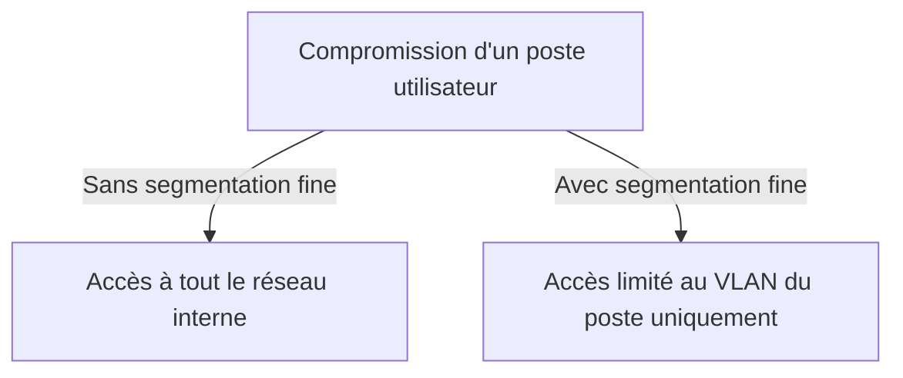
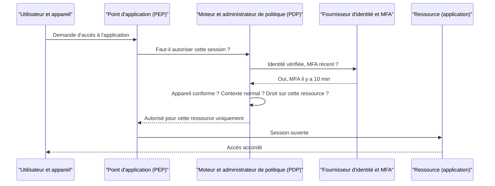

## Introduction

Ce chapitre approfondit la segmentation réseau déjà introduite au cours Administration Systèmes et Réseaux (chapitre 1), en la reliant au modèle plus récent du Zero Trust, une réponse directe au mouvement latéral étudié au cours Cybersécurité Offensive (chapitre 7).

Pourquoi est-ce si important ? Dans la majorité des incidents graves, ransomware compris, la compromission initiale ne touche qu'un poste ou un compte. Ce qui transforme cet incident local en catastrophe, c'est la capacité de l'attaquant à se déplacer ensuite librement : du poste vers les serveurs de fichiers, puis vers l'annuaire, puis vers les sauvegardes. Un réseau plat, où toutes les machines peuvent se parler, offre ce chemin gratuitement. La segmentation et le Zero Trust le coupent.

À la fin de ce chapitre, tu sauras concevoir une segmentation par fonction métier à partir d'une matrice de flux, écrire des règles de filtrage simples, expliquer les composants d'une architecture Zero Trust et argumenter pourquoi ce modèle complique le mouvement latéral.

## Rappel et approfondissement de la segmentation

<CehCallout>
Rappel du cours Administration Systèmes et Réseaux (chapitre 1) : le zonage réseau (DMZ, LAN, zone critique) limite la propagation d'une compromission d'une zone à l'autre — une segmentation plus fine, par VLAN et par fonction métier, réduit encore davantage la surface accessible depuis un point de compromission initial.
</CehCallout>



### Du zonage large à la segmentation par fonction métier

Le zonage large découpe le réseau en quelques grandes zones : Internet, la DMZ qui héberge les services exposés, et le LAN interne. C'est une base nécessaire, mais insuffisante : à l'intérieur du LAN, le poste d'un stagiaire peut souvent joindre directement le serveur de paie.

La segmentation par fonction métier va plus loin. Chaque groupe homogène de machines reçoit son propre segment, en pratique un VLAN, c'est-à-dire un réseau local virtuel identifié par un numéro et isolé au niveau 2 du modèle OSI. Les échanges entre VLAN passent obligatoirement par un équipement de niveau 3, routeur ou pare-feu, qui applique des règles. C'est là que se joue la sécurité : un VLAN sans filtrage entre segments n'est qu'un découpage administratif.

On distingue deux types de trafic. Le trafic **nord-sud** entre et sort du système d'information, par exemple entre Internet et la DMZ. Le trafic **est-ouest** circule à l'intérieur, entre postes et serveurs. Historiquement, les organisations surveillaient surtout le nord-sud ; or le mouvement latéral est, par définition, un trafic est-ouest.

### Construire une matrice de flux

Avant d'écrire une seule règle, le défenseur établit une matrice de flux : quels segments ont besoin de parler à quels autres, sur quels ports et pour quelle raison métier. Tout ce qui n'est pas dans la matrice est interdit par défaut.

Prenons une entreprise avec un service comptabilité, un service développement et une zone serveurs critiques.

| Source | Destination | Protocole et port | Justification |
| --- | --- | --- | --- |
| VLAN 10 Comptabilité | Serveur ERP (VLAN 30) | HTTPS 443 | Accès à l'application de gestion |
| VLAN 20 Développement | Forge Git (VLAN 40) | HTTPS 443, SSH 22 | Dépôt de code |
| VLAN 10 et 20 | Contrôleurs de domaine (VLAN 30) | Kerberos 88, LDAP 389, DNS 53, SMB 445 | Authentification et stratégies de groupe |
| VLAN 99 Administration | Tous les serveurs | SSH 22, RDP 3389, WinRM 5985-5986 | Administration depuis les postes dédiés uniquement |
| VLAN 20 Développement | VLAN 10 Comptabilité | Aucun | Aucun besoin métier |
| Tous les postes | Postes des autres VLAN | Aucun | Les postes n'ont pas à se parler entre eux |

Ce tableau répond déjà à une question clé : si un poste du service développement est compromis, l'attaquant ne peut pas atteindre directement la comptabilité, ni administrer les serveurs, car les protocoles d'administration ne sont accessibles que depuis le VLAN 99. Il lui reste les flux d'authentification vers les contrôleurs de domaine, qui doivent donc être particulièrement surveillés.

### Mettre en œuvre le filtrage

Sur un pare-feu Linux, la traduction en règles nftables ressemble à ceci. Le principe est une politique par défaut de refus, puis des autorisations explicites.

```bash
# /etc/nftables.d/inter-vlan.nft — extrait, sur le pare-feu qui route entre VLAN
table inet filtrage {
  chain forward {
    type filter hook forward priority 0; policy drop;   # tout est refusé par défaut

    ct state established,related accept                  # réponses aux connexions autorisées
    ct state invalid drop

    # Comptabilité vers ERP en HTTPS uniquement
    iifname "vlan10" ip daddr 10.0.30.20 tcp dport 443 accept
    # Développement vers la forge Git
    iifname "vlan20" ip daddr 10.0.40.10 tcp dport { 22, 443 } accept
    # Administration depuis le VLAN dédié seulement
    iifname "vlan99" tcp dport { 22, 3389, 5985, 5986 } accept

    # Journaliser les refus pour la détection (chapitre 5)
    log prefix "INTERVLAN-DROP " limit rate 10/second
  }
}
```

```bash
sudo nft -c -f /etc/nftables.d/inter-vlan.nft   # -c : vérifie sans appliquer
sudo nft -f /etc/nftables.d/inter-vlan.nft
sudo nft list chain inet filtrage forward
```

La ligne de journalisation est essentielle : un refus inter-VLAN répété depuis un poste est un indicateur précieux de reconnaissance interne. La segmentation devient ainsi à la fois une couche préventive et une source de détection.

### Micro-segmentation et pare-feu hôte

La micro-segmentation pousse la logique jusqu'à la machine individuelle, voire jusqu'à la charge de travail. Au lieu de filtrer entre VLAN, on filtre autour de chaque serveur ou de chaque conteneur. Elle se met en œuvre avec les pare-feu hôtes, Windows Defender Firewall ou nftables, avec les groupes de sécurité des fournisseurs cloud, ou avec les politiques réseau dans Kubernetes.

Une mesure simple et très efficace consiste à bloquer, sur le pare-feu hôte des postes de travail, les connexions entrantes SMB, RDP et WinRM provenant d'autres postes. Un poste utilisateur n'a quasiment jamais besoin d'accepter ces connexions depuis un autre poste, et ce sont précisément les canaux du mouvement latéral.

## Le principe du Zero Trust

<CehCallout>
Le modèle Zero Trust part d'un principe radical : ne jamais faire confiance implicitement à un utilisateur ou un appareil du seul fait qu'il se trouve à l'intérieur du réseau interne — chaque accès doit être vérifié explicitement, indépendamment de sa localisation réseau, contrairement au modèle traditionnel de « château fort » qui fait confiance à tout ce qui a franchi le périmètre.
</CehCallout>

<CompareTable
  titleA="Modèle traditionnel (château fort)"
  titleB="Zero Trust"
  rows={[
    { a: "Confiance implicite une fois à l'intérieur du réseau", b: "Vérification explicite à chaque accès, quelle que soit la localisation" },
    { a: "Périmètre unique fortement défendu", b: "Micro-segmentation avec vérification à chaque frontière" },
    { a: "Un attaquant ayant franchi le périmètre se déplace librement", b: "Un attaquant ayant compromis un point doit re-authentifier à chaque nouvelle ressource" },
]}
/>

Le Zero Trust n'est pas un produit qu'on achète, c'est une stratégie. Le terme a été popularisé par le cabinet Forrester au début des années 2010, puis formalisé par le NIST dans la publication SP 800-207, *Zero Trust Architecture*, parue en 2020. Ses principes peuvent se résumer en trois idées : vérifier explicitement chaque demande, accorder le moindre privilège pour la durée la plus courte, et partir de l'hypothèse que la compromission a déjà eu lieu, ce qu'on appelle en anglais *assume breach*.

### L'architecture de référence du NIST

Le NIST SP 800-207 décrit trois composants logiques. Le **moteur de politique**, ou *Policy Engine*, prend la décision d'autoriser ou non un accès en combinant l'identité, l'état de l'appareil, le contexte et la sensibilité de la ressource. L'**administrateur de politique**, ou *Policy Administrator*, traduit cette décision en actions, par exemple en ouvrant une session. Le **point d'application de la politique**, ou *Policy Enforcement Point*, se place devant la ressource et laisse passer ou bloque la connexion.



Le point essentiel est que la décision est prise **par ressource et par session**. Être authentifié pour la messagerie ne donne aucun droit implicite sur le serveur de fichiers.

### Les piliers du modèle de maturité de la CISA

L'agence américaine CISA a publié en 2023 la version 2.0 de son *Zero Trust Maturity Model*. Il organise la démarche en cinq piliers, identité, appareils, réseaux, applications et charges de travail, données, et trois capacités transverses : la visibilité et l'analyse, l'automatisation et l'orchestration, la gouvernance. Chaque pilier progresse sur quatre stades : traditionnel, initial, avancé et optimal. Ce modèle est utile pour se situer honnêtement : la plupart des organisations sont « avancées » sur l'identité grâce au MFA et « traditionnelles » sur le réseau.

### VPN traditionnel et ZTNA

Le VPN traditionnel illustre bien la différence de philosophie. Une fois connecté, l'utilisateur obtient une adresse dans le réseau interne et peut, sauf filtrage additionnel, joindre de nombreuses machines. Le ZTNA, *Zero Trust Network Access*, publie au contraire chaque application individuellement : l'utilisateur ne voit que les applications auxquelles il a droit, après vérification de son identité et de son appareil, et jamais le réseau sous-jacent. Les concentrateurs VPN exposés sur Internet ont en outre été parmi les équipements les plus exploités ces dernières années, ce qui pousse de nombreuses organisations vers ce modèle.

## Pourquoi le Zero Trust répond directement au mouvement latéral

<WarningCallout>
Rappel du cours Cybersécurité Offensive (chapitre 7) : le mouvement latéral exploite précisément la confiance implicite accordée à un compte ou un poste une fois à l'intérieur du réseau — un modèle Zero Trust correctement implémenté exige une nouvelle vérification à chaque tentative d'accès à une ressource différente, rendant le mouvement latéral considérablement plus difficile même après une compromission initiale.
</WarningCallout>

Conceptuellement, le mouvement latéral repose sur trois conditions : une connectivité réseau entre la machine compromise et la cible, des identifiants valides sur la cible, et l'absence de vérification supplémentaire au moment de la connexion. La segmentation supprime la première condition, le moindre privilège et le tiering du chapitre 4 réduisent la deuxième, et le Zero Trust attaque la troisième en exigeant une vérification contextuelle à chaque accès.

<Steps steps={[
  { title: "Vérifier l'identité à chaque accès", description: "Rappel du cours Administration Systèmes et Réseaux (chapitre 7, IAM) : authentification forte systématique, pas seulement à la connexion initiale." },
  { title: "Vérifier le contexte de l'appareil", description: "L'appareil est-il à jour, conforme aux politiques de sécurité de l'organisation, avant d'accorder l'accès ?" },
  { title: "Limiter chaque accès au strict nécessaire", description: "Rappel du principe du moindre privilège (cours Administration Systèmes et Réseaux, chapitre 7)." },
]} />

<AttackDefenseTable rows={[
  { phase: "Reconnaissance interne", attack: "L'attaquant cartographie les machines joignables depuis le poste compromis", defense: "Segmentation par fonction, refus par défaut, journalisation des refus inter-VLAN" },
  { phase: "Connexion à distance", attack: "Réutilisation d'identifiants valides via des protocoles d'administration", defense: "Protocoles d'administration réservés au VLAN d'administration, pare-feu hôte bloquant les connexions poste à poste" },
  { phase: "Accès aux applications", attack: "Un compte authentifié tente d'atteindre une application sensible", defense: "ZTNA par application, vérification de l'appareil et MFA contextuel à chaque session" },
  { phase: "Persistance réseau", attack: "Maintien d'un canal de communication sortant vers l'extérieur", defense: "Filtrage sortant, proxy authentifié, détection des connexions sortantes inhabituelles" }
]} />

### Détecter les tentatives de mouvement latéral

La segmentation produit des signaux exploitables par le SOC. Un refus inter-VLAN répété depuis un même poste, une connexion RDP ou SMB entre deux postes de travail, ou un compte utilisateur standard qui s'authentifie en réseau sur de nombreuses machines en peu de temps sont des anomalies fortes. Sous Windows, l'événement 4624 avec un type de connexion 3, c'est-à-dire réseau, ou 10, c'est-à-dire bureau à distance, entre deux postes de travail mérite une attention particulière. Le chapitre 5 montre comment transformer ces observations en règles de détection.

<AuditCallout>
Dans l'ISO/IEC 27001:2022, la segmentation relève du contrôle A.8.22 sur la séparation des réseaux, complété par A.8.20 sur la sécurité des réseaux et A.8.21 sur la sécurité des services réseau. La directive NIS2 cite explicitement la sécurité des réseaux et le contrôle d'accès parmi les mesures attendues. Un auditeur demandera la matrice de flux, sa justification métier et la preuve qu'elle est revue régulièrement.
</AuditCallout>

## Erreurs fréquentes

La première erreur est de **créer des VLAN sans filtrage entre eux**. Si le routeur laisse tout passer entre segments, le découpage n'apporte aucune protection.

La deuxième est de **laisser des règles « any to any » temporaires** qui deviennent permanentes. Chaque règle doit avoir un propriétaire, une justification et une date de revue.

La troisième est de **présenter le Zero Trust comme un produit**. Un fournisseur de ZTNA règle l'accès aux applications, mais sans gestion des identités, inventaire des appareils et classification des données, la stratégie reste incomplète.

La quatrième est d'**oublier les flux vers les contrôleurs de domaine et les outils d'administration**. Ce sont souvent les seuls flux autorisés depuis tous les segments, donc les plus surveillés par un attaquant et ceux qui doivent l'être le plus par le défenseur.

La cinquième est de **segmenter sans journaliser**. Un refus non journalisé protège, mais ne t'apprend rien sur la tentative.

## Lab — Mise en pratique

**Environnement** : réflexion guidée, puis terminal Kali pour l'observation et la configuration d'un pare-feu local.

<Steps steps={[
  { title: "Concevoir une segmentation fine", description: "Pour une entreprise avec un service comptabilité, un service développement et une zone serveurs critiques, propose une segmentation VLAN qui limiterait un mouvement latéral en cas de compromission du service développement. Rédige la matrice de flux avec une justification métier pour chaque ligne." },
  { title: "Expliquer l'impact Zero Trust sur une chaîne d'attaque", description: "Rappel du cours Cybersécurité Offensive (chapitre 7) : à quelle étape précise de la chaîne d'attaque AD un modèle Zero Trust correctement implémenté aurait-il pu bloquer la progression de l'attaquant ? Identifie laquelle des trois conditions du mouvement latéral est supprimée." },
  { title: "Observer la connectivité de ta machine", description: "Affiche tes interfaces, tes routes et tes connexions établies. Note quels réseaux ta machine peut joindre : c'est ta surface de mouvement latéral potentielle.", code: "ip -br addr\nip route\nss -tnp state established" },
  { title: "Écrire une politique de refus par défaut", description: "Crée une table nftables de test qui refuse les connexions entrantes sauf SSH et journalise les refus. Vérifie la syntaxe avant d'appliquer, et garde une session ouverte.", code: "sudo nft add table inet labtest\nsudo nft add chain inet labtest input '{ type filter hook input priority 0; policy accept; }'\nsudo nft add rule inet labtest input ct state established,related accept\nsudo nft add rule inet labtest input iif lo accept\nsudo nft add rule inet labtest input tcp dport 22 accept\nsudo nft add rule inet labtest input log prefix \\\"LAB-DROP \\\" drop\nsudo nft list table inet labtest" },
  { title: "Observer les refus journalisés", description: "Depuis une autre machine ou un conteneur du lab, tente une connexion sur un port fermé, puis lis les journaux du noyau. Observe l'adresse source et le port visé.", code: "sudo journalctl -k -g LAB-DROP --since '5 min ago'" },
  { title: "Nettoyer et évaluer ta maturité", description: "Supprime la table de test, puis situe une organisation que tu connais sur les cinq piliers du modèle de maturité Zero Trust de la CISA. Identifie le pilier le plus faible.", code: "sudo nft delete table inet labtest" }
]} />

## À retenir

- La segmentation réseau fine, par VLAN et par fonction métier, limite plus efficacement la propagation d'une compromission qu'un zonage large.
- Un VLAN n'est utile que si le trafic entre segments est filtré selon une matrice de flux en refus par défaut.
- Le Zero Trust remplace la confiance implicite du modèle « château fort » par une vérification explicite à chaque accès, indépendamment de la localisation réseau.
- Le NIST SP 800-207 décrit l'architecture de référence : moteur de politique, administrateur de politique et point d'application.
- Le Zero Trust répond directement au mouvement latéral en exigeant une nouvelle vérification à chaque nouvelle ressource accédée, y compris le contexte de l'appareil.
- Le ZTNA publie des applications plutôt qu'un réseau, contrairement au VPN traditionnel.
- La segmentation est aussi une source de détection : les refus journalisés révèlent la reconnaissance interne.

## Questions de révision

1. Quelle est la différence entre le modèle traditionnel « château fort » et le modèle Zero Trust ?
2. Pourquoi une segmentation VLAN fine limite-t-elle mieux la propagation d'une compromission qu'un zonage large de type DMZ et LAN ?
3. Pourquoi le Zero Trust complique-t-il directement le mouvement latéral étudié côté offensif ?
4. Quels sont les trois composants logiques décrits par le NIST SP 800-207, et quel est le rôle de chacun ?
5. Pourquoi faut-il journaliser les refus de flux entre segments ?
6. En quoi le ZTNA diffère-t-il d'un VPN traditionnel du point de vue de la surface exposée ?
7. Quels flux réseau restent nécessaires depuis presque tous les segments, et pourquoi doivent-ils être surveillés en priorité ?
