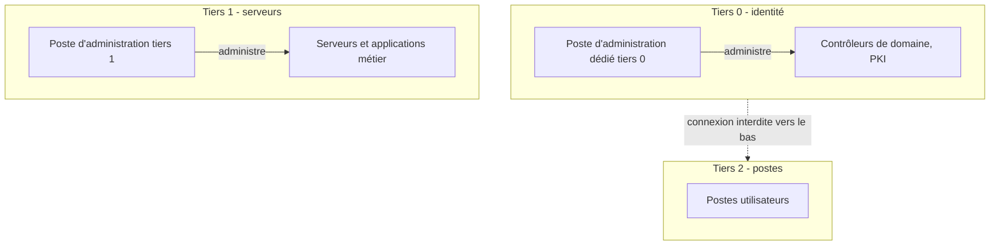

## Introduction

Ce chapitre approfondit la gestion des identités et des accès, ou IAM pour *Identity and Access Management*, déjà introduite au cours Administration Systèmes et Réseaux (chapitre 7). Il se concentre sur les comptes à privilèges élevés, la cible la plus recherchée dans une chaîne d'attaque Active Directory, comme l'a montré le cours Cybersécurité Offensive (chapitre 7).

Pourquoi un chapitre entier ? Parce que l'identité est devenue le nouveau périmètre. Avec le cloud, le télétravail et le Zero Trust vu au chapitre 3, l'accès à une ressource dépend de moins en moins de l'endroit où l'on se trouve et de plus en plus de qui l'on est. Les rapports d'incidents publiés par les grands acteurs de la réponse à incident placent régulièrement l'utilisation d'identifiants valides, la technique MITRE ATT&CK T1078 *Valid Accounts*, parmi les premiers vecteurs d'accès initial. Un attaquant qui se connecte avec un vrai compte ne déclenche ni antivirus ni signature réseau.

À la fin de ce chapitre, tu sauras inventorier les comptes à privilèges, appliquer le moindre privilège et l'élévation Just-In-Time, expliquer le modèle de tiering, déployer Windows LAPS et les comptes de service gérés, et choisir une authentification multifacteur adaptée au niveau de risque.

## Rappel — le principe du moindre privilège en pratique défensive

Le principe du moindre privilège dit qu'une identité, humaine ou technique, ne doit disposer que des droits strictement nécessaires à sa tâche, et seulement pendant le temps nécessaire. Il paraît évident, et pourtant c'est l'un des principes les plus violés, car ajouter un droit résout un problème immédiat alors que retirer un droit risque d'en créer un.

<CehCallout>
Rappel du cours Administration Systèmes et Réseaux (chapitre 7) : le principe du moindre privilège reste l'un des plus violés en pratique — un compte de service disposant de droits d'Administrateur du domaine pour une tâche qui n'en nécessite qu'une infime partie constitue précisément le type de cible privilégiée par le Kerberoasting étudié au cours Active Directory & Windows.
</CehCallout>

### Pourquoi les comptes de service sont si exposés

Un compte de service est un compte utilisé par une application plutôt que par un humain, par exemple pour lancer un service de sauvegarde ou se connecter à une base de données. Ces comptes cumulent souvent trois faiblesses : des droits excessifs accordés « pour que ça marche », un mot de passe qui ne change jamais parce que personne n'ose casser l'application, et l'absence de MFA, puisqu'aucun humain n'est là pour valider.

Conceptuellement, le Kerberoasting exploite le fait que n'importe quel utilisateur du domaine peut demander un ticket de service Kerberos pour un compte doté d'un nom de principal de service, ou SPN. Une partie de ce ticket est chiffrée avec une clé dérivée du mot de passe du compte de service. Si ce mot de passe est faible, il peut être retrouvé hors ligne, sans aucune interaction supplémentaire avec le domaine. Le défenseur en tire trois conclusions : les comptes de service doivent avoir des mots de passe longs et aléatoires, ils ne doivent pas avoir plus de droits que nécessaire, et l'algorithme de chiffrement RC4, plus faible, doit être abandonné au profit d'AES.

### Les comptes de service gérés

La réponse moderne est le compte de service géré de groupe, ou gMSA, *group Managed Service Account*. Son mot de passe de 240 caractères est généré et changé automatiquement par Active Directory, par défaut tous les trente jours, et seuls les serveurs autorisés peuvent le récupérer. Personne ne le connaît, il n'est jamais saisi à la main et il est impossible à deviner.

```powershell
# Prérequis unique par forêt : la clé racine KDS (en production, attendre la réplication)
Add-KdsRootKey -EffectiveImmediately

# Créer un gMSA utilisable uniquement par les serveurs du groupe SRV-Sauvegarde
New-ADServiceAccount -Name gmsa-backup -DNSHostName gmsa-backup.corp.local `
  -PrincipalsAllowedToRetrieveManagedPassword "SRV-Sauvegarde" `
  -KerberosEncryptionType AES128,AES256

# Sur le serveur autorisé : installer et tester le compte
Install-ADServiceAccount -Identity gmsa-backup
Test-ADServiceAccount -Identity gmsa-backup
```

```text
True
```

### Repérer les comptes à risque

Côté défense, il est simple d'inventorier les comptes utilisateurs qui portent un SPN, c'est-à-dire exposés au Kerberoasting, et de vérifier leurs privilèges et l'âge de leur mot de passe.

```powershell
Get-ADUser -Filter 'ServicePrincipalName -like "*"' `
  -Properties ServicePrincipalName, PasswordLastSet, MemberOf, msDS-SupportedEncryptionTypes |
  Select-Object SamAccountName, PasswordLastSet, @{n='Groupes';e={($_.MemberOf -replace '^CN=([^,]+).*','$1') -join ', '}}
```

```text
SamAccountName PasswordLastSet      Groupes
-------------- ---------------      -------
svc-backup     14/03/2017 09:12:44  Admins du domaine
svc-sql        02/06/2025 18:03:10  SQL-Readers
```

La première ligne est un cas d'école : un compte de service membre des Admins du domaine, dont le mot de passe n'a pas changé depuis huit ans. C'est précisément l'exemple du lab de ce chapitre, et la priorité absolue de remédiation.

## La gestion des accès à privilèges (PAM)

La gestion des accès à privilèges, ou PAM pour *Privileged Access Management*, est l'ensemble des processus et outils qui protègent les comptes capables de modifier la configuration du système d'information : administrateurs de domaine, administrateurs locaux, administrateurs du cloud, comptes root, comptes de service sensibles.

<Steps steps={[
  { title: "Inventorier tous les comptes à privilèges", description: "Un compte à privilèges oublié ou non documenté ne peut pas être correctement protégé." },
  { title: "Limiter la durée des privilèges élevés", description: "L'élévation de privilège temporaire (Just-In-Time), accordée uniquement pour la durée d'une tâche précise, réduit la fenêtre d'exposition par rapport à un accès permanent." },
  { title: "Isoler les postes d'administration", description: "Un administrateur ne devrait jamais utiliser le même poste pour naviguer sur Internet et pour administrer des systèmes critiques — rappel du modèle de tiering (cours Active Directory, chapitre 8)." },
  { title: "Faire tourner régulièrement les mots de passe à privilèges", description: "Rappel du cours Active Directory & Windows : LAPS (Local Administrator Password Solution) automatise cette rotation pour les comptes administrateurs locaux." },
]} />

### L'élévation Just-In-Time

Avec un accès permanent, un administrateur est membre du groupe des Admins du domaine vingt-quatre heures sur vingt-quatre, même quand il dort. Si son compte est compromis à trois heures du matin, l'attaquant obtient immédiatement ces privilèges. Avec l'élévation Just-In-Time, ou JIT, l'administrateur dispose d'un compte sans privilège par défaut ; lorsqu'il a besoin d'intervenir, il demande une élévation, souvent validée par un tiers et protégée par MFA, pour une durée limitée, par exemple deux heures, à l'issue de laquelle le droit disparaît automatiquement.

Faisons un calcul simple. Un administrateur qui a besoin de ses privilèges environ dix heures par mois les détient, en accès permanent, environ 730 heures par mois. Le JIT réduit donc la fenêtre d'exposition d'un facteur supérieur à 70. On trouve cette logique dans Microsoft Entra Privileged Identity Management, dans les bastions des solutions PAM commerciales, et, de façon plus simple, dans les appartenances temporaires aux groupes d'Active Directory, disponibles lorsque la fonctionnalité PAM de la forêt est activée.

Le complément du JIT est le JEA, *Just Enough Administration* : au lieu de donner des droits d'administration complets, on n'autorise que les commandes nécessaires. PowerShell JEA permet par exemple à un technicien de redémarrer un service précis sans pouvoir faire quoi que ce soit d'autre sur le serveur. Sous Linux, une règle `sudo` restreinte à une commande joue un rôle comparable.

### Le modèle de tiering et les postes d'administration

Le modèle de tiering découpe les actifs en niveaux de sensibilité. Le **tiers 0** regroupe ce qui contrôle l'identité de toute l'entreprise : contrôleurs de domaine, serveurs de certificats, outils de synchronisation d'identité, et les comptes qui les administrent. Le **tiers 1** regroupe les serveurs et applications métier. Le **tiers 2** regroupe les postes de travail des utilisateurs.

La règle fondamentale est qu'un compte d'un niveau supérieur ne doit jamais se connecter à une machine d'un niveau inférieur. Pourquoi ? Parce que lorsqu'un administrateur ouvre une session interactive sur une machine, des éléments d'authentification réutilisables restent en mémoire sur cette machine. Si le poste est compromis, ces éléments peuvent être volés. Un administrateur de domaine qui dépanne un poste utilisateur offre ses identifiants de tiers 0 à quiconque contrôle déjà ce poste.



Les postes d'administration dédiés, appelés PAW pour *Privileged Access Workstation*, matérialisent cette règle : un poste durci, sans messagerie ni navigation Internet, réservé à l'administration. Microsoft a fait évoluer ce modèle vers l'*Enterprise Access Model*, qui étend la même logique au cloud et distingue plan de contrôle, plan de gestion et plan de données, mais le principe de cloisonnement reste identique.

Le groupe **Protected Users** d'Active Directory renforce ce dispositif pour les comptes sensibles : ses membres ne peuvent plus utiliser NTLM, ni la délégation Kerberos, ni RC4, et leurs informations d'identification ne sont plus mises en cache de la même façon sur les machines.

### Windows LAPS et le Pass-the-Hash

Conceptuellement, le Pass-the-Hash consiste à s'authentifier avec l'empreinte NTLM d'un mot de passe plutôt qu'avec le mot de passe lui-même. Si toutes les machines d'un parc partagent le même mot de passe administrateur local, ce qui était très courant quand les postes étaient clonés à partir d'une même image, l'empreinte volée sur un seul poste ouvre la porte à tous les autres.

LAPS, *Local Administrator Password Solution*, casse ce scénario de deux façons complémentaires. D'abord, chaque machine reçoit un mot de passe administrateur local **unique** et aléatoire, ce qui rend une empreinte volée inutilisable ailleurs. Ensuite, ce mot de passe **tourne régulièrement et automatiquement**, ce qui limite la durée de vie d'une empreinte volée, y compris sur la machine d'origine. Depuis avril 2023, Windows LAPS est intégré nativement à Windows 10, Windows 11 et Windows Server ; il remplace l'ancien LAPS à installer séparément, désormais considéré comme hérité. Il peut stocker les mots de passe dans Active Directory, chiffrés, ou dans Microsoft Entra ID.

```powershell
# Préparer le schéma et autoriser les ordinateurs d'une OU à mettre à jour leur mot de passe
Update-LapsADSchema
Set-LapsADComputerSelfPermission -Identity "OU=Postes,DC=corp,DC=local"

# Lire le mot de passe géré d'un poste (réservé aux administrateurs autorisés)
Get-LapsADPassword -Identity PC-COMPTA-07 -AsPlainText

# Forcer une rotation immédiate, par exemple après un incident
Reset-LapsPassword
```

```text
ComputerName        : PC-COMPTA-07
DistinguishedName   : CN=PC-COMPTA-07,OU=Postes,DC=corp,DC=local
Account             : Administrator
Password            : 9vR!t2kQ#mZ7pLx4wE
PasswordUpdateTime  : 05/11/2026 08:14:02
ExpirationTimestamp : 05/12/2026 08:14:02
Source              : EncryptedPassword
DecryptionStatus    : Success
AuthorizedDecryptor : CORP\LAPS-Readers
```

<CehCallout>
Rappel direct du cours Active Directory & Windows (chapitre 8) : le modèle de tiering et LAPS sont deux mesures de durcissement spécifiquement conçues pour contrer le Pass-the-Hash et le mouvement latéral étudiés côté offensif — chaque mesure PAM répond à une technique d'attaque précise, pas à une menace abstraite.
</CehCallout>

### Visualiser les chemins d'attaque côté défense

Les défenseurs utilisent aujourd'hui les mêmes outils d'analyse de graphe que les auditeurs. BloodHound Community Edition, maintenu par SpecterOps, représente l'Active Directory sous forme de graphe et révèle les chemins par lesquels un compte ordinaire pourrait atteindre le tiers 0 à travers une succession d'appartenances à des groupes, de sessions et de délégations. PingCastle produit de son côté un rapport de santé de l'annuaire avec un score de risque. Utilisés régulièrement, et uniquement sur ton propre périmètre ou avec autorisation, ces outils permettent de couper les chemins les plus courts avant qu'un attaquant ne les trouve.

## L'authentification multifacteur, rappel et approfondissement

L'authentification multifacteur combine au moins deux facteurs de nature différente : ce que tu sais, comme un mot de passe, ce que tu possèdes, comme une clé physique ou un téléphone, et ce que tu es, comme une empreinte digitale. Tous les MFA ne se valent pas.

<CompareTable
  titleA="Rappel (cours Administration Systèmes et Réseaux, ch.7)"
  titleB="Application défensive avancée"
  rows={[
    { a: "MFA par SMS vulnérable au SIM swapping", b: "Privilégier les clés FIDO2 pour tous les comptes à privilèges élevés, sans exception" },
    { a: "MFA à la connexion initiale", b: "MFA également ré-exigé pour toute action sensible (changement de mot de passe, élévation temporaire)" },
]}
/>

### Classer les méthodes par résistance

| Méthode | Principale faiblesse | Usage recommandé |
| --- | --- | --- |
| SMS ou appel vocal | SIM swapping, interception, hameçonnage du code | À éviter, sauf en dernier recours |
| Code à usage unique (TOTP) | Le code peut être saisi sur un faux site relais | Utilisateurs standards, faute de mieux |
| Notification push simple | Fatigue MFA : l'utilisateur finit par accepter une demande non sollicitée | Avec correspondance de nombre et contexte affiché |
| Clé FIDO2 ou passkey | Résistante à l'hameçonnage, car liée cryptographiquement au domaine du site | Comptes à privilèges, puis généralisation |
| Windows Hello for Business, carte à puce | Résistantes à l'hameçonnage | Postes gérés, administrateurs |

Le SIM swapping consiste à convaincre un opérateur de transférer le numéro de la victime sur une nouvelle carte SIM, ce qui détourne les SMS. Les kits d'hameçonnage dits « adversary-in-the-middle » vont plus loin : ils se placent entre l'utilisateur et le vrai site, relaient le mot de passe et le code à usage unique, puis récupèrent le cookie de session. Seules les méthodes liées cryptographiquement au domaine, FIDO2 et passkeys en tête, résistent à ce scénario, car la clé refuse de signer pour un domaine qui n'est pas le bon.

### Le MFA ne s'arrête pas à la connexion

<WarningCallout>
Un MFA appliqué uniquement à la connexion initiale, mais jamais aux actions sensibles ultérieures (changement de configuration critique, accès à des données très sensibles), laisse une fenêtre d'exploitation à un attaquant ayant compromis une session déjà authentifiée — un principe qui rejoint le Zero Trust du chapitre 3 : vérifier à chaque action sensible, pas seulement à l'entrée.
</WarningCallout>

Les politiques d'accès conditionnel des fournisseurs d'identité permettent de mettre ce principe en œuvre : exiger une nouvelle authentification forte avant une élévation de privilège, l'enregistrement d'une nouvelle méthode MFA ou l'accès à une application sensible, et refuser l'accès depuis un appareil non conforme. Sur Linux, l'équivalent consiste par exemple à exiger une réauthentification pour `sudo` avec un délai court plutôt qu'un cache long.

<AttackDefenseTable rows={[
  { phase: "Vol d'identifiants", attack: "Hameçonnage du mot de passe et du code à usage unique via un site relais", defense: "FIDO2 ou passkeys, accès conditionnel exigeant un appareil conforme" },
  { phase: "Fatigue MFA", attack: "Envoi répété de notifications jusqu'à acceptation", defense: "Correspondance de nombre, limitation des demandes, alerte SOC sur les refus répétés" },
  { phase: "Kerberoasting", attack: "Récupération hors ligne du mot de passe faible d'un compte de service", defense: "gMSA, AES uniquement, droits minimaux, alerte sur les demandes de tickets RC4 (événement 4769)" },
  { phase: "Pass-the-Hash", attack: "Réutilisation d'une empreinte NTLM d'administrateur local sur d'autres machines", defense: "Windows LAPS, tiering, Protected Users, Credential Guard" },
  { phase: "Persistance par les groupes", attack: "Ajout discret d'un compte dans un groupe privilégié", defense: "Alerte sur les événements 4728, 4732 et 4756, revue régulière des membres" }
]} />

### Le cycle de vie des identités

Une identité naît, évolue et disparaît : c'est le cycle dit *Joiner, Mover, Leaver*. À l'arrivée, les droits sont accordés selon le rôle. Lors d'une mobilité interne, les anciens droits doivent être retirés, sinon l'utilisateur accumule des privilèges au fil des années. Au départ, le compte doit être désactivé le jour même. Les revues d'accès périodiques, où chaque responsable confirme les droits de son équipe, rattrapent les oublis.

<AuditCallout>
Dans l'ISO/IEC 27001:2022, ces sujets relèvent des contrôles A.5.15 sur le contrôle d'accès, A.5.16 sur la gestion des identités, A.5.17 sur les informations d'authentification, A.5.18 sur les droits d'accès, A.8.2 sur les droits d'accès privilégiés et A.8.5 sur l'authentification sécurisée. PCI DSS 4.0.1 exige le MFA pour tout accès à l'environnement des données de carte, et NIS2 cite explicitement l'authentification multifacteur parmi les mesures attendues.
</AuditCallout>

## Erreurs fréquentes

La première erreur est de **laisser les administrateurs utiliser un seul compte** pour leur messagerie et pour l'administration. Un administrateur doit disposer d'un compte standard pour son travail quotidien et d'un compte distinct, sans messagerie, pour l'administration.

La deuxième est d'**exclure les comptes de service du MFA sans compensation**. Si le MFA est impossible, il faut compenser : gMSA, restriction des machines autorisées, surveillance renforcée.

La troisième est de **considérer tout MFA comme équivalent**. Un SMS sur un compte d'administration cloud est aujourd'hui un risque connu.

La quatrième est de **déployer LAPS sans restreindre la lecture des mots de passe**. Si tous les techniciens peuvent lire tous les mots de passe, on a simplement déplacé le problème.

La cinquième est d'**oublier les comptes dormants** : anciens prestataires, comptes de test, comptes d'urgence jamais vérifiés. Le compte d'urgence, dit « bris de glace », est légitime, mais il doit être surveillé et testé.

## Lab — Mise en pratique

**Environnement** : terminal Kali pour la partie Linux ; un Active Directory de laboratoire pour la partie Windows, si tu en disposes.

<Steps steps={[
  { title: "Identifier un compte à risque", description: "Un compte de service dispose des droits d'Administrateur du domaine pour une tâche de sauvegarde qui ne nécessite qu'un accès en lecture à un dossier partagé. Quelle mesure PAM corrigerait directement ce risque ? Propose un plan en trois actions, en incluant la migration vers un gMSA." },
  { title: "Relier une mesure à une technique offensive", description: "En quoi LAPS (rotation automatique des mots de passe administrateur locaux) contre-t-il directement le Pass-the-Hash étudié au cours Active Directory & Windows ? Distingue le rôle de l'unicité du mot de passe et celui de sa rotation." },
  { title: "Inventorier les privilèges sous Linux", description: "Liste les membres des groupes d'administration et les règles sudo. Chaque entrée doit correspondre à un besoin réel.", code: "getent group sudo wheel adm\nsudo grep -rEv '^(#|$)' /etc/sudoers /etc/sudoers.d/\nsudo -l" },
  { title: "Repérer les comptes dormants", description: "Affiche les dernières connexions (lastlog2 remplace lastlog sur les distributions récentes, sinon utilise last) et les comptes disposant d'un shell. Un compte humain jamais connecté ou inactif depuis des mois doit être justifié ou désactivé.", code: "lastlog2 2>/dev/null || last -n 20\nsudo awk -F: '$7 !~ /(nologin|false)$/ {print $1, $7}' /etc/passwd" },
  { title: "Inventorier les comptes à SPN dans un AD de lab", description: "Liste les comptes utilisateurs portant un SPN, leurs groupes et l'âge de leur mot de passe. Classe-les par risque.", code: "Get-ADUser -Filter 'ServicePrincipalName -like \"*\"' -Properties PasswordLastSet, MemberOf | Select-Object SamAccountName, PasswordLastSet, MemberOf" },
  { title: "Auditer les groupes privilégiés", description: "Liste récursivement les membres des Admins du domaine. Compare avec la liste théorique : tout écart est un constat.", code: "Get-ADGroupMember -Identity 'Domain Admins' -Recursive | Select-Object SamAccountName, objectClass" },
  { title: "Choisir un MFA par population", description: "Pour trois populations, administrateurs du cloud, comptables, techniciens de maintenance sur le terrain, choisis une méthode MFA et justifie ton choix avec le tableau du chapitre." }
]} />

## À retenir

- La gestion des accès à privilèges (PAM) inventorie, limite dans le temps et isole les comptes et postes à privilèges élevés.
- L'élévation Just-In-Time accorde un privilège élevé uniquement pour la durée d'une tâche précise, ce qui réduit fortement la fenêtre d'exposition.
- Le modèle de tiering et LAPS, déjà vus au cours Active Directory & Windows, contrent directement le Pass-the-Hash et le mouvement latéral.
- Windows LAPS, natif depuis 2023, rend chaque mot de passe administrateur local unique et le fait tourner automatiquement.
- Les comptes de service à droits excessifs sont la cible du Kerberoasting : gMSA, AES et moindre privilège sont la réponse.
- Le MFA doit être résistant à l'hameçonnage pour les comptes sensibles, avec FIDO2 plutôt que le SMS vulnérable au SIM swapping.
- Le MFA doit s'appliquer non seulement à la connexion initiale, mais aussi aux actions sensibles ultérieures, dans l'esprit du Zero Trust.

## Questions de révision

1. Pourquoi l'élévation de privilège Just-In-Time réduit-elle le risque par rapport à un accès permanent ?
2. Comment le modèle de tiering et LAPS contrent-ils directement le Pass-the-Hash ?
3. Pourquoi le MFA ne devrait-il pas s'appliquer uniquement à la connexion initiale ?
4. Pourquoi un compte de service à mot de passe ancien et membre des Admins du domaine est-il une cible prioritaire, et comment le corriger ?
5. Explique pourquoi une clé FIDO2 résiste à un site d'hameçonnage relais alors qu'un code à usage unique n'y résiste pas.
6. Quelle règle fondamentale du modèle de tiering empêche un administrateur de domaine de dépanner un poste utilisateur avec son compte privilégié ?
7. Quels événements Windows surveillerais-tu pour détecter l'ajout d'un compte dans un groupe privilégié ?
