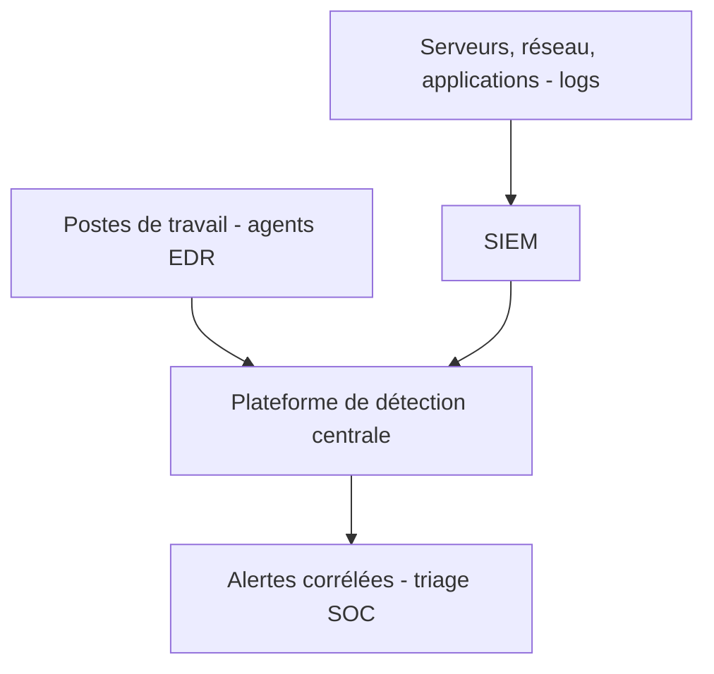

## Introduction

Ce chapitre met en pratique la couche de détection de la défense en profondeur (chapitre 1), en réunissant le SIEM déjà détaillé au cours Analyse SOC (chapitre 3) avec l'EDR, *Endpoint Detection and Response*, un complément indispensable au niveau du poste de travail.

Pourquoi la détection est-elle si centrale ? Parce que la prévention finit toujours par échouer quelque part. Les chapitres 2 à 4 ont rendu l'attaque plus difficile ; ce chapitre s'assure que, lorsqu'elle réussit malgré tout, elle soit vue rapidement. La durée pendant laquelle un attaquant reste présent sans être détecté, appelée *dwell time*, est directement liée à l'ampleur des dégâts : un ransomware détecté pendant la phase de reconnaissance interne est un incident maîtrisable ; détecté au moment du chiffrement, c'est une crise.

À la fin de ce chapitre, tu sauras expliquer ce que voient et ne voient pas un SIEM, un EDR et une sonde réseau, configurer les journaux qui comptent vraiment, écrire une règle de détection au format Sigma, et mesurer ta couverture avec MITRE ATT&CK.

## SIEM et EDR — deux niveaux de détection complémentaires

Le **SIEM**, *Security Information and Event Management*, collecte les journaux de nombreuses sources, les normalise dans un format commun, les conserve et les corrèle pour produire des alertes. Sa force est la vue d'ensemble : il peut relier une connexion VPN, une authentification sur un serveur et un accès à un partage, même si ces événements viennent de trois systèmes différents.

L'**EDR** est un agent installé sur chaque poste et serveur. Il observe en continu l'activité locale : création de processus, lignes de commande, accès mémoire, modifications du registre, connexions réseau par processus. Il peut aussi agir, par exemple en tuant un processus ou en isolant la machine du réseau.

<CompareTable
  titleA="SIEM (cours Analyse SOC, ch.3)"
  titleB="EDR"
  rows={[
    { a: "Corrèle des logs de sources multiples à l'échelle du SI", b: "Surveille en détail le comportement d'un poste ou serveur individuel" },
    { a: "Vue d'ensemble, détecte des motifs entre systèmes", b: "Vue en profondeur, détecte un comportement suspect au niveau processus" },
    { a: "Dépend de la qualité des logs remontés", b: "Observe directement l'activité (appels système, injections mémoire) sans dépendre des logs" },
]}
/>

<CehCallout>
Rappel du cours Forensics & DFIR (chapitre 3, analyse mémoire) : un EDR peut détecter en temps réel une injection de processus ou un comportement mémoire suspect, exactement le type d'indicateur qu'un analyste DFIR recherche manuellement après coup avec Volatility — l'EDR automatise et accélère cette détection.
</CehCallout>

### Les autres briques : NDR et XDR

Deux autres familles complètent le tableau. Le **NDR**, *Network Detection and Response*, analyse le trafic réseau lui-même, généralement à partir d'une copie du trafic. Il voit ce que ni l'EDR ni les journaux ne voient : les équipements sans agent, comme les imprimantes ou les caméras, les communications régulières vers un serveur de commande, ou les volumes d'exfiltration. Les outils libres de référence sont Zeek, qui produit des journaux de connexions très riches, et Suricata, qui combine détection par signatures et extraction de métadonnées.

Le **XDR**, *Extended Detection and Response*, est une approche commerciale qui unifie dans une même plateforme les données de l'EDR, de la messagerie, de l'identité, du cloud et parfois du réseau. Ce n'est pas une rupture technique, mais une intégration plus poussée ; il ne remplace pas la réflexion sur les sources de données décrite plus bas.

| Outil | Ce qu'il voit bien | Ses angles morts |
| --- | --- | --- |
| SIEM | Corrélation entre systèmes, authentifications, historique long | Ce qui n'est pas journalisé ; le détail mémoire d'un poste |
| EDR | Processus, lignes de commande, mémoire, actions locales | Machines sans agent ; vue globale entre systèmes |
| NDR | Trafic de toutes les machines, y compris sans agent | Contenu chiffré ; actions purement locales |
| Journaux d'identité | Connexions, MFA, accès conditionnel, changements de droits | Ce qui se passe après l'authentification sur la machine |

## Relier chaque outil à un vecteur d'attaque étudié

<Steps steps={[
  { title: "SIEM détecte le bruteforce réussi", description: "Rappel du cours Analyse SOC (chapitre 3) : corrélation Event ID 4625 répétés puis 4624 sur le même compte." },
  { title: "EDR détecte l'exécution de LinPEAS/WinPEAS", description: "Rappel du cours Cybersécurité Offensive (chapitre 6) : un comportement d'énumération intensive de fichiers système est un motif détectable par un EDR comportemental." },
  { title: "SIEM détecte la création de tâche planifiée suspecte", description: "Rappel du cours Cybersécurité Offensive (chapitre 8) : Event ID 4698, corrélé avec un compte n'en créant habituellement jamais." },
  { title: "EDR détecte l'injection de processus", description: "Rappel du cours IA & Agents en Cybersécurité (chapitre 2) : un comportement mémoire anormal, similaire à ce que révèle malfind en analyse forensique manuelle." },
]} />

Prenons ces quatre cas sous l'angle du mécanisme. Le **bruteforce**, technique ATT&CK T1110, produit une série d'échecs d'authentification, événement 4625, puis éventuellement un succès, événement 4624, sur le même compte. Un seul système ne suffit pas à juger : c'est la corrélation dans le temps, sur plusieurs événements, qui fait l'alerte. C'est donc typiquement un travail de SIEM.

Les scripts d'**énumération** comme LinPEAS ou WinPEAS lisent en quelques secondes des centaines de fichiers de configuration, listent les services, les droits et les binaires SUID. Ce comportement en rafale, lancé depuis un shell inhabituel, est très visible pour un agent qui observe les processus et les accès fichiers, c'est-à-dire un EDR.

La **tâche planifiée**, technique T1053.005, est un mécanisme de persistance classique. L'événement 4698 est produit à chaque création ; il devient suspect lorsqu'il est associé à un compte qui n'en crée jamais, ou à une commande encodée. C'est une règle SIEM qui s'appuie sur l'historique.

L'**injection de processus**, technique T1055, consiste à faire exécuter du code dans l'espace mémoire d'un autre processus légitime pour s'y cacher. Elle ne laisse quasiment aucune trace dans les journaux classiques, mais elle est observable par un EDR qui surveille les accès mémoire inter-processus.

## Les sources de journaux qui comptent

Un SIEM ne vaut que par ce qu'il reçoit. Trop d'organisations collectent des volumes énormes de journaux inutiles et ratent les quelques événements décisifs.

### Windows : stratégie d'audit et Sysmon

Par défaut, Windows ne journalise pas tout ce dont un défenseur a besoin. La stratégie d'audit avancée doit être configurée par GPO, en particulier la création de processus avec la ligne de commande complète, l'événement 4688.

```powershell
# Vérifier quelques catégories d'audit
auditpol /get /subcategory:"Process Creation","Logon","Other Object Access Events"

# Activer l'audit de création de processus (succès)
auditpol /set /subcategory:"Process Creation" /success:enable
```

```text
System audit policy
Category/Subcategory                      Setting
Detailed Tracking
  Process Creation                        Success
Logon/Logoff
  Logon                                   Success and Failure
Object Access
  Other Object Access Events              Success and Failure
```

La ligne de commande s'active séparément, par la stratégie « Inclure la ligne de commande dans les événements de création de processus ». La sous-catégorie *Other Object Access Events* est celle qui produit l'événement 4698 sur les tâches planifiées.

Sysmon, de la suite Sysinternals de Microsoft, enrichit considérablement la télémétrie gratuite d'un poste. Ses événements les plus utiles sont l'événement 1 pour la création de processus avec empreinte du binaire et processus parent, l'événement 3 pour les connexions réseau par processus, l'événement 10 pour l'accès d'un processus à un autre, utile pour repérer la lecture de la mémoire de LSASS, l'événement 11 pour la création de fichiers, l'événement 13 pour les modifications du registre et l'événement 22 pour les requêtes DNS. Sysmon s'utilise avec un fichier de configuration qui filtre le bruit ; des configurations communautaires maintenues servent de point de départ.

### Linux : auditd et journald

Sous Linux, le démon `auditd` journalise les appels système selon des règles. Quelques règles défensives classiques :

```bash
# /etc/audit/rules.d/50-defense.rules
-w /etc/passwd -p wa -k identite            # modification des comptes
-w /etc/shadow -p wa -k identite
-w /etc/sudoers -p wa -k privileges
-w /etc/sudoers.d/ -p wa -k privileges
-w /etc/cron.d/ -p wa -k persistance        # tâches planifiées
-w /etc/systemd/system/ -p wa -k persistance
-a always,exit -F arch=b64 -S execve -F euid=0 -F auid>=1000 -F auid!=unset -k exec_root
```

```bash
sudo augenrules --load
sudo ausearch -k persistance --start recent -i
```

```text
type=SYSCALL msg=audit(05/11/2026 14:02:11.381:812) : arch=x86_64 syscall=openat success=yes
  exit=3 ... comm=vim exe=/usr/bin/vim subj=unconfined key=persistance
type=PATH msg=audit(05/11/2026 14:02:11.381:812) : item=1 name=/etc/cron.d/maj-nocturne
  inode=393281 nametype=CREATE
```

La dernière règle journalise toute commande exécutée en root par un utilisateur humain, identifié par son `auid`, l'identifiant de connexion d'origine qui survit à `sudo`. On voit ici qu'un fichier a été créé dans `/etc/cron.d`, ce qui peut être légitime ou correspondre à une persistance : le contexte tranchera.

<WarningCallout>
La qualité de la détection dépend aussi de deux détails souvent négligés. Toutes les machines doivent être synchronisées sur une source de temps commune, sinon la corrélation et la chronologie d'incident deviennent fausses. Et la durée de conservation doit être suffisante : une compromission découverte après plusieurs mois ne peut pas être reconstituée si les journaux ont été purgés au bout de trente jours.
</WarningCallout>

## Écrire une détection portable avec Sigma

Sigma est un format ouvert de règles de détection, écrit en YAML, indépendant du SIEM. Une règle Sigma peut ensuite être convertie dans le langage de requête de Splunk, d'Elastic, de Microsoft Sentinel ou d'autres plateformes à l'aide de l'outil `sigma-cli`. C'est le socle de l'approche dite *detection as code*, où les règles sont versionnées, revues et testées comme du logiciel.

```yaml
title: Création de tâche planifiée avec commande encodée
id: 6f1b2c3d-4e5f-4a6b-8c7d-9e0f1a2b3c4d
status: experimental
description: Détecte une tâche planifiée dont l'action contient une commande PowerShell encodée
tags:
  - attack.persistence
  - attack.t1053.005
logsource:
  product: windows
  service: security
detection:
  selection:
    EventID: 4698
    TaskContent|contains:
      - '-enc'
      - '-EncodedCommand'
      - 'FromBase64String'
  condition: selection
falsepositives:
  - Outils d'administration légitimes utilisant des commandes encodées (à documenter)
level: high
```

```bash
pipx install sigma-cli
sigma plugin install splunk
sigma convert -t splunk -p splunk_windows tache_encodee.yml
```

```text
source="WinEventLog:Security" EventCode=4698 TaskContent IN ("*-enc*", "*-EncodedCommand*", "*FromBase64String*")
```

Une règle n'est jamais finie au premier jet. Elle passe par un cycle : hypothèse, écriture, test sur des données réelles, réglage des faux positifs, mise en production, puis revue périodique. Le chapitre 9 montre comment les exercices Purple Team alimentent ce cycle.

## Construire une architecture de détection cohérente



Dans ce schéma, les agents EDR et le SIEM convergent vers une plateforme de détection centrale, qui produit des alertes corrélées pour le triage SOC. En pratique, cette plateforme peut être le SIEM lui-même enrichi des alertes EDR, une solution XDR, ou une plateforme ouverte comme Wazuh, qui combine agent, collecte de journaux et règles de détection.

<WarningCallout>
Déployer un SIEM sans EDR (ou inversement) laisse un angle mort significatif : le SIEM seul dépend de la qualité et de l'exhaustivité des logs remontés par chaque système, tandis que l'EDR seul ne voit que les postes/serveurs sur lesquels il est installé, sans vue d'ensemble corrélée entre systèmes — les deux se complètent, rappel du principe de défense en profondeur (chapitre 1).
</WarningCallout>

### Mesurer la couverture avec MITRE ATT&CK

Pour savoir où sont tes angles morts, cartographie tes règles sur la matrice MITRE ATT&CK. La version Enterprise compte aujourd'hui quinze tactiques, depuis la mise à jour de 2026 qui a scindé l'ancienne tactique *Defense Evasion* en *Stealth* et *Defense Impairment*. L'outil ATT&CK Navigator permet de colorer les techniques couvertes. L'objectif n'est pas de tout couvrir, ce qui est impossible, mais de couvrir en priorité les techniques utilisées par les groupes qui ciblent ton secteur, comme l'explique le chapitre 8.

### Protéger la détection elle-même

Un attaquant expérimenté cherche à aveugler la défense avant d'agir : arrêter l'agent EDR, effacer le journal de sécurité, désactiver l'audit. Dans la version actuelle d'ATT&CK, ces actions relèvent de la tactique *Defense Impairment*, avec par exemple la technique T1685 pour la désactivation ou la modification des outils de sécurité et T1685.005 pour l'effacement des journaux d'événements Windows, anciennement T1562.001 et T1070.001. Les contre-mesures sont la protection contre la falsification de l'agent EDR, l'envoi des journaux en temps réel vers un collecteur distant, une alerte sur l'événement 1102 d'effacement du journal, et surtout une alerte lorsqu'une source cesse d'émettre : le silence d'une machine est un signal.

<AttackDefenseTable rows={[
  { phase: "Bruteforce", attack: "Essais répétés de mots de passe sur un compte exposé", defense: "Règle SIEM 4625 répétés puis 4624, verrouillage progressif, MFA" },
  { phase: "Énumération locale", attack: "Script lisant massivement la configuration système", defense: "EDR comportemental, alerte sur rafale d'accès fichiers depuis un shell inhabituel" },
  { phase: "Persistance", attack: "Création d'une tâche planifiée ou d'un service", defense: "Règle Sigma sur 4698 ou 7045, auditd sur cron et systemd" },
  { phase: "Vol d'identifiants", attack: "Lecture de la mémoire de LSASS", defense: "Sysmon événement 10, protection LSA, règle ASR dédiée, Credential Guard" },
  { phase: "Neutralisation de la défense", attack: "Arrêt de l'agent ou effacement des journaux", defense: "Protection anti-falsification, alerte 1102, alerte sur source silencieuse" }
]} />

<AuditCallout>
Dans l'ISO/IEC 27001:2022, la détection s'appuie sur les contrôles A.8.15 sur la journalisation, A.8.16 sur les activités de surveillance, nouveau dans la version 2022, et A.8.17 sur la synchronisation des horloges. PCI DSS 4.0.1 exige la revue des journaux, automatisée de fait à grande échelle, et une conservation d'au moins douze mois avec trois mois immédiatement disponibles. Le NIST CSF 2.0 regroupe ces activités dans la fonction Detect.
</AuditCallout>

## Erreurs fréquentes

La première erreur est de **tout collecter sans stratégie**. Le coût explose et les événements utiles se noient dans le bruit. Pars des techniques à détecter, puis déduis les sources nécessaires.

La deuxième est de **ne jamais régler les règles**. Une règle qui produit cent faux positifs par jour finit ignorée, et la vraie alerte passe inaperçue au milieu des autres.

La troisième est de **ne pas surveiller la santé de la collecte**. Un agent arrêté ou un collecteur saturé crée un angle mort silencieux.

La quatrième est d'**oublier les machines sans agent** : équipements réseau, appliances, systèmes industriels. Le NDR et les journaux syslog sont alors les seules sources.

La cinquième est d'**acheter un outil en pensant acheter une capacité**. Sans analystes, sans processus de triage et sans réglage, un SIEM n'est qu'une base de données coûteuse.

## Lab — Mise en pratique

**Environnement** : terminal Kali Linux ; une machine Windows de test pour les étapes facultatives.

<Steps steps={[
  { title: "Choisir l'outil de détection adapté", description: "Pour détecter une injection de processus mémoire (rappel du cours Forensics & DFIR, chapitre 3), SIEM ou EDR serait-il le plus adapté, et pourquoi ?" },
  { title: "Identifier un angle mort", description: "Une organisation dispose d'un EDR sur tous ses postes mais aucun SIEM. Quel type de détection lui manque-t-il, illustré par un exemple concret du cours Analyse SOC ?" },
  { title: "Installer et configurer auditd", description: "Installe auditd et ajoute des règles surveillant les comptes et la persistance. Vérifie que les règles sont chargées.", code: "sudo apt install -y auditd\nprintf '%s\\n' '-w /etc/passwd -p wa -k identite' '-w /etc/cron.d/ -p wa -k persistance' | sudo tee /etc/audit/rules.d/50-lab.rules\nsudo augenrules --load\nsudo auditctl -l" },
  { title: "Déclencher et observer un événement", description: "Crée un fichier dans /etc/cron.d, puis recherche l'événement correspondant. Observe le binaire utilisé, l'utilisateur d'origine (auid) et l'horodatage. Supprime ensuite le fichier.", code: "echo '# test' | sudo tee /etc/cron.d/lab-test\nsudo ausearch -k persistance --start recent -i | tail -20\nsudo rm /etc/cron.d/lab-test" },
  { title: "Écrire une règle Sigma", description: "Rédige une règle Sigma qui détecte la création d'un fichier dans /etc/cron.d sous Linux, puis convertis-la vers un SIEM de ton choix. Observe la requête générée.", code: "pipx install sigma-cli\nsigma plugin list\nsigma convert --help" },
  { title: "Cartographier la couverture", description: "Liste cinq règles de détection que tu connais (dans ce chapitre ou le cours Analyse SOC) et associe chacune à une technique ATT&CK. Identifie une tactique qui n'est couverte par aucune règle." },
  { title: "Vérifier l'audit Windows (facultatif)", description: "Sur une machine Windows de test, affiche la stratégie d'audit et vérifie que la création de processus et les tâches planifiées sont journalisées.", code: "auditpol /get /category:*" }
]} />

## À retenir

- Le SIEM corrèle des logs à l'échelle du système d'information, l'EDR surveille en détail le comportement de chaque poste individuellement.
- Chaque technique d'attaque étudiée dans le parcours, bruteforce, énumération privesc, tâche planifiée, injection de processus, a un outil de détection correspondant.
- SIEM et EDR se complètent : l'un sans l'autre laisse un angle mort significatif, dans l'esprit de la défense en profondeur ; le NDR couvre les machines sans agent.
- La détection commence par les bonnes sources : audit Windows avec ligne de commande, Sysmon, auditd, journaux d'identité, horloges synchronisées.
- Sigma permet d'écrire des règles portables, versionnées et testées, dans une logique de détection en tant que code.
- La couverture se mesure sur MITRE ATT&CK, aujourd'hui quinze tactiques, en priorisant les techniques des menaces pertinentes.
- La détection doit être protégée : un agent arrêté ou une source silencieuse est en soi une alerte.

## Questions de révision

1. Quelle est la différence de niveau d'observation entre un SIEM et un EDR ?
2. Quel outil détecterait le plus directement une exécution de LinPEAS sur un poste compromis ?
3. Pourquoi une organisation disposant uniquement d'un EDR, sans SIEM, présente-t-elle un angle mort de détection ?
4. Qu'apporte un NDR qu'un EDR ne peut pas fournir ?
5. Pourquoi l'événement 4698 seul n'est-il pas suffisant pour conclure à une persistance malveillante ?
6. Quel est l'intérêt d'écrire ses règles au format Sigma plutôt que directement dans le langage du SIEM ?
7. Comment détecter qu'un attaquant tente d'aveugler la détection ?
