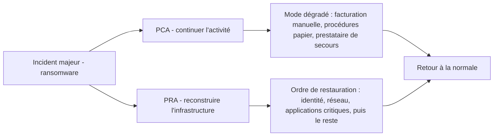

## Introduction

Ce chapitre remet en contexte la sauvegarde et la continuité d'activité, déjà détaillées au cours Administration Systèmes et Réseaux (chapitre 5), comme dernière ligne de défense face à un scénario que ni le durcissement ni la détection n'auraient réussi à empêcher.

Le ransomware a profondément changé le rôle de la sauvegarde. Autrefois, elle servait surtout à réparer une erreur humaine ou une panne de disque. Aujourd'hui, c'est souvent la seule chose qui sépare une organisation d'un choix impossible : payer une rançon sans garantie, ou perdre ses données. Les groupes de ransomware l'ont compris et cherchent à détruire les sauvegardes avant de chiffrer quoi que ce soit.

À la fin de ce chapitre, tu sauras concevoir une stratégie de sauvegarde qui résiste à un attaquant disposant de droits d'administration, définir des objectifs de reprise réalistes à partir des besoins métier, distinguer plan de reprise et plan de continuité, et prouver par des tests que la restauration fonctionne réellement.

## La sauvegarde comme dernière ligne de défense

<CehCallout>
Rappel du cours Administration Systèmes et Réseaux (chapitre 5) : dans le modèle de défense en profondeur (chapitre 1 de ce cours), la sauvegarde constitue la dernière couche — celle qui garantit la survie de l'organisation même si toutes les couches précédentes (périmètre, réseau, système, détection) ont échoué face à une attaque déterminée.
</CehCallout>

Dans le NIST CSF 2.0, la sauvegarde relève à la fois de la fonction Protect, pour la protection des données, et de la fonction Recover, pour le rétablissement. Son statut particulier tient au fait qu'elle reste utile quand tout le reste a échoué. Mais pour qu'elle joue ce rôle, elle doit être **indépendante** des couches précédentes : une sauvegarde qui tombe en même temps que l'annuaire n'est pas une dernière ligne de défense, c'est une victime de plus. On retrouve ici la notion de mode de défaillance commun vue au chapitre 1.

## Face au scénario ransomware

<WarningCallout>
Rappel du cours Administration Systèmes et Réseaux (chapitre 5) : un ransomware moderne cible spécifiquement les sauvegardes accessibles depuis le réseau compromis avant même de chiffrer les données de production — une sauvegarde immuable ou déconnectée (air-gapped) reste la seule protection réellement fiable contre ce scénario spécifique.
</WarningCallout>

### Pourquoi les sauvegardes sont ciblées

Conceptuellement, un groupe de ransomware moderne suit une progression assez constante. Il obtient un accès initial, s'élève jusqu'aux privilèges d'administration du domaine, cartographie l'infrastructure, puis, avant le chiffrement, s'attaque à tout ce qui permettrait une restauration : suppression des clichés instantanés de volume Windows, suppression des points de restauration, effacement ou chiffrement des dépôts de sauvegarde, et accès à la console de sauvegarde avec des identifiants volés. MITRE ATT&CK décrit ce comportement sous la technique T1490, *Inhibit System Recovery*, de la tactique Impact, aux côtés de T1486, *Data Encrypted for Impact*, pour le chiffrement lui-même.

Le raisonnement de l'attaquant est simple : si la victime peut restaurer, elle ne paiera pas. Le défenseur doit donc partir de l'hypothèse qu'un attaquant disposera, à un moment, des droits d'administrateur du domaine, et se demander : « avec ces droits, peut-il détruire mes sauvegardes ? ». Si la réponse est oui, la stratégie doit être revue.

### De la règle 3-2-1 à la règle 3-2-1-1-0

<Steps steps={[
  { title: "Appliquer la règle 3-2-1", description: "Rappel du cours Administration Systèmes et Réseaux : 3 copies, 2 supports différents, 1 copie hors site." },
  { title: "Garantir l'immuabilité d'au moins une copie", description: "Une sauvegarde que même un compte administrateur compromis ne peut modifier ni supprimer." },
  { title: "Isoler physiquement ou logiquement une copie", description: "Une sauvegarde air-gapped, totalement déconnectée du réseau de production entre deux opérations de sauvegarde." },
]} />

La règle 3-2-1 signifie trois copies des données, la production comptant pour une, sur deux supports différents, dont une copie hors site. Elle protège contre la panne matérielle et le sinistre physique, comme un incendie. Face au ransomware, la profession l'a étendue en **3-2-1-1-0** : le deuxième « 1 » exige au moins une copie hors ligne, isolée ou immuable, et le « 0 » exige zéro erreur lors des vérifications de restauration.

### Immuabilité et isolement : deux mécanismes différents

Une sauvegarde **immuable** ne peut ni être modifiée ni supprimée pendant une durée de rétention définie, même par un administrateur. On l'obtient avec un stockage WORM, *Write Once Read Many*, avec le verrouillage d'objets des stockages compatibles S3 en mode conformité, avec certaines appliances de sauvegarde à rétention verrouillée, ou avec des dépôts en mode ajout seul, où le client de sauvegarde peut écrire de nouvelles données mais pas effacer les anciennes.

Une sauvegarde **air-gapped**, ou isolée, est déconnectée du réseau de production entre deux opérations : bande retirée du lecteur et stockée ailleurs, disque débranché, ou coffre logique joignable seulement pendant une fenêtre courte et à l'initiative du coffre lui-même.

| Mécanisme | Ce qu'il protège | Limite principale |
| --- | --- | --- |
| Copie sur NAS accessible du domaine | Panne de disque, erreur de manipulation | Chiffrée ou supprimée avec les droits du domaine |
| Copie hors site synchronisée en continu | Sinistre physique | La suppression ou le chiffrement se propage aussi |
| Stockage immuable à rétention verrouillée | Suppression par un administrateur compromis | Les données déjà corrompues avant la sauvegarde restent corrompues |
| Copie air-gapped | Toute attaque réseau | Fréquence plus faible, donc perte de données plus importante |

La formulation « seule protection réellement fiable » du rappel ci-dessus doit se comprendre ainsi : contre un attaquant qui détient les droits d'administration, seules ces deux propriétés, l'immuabilité et l'isolement, garantissent qu'une copie survive. Elles ne suffisent pas à elles seules : il faut aussi pouvoir restaurer vite, et à partir d'une copie saine.

### Protéger l'infrastructure de sauvegarde elle-même

Le serveur et la console de sauvegarde sont des actifs de tiers 0 au sens du chapitre 4, car ils permettent de détruire ou d'exfiltrer toutes les données. Plusieurs mesures en découlent. L'infrastructure de sauvegarde ne doit pas être jointe au domaine de production, ou doit utiliser un domaine d'administration séparé, afin qu'un attaquant maître de l'annuaire n'en hérite pas automatiquement. La console doit être protégée par un MFA résistant à l'hameçonnage et accessible seulement depuis des postes d'administration dédiés. Les opérations destructrices, comme la réduction de la rétention ou la suppression d'un dépôt, devraient exiger une validation par une deuxième personne lorsque l'outil le permet. Les sauvegardes doivent être chiffrées, avec des clés conservées hors de l'infrastructure qu'elles protègent. Enfin, les événements de la plateforme de sauvegarde, comme une suppression massive, un changement de rétention ou une connexion inhabituelle à la console, doivent remonter au SIEM du chapitre 5.

<AttackDefenseTable rows={[
  { phase: "Reconnaissance", attack: "Recherche de la console et des dépôts de sauvegarde dans le réseau", defense: "Infrastructure de sauvegarde segmentée, hors du domaine de production" },
  { phase: "Vol d'identifiants", attack: "Utilisation des droits du domaine pour se connecter à la console", defense: "Identités séparées, MFA résistant à l'hameçonnage, accès depuis postes dédiés" },
  { phase: "Inhibition de la restauration (T1490)", attack: "Suppression des clichés instantanés, des points de restauration et des dépôts", defense: "Alerte sur la suppression des clichés, copies immuables, double validation des suppressions" },
  { phase: "Chiffrement (T1486)", attack: "Chiffrement des données de production et des copies accessibles", defense: "Copie air-gapped ou immuable, restauration testée, plan de reprise prêt" },
  { phase: "Double extorsion", attack: "Exfiltration préalable des données avant chiffrement", defense: "Chiffrement des sauvegardes, détection des volumes sortants anormaux, la sauvegarde ne protège pas de la fuite" }
]} />

Ce dernier point mérite d'être souligné : la meilleure sauvegarde du monde ne protège pas contre la publication de données volées. Elle répond au problème de la disponibilité, pas à celui de la confidentialité.

## Tester la restauration — une discipline défensive à part entière

<CehCallout>
Rappel du cours Administration Systèmes et Réseaux (chapitre 5) : une sauvegarde jamais restaurée en test n'offre aucune garantie réelle — de nombreuses organisations découvrent une sauvegarde corrompue précisément au moment où elles en ont le plus besoin, pendant un incident réel.
</CehCallout>

<Steps steps={[
  { title: "Planifier des tests de restauration réguliers", description: "Comme n'importe quelle autre maintenance préventive (rappel du cours Administration Systèmes et Réseaux, chapitre 8)." },
  { title: "Mesurer le temps réel de restauration", description: "Le RTO théorique (rappel du cours Administration Systèmes et Réseaux, chapitre 5) doit être validé par un test réel, pas seulement estimé sur le papier." },
  { title: "Documenter la procédure de restauration complète", description: "Rappel du cours Rédaction de Rapports (chapitre 4) : un runbook de restauration précis, pas des instructions vagues à improviser en pleine crise." },
]} />

### RPO, RTO et durée maximale d'interruption

Trois indicateurs structurent la conception. Le **RPO**, *Recovery Point Objective*, est la perte de données maximale acceptable, exprimée en durée : un RPO de quatre heures signifie qu'on accepte de perdre au plus les quatre dernières heures de travail. Le **RTO**, *Recovery Time Objective*, est la durée maximale acceptable pour rétablir le service. La **DMIA**, durée maximale d'interruption admissible, en anglais MTPD, est le délai au-delà duquel l'interruption menace la survie de l'activité ; le RTO doit lui être inférieur.

Ces valeurs ne se décident pas en salle serveur : elles viennent d'une **analyse d'impact sur l'activité**, ou BIA, menée avec les métiers. Faisons un exemple chiffré. Un service exige de ne jamais perdre plus de quatre heures de données. La fréquence de sauvegarde doit donc être d'au moins une sauvegarde toutes les quatre heures, et même un peu plus fréquente, car il faut compter la durée de la sauvegarde elle-même et le risque qu'une sauvegarde échoue. Avec des sauvegardes toutes les quatre heures, si l'une échoue, la perte réelle atteint huit heures. Une fréquence de trois heures, ou une réplication continue complétée par des sauvegardes, est plus prudente.

Mais il y a un piège propre au ransomware. Les attaquants restent souvent plusieurs jours ou semaines dans le réseau avant de chiffrer. Si la sauvegarde la plus récente contient déjà leurs outils de persistance, la restaurer telle quelle réinstalle la compromission. Il faut donc une **rétention** suffisamment longue pour remonter à une copie saine, et une procédure de vérification des sauvegardes avant remise en production. Le RPO effectif d'un incident de ransomware est souvent bien plus long que le RPO nominal.

### Mesurer la restauration en pratique

L'outil libre `restic` illustre bien ces principes : il chiffre les sauvegardes par défaut, déduplique les données et sait vérifier l'intégrité d'un dépôt.

```bash
export RESTIC_REPOSITORY=/mnt/sauvegarde/depot
export RESTIC_PASSWORD_FILE=/root/.restic-pass      # clé de chiffrement du dépôt

restic init                                          # crée un dépôt chiffré
restic backup /srv/donnees --tag quotidienne         # sauvegarde incrémentale
restic snapshots                                     # liste les points de restauration
restic check --read-data-subset=10%                  # relit 10 % des données pour détecter une corruption
time restic restore latest --target /tmp/test-restauration   # mesure la durée réelle
```

```text
ID        Time                 Host        Tags         Paths
-------------------------------------------------------------------
4f1c2a9e  2026-11-08 02:00:04  srv-fich01  quotidienne  /srv/donnees
b72e81d0  2026-11-09 02:00:03  srv-fich01  quotidienne  /srv/donnees

using temporary cache in /tmp/restic-check-cache-1234567
create exclusive lock for repository
load indexes
check all packs
check snapshots, trees and blobs
read 10.0% of data packs
[0:03] 100.00%  38 / 38 packs
no errors were found

real    4m12,551s
```

La dernière ligne est la seule qui compte pour le RTO : la restauration de ce jeu de données prend un peu plus de quatre minutes. Multiplie ce type de mesure par l'ensemble des systèmes critiques, ajoute la reconstruction de l'annuaire et des serveurs, et tu obtiens un RTO réaliste, souvent très différent de celui du papier. Le dépôt peut ensuite être placé derrière un serveur en mode ajout seul, comme `rest-server` avec l'option `--append-only`, pour que le client compromis ne puisse pas effacer les anciennes sauvegardes.

<WarningCallout>
Ne teste jamais une restauration en écrasant les données de production. Restaure toujours vers un emplacement ou un environnement isolé, puis compare. Une erreur de cible lors d'un test peut provoquer exactement la perte de données que la sauvegarde devait éviter.
</WarningCallout>

## Le plan de continuité d'activité (PCA) en complément

<CehCallout>
Rappel du cours Administration Systèmes et Réseaux (chapitre 5) : le PCA répond à la question « comment l'activité métier continue-t-elle PENDANT la restauration ? », distincte du PRA qui reconstruit l'infrastructure — un ransomware paralysant les systèmes de facturation pendant plusieurs jours nécessite un PCA définissant un mode dégradé, pas seulement un plan de restauration technique.
</CehCallout>



Le **PRA**, plan de reprise d'activité, est technique : il décrit comment reconstruire l'infrastructure, dans quel ordre et avec quelles ressources. L'ordre est crucial : sans annuaire, sans DNS et sans réseau, aucune application ne redémarre. Le **PCA**, plan de continuité d'activité, est métier : il décrit comment l'organisation continue à servir ses clients pendant que le PRA se déroule, par exemple avec une facturation manuelle, des formulaires papier, un site de secours ou un prestataire externe. Un hôpital qui bascule en procédures papier pendant une cyberattaque applique son PCA.

Le PCA doit être exercé, comme le PRA. Un exercice sur table, où la cellule de crise déroule un scénario sans toucher aux systèmes, révèle rapidement les dépendances oubliées : la liste des contacts stockée sur le serveur chiffré, le mot de passe du coffre conservé dans l'annuaire compromis, la procédure papier que personne ne connaît.

<AuditCallout>
Dans l'ISO/IEC 27001:2022, ces sujets relèvent des contrôles A.8.13 sur la sauvegarde des informations, A.5.29 sur la sécurité de l'information durant une perturbation, A.5.30 sur la préparation des TIC à la continuité d'activité, nouveau dans la version 2022, et A.8.14 sur la redondance. La norme ISO 22301:2019 encadre le système de management de la continuité d'activité. La directive NIS2 cite la continuité des activités, la gestion des sauvegardes et la reprise après sinistre parmi les mesures obligatoires, et DORA impose au secteur financier des politiques de sauvegarde et des tests de restauration réguliers.
</AuditCallout>

## Erreurs fréquentes

La première erreur est de **sauvegarder sur un NAS joint au domaine**, accessible avec les mêmes identifiants que la production. Il sera chiffré en même temps qu'elle.

La deuxième est de **ne jamais tester la restauration complète**. Restaurer un fichier isolé ne prouve pas qu'on sait reconstruire un annuaire, une base de données et leurs dépendances dans l'ordre.

La troisième est de **conserver une rétention trop courte**. Si l'attaquant est présent depuis trois semaines et que la rétention est de sept jours, toutes les copies contiennent la compromission.

La quatrième est de **stocker les clés de chiffrement ou la documentation du PRA dans le système qu'ils doivent restaurer**. Le jour de l'incident, ils sont inaccessibles.

La cinquième est de **confondre réplication et sauvegarde**. Une réplication en temps réel reproduit fidèlement le chiffrement ou la suppression sur le site secondaire.

## Lab — Mise en pratique

**Environnement** : terminal Kali Linux, avec le paquet restic.

<Steps steps={[
  { title: "Concevoir une stratégie anti-ransomware", description: "Pour une PME qui sauvegarde actuellement ses données chaque nuit sur un NAS accessible depuis le réseau interne, propose une amélioration concrète pour se protéger d'un ransomware. Vérifie que ta proposition respecte la règle 3-2-1-1-0." },
  { title: "Calculer un RPO et vérifier sa faisabilité", description: "Un service exige de ne jamais perdre plus de 4 heures de données. Quelle fréquence de sauvegarde minimale cela impose-t-il, et que faudrait-il tester pour garantir que cet objectif est réellement tenable ?" },
  { title: "Créer un dépôt de sauvegarde chiffré", description: "Installe restic, crée des données de test et initialise un dépôt local chiffré. Observe que restic demande un mot de passe : sans lui, le dépôt est illisible.", code: "sudo apt install -y restic\nmkdir -p ~/lab-donnees && for i in $(seq 1 200); do head -c 50000 /dev/urandom > ~/lab-donnees/f$i.bin; done\nexport RESTIC_REPOSITORY=~/lab-depot\nrestic init" },
  { title: "Sauvegarder et vérifier l'intégrité", description: "Effectue une sauvegarde, puis une vérification qui relit une partie des données. Note le message final de la vérification.", code: "restic backup ~/lab-donnees --tag lab\nrestic snapshots\nrestic check --read-data-subset=25%" },
  { title: "Simuler un incident et restaurer", description: "Simule la perte des données en les renommant avec une extension chiffrée factice, puis restaure dans un dossier séparé en mesurant la durée. Compare le contenu restauré avec l'original.", code: "for f in ~/lab-donnees/*.bin; do mv \"$f\" \"$f.locked\"; done\ntime restic restore latest --target ~/lab-restauration\nls ~/lab-restauration$HOME/lab-donnees | head" },
  { title: "Déduire un RTO réaliste", description: "À partir de la durée mesurée et du volume sauvegardé, estime le temps de restauration de 2 To de données. Ajoute le temps de reconstruction des serveurs et de l'annuaire, puis compare avec un RTO de 24 heures exigé par le métier." },
  { title: "Rédiger un mode dégradé", description: "Pour une activité de facturation paralysée pendant cinq jours, rédige en dix lignes le mode dégradé du PCA : qui fait quoi, avec quels outils, et comment les données saisies seront réintégrées après la restauration." }
]} />

## À retenir

- La sauvegarde constitue la dernière ligne de défense, garantissant la survie de l'organisation même si toutes les couches précédentes ont échoué, à condition d'être indépendante de ces couches.
- Un ransomware moderne cible d'abord les sauvegardes accessibles : une copie immuable ou air-gapped est indispensable.
- La règle 3-2-1, trois copies, deux supports, une hors site, s'étend aujourd'hui en 3-2-1-1-0, avec une copie isolée ou immuable et zéro erreur de restauration.
- L'infrastructure de sauvegarde est un actif de tiers 0 : identités séparées, MFA, chiffrement et supervision.
- RPO, RTO et durée maximale d'interruption viennent d'une analyse d'impact métier et doivent être validés par des tests réels.
- Tester régulièrement la restauration, pas seulement planifier la sauvegarde, est une discipline défensive à part entière.
- Le PRA reconstruit l'infrastructure technique, le PCA définit comment l'activité métier continue pendant la restauration.

## Questions de révision

1. Pourquoi la sauvegarde est-elle considérée comme la dernière couche de la défense en profondeur ?
2. Pourquoi une sauvegarde immuable ou air-gapped est-elle la seule protection fiable contre un ransomware moderne ?
3. Quelle est la différence entre PRA et PCA face à un incident de ransomware paralysant ?
4. Que signifient les deux derniers chiffres de la règle 3-2-1-1-0 ?
5. Pourquoi l'infrastructure de sauvegarde ne devrait-elle pas dépendre du domaine de production ?
6. Pourquoi le RPO effectif d'un incident de ransomware peut-il être bien plus long que le RPO nominal ?
7. Pourquoi une réplication en temps réel ne remplace-t-elle pas une sauvegarde ?
