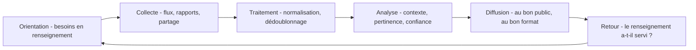

## Introduction

Ce chapitre complète le threat hunting déjà détaillé au cours Analyse SOC (chapitre 7) par la discipline qui l'alimente en amont : la threat intelligence, qui consiste à collecter et exploiter des informations sur les menaces avant même qu'elles ne se manifestent dans son propre système d'information.

La threat intelligence, ou CTI pour *Cyber Threat Intelligence*, n'est pas une liste d'adresses IP malveillantes. C'est un renseignement : une information collectée, analysée et mise en contexte pour aider quelqu'un à prendre une décision. Le RSSI qui choisit ses investissements, l'ingénieur détection qui priorise ses règles, l'analyste SOC qui doit savoir si une adresse est connue, l'administrateur qui doit choisir quel correctif appliquer en premier : tous consomment de la threat intelligence, à des niveaux différents.

À la fin de ce chapitre, tu sauras distinguer les trois niveaux de renseignement, dérouler le cycle du renseignement, exploiter des indicateurs dans un SIEM, partager de l'information avec les bons standards, et transformer un rapport sur un groupe d'attaquants en détections concrètes.

## Les trois niveaux de la threat intelligence

<CompareTable
  titleA="Niveau"
  titleB="Question à laquelle il répond"
  rows={[
    { a: "Stratégique", b: "Quelles tendances de menaces générales concernent notre secteur d'activité sur le long terme ?" },
    { a: "Tactique", b: "Quelles techniques (MITRE ATT&CK, rappel du cours Analyse SOC ch.4) les groupes de menace pertinents utilisent-ils actuellement ?" },
    { a: "Opérationnel", b: "Quels indicateurs de compromission précis (IP, hash, domaine) sont associés à une campagne d'attaque en cours ?" },
]}
/>

Le niveau **stratégique** s'adresse à la direction. Il se présente sous forme de rapports et de synthèses : « le secteur bancaire est de plus en plus ciblé par le ransomware », « les équipements de bordure exposés sur Internet sont devenus un vecteur d'accès initial majeur ». Il oriente les budgets et l'appréciation des risques.

Le niveau **tactique** s'adresse aux équipes de détection et d'architecture. Il décrit les techniques, tactiques et procédures, ou TTP, des groupes d'attaquants, généralement exprimées dans le vocabulaire MITRE ATT&CK : « le groupe X utilise le Kerberoasting, technique T1558.003, pour obtenir des identifiants ». Il permet de vérifier si l'on sait détecter ces comportements.

Le niveau **opérationnel** s'adresse au SOC et à la réponse à incident. Il fournit des indicateurs de compromission, ou IOC : adresses IP, noms de domaine, empreintes de fichiers, URL, associés à une campagne en cours. Certains auteurs distinguent en plus un niveau « technique » pour les IOC bruts et réservent « opérationnel » au contexte d'une campagne précise ; l'important est la logique de granularité croissante.

<CehCallout>
Rappel du cours Analyse SOC (chapitre 7, threat hunting) : la threat intelligence tactique et opérationnelle alimente directement les hypothèses de chasse — une nouvelle technique documentée par la threat intelligence devient une hypothèse concrète à vérifier dans son propre système d'information.
</CehCallout>

## Le cycle du renseignement

La CTI suit un cycle hérité du renseignement classique. Sans ce cycle, on accumule des flux sans savoir à quoi ils servent.



L'**orientation** est l'étape la plus souvent négligée. Elle consiste à formuler des besoins prioritaires en renseignement, par exemple : « quels groupes de ransomware ciblent les entreprises de logistique en Afrique centrale ? », « quelles vulnérabilités de nos équipements de bordure sont activement exploitées ? ». Ces questions découlent de ton secteur, de ta géographie, de tes technologies et de tes actifs critiques.

La **collecte** s'appuie sur des sources ouvertes, des flux commerciaux et le partage entre pairs. Le **traitement** normalise les données, élimine les doublons et les indicateurs manifestement erronés, comme des adresses de résolveurs DNS publics qui provoqueraient des milliers de faux positifs. L'**analyse** ajoute le contexte : cet indicateur est-il pertinent pour nous, avec quel niveau de confiance, depuis quand est-il actif ? La **diffusion** adapte la forme au public : une note d'une page pour la direction, une règle de détection pour le SOC. Le **retour** mesure si le renseignement a été utile, ce qui réoriente les besoins.

### Les sources utiles

| Source | Type | Usage |
| --- | --- | --- |
| CERT-FR, CSIRT nationaux | Alertes et avis de sécurité | Vulnérabilités critiques, campagnes visant le pays |
| Catalogue CISA KEV | Vulnérabilités exploitées confirmées | Priorisation des correctifs |
| EPSS du FIRST | Probabilité d'exploitation | Priorisation des correctifs |
| MITRE ATT&CK, fiches groupes | Renseignement tactique | Cartographie des TTP des groupes pertinents |
| abuse.ch (URLhaus, ThreatFox, MalwareBazaar) | IOC communautaires | Enrichissement SOC, blocage |
| Rapports publics des éditeurs de sécurité | Analyses de campagnes | Renseignement tactique et opérationnel |
| ISAC sectoriels et communautés de confiance | Partage entre pairs | Menaces propres au secteur |

Un ISAC, *Information Sharing and Analysis Center*, est une communauté sectorielle de partage, par exemple pour la finance ou la santé. Le partage entre pairs est souvent la source la plus pertinente, car les attaquants ciblent fréquemment plusieurs organisations d'un même secteur.

## Exploiter des indicateurs de compromission (IOC)

<Steps steps={[
  { title: "Collecter des IOC de sources fiables", description: "Flux de threat intelligence, rapports de recherche publics, partage d'informations sectoriel." },
  { title: "Intégrer les IOC au SIEM", description: "Rappel du chapitre 5 de ce cours : une règle de corrélation peut directement signaler toute connexion vers une IP ou un domaine déjà documenté comme malveillant." },
  { title: "Vérifier rétrospectivement", description: "Un nouvel IOC publié aujourd'hui peut révéler qu'une compromission passée, non détectée à l'époque, est présente dans les logs historiques." },
]} />

<TipCallout>
Rappel du cours Forensics & DFIR (chapitre 6, forensique réseau) : un IOC réseau (IP ou domaine de commande et contrôle documenté) permet de rechercher rétrospectivement dans des captures ou logs archivés une éventuelle communication passée avec cette infrastructure malveillante, même des mois après.
</TipCallout>

### La recherche rétrospective en pratique

Supposons qu'un avis publié aujourd'hui liste des domaines de commande et contrôle utilisés depuis six mois. La question défensive est double : « bloquons-nous ces domaines dès maintenant ? » et « avons-nous déjà communiqué avec eux ? ». La seconde question n'a de réponse que si les journaux DNS et proxy ont été conservés assez longtemps, ce qui rejoint la remarque sur la rétention du chapitre 5.

Sur des journaux Zeek, une recherche simple peut se faire en ligne de commande. Les adresses et domaines ci-dessous appartiennent aux plages réservées à la documentation.

```bash
# ioc_domaines.txt : un domaine par ligne, issu d'un avis de sécurité
cat ioc_domaines.txt
# Recherche dans les journaux DNS Zeek archivés (format TSV, champ query)
zcat /var/log/zeek/2026-*/dns.*.log.gz | zeek-cut ts id.orig_h query \
  | grep -F -f ioc_domaines.txt
```

```text
maj-logiciel.example
cdn-statique.example.net
1749203311.402  10.0.20.37  maj-logiciel.example
1749289715.877  10.0.20.37  maj-logiciel.example
```

Deux requêtes, en juin, depuis le même poste du VLAN développement. Ce résultat ne prouve pas à lui seul une compromission, mais il ouvre un incident à investiguer selon la méthodologie du chapitre 6. Dans un SIEM, la même recherche s'exprime par une jointure entre une table d'indicateurs et les journaux historiques.

### Les standards de partage

Pour échanger des renseignements entre outils et organisations, la communauté utilise des standards ouverts. **STIX 2.1**, *Structured Threat Information Expression*, est un format JSON maintenu par l'OASIS qui décrit des objets comme des indicateurs, des groupes d'attaquants, des logiciels malveillants, des techniques et les relations entre eux. **TAXII 2.1** est le protocole d'échange de ces objets sur HTTPS.

Le **TLP**, *Traffic Light Protocol*, dans sa version 2.0 publiée par le FIRST en 2022, indique avec qui une information peut être partagée. TLP:RED limite l'information aux seules personnes présentes. TLP:AMBER permet un partage au sein de l'organisation du destinataire et de ses clients, sur la base du besoin d'en connaître, et TLP:AMBER+STRICT au sein de l'organisation seulement. TLP:GREEN autorise un partage dans la communauté, et TLP:CLEAR une diffusion publique.

Les plateformes de threat intelligence centralisent tout cela. **MISP**, libre et très répandu dans les CERT, permet de stocker, corréler et partager des événements et des indicateurs. **OpenCTI**, libre également, structure le renseignement selon le modèle STIX et le relie à MITRE ATT&CK. Toutes deux peuvent alimenter automatiquement un SIEM.

<LegalCallout>
Le partage de renseignements peut contenir des données personnelles, comme des adresses IP ou des adresses électroniques de victimes. Il doit respecter le RGPD, le marquage TLP et les accords de la communauté. La directive NIS2 encourage explicitement, à son article 29, le partage volontaire d'informations sur les cybermenaces entre entités au sein de communautés de confiance.
</LegalCallout>

## Du renseignement tactique à la détection

L'usage le plus rentable de la threat intelligence est de transformer les TTP d'un groupe pertinent en détections. Prenons un exemple. Ton besoin en renseignement indique que les groupes de ransomware sont la menace principale. La fiche ATT&CK du groupe Wizard Spider, identifiant G0102, associé historiquement aux ransomwares Ryuk et Conti, liste de nombreuses techniques, dont le Kerberoasting T1558.003, l'inhibition de la restauration T1490 et l'accès par des services distants exposés T1133 ; les fiches des ransomwares qu'il déploie ajoutent le chiffrement T1486.

La démarche consiste à prendre chaque technique et à se poser trois questions : avons-nous les journaux nécessaires, avons-nous une règle, l'avons-nous testée ? Les réponses alimentent directement les chapitres 5 et 9.

| Technique du groupe | Journaux nécessaires | Règle existante | Testée |
| --- | --- | --- | --- |
| T1558.003 Kerberoasting | Événement 4769 sur les contrôleurs de domaine | Oui, tickets RC4 | Non |
| T1490 Inhibit System Recovery | Création de processus avec ligne de commande | Oui | Oui |
| T1486 Data Encrypted for Impact | Télémétrie EDR, accès fichiers | Fournie par l'EDR | Non |
| T1133 External Remote Services | Journaux VPN et d'accès distant | Non | Non |

Ce tableau révèle immédiatement les priorités : écrire une règle sur les connexions VPN anormales et tester les deux règles existantes non testées.

### La pyramide de la douleur

David Bianco a proposé en 2013 la **pyramide de la douleur**, qui classe les indicateurs selon la difficulté qu'éprouve l'attaquant à les changer. À la base, les empreintes de fichiers sont triviales à modifier : il suffit de recompiler. Viennent ensuite les adresses IP, faciles à changer, puis les noms de domaine, un peu moins faciles. Au-dessus, les artefacts réseau et système, comme un motif d'URL ou une clé de registre, puis les outils. Au sommet, les TTP : changer de façon d'opérer coûte très cher à un attaquant. Plus une détection vise haut dans la pyramide, plus elle est durable.

## Les limites de la threat intelligence

<WarningCallout>
Rappel du cours Data Science Complète (chapitre 8, sur la dérive de concept) : un IOC statique (une IP ou un domaine précis) a une durée de vie souvent courte — les attaquants changent régulièrement leur infrastructure. La threat intelligence tactique (techniques, comportements) reste généralement plus durable et utile à long terme que la seule accumulation d'IOC opérationnels ponctuels.
</WarningCallout>

D'autres limites méritent d'être connues. Les **faux positifs** sont fréquents : une adresse IP malveillante hier peut être réattribuée demain à un service légitime, notamment chez les hébergeurs cloud. Un indicateur doit donc avoir une date d'expiration. La **confiance** varie selon les sources : un indicateur issu d'une investigation confirmée vaut plus qu'une détection automatique non vérifiée ; des échelles comme le code de l'Amirauté, qui note la fiabilité de la source et la crédibilité de l'information, aident à l'exprimer. L'**attribution**, c'est-à-dire désigner l'auteur d'une attaque, est difficile et rarement utile au défenseur : savoir comment l'attaquant opère compte plus que savoir qui il est. Enfin, la **surcharge** guette : s'abonner à des dizaines de flux sans besoins définis noie le SOC sous des alertes sans valeur.

<AttackDefenseTable rows={[
  { phase: "Infrastructure de commande", attack: "Rotation rapide d'adresses IP et de domaines, parfois générés automatiquement (T1568.002)", defense: "Détection comportementale des communications régulières, réputation des domaines récents, expiration des IOC" },
  { phase: "Outillage", attack: "Recompilation des charges pour changer leur empreinte", defense: "Règles YARA sur des motifs stables, détection EDR comportementale plutôt que par empreinte" },
  { phase: "Techniques", attack: "Réutilisation de TTP éprouvées, coûteuses à changer", defense: "Détections fondées sur les TTP issues de la threat intelligence tactique" },
  { phase: "Vulnérabilités exploitées", attack: "Exploitation rapide des failles des équipements exposés après publication", defense: "Veille CISA KEV et CERT-FR, EPSS, correctif accéléré des équipements de bordure" }
]} />

<AuditCallout>
L'ISO/IEC 27001:2022 a introduit le contrôle A.5.7 sur le renseignement sur les menaces : l'organisation doit collecter et analyser les informations relatives aux menaces pour produire du renseignement exploitable. Un auditeur attendra des sources identifiées, une analyse de pertinence et la preuve que le renseignement a conduit à des actions, comme une nouvelle règle de détection ou un correctif accéléré.
</AuditCallout>

## Erreurs fréquentes

La première erreur est de **collecter sans besoins définis**. Sans orientation, la CTI devient un flux d'indicateurs que personne n'exploite.

La deuxième est d'**importer des IOC sans expiration ni filtrage**. Les listes gonflent, les faux positifs se multiplient et le SOC finit par ignorer ces alertes.

La troisième est de **se limiter aux IOC**. Les indicateurs du bas de la pyramide de la douleur sont utiles en urgence, mais la valeur durable est dans les TTP.

La quatrième est de **ne pas respecter le TLP**. Diffuser une information TLP:RED hors du cercle prévu détruit la confiance de la communauté et peut alerter l'attaquant.

La cinquième est de **négliger le renseignement sur les vulnérabilités**. Savoir quelles failles sont réellement exploitées, grâce au catalogue KEV et à l'EPSS, est souvent le renseignement le plus directement actionnable.

## Lab — Mise en pratique

**Environnement** : terminal Kali Linux avec accès Internet, `curl` et `jq`.

<Steps steps={[
  { title: "Classer un renseignement par niveau", description: "Classe ces informations par niveau (stratégique, tactique, opérationnel) : « le secteur bancaire est de plus en plus ciblé par le ransomware », « le groupe X utilise le Kerberoasting pour l'accès aux identifiants », « l'IP 45.33.x.x est un serveur de commande et contrôle actif »." },
  { title: "Expliquer une limite de la threat intelligence", description: "Pourquoi un IOC opérationnel (une IP précise) devient-il rapidement obsolète, alors qu'une information tactique (une technique MITRE ATT&CK) reste utile plus longtemps ? Situe chaque exemple sur la pyramide de la douleur." },
  { title: "Exploiter le catalogue CISA KEV", description: "Télécharge le catalogue des vulnérabilités exploitées et compte les entrées ajoutées pour un éditeur que tu utilises. Observe les champs dateAdded et knownRansomwareCampaignUse.", code: "curl -s https://www.cisa.gov/sites/default/files/feeds/known_exploited_vulnerabilities.json -o kev.json\njq '.count' kev.json\njq -r '.vulnerabilities[] | select(.vendorProject==\"Fortinet\") | [.cveID, .dateAdded, .knownRansomwareCampaignUse] | @tsv' kev.json | tail -5" },
  { title: "Interroger l'EPSS", description: "Récupère le score EPSS d'une vulnérabilité célèbre, Log4Shell. Le champ epss est une probabilité entre 0 et 1, le champ percentile la situe par rapport aux autres.", code: "curl -s 'https://api.first.org/data/v1/epss?cve=CVE-2021-44228' | jq '.data[0]'" },
  { title: "Cartographier les techniques d'un groupe", description: "Télécharge les données ATT&CK Enterprise et liste les techniques associées au groupe Wizard Spider (G0102). Choisis trois techniques et vérifie si tu sais les détecter.", code: "curl -sL https://raw.githubusercontent.com/mitre/cti/master/enterprise-attack/enterprise-attack.json -o ea.json\nGID=$(jq -r '.objects[] | select(.type==\"intrusion-set\" and .name==\"Wizard Spider\") | .id' ea.json)\njq -r --arg g \"$GID\" '.objects[] | select(.type==\"relationship\" and .relationship_type==\"uses\" and .source_ref==$g and (.target_ref|startswith(\"attack-pattern\"))) | .target_ref' ea.json | sort -u > tech.txt\nwc -l tech.txt" },
  { title: "Simuler une recherche rétrospective", description: "Crée un faux journal DNS et une liste d'IOC, puis recherche les correspondances. Observe quel poste a contacté un domaine listé, et à quelle date.", code: "printf '%s\\n' 'maj-logiciel.example' 'cdn-statique.example.net' > ioc.txt\nprintf '%s\\n' '2026-06-06T08:01 10.0.20.37 maj-logiciel.example' '2026-06-06T08:02 10.0.10.12 intranet.corp.local' '2026-06-07T08:01 10.0.20.37 maj-logiciel.example' > dns.log\ngrep -F -f ioc.txt dns.log" }
]} />

## À retenir

- La threat intelligence stratégique, tactique et opérationnelle répond à des questions de granularité croissante, de la tendance générale à l'indicateur précis.
- Le cycle du renseignement commence par des besoins définis ; sans orientation, la collecte n'a pas de valeur.
- Les IOC intégrés au SIEM permettent une détection immédiate, mais aussi une recherche rétrospective dans les logs archivés, à condition d'une rétention suffisante.
- STIX 2.1 et TAXII 2.1 structurent l'échange, le TLP 2.0 encadre la diffusion, MISP et OpenCTI centralisent le renseignement.
- Les IOC opérationnels ont une durée de vie courte ; la threat intelligence tactique, les techniques, reste généralement plus durable, comme l'illustre la pyramide de la douleur.
- Le renseignement tactique se transforme en détections et en hypothèses de chasse, technique par technique.
- Le renseignement sur les vulnérabilités exploitées, CISA KEV et EPSS, est souvent le plus directement actionnable.

## Questions de révision

1. Quelle est la différence entre threat intelligence stratégique, tactique et opérationnelle ?
2. Comment un IOC réseau peut-il permettre une détection rétrospective d'une compromission passée ?
3. Pourquoi la threat intelligence tactique reste-t-elle généralement plus durable que les IOC opérationnels ?
4. Pourquoi l'étape d'orientation du cycle du renseignement est-elle déterminante ?
5. Quelle est la différence entre TLP:AMBER et TLP:AMBER+STRICT ?
6. Comment transformerais-tu la fiche ATT&CK d'un groupe d'attaquants en plan d'amélioration de la détection ?
7. Pourquoi un indicateur de compromission devrait-il avoir une date d'expiration ?
