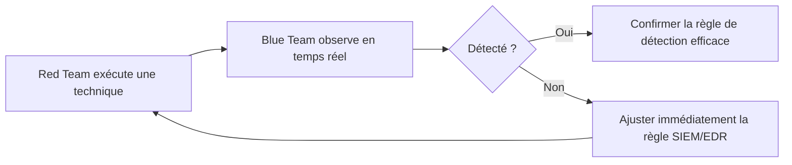

## Introduction

Ce chapitre réunit littéralement les deux moitiés du parcours Nyx, offensif et défensif, dans un même exercice organisationnel : les simulations Red Team et Blue Team, dont le Purple Team représente l'évolution la plus collaborative.

Pourquoi organiser de tels exercices ? Parce qu'une défense qui n'a jamais été éprouvée repose sur des suppositions. On suppose que l'EDR détecte tel comportement, que la règle SIEM se déclenche, que l'analyste réagit, que l'escalade fonctionne la nuit. Un exercice transforme ces suppositions en faits mesurés. C'est l'équivalent, pour la détection, du test de restauration vu au chapitre 7 pour la sauvegarde : tant qu'on n'a pas essayé, on ne sait pas.

À la fin de ce chapitre, tu sauras expliquer la différence entre les trois types d'exercices, concevoir un exercice Purple Team ciblé, l'encadrer correctement, mesurer ses résultats et transformer chaque non-détection en amélioration concrète.

## Red Team, Blue Team et Purple Team

<CompareTable
  titleA="Type d'exercice"
  titleB="Principe"
  rows={[
    { a: "Red Team", b: "Simule une attaque réelle (rappel du cours Cybersécurité Offensive) sans que la Blue Team ne soit prévenue, pour tester la détection en conditions réalistes" },
    { a: "Blue Team", b: "L'équipe défensive (rappel des cours Analyse SOC et Forensics & DFIR) qui détecte et répond, sans connaître à l'avance le scénario d'attaque" },
    { a: "Purple Team", b: "Collaboration explicite entre Red et Blue en temps réel, avec partage immédiat des observations des deux côtés" },
]}
/>

### Red Team : tester l'organisation en conditions réelles

Un exercice Red Team se distingue d'un test d'intrusion classique. Le test d'intrusion cherche à trouver le plus de vulnérabilités possible sur un périmètre défini, souvent en un temps court et avec la connaissance des équipes. La Red Team poursuit un **objectif**, par exemple accéder aux données de paie ou démontrer la capacité à arrêter une chaîne de production, en émulant le comportement d'un attaquant réaliste, sur plusieurs semaines, et sans que la Blue Team soit prévenue. Elle teste donc l'ensemble de l'organisation : les technologies, mais aussi les processus et les personnes.

Ce qui est mesuré n'est pas seulement « l'attaquant est-il entré ? », mais surtout « à quel moment a-t-il été vu, par qui, et qu'a-t-on fait ? ». Une Red Team qui atteint son objectif après avoir été détectée à la deuxième étape, mais dont l'alerte a été ignorée, révèle un problème de processus plus que de technologie.

### Blue Team : défendre sans connaître le scénario

La Blue Team est l'équipe défensive au quotidien : le SOC, les équipes DFIR, les administrateurs. Pendant un exercice Red Team, elle travaille normalement, sans savoir qu'un exercice est en cours, et c'est précisément ce qui donne sa valeur au test. Elle s'appuie sur les compétences des cours Analyse SOC et Forensics & DFIR : triage, investigation, confinement.

Autour de ces deux équipes, une **équipe blanche**, ou *White Team*, arbitre l'exercice. Elle connaît le scénario, fait le lien avec la direction, peut suspendre l'exercice si un risque réel apparaît, et permet de distinguer rapidement une action de la Red Team d'une véritable attaque concomitante. Ce dernier point est essentiel : un vrai attaquant peut agir pendant un exercice.

<CehCallout>
Un exercice Red Team classique (sans collaboration Purple) mesure la capacité de détection réelle de l'organisation, mais l'apprentissage reste souvent limité à un rapport final produit après coup — rappel du cours Rédaction de Rapports (chapitre 1) : le rapport donne sa valeur à la mission, mais un délai entre l'action et le retour d'expérience réduit l'efficacité pédagogique immédiate.
</CehCallout>

## Pourquoi le Purple Team maximise l'apprentissage collectif

Le Purple Team n'est pas une troisième équipe permanente : c'est une façon de travailler. Les membres de la Red Team et de la Blue Team s'assoient ensemble, physiquement ou virtuellement. La Red Team annonce la technique qu'elle va exécuter, l'exécute, et la Blue Team regarde immédiatement ce que ses outils ont vu.

Ce schéma montre la boucle centrale. Si la technique est détectée, on confirme que la règle fonctionne et on note le délai. Si elle ne l'est pas, les deux équipes cherchent ensemble pourquoi : le journal nécessaire n'est-il pas collecté, la règle est-elle mal écrite, l'agent est-il absent de cette machine ? La règle est ajustée sur-le-champ, puis la technique est rejouée pour vérifier que l'ajustement fonctionne.

<TipCallout>
Rappel du cours Analyse SOC (chapitre 3, corrélation) : dans un exercice Purple Team, si la Blue Team ne détecte pas une technique Red Team précise (par exemple un Kerberoasting), les deux équipes collaborent immédiatement pour comprendre pourquoi et ajuster la règle de corrélation SIEM sur-le-champ — un cycle d'amélioration bien plus rapide qu'un rapport final produit des semaines après l'exercice.
</TipCallout>

### Ce qui rend la boucle si efficace

La force du Purple Team tient à la réduction du délai entre l'action et l'apprentissage. Dans un exercice Red Team classique, le rapport arrive plusieurs semaines après les faits. Les journaux de l'époque ont parfois été purgés, les analystes ne se souviennent plus du contexte, et les recommandations deviennent une liste de tâches parmi d'autres. En Purple Team, l'analyste voit, dans la minute, à quoi ressemble réellement la technique dans ses outils. Il apprend à la reconnaître, et la règle est corrigée tant que tout le monde est concentré sur le sujet.

Les deux approches ne s'opposent pas pour autant. La Red Team mesure la capacité réelle, sans biais, ce que le Purple Team ne peut pas faire puisque la Blue Team sait ce qui arrive. Une organisation mature alterne : des exercices Purple Team fréquents pour améliorer la détection, et des exercices Red Team plus espacés pour vérifier, sans prévenir, que les progrès tiennent en conditions réelles.

| Critère | Red Team | Purple Team |
| --- | --- | --- |
| Blue Team prévenue | Non | Oui, collaboration totale |
| Objectif principal | Mesurer la capacité réelle | Améliorer rapidement la détection |
| Durée typique | Plusieurs semaines | Quelques jours ou ateliers récurrents |
| Livrable | Rapport final, chronologie, recommandations | Règles ajustées, matrice de couverture, actions immédiates |
| Délai de retour | Semaines | Minutes |

## Concevoir un exercice Purple Team efficace

<Steps steps={[
  { title: "Sélectionner des techniques MITRE ATT&CK précises", description: "Rappel du cours Analyse SOC (chapitre 4) : cibler des techniques réellement pertinentes pour l'organisation, pas un scénario générique." },
  { title: "Exécuter et observer simultanément", description: "La Red Team exécute une technique pendant que la Blue Team surveille activement ses outils de détection." },
  { title: "Documenter chaque résultat immédiatement", description: "Détecté ou non détecté, avec le détail de la règle ayant (ou n'ayant pas) fonctionné." },
  { title: "Ajuster et retester", description: "Une règle de détection ajustée doit être retestée avec la même technique pour confirmer son efficacité réelle." },
]} />

### Choisir les techniques

La sélection s'appuie directement sur la threat intelligence du chapitre 8. Si les groupes de ransomware sont la menace prioritaire, on retient les techniques documentées pour ces groupes : Kerberoasting T1558.003, création de tâche planifiée T1053.005, lecture de la mémoire de LSASS T1003.001, inhibition de la restauration T1490. Le MITRE Center for Threat-Informed Defense publie des plans d'émulation d'adversaires qui décrivent, étape par étape, le comportement de groupes réels, ce qui évite d'inventer un scénario irréaliste.

### Les outils d'émulation

Plusieurs outils libres permettent d'exécuter des tests reproductibles et contrôlés. **Atomic Red Team**, maintenu par Red Canary, est une bibliothèque de petits tests, chacun associé à une technique ATT&CK, avec leurs commandes de nettoyage ; le module PowerShell Invoke-AtomicRedTeam les exécute. **MITRE Caldera** automatise l'émulation d'adversaires à plus grande échelle. Des plateformes commerciales dites BAS, *Breach and Attack Simulation*, rejouent en continu des scénarios. Pour suivre les résultats, l'outil libre **VECTR** permet de consigner chaque test, son résultat et les améliorations.

<WarningCallout>
Les outils d'émulation exécutent de vraies actions sur de vrais systèmes. Ils ne s'utilisent qu'avec une autorisation écrite, sur un périmètre défini, de préférence d'abord en environnement de test, et en exécutant systématiquement les commandes de nettoyage prévues. Un test qui désactive une protection ou crée un compte et n'est pas nettoyé laisse une vraie faiblesse derrière lui.
</WarningCallout>

### Encadrer l'exercice

Tout exercice repose sur des **règles d'engagement** écrites et signées : périmètre inclus et exclu, techniques autorisées et interdites, horaires, contacts d'urgence, procédure d'arrêt, traitement des données rencontrées. Pour un exercice Red Team, une **lettre d'autorisation** signée par une personne habilitée protège les testeurs : sans elle, les mêmes actions constituent une intrusion illégale.

<LegalCallout>
En France, l'accès ou le maintien frauduleux dans un système de traitement automatisé de données est réprimé par l'article 323-1 du Code pénal, et d'autres articles visent l'entrave au fonctionnement et la détention d'outils sans motif légitime. Seule une autorisation explicite du propriétaire du système rend légitime un exercice offensif. Dans le secteur financier, le règlement DORA impose aux entités les plus significatives des tests de pénétration fondés sur la menace, dits TLPT, au moins tous les trois ans, en s'appuyant sur le cadre européen TIBER-EU qui définit le déroulement d'un exercice Red Team guidé par la threat intelligence.
</LegalCallout>

### Mesurer les résultats

Chaque technique testée produit une ligne de résultat. On distingue généralement plusieurs niveaux : **bloquée** par une protection, **alertée** par une règle qui déclenche une alerte traitée par le SOC, **journalisée** si l'événement existe dans les journaux mais sans alerte, et **non vue** si aucune trace n'existe. Cette distinction guide l'action : une technique journalisée mais non alertée demande une règle, une technique non vue demande d'abord une nouvelle source de données.

| Technique | Résultat initial | Cause | Action | Après retest |
| --- | --- | --- | --- | --- |
| T1053.005 Tâche planifiée | Journalisée | Pas de règle sur 4698 | Règle Sigma ajoutée | Alertée en 2 min |
| T1003.001 Mémoire de LSASS | Bloquée | Règle ASR active | Aucune | Bloquée |
| T1558.003 Kerberoasting | Non vue | Audit Kerberos désactivé | Activation de l'audit 4769, règle RC4 | Alertée en 5 min |
| T1490 Inhibition restauration | Alertée | Règle existante | Réduire le délai d'escalade | Alertée en 1 min |

Les indicateurs agrégés suivent l'évolution d'un exercice à l'autre : pourcentage de techniques alertées, délai moyen de détection, délai moyen de réponse. Ils alimentent le modèle de maturité du chapitre 10.

<AttackDefenseTable rows={[
  { phase: "Persistance (T1053.005)", attack: "Création d'une tâche planifiée qui relance une charge au démarrage", defense: "Règle sur l'événement 4698 corrélée au compte et au contenu de la tâche" },
  { phase: "Accès aux identifiants (T1558.003)", attack: "Demande de tickets de service pour des comptes à SPN", defense: "Audit Kerberos, alerte sur tickets RC4 en volume, gMSA" },
  { phase: "Découverte (T1083)", attack: "Énumération rapide de fichiers et de configurations", defense: "EDR comportemental, règles auditd sur les accès sensibles" },
  { phase: "Impact (T1490)", attack: "Suppression des clichés instantanés avant chiffrement", defense: "Alerte à haute priorité, isolement automatique du poste" }
]} />

### Au-delà de la technique : les exercices sur table

Tous les exercices ne sont pas techniques. L'**exercice sur table**, ou *tabletop*, réunit la cellule de crise autour d'un scénario déroulé par un animateur : « vendredi 18 heures, l'EDR signale un chiffrement massif sur trois serveurs ». Les participants décident, communiquent, cherchent les procédures. Ces exercices testent la méthodologie du chapitre 6 et le PCA du chapitre 7 à moindre coût, et révèlent souvent les problèmes les plus graves : personne ne sait qui peut décider de couper Internet, ou la liste des contacts est sur le serveur chiffré.

<WarningCallout>
Un exercice Red Team traditionnel mal encadré peut créer une dynamique de confrontation contre-productive entre équipes offensive et défensive — rappel du principe éthique du cours Psychologie & Ingénierie Sociale (chapitre 6) : l'objectif reste l'amélioration collective de la posture de sécurité, jamais la démonstration compétitive de la supériorité d'une équipe sur l'autre.
</WarningCallout>

## Erreurs fréquentes

La première erreur est de **transformer l'exercice en compétition**. Une Red Team qui humilie le SOC, ou un SOC qui se sent jugé, cesse de partager l'information, et l'organisation n'apprend rien.

La deuxième est de **tester des techniques non pertinentes**, choisies parce qu'elles sont spectaculaires plutôt que parce qu'elles correspondent aux menaces réelles de l'organisation.

La troisième est de **ne pas retester après correction**. Une règle ajustée et jamais rejouée reste une hypothèse.

La quatrième est d'**oublier le nettoyage** des actions d'émulation, qui laisse des comptes, des tâches ou des protections désactivées.

La cinquième est de **ne pas suivre les actions** : un rapport ou une matrice de couverture qui n'aboutit à aucun ticket assigné et daté n'a servi à rien.

## Lab — Mise en pratique

**Environnement** : terminal Kali Linux, avec auditd installé au chapitre 5. Tous les tests sont exécutés sur ta propre machine.

<Steps steps={[
  { title: "Concevoir un scénario Purple Team", description: "Choisis une technique du cours Cybersécurité Offensive (par exemple, l'énumération LinPEAS du chapitre 6) et décris comment un exercice Purple Team la testerait, en précisant ce que la Blue Team devrait observer pour la détecter." },
  { title: "Expliquer l'avantage du Purple Team", description: "Pourquoi le cycle d'ajustement immédiat du Purple Team est-il plus efficace qu'un rapport Red Team classique produit après coup ?" },
  { title: "Préparer la détection", description: "Côté Blue Team, ajoute une règle auditd qui surveille la lecture du fichier shadow et des tâches cron, signes typiques d'une énumération de privilèges.", code: "printf '%s\\n' '-w /etc/shadow -p r -k enum_sensible' '-w /etc/crontab -p r -k enum_sensible' | sudo tee /etc/audit/rules.d/60-purple.rules\nsudo augenrules --load\nsudo auditctl -l | grep enum_sensible" },
  { title: "Simuler un comportement d'énumération", description: "Côté Red Team, exécute une simulation bénigne qui reproduit le comportement observable d'un script d'énumération : recherche des binaires SUID et lecture de fichiers sensibles. Note l'heure exacte.", code: "date -u\nfind / -perm -4000 -type f 2>/dev/null | head -5\nsudo cat /etc/shadow > /dev/null\ncat /etc/crontab > /dev/null" },
  { title: "Observer et qualifier le résultat", description: "Côté Blue Team, recherche les événements. Classe le résultat : bloqué, alerté, journalisé ou non vu. Observe que la recherche find n'apparaît pas : quelle source faudrait-il ajouter ?", code: "sudo ausearch -k enum_sensible --start recent -i | grep -E 'type=SYSCALL|name=' | tail -10" },
  { title: "Ajuster et retester", description: "Ajoute une règle qui journalise les exécutions de find par un utilisateur humain, recharge, rejoue la simulation et vérifie que le résultat passe de non vu à journalisé.", code: "echo '-a always,exit -F arch=b64 -S execve -F path=/usr/bin/find -F auid>=1000 -F auid!=unset -k enum_find' | sudo tee -a /etc/audit/rules.d/60-purple.rules\nsudo augenrules --load\nfind / -perm -4000 -type f 2>/dev/null > /dev/null\nsudo ausearch -k enum_find --start recent -i | tail -5" },
  { title: "Consigner et nettoyer", description: "Remplis une ligne du tableau de résultats du chapitre pour ce test, puis supprime les règles de l'exercice.", code: "sudo rm /etc/audit/rules.d/60-purple.rules\nsudo augenrules --load" }
]} />

## À retenir

- La Red Team simule une attaque réelle sans prévenir, la Blue Team défend sans connaître le scénario, le Purple Team fait collaborer les deux en temps réel.
- Une équipe blanche arbitre l'exercice, et des règles d'engagement ainsi qu'une autorisation écrite encadrent toute action offensive.
- Le Purple Team permet un cycle d'ajustement immédiat des règles de détection, bien plus rapide qu'un rapport final produit des semaines après.
- Les techniques testées doivent être des techniques MITRE ATT&CK pertinentes pour l'organisation, issues de la threat intelligence.
- Chaque résultat se qualifie, bloqué, alerté, journalisé ou non vu, et chaque correction doit être retestée.
- DORA impose des tests fondés sur la menace, TLPT, aux entités financières significatives, sur le modèle de TIBER-EU.
- Un exercice Red ou Blue Team mal encadré peut créer une confrontation contre-productive : l'objectif reste toujours l'amélioration collective, jamais la compétition entre équipes.

## Questions de révision

1. Quelle est la différence fondamentale entre un exercice Red Team classique et un exercice Purple Team ?
2. Pourquoi le cycle d'ajustement immédiat du Purple Team accélère-t-il l'amélioration de la détection ?
3. Pourquoi un exercice Red ou Blue Team mal encadré peut-il devenir contre-productif ?
4. Quel est le rôle de l'équipe blanche, et pourquoi est-elle importante si une vraie attaque survient pendant l'exercice ?
5. Pourquoi une organisation mature alterne-t-elle exercices Purple Team et exercices Red Team ?
6. Quelle action différente faut-il mener pour une technique « journalisée » et pour une technique « non vue » ?
7. Qu'apporte un exercice sur table qu'un exercice technique ne teste pas ?
