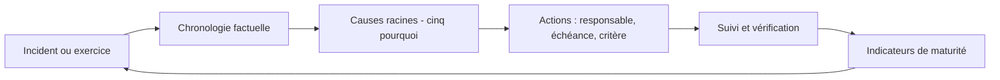

## Introduction

Ce dernier chapitre referme le cours Cybersécurité Défensive, et avec lui l'ensemble du parcours cybersécurité de Nyx, en abordant la discipline qui transforme chaque incident ou exercice en amélioration durable : le post-mortem, et la notion plus large de maturité de sécurité progressive.

La sécurité n'est jamais « terminée ». Les menaces évoluent, le système d'information change, les équipes se renouvellent. Une organisation qui a mis en place toutes les mesures des chapitres précédents, mais ne les remet jamais en question, verra son niveau de sécurité se dégrader silencieusement. À l'inverse, une organisation modeste qui apprend méthodiquement de chaque incident, de chaque exercice et de chaque quasi-incident progresse année après année.

À la fin de ce chapitre, tu sauras conduire un post-mortem qui produit des actions structurelles, rechercher les causes racines d'un incident, évaluer le niveau de maturité d'une organisation, choisir des indicateurs qui mesurent vraiment la progression, et relier tout cela au cycle d'amélioration continue exigé par les normes.

## Mener un post-mortem constructif

Un post-mortem, appelé aussi retour d'expérience ou RETEX, est une analyse structurée réalisée après un incident ou un exercice. Son but n'est pas de trouver un coupable, mais de comprendre ce qui s'est passé, pourquoi, et ce qui doit changer.

<CehCallout>
Rappel du cours Forensics & DFIR (chapitre 8) et du cours Analyse SOC (chapitre 8) : un post-mortem efficace ne se contente jamais de corriger la faille exploitée — il interroge pourquoi la détection a été tardive, quelles couches de la défense en profondeur (chapitre 1) ont failli, et ce qui doit changer structurellement, pas seulement ponctuellement.
</CehCallout>

<Steps steps={[
  { title: "Reconstruire la chronologie complète", description: "Rappel du cours Forensics & DFIR (chapitre 5) : une timeline précise, distinguant faits établis et hypothèses." },
  { title: "Identifier chaque couche de défense défaillante", description: "Rappel du chapitre 1 de ce cours : à quelle(s) couche(s) l'attaque aurait-elle pu être stoppée, et pourquoi ne l'a-t-elle pas été ?" },
  { title: "Prioriser les actions structurelles", description: "Au-delà du correctif immédiat, quelles mesures durables (durcissement, Zero Trust, PAM, détection) réduiraient un risque similaire à l'avenir ?" },
  { title: "Partager sans blâme individuel", description: "Rappel du cours Psychologie & Ingénierie Sociale (chapitre 5) : un post-mortem qui blâme un individu décourage la transparence nécessaire à l'amélioration collective." },
]} />

### Pourquoi « sans blâme »

La culture dite *blameless*, popularisée par les équipes d'exploitation des grands services en ligne, part d'un constat simple : si une personne risque une sanction en racontant ce qu'elle a fait, elle racontera moins, ou plus tard. Or le post-mortem a besoin de faits complets. Un utilisateur qui a cliqué sur un lien d'hameçonnage doit pouvoir le dire immédiatement, sans crainte, car chaque minute compte pour le confinement. Un administrateur qui a ouvert un port « temporairement » doit pouvoir l'expliquer, car c'est souvent le symptôme d'un processus de demande trop lent.

Sans blâme ne veut pas dire sans responsabilité. On recherche les conditions qui ont rendu l'erreur possible et probable, et on agit sur ces conditions : un outil ambigu, une procédure absente, une charge de travail excessive, un contrôle technique manquant. Une erreur humaine est presque toujours le point de départ d'une analyse, pas sa conclusion.

### Rechercher les causes racines

La méthode des **cinq pourquoi** aide à dépasser le symptôme. Prenons le compte compromis du chapitre 6.

1. Pourquoi l'attaquant a-t-il pu se connecter ? Parce qu'il possédait le mot de passe de l'utilisateur.
2. Pourquoi le mot de passe a-t-il suffi ? Parce que le MFA n'était pas exigé sur le portail d'accès distant.
3. Pourquoi le MFA n'était-il pas exigé ? Parce que ce portail avait été exclu de la politique lors de sa migration.
4. Pourquoi cette exclusion n'a-t-elle pas été repérée ? Parce qu'aucune revue périodique des exceptions n'existe.
5. Pourquoi l'intrusion a-t-elle duré quatre jours ? Parce qu'aucune règle ne signalait une connexion depuis un pays inhabituel.

Le correctif immédiat est d'activer le MFA sur ce portail. Les actions structurelles sont d'instaurer une revue trimestrielle des exceptions à la politique d'accès conditionnel, et d'ajouter une détection sur les connexions anormales. La dernière question, celle de la détection tardive, est exactement celle que le cours recommande de ne jamais oublier.

Un post-mortem utile produit un document court et structuré : résumé, impact, chronologie, causes, ce qui a bien fonctionné, ce qui a mal fonctionné, et une liste d'actions. Chaque action a un **responsable nommé**, une **échéance** et un **critère de vérification**. Une action sans responsable ni date est un vœu.



## La maturité de sécurité — une progression, pas un état binaire

On entend souvent la question « sommes-nous sécurisés ? ». Elle n'a pas de réponse binaire. La bonne question est : « à quel niveau de maturité sommes-nous, et quelle est la prochaine étape ? ».

<CompareTable
  titleA="Niveau de maturité"
  titleB="Caractéristique typique"
  rows={[
    { a: "Réactif", b: "Répond aux incidents au fur et à mesure, sans processus formalisé ni anticipation" },
    { a: "Géré", b: "Processus documentés (playbooks, cours Analyse SOC ch.6), défense en profondeur de base en place" },
    { a: "Proactif", b: "Threat hunting régulier (cours Analyse SOC ch.7), exercices Purple Team (chapitre 9), amélioration continue mesurée" },
]}
/>

Une organisation **réactive** découvre souvent ses incidents par hasard ou par un tiers, comme un client ou une autorité, et les traite en improvisant. Une organisation **gérée** dispose de playbooks, d'un SIEM et d'un EDR, d'une politique de correctifs et d'une défense en profondeur de base, mais attend que les alertes arrivent. Une organisation **proactive** cherche activement les menaces qui auraient échappé à la détection, éprouve régulièrement ses défenses par des exercices, et mesure sa progression.

<TipCallout>
Cette progression de maturité rejoint directement le système de progression de Nyx (Novice → Apprenti → Intermédiaire) : une organisation, comme un professionnel en formation, progresse par étapes mesurables, jamais par un saut immédiat vers la maturité complète.
</TipCallout>

### Les tiers et profils du NIST CSF 2.0

Le NIST CSF 2.0 propose deux outils complémentaires. Les **tiers de mise en œuvre** décrivent la rigueur de la gouvernance et de la gestion des risques sur quatre niveaux : partiel, informé par les risques, reproductible et adaptatif. Les **profils** permettent de décrire la situation actuelle de l'organisation, le profil actuel, et la situation visée, le profil cible, sur l'ensemble des fonctions Govern, Identify, Protect, Detect, Respond et Recover. L'écart entre les deux devient la feuille de route.

D'autres modèles existent selon les contextes : le C2M2 du département de l'Énergie américain, utilisé dans l'énergie et l'industrie, le SOC-CMM pour évaluer spécifiquement un SOC, ou les groupes d'implémentation IG1, IG2 et IG3 des CIS Controls vus au chapitre 1. L'important n'est pas le modèle choisi, mais de s'évaluer honnêtement et régulièrement avec le même référentiel.

### Mesurer avec des indicateurs utiles

Un bon indicateur aide à décider. Quelques indicateurs couramment utilisés dans une démarche défensive :

| Indicateur | Ce qu'il mesure | Exemple de cible |
| --- | --- | --- |
| MTTD, délai moyen de détection | Temps entre le début d'un incident et sa détection | En baisse à chaque trimestre |
| MTTR, délai moyen de réponse | Temps entre la détection et le confinement ou la résolution | Moins de 4 heures pour un incident élevé |
| Couverture ATT&CK testée | Part des techniques prioritaires alertées en exercice | Progression après chaque Purple Team |
| Délai de correctif des vulnérabilités KEV | Temps entre la publication et la correction | Quelques jours pour les équipements exposés |
| Taux de restauration réussie | Tests de restauration sans erreur | 100 %, règle 3-2-1-1-0 |
| Actions de post-mortem closes à échéance | Discipline du suivi | Plus de 90 % |

<WarningCallout>
Un indicateur devenu objectif cesse d'être un bon indicateur : c'est la loi de Goodhart. Si l'équipe est évaluée sur le nombre d'alertes fermées, elle fermera vite, pas bien. Si elle est évaluée sur le taux de correctifs appliqués, elle risque de traiter d'abord les correctifs faciles. Combine toujours plusieurs indicateurs, et revois-les avec ceux qui les produisent.
</WarningCallout>

Ces indicateurs se calculent simplement à partir du registre des incidents. Un court script Python suffit à suivre l'évolution trimestre par trimestre.

```python
# incidents.csv : id,debut,detection,resolution (horodatages ISO 8601)
import pandas as pd

df = pd.read_csv("incidents.csv", parse_dates=["debut", "detection", "resolution"])
df["ttd_h"] = (df["detection"] - df["debut"]).dt.total_seconds() / 3600
df["ttr_h"] = (df["resolution"] - df["detection"]).dt.total_seconds() / 3600
df["trimestre"] = df["detection"].dt.to_period("Q")

# La médiane est moins sensible qu'une moyenne à un incident exceptionnellement long
synthese = df.groupby("trimestre")[["ttd_h", "ttr_h"]].agg(["median", "mean"]).round(1)
print(synthese)
```

```text
          ttd_h         ttr_h
         median  mean  median  mean
trimestre
2026Q1     52.0  97.3    11.5  18.2
2026Q2     30.5  41.0     8.0  10.4
2026Q3     14.0  19.8     5.5   7.1
```

Ce tableau raconte une histoire : la détection s'améliore nettement d'un trimestre à l'autre, ce qui correspond, dans ce scénario, à la mise en place des règles issues des exercices Purple Team. L'écart entre moyenne et médiane au premier trimestre signale un incident découvert très tardivement, qui mérite à lui seul un post-mortem approfondi.

### L'amélioration continue dans les normes

<AuditCallout>
L'ISO/IEC 27001:2022 structure le système de management de la sécurité de l'information autour d'un cycle d'amélioration continue, souvent présenté sous la forme PDCA : planifier, faire, vérifier, agir. Les clauses 9 et 10 exigent la surveillance et la mesure, l'audit interne, la revue de direction, le traitement des non-conformités par des actions correctives, et l'amélioration continue. Le contrôle A.5.27 de l'Annexe A demande explicitement de tirer des enseignements des incidents de sécurité. Un auditeur vérifiera que les post-mortems existent, qu'ils produisent des actions et que ces actions sont suivies jusqu'à leur terme.
</AuditCallout>

Les réglementations européennes vont dans le même sens. NIS2 exige des politiques d'évaluation de l'efficacité des mesures de gestion des risques et engage la responsabilité des organes de direction, qui doivent approuver ces mesures et se former. DORA impose au secteur financier des tests réguliers et des enseignements tirés des incidents majeurs. La fonction Govern du NIST CSF 2.0 traduit la même idée : la cybersécurité est un sujet de gouvernance, pas seulement un sujet technique.

## Synthèse — panorama complet du cours

<CompareTable
  titleA="Chapitre"
  titleB="Couche de la défense en profondeur"
  rows={[
    { a: "1. Principes de défense en profondeur", b: "Cadre général du cours" },
    { a: "2. Durcissement des systèmes", b: "Couche système" },
    { a: "3. Segmentation et Zero Trust", b: "Couche réseau" },
    { a: "4. IAM en profondeur", b: "Couche identité et accès" },
    { a: "5. SIEM, EDR et supervision", b: "Couche détection" },
    { a: "6. Réponse à incident", b: "Réaction face à une défaillance des couches précédentes" },
    { a: "7. Sauvegarde et continuité", b: "Dernière ligne de défense" },
    { a: "8. Threat intelligence", b: "Anticipation proactive" },
    { a: "9. Red/Blue/Purple Team", b: "Validation pratique de l'ensemble des couches" },
    { a: "10. Amélioration continue", b: "Boucle de progression permanente" },
]}
/>

Relis ce tableau comme un cycle. La threat intelligence oriente le durcissement, la segmentation, la gestion des identités et la détection. Les exercices les éprouvent. Les incidents réels et les exercices alimentent les post-mortems, qui produisent des actions, qui renforcent à nouveau chaque couche. C'est cette boucle, bien plus qu'un outil particulier, qui distingue une défense mature.

<AttackDefenseTable rows={[
  { phase: "Exploitation de l'inertie", attack: "Réutilisation d'une faiblesse connue mais jamais corrigée après un incident précédent", defense: "Actions de post-mortem avec responsable, échéance et vérification" },
  { phase: "Exploitation de la dérive", attack: "Profiter d'une exception temporaire devenue permanente", defense: "Revue périodique des exceptions et des configurations" },
  { phase: "Exploitation des angles morts", attack: "Utiliser une technique que personne n'a jamais testée", defense: "Couverture ATT&CK mesurée et exercices Purple Team réguliers" },
  { phase: "Exploitation du silence", attack: "Agir là où les erreurs ne sont pas signalées par peur de la sanction", defense: "Culture sans blâme, signalement simple et valorisé" }
]} />

## Le parcours Nyx dans son ensemble

<CehCallout>
Ce cours referme un parcours complet : des fondations (Linux, Réseaux, Mathématiques) aux spécialisations offensive et défensive, en passant par la data science, l'IA et le droit — la cybersécurité moderne exige cette double compétence, offensive pour comprendre précisément ce qu'il faut défendre, défensive pour construire une protection réellement efficace face à des menaces bien comprises plutôt qu'abstraites.
</CehCallout>

Pour la suite, les certifications peuvent jalonner ta progression selon ton orientation. Côté défensif, la CompTIA Security+ dans sa version SY0-701 valide les fondamentaux, la CompTIA CySA+ et la Microsoft SC-200 visent l'analyse SOC, et les certifications GIAC couvrent des spécialités pointues. Côté offensif, le CEH v13 et l'OSCP+ restent des références. Aucune certification ne remplace la pratique : les Projets et les Labs de Nyx sont là pour ça.

## Erreurs fréquentes

La première erreur est de **chercher un coupable**. Le post-mortem devient un tribunal, les faits se raréfient et l'organisation n'apprend plus.

La deuxième est de **s'arrêter au correctif immédiat**. La faille corrigée ne reviendra pas, mais la cause structurelle produira une autre faille ailleurs.

La troisième est de **produire des actions sans suivi**. Un post-mortem dont les actions ne sont jamais vérifiées donne une fausse impression de progrès.

La quatrième est de **mesurer ce qui est facile plutôt que ce qui compte**, comme le nombre de règles SIEM au lieu de la couverture réellement testée.

La cinquième est de **viser directement le niveau proactif** sans les fondations du niveau géré. Le threat hunting n'a pas de sens si l'inventaire des actifs et la journalisation de base n'existent pas.

## Lab — Mise en pratique

**Environnement** : réflexion guidée, puis terminal Kali avec Python 3.12 ou plus récent et pandas 2.x.

<Steps steps={[
  { title: "Mener un post-mortem complet", description: "Pour l'incident de compte compromis du chapitre 6, rédige un post-mortem qui identifie une couche de défense défaillante et propose une action structurelle, pas seulement le correctif immédiat. Applique la méthode des cinq pourquoi." },
  { title: "Formaliser les actions", description: "Pour chaque action de ton post-mortem, indique un responsable, une échéance et un critère de vérification observable, par exemple « une connexion de test sans MFA est refusée »." },
  { title: "Créer un registre d'incidents fictif", description: "Crée un fichier CSV de six incidents répartis sur trois trimestres, avec les horodatages de début, de détection et de résolution.", code: "cat > incidents.csv << 'EOF'\nid,debut,detection,resolution\n1,2026-01-10T08:00,2026-01-13T10:00,2026-01-13T22:00\n2,2026-02-02T14:00,2026-02-04T09:00,2026-02-04T19:00\n3,2026-04-11T07:00,2026-04-12T15:00,2026-04-12T23:00\n4,2026-05-20T22:00,2026-05-21T23:00,2026-05-22T06:00\n5,2026-07-03T09:00,2026-07-03T21:00,2026-07-04T02:00\n6,2026-08-15T13:00,2026-08-16T05:00,2026-08-16T11:00\nEOF" },
  { title: "Calculer MTTD et MTTR", description: "Enregistre le script Python du chapitre sous le nom kpi.py, puis exécute-le sur ton registre. Observe l'évolution des médianes par trimestre et l'écart entre moyenne et médiane.", code: "python3 -m venv ~/venv-kpi && ~/venv-kpi/bin/pip install -q 'pandas>=2.2'\n~/venv-kpi/bin/python kpi.py" },
  { title: "Évaluer un niveau de maturité", description: "Pour une organisation que tu connais, ou celle d'un cas fictif, établis un profil actuel et un profil cible sur les six fonctions du NIST CSF 2.0, puis situe-la sur l'échelle réactif, géré, proactif. Liste les trois actions qui réduiraient le plus l'écart." },
  { title: "Situer sa propre progression", description: "Après ce parcours complet, à quel niveau de maturité (réactif, géré, proactif) situerais-tu tes propres compétences, et quel prochain projet Nyx (rappel de la section Projets) choisirais-tu pour progresser vers le niveau suivant ?" }
]} />

## À retenir

- Un post-mortem constructif interroge les défaillances structurelles de la défense en profondeur et la raison d'une détection tardive, pas seulement le correctif ponctuel, et reste toujours sans blâme individuel.
- La méthode des cinq pourquoi aide à remonter aux causes racines ; chaque action a un responsable, une échéance et un critère de vérification.
- La maturité de sécurité progresse par étapes, réactif, géré, proactif, à l'image du système de progression Novice, Apprenti, Intermédiaire de Nyx.
- Les tiers et profils du NIST CSF 2.0 permettent de mesurer l'écart entre situation actuelle et situation cible.
- MTTD, MTTR, couverture testée et délais de correctifs sont des indicateurs utiles, à combiner pour éviter les effets pervers.
- L'ISO/IEC 27001:2022 inscrit l'amélioration continue dans ses exigences, et NIS2 comme DORA engagent la direction.
- Ce cours referme le parcours complet de Nyx, où compétences offensives et défensives se répondent et se renforcent mutuellement.

## Questions de révision

1. Pourquoi un post-mortem ne doit-il jamais se limiter au correctif immédiat de la faille exploitée ?
2. Quels sont les trois niveaux de maturité de sécurité présentés dans ce chapitre ?
3. Pourquoi la cybersécurité moderne exige-t-elle une double compétence offensive et défensive plutôt qu'une spécialisation unique ?
4. Pourquoi un post-mortem doit-il être mené sans blâme, et en quoi cela diffère-t-il d'une absence de responsabilité ?
5. Applique la méthode des cinq pourquoi à un incident de ton choix et identifie l'action structurelle qui en découle.
6. Quelle est la différence entre un tier de mise en œuvre et un profil dans le NIST CSF 2.0 ?
7. Explique la loi de Goodhart avec un exemple d'indicateur de sécurité mal utilisé.

Félicitations, tu viens de terminer le cours **Cybersécurité Défensive**, et avec lui l'ensemble du parcours cybersécurité de Nyx ! Continue à pratiquer via les **Projets** et les **Labs** pour consolider chaque compétence acquise, et vise les certifications qui correspondent le mieux à ton objectif professionnel.
