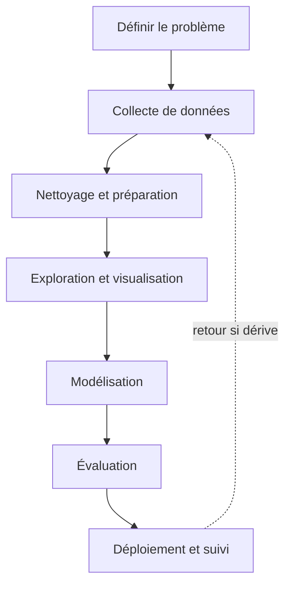

## Introduction

Ce cours met en pratique les fondations mathématiques posées aux cours Mathématiques Appliquées et Algèbre Linéaire, en les appliquant à des cas concrets de cybersécurité — détection de phishing, analyse de logs, identification d'anomalies réseau. Ce premier chapitre pose le cadre méthodologique global avant d'entrer dans le détail technique.

Pourquoi commencer par la méthode plutôt que par les algorithmes ? Parce que la grande majorité des projets de data science qui échouent ne le font pas à cause d'un mauvais algorithme, mais à cause d'un problème mal posé, de données non représentatives ou d'une évaluation trompeuse. En sécurité, ces erreurs coûtent cher : un détecteur qui noie le SOC sous les fausses alertes finit désactivé, et un détecteur qui rate les attaques donne un faux sentiment de protection. À la fin de ce chapitre, tu sauras décrire chaque étape d'un projet, cadrer un problème avec des chiffres, distinguer data science, machine learning et IA, et réaliser un premier diagnostic de qualité sur un jeu de données avec pandas.

## Les grandes étapes d'un projet de data science



Chaque étape a un objectif et un livrable précis. La **définition du problème** produit une question claire, une métrique de succès et des contraintes. La **collecte** rassemble les données nécessaires, avec leurs droits d'usage. Le **nettoyage et la préparation** traitent les valeurs manquantes, les doublons et les formats, puis construisent les caractéristiques (feature engineering). L'**exploration** (EDA) vérifie les distributions et les relations entre variables, et fait souvent émerger de nouvelles questions. La **modélisation** entraîne et compare des modèles. L'**évaluation** mesure leurs performances avec des métriques adaptées, sur des données jamais vues. Enfin, le **déploiement et le suivi** mettent le modèle en production et surveillent sa dégradation dans le temps.

La flèche en pointillés est essentielle : le cycle n'est pas linéaire. Quand le comportement des attaquants change ou que l'infrastructure évolue, les données de production s'éloignent de celles de l'entraînement ; on parle de **dérive** (drift). Il faut alors revenir à la collecte et réentraîner. En pratique, on fait aussi de nombreux allers-retours entre exploration, nettoyage et modélisation.

<CehCallout>
Contrairement à une idée reçue répandue, la modélisation (entraîner un algorithme de machine learning) ne représente généralement qu'une petite fraction du temps d'un projet de data science — la collecte, le nettoyage et l'exploration des données en consomment la majorité, souvent 60 à 80% selon les estimations couramment citées dans l'industrie.
</CehCallout>

### La méthode CRISP-DM

Le cycle ci-dessus est une version simplifiée de **CRISP-DM** (Cross-Industry Standard Process for Data Mining), une méthode publiée à la fin des années 1990 et toujours la plus utilisée. Elle comporte six phases : compréhension du métier, compréhension des données, préparation des données, modélisation, évaluation et déploiement. Sa grande leçon est de commencer par le **métier** : dans notre contexte, comprendre comment travaille le SOC, ce qu'est une alerte utile et combien d'alertes un analyste peut traiter par jour.

| Phase CRISP-DM | Question clé en sécurité | Livrable |
| --- | --- | --- |
| Compréhension du métier | Quel risque veut-on réduire, et pour qui ? | Énoncé du problème, critères de succès |
| Compréhension des données | Quelles sources existent, avec quelle qualité ? | Inventaire des sources, rapport de qualité |
| Préparation des données | Comment obtenir une table propre et représentative ? | Jeu de données nettoyé, caractéristiques |
| Modélisation | Quels modèles essayer, avec quelle référence ? | Modèles entraînés, modèle de référence (baseline) |
| Évaluation | Le modèle répond-il au besoin métier ? | Rapport de métriques, analyse d'erreurs |
| Déploiement | Comment l'intégrer au SIEM ou à la messagerie ? | Service en production, supervision, procédure de réentraînement |

## Data science, machine learning, IA — clarifier le vocabulaire

<CompareTable
  titleA="Terme"
  titleB="Périmètre"
  rows={[
    { a: "Data science", b: "Discipline englobante : collecte, nettoyage, analyse et exploitation de données pour en tirer des décisions" },
    { a: "Machine learning", b: "Sous-ensemble de la data science : algorithmes qui apprennent des motifs à partir de données plutôt que d'être programmés explicitement" },
    { a: "Intelligence artificielle", b: "Champ plus large englobant le ML, mais aussi des approches non statistiques (systèmes à base de règles, agents logiques)" },
]}
/>

Ces trois domaines se recouvrent sans s'emboîter parfaitement. Une grande partie de la data science n'utilise aucun machine learning : un tableau de bord qui compte les connexions échouées par pays, ou une analyse statistique qui compare deux politiques de mots de passe, relèvent de la data science sans rien « apprendre ». À l'inverse, le machine learning est l'une des branches de l'intelligence artificielle, aux côtés des systèmes experts à base de règles. Le **deep learning** est lui-même une sous-famille du machine learning fondée sur les réseaux de neurones, et les grands modèles de langage (LLM) en sont l'exemple le plus visible.

<TipCallout>
Un détecteur de spam basé sur une liste de mots interdits codée en dur relève de l'IA (un système à base de règles) mais pas du machine learning — un détecteur qui apprend à partir de milliers d'emails déjà classés relève, lui, du machine learning, approfondi au cours IA & Agents en Cybersécurité.
</TipCallout>

Le même raisonnement s'applique à un pare-feu qui bloque le trafic selon une liste de règles fixes : c'est un système à base de règles, pas du machine learning. Les deux approches sont complémentaires. Les règles, comme les signatures Suricata ou YARA, sont précises et explicables pour des menaces connues ; le machine learning généralise à des variantes et à des comportements nouveaux, au prix de faux positifs et d'une explicabilité moindre.

## Pourquoi ce cadre méthodologique compte particulièrement en sécurité

<WarningCallout>
Sauter directement à la modélisation sans comprendre la qualité et les biais des données collectées est une erreur fréquente et coûteuse en sécurité : un modèle de détection d'intrusion entraîné sur des logs incomplets ou non représentatifs du trafic réel de production donnera une fausse impression de performance en test, avant d'échouer largement une fois déployé.
</WarningCallout>

La sécurité cumule plusieurs difficultés rarement réunies ailleurs. Les classes sont très **déséquilibrées** : les attaques représentent souvent bien moins de 1 % des événements. Les **étiquettes** sont rares et coûteuses, car il faut un analyste pour confirmer qu'un événement est malveillant. L'environnement est **adversarial** : l'attaquant s'adapte au détecteur. Enfin, les jeux de données publics, comme CIC-IDS2017 ou UNSW-NB15, sont précieux pour apprendre, mais ils ont été générés sur des réseaux de test il y a plusieurs années ; un modèle excellent sur ces données peut s'effondrer sur ton propre trafic.

<Steps steps={[
  { title: "Définir précisément le problème", description: "Ex : 'détecter les emails de phishing' est trop vague — préciser le taux de faux positifs acceptable, la latence tolérée, les types de phishing ciblés." },
  { title: "Collecter des données représentatives", description: "Des données non représentatives du contexte réel de déploiement produisent un modèle qui ne généralise pas." },
  { title: "Nettoyer avant d'explorer", description: "Des données brutes contiennent presque toujours des valeurs manquantes, dupliquées ou aberrantes à traiter avant toute analyse fiable." },
  { title: "Évaluer avec les bonnes métriques", description: "Une métrique mal choisie (approfondi au chapitre 7) peut donner une illusion de succès sur un problème de sécurité déséquilibré (peu d'attaques parmi énormément de trafic normal)." },
]} />

### Cadrer avec des chiffres

Un bon énoncé ressemble à ceci : « Signaler en moins de deux secondes, avant remise dans la boîte de réception, les emails de phishing de type vol d'identifiants, en détectant au moins 95 % d'entre eux et en ne générant pas plus de 200 alertes par jour pour l'équipe de deux analystes. » Chaque élément est mesurable. Pour vérifier qu'un tel objectif est réaliste, on fait un calcul d'ordre de grandeur avant d'écrire la moindre ligne de modélisation.

```python
# Cadrage chiffré : que signifient 1 % de faux positifs sur la messagerie ?
emails_par_jour = 200_000
taux_phishing = 0.002              # 0,2 % des emails sont du phishing
rappel = 0.95                      # part du phishing détectée
taux_faux_positifs = 0.01          # part des emails légitimes signalés à tort

phishing = emails_par_jour * taux_phishing
legitimes = emails_par_jour - phishing
detectes = phishing * rappel
rates = phishing - detectes
fausses_alertes = legitimes * taux_faux_positifs
precision = detectes / (detectes + fausses_alertes)

print(f"Phishing reçus       : {phishing:,.0f}")
print(f"Détectés / ratés     : {detectes:,.0f} / {rates:,.0f}")
print(f"Fausses alertes      : {fausses_alertes:,.0f}")
print(f"Précision des alertes: {precision:.1%}")
```

```text
Phishing reçus       : 400
Détectés / ratés     : 380 / 20
Fausses alertes      : 1,996
Précision des alertes: 16.0%
```

Ce petit calcul est révélateur. Un taux de faux positifs de 1 %, qui paraît excellent, produit près de 2 000 fausses alertes par jour, dix fois plus que la capacité de l'équipe, et seulement 16 % des alertes sont de vrais phishing. L'objectif doit donc viser un taux de faux positifs autour de 0,1 % ou prévoir un tri automatique. C'est ce raisonnement, et non le choix de l'algorithme, qui détermine le succès du projet. Les notions de précision et de rappel seront formalisées au chapitre 7.

## Les rôles et les outils

Un projet réel mobilise plusieurs profils : le **data engineer** construit les pipelines de collecte (par exemple depuis le SIEM ou un lac de données) ; le **data scientist** explore, modélise et évalue ; l'**ingénieur MLOps** déploie et surveille les modèles ; et l'**expert métier**, ici l'analyste SOC ou le threat hunter, fournit les étiquettes et juge la pertinence des résultats. Dans une petite équipe, une même personne cumule souvent plusieurs rôles.

Côté outils, l'écosystème Python domine : Python 3.12 ou plus récent, **pandas 2.x** pour les tableaux de données, **NumPy 2.x** pour le calcul, **matplotlib** et **seaborn** pour la visualisation, **scikit-learn** (version 1.5 ou plus récente) pour le machine learning classique, et Jupyter pour l'exploration interactive. On isole chaque projet dans un environnement virtuel, avec `python -m venv` ou l'outil `uv`, et on fige les versions des dépendances pour que les résultats soient reproductibles. Des outils comme MLflow permettent de tracer les expériences et les modèles.

```bash
# Créer un environnement isolé et installer la pile data
python3 -m venv .venv
source .venv/bin/activate
pip install "pandas>=2.2" "numpy>=2.0" "scikit-learn>=1.5" matplotlib seaborn jupyterlab
python -c "import pandas, sklearn; print(pandas.__version__, sklearn.__version__)"
```

### Un premier diagnostic avec pandas

Avant toute chose, on charge les données et on les regarde. Les méthodes `head`, `info`, `isna` et `duplicated` de pandas donnent en quelques lignes une vue d'ensemble de la qualité.

```python
import pandas as pd
import numpy as np

data = {
    "email_id": [1, 2, 3, 3, 4, 5],
    "urgence_langage": [1, 0, 1, 1, np.nan, 0],
    "lien_raccourci": [1, 0, 1, 1, 0, np.nan],
    "label": ["phishing", "legitime", "phishing", "phishing", "legitime", "legitime"],
}
df = pd.DataFrame(data)
print(df.head())
df.info()
print("Valeurs manquantes par colonne :")
print(df.isna().sum())
print("Lignes dupliquees :", df.duplicated().sum())
print(df["label"].value_counts())
```

```text
   email_id  urgence_langage  lien_raccourci     label
0         1              1.0             1.0  phishing
1         2              0.0             0.0  legitime
2         3              1.0             1.0  phishing
3         3              1.0             1.0  phishing
4         4              NaN             0.0  legitime
<class 'pandas.core.frame.DataFrame'>
RangeIndex: 6 entries, 0 to 5
Data columns (total 4 columns):
 #   Column           Non-Null Count  Dtype  
---  ------           --------------  -----  
 0   email_id         6 non-null      int64  
 1   urgence_langage  5 non-null      float64
 2   lien_raccourci   5 non-null      float64
 3   label            6 non-null      object 
dtypes: float64(2), int64(1), object(1)
memory usage: 324.0+ bytes
Valeurs manquantes par colonne :
email_id           0
urgence_langage    1
lien_raccourci     1
label              0
dtype: int64
Lignes dupliquees : 1
label
phishing    3
legitime    3
Name: count, dtype: int64
```

On repère immédiatement deux valeurs manquantes (notées `NaN`, Not a Number), une ligne dupliquée (l'email 3 apparaît deux fois) et un détail subtil : à cause des valeurs manquantes, pandas a converti les colonnes 0/1 en nombres flottants. Le doublon fausse aussi l'équilibre apparent des classes : sans lui, il n'y aurait que deux phishing pour trois emails légitimes. Le chapitre 2 montrera comment traiter ces problèmes.

## Déploiement, suivi et gouvernance

Un modèle n'a de valeur qu'en production. Le déploiement peut prendre la forme d'un traitement par lots (scorer chaque nuit les connexions VPN de la veille) ou d'un service en temps réel (scorer chaque email avant remise). Dans les deux cas, il faut **superviser** : la distribution des entrées, la proportion d'alertes, le retour des analystes sur les faux positifs. Une hausse soudaine du nombre d'alertes signale souvent une dérive ou un changement de format des logs plutôt qu'une vague d'attaques.

Le cadre réglementaire fait aussi partie du cycle. Les données de sécurité contiennent des données personnelles (adresses IP, identifiants, contenu d'emails), soumises au RGPD dès la collecte ; le chapitre 9 y revient en détail. Le règlement européen sur l'intelligence artificielle (AI Act), entré en vigueur en août 2024 avec une application progressive jusqu'en 2027, impose des obligations selon le niveau de risque du système, et la directive NIS2 renforce les exigences de gestion des risques cyber pour de nombreuses organisations.

<AuditCallout>
L'ISO/IEC 27001:2022 exige notamment de journaliser et surveiller les activités (contrôles A.8.15 « Journalisation » et A.8.16 « Activités de surveillance »). Un projet de data science qui exploite ces journaux doit documenter ses sources, la durée de conservation des données et les droits d'accès, afin de rester cohérent avec le système de management de la sécurité de l'information.
</AuditCallout>

## Erreurs fréquentes

La première erreur est de commencer par l'algorithme (« faisons du deep learning sur nos logs ») au lieu de commencer par la question métier. La deuxième est d'oublier le **modèle de référence** : une règle simple ou un seuil statistique donne une base de comparaison, et un modèle complexe qui ne fait pas mieux n'a aucune raison d'exister. La troisième est de juger un modèle sur un jeu de test qui ne ressemble pas à la production, par exemple un jeu public ancien. La quatrième est de considérer le projet terminé au déploiement, sans plan de suivi ni de réentraînement. Enfin, beaucoup d'équipes oublient de vérifier, avant de collecter, qu'elles ont le droit d'utiliser les données pour cet usage.

## Lab — Mise en pratique

**Environnement** : Python 3.12+ (terminal Nyx Shell ou environnement local avec `pandas`, `numpy` et `matplotlib` installés).

<Steps steps={[
  { title: "Préparer l'environnement", description: "Crée un environnement virtuel, installe la pile data et vérifie les versions affichées : pandas doit être en 2.x et scikit-learn en 1.5 ou plus.", code: "python3 -m venv .venv && source .venv/bin/activate\npip install 'pandas>=2.2' 'numpy>=2.0' 'scikit-learn>=1.5' matplotlib\npython -c 'import pandas, sklearn; print(pandas.__version__, sklearn.__version__)'" },
  { title: "Charger un jeu de données brut sans le nettoyer", description: "Reproduis l'erreur décrite plus haut : charge un petit jeu d'emails avec des valeurs manquantes et un doublon, sans rien corriger, et observe ce que révèle un simple coup d'œil.", code: 'import pandas as pd\nimport numpy as np\n\ndata = {\n    "email_id": [1, 2, 3, 3, 4, 5],\n    "urgence_langage": [1, 0, 1, 1, np.nan, 0],\n    "lien_raccourci": [1, 0, 1, 1, 0, np.nan],\n    "label": ["phishing", "legitime", "phishing", "phishing", "legitime", "legitime"]\n}\ndf = pd.DataFrame(data)\nprint(df.head())\ndf.info()' },
  { title: "Quantifier les problèmes avant de foncer vers la modélisation", description: "Avant tout entraînement, mesure explicitement l'ampleur des valeurs manquantes et des doublons — l'étape que l'équipe de l'exercice précédent a sautée. Tu dois trouver une valeur manquante dans deux colonnes et une ligne dupliquée.", code: 'print("Valeurs manquantes par colonne :")\nprint(df.isna().sum())\nprint("Lignes dupliquees :", df.duplicated().sum())' },
  { title: "Faire un cadrage chiffré", description: "Reprends le script de cadrage et cherche le taux de faux positifs maximal qui permet de rester sous 200 alertes par jour. Quelle précision obtiens-tu alors ?", code: "for fp in (0.01, 0.005, 0.001, 0.0005):\n    fa = 199_600 * fp\n    print(fp, round(fa), round(380 / (380 + fa), 3))" },
  { title: "Identifier une étape manquante", description: "Une équipe entraîne directement un modèle de détection de phishing sur un jeu de données brut téléchargé en ligne, sans l'explorer ni le nettoyer au préalable, comme dans l'exemple ci-dessus. Quelles étapes du cycle de vie ont été sautées, et quel risque cela fait-il courir ?" },
  { title: "Distinguer IA, ML et data science", description: "Un pare-feu qui bloque le trafic selon une liste de règles fixes relève-t-il du machine learning ? Et un tableau de bord qui compte les échecs d'authentification par heure relève-t-il de la data science ? Justifie." },
]} />

## À retenir

- Un projet de data science suit un cycle : définition du problème, collecte, nettoyage et préparation, exploration, modélisation, évaluation, déploiement et suivi, avec retour à la collecte en cas de dérive.
- La collecte, le nettoyage et l'exploration consomment généralement 60 à 80 % du temps d'un projet, bien avant la modélisation.
- La méthode CRISP-DM commence par la compréhension du métier : en sécurité, la capacité de traitement du SOC fixe les contraintes.
- Le machine learning est un sous-ensemble de la data science, et une branche de l'intelligence artificielle, qui inclut aussi les systèmes à base de règles.
- Un problème bien posé précise la cible, la métrique, le taux de faux positifs acceptable et la latence ; un calcul d'ordre de grandeur révèle souvent qu'un « petit » taux d'erreur est énorme en volume.
- Des données non représentatives de la production donnent une fausse impression de performance.
- Le déploiement s'accompagne d'une supervision continue et d'un respect du cadre légal (RGPD, AI Act, NIS2).

## Questions de révision

1. Pourquoi la modélisation ne représente-t-elle généralement qu'une petite partie du temps d'un projet de data science ?
2. Quelle étape suit directement la collecte de données dans le cycle de vie, et pourquoi ?
3. Quelle est la différence entre intelligence artificielle et machine learning ? Donne un exemple de système d'IA qui n'est pas du machine learning.
4. Reformule l'objectif « détecter les emails de phishing » en un énoncé mesurable.
5. Avec 500 000 emails par jour dont 0,1 % de phishing et un taux de faux positifs de 0,5 %, combien de fausses alertes obtiens-tu chaque jour ?
6. Pourquoi des données non représentatives du contexte réel de déploiement posent-elles un problème particulièrement grave en sécurité ?
7. Pourquoi un jeu de données public comme CIC-IDS2017 ne suffit-il pas à valider un détecteur destiné à ton propre réseau ?
