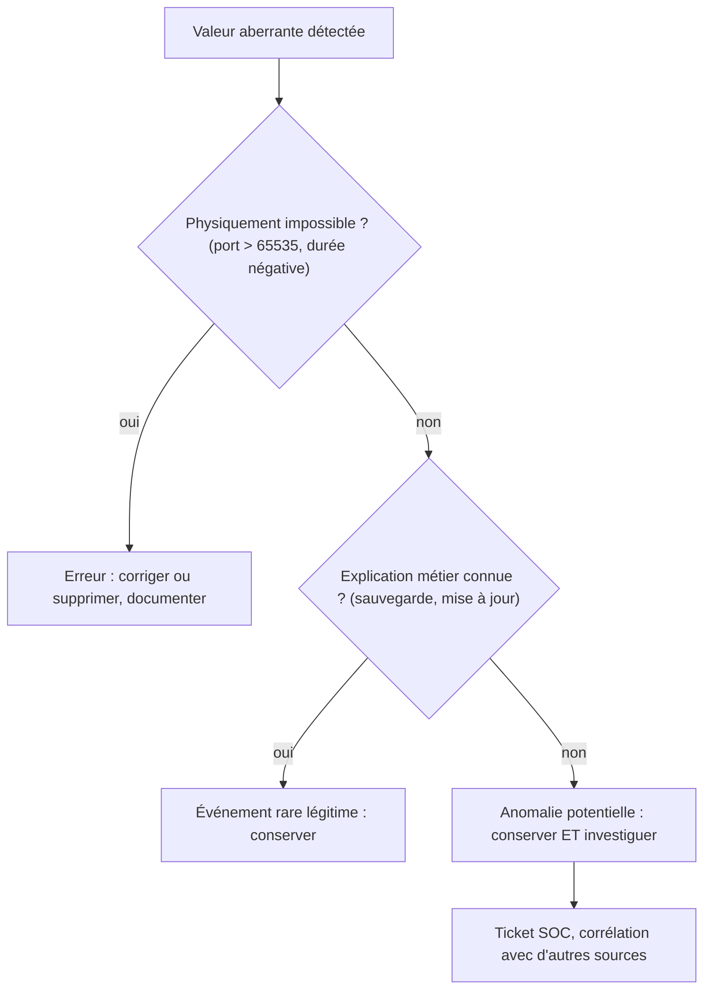

## Introduction

"Garbage in, garbage out" — aucun modèle, aussi sophistiqué soit-il, ne peut compenser des données de mauvaise qualité en entrée. Ce chapitre couvre les techniques fondamentales de nettoyage, à appliquer avant toute exploration ou modélisation.

En sécurité, le nettoyage a une particularité : ce qui ressemble à du « bruit » est parfois exactement le signal recherché. Une connexion de neuf mégaoctets au milieu de transferts de quelques kilo-octets peut être une erreur de capteur, une sauvegarde légitime ou une exfiltration. À la fin de ce chapitre, tu sauras transformer des journaux bruts en tableau pandas correctement typé, diagnostiquer les valeurs manquantes et les doublons, détecter les valeurs aberrantes avec des méthodes robustes, et mettre les variables à l'échelle sans contaminer ton évaluation.

## Sources de données courantes en sécurité

<CompareTable
  titleA="Source"
  titleB="Exemple d'usage"
  rows={[
    { a: "Logs applicatifs et système", b: "Détection d'anomalies, investigation post-incident (lien avec le cours DFIR)" },
    { a: "Capture de trafic réseau (PCAP)", b: "Détection de comportements réseau suspects" },
    { a: "Bases de vulnérabilités publiques (CVE, NVD)", b: "Analyse de tendances, priorisation de correctifs" },
    { a: "Emails et échantillons de phishing", b: "Entraînement de modèles de détection de phishing" },
    { a: "Télémétrie EDR et journaux Windows (Sysmon, événements 4624/4625)", b: "Détection de mouvements latéraux, chasse aux menaces" },
    { a: "Flux réseau (NetFlow, IPFIX, Zeek)", b: "Profilage de trafic à grande échelle sans stocker le contenu des paquets" },
]}
/>

Chaque source a ses forces et ses pièges. Une capture PCAP est exhaustive mais volumineuse et souvent chiffrée (TLS 1.3) ; les flux réseau résument les échanges et passent à l'échelle, mais perdent le contenu. Les bases publiques sont précieuses pour prioriser les correctifs : le NVD fournit les scores CVSS (la version 4.0 est publiée depuis fin 2023, même si de nombreuses entrées n'ont encore qu'un score 3.1), le score EPSS du FIRST estime la probabilité d'exploitation dans les 30 jours, et le catalogue CISA KEV recense les vulnérabilités exploitées activement. Combiner ces trois sources est aujourd'hui la base d'une priorisation fondée sur les données.

### Les formats et la collecte

Les données arrivent sous des formats variés : CSV, JSON (une ligne par événement, dit JSON Lines), syslog texte, Parquet pour les gros volumes, ou API d'un SIEM. pandas sait lire la plupart d'entre eux avec `read_csv`, `read_json(lines=True)` ou `read_parquet`. Avant de collecter, vérifie trois choses : le **droit d'usage** (des emails d'employés sont des données personnelles), la **représentativité** (la période couvre-t-elle les jours ouvrés, les week-ends, les pics de fin de mois ?) et la **synchronisation des horloges** (des fuseaux horaires mélangés rendent toute corrélation temporelle fausse).

### Parser des logs bruts

Les journaux texte doivent être découpés en champs. Les expressions régulières, avec des groupes nommés, sont l'outil classique. Voici l'extraction des tentatives SSH d'un journal `auth.log`, avec des adresses IP issues des plages réservées à la documentation.

```python
import re
import pandas as pd

lignes = """\
2026-11-02T08:14:03+01:00 srv-web sshd[1021]: Failed password for root from 203.0.113.45 port 52144 ssh2
2026-11-02T08:14:05+01:00 srv-web sshd[1021]: Failed password for invalid user admin from 203.0.113.45 port 52150 ssh2
2026-11-02T08:15:40+01:00 srv-web sshd[1088]: Accepted publickey for deploy from 198.51.100.7 port 40022 ssh2
2026-11-02T08:15:41+01:00 srv-web sshd[1088]: Accepted publickey for deploy from 198.51.100.7 port 40022 ssh2
2026-11-02T08:17:12+01:00 srv-web sshd[1102]: Failed password for invalid user oracle from 203.0.113.45 port 52201 ssh2
2026-11-02T08:18:00+01:00 srv-web sshd[1110]: Connection closed by 192.0.2.10 port 61000 [preauth]
""".splitlines()

motif = re.compile(
    r"^(?P<ts>\S+) (?P<hote>\S+) sshd\[\d+\]: (?P<resultat>Failed|Accepted) (?P<methode>\S+) "
    r"for (?:invalid user )?(?P<user>\S+) from (?P<ip>\S+) port (?P<port>\d+)"
)
enregistrements = [m.groupdict() for l in lignes if (m := motif.match(l))]
df = pd.DataFrame(enregistrements)
df["ts"] = pd.to_datetime(df["ts"])
df["port"] = pd.to_numeric(df["port"])
print(f"{len(lignes)} lignes lues, {len(df)} parsées")
print(df[["ts", "resultat", "user", "ip"]])
print(df.dtypes)
```

```text
6 lignes lues, 5 parsées
                         ts  resultat    user            ip
0 2026-11-02 08:14:03+01:00    Failed    root  203.0.113.45
1 2026-11-02 08:14:05+01:00    Failed   admin  203.0.113.45
2 2026-11-02 08:15:40+01:00  Accepted  deploy  198.51.100.7
3 2026-11-02 08:15:41+01:00  Accepted  deploy  198.51.100.7
4 2026-11-02 08:17:12+01:00    Failed  oracle  203.0.113.45
ts          datetime64[ns, UTC+01:00]
hote                           object
resultat                       object
methode                        object
user                           object
ip                             object
port                            int64
dtype: object
```

Trois leçons se dégagent. D'abord, **compte toujours les lignes non parsées** : ici, la dernière ligne a un autre format et a été ignorée ; si 30 % des lignes étaient ignorées, l'analyse serait biaisée sans que rien ne s'affiche. Ensuite, **type explicitement** les colonnes : `pd.to_datetime` conserve le fuseau horaire, et `pd.to_numeric` convertit le port ; avec l'option `errors="coerce"`, toute valeur non convertible devient `NaN` au lieu de lever une erreur. Enfin, les lignes 2 et 3 sont presque identiques, à une seconde près : un simple test de doublon exact ne les repérera pas.

## Traiter les valeurs manquantes

<Steps steps={[
  { title: "Identifier le motif de l'absence", description: "Une valeur manquante au hasard n'a pas le même traitement qu'une absence systématique (ex : un champ jamais rempli pour un type d'événement particulier)." },
  { title: "Suppression", description: "Retirer les lignes ou colonnes avec trop de valeurs manquantes — acceptable si la perte d'information reste limitée." },
  { title: "Imputation", description: "Remplacer par une valeur estimée (moyenne, médiane, ou valeur prédite) — préserve la taille du jeu de données mais introduit une estimation." },
]} />

### Les trois mécanismes d'absence

Les statisticiens distinguent trois mécanismes. Une valeur est **manquante complètement au hasard** (MCAR, Missing Completely At Random) si son absence ne dépend de rien : un paquet UDP de journalisation perdu aléatoirement. Elle est **manquante au hasard conditionnellement** (MAR) si l'absence dépend d'autres variables observées : le champ « user-agent » est vide pour tout le trafic non HTTP. Elle est **manquante de façon non aléatoire** (MNAR) si l'absence dépend de la valeur elle-même : un malware qui efface certains journaux, ou un agent EDR qui cesse d'envoyer sa télémétrie précisément sur la machine compromise. Dans ce dernier cas, l'absence est elle-même un indice !

<WarningCallout>
Supprimer systématiquement toute ligne contenant une valeur manquante peut introduire un biais silencieux : si les valeurs manquantes ne sont pas réparties au hasard (par exemple, un capteur réseau qui ne journalise pas certains types de paquets), les données restantes ne représentent plus fidèlement la réalité du trafic.
</WarningCallout>

### Choisir une stratégie

| Situation | Stratégie conseillée | Outil |
| --- | --- | --- |
| Peu de valeurs manquantes, absence aléatoire | Suppression des lignes | `df.dropna()` |
| Colonne presque vide et peu utile | Suppression de la colonne | `df.drop(columns=...)` |
| Variable numérique asymétrique (durées, tailles) | Imputation par la médiane | `SimpleImputer(strategy="median")` |
| Variable catégorielle | Imputation par la modalité la plus fréquente ou par « inconnu » | `SimpleImputer(strategy="most_frequent")` |
| Absence potentiellement informative | Imputer et ajouter un indicateur d'absence | `add_indicator=True` |
| Fortes relations entre variables | Imputation par plus proches voisins | `KNNImputer` |

L'**imputation** remplace une valeur manquante par une estimation. La médiane est préférée à la moyenne pour les variables de sécurité, car une seule valeur extrême déplace fortement la moyenne. Conserver une colonne indiquant que la valeur a été imputée permet au modèle d'exploiter le fait même de l'absence.

## Doublons et valeurs aberrantes

<CehCallout>
Des doublons dans un jeu de données d'entraînement peuvent artificiellement gonfler l'importance de certains exemples — un même email de phishing dupliqué 50 fois dans le jeu d'entraînement biaise le modèle vers ce cas précis, au détriment de la généralisation.
</CehCallout>

Les doublons ont un second effet, plus sournois : si une copie se retrouve dans le jeu d'entraînement et une autre dans le jeu de test, le modèle est évalué sur un exemple qu'il a déjà vu, et ses performances sont surestimées. On dédoublonne donc **avant** de séparer entraînement et test. Il existe aussi des **quasi-doublons** : un événement journalisé deux fois à une seconde d'intervalle, ou le même email de campagne avec seulement le prénom changé. On les traite avec `drop_duplicates(subset=[...])` sur les colonnes significatives, ou en arrondissant les horodatages.

### Un nettoyage complet, dans le bon ordre

```python
import pandas as pd
import numpy as np

data = {
    "ip_source": ["10.0.0.5", "10.0.0.6", "10.0.0.6", "10.0.0.7", "10.0.0.8"],
    "duree_s": [12, 45, 45, np.nan, 9],
    "taille_octets": [2400, 5100, 5100, 3200, 9000000],
}
df = pd.DataFrame(data)
print("doublons :", df.duplicated().sum(), "| manquants :", df["duree_s"].isna().sum())

df = df.drop_duplicates()                              # 1. dédoublonner d'abord
df["duree_manquante"] = df["duree_s"].isna()          # 2. garder la trace de l'imputation
df["duree_s"] = df["duree_s"].fillna(df["duree_s"].median())   # 3. imputer
print(df)
```

```text
doublons : 1 | manquants : 1
  ip_source  duree_s  taille_octets  duree_manquante
0  10.0.0.5     12.0           2400            False
1  10.0.0.6     45.0           5100            False
3  10.0.0.7     12.0           3200             True
4  10.0.0.8      9.0        9000000            False
```

L'ordre compte : si l'on imputait avant de dédoublonner, la médiane serait calculée sur [12, 45, 45, 9] et vaudrait 28,5 ; après dédoublonnage, elle est calculée sur [12, 45, 9] et vaut 12. Le doublon aurait faussé l'imputation. La valeur de 9 000 000 octets, elle, a été volontairement laissée intacte : on ne décide de son sort qu'après l'avoir examinée.

### Détecter les valeurs aberrantes de façon robuste

Une **valeur aberrante** (outlier) est une observation très éloignée des autres. Trois méthodes sont courantes : le **z-score**, qui mesure l'écart à la moyenne en nombre d'écarts-types ; la **règle de l'IQR** de Tukey, qui signale toute valeur au-delà de 1,5 fois l'écart interquartile sous le premier quartile ou au-dessus du troisième ; et le **z-score robuste**, qui remplace la moyenne par la médiane et l'écart-type par l'écart absolu médian (MAD).

```python
import pandas as pd

tailles = pd.Series([2400, 5100, 3200, 4100, 2900, 3800, 4500, 9_000_000],
                    index=[f"cnx{i}" for i in range(1, 9)])

# 1. z-score classique : la valeur extrême gonfle elle-même la moyenne et l'écart-type
z = (tailles - tailles.mean()) / tailles.std()

# 2. Méthode IQR (règle de Tukey, celle des moustaches du boxplot)
q1, q3 = tailles.quantile([0.25, 0.75])
iqr = q3 - q1
hors_iqr = (tailles < q1 - 1.5 * iqr) | (tailles > q3 + 1.5 * iqr)

# 3. z-score robuste : médiane et MAD (écart absolu médian)
med = tailles.median()
mad = (tailles - med).abs().median()
z_robuste = 0.6745 * (tailles - med) / mad

print(pd.DataFrame({"taille": tailles, "z": z.round(2),
                    "hors_IQR": hors_iqr, "z_robuste": z_robuste.round(1)}))
print(f"Bornes IQR : [{q1 - 1.5 * iqr:.0f} ; {q3 + 1.5 * iqr:.0f}]")
```

```text
       taille     z  hors_IQR  z_robuste
cnx1     2400 -0.35     False       -1.2
cnx2     5100 -0.35     False        0.9
cnx3     3200 -0.35     False       -0.6
cnx4     4100 -0.35     False        0.1
cnx5     2900 -0.35     False       -0.8
cnx6     3800 -0.35     False       -0.1
cnx7     4500 -0.35     False        0.4
cnx8  9000000  2.47      True     6742.0
Bornes IQR : [838 ; 6938]
```

Ce résultat illustre l'**effet de masquage** : avec le z-score classique, la connexion de 9 Mo n'obtient que 2,47, sous le seuil habituel de 3, parce qu'elle a elle-même gonflé la moyenne et l'écart-type. Les méthodes IQR et z-score robuste, fondées sur des quantiles et la médiane, la signalent sans ambiguïté. Le facteur 0,6745 rend le z-score robuste comparable à un z-score classique pour des données gaussiennes ; on utilise couramment un seuil de 3,5.

<CompareTable
  titleA="Valeur aberrante (outlier)"
  titleB="Traitement possible"
  rows={[
    { a: "Erreur de saisie ou de capture (ex : âge de 999 ans)", b: "Correction ou suppression — c'est une erreur, pas une donnée réelle" },
    { a: "Événement rare mais réel (ex : pic de trafic légitime lors d'un lancement produit)", b: "Conservation — c'est une information précieuse, pas du bruit" },
    { a: "Anomalie de sécurité (ex : exfiltration de données)", b: "Conservation ET investigation — c'est potentiellement l'objet même de la détection" },
]}
/>

<WarningCallout>
Confondre une valeur aberrante liée à une véritable attaque avec une simple erreur à corriger est une erreur méthodologique grave en sécurité : nettoyer trop agressivement un jeu de données peut supprimer précisément les exemples d'attaques que le modèle devait apprendre à détecter.
</WarningCallout>



## Normaliser et standardiser les données

<Steps steps={[
  { title: "Standardisation (z-score)", description: "Recentre les données autour d'une moyenne de 0 avec un écart-type de 1 — utile quand des variables ont des échelles très différentes (ex : durée en secondes vs taille en octets)." },
  { title: "Normalisation min-max", description: "Ramène toutes les valeurs entre 0 et 1 — utile quand on veut préserver la forme de la distribution d'origine." },
]} />

<TipCallout>
Sans standardisation, une variable exprimée en millions (taille d'un transfert réseau en octets) peut totalement dominer une variable exprimée en unités (nombre de connexions), faussant les calculs de distance vus au cours Algèbre Linéaire (chapitre 6) utilisés par de nombreux algorithmes de classification.
</TipCallout>

La standardisation calcule, pour chaque valeur x, la quantité (x − moyenne) / écart-type. Par exemple, pour une moyenne de 30 secondes et un écart-type de 5, une durée de 40 secondes devient (40 − 30) / 5 = 2. La normalisation min-max calcule (x − min) / (max − min). Une troisième option, le **RobustScaler**, utilise la médiane et l'écart interquartile, et résiste aux valeurs extrêmes.

```python
import numpy as np
np.set_printoptions(suppress=True)
from sklearn.preprocessing import StandardScaler, MinMaxScaler, RobustScaler

X = np.array([[12, 2400], [45, 5100], [30, 3200], [9, 4100], [20, 9_000_000]], dtype=float)
for scaler in (StandardScaler(), MinMaxScaler(), RobustScaler()):
    Xs = scaler.fit_transform(X)
    print(f"{type(scaler).__name__:15s} taille -> {Xs[:, 1].round(2)}")
```

```text
StandardScaler  taille -> [-0.5 -0.5 -0.5 -0.5  2. ]
MinMaxScaler    taille -> [0. 0. 0. 0. 1.]
RobustScaler    taille -> [  -0.89    0.53   -0.47    0.   4734.68]
```

Avec StandardScaler et MinMaxScaler, la valeur extrême écrase toutes les autres : les quatre connexions ordinaires deviennent indiscernables (−0,5 ou 0). Le RobustScaler préserve leurs différences et laisse la valeur extrême très loin, ce qui est souvent le comportement souhaité en détection. Un passage au logarithme, avec `np.log1p`, est une autre solution classique pour les volumes en octets, dont la distribution est très asymétrique.

### Éviter la fuite de données

Un scaler apprend des paramètres (moyenne, écart-type, quantiles). S'il est ajusté sur toutes les données avant la séparation entraînement/test, des informations du test « fuient » dans l'entraînement : c'est une **fuite de données** (data leakage), qui gonfle artificiellement les résultats. La bonne pratique consiste à ajuster le scaler et l'imputeur sur l'entraînement seulement, dans un `Pipeline` scikit-learn qui applique automatiquement la même transformation aux nouvelles données.

```python
from sklearn.pipeline import make_pipeline
from sklearn.impute import SimpleImputer
from sklearn.preprocessing import RobustScaler
from sklearn.neighbors import KNeighborsClassifier

modele = make_pipeline(
    SimpleImputer(strategy="median", add_indicator=True),  # appris sur le train uniquement
    RobustScaler(),
    KNeighborsClassifier(n_neighbors=5),
)
# modele.fit(X_train, y_train) puis modele.score(X_test, y_test)
```

<AttackDefenseTable rows={[
  { phase: "Anti-forensics", attack: "Effacer ou désactiver la journalisation sur la machine compromise (MITRE ATT&CK T1070, T1562)", defense: "Traiter l'absence de logs comme un signal (MNAR), alerter sur un agent silencieux" },
  { phase: "Empoisonnement", attack: "Injecter des événements dupliqués ou falsifiés pour fausser l'apprentissage", defense: "Dédoublonner, tracer la provenance des données, valider les schémas" },
  { phase: "Exfiltration", attack: "Transfert massif noyé dans des données que le nettoyage « corrige »", defense: "Ne jamais supprimer une valeur extrême sans investigation, utiliser des méthodes robustes" },
]} />

## Erreurs fréquentes

On supprime trop vite les lignes incomplètes avec `dropna()`, sans vérifier si l'absence est aléatoire. On impute avant de dédoublonner, ou on ajuste les transformations sur l'ensemble des données avant la séparation entraînement/test. On fait confiance au z-score classique en présence de valeurs extrêmes, qui masquent leur propre détection. On oublie de vérifier le taux de lignes non parsées d'un journal. On mélange les fuseaux horaires, ce qui décale les corrélations d'une heure ou plus. Enfin, on ne documente pas les choix de nettoyage : quelques mois plus tard, personne ne sait pourquoi certaines lignes ont disparu.

## Lab — Mise en pratique

**Environnement** : Python 3.12+ (terminal Nyx Shell ou environnement local avec `pandas`, `numpy` et `scikit-learn` installés).

<Steps steps={[
  { title: "Créer un jeu de connexions réseau brut", description: "Construis un petit DataFrame de connexions contenant une valeur manquante, un doublon exact et une valeur de taille clairement aberrante — les trois problèmes vus dans ce chapitre.", code: 'import pandas as pd\nimport numpy as np\n\ndata = {\n    "ip_source": ["10.0.0.5", "10.0.0.6", "10.0.0.6", "10.0.0.7", "10.0.0.8"],\n    "duree_s": [12, 45, 45, np.nan, 9],\n    "taille_octets": [2400, 5100, 5100, 3200, 9000000]\n}\ndf = pd.DataFrame(data)\nprint(df)' },
  { title: "Traiter les doublons puis les valeurs manquantes", description: "Supprime d'abord les lignes strictement dupliquées, puis impute la durée manquante par la médiane (robuste aux valeurs extrêmes), en gardant un indicateur d'imputation. La médiane imputée doit valoir 12.", code: 'df = df.drop_duplicates()\ndf["duree_manquante"] = df["duree_s"].isna()\ndf["duree_s"] = df["duree_s"].fillna(df["duree_s"].median())\nprint(df)' },
  { title: "Standardiser une colonne (z-score)", description: "Standardise la taille en octets — la valeur aberrante de 9 000 000 octets doit ressortir avec un z-score nettement supérieur aux autres. Remarque qu'avec si peu de lignes, il reste inférieur à 3 : c'est l'effet de masquage.", code: 'moyenne = df["taille_octets"].mean()\necart_type = df["taille_octets"].std()\ndf["taille_standardisee"] = (df["taille_octets"] - moyenne) / ecart_type\nprint(df[["taille_octets", "taille_standardisee"]])' },
  { title: "Comparer avec une méthode robuste", description: "Calcule les bornes IQR et le z-score robuste de la taille. La valeur extrême doit être signalée sans ambiguïté.", code: 't = df["taille_octets"]\nq1, q3 = t.quantile([0.25, 0.75])\nprint(t[(t > q3 + 1.5 * (q3 - q1))])\nprint((0.6745 * (t - t.median()) / (t - t.median()).abs().median()).round(1))' },
  { title: "Parser un journal SSH", description: "Recopie le script de parsing du chapitre en nommant le DataFrame obtenu df_ssh, ajoute deux lignes de ton choix dans un format différent, et vérifie que le nombre de lignes non parsées est bien affiché. Compte ensuite les échecs par adresse IP.", code: 'print(df_ssh[df_ssh["resultat"] == "Failed"].groupby("ip").size())' },
  { title: "Relier ce nettoyage aux données de sécurité", description: "Un jeu de données de connexions réseau a 2% de valeurs manquantes réparties uniformément sur une colonne peu importante : suppression ou imputation, et pourquoi ? La ligne à 9 000 000 octets isolée ci-dessus pourrait aussi être une exfiltration réelle plutôt qu'une erreur de capture : faut-il la traiter comme une erreur à nettoyer ou comme un signal à investiguer ? Justifie les deux réponses." },
]} />

## À retenir

- La qualité des données conditionne directement la qualité de tout modèle — aucun algorithme ne compense des données médiocres.
- Parser un journal exige de compter les lignes rejetées et de typer explicitement dates et nombres.
- Les valeurs manquantes peuvent être supprimées ou imputées (moyenne, médiane, valeur prédite), selon que leur absence est aléatoire ou systématique ; une absence non aléatoire peut être un indice d'attaque.
- Les doublons gonflent l'importance de certains exemples et faussent l'évaluation ; on les supprime avant d'imputer et avant de séparer entraînement et test.
- Le z-score classique est masqué par les valeurs extrêmes ; l'IQR et le z-score robuste (médiane, MAD) sont plus fiables.
- En sécurité, une valeur aberrante peut être une erreur à corriger ou une attaque réelle à préserver et investiguer — les confondre est une erreur méthodologique grave.
- La standardisation (z-score) recentre sur une moyenne de 0 et un écart-type de 1 ; les transformations s'ajustent sur l'entraînement uniquement, dans un Pipeline.

## Questions de révision

1. Pourquoi supprimer systématiquement toute ligne avec une valeur manquante peut-il introduire un biais ? Donne un exemple de valeur manquante non aléatoire en sécurité.
2. Qu'est-ce que l'imputation, et pourquoi préférer la médiane à la moyenne pour une durée de connexion ?
3. Donne un exemple où un doublon dans les données peut biaiser un modèle de détection, et explique pourquoi il faut dédoublonner avant la séparation entraînement/test.
4. Pourquoi faut-il être particulièrement prudent avant de "nettoyer" une valeur aberrante dans un jeu de données de sécurité ?
5. Explique l'effet de masquage du z-score classique et comment le z-score robuste le contourne.
6. Quelle technique recentre les données autour d'une moyenne de 0 avec un écart-type de 1, et pourquoi est-elle nécessaire avant un k-NN ?
7. Qu'est-ce qu'une fuite de données lors de la standardisation, et comment un Pipeline scikit-learn l'évite-t-il ?
