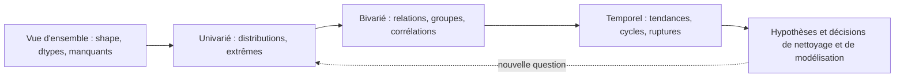

## Introduction

L'analyse exploratoire de données (Exploratory Data Analysis, EDA) est l'étape où l'on se familiarise avec un jeu de données avant toute modélisation — une étape trop souvent négligée par impatience d'arriver au machine learning, alors qu'elle révèle souvent les informations les plus utiles.

En sécurité, l'EDA est souvent l'étape où l'on trouve directement des incidents : une rafale d'échecs d'authentification à trois heures du matin, une population de connexions trop régulières pour être humaines, une machine qui envoie dix fois plus de données que ses voisines. C'est aussi l'esprit du **threat hunting**, la chasse proactive aux menaces, qui consiste à explorer les données à partir d'hypothèses. À la fin de ce chapitre, tu sauras résumer un jeu de données avec pandas, choisir et produire les bons graphiques, repérer des distributions bimodales et des ruptures temporelles, et interpréter une corrélation sans tomber dans le piège de la causalité.

## L'objectif de l'EDA

<CehCallout>
L'EDA répond à des questions simples mais essentielles : quelle est la distribution de chaque variable ? Y a-t-il des corrélations entre variables ? Des groupes ou motifs se dégagent-ils visuellement ? Ces réponses orientent directement les choix de nettoyage (chapitre 2) et de modélisation (chapitres 5-6) à venir.
</CehCallout>

### Une démarche en quatre temps

Une EDA efficace suit un ordre logique. On commence par la **vue d'ensemble** : dimensions du tableau, types de colonnes, valeurs manquantes. On passe ensuite à l'**analyse univariée**, variable par variable : distribution, tendance centrale, dispersion, valeurs extrêmes. Puis vient l'**analyse bivariée et multivariée** : relations entre paires de variables, comparaisons entre groupes, corrélations. Enfin, pour les données horodatées, très fréquentes en sécurité, l'**analyse temporelle** : tendances, cycles journaliers et hebdomadaires, ruptures. Chaque étape produit des observations écrites, qui deviennent des hypothèses à vérifier.



### Résumer les données avec pandas

On travaille sur un jeu simulé de 1 200 connexions sortantes d'un poste de travail sur une journée, mélangeant du trafic humain et du trafic automatisé (balises régulières d'un logiciel, ou d'un implant malveillant). Le script suivant le génère et l'enregistre dans `connexions.csv`, puis en donne un premier résumé.

```python
import numpy as np
import pandas as pd

rng = np.random.default_rng(seed=3)
n_humain, n_bot = 900, 300
cnx = pd.DataFrame({
    "horodatage": pd.date_range("2026-11-02", periods=n_humain + n_bot, freq="72s").to_numpy()[
        rng.permutation(n_humain + n_bot)],
    "duree_s": np.concatenate([rng.lognormal(3.4, 0.5, n_humain),    # humains : ~30 s, très variable
                               rng.normal(2.0, 0.3, n_bot)]).round(2), # bots : ~2 s, très régulier
    "octets": np.concatenate([rng.lognormal(8.5, 0.8, n_humain),
                              rng.normal(600, 50, n_bot)]).round(),
    "protocole": rng.choice(["https", "ssh", "dns"], n_humain + n_bot, p=[0.7, 0.1, 0.2]),
})
cnx["paquets"] = (cnx["octets"] / 900 + rng.normal(0, 0.5, len(cnx))).clip(lower=1).round()
cnx.to_csv("connexions.csv", index=False)

print(cnx.shape)
print(cnx.describe().round(1))
print(cnx["protocole"].value_counts(normalize=True).round(3))
print(cnx.groupby("protocole")["duree_s"].median().round(1))
```

```text
(1200, 5)
                horodatage  duree_s   octets  paquets
count                 1200   1200.0   1200.0   1200.0
mean   2026-11-02 11:59:24     26.4   5265.6      6.0
min    2026-11-02 00:00:00      1.2    455.0      1.0
25%    2026-11-02 05:59:42      5.8    695.5      1.0
50%    2026-11-02 11:59:24     24.5   3409.0      4.0
75%    2026-11-02 17:59:06     38.4   7181.8      8.0
max    2026-11-02 23:58:48    147.8  68523.0     76.0
std                    NaN     20.6   6355.6      7.0
protocole
https    0.680
dns      0.216
ssh      0.104
Name: proportion, dtype: float64
protocole
dns      24.3
https    25.2
ssh      23.4
Name: duree_s, dtype: float64
```

La méthode `describe` donne pour chaque colonne numérique le nombre de valeurs, la moyenne, l'écart-type (std), le minimum, les quartiles (25 %, 50 % qui est la médiane, 75 %) et le maximum. Plusieurs indices sautent aux yeux. Pour les octets, la moyenne (5 266) est bien supérieure à la médiane (3 409) : la distribution est **asymétrique à droite**, tirée par quelques gros transferts. Le maximum (68 523) se situe à plus de neuf écarts interquartiles au-dessus du troisième quartile. Et le premier quartile de la durée (5,8 s) est étonnamment bas comparé à la médiane : un quart des connexions durent moins de six secondes. `value_counts(normalize=True)` donne les proportions de chaque protocole, et `groupby` compare une statistique entre groupes ; ici, la durée médiane est semblable pour les trois protocoles.

## Choisir la bonne visualisation

<CompareTable
  titleA="Type de graphique"
  titleB="Usage typique"
  rows={[
    { a: "Histogramme", b: "Visualiser la distribution d'une variable numérique unique (ex : durée des connexions)" },
    { a: "Nuage de points (scatter plot)", b: "Visualiser la relation entre deux variables numériques (ex : taille de paquet vs durée)" },
    { a: "Diagramme en boîte (boxplot)", b: "Comparer la distribution d'une variable entre plusieurs groupes, et repérer les valeurs aberrantes" },
    { a: "Matrice de corrélation (heatmap)", b: "Visualiser les corrélations entre de nombreuses variables simultanément" },
    { a: "Graphique temporel (time series)", b: "Visualiser l'évolution d'une variable dans le temps (ex : volume de trafic par heure)" },
    { a: "Diagramme en barres", b: "Comparer des effectifs entre catégories (ex : alertes par protocole ou par règle)" },
]}
/>

### Lire un boxplot

Le **diagramme en boîte** (boxplot) résume une distribution en cinq repères. La boîte va du premier au troisième quartile, et contient donc la moitié centrale des données ; le trait intérieur marque la médiane. Les **moustaches** s'étendent jusqu'aux valeurs les plus extrêmes situées à moins de 1,5 fois l'écart interquartile de la boîte : c'est la règle de Tukey vue au chapitre 2. Tout point au-delà est dessiné individuellement comme valeur aberrante.

<TipCallout>
Un boxplot est particulièrement utile en sécurité : il affiche directement la médiane, les quartiles et les valeurs aberrantes d'une distribution — un pic de trafic apparaissant comme un point isolé au-delà des "moustaches" du boxplot est visuellement immédiat à repérer, sans calcul supplémentaire.
</TipCallout>

### Produire les graphiques

matplotlib est la bibliothèque de base ; seaborn, construite au-dessus, produit en une ligne des graphiques statistiques soignés à partir d'un DataFrame. Pour les variables très asymétriques comme les octets, une **échelle logarithmique** rend la distribution lisible.

```python
import pandas as pd
import matplotlib.pyplot as plt
import seaborn as sns

cnx = pd.read_csv("connexions.csv", parse_dates=["horodatage"])
fig, axes = plt.subplots(2, 2, figsize=(11, 8))

sns.histplot(cnx["duree_s"], bins=40, ax=axes[0, 0])                 # distribution
axes[0, 0].set_title("Durée des connexions (s)")

sns.boxplot(data=cnx, x="protocole", y="octets", ax=axes[0, 1])     # comparaison entre groupes
axes[0, 1].set_yscale("log")
axes[0, 1].set_title("Octets par protocole (échelle log)")

sns.scatterplot(data=cnx, x="duree_s", y="octets", alpha=0.4, ax=axes[1, 0])
axes[1, 0].set_yscale("log")
axes[1, 0].set_title("Durée vs octets")

sns.heatmap(cnx[["duree_s", "octets", "paquets"]].corr(), annot=True,
            cmap="coolwarm", vmin=-1, vmax=1, ax=axes[1, 1])          # corrélations
axes[1, 1].set_title("Corrélations de Pearson")

fig.tight_layout()
fig.savefig("eda_connexions.png", dpi=120)
```

Sur le nuage de points, deux amas apparaissent nettement : un nuage diffus de connexions longues et volumineuses, et un petit paquet très serré autour de deux secondes et six cents octets. Ce second amas est la signature typique d'un trafic **automatisé**.

## Repérer des motifs révélateurs

<Steps steps={[
  { title: "Examiner les distributions individuelles", description: "Une distribution bimodale (deux pics) peut indiquer que la variable mélange en réalité deux populations distinctes (ex : trafic légitime et trafic automatisé)." },
  { title: "Examiner les corrélations entre variables", description: "Une forte corrélation entre deux variables peut indiquer une redondance (l'une des deux suffit) ou une relation causale à creuser." },
  { title: "Examiner l'évolution temporelle", description: "Une rupture nette dans une série temporelle (volume de connexions, taux d'erreur) coïncide souvent avec un changement d'infrastructure ou un incident." },
]} />

### Une distribution bimodale

Même sans graphique, on peut construire un histogramme « en texte » avec `pd.cut`, qui découpe une variable en classes.

```python
import pandas as pd

cnx = pd.read_csv("connexions.csv", parse_dates=["horodatage"])
# Histogramme « texte » de la durée : deux populations apparaissent
classes = pd.cut(cnx["duree_s"], bins=[0, 3, 6, 12, 24, 48, 96, 200])
print(classes.value_counts(sort=False))
print(cnx[["duree_s", "octets", "paquets"]].corr().round(2))
print(cnx[["duree_s", "octets", "paquets"]].corr(method="spearman").round(2))
```

```text
duree_s
(0, 3]       299
(3, 6]         1
(6, 12]       23
(12, 24]     262
(24, 48]     455
(48, 96]     152
(96, 200]      8
Name: count, dtype: int64
         duree_s  octets  paquets
duree_s     1.00    0.27     0.26
octets      0.27    1.00     1.00
paquets     0.26    1.00     1.00
         duree_s  octets  paquets
duree_s     1.00    0.54     0.50
octets      0.54    1.00     0.98
paquets     0.50    0.98     1.00
```

La distribution est clairement **bimodale** : un premier pic de 299 connexions de moins de 3 secondes, un creux presque vide entre 3 et 6 secondes, puis une seconde population centrée autour de 24 à 48 secondes. Une moyenne globale de 26 secondes ne décrit aucune des deux populations ! L'étape suivante d'une investigation serait d'isoler les connexions courtes, de regarder leurs destinations et l'intervalle entre deux connexions successives : un intervalle très régulier est la signature d'un **beaconing**, ces appels périodiques qu'un implant de commande et contrôle envoie à son serveur (le canal lui-même relève souvent de la technique MITRE ATT&CK T1071, Application Layer Protocol).

### Corrélations : Pearson et Spearman

Le **coefficient de Pearson** mesure la force d'une relation **linéaire** entre deux variables, de −1 à 1. Le **coefficient de Spearman** mesure une relation **monotone** quelconque, en travaillant sur les rangs ; il résiste mieux aux valeurs extrêmes et aux relations non linéaires. Ici, octets et paquets sont corrélés à 1,00 : ils portent la même information, et l'une des deux variables pourrait être retirée d'un modèle linéaire. La relation entre durée et octets paraît faible en Pearson (0,27) mais plus nette en Spearman (0,54), signe d'une relation monotone mais non linéaire, et de l'influence des deux populations.

<CehCallout>
Une matrice de corrélation peut révéler qu'un ensemble de caractéristiques censées être indépendantes évoluent en réalité fortement ensemble — un signal utile pour simplifier un modèle (via la réduction de dimension du cours Algèbre Linéaire, chapitre 5) ou pour repérer une variable redondante voire fuyant de l'information sur la cible à prédire.
</CehCallout>

Une **fuite d'information sur la cible** (target leakage) survient quand une variable contient la réponse. Exemple classique : dans un jeu d'alertes, la colonne « ticket_clos_par_analyste » ou « règle_de_blocage_déclenchée » est presque parfaitement corrélée à l'étiquette « malveillant », parce qu'elle a été remplie *après* la décision. Un modèle qui l'utilise semble excellent, mais il ne pourra jamais l'avoir au moment de prédire. Une corrélation suspecte de 0,99 avec la cible doit toujours déclencher cette question.

### Les séries temporelles

En sécurité, presque tout est horodaté. Avec un index de dates, pandas permet d'agréger par période avec `resample` et de calculer des statistiques glissantes avec `rolling`.

```python
import numpy as np
import pandas as pd

rng = np.random.default_rng(seed=5)
heures = pd.date_range("2026-11-02", periods=48, freq="h")
echecs = pd.Series(rng.poisson(4, 48), index=heures)
echecs["2026-11-03 03:00"] = 187                     # rafale de bruteforce SSH
par_heure = echecs.resample("6h").sum()
print(par_heure)
mediane = echecs.rolling(12, min_periods=1).median()
print(echecs[echecs > 5 * mediane])
```

```text
2026-11-02 00:00:00     24
2026-11-02 06:00:00     19
2026-11-02 12:00:00     35
2026-11-02 18:00:00     25
2026-11-03 00:00:00    204
2026-11-03 06:00:00     21
2026-11-03 12:00:00     18
2026-11-03 18:00:00     25
Freq: 6h, dtype: int64
2026-11-03 03:00:00    187
Freq: h, dtype: int64
```

L'agrégation par tranches de six heures fait ressortir la nuit du 3 novembre (204 échecs contre une vingtaine habituellement), et la comparaison à une médiane glissante sur douze heures isole l'heure exacte : 3 h du matin, avec 187 échecs. La médiane glissante sert de **ligne de base** adaptative ; utiliser la médiane plutôt que la moyenne évite que la rafale ne relève elle-même la ligne de base. Ce type de détection correspond à la technique MITRE ATT&CK T1110 (Brute Force).

## Le piège de la sur-interprétation visuelle

<WarningCallout>
Une corrélation visuelle entre deux variables sur un graphique ne prouve jamais une relation de cause à effet — deux variables peuvent varier ensemble simplement parce qu'elles dépendent toutes deux d'une troisième variable cachée (par exemple, le volume de trafic ET le taux d'erreur peuvent tous deux augmenter simplement parce que c'est une heure de forte charge, sans lien causal direct entre eux).
</WarningCallout>

Cette troisième variable s'appelle un **facteur de confusion**. Un exemple typique : le nombre de tickets de support et le nombre de tentatives de connexion échouées augmentent ensemble chaque lundi. Les tickets ne causent pas les échecs, ni l'inverse : le lundi, les employés reviennent de week-end, ont oublié leur mot de passe, échouent à se connecter, puis ouvrent un ticket. D'autres pièges visuels guettent : un axe des ordonnées qui ne commence pas à zéro exagère les variations, une agrégation trop grossière masque les pics (une rafale de cinq minutes disparaît dans une moyenne journalière), et le **paradoxe de Simpson** peut inverser une tendance quand on mélange des groupes de tailles différentes.

| Piège | Exemple en sécurité | Parade |
| --- | --- | --- |
| Corrélation prise pour causalité | tickets et échecs de connexion le lundi | chercher le facteur de confusion, expérimenter |
| Agrégation trop grossière | rafale de 5 minutes noyée dans une moyenne journalière | plusieurs granularités, statistiques glissantes |
| Moyenne d'une distribution bimodale | durée moyenne de 26 s qui ne décrit personne | histogramme avant toute moyenne |
| Échelle linéaire sur des octets | tout écrasé près de zéro sauf un point | échelle logarithmique |
| Fuite d'information | colonne remplie après la décision de l'analyste | vérifier quand chaque colonne est connue |

## Erreurs fréquentes

On saute l'EDA pour gagner du temps, et on découvre trois semaines plus tard qu'une colonne était vide à 40 %. On résume une variable par sa moyenne sans regarder sa distribution. On regarde uniquement le coefficient de Pearson, qui ne voit que les relations linéaires. On interprète une corrélation comme une causalité. On produit des dizaines de graphiques sans noter ce que chacun apprend. On oublie de contrôler les fuseaux horaires avant d'analyser une série temporelle. Enfin, on explore le jeu de test avec autant de soin que le jeu d'entraînement, ce qui revient à l'utiliser pour prendre des décisions de modélisation et fausse l'évaluation finale.

## Lab — Mise en pratique

**Environnement** : Python 3.12+ (terminal Nyx Shell ou environnement local avec `pandas`, `numpy`, `matplotlib` et `seaborn` installés).

<Steps steps={[
  { title: "Tracer un histogramme des durées de connexion", description: "Génère un petit jeu de connexions majoritairement normales avec quelques durées très élevées, puis visualise leur distribution.", code: 'import pandas as pd\nimport numpy as np\nimport matplotlib.pyplot as plt\n\nrng = np.random.default_rng(0)\nconnexions = pd.DataFrame({\n    "duree_s": np.concatenate([rng.normal(30, 5, 95), [400, 420, 450, 500, 600]]),\n    "taille_octets": rng.normal(5000, 1000, 100)\n})\n\nplt.hist(connexions["duree_s"], bins=20)\nplt.xlabel("Duree (s)")\nplt.ylabel("Nombre de connexions")\nplt.title("Distribution des durees de connexion")\nplt.savefig("hist_durees.png")' },
  { title: "Repérer les valeurs aberrantes avec un boxplot", description: "Affiche un boxplot de la même variable — les durées de 400 à 600 secondes doivent apparaître comme des points isolés au-delà des moustaches.", code: 'plt.figure()\nplt.boxplot(connexions["duree_s"])\nplt.title("Boxplot des durees de connexion")\nplt.savefig("boxplot_durees.png")' },
  { title: "Calculer et visualiser une matrice de corrélation", description: "Calcule la corrélation entre les variables du jeu de données et affiche-la sous forme de heatmap avec matplotlib. Les deux variables étant générées indépendamment, la corrélation doit être proche de 0.", code: 'correlation = connexions.corr()\nprint(correlation)\n\nplt.figure()\nplt.imshow(correlation, cmap="coolwarm", vmin=-1, vmax=1)\nplt.xticks(range(len(correlation)), correlation.columns, rotation=45)\nplt.yticks(range(len(correlation)), correlation.columns)\nplt.colorbar()\nplt.title("Matrice de correlation")\nplt.savefig("correlation.png")' },
  { title: "Explorer le jeu des 1 200 connexions", description: "Exécute le script de génération du chapitre, puis le tableau de bord seaborn. Repère les deux populations sur l'histogramme et sur le nuage de points.", code: 'cnx = pd.read_csv("connexions.csv", parse_dates=["horodatage"])\nprint(cnx.describe().round(1))\nprint(pd.cut(cnx["duree_s"], [0, 3, 6, 12, 24, 48, 96, 200]).value_counts(sort=False))' },
  { title: "Isoler la population automatisée", description: "Filtre les connexions de moins de 3 secondes et compare leurs statistiques au reste. Qu'est-ce qui les distingue, en plus de la durée ?", code: 'courtes = cnx[cnx["duree_s"] < 3]\nprint(courtes[["octets", "paquets"]].describe().round(1))\nprint(cnx[cnx["duree_s"] >= 3][["octets", "paquets"]].describe().round(1))' },
  { title: "Détecter une rafale temporelle", description: "Reprends la série des échecs d'authentification, change l'heure de la rafale et sa taille (par exemple 25 échecs seulement). La règle « plus de 5 fois la médiane glissante » la détecte-t-elle encore ?", code: 'echecs["2026-11-03 03:00"] = 25\nmediane = echecs.rolling(12, min_periods=1).median()\nprint(echecs[echecs > 5 * mediane])' },
  { title: "Interpréter une corrélation avec prudence", description: "Un graphique montre que le nombre de tickets de support et le nombre de tentatives de connexion échouées augmentent ensemble chaque lundi. Peut-on conclure que l'un cause l'autre ? Propose une explication alternative." },
]} />

## À retenir

- L'EDA (Exploratory Data Analysis) permet de comprendre les distributions, corrélations et motifs d'un jeu de données avant toute modélisation ; elle suit l'ordre vue d'ensemble, univarié, bivarié, temporel.
- `describe`, `value_counts`, `groupby`, `resample` et `rolling` couvrent l'essentiel des résumés en pandas.
- Le choix du type de graphique (histogramme, scatter plot, boxplot, heatmap, série temporelle) dépend de la question posée ; l'échelle logarithmique s'impose pour les volumes.
- Le boxplot affiche médiane, quartiles et valeurs aberrantes au-delà des moustaches.
- Une distribution bimodale signale souvent un mélange de deux populations, comme du trafic humain et du trafic automatisé.
- Pearson ne mesure que les relations linéaires ; Spearman capte les relations monotones. Une corrélation quasi parfaite avec la cible doit faire soupçonner une fuite.
- Une corrélation visuelle n'implique jamais automatiquement une relation de cause à effet : une troisième variable cachée peut expliquer les deux.

## Questions de révision

1. Que signifie l'acronyme EDA, et pourquoi l'EDA doit-elle précéder la modélisation plutôt que d'être sautée par impatience ?
2. Quel type de graphique est particulièrement adapté pour repérer des valeurs aberrantes dans une distribution, et comment sont définies ses moustaches ?
3. Quel graphique choisirais-tu pour visualiser la distribution de la durée des connexions ? Et pour visualiser les corrélations entre quinze variables ?
4. Que peut indiquer une distribution bimodale de la durée des connexions, et comment poursuivrais-tu l'investigation ?
5. Dans le jeu simulé, la moyenne des octets est bien supérieure à la médiane. Qu'est-ce que cela révèle sur la distribution ?
6. Pourquoi une forte corrélation visuelle entre deux variables ne prouve-t-elle pas un lien de cause à effet ? Illustre avec l'exemple des lundis.
7. Qu'est-ce qu'une fuite d'information sur la cible, et pourquoi une corrélation de 0,99 entre une variable et l'étiquette est-elle suspecte ?
