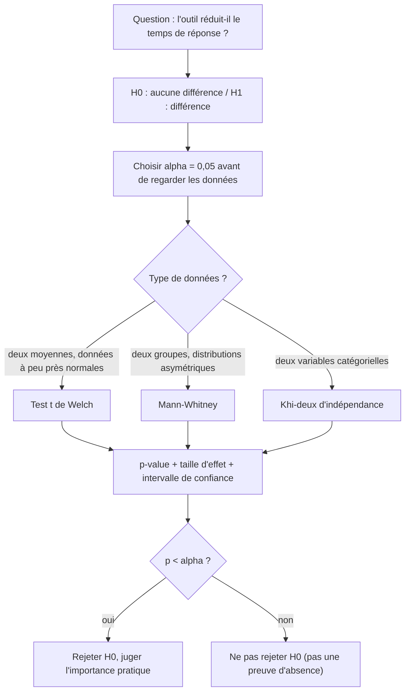

## Introduction

Ce chapitre approfondit les statistiques descriptives déjà vues au cours Mathématiques Appliquées (chapitre 6), en les étendant vers des outils plus formels pour comparer des groupes et quantifier des relations entre variables.

Ces outils répondent à des questions que tout responsable sécurité se pose. Le nouvel outil de détection a-t-il vraiment réduit le temps de réponse aux incidents, ou avons-nous simplement eu un mois calme ? Les emails avec une archive en pièce jointe sont-ils réellement plus souvent du phishing ? Le nombre d'alertes suit-il le volume de trafic ? Sans méthode, on conclut sur une impression ; avec un test bien choisi, on quantifie le rôle du hasard. À la fin de ce chapitre, tu sauras formuler et réaliser un test d'hypothèse avec SciPy, interpréter correctement une p-value, l'accompagner d'une taille d'effet et d'un intervalle de confiance, et choisir le bon coefficient de corrélation.

## Rappel et approfondissement — moyenne, médiane, écart-type

<CehCallout>
Rappel du cours Mathématiques Appliquées : la moyenne est sensible aux valeurs extrêmes, la médiane y est robuste, et l'écart-type mesure la dispersion. En data science, ces trois indicateurs se calculent systématiquement en première étape de toute analyse, avant même de tracer un graphique.
</CehCallout>

### Population, échantillon et estimation

La **population** est l'ensemble de tout ce qui nous intéresse : toutes les connexions passées et futures d'un réseau, tous les incidents possibles. On n'observe jamais qu'un **échantillon**, par exemple les incidents du dernier trimestre. Les statistiques calculées sur l'échantillon, comme la moyenne observée, sont des **estimations** des valeurs réelles de la population, et elles fluctuent d'un échantillon à l'autre. Toute la statistique inférentielle consiste à quantifier cette fluctuation.

Un détail pratique en découle : l'écart-type d'un échantillon se calcule en divisant par n − 1 plutôt que par n (correction de Bessel), pour ne pas sous-estimer la dispersion réelle. Attention aux valeurs par défaut : `np.std` divise par n (`ddof=0`), alors que la méthode `std` de pandas divise par n − 1 (`ddof=1`). Sur de petits échantillons, l'écart est sensible.

### L'erreur standard et l'intervalle de confiance

L'**erreur standard** de la moyenne mesure de combien la moyenne fluctue d'un échantillon à l'autre ; elle vaut l'écart-type divisé par la racine de n. Elle diminue quand l'échantillon grandit : avec quatre fois plus de données, l'incertitude est divisée par deux. Un **intervalle de confiance** à 95 % est une plage construite de façon que, si l'on répétait l'expérience un grand nombre de fois, 95 % des intervalles ainsi calculés contiendraient la vraie valeur. Il est beaucoup plus informatif qu'une simple p-value, car il donne à la fois l'ordre de grandeur de l'effet et l'incertitude qui l'entoure.

## Le principe d'un test d'hypothèse

<Steps steps={[
  { title: "Formuler une hypothèse nulle (H0)", description: "L'affirmation par défaut à réfuter — par exemple, 'ce nouveau pare-feu n'a aucun effet sur le taux d'intrusions détectées'." },
  { title: "Collecter des données et calculer une statistique de test", description: "Comparer les taux observés avant et après le déploiement du pare-feu." },
  { title: "Calculer une p-value", description: "La probabilité d'observer une différence au moins aussi grande que celle mesurée, SI l'hypothèse nulle était vraie." },
  { title: "Décider", description: "Une p-value très faible (généralement < 0,05) suggère de rejeter l'hypothèse nulle — mais cela ne confirme jamais l'hypothèse alternative avec certitude absolue." },
]} />

L'**hypothèse alternative** (H1) est ce que l'on cherche à montrer, par exemple « le temps de réponse a diminué ». Le **seuil de signification**, noté alpha et souvent fixé à 0,05, est choisi **avant** de regarder les données. Si la p-value est inférieure à alpha, on rejette H0 ; sinon, on ne la rejette pas, ce qui ne prouve pas pour autant qu'elle soit vraie : l'absence de preuve n'est pas la preuve de l'absence.

### Les deux types d'erreurs

| Décision \ Réalité | H0 vraie (aucun effet) | H0 fausse (effet réel) |
| --- | --- | --- |
| Rejeter H0 | Erreur de type I, faux positif, probabilité alpha | Bonne décision, probabilité = puissance |
| Ne pas rejeter H0 | Bonne décision | Erreur de type II, faux négatif, probabilité bêta |

Cette grille est exactement celle des faux positifs et faux négatifs d'un détecteur, que l'on retrouvera au chapitre 7. La **puissance** d'un test, égale à 1 − bêta, est sa capacité à détecter un effet qui existe vraiment ; elle augmente avec la taille de l'échantillon et la taille de l'effet. Avec huit mesures seulement, un test n'a de puissance que pour des effets importants.



### Un test complet avec SciPy

Reprenons la question : le nouvel outil de détection a-t-il réduit le temps de réponse aux incidents ? On dispose de huit temps de réponse, en minutes, avant et après son déploiement.

```python
import numpy as np
from scipy import stats

avant = np.array([42, 39, 51, 47, 60, 45, 38, 55])   # temps de réponse (min)
apres = np.array([30, 28, 35, 25, 40, 33, 29, 31])

for nom, x in [("avant", avant), ("après", apres)]:
    print(f"{nom:6s} moyenne={x.mean():.2f} médiane={np.median(x):.1f} écart-type={x.std(ddof=1):.2f}")

res = stats.ttest_ind(avant, apres, equal_var=False)       # test t de Welch
print(f"Welch : t = {res.statistic:.3f}, p = {res.pvalue:.5f}")
ic = res.confidence_interval(confidence_level=0.95)
print(f"IC 95 % de la différence : [{ic.low:.1f} ; {ic.high:.1f}] minutes")

# Taille d'effet : d de Cohen (écart des moyennes / écart-type combiné)
s_comb = np.sqrt((avant.var(ddof=1) + apres.var(ddof=1)) / 2)
print(f"d de Cohen = {(avant.mean() - apres.mean()) / s_comb:.2f}")

mw = stats.mannwhitneyu(avant, apres)
print(f"Mann-Whitney : U = {mw.statistic:.0f}, p = {mw.pvalue:.5f}")
```

```text
avant  moyenne=47.12 médiane=46.0 écart-type=7.77
après  moyenne=31.38 médiane=30.5 écart-type=4.63
Welch : t = 4.925, p = 0.00041
IC 95 % de la différence : [8.7 ; 22.8] minutes
d de Cohen = 2.46
Mann-Whitney : U = 62, p = 0.00062
```

Le **test t de Welch** compare deux moyennes sans supposer que les deux groupes ont la même variance ; c'est le choix par défaut recommandé, obtenu avec `equal_var=False`. La statistique t mesure l'écart entre les moyennes en nombre d'erreurs standards : ici, près de cinq. La p-value de 0,0004 signifie que, si l'outil n'avait aucun effet, on observerait une différence aussi grande moins de quatre fois sur dix mille. L'intervalle de confiance indique que la réduction réelle se situe plausiblement entre 8,7 et 22,8 minutes. Le **d de Cohen** exprime l'écart en nombre d'écarts-types : par convention, 0,2 est un petit effet, 0,5 un effet moyen et 0,8 un grand effet ; 2,46 est donc un effet très important. Le **test de Mann-Whitney**, qui compare les rangs plutôt que les valeurs, ne suppose pas de distribution normale et confirme le résultat ; il est préférable pour des données très asymétriques comme des durées ou des volumes.

Reste une question que la statistique ne tranche pas seule : la baisse est-elle due à l'outil, ou à un autre changement survenu en même temps, comme l'arrivée d'un nouvel analyste ? Seule une comparaison bien conçue, par exemple avec un groupe témoin, permet d'attribuer la cause.

<WarningCallout>
Une p-value faible ne signifie pas "l'effet est important" — elle signifie seulement que l'effet observé est statistiquement peu probable sous l'hypothèse nulle. Un très grand jeu de données peut rendre statistiquement significatif un effet minuscule et sans intérêt pratique réel — un piège fréquent d'interprétation.
</WarningCallout>

### Démonstration : significatif mais insignifiant

```python
import numpy as np
from scipy import stats

rng = np.random.default_rng(seed=0)
# 5 millions de connexions par groupe ; latence moyenne 120,00 ms contre 120,05 ms
a = rng.normal(120.00, 10, 5_000_000)
b = rng.normal(120.05, 10, 5_000_000)
res = stats.ttest_ind(a, b, equal_var=False)
d = (b.mean() - a.mean()) / np.sqrt((a.var(ddof=1) + b.var(ddof=1)) / 2)
print(f"p = {res.pvalue:.2e}   différence = {b.mean() - a.mean():.3f} ms   d = {d:.3f}")
```

```text
p = 6.78e-12   différence = 0.043 ms   d = 0.004
```

Avec dix millions de connexions, une différence de latence de quatre centièmes de milliseconde est « hautement significative » (p de l'ordre de 10 puissance −12), alors que la taille d'effet est quasi nulle. C'est pourquoi on rapporte **toujours** la taille d'effet et l'intervalle de confiance avec la p-value, et on se demande si l'effet compte en pratique.

### Les tests multiples

Si tu testes vingt caractéristiques indépendantes au seuil de 0,05 alors qu'aucune n'a d'effet réel, tu peux t'attendre à environ un faux positif par pur hasard. Ce problème des **comparaisons multiples** est fréquent en threat hunting, où l'on compare des dizaines de métriques entre une machine suspecte et le reste du parc. La **correction de Bonferroni** divise le seuil par le nombre de tests (0,05 / 20 = 0,0025) ; la méthode de Benjamini-Hochberg, moins conservatrice, contrôle la proportion de fausses découvertes et est disponible dans `scipy.stats.false_discovery_control`.

### Le test du khi-deux pour les variables catégorielles

Quand les deux variables sont catégorielles, on utilise le **test du khi-deux d'indépendance** sur un tableau de contingence. Question : la présence d'une archive (zip, iso) en pièce jointe est-elle liée au fait qu'un email soit du phishing ?

```python
import numpy as np
from scipy import stats

# Tableau de contingence : pièce jointe .zip/.iso vs label
#                  phishing  légitime
table = np.array([[  48,       112],    # avec archive
                  [  52,      1788]])   # sans archive
chi2, p, ddl, attendu = stats.chi2_contingency(table)
print(f"chi2 = {chi2:.1f}, ddl = {ddl}, p = {p:.2e}")
print("effectifs attendus sous H0 :\n", attendu.round(1))
```

```text
chi2 = 223.1, ddl = 1, p = 1.86e-50
effectifs attendus sous H0 :
 [[   8.  152.]
 [  92. 1748.]]
```

Si la pièce jointe n'avait aucun lien avec le phishing, on attendrait environ 8 phishing parmi les 160 emails avec archive ; on en observe 48, six fois plus. Le test confirme une association très forte. Concrètement, 30 % des emails avec archive sont du phishing (48 sur 160), contre moins de 3 % sans archive (52 sur 1 840). C'est une bonne caractéristique candidate pour un modèle, et un argument pour mettre en quarantaine les archives venant de l'extérieur, une technique d'accès initial bien documentée (MITRE ATT&CK T1566.001, pièce jointe de spearphishing).

## La corrélation de Pearson

```text
Le coefficient de corrélation de Pearson (r) varie de -1 à 1 :

r proche de 1  → forte corrélation positive (les deux variables augmentent ensemble)
r proche de -1 → forte corrélation négative (l'une augmente quand l'autre diminue)
r proche de 0  → absence de relation linéaire
```

Le coefficient de Pearson est la covariance des deux variables divisée par le produit de leurs écarts-types. Autrement dit, c'est la similarité cosinus (cours Algèbre Linéaire, chapitre 6) entre les deux variables une fois centrées. Son carré, r², s'interprète comme la part de variance de l'une expliquée linéairement par l'autre.

<CehCallout>
Le coefficient de Pearson ne mesure QUE les relations linéaires — deux variables peuvent avoir une relation forte mais non linéaire (par exemple en forme de courbe) et afficher pourtant une corrélation de Pearson proche de 0. Toujours visualiser un nuage de points (chapitre 3) en complément du seul chiffre de corrélation.
</CehCallout>

```python
import numpy as np
from scipy import stats

x = np.linspace(-3, 3, 61)
y = x ** 2                                          # relation parfaite mais non linéaire (en U)
print(f"Pearson  r   = {stats.pearsonr(x, y).statistic:.3f}")
print(f"Spearman rho = {stats.spearmanr(x, y).statistic:.3f}")

volume = np.array([100, 150, 200, 250, 300, 350])
alertes = np.array([5, 8, 12, 15, 20, 22])
r = stats.pearsonr(volume, alertes)
print(f"volume/alertes : r = {r.statistic:.3f}, p = {r.pvalue:.5f}")
```

```text
Pearson  r   = 0.000
Spearman rho = 0.016
volume/alertes : r = 0.996, p = 0.00002
```

Dans le premier exemple, y est entièrement déterminé par x, et pourtant Pearson vaut 0. Même Spearman, qui capte les relations **monotones** (toujours croissantes ou toujours décroissantes), échoue ici, car la relation descend puis remonte. Seul un nuage de points révèle la forme en U. En sécurité, ce type de relation existe : le taux d'erreurs d'un service peut être élevé à très faible charge (sondes de supervision en échec) et à très forte charge (saturation), et bas entre les deux. Dans le second exemple, volume de trafic et nombre d'alertes sont presque parfaitement corrélés (r = 0,996) sur seulement six points ; la p-value de `pearsonr` teste l'hypothèse nulle d'une corrélation nulle. Avec si peu de points, un seul point aberrant suffirait pourtant à changer fortement r.

## Application à la comparaison de groupes en sécurité

<CompareTable
  titleA="Question"
  titleB="Approche statistique"
  rows={[
    { a: "Le nouveau système de détection réduit-il vraiment le temps de réponse moyen aux incidents ?", b: "Test d'hypothèse comparant les temps de réponse avant/après" },
    { a: "Le volume de trafic est-il corrélé au nombre d'alertes générées ?", b: "Coefficient de corrélation de Pearson (si la relation semble linéaire au nuage de points)" },
    { a: "Les emails de phishing ont-ils une longueur significativement différente des emails légitimes ?", b: "Test d'hypothèse comparant les moyennes des deux groupes" },
    { a: "La présence d'une archive en pièce jointe est-elle liée au phishing ?", b: "Test du khi-deux d'indépendance sur un tableau de contingence" },
    { a: "Les volumes transférés (très asymétriques) diffèrent-ils entre deux sous-réseaux ?", b: "Test de Mann-Whitney, fondé sur les rangs" },
]}
/>

<TipCallout>
Avant de conclure qu'un nouvel outil de sécurité "fonctionne mieux", un test d'hypothèse rigoureux protège contre la conclusion hâtive basée sur une simple observation ponctuelle ("on a eu moins d'incidents ce mois-ci") qui pourrait n'être due qu'au hasard ou à d'autres facteurs.
</TipCallout>

Les statistiques servent aussi à défendre un budget ou à rendre compte à une direction. Les indicateurs d'un SOC, comme le temps moyen de détection (MTTD) et le temps moyen de réponse (MTTR), sont des moyennes sur des échantillons ; les présenter avec un intervalle de confiance et une médiane évite de surinterpréter une variation d'un mois sur l'autre. Le NIST CSF 2.0, avec sa nouvelle fonction Govern, insiste justement sur le pilotage par des mesures de la performance de la cybersécurité.

## Erreurs fréquentes

L'erreur la plus répandue est de lire la p-value comme « la probabilité que H0 soit vraie » : c'est la probabilité d'observer des données au moins aussi extrêmes **si** H0 est vraie. Vient ensuite la confusion entre significativité statistique et importance pratique. Beaucoup multiplient les tests jusqu'à trouver un p inférieur à 0,05 (le p-hacking), sans corriger pour les comparaisons multiples. On utilise aussi le test t classique, qui suppose des variances égales, au lieu de celui de Welch, ou un test t sur des données très asymétriques et peu nombreuses. On oublie que `np.std` divise par n et non par n − 1. On conclut qu'il n'y a « aucun effet » parce qu'un test sur huit valeurs n'est pas significatif, alors qu'il manquait simplement de puissance. Enfin, on interprète une corrélation, même très forte, comme une causalité.

## Lab — Mise en pratique

**Environnement** : Python 3.12+ (terminal Nyx Shell ou environnement local avec `numpy` et `scipy` installés).

<Steps steps={[
  { title: "Calculer les statistiques descriptives avant/après", description: "Reprends l'exemple du pare-feu : calcule moyenne, médiane et écart-type des temps de réponse aux incidents avant et après déploiement. Compare np.std avec ddof=0 et ddof=1.", code: 'import numpy as np\n\navant = np.array([42, 39, 51, 47, 60, 45, 38, 55])\napres = np.array([30, 28, 35, 25, 40, 33, 29, 31])\n\nprint("Avant - moyenne:", np.mean(avant), "mediane:", np.median(avant), "ecart-type:", np.std(avant), np.std(avant, ddof=1))\nprint("Apres - moyenne:", np.mean(apres), "mediane:", np.median(apres), "ecart-type:", np.std(apres), np.std(apres, ddof=1))' },
  { title: "Réaliser un test d'hypothèse", description: "Teste si la différence entre les deux groupes est statistiquement significative avec un test t de Welch, et récupère la p-value et l'intervalle de confiance. Tu dois obtenir une p-value d'environ 0,0004.", code: 'from scipy import stats\n\nres = stats.ttest_ind(avant, apres, equal_var=False)\nprint("Statistique t :", res.statistic)\nprint("p-value :", res.pvalue)\nprint(res.confidence_interval())' },
  { title: "Mesurer la taille d'effet", description: "Calcule le d de Cohen et classe l'effet (petit, moyen, grand).", code: 's = np.sqrt((avant.var(ddof=1) + apres.var(ddof=1)) / 2)\nprint((avant.mean() - apres.mean()) / s)' },
  { title: "Tester une association catégorielle", description: "Reprends le tableau archive / phishing et modifie-le pour que la proportion de phishing soit la même avec ou sans archive. Que devient la p-value ?", code: 'table = np.array([[5, 155], [57, 1783]])\nprint(stats.chi2_contingency(table).pvalue)' },
  { title: "Calculer un coefficient de corrélation de Pearson", description: "Calcule la corrélation entre le volume de trafic et le nombre d'alertes générées, comme dans le tableau du chapitre. Remplace ensuite la dernière valeur d'alertes par 2 et observe l'effet d'un seul point aberrant.", code: 'volume_trafic = np.array([100, 150, 200, 250, 300, 350])\nnombre_alertes = np.array([5, 8, 12, 15, 20, 22])\nprint("Pearson :", round(np.corrcoef(volume_trafic, nombre_alertes)[0, 1], 3))\nnombre_alertes[-1] = 2\nprint("Avec un point aberrant :", round(np.corrcoef(volume_trafic, nombre_alertes)[0, 1], 3))' },
  { title: "Observer l'effet de la taille d'échantillon", description: "Relance la démonstration des 5 millions de connexions avec 5 000 connexions par groupe. La différence de 0,05 ms est-elle encore significative ?", code: 'rng = np.random.default_rng(0)\na = rng.normal(120.00, 10, 5_000); b = rng.normal(120.05, 10, 5_000)\nprint(stats.ttest_ind(a, b, equal_var=False).pvalue)' },
  { title: "Interpréter les résultats avec prudence", description: "Le test ci-dessus porte sur seulement 8 mesures avant/après. Si le même test était refait sur 10 millions de connexions et donnait une p-value de 0,001, pourrait-on affirmer que l'effet du pare-feu est nécessairement important en pratique ? Et pourquoi faudrait-il aussi tracer un nuage de points même quand, comme ici, le coefficient de Pearson calculé est élevé ou proche de 0 ?" },
]} />

## À retenir

- La moyenne est sensible aux valeurs extrêmes, la médiane y est robuste, l'écart-type mesure la dispersion ; l'écart-type d'un échantillon se calcule avec n − 1.
- Un test d'hypothèse détermine si une différence observée est statistiquement significative ou probablement due au hasard ; H0 est l'affirmation par défaut à réfuter.
- La p-value est la probabilité d'observer une différence au moins aussi grande que celle mesurée si H0 était vraie, pas la probabilité que H0 soit vraie.
- Une p-value faible indique une significativité statistique, pas nécessairement une importance pratique : on rapporte toujours une taille d'effet et un intervalle de confiance.
- Welch compare deux moyennes, Mann-Whitney deux distributions asymétriques, le khi-deux deux variables catégorielles ; les tests multiples exigent une correction.
- Le coefficient de corrélation de Pearson ne capture que les relations linéaires, Spearman les relations monotones — toujours les compléter par un nuage de points.

## Questions de révision

1. Dans un test d'hypothèse, que représente l'hypothèse nulle H0 ? Formule H0 et H1 pour l'évaluation d'un nouveau pare-feu.
2. Que mesure exactement une p-value, et que signifie une p-value faible ?
3. Pourquoi une p-value de 0,001 obtenue sur 10 millions de connexions ne garantit-elle pas qu'un effet est important en pratique ? Quels indicateurs ajouter ?
4. Quelle est la différence entre une erreur de type I et une erreur de type II ? Relie-les aux faux positifs et faux négatifs d'un détecteur.
5. Quel test choisirais-tu pour comparer la longueur des emails de phishing et des emails légitimes ? Et pour savoir si la présence d'une archive est liée au phishing ?
6. Pourquoi le coefficient de corrélation de Pearson peut-il être proche de 0 alors que deux variables ont une relation forte mais non linéaire ?
7. Tu compares 30 métriques entre une machine suspecte et le parc, et trois sont significatives au seuil de 0,05. Pourquoi faut-il rester prudent ?
