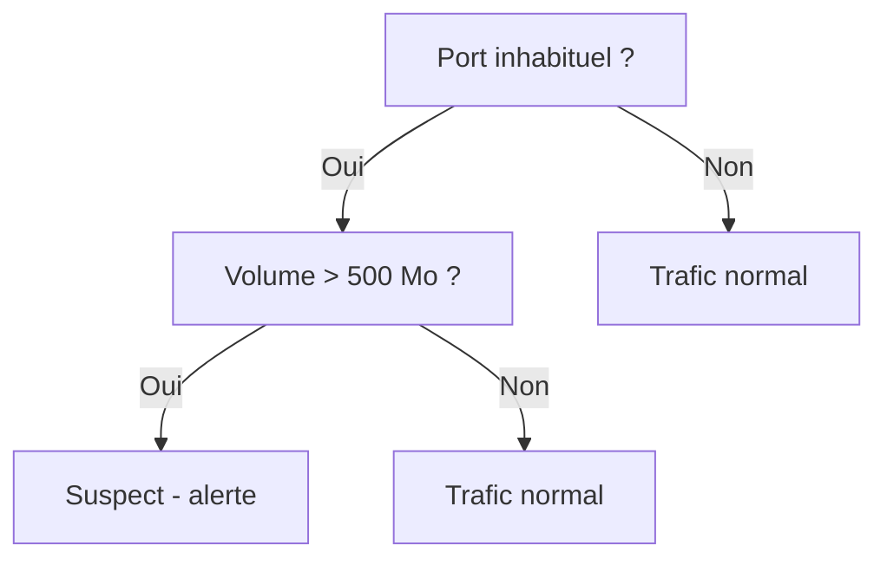

## Introduction

Ce chapitre introduit le machine learning supervisé — la famille d'algorithmes la plus utilisée en pratique, où le modèle apprend à partir d'exemples déjà étiquetés (par exemple, des emails déjà classés "phishing" ou "légitime").

L'apprentissage supervisé est au cœur de nombreux outils de sécurité : les filtres anti-phishing des messageries, les moteurs de détection de malwares fondés sur l'apprentissage, la classification automatique des alertes dans un SOC ou la détection de fraude bancaire. À la fin de ce chapitre, tu sauras formuler un problème en classification ou en régression, expliquer et coder à la main l'algorithme des k plus proches voisins, lire un arbre de décision, et entraîner puis comparer plusieurs modèles avec scikit-learn en repérant les signes de surapprentissage.

## Le principe de l'apprentissage supervisé


<CehCallout>
"Supervisé" signifie que chaque exemple d'entraînement est accompagné de la bonne réponse (l'étiquette) — un modèle de détection de phishing supervisé s'entraîne sur des milliers d'emails déjà classés par des humains, puis apprend à généraliser cette classification à de nouveaux emails jamais vus.
</CehCallout>

### Le vocabulaire

Chaque exemple est décrit par des **caractéristiques** (features), rangées dans une matrice notée X, avec une ligne par exemple et une colonne par caractéristique, comme dans le cours Algèbre Linéaire (chapitre 2). La bonne réponse associée à chaque exemple est l'**étiquette** (label ou cible), rangée dans un vecteur y. L'**entraînement** consiste à ajuster les paramètres du modèle pour que ses prédictions sur X ressemblent le plus possible à y. Mais l'objectif réel n'est pas de bien prédire les exemples déjà vus : c'est la **généralisation**, c'est-à-dire bien prédire des exemples nouveaux.

Pour mesurer cette généralisation, on met de côté une partie des données, le **jeu de test**, que le modèle ne voit jamais pendant l'entraînement. Comparer le score sur l'entraînement et le score sur le test est le premier diagnostic de tout modèle.

### D'où viennent les étiquettes ?

En sécurité, les étiquettes sont la ressource la plus rare. Elles proviennent des signalements des utilisateurs (le bouton « signaler un phishing »), des verdicts des analystes du SOC, des bacs à sable (sandbox) qui exécutent des fichiers suspects, ou de flux de renseignement sur les menaces. Toutes ces sources sont imparfaites : un utilisateur signale une newsletter comme phishing, un analyste pressé classe mal une alerte. On parle d'**étiquettes bruitées**, et un bon modèle doit y résister.

## Classification vs régression

<CompareTable
  titleA="Classification"
  titleB="Régression"
  rows={[
    { a: "Prédit une catégorie discrète", b: "Prédit une valeur numérique continue" },
    { a: "Exemple : phishing ou légitime", b: "Exemple : temps estimé avant qu'une vulnérabilité soit exploitée" },
    { a: "Exemple : type de malware (ransomware, spyware, ver...)", b: "Exemple : volume de trafic attendu la semaine prochaine" },
    { a: "Métriques : précision, rappel, F1 (chapitre 7)", b: "Métriques : erreur absolue moyenne (MAE), erreur quadratique (RMSE)" },
]}
/>

La classification est **binaire** quand il n'y a que deux classes (phishing ou légitime, intrusion ou normal) et **multiclasse** quand il y en a plus (famille de malware). La plupart des classifieurs ne renvoient pas seulement une classe mais aussi un **score** ou une probabilité, obtenue en scikit-learn avec `predict_proba` ; la décision finale dépend d'un seuil, que l'on ajuste selon le coût des erreurs (chapitre 7). Certains problèmes peuvent d'ailleurs se formuler des deux façons : prédire le score EPSS d'une vulnérabilité, qui est une probabilité, relève de la régression, alors que prédire si elle sera ajoutée au catalogue CISA KEV relève de la classification.

### Un exemple de régression

La **régression linéaire** cherche la droite (ou l'hyperplan) qui prédit le mieux une valeur numérique à partir des caractéristiques. Ici, on prévoit le nombre d'alertes quotidiennes d'un SIEM à partir du volume de trafic, pour dimensionner l'équipe.

```python
import numpy as np
from sklearn.linear_model import LinearRegression
from sklearn.metrics import mean_absolute_error

rng = np.random.default_rng(seed=1)
volume_go = rng.uniform(50, 500, 200).reshape(-1, 1)        # trafic journalier (Go)
alertes = 12 + 0.3 * volume_go.ravel() + rng.normal(0, 8, 200)
reg = LinearRegression().fit(volume_go[:150], alertes[:150])
pred = reg.predict(volume_go[150:])
print(f"alertes ≈ {reg.intercept_:.1f} + {reg.coef_[0]:.3f} × volume_Go")
print(f"MAE sur le test : {mean_absolute_error(alertes[150:], pred):.1f} alertes")
print("prévision pour 400 Go :", reg.predict([[400]]).round(0))
```

```text
alertes ≈ 11.3 + 0.299 × volume_Go
MAE sur le test : 6.1 alertes
prévision pour 400 Go : [131.]
```

Le modèle retrouve presque exactement la relation simulée (12 + 0,3 × volume). L'**erreur absolue moyenne** (MAE) indique qu'il se trompe en moyenne de six alertes par jour. Note la forme `reshape(-1, 1)` : scikit-learn attend toujours une matrice X à deux dimensions, même avec une seule caractéristique.

## Les k plus proches voisins (k-NN)

<Steps steps={[
  { title: "Représenter chaque exemple comme un vecteur", description: "Rappel du cours Algèbre Linéaire, chapitre 1 — chaque email, connexion ou fichier devient un vecteur de caractéristiques." },
  { title: "Calculer la distance à tous les exemples connus", description: "Utiliser une distance euclidienne ou une similarité cosinus (cours Algèbre Linéaire, chapitre 6)." },
  { title: "Regarder les k voisins les plus proches", description: "Prendre les k exemples déjà étiquetés les plus proches de la nouvelle donnée." },
  { title: "Voter la classe majoritaire", description: "La classe la plus représentée parmi ces k voisins devient la prédiction." },
]} />

Le k-NN est un modèle dit **paresseux** : il n'apprend rien pendant l'entraînement, il mémorise simplement les exemples. Tout le travail se fait au moment de la prédiction, ce qui le rend lent sur de grands volumes. Codons-le à la main sur six connexions décrites par [volume en Mo, durée en secondes].

```python
import numpy as np
from collections import Counter

X_entrainement = np.array([
    [10, 30], [12, 28], [8, 25],       # trafic normal
    [600, 5], [550, 4], [700, 6]       # intrusion suspectee
])
y_entrainement = np.array(["normal", "normal", "normal", "intrusion", "intrusion", "intrusion"])
nouvelle_connexion = np.array([580, 5])

distances = np.linalg.norm(X_entrainement - nouvelle_connexion, axis=1)
print("Distances :", distances.round(1))
k = 3
voisins = y_entrainement[np.argsort(distances)[:k]]
print("Voisins :", voisins, "->", Counter(voisins).most_common(1)[0][0])
```

```text
Distances : [570.5 568.5 572.3  20.   30.  120. ]
Voisins : ['intrusion' 'intrusion' 'intrusion'] -> intrusion
```

Les trois voisins les plus proches (à 20, 30 et 120 unités) sont des intrusions : la nouvelle connexion est classée « intrusion ». Remarque que le volume, exprimé en centaines de Mo, domine totalement la distance ; sur de vraies données, il faudrait standardiser les caractéristiques, comme on l'a vu au chapitre 2.

<TipCallout>
Le choix de k influence fortement le résultat : un k trop petit (ex : 1) rend le modèle très sensible au bruit d'un seul exemple mal étiqueté ; un k trop grand lisse excessivement les frontières entre classes, au risque de perdre en précision sur des cas limites.
</TipCallout>

Avec k = 1, si l'exemple le plus proche est une intrusion étiquetée « normal » par erreur, la prédiction sera fausse, sans aucun garde-fou. Avec k = 3 ou plus, ce mauvais exemple est mis en minorité par ses voisins. On choisit souvent un k impair en classification binaire pour éviter les égalités, et on le règle par validation croisée (chapitre 7).

## Les arbres de décision

<CehCallout>
Un arbre de décision pose une série de questions successives sur les caractéristiques d'une donnée ("le volume de trafic dépasse-t-il 500 Mo ?", "le port est-il inhabituel ?") pour arriver à une classification finale — sa structure est directement lisible et interprétable par un humain, contrairement à de nombreux autres modèles de machine learning.
</CehCallout>



### Comment l'arbre choisit ses questions

À chaque nœud, l'algorithme teste toutes les caractéristiques et tous les seuils possibles, et retient la question qui sépare le mieux les classes. La qualité d'une séparation se mesure par l'**impureté de Gini** (le critère par défaut de scikit-learn) ou par l'**entropie** : un groupe qui ne contient qu'une seule classe est pur, son impureté vaut zéro. Par exemple, un nœud contenant 50 % de phishing a une impureté de Gini de 1 − (0,5² + 0,5²) = 0,5 ; un nœud contenant 90 % de phishing a une impureté de 1 − (0,9² + 0,1²) = 0,18. L'arbre choisit la question qui fait le plus baisser l'impureté moyenne, puis recommence dans chaque branche.

<WarningCallout>
Un arbre de décision trop profond (trop de questions successives) peut mémoriser exactement les exemples d'entraînement plutôt que d'apprendre des motifs généralisables — un phénomène appelé surapprentissage (overfitting), approfondi au chapitre 7 de ce cours.
</WarningCallout>

## En pratique avec scikit-learn

### Un jeu d'emails simulé

On simule 2 000 emails décrits par cinq caractéristiques classiques d'un détecteur de phishing : nombre de liens, âge du domaine de l'expéditeur, nombre de mots d'urgence (« immédiatement », « suspendu »), présence d'une pièce jointe et échec de la vérification SPF. Pour être réaliste, 3 % des étiquettes sont volontairement fausses.

```python
import numpy as np
import pandas as pd

rng = np.random.default_rng(seed=42)
n = 2000
phishing = rng.random(n) < 0.3                       # 30 % de phishing (jeu équilibré artificiellement)
emails = pd.DataFrame({
    "nb_liens": np.where(phishing, rng.poisson(6, n), rng.poisson(2, n)),
    "domaine_age_jours": np.where(phishing, rng.exponential(40, n), rng.exponential(2000, n)).round(),
    "mots_urgence": np.where(phishing, rng.poisson(3, n), rng.poisson(0.5, n)),
    "piece_jointe": (rng.random(n) < np.where(phishing, 0.35, 0.2)).astype(int),
    "spf_echec": (rng.random(n) < np.where(phishing, 0.4, 0.03)).astype(int),
})
emails["label"] = phishing.astype(int)
# 3 % d'étiquettes erronées : la réalité est bruitée
bruit = rng.random(n) < 0.03
emails.loc[bruit, "label"] = 1 - emails.loc[bruit, "label"]
emails.to_csv("emails.csv", index=False)
print(emails.head())
print(emails["label"].value_counts())
```

```text
   nb_liens  domaine_age_jours  mots_urgence  piece_jointe  spf_echec  label
0         1             9124.0             0             0          0      0
1         5              518.0             0             0          0      0
2         1              129.0             0             0          0      0
3         1              316.0             0             0          0      0
4         7                1.0             4             1          0      1
label
0    1373
1     627
Name: count, dtype: int64
```

### Entraîner et comparer plusieurs modèles

Tous les modèles de scikit-learn partagent la même interface : `fit(X, y)` pour entraîner, `predict(X)` pour prédire et `score(X, y)` pour obtenir l'exactitude (accuracy). On commence toujours par un **modèle de référence** naïf, ici `DummyClassifier`, qui prédit toujours la classe majoritaire.

```python
import pandas as pd
from sklearn.model_selection import train_test_split
from sklearn.tree import DecisionTreeClassifier, export_text
from sklearn.neighbors import KNeighborsClassifier
from sklearn.pipeline import make_pipeline
from sklearn.preprocessing import StandardScaler
from sklearn.dummy import DummyClassifier

emails = pd.read_csv("emails.csv")
X, y = emails.drop(columns="label"), emails["label"]
X_tr, X_te, y_tr, y_te = train_test_split(X, y, test_size=0.25, random_state=0, stratify=y)

modeles = {
    "référence (classe majoritaire)": DummyClassifier(strategy="most_frequent"),
    "k-NN k=1": make_pipeline(StandardScaler(), KNeighborsClassifier(n_neighbors=1)),
    "k-NN k=15": make_pipeline(StandardScaler(), KNeighborsClassifier(n_neighbors=15)),
    "arbre profondeur 3": DecisionTreeClassifier(max_depth=3, random_state=0),
    "arbre sans limite": DecisionTreeClassifier(random_state=0),
}
for nom, m in modeles.items():
    m.fit(X_tr, y_tr)
    print(f"{nom:32s} train = {m.score(X_tr, y_tr):.3f}   test = {m.score(X_te, y_te):.3f}")

arbre = modeles["arbre profondeur 3"]
print(export_text(arbre, feature_names=list(X.columns)))
print("profondeur de l'arbre sans limite :", modeles["arbre sans limite"].get_depth())
```

```text
référence (classe majoritaire)   train = 0.687   test = 0.686
k-NN k=1                         train = 1.000   test = 0.916
k-NN k=15                        train = 0.938   test = 0.940
arbre profondeur 3               train = 0.941   test = 0.938
arbre sans limite                train = 1.000   test = 0.908
|--- domaine_age_jours <= 134.00
|   |--- mots_urgence <= 0.50
|   |   |--- nb_liens <= 3.50
|   |   |   |--- class: 0
|   |   |--- nb_liens >  3.50
|   |   |   |--- class: 1
|   |--- mots_urgence >  0.50
|   |   |--- nb_liens <= 2.50
|   |   |   |--- class: 0
|   |   |--- nb_liens >  2.50
|   |   |   |--- class: 1
|--- domaine_age_jours >  134.00
|   |--- nb_liens <= 6.50
|   |   |--- mots_urgence <= 3.50
|   |   |   |--- class: 0
|   |   |--- mots_urgence >  3.50
|   |   |   |--- class: 1
|   |--- nb_liens >  6.50
|   |   |--- domaine_age_jours <= 1644.00
|   |   |   |--- class: 1
|   |   |--- domaine_age_jours >  1644.00
|   |   |   |--- class: 0

profondeur de l'arbre sans limite : 22
```

Ce tableau résume tout le chapitre. Le modèle de référence atteint déjà 68,6 % sans rien apprendre : c'est le plancher à battre. Le k-NN avec k = 1 et l'arbre sans limite obtiennent un score **parfait sur l'entraînement** (1,000), mais moins bon sur le test (0,916 et 0,908) : ils ont mémorisé les exemples, y compris les 3 % d'étiquettes fausses. C'est la signature du **surapprentissage**. L'arbre sans limite a d'ailleurs poussé jusqu'à 22 niveaux de questions. À l'inverse, le k-NN avec k = 15 et l'arbre de profondeur 3 ont des scores d'entraînement et de test proches et meilleurs sur le test : ils généralisent mieux.

L'arbre de profondeur 3, affiché par `export_text`, est directement lisible par un analyste : sa première question porte sur l'âge du domaine (moins de 134 jours), puis sur les mots d'urgence et le nombre de liens. On peut le transformer en règles, le justifier lors d'un audit, et vérifier qu'il ne repose pas sur une caractéristique absurde. Il ne retient pas l'échec SPF ni la pièce jointe dans ses trois premiers niveaux, ce qui ne signifie pas qu'elles sont inutiles, seulement que d'autres questions séparaient mieux les classes.

| Modèle | Points forts | Points faibles | Hyperparamètre clé |
| --- | --- | --- | --- |
| k-NN | simple, aucune hypothèse sur la forme des classes | lent en prédiction, sensible à l'échelle et à la dimension | `n_neighbors` |
| Arbre de décision | lisible, pas besoin de standardiser, gère les variables mixtes | instable, surapprend facilement | `max_depth`, `min_samples_leaf` |
| Régression logistique | rapide, probabilités calibrées, coefficients interprétables | frontières linéaires uniquement | `C` (régularisation) |
| Forêt aléatoire, gradient boosting | très performants sur des données tabulaires | moins lisibles, plus lourds | nombre d'arbres, profondeur |

Les **hyperparamètres** sont les réglages choisis avant l'entraînement (k, profondeur maximale), par opposition aux **paramètres** appris par le modèle (les seuils de l'arbre). Les forêts aléatoires et le gradient boosting, qui combinent des centaines d'arbres, sont traités dans le cours Machine Learning ; ce sont souvent les meilleurs modèles sur des données tabulaires de sécurité.

## Applications et menaces en cybersécurité

<AttackDefenseTable rows={[
  { phase: "Évasion", attack: "L'attaquant envoie son phishing depuis un domaine « vieilli » acheté plusieurs mois à l'avance, pour passer la première question de l'arbre", defense: "Combiner plusieurs signaux (réputation, contenu, authentification DMARC), surveiller l'importance des caractéristiques" },
  { phase: "Empoisonnement des étiquettes", attack: "Signaler massivement des emails légitimes comme phishing, ou l'inverse, pour corrompre les données d'entraînement", defense: "Valider les signalements, pondérer la fiabilité des sources, contrôler la dérive des étiquettes" },
  { phase: "Reconnaissance du modèle", attack: "Sonder le filtre avec des variantes pour deviner ses règles", defense: "Limiter le retour d'information, varier les modèles, journaliser les tentatives répétées" },
]} />

Un modèle supervisé ne reconnaît que ce qu'il a appris : les techniques réellement nouvelles lui échappent, d'où l'intérêt du non supervisé (chapitre 6). Le cadre MITRE ATLAS recense les techniques d'attaque spécifiques aux systèmes d'apprentissage automatique, comme l'évasion ou l'empoisonnement.

## Erreurs fréquentes

On évalue le modèle sur les données qui ont servi à l'entraîner, et on se félicite d'un score parfait qui ne veut rien dire. On oublie le modèle de référence, et on célèbre 90 % d'exactitude là où prédire toujours « légitime » donnait déjà 86 %. On applique un k-NN sans standardiser. On laisse un arbre pousser sans limite de profondeur. On sépare entraînement et test sans `stratify=y`, ce qui peut produire un test avec une proportion d'attaques différente. On mélange dans le temps des emails de 2026 dans l'entraînement et des emails de 2024 dans le test, alors qu'en production on prédit toujours le futur à partir du passé. Enfin, on confond paramètres appris et hyperparamètres réglés par l'humain.

## Lab — Mise en pratique

**Environnement** : Python 3.12+ (terminal Nyx Shell ou environnement local avec `numpy`, `pandas` et `scikit-learn` installés).

<Steps steps={[
  { title: "Représenter des connexions comme des vecteurs", description: "Crée un petit jeu d'entraînement étiqueté (trafic normal vs intrusion suspectée) sous forme de vecteurs [volume_Mo, duree_s], ainsi qu'une nouvelle connexion à classer.", code: 'import numpy as np\n\n# Chaque connexion est un vecteur [volume_Mo, duree_s], avec son etiquette connue\nX_entrainement = np.array([\n    [10, 30], [12, 28], [8, 25],       # trafic normal\n    [600, 5], [550, 4], [700, 6]       # intrusion suspectee\n])\ny_entrainement = np.array(["normal", "normal", "normal", "intrusion", "intrusion", "intrusion"])\n\nnouvelle_connexion = np.array([580, 5])' },
  { title: "Calculer la distance aux exemples connus", description: "Calcule la distance euclidienne entre la nouvelle connexion et chaque exemple d'entraînement. Les trois plus petites distances doivent correspondre aux intrusions.", code: 'distances = np.linalg.norm(X_entrainement - nouvelle_connexion, axis=1)\nprint("Distances aux exemples connus :", distances)' },
  { title: "Voter la classe majoritaire (k-NN)", description: "Retiens les k=3 voisins les plus proches et détermine la classe majoritaire parmi eux.", code: 'k = 3\nindices_plus_proches = np.argsort(distances)[:k]\nvoisins = y_entrainement[indices_plus_proches]\n\nfrom collections import Counter\nprediction = Counter(voisins).most_common(1)[0][0]\nprint("Classe predite pour la nouvelle connexion :", prediction)' },
  { title: "Vérifier avec scikit-learn", description: "Entraîne un KNeighborsClassifier avec k=3 sur les mêmes données et compare sa prédiction à la tienne.", code: 'from sklearn.neighbors import KNeighborsClassifier\nknn = KNeighborsClassifier(n_neighbors=3).fit(X_entrainement, y_entrainement)\nprint(knn.predict([nouvelle_connexion]))' },
  { title: "Comparer des modèles sur le jeu d'emails", description: "Génère emails.csv avec le script du chapitre, puis exécute la comparaison. Repère les deux modèles dont le score d'entraînement vaut 1,000 et explique pourquoi leur score de test est plus bas.", code: '# scripts du chapitre : generation puis comparaison\nfor nom, m in modeles.items():\n    print(nom, m.score(X_tr, y_tr), m.score(X_te, y_te))' },
  { title: "Faire varier la profondeur de l'arbre", description: "Trace l'évolution des scores d'entraînement et de test pour une profondeur de 1 à 15. À partir de quelle profondeur le score de test cesse-t-il de progresser ?", code: 'for d in range(1, 16):\n    a = DecisionTreeClassifier(max_depth=d, random_state=0).fit(X_tr, y_tr)\n    print(d, round(a.score(X_tr, y_tr), 3), round(a.score(X_te, y_te), 3))' },
  { title: "Relier au choix de k", description: "'Prédire si une connexion réseau est une intrusion ou non' est-il un problème de classification ou de régression ? Et 'estimer la bande passante consommée dans l'heure suivante' ? Avec le code ci-dessus, pourquoi un k=1 rendrait-il la prédiction beaucoup plus sensible à un seul exemple d'entraînement mal étiqueté qu'un k=3 ?" },
]} />

## À retenir

- L'apprentissage supervisé entraîne un modèle à partir d'exemples déjà étiquetés (la bonne réponse accompagne chaque exemple), pour généraliser à de nouvelles données.
- La classification prédit une catégorie discrète (phishing ou non, type de malware), la régression une valeur numérique continue (temps avant exploitation, volume de trafic).
- Le k-NN vote la classe majoritaire parmi les k voisins les plus proches ; un k trop petit le rend sensible au bruit d'un seul exemple mal étiqueté.
- Un arbre de décision classe par une série de questions lisibles et interprétables ; trop profond, il mémorise l'entraînement (surapprentissage).
- scikit-learn offre une interface commune `fit` / `predict` / `score` ; on compare toujours à un modèle de référence.
- Un score d'entraînement bien supérieur au score de test signale le surapprentissage.

## Questions de révision

1. Que signifie "supervisé" dans l'apprentissage supervisé, et d'où proviennent les étiquettes en sécurité ?
2. Donne un exemple de problème de classification et un exemple de problème de régression en cybersécurité.
3. Décris les étapes de classification d'une nouvelle donnée par l'algorithme des k plus proches voisins.
4. Pourquoi un k-NN avec k=1 est-il particulièrement vulnérable à un exemple d'entraînement mal étiqueté ?
5. Quel est le principal avantage d'un arbre de décision par rapport à d'autres modèles ? Explique comment il choisit sa première question.
6. Pourquoi un arbre de décision trop profond risque-t-il de mal généraliser à de nouvelles données ? Comment le repères-tu dans les scores ?
7. Pourquoi faut-il toujours comparer un modèle à un DummyClassifier, et que représentait le score de 0,686 dans l'exemple ?
