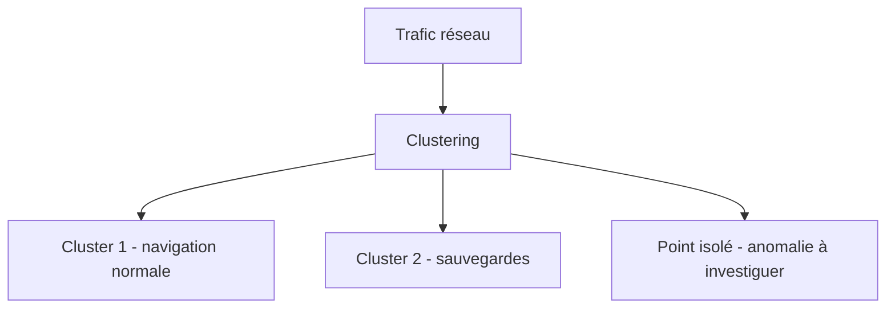

## Introduction

Contrairement au chapitre précédent, l'apprentissage non supervisé travaille sur des données SANS étiquette connue — une situation très fréquente en sécurité, où l'on ne dispose pas toujours d'exemples déjà classés d'attaques (notamment pour des menaces inédites, dites "zero-day").

C'est aussi la situation de départ de presque tout analyste : des millions de lignes de logs, aucune étiquette, et la question « qu'est-ce qui sort de l'ordinaire ? ». Les fonctions d'analyse comportementale des utilisateurs et des entités (UEBA) intégrées aux SIEM et aux EDR modernes reposent largement sur ces techniques. À la fin de ce chapitre, tu sauras expliquer et coder l'algorithme k-means, choisir un nombre de groupes, repérer des anomalies par la distance aux centres ou avec Isolation Forest, et surtout comprendre pourquoi toute alerte d'anomalie doit être triée par un humain.

## Pourquoi le non supervisé compte particulièrement en sécurité

<CehCallout>
Un modèle supervisé de détection d'intrusion ne peut détecter que des types d'attaques déjà vus et étiquetés dans son jeu d'entraînement. Une attaque totalement inédite ("zero-day" en termes de comportement, pas nécessairement de vulnérabilité) échappera à un modèle purement supervisé — c'est précisément ce que le non supervisé, en cherchant des motifs sans étiquette préalable, peut aider à repérer.
</CehCallout>

L'apprentissage non supervisé couvre plusieurs familles de tâches. Le **clustering** regroupe les observations similaires. La **détection d'anomalies** repère les observations qui ne ressemblent à rien de connu. La **réduction de dimension**, comme la PCA vue au cours Algèbre Linéaire (chapitre 5), résume les données en quelques axes. Ces familles se combinent souvent : on réduit la dimension, on regroupe, puis on cherche ce qui s'écarte des groupes.

<CompareTable
  titleA="Supervisé (chapitre 5)"
  titleB="Non supervisé (ce chapitre)"
  rows={[
    { a: "Exige des exemples étiquetés", b: "Travaille sur des données sans étiquette" },
    { a: "Reconnaît des attaques déjà connues", b: "Repère ce qui s'écarte de la normale, connu ou non" },
    { a: "Évaluation directe avec des métriques (précision, rappel)", b: "Évaluation difficile : il n'y a pas de bonne réponse de référence" },
    { a: "Peu de faux positifs si les données sont représentatives", b: "Faux positifs inévitables sur les comportements rares mais légitimes" },
]}
/>

## Le clustering — regrouper sans étiquette

<Steps steps={[
  { title: "Choisir un nombre de groupes (k)", description: "Décider combien de groupes distincts on cherche à identifier dans les données." },
  { title: "Initialiser des centres de groupe au hasard", description: "Des points de départ arbitraires dans l'espace des caractéristiques (cours Algèbre Linéaire, chapitre 1)." },
  { title: "Assigner chaque point au centre le plus proche", description: "Utiliser une distance (cours Algèbre Linéaire, chapitre 6) pour déterminer l'appartenance." },
  { title: "Recalculer les centres et répéter", description: "Le centre de chaque groupe devient la moyenne de tous les points qui lui sont assignés, jusqu'à stabilisation." },
]} />

### Ce que k-means optimise

L'algorithme **k-means** cherche à minimiser l'**inertie**, c'est-à-dire la somme des carrés des distances entre chaque point et le centre de son groupe. Chaque itération ne peut que diminuer l'inertie, ce qui garantit que l'algorithme s'arrête. Un petit exemple chiffré : avec les points 1, 2 et 10 sur une droite et deux centres initiaux en 1 et 10, les points 1 et 2 rejoignent le premier centre, le point 10 le second ; le premier centre devient la moyenne de 1 et 2, soit 1,5, et le second reste en 10. À l'itération suivante, plus rien ne change : l'algorithme a convergé.

<TipCallout>
L'algorithme k-means, le plus utilisé pour le clustering, ne garantit pas de trouver la meilleure solution globale — le résultat peut dépendre de l'initialisation aléatoire des centres, d'où la pratique courante de relancer l'algorithme plusieurs fois et de garder le meilleur résultat obtenu.
</TipCallout>

En scikit-learn, le paramètre `n_init` fixe ce nombre de relances, et l'initialisation par défaut, appelée k-means++, choisit des centres de départ bien espacés, ce qui améliore nettement les résultats.

### Coder k-means à la main

```python
import numpy as np

rng = np.random.default_rng(1)
cluster_navigation = rng.normal([20, 5], 2, size=(20, 2))       # duree, volume
cluster_sauvegardes = rng.normal([300, 800], 15, size=(15, 2))
point_isole = np.array([[900, 50]])                              # comportement inhabituel
X = np.vstack([cluster_navigation, cluster_sauvegardes, point_isole])

k = 2
centres = X[[0, 20]].copy()          # initialisation : un point de chaque groupe (pour la reproductibilité)
for iteration in range(10):
    distances = np.array([np.linalg.norm(X - c, axis=1) for c in centres])
    assignations = np.argmin(distances, axis=0)
    nouveaux = np.array([X[assignations == c].mean(axis=0) for c in range(k)])
    if np.allclose(nouveaux, centres):
        break
    centres = nouveaux
print("itérations :", iteration, "| centres :\n", centres.round(1))
d = np.linalg.norm(X - centres[assignations], axis=1)
print("anomalie candidate :", X[np.argmax(d)], "à", d.max().round(1), "de son centre")
```

```text
itérations : 1 | centres :
 [[ 61.9   7.1]
 [298.7 795.8]]
anomalie candidate : [900.  50.] à 839.2 de son centre
```

L'algorithme converge en deux passages. Le point isolé est bien repéré comme le plus éloigné de son centre, à 839 unités. Mais observe le premier centre : la navigation est simulée autour d'une durée de 20, et pourtant le centre est en 61,9. Le point isolé, rattaché de force au groupe navigation, a tiré la moyenne vers lui. C'est une limite importante de k-means : **chaque point doit appartenir à un groupe**, et les valeurs extrêmes déforment les centres. Des algorithmes comme DBSCAN, qui étiquette explicitement certains points comme « bruit », ou l'utilisation de la médiane (k-médoïdes) atténuent ce problème.

### Choisir k : coude et silhouette

Le nombre de groupes est rarement connu. Deux outils aident à le choisir. La **méthode du coude** trace l'inertie en fonction de k : elle diminue toujours, mais on cherche le point où elle cesse de chuter fortement. Le **score de silhouette** mesure, pour chaque point, s'il est plus proche des points de son groupe que de ceux du groupe voisin ; il varie de −1 à 1, et plus il est élevé, mieux les groupes sont séparés. On simule ici 1 000 sessions réseau issues de trois profils : navigation web, sauvegardes et sondes de supervision.

```python
import numpy as np
from sklearn.cluster import KMeans
from sklearn.metrics import silhouette_score
from sklearn.preprocessing import StandardScaler

rng = np.random.default_rng(seed=0)
# Sessions : [log10(octets), durée (min), nb_destinations]
web = np.column_stack([rng.normal(5.0, 0.3, 600), rng.normal(15, 5, 600), rng.poisson(12, 600)])
sauvegarde = np.column_stack([rng.normal(8.5, 0.2, 150), rng.normal(45, 8, 150), rng.poisson(1, 150) + 1])
supervision = np.column_stack([rng.normal(3.0, 0.2, 250), rng.normal(0.5, 0.1, 250), rng.poisson(40, 250)])
X = np.vstack([web, sauvegarde, supervision])
Xs = StandardScaler().fit_transform(X)

for k in range(2, 7):
    km = KMeans(n_clusters=k, n_init=10, random_state=0).fit(Xs)
    print(f"k={k}  inertie={km.inertia_:8.1f}  silhouette={silhouette_score(Xs, km.labels_):.3f}")
```

```text
k=2  inertie=  1311.1  silhouette=0.623
k=3  inertie=   228.0  silhouette=0.769
k=4  inertie=   185.8  silhouette=0.480
k=5  inertie=   149.7  silhouette=0.417
k=6  inertie=   120.0  silhouette=0.382
```

L'inertie s'effondre entre k = 2 et k = 3 (de 1 311 à 228), puis ne baisse plus que lentement : c'est le coude. Le score de silhouette atteint son maximum, 0,769, pour k = 3. Les deux méthodes retrouvent les trois profils simulés. Le volume est exprimé en logarithme décimal des octets, et les données sont standardisées : sans cela, k-means, qui repose sur la distance euclidienne, serait dominé par la variable à la plus grande échelle (cours Algèbre Linéaire, chapitre 6).

## Application du clustering à la sécurité

<CompareTable
  titleA="Cas d'usage"
  titleB="Ce que révèle le clustering"
  rows={[
    { a: "Segmentation du trafic réseau", b: "Regroupe les connexions en profils similaires (navigation web normale, sauvegardes automatisées, streaming...)" },
    { a: "Regroupement de malwares", b: "Identifie des familles de malwares aux comportements similaires, sans connaître leur nom au préalable" },
    { a: "Profils utilisateurs", b: "Regroupe les comportements utilisateurs typiques, pour repérer ensuite ceux qui s'en écartent fortement" },
    { a: "Regroupement d'alertes", b: "Rassemble les alertes similaires d'un SIEM pour qu'un analyste traite une campagne entière d'un coup" },
]}
/>

Le clustering est aussi un formidable outil de **réduction de la charge** du SOC : si 4 000 alertes se répartissent en douze groupes homogènes, l'analyste examine un représentant de chaque groupe au lieu de 4 000 lignes. En analyse de malwares, regrouper des échantillons par similarité de comportement en bac à sable permet de rattacher une nouvelle variante à une famille connue.

## La détection d'anomalies par le non supervisé

<CehCallout>
Le principe central : la grande majorité du trafic ou des comportements est "normale" et se regroupe naturellement en quelques clusters denses — une observation qui n'appartient clairement à aucun cluster existant, ou qui en est très éloignée, constitue une anomalie candidate à investiguer, sans jamais avoir eu besoin d'exemples étiquetés d'attaques.
</CehCallout>



### Deux détecteurs comparés

Le premier détecteur réutilise k-means : on calcule pour chaque session la distance à son centre le plus proche, et on fixe un seuil au 99,5e centile des distances du trafic d'apprentissage. Le second est **Isolation Forest**, un algorithme conçu pour la détection d'anomalies. Son idée est élégante : il construit des arbres qui découpent l'espace au hasard, et mesure combien de découpes sont nécessaires pour isoler chaque point. Un point anormal, éloigné des autres, est isolé en très peu de découpes ; un point normal, entouré de voisins, en demande beaucoup.

```python
import numpy as np
from sklearn.cluster import KMeans
from sklearn.ensemble import IsolationForest
from sklearn.preprocessing import StandardScaler

rng = np.random.default_rng(seed=0)
web = np.column_stack([rng.normal(5.0, 0.3, 600), rng.normal(15, 5, 600), rng.poisson(12, 600)])
sauvegarde = np.column_stack([rng.normal(8.5, 0.2, 150), rng.normal(45, 8, 150), rng.poisson(1, 150) + 1])
supervision = np.column_stack([rng.normal(3.0, 0.2, 250), rng.normal(0.5, 0.1, 250), rng.poisson(40, 250)])
X = np.vstack([web, sauvegarde, supervision])

nouvelles = np.array([
    [5.1, 14, 11],      # navigation ordinaire
    [8.6, 40, 1],       # sauvegarde ordinaire
    [8.3, 180, 1],      # gros transfert très long vers une seule destination (exfiltration ?)
    [3.1, 0.6, 250],    # sessions très courtes vers 250 destinations (scan ?)
])
scaler = StandardScaler().fit(X)
km = KMeans(n_clusters=3, n_init=10, random_state=0).fit(scaler.transform(X))

dist_train = km.transform(scaler.transform(X)).min(axis=1)       # distance au centre le plus proche
seuil = np.percentile(dist_train, 99.5)
dist_new = km.transform(scaler.transform(nouvelles)).min(axis=1)
print("seuil k-means :", seuil.round(2), "| distances :", dist_new.round(2))

iso = IsolationForest(n_estimators=200, contamination="auto", random_state=0).fit(X)
print("Isolation Forest (1 = normal, -1 = anomalie) :", iso.predict(nouvelles))
print("scores (plus bas = plus anormal) :", iso.score_samples(nouvelles).round(3))
```

```text
seuil k-means : 1.1 | distances : [ 0.12  0.33  9.44 14.67]
Isolation Forest (1 = normal, -1 = anomalie) : [ 1 -1 -1 -1]
scores (plus bas = plus anormal) : [-0.383 -0.537 -0.659 -0.584]
```

Le détecteur fondé sur k-means sépare parfaitement les cas : la navigation et la sauvegarde ordinaires sont très proches de leur centre (0,12 et 0,33, sous le seuil de 1,1), tandis que le transfert de trois heures et le balayage de 250 destinations en sont à 9,4 et 14,7. Isolation Forest repère aussi les deux comportements suspects, mais il signale également la **sauvegarde ordinaire** comme anomalie ! Les sauvegardes ne représentent que 15 % des sessions et forment un petit groupe isolé du reste : pour un algorithme qui cherche ce qui est facile à isoler, un comportement rare mais parfaitement légitime ressemble à une anomalie. Le paramètre `contamination` fixe la proportion attendue d'anomalies et donc le seuil ; avec la valeur `"auto"`, scikit-learn utilise le seuil proposé dans l'article original. Ajuster ce seuil, ou entraîner un détecteur par profil, réduirait ce faux positif.

<WarningCallout>
La détection d'anomalies non supervisée produit inévitablement des faux positifs : un comportement légitime mais rare (un employé qui se connecte depuis un nouveau pays lors d'un déplacement professionnel) peut être signalé comme anomalie alors qu'il ne s'agit pas d'une attaque — ces alertes doivent être triées par un analyste, un lien direct avec le travail quotidien décrit au cours Analyse SOC.
</WarningCallout>

| Algorithme | Principe | Points forts | Limites |
| --- | --- | --- | --- |
| k-means + distance | distance au centre le plus proche | simple, explicable | suppose des groupes sphériques, sensible aux extrêmes |
| DBSCAN | densité ; les points isolés sont du bruit | trouve des groupes de forme libre, pas besoin de k | réglage délicat de `eps` |
| Isolation Forest | nombre de découpes pour isoler un point | rapide, adapté aux grandes dimensions | signale les petits groupes légitimes |
| Local Outlier Factor | densité locale comparée aux voisins | gère des densités variables | coûteux sur de gros volumes |
| Erreur de reconstruction PCA | écart au sous-espace principal (Algèbre Linéaire, ch. 5) | capte les corrélations rompues | relations linéaires uniquement |

### Réduire les faux positifs

Plusieurs pratiques rendent la détection d'anomalies exploitable. On construit des **lignes de base par entité** (par utilisateur, par serveur, par heure de la journée) plutôt qu'une seule norme pour tout le parc : une connexion à 3 heures du matin est normale pour un serveur de sauvegarde, pas pour un poste de comptabilité. On **enrichit** les anomalies avec du contexte (géolocalisation, calendrier de déplacements, tickets de changement) avant de les présenter. On **corrèle** plusieurs signaux faibles plutôt que d'alerter sur un seul. Enfin, on **réinjecte** les verdicts des analystes : une anomalie confirmée devient un exemple étiqueté pour un futur modèle supervisé, et un faux positif récurrent devient une exception documentée.

<AttackDefenseTable rows={[
  { phase: "Exfiltration", attack: "Transfert massif vers une destination unique (MITRE ATT&CK T1041, T1048)", defense: "Distance au profil de l'entité, alerte sur volume et durée inhabituels" },
  { phase: "Découverte réseau", attack: "Balayage de nombreuses destinations (T1046, Network Service Discovery)", defense: "Nombre de destinations distinctes comme caractéristique, Isolation Forest" },
  { phase: "Évasion par lenteur", attack: "Rester dans la normale : exfiltrer lentement, imiter les horaires de bureau", defense: "Agrégats sur de longues fenêtres, corrélation avec d'autres sources" },
  { phase: "Dérive de la ligne de base", attack: "Introduire progressivement le comportement malveillant pour qu'il devienne « normal »", defense: "Apprendre sur des périodes validées, surveiller l'évolution des centres" },
]} />

## Erreurs fréquentes

On applique k-means sans standardiser, et la variable exprimée en octets décide seule des groupes. On fixe k arbitrairement sans regarder le coude ni la silhouette. On interprète les groupes comme des vérités, alors qu'ils dépendent des caractéristiques choisies et de l'algorithme. On oublie que k-means rattache chaque point à un groupe, y compris les points aberrants qui déforment les centres. On transforme chaque anomalie en alerte, et le SOC est noyé. On croit qu'une anomalie est forcément une attaque, ou qu'une attaque est forcément une anomalie, alors qu'un attaquant prudent cherche justement à ressembler au trafic normal. Enfin, on apprend la normalité sur une période qui contenait déjà l'attaquant.

## Lab — Mise en pratique

**Environnement** : Python 3.12+ (terminal Nyx Shell ou environnement local avec `numpy` et `scikit-learn` installés).

<Steps steps={[
  { title: "Créer un jeu de connexions avec un point isolé", description: "Génère deux groupes de comportements réseau normaux (navigation, sauvegardes) plus un point clairement isolé, comme dans le schéma du chapitre.", code: 'import numpy as np\n\nrng = np.random.default_rng(1)\ncluster_navigation = rng.normal([20, 5], 2, size=(20, 2))     # duree, volume\ncluster_sauvegardes = rng.normal([300, 800], 15, size=(15, 2))\npoint_isole = np.array([[900, 50]])                             # comportement inhabituel\n\nX = np.vstack([cluster_navigation, cluster_sauvegardes, point_isole])\nprint(X.shape)' },
  { title: "Implémenter les étapes du k-means", description: "Initialise deux centres au hasard, puis répète assignation et recalcul des centres jusqu'à stabilisation — les quatre étapes décrites plus haut. Relance plusieurs fois : les centres finaux changent-ils selon l'initialisation ?", code: 'k = 2\ncentres = X[rng.choice(len(X), k, replace=False)]\n\nfor iteration in range(10):\n    distances = np.array([np.linalg.norm(X - centre, axis=1) for centre in centres])\n    assignations = np.argmin(distances, axis=0)\n    centres = np.array([X[assignations == c].mean(axis=0) for c in range(k)])\n\nprint("Centres finaux :", centres)' },
  { title: "Repérer l'anomalie", description: "Identifie le point le plus éloigné du centre de son propre cluster : c'est l'anomalie candidate à investiguer, sans avoir utilisé aucune étiquette d'attaque.", code: 'distances_au_centre = np.linalg.norm(X - centres[assignations], axis=1)\nindice_anomalie = np.argmax(distances_au_centre)\nprint("Point le plus eloigne de son cluster (anomalie candidate) :", X[indice_anomalie])' },
  { title: "Choisir k avec scikit-learn", description: "Avec le jeu des 1 000 sessions du chapitre, calcule l'inertie et la silhouette pour k de 2 à 6. Quel k retiens-tu, et pourquoi ?", code: 'from sklearn.cluster import KMeans\nfrom sklearn.metrics import silhouette_score\nfor k in range(2, 7):\n    km = KMeans(n_clusters=k, n_init=10, random_state=0).fit(Xs)\n    print(k, round(km.inertia_, 1), round(silhouette_score(Xs, km.labels_), 3))' },
  { title: "Comparer deux détecteurs d'anomalies", description: "Exécute le script k-means + Isolation Forest. Ajoute une cinquième session de ton choix (par exemple une session web très longue). Quel détecteur la signale ?", code: 'nouvelles = np.vstack([nouvelles, [5.0, 120, 12]])\nprint(km.transform(scaler.transform(nouvelles)).min(axis=1).round(2))\nprint(iso.predict(nouvelles))' },
  { title: "Corriger un faux positif", description: "Isolation Forest signale la sauvegarde ordinaire. Entraîne un détecteur séparé sur les seules sessions de sauvegarde, puis vérifie que la sauvegarde ordinaire est jugée normale et l'exfiltration toujours anormale.", code: 'from sklearn.ensemble import IsolationForest\niso_sauv = IsolationForest(random_state=0).fit(sauvegarde)\nprint(iso_sauv.predict([[8.6, 40, 1], [8.3, 180, 1]]))' },
  { title: "Anticiper un faux positif malgré le clustering", description: "Pourquoi une équipe de sécurité qui veut détecter des attaques encore jamais documentées choisirait-elle une approche non supervisée comme celle ci-dessus plutôt que supervisée ? Si le point isolé détecté à l'étape précédente correspondait en réalité à un employé en déplacement se connectant depuis un pays inhabituel, pourquoi le système le signalerait-il à tort, et comment un analyste SOC devrait-il réagir ?" },
]} />

## À retenir

- L'apprentissage non supervisé travaille sans étiquettes connues, particulièrement utile pour détecter des menaces inédites qu'un modèle supervisé ne peut pas reconnaître.
- Le clustering (k-means) regroupe des données similaires : assignation au centre le plus proche, puis recalcul de chaque centre comme la moyenne de ses points, jusqu'à stabilisation.
- k-means dépend de l'initialisation (d'où les relances avec `n_init`) et des valeurs extrêmes ; il exige des données standardisées.
- La méthode du coude et le score de silhouette aident à choisir le nombre de groupes.
- Une observation très éloignée de tous les clusters est une anomalie candidate ; Isolation Forest isole les points rares en peu de découpes.
- La détection d'anomalies non supervisée produit inévitablement des faux positifs sur les comportements rares mais légitimes : lignes de base par entité, contexte et tri par un analyste sont indispensables.

## Questions de révision

1. Quelle est la principale différence entre apprentissage supervisé et non supervisé, et pourquoi un modèle supervisé ne peut-il pas détecter une attaque totalement inédite ?
2. Décris les grandes étapes de l'algorithme k-means et ce que devient le centre d'un groupe à chaque itération.
3. Pourquoi relance-t-on souvent k-means plusieurs fois avec des initialisations différentes ?
4. Dans le lab codé à la main, pourquoi le centre du groupe navigation se retrouve-t-il loin de la vraie moyenne de la navigation ?
5. Comment la méthode du coude et le score de silhouette aident-ils à choisir k ?
6. Pourquoi Isolation Forest a-t-il signalé la sauvegarde ordinaire, et comment corriger ce faux positif ?
7. Pourquoi la détection d'anomalies non supervisée produit-elle nécessairement des faux positifs, et comment un SOC doit-il s'organiser pour les gérer ?
