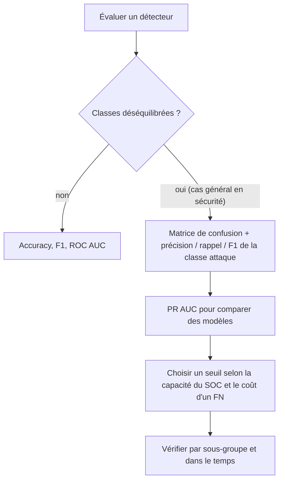
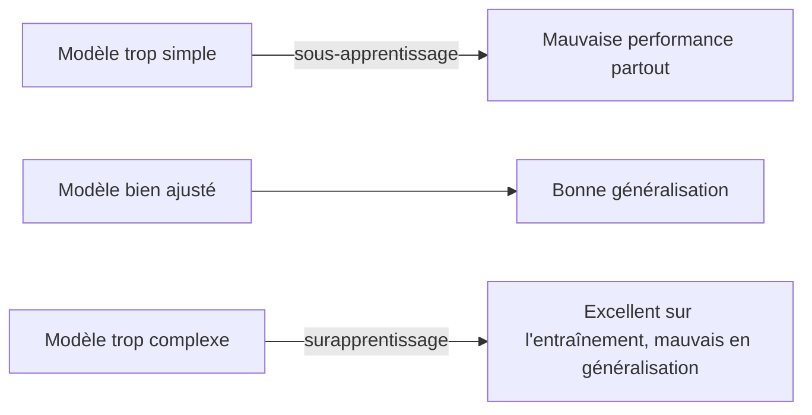

## Introduction

Un modèle qui affiche "99% de précision" peut être soit excellent, soit totalement inutile — tout dépend de la métrique employée et de la nature des données. Ce chapitre couvre les pièges d'évaluation les plus fréquents, particulièrement critiques en sécurité où les données sont presque toujours déséquilibrées (très peu d'attaques parmi énormément de trafic normal).

L'évaluation est l'étape où se décide la mise en production, et donc celle où une erreur coûte le plus cher. Un fournisseur qui vante « 99,9 % de détection » sans préciser sur quelles données, avec quel seuil et quel taux de faux positifs, ne dit en réalité presque rien. À la fin de ce chapitre, tu sauras lire une matrice de confusion, calculer et interpréter précision, rappel et F1, choisir un seuil de décision adapté à la capacité d'un SOC, diagnostiquer le surapprentissage avec une courbe de validation et organiser une validation croisée sans fuite de données.

## La matrice de confusion

<CompareTable
  titleA="Résultat"
  titleB="Signification"
  rows={[
    { a: "Vrai positif (VP)", b: "Le modèle prédit une attaque, c'en est réellement une" },
    { a: "Faux positif (FP)", b: "Le modèle prédit une attaque, mais c'était du trafic normal (fausse alerte)" },
    { a: "Vrai négatif (VN)", b: "Le modèle prédit du trafic normal, c'en est réellement" },
    { a: "Faux négatif (FN)", b: "Le modèle prédit du trafic normal, mais c'était une attaque manquée" },
]}
/>

Par convention, la classe « positive » est celle que l'on cherche à détecter : l'attaque, le phishing, la fraude. La **matrice de confusion** range ces quatre comptes dans un tableau. En scikit-learn, `confusion_matrix` place les classes réelles en lignes et les classes prédites en colonnes : la première ligne contient les VN puis les FP, la seconde les FN puis les VP. Cet ordre surprend souvent, il faut toujours le vérifier.

| Réel \ Prédit | Prédit normal | Prédit attaque |
| --- | --- | --- |
| Réellement normal | VN | FP (fausse alerte) |
| Réellement attaque | FN (attaque manquée) | VP |

<WarningCallout>
En sécurité, un faux négatif (une attaque manquée) est généralement bien plus coûteux qu'un faux positif (une fausse alerte à trier) — un système de détection doit souvent être réglé en tenant compte de cette asymétrie de coût, pas seulement en cherchant à minimiser le nombre total d'erreurs.
</WarningCallout>

Cette asymétrie a toutefois une limite : chaque fausse alerte consomme du temps d'analyste, et une avalanche de faux positifs provoque la **fatigue d'alerte**, qui conduit les équipes à ignorer ou désactiver un détecteur. Un faux positif n'est donc pas gratuit ; il faut chiffrer les deux coûts.

## Pourquoi l'accuracy est trompeuse sur des données déséquilibrées

<CehCallout>
Sur un jeu de données où seulement 1% du trafic est une attaque réelle, un modèle "paresseux" qui prédit systématiquement "trafic normal" obtient déjà 99% d'accuracy — un chiffre impressionnant mais totalement inutile, puisque ce modèle ne détecte jamais aucune attaque. C'est le piège classique de l'accuracy sur des données fortement déséquilibrées, la norme en sécurité.
</CehCallout>

L'**accuracy** (exactitude) est la proportion de prédictions correctes : (VP + VN) divisé par le total. Démontrons le piège sur 20 000 flux simulés, dont 1 % d'attaques, avec la fonction `make_classification` de scikit-learn.

```python
import numpy as np
from sklearn.datasets import make_classification
from sklearn.model_selection import train_test_split
from sklearn.linear_model import LogisticRegression
from sklearn.dummy import DummyClassifier
from sklearn.metrics import confusion_matrix, classification_report, accuracy_score

# 20 000 flux, 1 % d'attaques
X, y = make_classification(n_samples=20_000, n_features=10, n_informative=4,
                           weights=[0.99], class_sep=1.0, flip_y=0.002, random_state=7)
X_tr, X_te, y_tr, y_te = train_test_split(X, y, test_size=0.3, stratify=y, random_state=0)

paresseux = DummyClassifier(strategy="most_frequent").fit(X_tr, y_tr)
print("accuracy du modèle paresseux :", round(accuracy_score(y_te, paresseux.predict(X_te)), 4))

clf = LogisticRegression(max_iter=1000).fit(X_tr, y_tr)
pred = clf.predict(X_te)
print("accuracy de la régression logistique :", round(accuracy_score(y_te, pred), 4))
print(confusion_matrix(y_te, pred))
print(classification_report(y_te, pred, target_names=["normal", "attaque"], digits=3))
```

```text
accuracy du modèle paresseux : 0.9895
accuracy de la régression logistique : 0.9925
[[5935    2]
 [  43   20]]
              precision    recall  f1-score   support

      normal      0.993     1.000     0.996      5937
     attaque      0.909     0.317     0.471        63

    accuracy                          0.993      6000
   macro avg      0.951     0.659     0.733      6000
weighted avg      0.992     0.993     0.991      6000
```

Le modèle paresseux atteint 98,95 % d'accuracy sans détecter une seule attaque. La régression logistique fait à peine mieux, 99,25 %, et pourtant la matrice de confusion révèle qu'elle **rate 43 attaques sur 63** : elle n'en détecte que 20. L'accuracy, dominée par les 5 937 flux normaux, masque complètement ce résultat. Le rapport `classification_report` donne les bonnes métriques classe par classe.

## Précision, rappel et F1-score

<CompareTable
  titleA="Métrique"
  titleB="Calcul et signification"
  rows={[
    { a: "Précision (precision)", b: "VP / (VP + FP) — parmi les alertes déclenchées, quelle proportion est réellement une attaque ?" },
    { a: "Rappel (recall)", b: "VP / (VP + FN) — parmi les attaques réelles, quelle proportion a été détectée ?" },
    { a: "F1-score", b: "Moyenne harmonique de la précision et du rappel — un compromis unique entre les deux" },
    { a: "Taux de faux positifs (FPR)", b: "FP / (FP + VN) — parmi le trafic normal, quelle proportion déclenche une alerte ?" },
]}
/>

Faisons un calcul complet. Un modèle produit 80 vrais positifs, 20 faux positifs et 10 faux négatifs. Sa précision vaut 80 / (80 + 20) = 0,80 : quatre alertes sur cinq sont justifiées. Son rappel vaut 80 / (80 + 10) = 0,889 : il détecte près de 89 % des attaques. Son F1 vaut 2 × 0,80 × 0,889 / (0,80 + 0,889) ≈ 0,842. La **moyenne harmonique** a une propriété utile : elle est tirée vers la plus faible des deux valeurs, si bien qu'un modèle ne peut pas obtenir un bon F1 en sacrifiant complètement l'une des deux métriques. Dans l'exemple précédent, la régression logistique avait une excellente précision (0,909) mais un rappel médiocre (0,317), d'où un F1 de seulement 0,471.

Dans le rapport, la ligne **macro avg** fait la moyenne simple des deux classes, alors que **weighted avg** pondère par le nombre d'exemples, ce qui la rend aussi trompeuse que l'accuracy sur des données déséquilibrées.

<TipCallout>
Un SOC qui privilégie ne rater aucune attaque (chapitre lié : Analyse SOC) acceptera un rappel élevé au prix d'une précision plus faible (plus de fausses alertes à trier) — le choix du compromis précision/rappel dépend directement du coût relatif des faux positifs et des faux négatifs pour l'organisation concernée.
</TipCallout>

## Choisir un seuil de décision

Un classifieur produit un score, et `predict` applique par défaut un seuil de 0,5. Rien n'oblige à garder ce seuil : en le baissant, on déclenche plus d'alertes, on gagne en rappel et on perd en précision. Le bon seuil dépend de la capacité de traitement de l'équipe.

```python
import numpy as np
from sklearn.datasets import make_classification
from sklearn.model_selection import train_test_split
from sklearn.linear_model import LogisticRegression
from sklearn.metrics import precision_score, recall_score, roc_auc_score, average_precision_score

X, y = make_classification(n_samples=20_000, n_features=10, n_informative=4,
                           weights=[0.99], class_sep=1.0, flip_y=0.002, random_state=7)
X_tr, X_te, y_tr, y_te = train_test_split(X, y, test_size=0.3, stratify=y, random_state=0)
clf = LogisticRegression(max_iter=1000).fit(X_tr, y_tr)
proba = clf.predict_proba(X_te)[:, 1]

print(f"ROC AUC = {roc_auc_score(y_te, proba):.3f}   PR AUC (average precision) = {average_precision_score(y_te, proba):.3f}")
print("seuil  alertes  précision  rappel")
for seuil in (0.5, 0.3, 0.1, 0.05, 0.02):
    p = (proba >= seuil).astype(int)
    print(f"{seuil:5.2f}  {p.sum():7d}  {precision_score(y_te, p):9.3f}  {recall_score(y_te, p):6.3f}")

pondere = LogisticRegression(max_iter=1000, class_weight="balanced").fit(X_tr, y_tr)
p = pondere.predict(X_te)
print(f"class_weight='balanced' : alertes={p.sum()}, précision={precision_score(y_te, p):.3f}, rappel={recall_score(y_te, p):.3f}")
```

```text
ROC AUC = 0.959   PR AUC (average precision) = 0.539
seuil  alertes  précision  rappel
 0.50       22      0.909   0.317
 0.30       34      0.735   0.397
 0.10       99      0.394   0.619
 0.05      202      0.218   0.698
 0.02      500      0.106   0.841
class_weight='balanced' : alertes=757, précision=0.075, rappel=0.905
```

Ce tableau est l'outil de décision d'un responsable SOC. Avec le seuil par défaut, 22 alertes et un tiers des attaques détectées. Avec un seuil de 0,05, dix fois plus d'alertes (202) pour un rappel de 70 %, mais seulement une alerte sur cinq justifiée. Avec `class_weight="balanced"`, qui donne aux attaques un poids inversement proportionnel à leur fréquence pendant l'entraînement, le rappel monte à 90 % au prix de 757 alertes, dont plus de 92 % de fausses. Il n'existe pas de bon seuil universel : si l'équipe peut traiter cent alertes sur cette période, un seuil autour de 0,1 est un compromis raisonnable. Depuis la version 1.5, scikit-learn propose aussi `TunedThresholdClassifierCV`, qui choisit automatiquement le seuil optimisant une métrique par validation croisée.

### ROC AUC ou PR AUC ?

La **courbe ROC** trace le rappel en fonction du taux de faux positifs pour tous les seuils ; l'aire sous cette courbe (**ROC AUC**) vaut 0,5 pour un modèle aléatoire et 1 pour un modèle parfait. La **courbe précision-rappel** trace la précision en fonction du rappel ; son aire, l'**average precision** ou PR AUC, vaut environ la proportion de positifs (ici 0,01) pour un modèle aléatoire. Sur notre exemple, la ROC AUC de 0,959 paraît excellente, alors que la PR AUC de 0,539 montre que la précision s'effondre dès qu'on cherche à détecter la majorité des attaques. La raison est que le taux de faux positifs divise par l'énorme nombre de flux normaux : 200 fausses alertes ne font que 3 % de taux de faux positifs. **Sur des données très déséquilibrées, on privilégie la courbe précision-rappel.**



## Le surapprentissage (overfitting)

<CehCallout>
Un modèle en surapprentissage a "mémorisé" les exemples d'entraînement (y compris leur bruit et leurs particularités non généralisables) plutôt que d'apprendre des motifs réellement transférables — il obtient d'excellents résultats sur les données d'entraînement mais échoue sur des données nouvelles jamais vues.
</CehCallout>



Le **sous-apprentissage** (underfitting) est le problème inverse : un modèle trop simple, comme un arbre d'une seule question, ne capte pas la structure des données et se trompe partout. Entre les deux se trouve le compromis biais-variance : un modèle simple a un **biais** élevé (il se trompe systématiquement), un modèle complexe a une **variance** élevée (il change beaucoup selon les exemples d'entraînement).

<Steps steps={[
  { title: "Séparer les données en jeux distincts", description: "Entraînement (pour apprendre), validation (pour ajuster), test (pour l'évaluation finale, jamais utilisé pendant l'entraînement)." },
  { title: "Surveiller l'écart entraînement/validation", description: "Un modèle en surapprentissage montre une performance qui continue de s'améliorer sur l'entraînement tout en stagnant ou se dégradant sur la validation." },
  { title: "Simplifier le modèle si nécessaire", description: "Réduire la profondeur d'un arbre de décision, ou utiliser des techniques de régularisation, pour limiter la mémorisation excessive." },
]} />

### La validation croisée et la courbe de validation

Avec un seul découpage validation, le résultat dépend du hasard du découpage, surtout quand il n'y a que quelques dizaines d'attaques. La **validation croisée** à k plis (k-fold) découpe les données en k parts, entraîne k fois en gardant chaque fois une part différente pour la validation, et fait la moyenne. La version **stratifiée** (`StratifiedKFold`) garantit la même proportion d'attaques dans chaque pli. La fonction `validation_curve` applique ce principe pour plusieurs valeurs d'un hyperparamètre.

```python
import numpy as np
from sklearn.datasets import make_classification
from sklearn.model_selection import StratifiedKFold, validation_curve, cross_val_score
from sklearn.tree import DecisionTreeClassifier

X, y = make_classification(n_samples=20_000, n_features=10, n_informative=4,
                           weights=[0.99], class_sep=1.0, flip_y=0.002, random_state=7)
cv = StratifiedKFold(n_splits=5, shuffle=True, random_state=0)

profondeurs = [1, 2, 4, 6, 8, 12, 20]
train, val = validation_curve(DecisionTreeClassifier(random_state=0), X, y,
                              param_name="max_depth", param_range=profondeurs,
                              cv=cv, scoring="average_precision")
for d, tr, va in zip(profondeurs, train.mean(axis=1), val.mean(axis=1)):
    print(f"profondeur {d:2d}   train = {tr:.3f}   validation = {va:.3f}   écart = {tr - va:.3f}")

scores = cross_val_score(DecisionTreeClassifier(max_depth=6, random_state=0), X, y,
                         cv=cv, scoring="average_precision")
print("PR AUC par pli :", scores.round(3), f"| moyenne {scores.mean():.3f} ± {scores.std():.3f}")
```

```text
profondeur  1   train = 0.074   validation = 0.066   écart = 0.008
profondeur  2   train = 0.120   validation = 0.099   écart = 0.021
profondeur  4   train = 0.385   validation = 0.311   écart = 0.074
profondeur  6   train = 0.552   validation = 0.379   écart = 0.173
profondeur  8   train = 0.658   validation = 0.436   écart = 0.222
profondeur 12   train = 0.845   validation = 0.457   écart = 0.388
profondeur 20   train = 0.999   validation = 0.384   écart = 0.615
```

```text
PR AUC par pli : [0.381 0.446 0.347 0.371 0.35 ] | moyenne 0.379 ± 0.036
```

La lecture est typique. Aux faibles profondeurs, les deux scores sont bas : **sous-apprentissage**. En augmentant la profondeur, le score de validation progresse jusqu'à environ 0,46 vers la profondeur 12. Au-delà, le score d'entraînement continue de monter jusqu'à 0,999, presque parfait, tandis que la validation **redescend** à 0,384 : l'arbre mémorise le bruit, c'est le **surapprentissage**. L'écart entre les deux scores ne cesse de se creuser. La validation croisée montre aussi la **variabilité** du résultat : selon le pli, la PR AUC de l'arbre de profondeur 6 varie de 0,347 à 0,446, ce qui rappelle qu'un score unique sans écart-type est fragile.

<WarningCallout>
Évaluer un modèle sur les mêmes données que celles utilisées pour l'entraîner donne systématiquement une estimation optimiste et trompeuse de sa performance réelle — c'est pourquoi le jeu de test doit rester strictement séparé et jamais consulté avant l'évaluation finale.
</WarningCallout>

## Les fuites de données et l'évaluation dans le temps

Une **fuite de données** (data leakage) se produit quand une information indisponible au moment de la prédiction réelle s'invite dans l'entraînement ou l'évaluation. Les formes les plus fréquentes en sécurité sont les suivantes : un prétraitement (standardisation, sélection de caractéristiques, rééquilibrage) ajusté sur toutes les données avant le découpage ; des doublons ou quasi-doublons répartis entre entraînement et test (chapitre 2) ; une caractéristique remplie après la décision, comme le statut du ticket (chapitre 3) ; et surtout le **mélange temporel**.

En production, on prédit toujours le futur à partir du passé. Si l'on mélange aléatoirement des événements de janvier à juin, le modèle s'entraîne sur des attaques de juin pour « prédire » des attaques de mars, ce qui est impossible en réalité et surestime les performances, notamment face à la dérive des techniques d'attaque (chapitre 8). Pour des données horodatées, on utilise un découpage temporel : entraînement sur le passé, test sur la période suivante, ou `TimeSeriesSplit` de scikit-learn. Une autre forme de fuite consiste à mettre des événements de la même machine ou de la même campagne de phishing des deux côtés du découpage ; `GroupKFold` garde chaque groupe d'un seul côté.

| Piège | Symptôme | Parade |
| --- | --- | --- |
| Accuracy sur classes déséquilibrées | 99 % sans aucune détection | précision, rappel, F1, PR AUC |
| Seuil de 0,5 par défaut | rappel très faible | choisir le seuil selon la capacité du SOC |
| Évaluation sur l'entraînement | score parfait | jeu de test séparé, validation croisée |
| Prétraitement avant découpage | scores trop beaux | Pipeline scikit-learn |
| Mélange temporel | effondrement en production | découpage chronologique, TimeSeriesSplit |
| Même campagne des deux côtés | surestimation | GroupKFold par campagne ou par machine |
| Test consulté à chaque essai | surajustement au test | ne regarder le test qu'une fois, à la fin |

## Erreurs fréquentes

On communique un seul chiffre, l'accuracy, sans matrice de confusion. On compare deux modèles avec la ROC AUC sur des données à 0,1 % d'attaques. On garde le seuil de 0,5 sans se demander s'il correspond au besoin. On lit la matrice de confusion de scikit-learn à l'envers. On optimise les hyperparamètres en regardant le jeu de test, qui cesse alors d'être une évaluation indépendante. On mélange aléatoirement des données horodatées. On présente un score sans sa variabilité entre plis. Enfin, on rééquilibre les classes (sur-échantillonnage, SMOTE) avant de découper, ce qui place des copies d'attaques des deux côtés et constitue une fuite.

## Lab — Mise en pratique

**Environnement** : Python 3.12+ (terminal Nyx Shell ou environnement local avec `numpy`, `pandas` et `scikit-learn` installés).

<Steps steps={[
  { title: "Calculer précision, rappel et F1-score", description: "Un modèle de détection produit 80 vrais positifs, 20 faux positifs, et 10 faux négatifs. Calcule sa précision, son rappel et son F1-score. Résultats attendus : 0,8, 0,889 et 0,842.", code: 'VP, FP, FN = 80, 20, 10\n\nprecision = VP / (VP + FP)\nrappel = VP / (VP + FN)\nf1 = 2 * (precision * rappel) / (precision + rappel)\n\nprint("Precision :", round(precision, 3))\nprint("Rappel :", round(rappel, 3))\nprint("F1-score :", round(f1, 3))' },
  { title: "Démontrer le piège de l'accuracy", description: "Simule un jeu de données déséquilibré (2% d'attaques) et un modèle 'paresseux' qui prédit toujours 'normal', comme dans l'exemple du modèle de fraude à 98% d'accuracy.", code: 'import numpy as np\n\nrng = np.random.default_rng(2)\nn = 1000\nlabels_reels = rng.choice(["normal", "attaque"], size=n, p=[0.98, 0.02])\nprediction_paresseuse = np.array(["normal"] * n)\n\naccuracy = (prediction_paresseuse == labels_reels).mean()\nprint("Accuracy du modele paresseux :", round(accuracy, 3))\nprint("Attaques reellement detectees :", ((prediction_paresseuse == "attaque") & (labels_reels == "attaque")).sum())' },
  { title: "Lire une matrice de confusion", description: "Exécute le script de la régression logistique du chapitre et identifie VN, FP, FN et VP dans la matrice. Vérifie que le rappel affiché vaut bien VP / (VP + FN).", code: 'from sklearn.metrics import confusion_matrix\nvn, fp, fn, vp = confusion_matrix(y_te, pred).ravel()\nprint(vn, fp, fn, vp, vp / (vp + fn))' },
  { title: "Choisir un seuil pour un SOC", description: "L'équipe peut traiter au maximum 120 alertes sur le jeu de test. Trouve le seuil le plus bas qui respecte cette contrainte, et note le rappel obtenu.", code: 'for s in np.arange(0.02, 0.5, 0.01):\n    if (proba >= s).sum() <= 120:\n        print(round(s, 2), (proba >= s).sum(), recall_score(y_te, proba >= s))\n        break' },
  { title: "Repérer un surapprentissage via l'écart entraînement/validation", description: "Compare l'accuracy sur l'entraînement et sur la validation à mesure que la complexité du modèle augmente, pour repérer où le surapprentissage apparaît.", code: 'complexites = np.array([1, 2, 3, 4, 5])\naccuracy_entrainement = np.array([0.70, 0.80, 0.90, 0.97, 0.99])\naccuracy_validation = np.array([0.68, 0.78, 0.85, 0.80, 0.72])\n\necart = accuracy_entrainement - accuracy_validation\nprint("Ecart entrainement/validation par complexite :", np.round(ecart, 2))\nprint("Meilleure validation a la complexite :", complexites[np.argmax(accuracy_validation)])' },
  { title: "Tracer une vraie courbe de validation", description: "Exécute validation_curve sur l'arbre de décision et repère la profondeur qui maximise la PR AUC de validation. Remplace ensuite l'arbre par une forêt aléatoire et compare.", code: 'from sklearn.ensemble import RandomForestClassifier\nprint(cross_val_score(RandomForestClassifier(n_estimators=200, random_state=0, n_jobs=-1), X, y, cv=cv, scoring="average_precision").mean())' },
  { title: "Interpréter l'écart observé", description: "Pourquoi un écart important entre l'accuracy sur l'entraînement et sur la validation (comme observé à la complexité 4 et au-delà ci-dessus) signale-t-il un surapprentissage plutôt qu'une simple variation aléatoire ?" },
]} />

## À retenir

- La matrice de confusion (VP, FP, VN, FN) est la base de toutes les métriques d'évaluation d'un modèle de classification ; en scikit-learn, les classes réelles sont en lignes.
- L'accuracy est trompeuse sur des données déséquilibrées, la norme en sécurité : un modèle qui prédit toujours « normal » atteint 99 % avec 1 % d'attaques.
- Précision = VP / (VP + FP), rappel = VP / (VP + FN), F1 = leur moyenne harmonique.
- Un faux négatif coûte généralement plus cher qu'un faux positif, mais les fausses alertes provoquent la fatigue d'alerte : le seuil se choisit selon les coûts et la capacité du SOC.
- Sur des classes très déséquilibrées, la courbe précision-rappel est plus honnête que la courbe ROC.
- Le surapprentissage se détecte en comparant la performance sur l'entraînement et sur un jeu de validation distinct : l'entraînement continue de s'améliorer pendant que la validation stagne ou se dégrade.
- La validation croisée stratifiée, les Pipelines et le découpage chronologique évitent les fuites de données.

## Questions de révision

1. Dans la matrice de confusion, que représente un faux négatif, et pourquoi est-il généralement plus coûteux qu'un faux positif en sécurité ?
2. Pourquoi l'accuracy peut-elle donner une impression trompeuse de performance sur un jeu de données déséquilibré ? Illustre avec 1 % d'attaques.
3. Un modèle produit 80 vrais positifs, 20 faux positifs et 10 faux négatifs. Calcule sa précision, son rappel et son F1.
4. Pourquoi baisser le seuil de décision augmente-t-il le rappel et diminue-t-il la précision ? Comment choisir ce seuil en pratique ?
5. Pourquoi une ROC AUC de 0,96 peut-elle coexister avec une PR AUC de 0,54, et laquelle croire en sécurité ?
6. Comment détecte-t-on qu'un modèle est en situation de surapprentissage ? Décris la forme d'une courbe de validation typique.
7. Pourquoi ne faut-il pas mélanger aléatoirement des événements horodatés pour évaluer un détecteur, et quelle alternative utiliser ?
