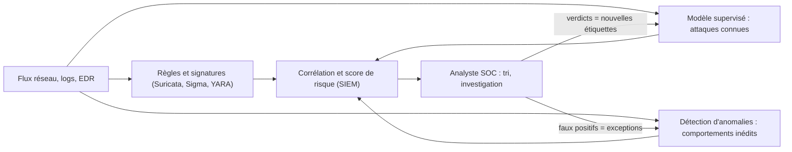

## Introduction

Ce chapitre réunit les notions des sept chapitres précédents autour de trois cas d'usage concrets et largement déployés en entreprise : la détection de phishing, la détection d'intrusion réseau, et la détection de fraude. Chacun illustre un défi méthodologique différent.

Le phishing illustre la **dérive de concept** : les campagnes changent sans cesse et un modèle vieillit. La détection d'intrusion illustre le **déséquilibre extrême** des classes et la nécessité de combiner plusieurs approches. La fraude illustre le caractère **adversarial** du domaine : l'adversaire étudie le détecteur et s'y adapte. À la fin de ce chapitre, tu sauras construire des caractéristiques à partir de texte, de noms de domaine et d'historiques de comportement, entraîner un petit classifieur de phishing, détecter une dérive des données avec un test de Kolmogorov-Smirnov, et concevoir une chaîne de détection réaliste.

## Cas 1 — Détection de phishing par email

<Steps steps={[
  { title: "Caractéristiques extraites", description: "Présence de liens raccourcis, urgence du langage employé, domaine de l'expéditeur, présence de pièces jointes exécutables, fautes d'orthographe." },
  { title: "Type de modèle", description: "Classification supervisée (chapitre 5) — phishing ou légitime — entraînée sur des milliers d'emails déjà étiquetés." },
  { title: "Défi principal", description: "Les techniques de phishing évoluent constamment ; un modèle entraîné sur des données anciennes se dégrade progressivement (dérive de concept), nécessitant un réentraînement régulier." },
]} />

### Trois familles de caractéristiques

Un détecteur de phishing moderne combine trois familles de signaux. Les **métadonnées techniques** : résultats des authentifications SPF, DKIM et DMARC, âge et réputation du domaine de l'expéditeur, chemin des en-têtes Received, écart entre le nom affiché et l'adresse réelle. Les **caractéristiques des liens et pièces jointes** : domaine différent du texte affiché, raccourcisseur d'URL, adresse IP à la place d'un nom, archive ou fichier ISO, macro dans un document bureautique. Enfin, le **contenu textuel** : ton urgent, demande d'identifiants, menace de suspension, usurpation d'une marque connue.

<CehCallout>
Le langage employé dans un email de phishing peut être analysé via des techniques de traitement automatique du langage (NLP), transformant le texte en vecteurs (rappel du cours Algèbre Linéaire, chapitre 1) exploitables par un modèle de classification.
</CehCallout>

### Un classifieur de texte en quelques lignes

La méthode classique combine une vectorisation **TF-IDF** (fréquence du terme pondérée par sa rareté dans le corpus) et une régression logistique. On l'illustre ici sur un corpus volontairement minuscule de douze emails.

```python
import numpy as np
from sklearn.feature_extraction.text import TfidfVectorizer
from sklearn.linear_model import LogisticRegression
from sklearn.pipeline import make_pipeline

emails = [
    ("Votre compte sera suspendu, verifiez vos identifiants immediatement", 1),
    ("Action requise : confirmez votre mot de passe sous 24 heures", 1),
    ("Votre colis est bloque, payez les frais de douane via ce lien", 1),
    ("Alerte securite : connexion inhabituelle, cliquez pour debloquer", 1),
    ("Facture impayee en piece jointe, reglement urgent demande", 1),
    ("Votre boite mail est pleine, validez votre compte ici", 1),
    ("Compte rendu de la reunion projet de mardi en piece jointe", 0),
    ("Planning des astreintes du SOC pour le mois prochain", 0),
    ("Merci pour ta relecture du rapport d incident", 0),
    ("Rappel : formation sensibilisation au phishing jeudi a 14h", 0),
    ("Le serveur de sauvegarde sera redemarre ce soir a 22h", 0),
    ("Peux-tu valider la demande de conges de l equipe ?", 0),
]
textes, y = zip(*emails)
modele = make_pipeline(TfidfVectorizer(ngram_range=(1, 2), sublinear_tf=True), LogisticRegression(C=10))
modele.fit(textes, y)

tfidf, clf = modele
mots = np.array(tfidf.get_feature_names_out())
ordre = np.argsort(clf.coef_[0])
print("vers phishing :", list(mots[ordre[-6:]][::-1]))
print("vers légitime :", list(mots[ordre[:6]]))

nouveaux = ["Urgent : verifiez votre compte pour eviter la suspension",
            "Ordre du jour de la reunion securite de jeudi"]
print(modele.predict_proba(nouveaux)[:, 1].round(2))
```

```text
vers phishing : ['votre', 'votre compte', 'est', 'urgent demande', 'urgent', 'impayee']
vers légitime : ['la', 'du', 'de', 'le', 'incident', 'merci pour']
[0.68 0.23]
```

Le modèle classe correctement les deux nouveaux emails (0,68 pour le phishing, 0,23 pour la réunion). Mais l'examen des poids est instructif : les mots les plus discriminants sont « votre », « est », « la » ou « de ». Sur douze exemples, le modèle a appris que le phishing vouvoie et que les emails internes contiennent des articles, une **corrélation fallacieuse** qui ne tiendrait pas sur de vraies données. Un attaquant qui écrirait « Merci pour la relecture du compte rendu » passerait sans difficulté. C'est pourquoi il faut des milliers d'emails étiquetés et représentatifs, et pourquoi inspecter les poids d'un modèle est un réflexe indispensable. Le paramètre `ngram_range=(1, 2)` ajoute les paires de mots consécutifs comme « votre compte », et `sublinear_tf=True` atténue l'effet des mots répétés.

En 2026, les meilleurs filtres utilisent aussi des modèles de langage fondés sur les Transformers, qui comprennent mieux le sens. Mais les attaquants utilisent les mêmes outils : les LLM génèrent des emails sans fautes, personnalisés et variés, ce qui rend obsolètes les indices historiques comme les fautes d'orthographe et renforce le poids des signaux techniques (authentification, réputation, comportement des liens).

### La dérive de concept

La **dérive de concept** survient quand la relation entre les caractéristiques et la cible change : ce qui caractérisait le phishing il y a un an ne le caractérise plus. On distingue souvent la **dérive des données** (la distribution des caractéristiques change, par exemple les URL raccourcissent) de la dérive de concept proprement dite (une même URL courte, autrefois légitime, devient un signal de phishing). Un test statistique simple, le **test de Kolmogorov-Smirnov** à deux échantillons, compare deux distributions et signale un changement.

```python
import numpy as np
from scipy.stats import ks_2samp

rng = np.random.default_rng(seed=8)
# Longueur des URL dans les emails de phishing : à l'entraînement, puis six mois plus tard
urls_entrainement = rng.normal(75, 15, 3000)
urls_production = rng.normal(48, 12, 3000)       # les attaquants passent aux URL courtes
res = ks_2samp(urls_entrainement, urls_production)
print(f"KS = {res.statistic:.3f}, p = {res.pvalue:.1e}")
```

```text
KS = 0.675, p = 0.0e+00
```

La statistique KS, qui mesure le plus grand écart entre les deux distributions cumulées, vaut 0,675 sur une échelle de 0 à 1 : la distribution a profondément changé, et la p-value est si petite qu'elle s'affiche comme zéro. En production, on surveille ainsi chaque caractéristique importante chaque semaine, ainsi que la proportion d'alertes et le taux de faux positifs remontés par les analystes, et on déclenche un réentraînement quand la dérive dépasse un seuil. Comme on l'a vu au chapitre 4, sur de très gros volumes même une dérive minime est « significative » : on se fie donc à la valeur de la statistique plus qu'à la p-value.

## Cas 2 — Détection d'intrusion réseau

<Steps steps={[
  { title: "Caractéristiques extraites", description: "Volume de données transférées, durée de connexion, ports utilisés, fréquence des requêtes, entropie du trafic (rappel du cours Mathématiques Appliquées, chapitre 5)." },
  { title: "Type de modèle", description: "Souvent une combinaison de supervisé (attaques connues) et non supervisé (chapitre 6, pour les anomalies inédites)." },
  { title: "Défi principal", description: "Un très fort déséquilibre entre trafic normal et attaques réelles (chapitre 7) rend l'accuracy inutile comme métrique d'évaluation." },
]} />

### L'entropie comme caractéristique

L'**entropie de Shannon** mesure l'imprévisibilité d'une distribution. Appliquée aux ports contactés par une machine, elle est faible si la machine parle toujours aux mêmes services et élevée si elle en contacte beaucoup, comme lors d'un balayage. Appliquée aux caractères d'un nom de domaine, elle aide à repérer les domaines générés par algorithme (**DGA**, Domain Generation Algorithm), que certains malwares utilisent pour joindre leur serveur de commande (MITRE ATT&CK T1568.002).

```python
import math
from collections import Counter
import pandas as pd

def entropie_shannon(texte: str) -> float:
    """Entropie de Shannon (bits par caractère) de la distribution des caractères."""
    n = len(texte)
    return -sum(c / n * math.log2(c / n) for c in Counter(texte).values())

domaines = ["google", "wikipedia", "microsoftonline", "banque-populaire",
            "xjw3k9qpz2lmv8rt", "q8f2nzk4v0ycx7ub", "kdjfhgqowieur"]
df = pd.DataFrame({"domaine": domaines})
df["longueur"] = df["domaine"].str.len()
df["entropie"] = df["domaine"].map(entropie_shannon).round(2)
df["ratio_chiffres"] = (df["domaine"].str.count(r"\d") / df["longueur"]).round(2)
df["ratio_voyelles"] = (df["domaine"].str.count("[aeiouy]") / df["longueur"]).round(2)
print(df)
```

```text
            domaine  longueur  entropie  ratio_chiffres  ratio_voyelles
0            google         6      1.92            0.00            0.50
1         wikipedia         9      2.64            0.00            0.56
2   microsoftonline        15      3.32            0.00            0.40
3  banque-populaire        16      3.50            0.00            0.50
4  xjw3k9qpz2lmv8rt        16      4.00            0.25            0.00
5  q8f2nzk4v0ycx7ub        16      4.00            0.31            0.12
6     kdjfhgqowieur        13      3.70            0.00            0.31
```

Les deux domaines aléatoires atteignent l'entropie maximale possible pour 16 caractères tous différents, 4 bits par caractère, et contiennent chiffres et peu de voyelles. Mais l'entropie seule ne suffit pas : « banque-populaire », parfaitement légitime, atteint 3,50, et l'entropie augmente mécaniquement avec la longueur. Le domaine « kdjfhgqowieur », tapé au hasard sur un clavier et sans chiffres, se distingue surtout par son faible taux de voyelles. C'est en combinant plusieurs caractéristiques (entropie, longueur, ratios, fréquence des bigrammes, âge du domaine, volume de réponses NXDOMAIN) qu'un modèle devient fiable. Les DGA modernes fondés sur des dictionnaires, qui concatènent des mots réels, échappent d'ailleurs complètement à l'entropie.

<WarningCallout>
Un système de détection d'intrusion basé uniquement sur des règles statiques passe à côté des attaques nouvelles ; un système basé uniquement sur le ML peut générer un volume de faux positifs ingérable sans réglage soigneux — les déploiements réels combinent généralement les deux approches, avec une supervision humaine (cours Analyse SOC) pour trier les alertes.
</WarningCallout>

### Une architecture de détection en couches



Les règles capturent les menaces connues avec une grande précision ; le modèle supervisé généralise aux variantes ; la détection d'anomalies repère l'inédit ; la corrélation réduit le bruit en combinant des signaux faibles ; et l'analyste ferme la boucle en fournissant de nouvelles étiquettes. Les jeux de données publics comme CIC-IDS2017 ou UNSW-NB15 permettent de s'entraîner, mais un détecteur doit toujours être évalué sur le trafic de l'organisation qui le déploie.

## Cas 3 — Détection de fraude financière

<Steps steps={[
  { title: "Caractéristiques extraites", description: "Montant de la transaction, localisation géographique, heure, historique récent du compte, écart par rapport au comportement habituel de l'utilisateur." },
  { title: "Type de modèle", description: "Souvent des modèles capables de traiter des flux en temps réel, la décision devant être prise en quelques millisecondes lors du passage de la carte." },
  { title: "Défi principal", description: "Les fraudeurs adaptent activement leurs techniques pour contourner les modèles connus — un défi qualifié d'adversarial, où l'attaquant cherche explicitement à tromper le modèle." },
]} />

### Comparer chaque client à lui-même

La caractéristique la plus puissante en détection de fraude est souvent l'**écart au comportement habituel** du client, plutôt qu'au comportement global. Avec pandas, `groupby(...).transform(...)` calcule une statistique par client et la redistribue sur chaque ligne.

```python
import numpy as np
import pandas as pd

rng = np.random.default_rng(seed=4)
tx = pd.DataFrame({
    "client": np.repeat(["c1", "c2", "c3"], 30),
    "montant": np.concatenate([rng.normal(40, 10, 30), rng.normal(900, 150, 30), rng.normal(15, 4, 30)]).round(2),
})
tx.loc[89, "montant"] = 480.0          # transaction inhabituelle pour le client c3
tx.loc[59, "montant"] = 1150.0         # montant élevé mais habituel pour c2

grp = tx.groupby("client")["montant"]
tx["z_client"] = ((tx["montant"] - grp.transform("median")) /
                  grp.transform(lambda s: (s - s.median()).abs().median())).round(1)
tx["z_global"] = ((tx["montant"] - tx["montant"].mean()) / tx["montant"].std()).round(1)
print(tx.loc[[59, 89], ["client", "montant", "z_global", "z_client"]])
```

```text
   client  montant  z_global  z_client
59     c2   1150.0       2.0       3.3
89     c3    480.0       0.4     127.2
```

Vue globalement, la transaction de 480 euros du client c3 est banale (z de 0,4), alors que celle de 1 150 euros de c2 paraît plus suspecte (z de 2,0). Rapportées à l'historique de chaque client, les conclusions s'inversent : 480 euros représente plus de 127 écarts absolus médians au-dessus des habitudes de c3, qui dépense d'ordinaire une quinzaine d'euros, tandis que 1 150 euros reste dans la marge haute, mais plausible, des achats de c2. On utilise ici le z-score robuste du chapitre 2, fondé sur la médiane et l'écart absolu médian.

<CehCallout>
Le défi "adversarial" de la détection de fraude rejoint une préoccupation centrale de l'IA appliquée à la sécurité : un attaquant qui connaît (ou devine) le fonctionnement d'un modèle de détection peut délibérément construire des exemples conçus pour le tromper — un sujet approfondi au cours IA & Agents en Cybersécurité.
</CehCallout>

Concrètement, un fraudeur qui a volé une carte commence souvent par de petites transactions de test pour vérifier qu'elle fonctionne, puis reste sous les seuils qu'il soupçonne. Les **étiquettes arrivent en retard** (une contestation de paiement peut survenir des semaines après), ce qui complique le réentraînement. Et la latence est critique : la décision doit tomber en quelques dizaines de millisecondes. Dans l'Union européenne, la directive sur les services de paiement (DSP2) impose l'authentification forte du client, avec des exemptions autorisées lorsque l'analyse de risque en temps réel le permet : la qualité du modèle de fraude a donc un impact direct sur l'expérience client.

<AttackDefenseTable rows={[
  { phase: "Phishing", attack: "Emails générés par LLM, sans fautes, personnalisés ; hébergement sur des services légitimes", defense: "Pondérer les signaux techniques (DMARC, âge du domaine, réputation), réentraîner régulièrement, surveiller la dérive" },
  { phase: "Commande et contrôle", attack: "Domaines DGA, ou DGA à base de dictionnaire pour paraître légitimes", defense: "Combiner entropie, n-grammes, réponses NXDOMAIN et âge des domaines ; renseignement sur les menaces" },
  { phase: "Intrusion réseau", attack: "Rester sous les seuils, imiter le trafic légitime (living off the land)", defense: "Défense en couches : règles, supervisé, anomalies, corrélation, analyste" },
  { phase: "Fraude", attack: "Transactions de test de faible montant, puis montée progressive", defense: "Écart au profil du client, vitesse des transactions, analyse de graphe des comptes liés" },
]} />

## Un fil conducteur commun aux trois cas

<CompareTable
  titleA="Étape du cycle de vie (chapitre 1)"
  titleB="Application commune aux trois cas"
  rows={[
    { a: "Collecte et nettoyage (ch.2)", b: "Données souvent bruitées, incomplètes, nécessitant un nettoyage rigoureux" },
    { a: "Exploration (ch.3)", b: "Visualiser les distributions pour repérer les motifs distinctifs de la fraude/l'intrusion/le phishing" },
    { a: "Statistiques (ch.4)", b: "Tester si une caractéristique distingue réellement les classes, détecter les dérives" },
    { a: "Modélisation (ch.5-6)", b: "Combinaison fréquente de supervisé (menaces connues) et non supervisé (menaces inédites)" },
    { a: "Évaluation (ch.7)", b: "Précision/rappel plutôt qu'accuracy, du fait du fort déséquilibre des classes" },
]}
/>

| Cas | Défi dominant | Métrique clé | Fréquence de réentraînement typique |
| --- | --- | --- | --- |
| Phishing | dérive de concept | rappel sous contrainte de faux positifs | fréquente, au rythme des campagnes |
| Intrusion réseau | déséquilibre extrême, inédit | précision des alertes, PR AUC | selon la dérive de l'infrastructure |
| Fraude | adversaire actif, étiquettes tardives | coût financier évité | continue ou très fréquente |

## Erreurs fréquentes

On construit un détecteur de phishing sur un corpus public ancien et on s'étonne qu'il échoue sur les campagnes actuelles. On fait confiance à un modèle de texte sans inspecter ses poids, et on découvre qu'il a appris des mots vides. On utilise l'entropie seule pour détecter les DGA. On compare chaque transaction à la moyenne globale plutôt qu'à l'historique du client. On évalue un détecteur d'intrusion avec l'accuracy. On déploie sans surveiller la dérive. Enfin, on oublie que l'adversaire lit aussi les publications et les documentations des produits de sécurité, et qu'il teste ses campagnes contre les filtres du marché avant de les lancer.

## Lab — Mise en pratique

**Environnement** : Python 3.12+ (terminal Nyx Shell ou environnement local avec `pandas`, `numpy`, `scipy` et `scikit-learn` installés).

<Steps steps={[
  { title: "Construire un tableau de caractéristiques d'emails", description: "Reprends les caractéristiques du cas 1 (lien raccourci, langage urgent, pièce jointe exécutable) sous forme de DataFrame étiqueté.", code: 'import pandas as pd\n\nemails = pd.DataFrame({\n    "lien_raccourci": [1, 0, 1, 0],\n    "langage_urgent": [1, 0, 1, 0],\n    "piece_jointe_exe": [1, 0, 0, 0],\n    "label": ["phishing", "legitime", "phishing", "legitime"]\n})\nprint(emails)' },
  { title: "Calculer un score de risque simple", description: "Combine ces caractéristiques en un score de risque basique, la même logique qu'un modèle de classification supervisée simplifié dont tous les poids vaudraient 1.", code: 'emails["score_risque"] = emails[["lien_raccourci", "langage_urgent", "piece_jointe_exe"]].sum(axis=1)\nprint(emails[["score_risque", "label"]])' },
  { title: "Entraîner un classifieur de texte", description: "Exécute le classifieur TF-IDF du chapitre, puis ajoute six emails de ton choix (trois de chaque classe). Les mots les plus discriminants deviennent-ils plus pertinents ? Teste un email de phishing rédigé avec des articles et sans vouvoiement.", code: 'print(modele.predict_proba(["Merci pour la relecture, le document est ici : valide ton mot de passe"])[:, 1])' },
  { title: "Calculer l'entropie du trafic pour la détection d'intrusion", description: "Reprends la caractéristique d'entropie du trafic mentionnée au cas 2 et calcule-la sur une distribution de ports observés. Tu dois obtenir environ 1,846 bit.", code: 'import numpy as np\n\nports = pd.Series([80, 80, 443, 443, 443, 22, 8080, 8080, 8080, 8080])\nprobabilites = ports.value_counts(normalize=True)\nentropie = -np.sum(probabilites * np.log2(probabilites))\nprint("Entropie du trafic (ports) :", round(entropie, 3))' },
  { title: "Repérer des domaines générés par algorithme", description: "Applique la fonction entropie_shannon à une dizaine de domaines réels et inventés. Trouve un domaine légitime à forte entropie et un domaine inventé à faible entropie : que conclus-tu ?", code: 'for d in ["lemonde", "service-public", "a1b2c3d4e5f6", "aaaabbbb"]:\n    print(d, round(entropie_shannon(d), 2))' },
  { title: "Détecter une dérive", description: "Avec ks_2samp, compare deux échantillons de longueurs d'URL tirés de la même distribution, puis de deux distributions de moyennes 75 et 72. Observe la statistique KS dans chaque cas.", code: 'from scipy.stats import ks_2samp\nrng = np.random.default_rng(0)\nprint(ks_2samp(rng.normal(75, 15, 3000), rng.normal(75, 15, 3000)).statistic)\nprint(ks_2samp(rng.normal(75, 15, 3000), rng.normal(72, 15, 3000)).statistic)' },
  { title: "Proposer des caractéristiques et identifier le défi adversarial", description: "En t'inspirant du tableau de caractéristiques ci-dessus, propose 4 caractéristiques pertinentes à extraire des données de connexion pour détecter un compte utilisateur compromis. En quoi la détection de fraude financière diffère-t-elle par ailleurs de la plupart des problèmes de classification classiques, du fait du comportement actif des fraudeurs ?" },
]} />

## À retenir

- La détection de phishing, d'intrusion réseau et de fraude illustrent chacune un défi méthodologique distinct : dérive de concept, déséquilibre extrême des classes, et comportement adversarial actif.
- Le phishing se détecte par classification supervisée sur des milliers d'emails étiquetés ; le texte est vectorisé (TF-IDF, embeddings) et le modèle doit être réentraîné régulièrement.
- Inspecter les poids d'un modèle révèle les corrélations fallacieuses apprises sur des données insuffisantes.
- L'entropie aide à repérer balayages et domaines DGA, mais doit être combinée à d'autres caractéristiques.
- En fraude, l'écart au comportement habituel de chaque client est plus révélateur que l'écart à la moyenne globale.
- Les déploiements réels combinent règles, supervisé et non supervisé, avec une supervision humaine pour trier les alertes et fournir de nouvelles étiquettes.
- Le déséquilibre des classes, quasi systématique en sécurité, impose précision et rappel plutôt que l'accuracy ; la dérive se surveille avec des tests comme Kolmogorov-Smirnov.

## Questions de révision

1. Quel type de modèle est typiquement utilisé pour la détection de phishing, et pourquoi nécessite-t-il un réentraînement régulier ?
2. Dans l'exemple TF-IDF, pourquoi les mots « votre » et « la » sont-ils devenus discriminants, et quel risque cela représente-t-il ?
3. Pourquoi combine-t-on souvent supervisé et non supervisé pour la détection d'intrusion réseau ?
4. Pourquoi l'entropie d'un nom de domaine ne suffit-elle pas à détecter un domaine généré par algorithme ?
5. Pourquoi le fort déséquilibre entre trafic normal et attaques rend-il l'accuracy inutile pour évaluer un système de détection d'intrusion ?
6. Qu'est-ce qui rend la détection de fraude financière particulièrement "adversariale", et pourquoi l'écart au comportement habituel du client est-il une caractéristique clé ?
7. Comment détecterais-tu, en production, que les attaquants ont changé la forme de leurs URL de phishing ?
