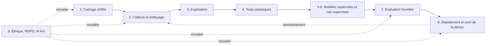

## Introduction

Ce dernier chapitre referme le cours en abordant une dimension trop souvent négligée : les implications éthiques et légales de la data science, avant de dresser une synthèse reliant chaque chapitre à son usage concret.

En sécurité, ces questions ne sont pas théoriques. Un modèle de détection de menaces internes analyse le comportement des employés ; un détecteur de fraude peut bloquer le compte d'un client ; un filtre peut mettre en quarantaine les emails d'un partenaire légitime. Ces décisions touchent des personnes, reposent sur des données personnelles et peuvent être injustes si le modèle est biaisé. À la fin de ce chapitre, tu sauras identifier les grands types de biais, évaluer un modèle par sous-groupe, appliquer la minimisation et la pseudonymisation des données, situer ton projet dans le RGPD et l'AI Act, et relier chaque chapitre du cours à un pipeline complet.

## Les biais dans les données et les modèles

<CompareTable
  titleA="Type de biais"
  titleB="Exemple concret"
  rows={[
    { a: "Biais de sélection", b: "Un modèle entraîné uniquement sur du trafic d'un seul pays généralise mal à un trafic international" },
    { a: "Biais historique", b: "Un modèle entraîné sur des décisions humaines passées reproduit les biais (parfois discriminatoires) de ces décisions" },
    { a: "Biais de mesure", b: "Un capteur réseau qui journalise mal certains types de paquets sous-représente systématiquement une catégorie de trafic" },
    { a: "Biais d'étiquetage", b: "Les analystes enquêtent surtout sur les alertes d'un certain type, si bien que les autres attaques restent étiquetées « normales »" },
    { a: "Boucle de rétroaction", b: "Le modèle ne fait inspecter que ce qu'il signale ; les attaques qu'il rate ne sont jamais étiquetées et ne lui sont jamais apprises" },
]}
/>

Les deux derniers biais sont particulièrement sournois en sécurité. Le **biais d'étiquetage** vient du fait que les étiquettes reflètent ce que les humains ont regardé, pas la réalité : si l'équipe ne chasse jamais les menaces sur les équipements industriels, aucune attaque n'y sera étiquetée, et le modèle apprendra que ces équipements sont toujours sains. La **boucle de rétroaction** aggrave le problème au fil du temps : un modèle qui décide de ce qui est inspecté finit par confirmer ses propres angles morts. Une parade consiste à réserver une petite part du temps d'analyse à un échantillonnage aléatoire d'événements non signalés.

<WarningCallout>
Un modèle de détection entraîné majoritairement sur des attaques ciblant un type d'infrastructure spécifique (par exemple, des serveurs Linux) peut sous-performer silencieusement sur un autre type d'infrastructure (Windows) sans qu'aucune métrique globale ne le révèle clairement — une raison supplémentaire d'évaluer un modèle sur des sous-groupes représentatifs, pas seulement sur une moyenne globale.
</WarningCallout>

### Évaluer par sous-groupe

```python
import pandas as pd

resultats = pd.DataFrame({
    "infrastructure": ["linux"] * 5 + ["windows"] * 5,
    "attaque_reelle": [1, 1, 1, 0, 1, 1, 1, 0, 1, 1],
    "detectee":       [1, 1, 1, 0, 1, 0, 0, 0, 1, 0],
})
attaques = resultats[resultats["attaque_reelle"] == 1]
print("rappel global :", attaques["detectee"].mean().round(2))
print(attaques.groupby("infrastructure")["detectee"]
      .agg(attaques="size", detectees="sum", rappel="mean")
      .assign(taux_faux_negatifs=lambda d: 1 - d["rappel"]).round(2))
```

```text
rappel global : 0.62
                attaques  detectees  rappel  taux_faux_negatifs
infrastructure                                                 
linux                  4          4    1.00                0.00
windows                4          1    0.25                0.75
```

Le rappel global de 62 % paraît moyen mais acceptable. Le détail par sous-groupe change tout : le modèle détecte toutes les attaques sur Linux, mais seulement une sur quatre sur Windows. Trois attaques Windows sur quatre passent inaperçues, ce qui peut être catastrophique si les contrôleurs de domaine Active Directory tournent sous Windows. On calcule le taux de faux négatifs **parmi les attaques réelles** de chaque groupe, et non parmi toutes les lignes, sinon la proportion d'événements normaux dans chaque groupe fausse la comparaison. En pratique, on définit les sous-groupes pertinents dès le cadrage : système d'exploitation, site géographique, type d'actif, langue des emails, catégorie d'utilisateurs.

### Équité envers les personnes

Quand un modèle prend des décisions sur des personnes, la question devient celle de l'**équité**. Un détecteur de comptes compromis qui signale deux fois plus souvent les employés travaillant de nuit, ou un filtre anti-fraude qui bloque davantage les clients voyageant dans certains pays, crée un traitement inégal, même sans utiliser de variable sensible : d'autres variables, comme le pays de connexion ou les horaires, peuvent servir d'**indicateurs indirects** (proxies). Comparer les taux de faux positifs entre groupes de personnes est un premier contrôle simple. Des bibliothèques comme Fairlearn fournissent des métriques d'équité compatibles avec scikit-learn.

## Data science et RGPD — un lien direct

<CehCallout>
Rappel du cours Droit et Réglementation (chapitre 2) : le principe de minimisation des données s'applique directement à la data science — collecter et conserver plus de données personnelles que nécessaire pour un modèle donné constitue un manquement au RGPD, indépendamment de la qualité technique du modèle lui-même.
</CehCallout>

Les données de sécurité sont presque toujours des **données personnelles** au sens du RGPD : une adresse IP, un identifiant de connexion, un nom de poste ou le contenu d'un email permettent d'identifier, directement ou indirectement, une personne. Plusieurs principes et articles s'appliquent directement à un projet de data science.

| Exigence RGPD | Article | Traduction concrète dans un projet |
| --- | --- | --- |
| Licéité, base légale | art. 6 | la sécurité des réseaux peut relever de l'intérêt légitime (considérant 49), à documenter |
| Limitation des finalités | art. 5.1.b | des logs collectés pour la sécurité ne servent pas à évaluer la productivité des employés |
| Minimisation | art. 5.1.c | ne garder que les caractéristiques nécessaires au modèle |
| Limitation de la conservation | art. 5.1.e | durée de rétention définie pour les données d'entraînement |
| Protection dès la conception | art. 25 | pseudonymiser dès la collecte, restreindre les accès |
| Décision individuelle automatisée | art. 22 | intervention humaine possible pour un blocage de compte automatique |
| Analyse d'impact (AIPD) | art. 35 | obligatoire si surveillance systématique ou traitement à risque élevé |

<Steps steps={[
  { title: "Minimiser les données personnelles collectées", description: "Ne conserver que les caractéristiques réellement nécessaires au modèle, pas l'intégralité des données brutes disponibles." },
  { title: "Anonymiser ou pseudonymiser quand possible", description: "Un modèle de détection d'anomalies réseau a rarement besoin de connaître l'identité exacte d'un utilisateur, seulement son comportement." },
  { title: "Documenter les décisions automatisées", description: "Le RGPD encadre les décisions entièrement automatisées ayant un impact significatif sur une personne — un blocage automatique de compte basé sur un modèle de détection de fraude peut en relever." },
]} />

### Pseudonymiser correctement

La **pseudonymisation** remplace un identifiant par un pseudonyme, de façon qu'on ne puisse plus attribuer les données à une personne sans une information supplémentaire conservée à part. Les données pseudonymisées restent des données personnelles. L'**anonymisation**, elle, rend la réidentification impossible de manière irréversible ; les données sortent alors du champ du RGPD, mais c'est très difficile à garantir sur des logs riches. Une erreur classique consiste à « anonymiser » des adresses IPv4 avec un simple hachage SHA-256 : il n'existe qu'environ 4,3 milliards d'adresses IPv4, et un ordinateur portable les hache toutes en quelques minutes, ce qui permet de retrouver chaque adresse. Il faut une **fonction à clé secrète** (HMAC) ou un chiffrement.

```python
import hashlib
import hmac
import ipaddress
import secrets

import pandas as pd

logs = pd.DataFrame({
    "utilisateur": ["a.diallo", "j.martin", "a.diallo"],
    "ip": ["192.168.10.23", "192.168.10.87", "203.0.113.45"],
    "octets": [1200, 56000, 830],
})

# Un simple SHA-256 d'une IPv4 se casse par force brute (2^32 possibilités) : on utilise une clé secrète.
CLE = secrets.token_bytes(32)          # à stocker dans un coffre-fort de secrets, pas dans le code

def pseudonymiser(valeur: str) -> str:
    return hmac.new(CLE, valeur.encode(), hashlib.sha256).hexdigest()[:12]

def generaliser_ip(ip: str) -> str:
    """Tronque une IPv4 au /24 : on garde le sous-réseau, pas la machine."""
    return str(ipaddress.ip_network(f"{ip}/24", strict=False))

logs["utilisateur"] = logs["utilisateur"].map(pseudonymiser)
logs["reseau"] = logs.pop("ip").map(generaliser_ip)
print(logs)
```

```text
    utilisateur  octets           reseau
0  8717fa52a98c    1200  192.168.10.0/24
1  fe019cf39fd2   56000  192.168.10.0/24
2  8717fa52a98c     830   203.0.113.0/24
```

Les pseudonymes changent à chaque exécution puisque la clé est tirée au hasard, mais au sein d'une exécution, le même utilisateur reçoit toujours le même pseudonyme (lignes 0 et 2), ce qui permet au modèle d'apprendre des profils comportementaux sans connaître les noms. La **généralisation** des adresses au sous-réseau /24 réduit encore la précision de l'information : on sait de quel réseau vient la connexion, pas de quelle machine. Le module `secrets` fournit des nombres aléatoires adaptés à la cryptographie, contrairement au module `random`. Si l'enquête l'exige, l'équipe autorisée qui détient la clé peut recalculer le pseudonyme d'un utilisateur précis pour retrouver ses événements.

<LegalCallout>
Le règlement européen sur l'intelligence artificielle (règlement (UE) 2024/1689, dit AI Act), entré en vigueur le 1er août 2024 avec une application progressive, classe les systèmes d'IA selon leur niveau de risque : pratiques interdites, systèmes à haut risque soumis à des obligations de gestion des risques, de qualité des données, de documentation et de supervision humaine, obligations de transparence, et risque minimal. Un détecteur de menaces réseau relève en général du risque minimal, mais un système d'IA utilisé pour évaluer ou surveiller des employés peut relever de la catégorie à haut risque. La directive NIS2 impose par ailleurs aux entités essentielles et importantes des mesures de gestion des risques cyber, dont la détection fait partie : vérifie toujours le cadre applicable avec ton DPO et ton service juridique.
</LegalCallout>

### Documenter un modèle

Une bonne pratique, issue de la recherche et largement adoptée, consiste à accompagner chaque modèle d'une **fiche de modèle** (model card) : finalité et usages prévus, données d'entraînement et leur période, métriques globales et par sous-groupe, seuil retenu et justification, limites connues, procédure de réentraînement, responsable. Cette fiche sert à la fois à l'audit, à l'analyse d'impact, au respect de l'AI Act le cas échéant, et à la transmission entre équipes.

<AttackDefenseTable rows={[
  { phase: "Fuite de données d'entraînement", attack: "Exfiltrer le jeu d'entraînement, riche en données personnelles et en indicateurs internes", defense: "Minimisation, pseudonymisation par HMAC, contrôle d'accès et chiffrement des jeux de données" },
  { phase: "Inférence d'appartenance", attack: "Interroger un modèle pour deviner si une personne figurait dans ses données d'entraînement", defense: "Limiter le surapprentissage, restreindre l'accès aux scores, envisager la confidentialité différentielle" },
  { phase: "Détournement de finalité", attack: "Réutiliser un modèle de sécurité pour surveiller la productivité des employés", defense: "Finalité documentée, AIPD, gouvernance et contrôle par le DPO" },
]} />

## Synthèse — panorama complet du cours

<CompareTable
  titleA="Chapitre"
  titleB="Contribution au pipeline complet"
  rows={[
    { a: "1. Cycle de vie", b: "Cadre méthodologique global" },
    { a: "2. Nettoyage", b: "Fiabiliser les données avant toute analyse" },
    { a: "3. Exploration (EDA)", b: "Comprendre les données avant de modéliser" },
    { a: "4. Statistiques appliquées", b: "Quantifier rigoureusement les observations" },
    { a: "5. ML supervisé", b: "Classer/prédire à partir d'exemples étiquetés" },
    { a: "6. ML non supervisé", b: "Détecter sans étiquettes préalables" },
    { a: "7. Évaluation", b: "Mesurer honnêtement la performance réelle" },
    { a: "8. Cas concrets", b: "Appliquer l'ensemble à des problèmes réels de sécurité" },
    { a: "9. Éthique et conformité", b: "Garantir un usage juste, licite et documenté" },
]}
/>



Ce schéma résume le fil conducteur du cours. Le cadrage chiffré (chapitre 1) fixe la cible et les contraintes. Le nettoyage (chapitre 2) fiabilise les données sans effacer les attaques. L'exploration (chapitre 3) fait émerger les populations et les ruptures. Les tests statistiques (chapitre 4) distinguent l'effet réel du hasard. Les modèles supervisés et non supervisés (chapitres 5 et 6) se complètent pour couvrir le connu et l'inédit. L'évaluation (chapitre 7) choisit des métriques adaptées au déséquilibre et évite les fuites. Les cas concrets (chapitre 8) montrent comment tout cela vit en production, face à la dérive et à l'adversaire. Et l'éthique encadre chaque étape, de la collecte au déploiement.

## Où aller ensuite

<Steps steps={[
  { title: "Vers Python pour la Data Science", description: "Mettre en pratique concrètement chaque notion vue ici (Pandas, NumPy, scikit-learn) sur de vrais jeux de données." },
  { title: "Vers IA & Agents en Cybersécurité", description: "Approfondir les réseaux de neurones et les agents autonomes, en s'appuyant sur les bases de ML supervisé/non supervisé de ce cours." },
  { title: "Vers Analyse SOC", description: "Voir comment les alertes générées par ces modèles sont concrètement triées et traitées au quotidien par un analyste." },
]} />

Les cours Machine Learning et Deep Learning approfondissent ensuite les algorithmes (ensembles d'arbres, réseaux de neurones, Transformers), et le cours Droit et Réglementation détaille le cadre légal évoqué ici.

## Erreurs fréquentes

On se contente d'une métrique globale et on ne découvre le biais qu'après un incident. On croit qu'un hachage simple anonymise des adresses IP ou des identifiants. On collecte « au cas où » toutes les données disponibles, en violation du principe de minimisation. On réutilise des données de sécurité pour une autre finalité, comme l'évaluation des employés. On automatise entièrement une décision lourde de conséquences, comme le blocage d'un compte, sans voie de recours humaine. On oublie l'analyse d'impact quand le traitement surveille systématiquement des personnes. Enfin, on considère l'éthique comme une étape finale de validation, alors qu'elle se joue dès le cadrage.

## Lab — Mise en pratique

**Environnement** : Python 3.12+ (terminal Nyx Shell ou environnement local avec `pandas` installé).

<Steps steps={[
  { title: "Détecter un biais silencieux par sous-groupe", description: "Simule des résultats de détection sur deux infrastructures (Linux, Windows) et calcule le taux de faux négatifs par sous-groupe, parmi les attaques réelles — le biais de l'exemple du chapitre n'apparaîtrait pas dans une métrique globale. Tu dois obtenir 0 % sur Linux et 75 % sur Windows.", code: 'import pandas as pd\n\nresultats = pd.DataFrame({\n    "infrastructure": ["linux"]*5 + ["windows"]*5,\n    "attaque_reelle": [1, 1, 1, 0, 1, 1, 1, 0, 1, 1],\n    "detectee": [1, 1, 1, 0, 1, 0, 0, 0, 1, 0]\n})\n\nattaques = resultats[resultats["attaque_reelle"] == 1]\ntaux_fn_par_infra = 1 - attaques.groupby("infrastructure")["detectee"].mean()\nprint(taux_fn_par_infra)' },
  { title: "Appliquer le principe de minimisation des données", description: "Sélectionne uniquement les colonnes réellement nécessaires au modèle de détection de fraude dans un DataFrame de transactions contenant des données personnelles superflues.", code: 'transactions = pd.DataFrame({\n    "montant": [120, 45, 900],\n    "heure": [14, 22, 3],\n    "localisation": ["Paris", "Lyon", "Paris"],\n    "nom_complet": ["Jean D.", "Awa K.", "Marc L."],\n    "historique_achats": [["livre", "cafe"], ["essence"], ["electronique", "voyage"]]\n})\n\n# Le modele de detection de fraude n a besoin que de ces trois colonnes\ncolonnes_necessaires = ["montant", "heure", "localisation"]\ndonnees_minimisees = transactions[colonnes_necessaires]\nprint(donnees_minimisees)' },
  { title: "Montrer qu'un hachage simple ne protège pas une IP", description: "Hache une adresse du réseau 192.168.10.0/24 avec SHA-256, puis retrouve-la en hachant les 256 adresses possibles du sous-réseau. Imagine la même attaque sur tout l'espace IPv4.", code: 'import hashlib, ipaddress\ncible = hashlib.sha256(b"192.168.10.87").hexdigest()\nfor ip in ipaddress.ip_network("192.168.10.0/24"):\n    if hashlib.sha256(str(ip).encode()).hexdigest() == cible:\n        print("IP retrouvee :", ip)' },
  { title: "Pseudonymiser avec une clé", description: "Exécute le script HMAC du chapitre deux fois. Vérifie que, dans une même exécution, un même utilisateur garde le même pseudonyme, et que les pseudonymes changent quand la clé change.", code: 'print(logs.groupby("utilisateur")["octets"].sum())' },
  { title: "Rédiger une fiche de modèle", description: "Pour le classifieur de phishing du chapitre 5, rédige une fiche de modèle de dix lignes : finalité, données et période, métriques globales et par sous-groupe, seuil, limites connues, responsable, fréquence de réentraînement." },
  { title: "Interpréter le biais et la minimisation", description: "Le tableau ci-dessus montre un taux de faux négatifs bien plus élevé sur l'infrastructure Windows : quel biais cela révèle-t-il, et quel risque concret en découle-t-il ? Par ailleurs, pourquoi serait-il problématique de conserver le nom complet et l'historique d'achats détaillé du client dans le DataFrame de transactions, alors que le modèle n'utilise que montant/heure/localisation ?" },
]} />

## À retenir

- Les biais de sélection, historiques, de mesure et d'étiquetage, ainsi que les boucles de rétroaction, peuvent affecter silencieusement la performance et l'équité d'un modèle, sans apparaître dans les métriques globales.
- Un modèle entraîné surtout sur des attaques Linux peut sous-performer silencieusement sur Windows : on évalue toujours par sous-groupe, en calculant les faux négatifs parmi les attaques réelles.
- Le principe de minimisation des données du RGPD s'applique directement à la data science : ne conserver que les caractéristiques nécessaires au modèle, indépendamment de sa qualité technique.
- Le RGPD encadre les décisions entièrement automatisées ayant un impact significatif, comme un blocage automatique de compte, et impose une AIPD pour les traitements à risque élevé.
- Un hachage simple n'anonymise pas une adresse IP ; on pseudonymise avec une clé secrète (HMAC) et on généralise quand c'est possible.
- L'AI Act classe les systèmes d'IA selon leur risque ; une fiche de modèle documente finalité, données, métriques et limites.
- Ce cours forme un pipeline complet, du cadrage à l'évaluation et au suivi, directement réutilisable dans les cours Python pour la Data Science, IA & Agents en Cybersécurité et Analyse SOC.

## Questions de révision

1. Donne un exemple de biais de sélection et un exemple de biais de mesure qui pourraient affecter un modèle de détection réseau.
2. Pourquoi un modèle entraîné majoritairement sur des attaques ciblant des serveurs Linux peut-il sous-performer silencieusement sur des serveurs Windows, et comment le détecter ?
3. Qu'est-ce qu'une boucle de rétroaction dans un système de détection, et comment en limiter les effets ?
4. Pourquoi le principe de minimisation des données du RGPD s'applique-t-il directement à un projet de data science ?
5. Pourquoi un blocage automatique de compte basé sur un modèle de détection de fraude peut-il relever d'obligations RGPD spécifiques ?
6. Pourquoi le hachage SHA-256 d'une adresse IPv4 ne constitue-t-il pas une anonymisation, et que faut-il utiliser à la place ?
7. Vers quel cours orienterais-tu quelqu'un qui veut mettre en pratique concrètement les notions de ce cours (Pandas, NumPy, scikit-learn) avec du code ?

Félicitations, tu viens de terminer le cours **Data Science Complète** ! Direction **Python pour la Data Science** pour mettre en pratique chaque notion vue ici avec du code réel.
