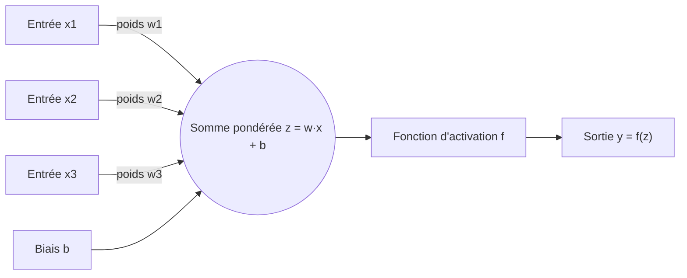
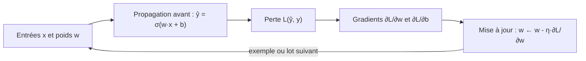

## Introduction

Ce cours prolonge le cours Machine Learning en abordant les réseaux de neurones et le deep learning. Ces modèles, inspirés très librement des neurones biologiques, sont à l'origine des avancées les plus visibles de l'intelligence artificielle : reconnaissance d'images, traduction, assistants conversationnels, détection de malwares à partir d'octets bruts ou analyse de journaux à grande échelle.

Pourtant, tout l'édifice repose sur une brique étonnamment simple : le **perceptron**, une unité qui fait une somme pondérée puis applique une fonction. Si tu comprends parfaitement ce qui se passe dans un seul perceptron — comment il calcule sa sortie et comment il corrige ses poids grâce à la **descente de gradient** — tu as compris l'essentiel du mécanisme d'apprentissage d'un modèle de plusieurs milliards de paramètres. La différence entre les deux est une question d'échelle et d'architecture, pas de principe.

En sécurité, cette compréhension a des conséquences très concrètes. Un analyste qui sait qu'un modèle n'est qu'une fonction paramétrée, ajustée pour réduire une erreur sur des données d'entraînement, sait aussi ce que le modèle ne peut pas faire : il ne « comprend » pas une attaque, il sépare des points dans un espace de caractéristiques. Cette lucidité est la base de tout ce qu'on verra au chapitre 7 sur les attaques adversariales et la dérive des modèles.

À la fin de ce chapitre, tu sauras calculer à la main la sortie d'un perceptron, choisir une fonction d'activation, expliquer pourquoi XOR met un perceptron en échec, et appliquer un pas de descente de gradient, d'abord avec numpy puis avec PyTorch.

## Le perceptron, l'unité de base

### Un peu d'histoire

Le perceptron a été proposé par Frank Rosenblatt en 1958. L'idée était de modéliser un neurone comme une unité qui reçoit des signaux, les pondère, et « s'active » si la somme dépasse un seuil. En 1969, Marvin Minsky et Seymour Papert ont publié le livre *Perceptrons*, qui démontrait rigoureusement les limites d'un perceptron à une seule couche, notamment son incapacité à représenter la fonction XOR. Cette critique a contribué à une longue période de désintérêt pour les réseaux de neurones, jusqu'à la popularisation de la rétropropagation pour entraîner des réseaux à plusieurs couches dans les années 1980, sujet du chapitre 2.

### Le calcul d'un perceptron

Un perceptron reçoit un vecteur d'entrées `x = (x1, x2, …, xn)`. À chaque entrée est associé un **poids** `wi`, un nombre réel qui exprime l'importance de cette entrée. Le perceptron possède aussi un **biais** `b`, un paramètre appris qui ne dépend d'aucune entrée. Le calcul se fait en deux temps.

```text
1. Pré-activation (somme pondérée plus biais) :
   z = w1*x1 + w2*x2 + ... + wn*xn + b   =   w · x + b

2. Activation :
   sortie = f(z)        où f est la fonction d'activation
```

La première étape est exactement un **produit scalaire**, que tu as rencontré dans le cours Algèbre Linéaire, auquel on ajoute le biais. C'est aussi la formule de la régression linéaire du cours Machine Learning. Ce qui distingue le perceptron, c'est la seconde étape : la fonction d'activation `f`.

Le biais joue un rôle souvent sous-estimé. Sans lui, la frontière de décision `w · x = 0` passerait forcément par l'origine. Le biais permet de **décaler le seuil de décision** indépendamment des valeurs des entrées. Pense à un détecteur de connexions suspectes : même si toutes les caractéristiques valent zéro, tu veux pouvoir régler le niveau à partir duquel le modèle déclenche une alerte.



### Exemple chiffré pas à pas

Prenons trois entrées `x = (0.5, -0.2, 0.1)`, des poids `w = (0.4, 0.3, -0.5)` et un biais `b = 0.1`.

```text
z = 0.4*0.5 + 0.3*(-0.2) + (-0.5)*0.1 + 0.1
  = 0.20   - 0.06        - 0.05       + 0.1
  = 0.19

Avec la sigmoïde : sortie = 1 / (1 + e^(-0.19)) ≈ 0.5474
```

Une sortie de 0.5474 s'interprète, avec une sigmoïde, comme une probabilité d'environ 55 % d'appartenir à la classe positive. On retrouvera exactement ces valeurs dans le lab.

### Le perceptron comme classifieur linéaire

Si l'on décide « classe positive quand `z` est positif », la frontière de décision est l'ensemble des points où `w · x + b = 0`. En deux dimensions, c'est une droite ; en trois, un plan ; au-delà, un **hyperplan**. Le perceptron est donc un **classifieur linéaire** : il coupe l'espace des caractéristiques en deux demi-espaces. Avec une sigmoïde en sortie et une perte d'entropie croisée, un perceptron est mathématiquement identique à une **régression logistique**, vue dans le cours Machine Learning.

## Les fonctions d'activation

### Pourquoi la non-linéarité est indispensable

Imagine qu'on empile deux couches de perceptrons sans fonction d'activation. La première calcule `h = W1·x + b1`, la seconde `y = W2·h + b2`. En développant, on obtient `y = (W2·W1)·x + (W2·b1 + b2)`, c'est-à-dire une seule transformation linéaire. Quel que soit le nombre de couches, **l'ensemble resterait équivalent à un seul modèle linéaire**. Toute la puissance d'un réseau profond vient de la non-linéarité introduite entre les couches : c'est elle qui permet d'apprendre des motifs complexes, courbes, imbriqués.

### Les fonctions classiques

| Fonction | Formule | Plage de sortie | Usage typique |
| --- | --- | --- | --- |
| Échelon (Heaviside) | 1 si z ≥ 0, sinon 0 | 0 ou 1 | Perceptron historique de Rosenblatt, non dérivable |
| Sigmoïde | 1 / (1 + e^(-z)) | entre 0 et 1 | Sortie d'une classification binaire (probabilité) |
| Tanh | (e^z - e^(-z)) / (e^z + e^(-z)) | entre -1 et 1, centrée sur 0 | Couches cachées anciennes, cellules LSTM |
| ReLU | max(0, z) | 0 ou z positif | Couches cachées de la plupart des réseaux modernes |
| GELU | z multiplié par la fonction de répartition de la loi normale en z | proche de ReLU, lisse | Transformers (BERT, famille GPT) |

La **ReLU** (Rectified Linear Unit) retourne 0 pour toute entrée négative et l'entrée elle-même pour toute entrée positive. Elle est devenue la fonction par défaut des couches internes parce qu'elle est très peu coûteuse et que sa dérivée vaut 1 sur toute la partie positive, ce qui limite l'affaiblissement du gradient dans les réseaux profonds. Son défaut : un neurone dont la pré-activation reste toujours négative ne reçoit plus jamais de gradient, on parle de neurone « mort ». Des variantes comme Leaky ReLU, GELU ou SiLU adoucissent ce comportement ; les Transformers modernes utilisent souvent GELU ou des variantes basées sur SiLU.

La **tanh** produit des valeurs entre -1 et 1, centrées sur 0, ce qui facilite l'optimisation par rapport à la sigmoïde dont les sorties sont toujours positives. La **sigmoïde** reste le bon choix pour la toute dernière couche quand on veut une probabilité.

Voici les valeurs réelles des trois fonctions sur quelques points, calculées avec numpy :

```text
z         : -2.0    -0.5    0.0    0.5    2.0
sigmoïde  : 0.119   0.378   0.500  0.622  0.881
tanh      : -0.964  -0.462  0.000  0.462  0.964
ReLU      : 0.0     0.0     0.0    0.5    2.0
```

### Le problème de la saturation

La sigmoïde et la tanh **saturent** : pour des valeurs de `z` très grandes ou très petites, leur courbe devient presque plate et leur dérivée tend vers 0. La dérivée de la sigmoïde vaut `σ(z) * (1 - σ(z))`, dont le maximum est 0.25, atteint en `z = 0`. Un neurone saturé n'apprend presque plus. C'est l'une des raisons pour lesquelles on normalise les entrées, et l'une des origines du problème du gradient qui s'évanouit que tu retrouveras aux chapitres 2 et 4.

<TipCallout>
Règle pratique en 2026 : ReLU (ou GELU dans un Transformer) dans les couches cachées, sigmoïde en sortie pour une classification binaire, softmax en sortie pour une classification à plusieurs classes, aucune activation en sortie pour une régression. Dans PyTorch, préfère `nn.BCEWithLogitsLoss` qui applique la sigmoïde en interne, de façon numériquement stable.
</TipCallout>

## La limite historique du perceptron isolé

### La séparabilité linéaire

Un problème est **linéairement séparable** si une seule droite (ou un hyperplan) peut séparer parfaitement les exemples des deux classes. Les fonctions logiques ET et OU le sont : pour ET, seul le point (1, 1) est positif, et une droite le sépare sans difficulté des trois autres.

La fonction **XOR** (OU exclusif) vaut 1 quand exactement une des deux entrées vaut 1. Les points positifs sont (0, 1) et (1, 0), les négatifs (0, 0) et (1, 1). Ils sont disposés en diagonales croisées : aucune droite ne peut mettre les deux positifs d'un côté et les deux négatifs de l'autre. XOR n'est **pas linéairement séparable**, donc un perceptron isolé, qui ne trace qu'une frontière linéaire, ne peut pas l'apprendre, quel que soit le temps d'entraînement.

```text
        x2
        1 |  (0,1)=1      (1,1)=0
          |
        0 |  (0,0)=0      (1,0)=1
          +------------------------ x1
             0            1
Aucune droite ne sépare les 1 des 0.
```

### Ce que montre l'expérience

En entraînant un perceptron sigmoïde par descente de gradient pendant 2000 époques, avec la même procédure, on obtient ces pertes d'entropie croisée :

```text
AND  époque 1    perte 0.6942
AND  époque 1000 perte 0.0347
AND  époque 2000 perte 0.0174
AND  prédictions [0.00 0.02 0.02 0.97]   -> appris

XOR  époque 1    perte 0.6942
XOR  époque 1000 perte 0.6931
XOR  époque 2000 perte 0.6931
XOR  prédictions [0.50 0.50 0.50 0.50]   -> échec
```

Pour XOR, la perte se bloque à 0.6931, c'est-à-dire `ln(2)` : le modèle répond 0.5 partout, la meilleure stratégie possible pour une frontière linéaire face à ce problème. La solution, détaillée au chapitre 2, consiste à ajouter une **couche cachée** : deux neurones cachés peuvent apprendre respectivement OU et NON-ET, et le neurone de sortie combine les deux avec un ET.

<WarningCallout>
La même limite existe en sécurité. Un modèle linéaire sur des caractéristiques brutes ne peut pas exprimer une règle du type « suspect si connexion la nuit OU volume élevé, mais pas les deux à la fois chez un administrateur ». Soit tu construis des caractéristiques qui rendent le problème linéaire (feature engineering), soit tu utilises un réseau avec couches cachées.
</WarningCallout>

## La descente de gradient appliquée au perceptron

### La fonction de perte

Pour apprendre, il faut mesurer l'erreur. Une **fonction de perte** (loss) associe à une prédiction et à une valeur attendue un nombre positif, d'autant plus grand que la prédiction est mauvaise.

```text
Erreur quadratique (régression) :   L = (ŷ - y)²            (souvent avec un facteur 1/2)
Entropie croisée binaire :          L = -[ y*ln(ŷ) + (1-y)*ln(1-ŷ) ]
```

L'entraînement consiste à trouver les poids et le biais qui minimisent la perte moyenne sur les données d'entraînement.

### Le principe

Le **gradient** de la perte par rapport à un poids indique dans quelle direction et avec quelle intensité la perte augmente quand ce poids augmente. Pour réduire la perte, on déplace donc chaque paramètre dans la direction opposée au gradient, d'un pas contrôlé par le **taux d'apprentissage** `η` (learning rate) :

```text
w  ←  w - η * ∂L/∂w
b  ←  b - η * ∂L/∂b
```

C'est exactement le principe que tu as vu pour la régression linéaire dans le cours Machine Learning : ajuster progressivement les paramètres pour minimiser l'écart entre prédiction et valeur attendue. Concrètement, après avoir calculé l'erreur entre la sortie prédite et la sortie attendue, on ajuste chaque poids et le biais dans la direction qui réduit l'erreur, en proportion du taux d'apprentissage.

### Le calcul des dérivées par la règle de la chaîne

Pour un perceptron sigmoïde avec la perte quadratique `L = ½ (ŷ - y)²`, la sortie dépend de `z`, qui dépend des poids. On enchaîne les dérivées :

```text
∂L/∂ŷ  = (ŷ - y)                     l'erreur
∂ŷ/∂z  = ŷ * (1 - ŷ)                 dérivée de la sigmoïde
∂z/∂wi = xi
∂z/∂b  = 1

donc  ∂L/∂wi = (ŷ - y) * ŷ * (1 - ŷ) * xi
      ∂L/∂b  = (ŷ - y) * ŷ * (1 - ŷ)
```

Cet enchaînement est la **règle de dérivation en chaîne**. La rétropropagation du chapitre 2 n'est rien d'autre que cette règle appliquée systématiquement, couche après couche.

Remarque : avec l'entropie croisée binaire au lieu de l'erreur quadratique, le facteur `ŷ(1 - ŷ)` disparaît et le gradient devient simplement `(ŷ - y) * xi`. C'est l'une des raisons pour lesquelles on préfère l'entropie croisée en classification : elle n'est pas freinée par la saturation de la sigmoïde.

### Un pas de gradient à la main

Reprenons l'exemple chiffré, avec `y = 1` attendu et `η = 0.1`.

```text
ŷ            = 0.5474
erreur       = ŷ - y = -0.4526
ŷ(1-ŷ)       = 0.5474 * 0.4526 ≈ 0.2477
facteur      = -0.4526 * 0.2477 ≈ -0.1121

∂L/∂w = facteur * x = -0.1121 * (0.5, -0.2, 0.1) = (-0.0561, 0.0224, -0.0112)
∂L/∂b = -0.1121

w_nouveau = w - 0.1 * ∂L/∂w = (0.4056, 0.2978, -0.4989)
b_nouveau = 0.1 - 0.1 * (-0.1121) = 0.1112
```

Le poids associé à `x1`, une entrée positive, augmente : le modèle pousse la sortie vers 1. Le poids de `x2`, entrée négative, diminue pour la même raison. L'erreur passe de 0.4526 à 0.4490. Le progrès est faible, ce qui est normal : un seul pas avec un petit taux d'apprentissage. L'entraînement répète ce pas des milliers de fois.



### Le taux d'apprentissage

Le taux d'apprentissage est le réglage le plus sensible. Trop petit, l'entraînement est interminable. Trop grand, chaque pas dépasse le minimum et la perte oscille ou explose jusqu'à produire des valeurs `nan`. Les valeurs typiques vont de `1e-1` pour un petit problème jouet à `1e-4` ou moins pour l'ajustement d'un grand modèle. Les optimiseurs modernes comme **Adam** ou **AdamW** adaptent automatiquement le pas pour chaque paramètre ; on les verra au chapitre 6.

### Règle du perceptron et descente de gradient

Le perceptron original de Rosenblatt, avec sa fonction échelon, n'est pas dérivable. Il utilisait une règle de correction plus simple : `w ← w + η (y - ŷ) x`, appliquée seulement quand le perceptron se trompe. Cette règle converge si les données sont linéairement séparables, mais elle ne se généralise pas aux réseaux à plusieurs couches. Remplacer l'échelon par une fonction dérivable comme la sigmoïde est précisément ce qui ouvre la porte à la descente de gradient et à la rétropropagation.

## De numpy à PyTorch

Écrire les dérivées à la main est formateur, mais devient impossible dès qu'un réseau dépasse quelques couches. Les frameworks modernes, au premier rang desquels **PyTorch 2.x**, calculent automatiquement les gradients grâce à la **différentiation automatique** (autograd) : ils enregistrent les opérations de la propagation avant, puis appliquent la règle de la chaîne en sens inverse lors de l'appel à `backward()`.

```python
import torch

x = torch.tensor([0.5, -0.2, 0.1])
w = torch.tensor([0.4, 0.3, -0.5], requires_grad=True)  # on veut le gradient de w
b = torch.tensor(0.1, requires_grad=True)
y = torch.tensor(1.0)

y_hat = torch.sigmoid(w @ x + b)        # propagation avant
loss = 0.5 * (y_hat - y) ** 2            # perte quadratique
loss.backward()                          # autograd calcule dL/dw et dL/db

print(y_hat.item())
print(w.grad)
print(b.grad)
```

```text
0.5473576188087463
tensor([-0.0561,  0.0224, -0.0112])
tensor(-0.1121)
```

Les gradients sont identiques à ceux calculés à la main. Dans un vrai projet, on n'écrit pas non plus la mise à jour : on utilise `nn.Linear` pour la couche et `torch.optim.SGD` pour appliquer `w ← w - η·∂L/∂w`.

```python
import torch
from torch import nn

model = nn.Linear(3, 1)                  # w (3 poids) et b, initialisés aléatoirement
optimizer = torch.optim.SGD(model.parameters(), lr=0.1)
loss_fn = nn.BCEWithLogitsLoss()         # sigmoïde + entropie croisée, numériquement stable

x = torch.tensor([[0.5, -0.2, 0.1]])
y = torch.tensor([[1.0]])

for step in range(3):
    optimizer.zero_grad()                # remet les gradients à zéro (ils s'accumulent sinon)
    loss = loss_fn(model(x), y)
    loss.backward()
    optimizer.step()
    print(step, round(loss.item(), 4))
```

La perte affichée décroît à chaque pas ; ses valeurs exactes dépendent de l'initialisation aléatoire des poids.

## Applications en cybersécurité

Un perceptron seul est un modèle modeste, mais il apparaît partout sous forme de dernière couche : la sortie d'un détecteur de phishing, d'un classifieur de malware ou d'un score de risque de connexion est presque toujours un neurone sigmoïde au sommet d'un réseau plus profond. Comprendre ce neurone permet de lire correctement un score : 0.97 n'est pas une certitude, c'est la sortie d'une fonction ajustée sur des données passées.

Un modèle linéaire reste par ailleurs un excellent point de départ, ou **baseline**, pour un problème de détection : rapide, interprétable (chaque poids dit si une caractéristique pousse vers « malveillant » ou « bénin »), et souvent suffisant quand les caractéristiques sont bien construites. Avant de déployer un réseau profond, vérifie toujours qu'il bat significativement une régression logistique sur le même jeu de test.

<CehCallout>
Les certifications de sécurité comme CEH v13 ou Security+ n'exigent pas de calculer un gradient, mais elles attendent que tu saches qu'un modèle de détection basé sur l'IA produit des faux positifs et des faux négatifs, qu'il dépend de ses données d'entraînement et qu'il peut être contourné. Ces trois idées découlent directement du fonctionnement du perceptron vu ici.
</CehCallout>

## Erreurs fréquentes

- **Oublier de normaliser les entrées.** Si une caractéristique est un nombre d'octets (des millions) et une autre un booléen, la somme pondérée est dominée par la première et la sigmoïde sature immédiatement. Standardise tes caractéristiques (moyenne 0, écart-type 1) avant l'entraînement.
- **Choisir un taux d'apprentissage arbitraire.** Une perte qui devient `nan` ou qui oscille signale presque toujours un pas trop grand.
- **Oublier `optimizer.zero_grad()` dans PyTorch.** Les gradients s'additionnent d'un appel à l'autre ; sans remise à zéro, chaque pas utilise la somme de tous les gradients précédents.
- **Appliquer une sigmoïde puis `BCEWithLogitsLoss`.** Cette perte attend des logits bruts ; appliquer la sigmoïde deux fois fausse silencieusement l'apprentissage.
- **Croire qu'un entraînement plus long résoudra XOR.** Une limite d'expressivité du modèle ne se corrige pas avec plus d'époques, mais avec une autre architecture.
- **Initialiser tous les poids à zéro dans un réseau à plusieurs neurones.** Tous les neurones d'une couche calculent alors la même chose et reçoivent le même gradient : ils restent identiques. On initialise aléatoirement, ce que font les couches PyTorch par défaut.

## Lab — Mise en pratique

**Environnement** : Python 3.12 avec `numpy` (terminal Nyx Shell ou environnement local). L'étape 6 nécessite `torch` (`pip install torch`). Garde la même session Python d'une étape à l'autre.

<Steps steps={[
  { title: "Implémenter un perceptron avec numpy", description: "Définis un perceptron à 3 entrées et calcule sa sortie via une somme pondérée suivie de la sigmoïde. Tu dois obtenir environ 0.5474, la valeur calculée à la main dans ce chapitre.", code: "import numpy as np\n\nx = np.array([0.5, -0.2, 0.1])\nw = np.array([0.4, 0.3, -0.5])\nb = 0.1\n\ndef sigmoid(z):\n    return 1 / (1 + np.exp(-z))\n\ndef forward(x, w, b):\n    return sigmoid(np.dot(w, x) + b)\n\ny_pred = forward(x, w, b)\nprint('Sortie du perceptron :', y_pred)" },
  { title: "Comparer les fonctions d'activation", description: "Calcule sigmoïde, tanh et ReLU sur quelques valeurs. Observe que la tanh est centrée sur 0 avec des valeurs entre -1 et 1, et que la ReLU annule toutes les entrées négatives.", code: "z = np.array([-2.0, -0.5, 0.0, 0.5, 2.0])\nprint('sigmoide', np.round(sigmoid(z), 3))\nprint('tanh    ', np.round(np.tanh(z), 3))\nprint('relu    ', np.maximum(0, z))" },
  { title: "Appliquer un pas de descente de gradient", description: "Calcule l'erreur puis ajuste les poids et le biais. Compare tes nouveaux poids avec le calcul manuel du chapitre : environ 0.4056, 0.2978 et -0.4989.", code: "y_true = 1.0\nlearning_rate = 0.1\n\nerror = y_pred - y_true\n# derivee de la sigmoide : sigmoid(z) * (1 - sigmoid(z))\ngrad_w = error * y_pred * (1 - y_pred) * x\ngrad_b = error * y_pred * (1 - y_pred)\n\nw = w - learning_rate * grad_w\nb = b - learning_rate * grad_b\nprint('Nouveaux poids :', w)\nprint('Nouveau biais :', b)" },
  { title: "Vérifier que l'erreur a diminué", description: "Recalcule la sortie avec les poids mis à jour. L'erreur doit passer d'environ 0.4526 à 0.4490 : une petite amélioration, normale pour un seul pas.", code: "y_pred_new = forward(x, w, b)\nprint('Erreur avant :', abs(y_pred - y_true))\nprint('Erreur apres :', abs(y_pred_new - y_true))" },
  { title: "Constater la limite du perceptron sur XOR", description: "Entraîne le perceptron sur XOR pendant 2000 époques. Les sorties restent toutes proches de 0.5 : aucune frontière linéaire ne sépare XOR. Remplace ensuite y_xor par np.array([0,0,0,1]) (la fonction ET) et constate que l'apprentissage réussit.", code: "np.random.seed(42)\nX_xor = np.array([[0,0],[0,1],[1,0],[1,1]])\ny_xor = np.array([0,1,1,0])\nw = np.random.randn(2)\nb = 0.0\nlr = 0.5\n\nfor epoch in range(2000):\n    for xi, yi in zip(X_xor, y_xor):\n        y_hat = forward(xi, w, b)\n        err = y_hat - yi\n        w -= lr * err * y_hat * (1 - y_hat) * xi\n        b -= lr * err * y_hat * (1 - y_hat)\n\nfor xi in X_xor:\n    print(xi, '->', round(forward(xi, w, b), 2))" },
  { title: "Vérifier tes gradients avec PyTorch", description: "Reproduis le pas de gradient avec autograd. Les gradients affichés doivent correspondre à ceux calculés à la main : environ -0.0561, 0.0224 et -0.0112 pour w, et -0.1121 pour b.", code: "import torch\n\nx_t = torch.tensor([0.5, -0.2, 0.1])\nw_t = torch.tensor([0.4, 0.3, -0.5], requires_grad=True)\nb_t = torch.tensor(0.1, requires_grad=True)\n\ny_hat = torch.sigmoid(w_t @ x_t + b_t)\nloss = 0.5 * (y_hat - 1.0) ** 2\nloss.backward()\nprint(w_t.grad, b_t.grad)" },
  { title: "Explorer le taux d'apprentissage", description: "Relance l'entraînement sur la fonction ET avec lr = 0.01, 0.5 puis 50. Note le nombre d'époques nécessaire pour que toutes les prédictions soient du bon côté de 0.5, et observe le comportement erratique ou la saturation avec un pas très grand.", code: "y_and = np.array([0,0,0,1])\nfor lr in (0.01, 0.5, 50):\n    np.random.seed(0)\n    w, b = np.random.randn(2), 0.0\n    for epoch in range(2000):\n        for xi, yi in zip(X_xor, y_and):\n            y_hat = forward(xi, w, b)\n            g = (y_hat - yi) * y_hat * (1 - y_hat)\n            w -= lr * g * xi\n            b -= lr * g\n    print(lr, [round(forward(xi, w, b), 2) for xi in X_xor])" },
]} />

## À retenir

- Un perceptron calcule une somme pondérée de ses entrées plus un biais, puis applique une fonction d'activation ; le biais décale le seuil de décision indépendamment des entrées.
- Sans non-linéarité, un empilement de couches reste équivalent à un seul modèle linéaire ; la sigmoïde, la tanh, la ReLU et la GELU apportent cette non-linéarité.
- La ReLU retourne 0 pour une entrée négative et l'entrée elle-même sinon ; la tanh est centrée sur 0 avec des sorties entre -1 et 1 ; la sigmoïde donne une probabilité entre 0 et 1.
- Un perceptron isolé est un classifieur linéaire : il ne peut pas apprendre XOR, qui n'est pas linéairement séparable.
- La descente de gradient ajuste chaque poids et le biais dans la direction opposée au gradient de la perte, en proportion du taux d'apprentissage.
- La règle de dérivation en chaîne permet de calculer ces gradients ; PyTorch l'automatise grâce à autograd.
- Normaliser les entrées et bien choisir le taux d'apprentissage sont les deux conditions pratiques d'un entraînement qui converge.

## Questions de révision

1. Que calcule un perceptron avant d'appliquer sa fonction d'activation, et quel est le rôle précis du biais ?
2. Démontre en deux lignes pourquoi deux couches linéaires sans activation équivalent à une seule couche linéaire.
3. Pourquoi un perceptron isolé ne peut-il pas résoudre XOR, alors qu'il apprend sans difficulté la fonction ET ?
4. Pourquoi la perte d'un perceptron entraîné sur XOR se bloque-t-elle à environ 0.693 ?
5. Écris la mise à jour d'un poids par descente de gradient et explique ce qui se passe si le taux d'apprentissage est beaucoup trop grand.
6. Quelle est la dérivée de la sigmoïde, et pourquoi sa valeur maximale de 0.25 pose-t-elle problème dans un réseau profond ?
7. Dans quel cas un modèle linéaire suffit-il pour un problème de détection en sécurité, et comment le vérifierais-tu avant d'adopter un réseau profond ?
