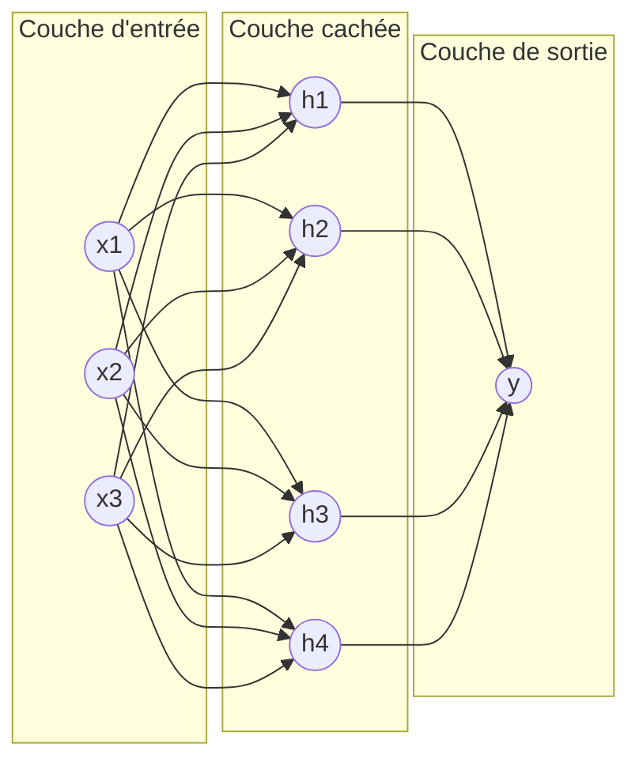
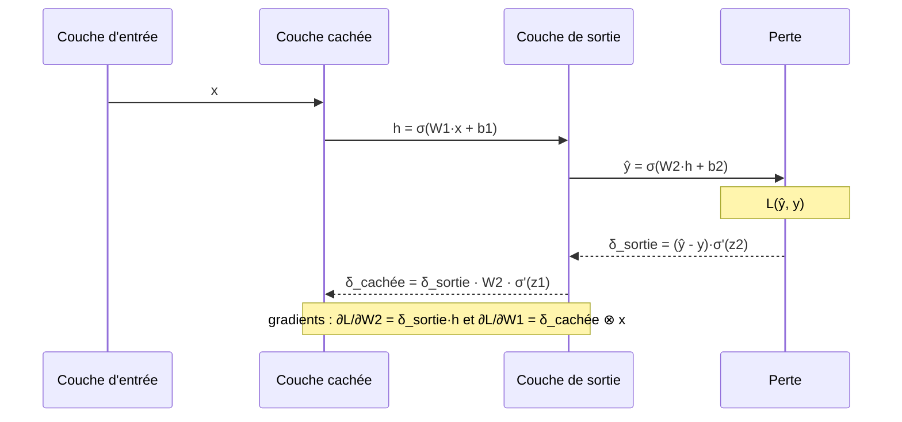

## Introduction

Au chapitre 1, tu as vu qu'un perceptron isolé est un classifieur linéaire, incapable d'apprendre XOR. La solution est connue depuis longtemps : empiler plusieurs couches de perceptrons. Le vrai problème était ailleurs. Comment ajuster les poids d'une couche cachée, alors qu'on ne connaît pas la « bonne » sortie de cette couche ? On ne sait mesurer l'erreur qu'à la sortie du réseau.

La réponse est la **rétropropagation du gradient** (backpropagation), popularisée en 1986 par David Rumelhart, Geoffrey Hinton et Ronald Williams. Elle calcule, pour chaque poids de chaque couche, sa contribution à l'erreur finale, en appliquant méthodiquement la règle de dérivation en chaîne de la sortie vers l'entrée. C'est toujours, en 2026, l'algorithme qui entraîne tous les réseaux profonds, des petits classifieurs aux grands modèles de langage.

Pour un professionnel de la sécurité, ce chapitre est la clé pour comprendre deux phénomènes qui reviendront plus loin : pourquoi un réseau peut apprendre des corrélations que personne n'a programmées (y compris des corrélations parasites), et pourquoi le même mécanisme de gradient qui entraîne le modèle peut être retourné contre lui pour fabriquer des exemples adversariaux, sujet du chapitre 7.

À la fin de ce chapitre, tu sauras décrire et dimensionner un réseau multicouche, calculer une propagation avant et une rétropropagation à la main sur un petit exemple, et entraîner le même réseau en quelques lignes de PyTorch.

## L'architecture d'un réseau à plusieurs couches

### Les trois parties d'un réseau

Un réseau de neurones profond empile des couches de perceptrons. On distingue trois parties :

- la **couche d'entrée**, qui reçoit les données brutes, par exemple les caractéristiques d'un flux réseau ; elle ne calcule rien, elle transmet ;
- une ou plusieurs **couches cachées**, qui transforment progressivement l'information ; on les dit cachées parce que leurs valeurs ne sont ni des entrées ni des sorties observées ;
- la **couche de sortie**, qui produit la prédiction finale : une probabilité, un score par classe ou une valeur numérique.

Quand chaque neurone d'une couche est relié à tous les neurones de la couche précédente, on parle de couche **dense** ou **entièrement connectée**, et le réseau complet s'appelle un **perceptron multicouche** (MLP, multilayer perceptron). On parle de réseau « profond » dès qu'il y a plusieurs couches cachées.



### Compter les paramètres

Une couche dense qui reçoit `n` entrées et produit `m` sorties possède une matrice de poids de taille `m × n` et un vecteur de biais de taille `m`, soit `m*n + m` paramètres. Pour le réseau du schéma, trois entrées, quatre neurones cachés et une sortie :

```text
Couche cachée : 4 x 3 poids + 4 biais = 16 paramètres
Couche sortie : 1 x 4 poids + 1 biais =  5 paramètres
Total                                 = 21 paramètres
```

Un réseau de détection d'intrusion modeste, avec 20 caractéristiques d'entrée et deux couches cachées de 64 et 32 neurones, compte déjà 3 457 paramètres. Les grands modèles de langage en comptent des milliards. Il faut donc une méthode qui calcule tous les gradients en une seule passe, sans traiter les poids un par un.

### La forme matricielle

Plutôt que de calculer neurone par neurone, on écrit chaque couche comme une multiplication matricielle suivie d'une activation appliquée élément par élément :

```text
h = f( W1 · x + b1 )        couche cachée
ŷ = g( W2 · h + b2 )        couche de sortie
```

Cette écriture est essentielle en pratique : les multiplications de matrices sont précisément ce que les GPU accélèrent massivement, comme on le verra au chapitre 6.

### Pourquoi la profondeur résout XOR

Chaque couche apporte sa propre non-linéarité. Une couche cachée peut donc construire de **nouvelles caractéristiques** à partir des entrées, dans lesquelles le problème devient linéairement séparable. Pour XOR, une construction à la main suffit :

```text
h1 = OU(x1, x2)        vaut 1 si au moins une entrée vaut 1
h2 = NON-ET(x1, x2)    vaut 0 seulement si les deux valent 1
y  = ET(h1, h2)        vrai si « au moins un » ET « pas les deux »

x1 x2 | h1 h2 | y
 0  0 |  0  1 | 0
 0  1 |  1  1 | 1
 1  0 |  1  1 | 1
 1  1 |  1  0 | 0
```

Dans l'espace (h1, h2), les deux classes deviennent séparables par une droite. Un réseau entraîné ne trouve pas forcément cette solution exacte, mais il trouve une transformation équivalente. Plus généralement, on peut voir chaque couche cachée comme une **représentation intermédiaire de plus en plus abstraite** des données : des combinaisons simples dans les premières couches, des concepts plus composites dans les suivantes.

<TipCallout>
Le théorème d'approximation universelle (Cybenko, 1989, puis Hornik, 1991) établit qu'un réseau à une seule couche cachée suffisamment large peut approcher n'importe quelle fonction continue sur un domaine borné. Il ne dit rien sur la taille nécessaire ni sur la facilité d'entraînement : en pratique, plusieurs couches de taille raisonnable apprennent bien plus efficacement qu'une seule couche gigantesque.
</TipCallout>

## La propagation avant

La **propagation avant** (forward pass) calcule la sortie du réseau pour une entrée donnée, en propageant les données de la couche d'entrée vers la couche de sortie, couche après couche. Chaque neurone calcule sa somme pondérée puis applique sa fonction d'activation, en utilisant les sorties de la couche précédente comme entrées.

### Exemple chiffré

Prenons un réseau à 2 entrées, 2 neurones cachés et 1 sortie, avec la sigmoïde partout et tous les biais à zéro.

```text
x  = (0.5, 0.8)
W1 = [[0.2, -0.4],      ligne 1 : poids du neurone caché 1
      [0.7,  0.1]]      ligne 2 : poids du neurone caché 2
W2 = (0.5, -0.3)

z1 = W1 · x = (0.2*0.5 - 0.4*0.8 ,  0.7*0.5 + 0.1*0.8) = (-0.22, 0.43)
h  = σ(z1)  = (0.4452, 0.6059)
z2 = W2 · h = 0.5*0.4452 - 0.3*0.6059 = 0.0408
ŷ  = σ(z2)  = 0.5102
```

Si la sortie attendue est `y = 1`, l'erreur vaut environ 0.49. Il reste à savoir comment chacun des six poids doit bouger pour la réduire.

## Le problème central : ajuster des milliers de poids

La descente de gradient du chapitre 1 exige la dérivée de la perte par rapport à chaque poids. Pour les poids de la couche de sortie, c'est le même calcul que pour un perceptron. Pour les poids d'une couche cachée, la perte ne dépend d'eux qu'indirectement, à travers toutes les couches suivantes.

Une approche naïve consisterait à perturber chaque poids d'une petite quantité, recalculer la perte et mesurer la variation : c'est la méthode des **différences finies**. Elle exige une propagation avant complète par poids. Pour un réseau d'un million de paramètres, il faudrait un million de passes pour un seul pas de gradient, ce qui est numériquement intraitable. La rétropropagation obtient **tous** les gradients pour un coût de l'ordre de deux à trois propagations avant.

## La rétropropagation du gradient

### Le principe

La rétropropagation calcule l'erreur à la couche de sortie, puis la propage **de la couche de sortie vers la couche d'entrée**, couche par couche, en utilisant la **règle de dérivation en chaîne**. À chaque couche, elle réutilise le résultat déjà calculé pour la couche suivante, ce qui évite tout calcul redondant.



### Les équations

Avec la perte quadratique `L = ½ (ŷ - y)²` et des activations sigmoïdes, on définit un terme d'erreur `δ` (delta) par couche :

```text
Couche de sortie :
  δ_sortie = (ŷ - y) * σ'(z2)            avec σ'(z) = σ(z) * (1 - σ(z))
  ∂L/∂W2   = δ_sortie * h
  ∂L/∂b2   = δ_sortie

Couche cachée (la chaîne remonte à travers W2) :
  δ_cachée = (δ_sortie * W2) * σ'(z1)    produit élément par élément
  ∂L/∂W1   = produit extérieur de δ_cachée et x
  ∂L/∂b1   = δ_cachée
```

Le point clé est la ligne de `δ_cachée` : le gradient de la couche cachée s'obtient en **multipliant le gradient de sortie par les poids de la couche de sortie et par la dérivée de l'activation de la couche cachée**. Un neurone caché relié à la sortie par un poids important reçoit une grande part de la responsabilité de l'erreur. Pour un réseau plus profond, on répète exactement la même opération en remontant d'une couche à chaque fois.

### Les valeurs numériques

En reprenant l'exemple précédent avec `y = 1` :

```text
δ_sortie = (0.5102 - 1) * 0.5102 * 0.4898          = -0.1224
∂L/∂W2   = -0.1224 * (0.4452, 0.6059)              = (-0.0545, -0.0742)

σ'(z1)   = (0.4452*0.5548, 0.6059*0.3941)          = (0.2470, 0.2388)
δ_cachée = (-0.1224*0.5, -0.1224*(-0.3)) * σ'(z1)  = (-0.0151, 0.0088)
∂L/∂W1   = [[-0.0076, -0.0121],
            [ 0.0044,  0.0070]]
```

Observe le signe : le neurone caché 2 est relié à la sortie par un poids négatif (-0.3). Pour augmenter la sortie, le réseau doit donc **réduire** son activation, d'où un gradient positif sur ses poids, qui les fera diminuer. Après une mise à jour avec un taux d'apprentissage de 0.5, l'erreur passe de 0.4898 à 0.4653.

<CehCallout>
Retiens le vocabulaire exact, souvent repris dans les questions d'examen et d'entretien : la propagation avant calcule la sortie, la rétropropagation calcule les gradients de la sortie vers l'entrée grâce à la règle de la chaîne, et la descente de gradient (ou un optimiseur comme Adam) utilise ces gradients pour mettre à jour les poids. Ce sont trois étapes distinctes.
</CehCallout>

## Les difficultés des réseaux profonds

### Gradients qui s'évanouissent ou qui explosent

Dans un réseau à `L` couches, le gradient de la première couche est un produit de `L` facteurs, chacun contenant un poids et une dérivée d'activation. La dérivée de la sigmoïde ne dépasse jamais 0.25. Multiplie dix facteurs inférieurs à 0.25 et tu obtiens un nombre minuscule : les premières couches n'apprennent presque plus. C'est le **gradient qui s'évanouit** (vanishing gradient). À l'inverse, si les facteurs sont systématiquement supérieurs à 1, le gradient **explose** et l'entraînement diverge.

### Les remèdes modernes

| Problème | Remède | Principe |
| --- | --- | --- |
| Saturation des activations | ReLU, GELU | Dérivée égale ou proche de 1 sur la partie positive |
| Mauvaise échelle initiale | Initialisation de Glorot (Xavier) ou de He (Kaiming) | Choisir la variance des poids selon le nombre d'entrées pour conserver l'échelle du signal |
| Dérive des distributions internes | Batch normalization, layer normalization | Renormaliser les activations à chaque couche |
| Profondeur très grande | Connexions résiduelles | Ajouter l'entrée d'un bloc à sa sortie, offrant un chemin direct au gradient |
| Gradients explosifs | Écrêtage du gradient (gradient clipping) | Limiter la norme du gradient avant la mise à jour |

Les connexions résiduelles, introduites par les réseaux ResNet en 2015, sont présentes dans pratiquement toutes les architectures profondes actuelles, y compris les Transformers du chapitre 5.

## La différentiation automatique avec PyTorch

Écrire les équations de rétropropagation à la main n'est plus nécessaire. PyTorch construit, pendant la propagation avant, un **graphe de calcul** qui mémorise chaque opération. L'appel `loss.backward()` parcourt ce graphe à l'envers et remplit l'attribut `.grad` de chaque paramètre. C'est la rétropropagation, automatisée et généralisée à n'importe quelle architecture.

Voici un réseau qui résout XOR avec une couche cachée de 4 neurones :

```python
import torch
from torch import nn

torch.manual_seed(0)
X = torch.tensor([[0., 0], [0, 1], [1, 0], [1, 1]])
y = torch.tensor([[0.], [1], [1], [0]])

model = nn.Sequential(
    nn.Linear(2, 4),   # couche cachée : 2 entrées -> 4 neurones
    nn.Tanh(),         # non-linéarité
    nn.Linear(4, 1),   # couche de sortie : un logit
)
print(model)
print(sum(p.numel() for p in model.parameters()), "paramètres")

optimizer = torch.optim.Adam(model.parameters(), lr=0.05)
loss_fn = nn.BCEWithLogitsLoss()

for epoch in range(1, 501):
    optimizer.zero_grad()            # remise à zéro des gradients
    loss = loss_fn(model(X), y)      # propagation avant + perte
    loss.backward()                  # rétropropagation
    optimizer.step()                 # mise à jour des poids
    if epoch in (1, 100, 250, 500):
        print(f"époque {epoch:4d}  perte {loss.item():.4f}")

with torch.no_grad():
    print(torch.sigmoid(model(X)).squeeze().round(decimals=3))
```

```text
Sequential(
  (0): Linear(in_features=2, out_features=4, bias=True)
  (1): Tanh()
  (2): Linear(in_features=4, out_features=1, bias=True)
)
17 paramètres
époque    1  perte 0.6996
époque  100  perte 0.0049
époque  250  perte 0.0014
époque  500  perte 0.0005
tensor([0.0000, 0.9990, 1.0000, 0.0000])
```

Là où le perceptron du chapitre 1 restait bloqué à 0.693, une seule couche cachée de 4 neurones fait tomber la perte quasiment à zéro. Les valeurs exactes peuvent varier légèrement selon la version de PyTorch et le matériel.

## Applications en cybersécurité

Les MLP sont souvent utilisés sur des **données tabulaires** de sécurité : statistiques de flux réseau (durée, octets, nombre de paquets, ports), caractéristiques extraites d'un exécutable (taille des sections, entropie, imports), ou attributs d'une connexion utilisateur. Des jeux de données publics comme CIC-IDS2017 sont fréquemment utilisés pour s'exercer à la détection d'intrusion.

Deux mises en garde s'imposent. D'abord, sur des données tabulaires, les méthodes à base d'arbres comme le gradient boosting (vues dans le cours Machine Learning) font souvent jeu égal ou mieux qu'un MLP, pour un coût et une opacité moindres : compare toujours. Ensuite, un réseau apprend toutes les corrélations qui réduisent la perte, y compris les **artefacts** du jeu de données. Si, dans tes données d'entraînement, toutes les attaques proviennent d'une même plage d'adresses IP de laboratoire, le réseau peut apprendre « cette plage égale attaque » plutôt qu'un comportement malveillant. Il obtiendra un score excellent en test et sera inutile en production.

<WarningCallout>
Le gradient d'un modèle par rapport à ses entrées, calculé par exactement le même mécanisme que la rétropropagation, indique comment modifier une entrée pour changer la décision. C'est le fondement des attaques adversariales du chapitre 7. Exposer un modèle de détection avec ses scores bruts, ou pire ses gradients, facilite ce type de contournement.
</WarningCallout>

## Erreurs fréquentes

- **Confondre propagation avant et rétropropagation.** La première calcule la prédiction ; la seconde calcule les gradients, en sens inverse.
- **Empiler des couches sans activation.** Un `nn.Sequential` composé uniquement de `nn.Linear` reste un modèle linéaire, quel que soit le nombre de couches.
- **Utiliser la sigmoïde dans toutes les couches cachées d'un réseau profond.** C'est la recette du gradient qui s'évanouit ; préfère ReLU ou GELU.
- **Oublier `torch.no_grad()` à l'inférence.** Le graphe de calcul est construit inutilement, ce qui consomme de la mémoire.
- **Évaluer sur les données d'entraînement.** Un MLP de quelques milliers de paramètres peut mémoriser un petit jeu de données ; seule une évaluation sur un jeu de test séparé mesure la généralisation.
- **Ignorer une perte qui devient `nan`.** C'est souvent un gradient explosif ou un taux d'apprentissage trop élevé ; l'écrêtage du gradient et un pas plus petit sont les premiers réflexes.

## Lab — Mise en pratique

**Environnement** : Python 3.12 avec `numpy`, puis `torch` pour les dernières étapes. Garde la même session Python d'une étape à l'autre.

<Steps steps={[
  { title: "Construire un mini réseau à une couche cachée", description: "Définis un réseau à 2 entrées, 2 neurones cachés et 1 sortie, puis calcule sa propagation avant. Tu dois retrouver les activations cachées 0.4452 et 0.6059 et une sortie de 0.5102.", code: "import numpy as np\n\ndef sigmoid(z):\n    return 1 / (1 + np.exp(-z))\n\nx = np.array([0.5, 0.8])\n\n# Couche cachee : 2 neurones, chacun avec 2 poids + biais\nW1 = np.array([[0.2, -0.4], [0.7, 0.1]])\nb1 = np.array([0.0, 0.0])\n\n# Couche de sortie : 1 neurone, 2 poids + biais\nW2 = np.array([0.5, -0.3])\nb2 = 0.0\n\nz1 = W1.dot(x) + b1\nh = sigmoid(z1)\ny_pred = sigmoid(W2.dot(h) + b2)\n\nprint('Activations couche cachee :', h)\nprint('Sortie du reseau :', y_pred)" },
  { title: "Rétropropager l'erreur avec la règle de dérivation en chaîne", description: "Calcule le gradient de chaque poids, de la sortie vers la couche cachée. Observe que delta_hidden multiplie le gradient de sortie par les poids W2 et par la dérivée de l'activation cachée, exactement comme dans les équations du chapitre.", code: "def sigmoid_deriv(a):\n    return a * (1 - a)\n\ny_true = 1.0\nlr = 0.5\n\ndelta_output = (y_pred - y_true) * sigmoid_deriv(y_pred)\ndelta_hidden = delta_output * W2 * sigmoid_deriv(h)\n\ngrad_W2 = delta_output * h\ngrad_b2 = delta_output\ngrad_W1 = np.outer(delta_hidden, x)\ngrad_b1 = delta_hidden\n\nprint('Gradient couche de sortie (W2) :', grad_W2)\nprint('Gradient couche cachee (W1) :', grad_W1)" },
  { title: "Vérifier un gradient par différences finies", description: "Perturbe un seul poids de W1 de plus ou moins epsilon et mesure la variation de la perte. La valeur obtenue doit coïncider avec grad_W1[0, 0] à quelques décimales près : c'est la technique classique pour vérifier une rétropropagation écrite à la main.", code: "def loss_fn(W1_, W2_):\n    out = sigmoid(W2_.dot(sigmoid(W1_.dot(x) + b1)) + b2)\n    return 0.5 * (out - y_true) ** 2\n\neps = 1e-5\nWp, Wm = W1.copy(), W1.copy()\nWp[0, 0] += eps\nWm[0, 0] -= eps\nnum_grad = (loss_fn(Wp, W2) - loss_fn(Wm, W2)) / (2 * eps)\nprint('Gradient numerique :', num_grad)\nprint('Gradient analytique :', grad_W1[0, 0])" },
  { title: "Mettre à jour les poids et vérifier l'erreur", description: "Applique la descente de gradient sur les deux couches, puis recalcule la propagation avant. L'erreur doit passer d'environ 0.4898 à 0.4653.", code: "W2 = W2 - lr * grad_W2\nb2 = b2 - lr * grad_b2\nW1 = W1 - lr * grad_W1\nb1 = b1 - lr * grad_b1\n\nh_new = sigmoid(W1.dot(x) + b1)\ny_pred_new = sigmoid(W2.dot(h_new) + b2)\n\nprint('Erreur avant mise a jour :', abs(y_pred - y_true))\nprint('Erreur apres mise a jour :', abs(y_pred_new - y_true))" },
  { title: "Résoudre XOR avec PyTorch", description: "Entraîne un MLP 2-4-1 sur XOR avec autograd. Compare la perte finale (proche de 0) avec le plateau à 0.693 du perceptron isolé du chapitre 1.", code: "import torch\nfrom torch import nn\n\ntorch.manual_seed(0)\nX = torch.tensor([[0., 0], [0, 1], [1, 0], [1, 1]])\ny = torch.tensor([[0.], [1], [1], [0]])\nmodel = nn.Sequential(nn.Linear(2, 4), nn.Tanh(), nn.Linear(4, 1))\nopt = torch.optim.Adam(model.parameters(), lr=0.05)\nloss_fn_t = nn.BCEWithLogitsLoss()\nfor epoch in range(500):\n    opt.zero_grad()\n    loss = loss_fn_t(model(X), y)\n    loss.backward()\n    opt.step()\nprint('perte finale', loss.item())\nwith torch.no_grad():\n    print(torch.sigmoid(model(X)).squeeze())" },
  { title: "Retirer la non-linéarité", description: "Remplace nn.Tanh() par nn.Identity() et relance l'entraînement. La perte doit rester bloquée vers 0.693 : sans activation, deux couches linéaires équivalent à une seule.", code: "torch.manual_seed(0)\nlinear_model = nn.Sequential(nn.Linear(2, 4), nn.Identity(), nn.Linear(4, 1))\nopt = torch.optim.Adam(linear_model.parameters(), lr=0.05)\nfor epoch in range(500):\n    opt.zero_grad()\n    loss = loss_fn_t(linear_model(X), y)\n    loss.backward()\n    opt.step()\nprint('perte finale sans activation', loss.item())" },
  { title: "Observer le gradient qui s'évanouit", description: "Construis un réseau de 10 couches sigmoïdes, fais une rétropropagation et affiche la norme du gradient de la première et de la dernière couche. Recommence avec nn.ReLU() et compare l'écart entre les deux normes.", code: "def grad_norms(act):\n    torch.manual_seed(0)\n    layers = []\n    for _ in range(10):\n        layers += [nn.Linear(32, 32), act()]\n    net = nn.Sequential(*layers, nn.Linear(32, 1))\n    out = net(torch.randn(64, 32)).mean()\n    out.backward()\n    return net[0].weight.grad.norm().item(), net[-1].weight.grad.norm().item()\n\nprint('sigmoid (premiere, derniere) :', grad_norms(nn.Sigmoid))\nprint('relu    (premiere, derniere) :', grad_norms(nn.ReLU))" },
]} />

## À retenir

- Un réseau de neurones profond se compose d'une couche d'entrée, d'une ou plusieurs couches cachées et d'une couche de sortie ; une couche dense de n entrées et m sorties a m fois n poids plus m biais.
- La propagation avant calcule la sortie du réseau pour une entrée donnée, de l'entrée vers la sortie.
- La rétropropagation calcule la contribution de chaque poids à l'erreur finale, de la sortie vers l'entrée, grâce à la règle de dérivation en chaîne, pour un coût proche de celui d'une propagation avant.
- Le gradient d'une couche cachée s'obtient en multipliant le gradient de la couche suivante par ses poids et par la dérivée de l'activation de la couche cachée.
- Chaque couche apporte sa propre non-linéarité et construit une représentation plus abstraite, ce qui permet de résoudre XOR.
- Les gradients qui s'évanouissent ou explosent se combattent avec ReLU, une bonne initialisation, la normalisation, les connexions résiduelles et l'écrêtage.
- PyTorch automatise la rétropropagation avec autograd : `loss.backward()` puis `optimizer.step()`.

## Questions de révision

1. Quelles sont les trois grandes parties de l'architecture d'un réseau de neurones profond, et quel est le rôle de chacune ?
2. Combien de paramètres possède un réseau 10-16-8-2 entièrement connecté ? Détaille le calcul.
3. Que calcule la propagation avant, par opposition à la rétropropagation, et dans quel sens chacune parcourt-elle le réseau ?
4. Pourquoi la méthode des différences finies est-elle inutilisable pour entraîner un grand réseau, et en quoi la rétropropagation la surpasse-t-elle ?
5. Écris l'expression du delta d'une couche cachée et explique intuitivement pourquoi elle fait intervenir les poids de la couche suivante.
6. Pourquoi un réseau de dix couches sigmoïdes apprend-il mal, et quelles modifications proposerais-tu ?
7. Un MLP de détection d'intrusion obtient 99 % de précision en test mais échoue en production. Quelles hypothèses liées aux données vérifierais-tu en premier ?
