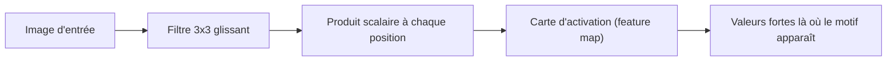
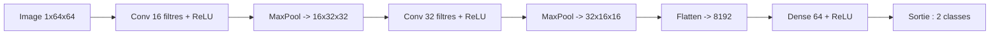

## Introduction

Les réseaux de neurones convolutifs, ou **CNN** (Convolutional Neural Networks), sont l'architecture qui a déclenché la vague moderne du deep learning. En 2012, le réseau AlexNet a remporté le concours de classification d'images ImageNet avec une avance spectaculaire sur les méthodes classiques, en s'appuyant sur des convolutions entraînées sur GPU. Depuis, les CNN ont été la base de la reconnaissance d'objets, de la détection de visages, de l'imagerie médicale et de la lecture automatique de documents.

En sécurité, ils interviennent dans des contextes moins évidents : comparer la capture d'écran d'une page de connexion à celles de marques connues pour repérer un site de phishing, classer des fichiers exécutables convertis en images, analyser des séquences d'octets bruts avec des convolutions à une dimension, ou trier des images lors d'une investigation forensique.

À la fin de ce chapitre, tu sauras pourquoi la convolution est adaptée aux données qui ont une structure spatiale, tu sauras calculer une carte d'activation à la main, tu comprendras le rôle du pooling et la hiérarchie des couches, et tu sauras construire et dimensionner un petit CNN avec PyTorch.

## Pourquoi un réseau dense est mal adapté aux images

### Le problème du nombre de poids

Une image en couleur de 224 × 224 pixels, une taille classique en vision, contient trois canaux (rouge, vert, bleu). Elle représente donc `224 × 224 × 3 = 150 528` valeurs, soit plus de 150 000 entrées. Si on la connecte à une couche dense de seulement 1 000 neurones, comme au chapitre 2, cette seule couche nécessite plus de 150 millions de poids. C'est un nombre de poids explosif, coûteux en mémoire et propice au surapprentissage.

### Le problème de la structure spatiale

Plus grave encore, une couche dense ignore complètement la **structure spatiale** de l'image. Pour elle, les pixels sont une liste de nombres sans ordre : deux pixels voisins ne sont pas plus liés que deux pixels situés aux coins opposés. Or, dans une image, l'information est locale : un contour, une lettre, un logo sont formés de pixels proches. Et un même motif peut apparaître n'importe où : un réseau dense devrait apprendre séparément à reconnaître un logo en haut à gauche et en bas à droite.

Les CNN exploitent ces deux propriétés : au lieu de connecter chaque pixel individuellement, ils appliquent de **petits filtres** qui se déplacent sur l'image et détectent des motifs locaux, indépendamment de leur position exacte.

## La convolution

### Le filtre et le glissement

Un **filtre**, aussi appelé **noyau** (kernel), est une petite matrice de poids, par exemple 3 × 3. On le fait glisser sur l'image. À chaque position, on calcule un **produit scalaire** entre le filtre et la portion d'image qu'il recouvre : on multiplie les valeurs case par case et on additionne. Le résultat de toutes les positions forme une nouvelle grille, appelée **carte d'activation** (feature map), qui indique où le motif détecté par le filtre est présent dans l'image.



### Exemple chiffré

Prenons une image 6 × 6 dont la moitié gauche est claire (1) et la moitié droite sombre (0), et un filtre détecteur de contour vertical :

```text
Image 6x6                      Filtre 3x3
1 1 1 0 0 0                    1 0 -1
1 1 1 0 0 0                    1 0 -1
1 1 1 0 0 0                    1 0 -1
1 1 1 0 0 0
1 1 1 0 0 0
1 1 1 0 0 0
```

Le filtre calcule « colonne de gauche moins colonne de droite ». Sur une zone uniforme, le résultat est 0. À cheval sur la frontière, la colonne de gauche vaut 1 et celle de droite 0, sur trois lignes : le résultat vaut 3.

```text
Position (0,0) : colonnes 0 à 2, toutes à 1 -> 3 - 3 = 0
Position (0,1) : colonnes 1 à 3 -> (1+1+1) - (0+0+0) = 3
Carte d'activation 4x4 :
0 3 3 0
0 3 3 0
0 3 3 0
0 3 3 0
```

La carte d'activation s'allume exactement là où se trouve le contour vertical. Le même filtre appliqué à une image uniforme produit une carte entièrement nulle : un filtre ne réagit qu'au motif pour lequel il est conçu. Dans un CNN, personne ne conçoit les filtres à la main : leurs poids sont appris par rétropropagation, comme n'importe quel autre poids.

<TipCallout>
Rigoureusement, l'opération implémentée par les frameworks (`nn.Conv2d` dans PyTorch) est une corrélation croisée : le filtre n'est pas retourné avant le glissement, contrairement à la convolution mathématique. Comme les poids sont appris, la distinction n'a aucune conséquence pratique, et tout le monde parle de convolution.
</TipCallout>

### Taille de sortie, pas et remplissage

Trois hyperparamètres fixent la taille de la carte d'activation :

- la **taille du noyau** `k`, souvent 3 ;
- le **pas** (stride) `s`, le nombre de pixels dont le filtre se décale à chaque étape ;
- le **remplissage** (padding) `p`, le nombre de pixels nuls ajoutés autour de l'image pour traiter les bords.

```text
taille_sortie = (taille_entrée - k + 2p) / s + 1     (partie entière)

Image 6x6, k=3, p=0, s=1  ->  (6 - 3 + 0) / 1 + 1 = 4   -> carte 4x4
Image 64x64, k=3, p=1, s=1 -> (64 - 3 + 2) / 1 + 1 = 64 -> taille conservée
```

Le choix `k = 3, p = 1, s = 1` est très courant parce qu'il conserve la taille de l'image.

### Les canaux

Une image couleur a trois canaux ; un filtre couvre alors les trois canaux à la fois et a la forme 3 × 3 × 3. Une couche convolutive applique plusieurs filtres en parallèle, chacun produisant sa propre carte d'activation : une couche à 32 filtres produit 32 canaux de sortie. Le nombre de paramètres est indépendant de la taille de l'image :

```text
Conv2d(3 canaux -> 32 filtres, noyau 3x3) :
  32 filtres x (3 x 3 x 3 poids) + 32 biais = 896 paramètres
```

Compare ces 896 paramètres aux 150 millions de la couche dense : c'est l'effet du partage de poids.

### Le partage de poids

Le **partage de poids** (weight sharing) est le fait de réutiliser le même filtre à toutes les positions de l'image, au lieu d'avoir un poids différent par pixel. Il a deux conséquences : il réduit drastiquement le nombre de paramètres par rapport à un réseau dense, et il rend la détection **invariante à la position** du motif, plus précisément équivariante : si le contour se déplace dans l'image, la zone active de la carte se déplace de la même façon.

## Les couches successives, des motifs simples aux concepts

Un CNN empile plusieurs couches convolutives. Les **premières couches** détectent des motifs très simples : contours, coins, gradients de couleur. Les couches suivantes combinent ces motifs pour détecter des formes plus complexes : textures, yeux, roues, lettres. Les **couches profondes** réagissent à des concepts encore plus abstraits, comme des visages entiers ou des véhicules. C'est la hiérarchie de représentations de plus en plus abstraites évoquée au chapitre 2, rendue très visible par la structure spatiale.

Ce mécanisme repose aussi sur le **champ récepteur** : chaque neurone d'une couche profonde dépend d'une zone de l'image d'origine d'autant plus large que la couche est profonde. Un neurone de la première couche voit 3 × 3 pixels ; après plusieurs convolutions et poolings, un neurone voit une grande partie de l'image.

## Le pooling

### Principe

Une couche de **pooling** réduit la taille d'une carte d'activation. Le plus courant, le **max-pooling**, découpe la carte en petites régions, typiquement 2 × 2 avec un pas de 2, et ne conserve que la **valeur maximale** de chaque région.

```text
Carte 4x4           Max-pooling 2x2, pas 2
1 3 | 2 0
5 2 | 1 4           ->    5 4
----+----                 6 8
0 6 | 8 1
2 1 | 3 7
```

Le pooling divise ici le nombre de valeurs par quatre, ce qui réduit le volume de calcul des couches suivantes. Il rend aussi la détection plus robuste à de **petites variations de position** : si le motif bouge d'un pixel à l'intérieur d'une région, le maximum reste le même. Le pooling n'a aucun paramètre à apprendre.

### Architecture type

| Couche | Rôle | Paramètres appris |
| --- | --- | --- |
| Convolution | Détecte des motifs locaux grâce à des filtres glissants | Oui (filtres et biais) |
| Activation ReLU | Introduit la non-linéarité | Non |
| Pooling (max-pooling) | Réduit la dimension, conserve les activations les plus fortes | Non |
| Aplatissement (flatten) | Transforme les cartes en un vecteur | Non |
| Couche dense finale | Combine les motifs détectés pour produire la classification | Oui |



## Un CNN avec PyTorch 2.x

Voici le CNN du schéma, conçu pour des images en niveaux de gris de 64 × 64 pixels et deux classes (par exemple bénin ou malveillant). Le code affiche la forme du tenseur après chaque couche, ce qui est le meilleur réflexe pour déboguer une architecture.

```python
import torch
from torch import nn

model = nn.Sequential(
    nn.Conv2d(1, 16, kernel_size=3, padding=1), nn.ReLU(), nn.MaxPool2d(2),
    nn.Conv2d(16, 32, kernel_size=3, padding=1), nn.ReLU(), nn.MaxPool2d(2),
    nn.Flatten(),
    nn.Linear(32 * 16 * 16, 64), nn.ReLU(),
    nn.Linear(64, 2),
)

x = torch.randn(8, 1, 64, 64)       # lot de 8 images : (batch, canaux, hauteur, largeur)
for layer in model:
    x = layer(x)
    print(f"{layer.__class__.__name__:10s} {tuple(x.shape)}")
print(sum(p.numel() for p in model.parameters()), "paramètres")
```

```text
Conv2d     (8, 16, 64, 64)
ReLU       (8, 16, 64, 64)
MaxPool2d  (8, 16, 32, 32)
Conv2d     (8, 32, 32, 32)
ReLU       (8, 32, 32, 32)
MaxPool2d  (8, 32, 16, 16)
Flatten    (8, 8192)
Linear     (8, 64)
ReLU       (8, 64)
Linear     (8, 2)
529282 paramètres
```

Remarque instructive : la quasi-totalité des 529 282 paramètres se trouve dans la première couche dense (8 192 × 64 poids). Les couches convolutives n'en comptent que quelques milliers. C'est pourquoi les architectures modernes remplacent souvent l'aplatissement par un **pooling global** (`nn.AdaptiveAvgPool2d(1)`), qui réduit chaque canal à une seule valeur.

### Les architectures de référence et le transfert d'apprentissage

Plusieurs architectures ont marqué l'histoire : LeNet pour les chiffres manuscrits dans les années 1990, AlexNet en 2012, VGG et ses piles de convolutions 3 × 3, puis ResNet en 2015 avec ses connexions résiduelles qui ont permis d'entraîner des réseaux de plus de cent couches. Depuis 2020, les **Vision Transformers** (ViT), qui appliquent l'attention du chapitre 5 à des morceaux d'image, concurrencent les CNN sur de nombreuses tâches, mais les CNN restent très utilisés pour leur efficacité.

En pratique, on entraîne rarement un CNN à partir de zéro. On part d'un modèle **pré-entraîné** sur un grand jeu d'images et on ne réentraîne que les dernières couches sur ses propres données : c'est le **transfert d'apprentissage** (transfer learning). Avec torchvision, cela s'écrit par exemple `resnet18(weights=ResNet18_Weights.DEFAULT)`, puis on remplace la dernière couche `fc` par une couche adaptée à ses classes. Les premières couches, qui détectent des contours et des textures génériques, sont réutilisables d'un domaine à l'autre.

## Applications en cybersécurité

### Phishing visuel

Les pages de phishing imitent l'apparence de marques connues. Un CNN peut comparer une capture d'écran de page à une bibliothèque de pages légitimes et lever une alerte quand une page ressemble fortement à celle d'une banque alors que son domaine n'a rien à voir. C'est un signal complémentaire de l'analyse d'URL et de contenu.

### Malware représenté comme une image

Une approche étudiée depuis le début des années 2010 consiste à lire les octets d'un exécutable comme des niveaux de gris et à les ranger en image. Des familles de malwares partagent des structures visibles (sections, zones compressées), qu'un CNN peut apprendre à reconnaître. Une variante utilise des **convolutions à une dimension** directement sur la séquence d'octets brute : le filtre glisse le long du fichier au lieu de glisser sur une grille.

### Forensique et OCR

En investigation, les CNN aident à trier de grands volumes d'images saisies, à extraire du texte de captures d'écran ou de documents scannés, et à repérer des documents d'identité ou des codes QR dans un lot de fichiers.

<WarningCallout>
Un CNN entraîné à détecter des logos de phishing dans des captures d'écran reste faillible : il est vulnérable à des variantes visuelles jamais vues à l'entraînement (logo redessiné, couleurs modifiées, mise en page inhabituelle) et aux perturbations adversariales du chapitre 7. Comme le rappelle le cours Analyse SOC, un modèle de vision est un outil d'aide à la décision, jamais une autorité absolue : combine-le avec d'autres signaux et une revue humaine.
</WarningCallout>

## Erreurs fréquentes

- **Se tromper dans l'ordre des dimensions.** PyTorch attend `(batch, canaux, hauteur, largeur)`. Une image chargée au format `(hauteur, largeur, canaux)` doit être permutée.
- **Calculer faux la taille d'entrée de la couche dense.** L'erreur « mat1 and mat2 shapes cannot be multiplied » vient presque toujours de là. Affiche les formes couche par couche, comme dans l'exemple, ou utilise `nn.LazyLinear`.
- **Oublier de normaliser les pixels.** Des valeurs entre 0 et 255 au lieu de 0 et 1 (ou standardisées) ralentissent ou bloquent l'apprentissage.
- **Croire que le pooling apprend quelque chose.** Il n'a aucun paramètre ; il réduit seulement la dimension.
- **Entraîner un gros CNN à partir de zéro sur quelques centaines d'images.** Le surapprentissage est garanti ; le transfert d'apprentissage et l'augmentation de données (chapitre 6) sont faits pour ce cas.
- **Évaluer un détecteur de malware sur des fichiers des mêmes familles qu'à l'entraînement.** Le score obtenu ne dit rien de la capacité à détecter une famille nouvelle ; sépare tes jeux par famille ou par date.

## Lab — Mise en pratique

**Environnement** : Python 3.12 avec `numpy`, puis `torch` pour les deux dernières étapes. Garde la même session Python d'une étape à l'autre.

<Steps steps={[
  { title: "Implémenter la convolution à la main", description: "Fais glisser un filtre détecteur de contour vertical sur une image 6x6 dont la moitié gauche est claire. Tu dois obtenir une carte d'activation 4x4 dont les deux colonnes centrales valent 3 : c'est l'emplacement du contour.", code: "import numpy as np\n\n# Image 6x6 : moitie gauche claire, moitie droite sombre\nimage = np.zeros((6, 6))\nimage[:, :3] = 1\n\n# Filtre 3x3 detecteur de contour vertical\nkernel = np.array([\n    [1, 0, -1],\n    [1, 0, -1],\n    [1, 0, -1],\n])\n\ndef convolve2d(img, k):\n    kh, kw = k.shape\n    oh, ow = img.shape[0] - kh + 1, img.shape[1] - kw + 1\n    out = np.zeros((oh, ow))\n    for i in range(oh):\n        for j in range(ow):\n            region = img[i:i+kh, j:j+kw]\n            out[i, j] = np.sum(region * k)\n    return out\n\nfeature_map = convolve2d(image, kernel)\nprint('Sortie de la convolution (feature map) :')\nprint(feature_map)" },
  { title: "Implémenter le max-pooling à la main", description: "Réduis la carte d'activation 4x4 en ne conservant que la valeur maximale sur des régions 2x2. Tu dois obtenir une carte 2x2 remplie de 3 : la présence du contour est conservée avec quatre fois moins de valeurs.", code: "def max_pool2d(fmap, size=2, stride=2):\n    h, w = fmap.shape\n    oh, ow = (h - size) // stride + 1, (w - size) // stride + 1\n    pooled = np.zeros((oh, ow))\n    for i in range(oh):\n        for j in range(ow):\n            region = fmap[i*stride:i*stride+size, j*stride:j*stride+size]\n            pooled[i, j] = np.max(region)\n    return pooled\n\npooled_map = max_pool2d(feature_map)\nprint('Apres max-pooling :')\nprint(pooled_map)" },
  { title: "Vérifier la spécificité du filtre", description: "Applique le même filtre à une image uniforme, puis le filtre transposé (détecteur de contour horizontal) à l'image d'origine. Les deux réponses doivent être nulles : un filtre ne réagit qu'au motif pour lequel il est conçu.", code: "image_no_edge = np.ones((6, 6))\nprint('Image uniforme :')\nprint(convolve2d(image_no_edge, kernel))\nprint('Filtre horizontal sur contour vertical :')\nprint(convolve2d(image, kernel.T))" },
  { title: "Comparer le nombre de paramètres", description: "Calcule le nombre de poids d'une couche dense de 1000 neurones sur une image 224x224x3, puis celui d'une couche convolutive de 32 filtres 3x3. Observe l'écart de plusieurs ordres de grandeur.", code: "dense = 224 * 224 * 3 * 1000 + 1000\nconv = 32 * (3 * 3 * 3) + 32\nprint('Couche dense :', dense)\nprint('Couche convolutive :', conv)" },
  { title: "Retrouver ta convolution avec PyTorch", description: "Applique le même filtre avec torch.nn.functional.conv2d. Le résultat doit être identique à ta fonction manuelle, ce qui confirme que PyTorch implémente une corrélation croisée sans retourner le filtre.", code: "import torch\nimport torch.nn.functional as F\n\nt_img = torch.tensor(image, dtype=torch.float32).view(1, 1, 6, 6)\nt_ker = torch.tensor(kernel, dtype=torch.float32).view(1, 1, 3, 3)\nprint(F.conv2d(t_img, t_ker))" },
  { title: "Suivre les formes dans un CNN complet", description: "Construis le CNN du chapitre et affiche la forme du tenseur après chaque couche. Modifie ensuite la taille d'entrée en 128x128 et observe l'erreur sur la couche dense : c'est l'erreur de dimension la plus fréquente.", code: "from torch import nn\n\nmodel = nn.Sequential(\n    nn.Conv2d(1, 16, kernel_size=3, padding=1), nn.ReLU(), nn.MaxPool2d(2),\n    nn.Conv2d(16, 32, kernel_size=3, padding=1), nn.ReLU(), nn.MaxPool2d(2),\n    nn.Flatten(), nn.Linear(32 * 16 * 16, 64), nn.ReLU(), nn.Linear(64, 2),\n)\nx = torch.randn(8, 1, 64, 64)\nfor layer in model:\n    x = layer(x)\n    print(layer.__class__.__name__, tuple(x.shape))\nprint(sum(p.numel() for p in model.parameters()), 'parametres')" },
]} />

## À retenir

- Un réseau dense est mal adapté aux images : il ignore leur structure spatiale et produit un nombre de poids explosif (plus de 150 000 valeurs pour une image 224 × 224 en couleur).
- Une convolution fait glisser un petit filtre sur l'image et calcule à chaque position un produit scalaire ; le résultat est une carte d'activation qui indique où le motif apparaît.
- Le partage de poids réutilise le même filtre à toutes les positions, ce qui réduit drastiquement le nombre de paramètres et rend la détection indépendante de la position.
- La taille de sortie dépend du noyau, du pas et du remplissage ; chaque filtre produit un canal.
- Le max-pooling conserve la valeur maximale de chaque région, réduit la dimension et rend la détection plus robuste aux petits décalages, sans aucun paramètre.
- Les premières couches détectent des contours et des coins, les couches profondes des concepts abstraits comme des visages ou des véhicules.
- En sécurité, les CNN servent au phishing visuel, à la classification de malwares et à la forensique, mais restent faillibles face à des variantes inédites.

## Questions de révision

1. Pourquoi un réseau dense classique est-il mal adapté au traitement direct d'images ? Donne deux raisons distinctes.
2. Qu'est-ce qu'une carte d'activation, et comment est-elle produite par un filtre ?
3. Calcule la taille de sortie d'une convolution 5 × 5 avec un pas de 2 et un remplissage de 2 sur une image 32 × 32.
4. Combien de paramètres possède une couche `Conv2d(16, 64, kernel_size=3)` ? Pourquoi ce nombre ne dépend-il pas de la taille de l'image ?
5. Quel est le rôle du pooling, et pourquoi n'a-t-il aucun paramètre à apprendre ?
6. Que détectent typiquement les premières couches d'un CNN par rapport aux couches profondes, et pourquoi ?
7. Un CNN de détection de pages de phishing affiche d'excellents résultats en test. Quelles faiblesses chercherais-tu avant de lui faire confiance en production ?
