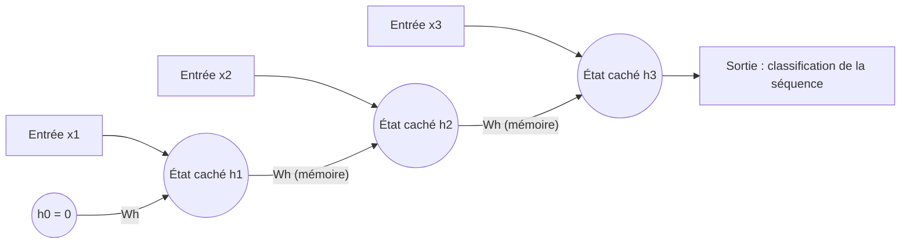
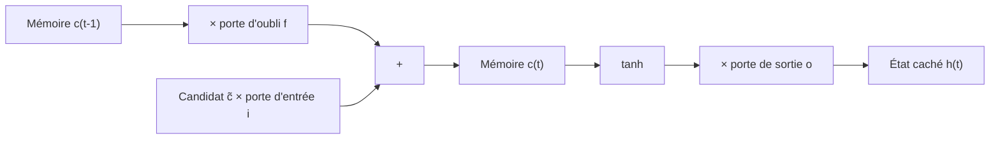

## Introduction

Beaucoup de données de sécurité sont des **séquences** : une suite de commandes tapées dans un shell, une succession d'événements dans un journal système, la série temporelle du volume de trafic d'un serveur, les caractères d'un nom de domaine, les appels système d'un processus. Dans toutes ces données, l'**ordre** porte l'information. La commande `curl` n'a pas le même sens selon qu'elle suit un `apt update` ou un `tar` sur le répertoire des clés SSH.

Les CNN du chapitre 3 excellent sur des données spatiales à taille fixe, comme les images. Les **réseaux de neurones récurrents** (RNN, Recurrent Neural Networks) ont été conçus pour les séquences : ils les lisent élément par élément en gardant une mémoire de ce qu'ils ont déjà vu. Leur variante la plus célèbre, le **LSTM**, a dominé le traitement du langage et des séries temporelles pendant les années 2010, avant que les Transformers du chapitre 5 ne prennent le relais pour la plupart des tâches.

Pourquoi étudier les RNN si les Transformers les ont remplacés ? Parce que les Transformers ont été inventés précisément pour résoudre les limites des RNN : on ne comprend bien l'attention qu'après avoir compris le problème qu'elle résout. Et parce que les LSTM restent pertinents pour des modèles légers qui traitent un flux en continu, avec une mémoire de taille fixe.

À la fin de ce chapitre, tu sauras dérouler un RNN à la main, expliquer le gradient qui s'évanouit, décrire les portes d'un LSTM et utiliser `nn.LSTM` sur un problème de classification de séquences.

## Pourquoi les séquences posent un problème particulier

Un réseau dense ou un CNN traite chaque entrée **indépendamment**, sans mémoire des entrées précédentes. Il attend en outre une entrée de taille fixe. Ces deux propriétés posent problème pour une séquence de commandes shell, par exemple, où le sens d'une commande dépend souvent de celles qui l'ont précédée, et où la longueur d'une session varie de trois à trois mille commandes. C'est la même idée que l'analyse de séquences d'événements vue dans le cours Analyse SOC : une alerte isolée dit peu, une chaîne d'événements raconte une attaque.

On pourrait concaténer une fenêtre fixe des dix dernières commandes et l'envoyer à un réseau dense. Mais le réseau devrait alors apprendre séparément le motif « téléchargement puis exécution » à chaque position de la fenêtre, et ignorerait tout ce qui sort de la fenêtre. Il faut un modèle qui partage ses poids **dans le temps**, comme le CNN partage les siens dans l'espace.

## Représenter les éléments d'une séquence

Avant d'entrer dans un réseau, chaque élément d'une séquence doit devenir un vecteur de nombres. Pour des valeurs numériques, comme un nombre d'octets par minute, c'est immédiat après normalisation. Pour des symboles, comme des caractères, des mots ou des identifiants d'événements, on construit d'abord un **vocabulaire** qui associe un entier à chaque symbole, puis une couche d'**embedding** associe à chaque entier un vecteur dense appris pendant l'entraînement.

```python
import torch
from torch import nn

emb = nn.Embedding(num_embeddings=200, embedding_dim=16)  # 200 symboles, vecteurs de taille 16
seq = torch.tensor([[3, 17, 42]])                         # une séquence de 3 symboles
print(emb(seq).shape)
```

```text
torch.Size([1, 3, 16])
```

Le chapitre 5 revient en détail sur les embeddings et la tokenisation, qui sont au cœur des modèles de langage.

## Le réseau de neurones récurrent

### L'état caché

Un RNN traite une séquence élément par élément. À chaque étape `t`, il combine l'entrée actuelle `x_t` et un **état caché** `h_(t-1)` hérité de l'étape précédente, pour produire un nouvel état caché `h_t`. Cet état caché est un vecteur qui **résume l'information des éléments précédents** de la séquence : il joue le rôle de mémoire du contexte passé.

```text
h_t = tanh( Wx · x_t + Wh · h_(t-1) + b )
y_t = Wy · h_t + by          (sortie éventuelle à chaque étape)
```

Les mêmes matrices `Wx`, `Wh` et `Wy` sont utilisées à toutes les étapes : c'est le partage de poids dans le temps. Un RNN a donc le même nombre de paramètres quelle que soit la longueur de la séquence.



Ce schéma montre le RNN **déroulé** dans le temps : il s'agit d'une seule cellule, réutilisée à chaque étape, et non de trois couches différentes.

### Exemple chiffré

Prenons un RNN à une seule dimension, avec `Wx = 0.6`, `Wh = 0.9`, `b = 0` et la séquence `(0.8, -0.5, 0.3)` :

```text
h1 = tanh(0.6*0.8  + 0.9*0      ) = tanh(0.480)  = 0.4462
h2 = tanh(0.6*-0.5 + 0.9*0.4462 ) = tanh(0.1016) = 0.1013
h3 = tanh(0.6*0.3  + 0.9*0.1013 ) = tanh(0.2712) = 0.2647
```

L'état `h3` dépend des trois entrées. C'est ce mécanisme d'état caché transmis d'une étape à l'autre qui permet à un RNN de détecter des **motifs qui s'étendent sur plusieurs éléments** d'une séquence : par exemple, une suite de commandes qui, prises isolément, semblent anodines (lister des fichiers, compresser un répertoire, ouvrir une connexion sortante), mais qui ensemble évoquent une exfiltration de données.

### Les configurations d'usage

| Configuration | Entrée | Sortie | Exemple en sécurité |
| --- | --- | --- | --- |
| Plusieurs vers un | Une séquence | Une étiquette | Classer un nom de domaine comme généré par algorithme ou légitime |
| Plusieurs vers plusieurs | Une séquence | Une sortie par étape | Prédire l'événement suivant de chaque position d'un journal |
| Encodeur-décodeur | Une séquence | Une autre séquence | Traduction, résumé ; aujourd'hui confié aux Transformers |

Un RNN peut aussi être **bidirectionnel** : un second RNN lit la séquence de droite à gauche, et on concatène les deux états. C'est utile pour classer une séquence complète, pas pour prédire en temps réel.

## Le problème du gradient qui s'évanouit

### La rétropropagation à travers le temps

Pour entraîner un RNN, on le déroule sur toute la séquence et on applique la rétropropagation du chapitre 2 sur ce graphe déroulé : c'est la **rétropropagation à travers le temps** (BPTT, backpropagation through time). Le gradient de la perte par rapport à un état ancien `h_1` traverse toutes les étapes suivantes. À chaque étape, il est multiplié par `Wh` et par la dérivée de la tanh, `1 - h²`, qui est toujours inférieure ou égale à 1.

```text
∂h_t / ∂h_(t-1) = Wh * (1 - h_t²)

Sur l'exemple : 0.9 * (1 - 0.2647²) = 0.837
                0.837 * 0.9 * (1 - 0.1013²) = 0.746
                0.746 * 0.9 * (1 - 0.4462²) = 0.537
```

Sur trois étapes, le gradient a déjà perdu près de la moitié de sa valeur. Sur une séquence aléatoire de 50 étapes avec les mêmes poids, la simulation du lab donne un gradient d'environ `1e-4` après 5 étapes, `8e-7` après 10 étapes et de l'ordre de `1e-16` après 50 étapes. Autrement dit, le gradient rétropropagé à travers de nombreuses étapes devient **extrêmement petit** : il « s'évanouit ». Le RNN classique devient incapable d'apprendre des **dépendances lointaines**, par exemple relier une connexion établie au début d'une session à une exfiltration qui survient deux cents événements plus tard.

### Le gradient qui explose

Si `Wh` est grand, les facteurs dépassent 1 et le gradient grandit exponentiellement : il **explose**, et l'entraînement diverge. Le remède classique est l'**écrêtage du gradient** : avant chaque mise à jour, si la norme du gradient dépasse un seuil, on la ramène à ce seuil. Dans PyTorch, c'est une ligne : `torch.nn.utils.clip_grad_norm_(model.parameters(), max_norm=1.0)`. L'écrêtage ne résout en revanche rien au gradient qui s'évanouit : un gradient nul reste nul.

## Le LSTM : une mémoire à long terme

### L'idée

Le **LSTM** (Long Short-Term Memory), proposé par Sepp Hochreiter et Jürgen Schmidhuber en 1997, ajoute à l'état caché une seconde mémoire, la **mémoire de cellule** `c_t` (cell state), et un **mécanisme de portes** qui régule explicitement ce qui doit être retenu, oublié ou transmis. Chaque porte est une couche sigmoïde dont la sortie, entre 0 et 1, agit comme un robinet : 0 bloque l'information, 1 la laisse passer entièrement.

### Les trois portes

- La **porte d'oubli** `f_t` décide quelle part de la mémoire précédente doit être **conservée ou effacée**.
- La **porte d'entrée** `i_t` décide quelle **nouvelle information** de l'étape actuelle doit être ajoutée à la mémoire.
- La **porte de sortie** `o_t` décide quelle part de la mémoire actuelle sert à produire l'état caché, donc la sortie de cette étape.

```text
f_t = σ( Wf · [h_(t-1), x_t] + bf )        porte d'oubli
i_t = σ( Wi · [h_(t-1), x_t] + bi )        porte d'entrée
o_t = σ( Wo · [h_(t-1), x_t] + bo )        porte de sortie
c̃_t = tanh( Wc · [h_(t-1), x_t] + bc )     candidat : nouvelle information

c_t = f_t * c_(t-1) + i_t * c̃_t            nouvelle mémoire de cellule
h_t = o_t * tanh(c_t)                       nouvel état caché
```

La notation `[h_(t-1), x_t]` désigne la concaténation des deux vecteurs, et `*` le produit élément par élément.



### Pourquoi cela résout le problème

La ligne clé est `c_t = f_t * c_(t-1) + i_t * c̃_t`. La mémoire se met à jour par **addition**, pas par une multiplication matricielle suivie d'une tanh. Le gradient qui remonte le long de la mémoire de cellule est multiplié à chaque étape par `f_t`. Si la porte d'oubli apprend à rester proche de 1 pour une information importante, le gradient traverse des dizaines ou des centaines d'étapes sans s'effondrer. Au lieu d'une simple mémoire qui s'estompe progressivement, le LSTM peut **préserver une information pertinente sur de très nombreuses étapes**, si les portes apprennent que c'est nécessaire.

### Exemple chiffré d'une étape

Avec `x_t = 0.5`, `h_(t-1) = 0.2`, `c_(t-1) = 0.4`, et des poids scalaires simplifiés appliqués à la somme `x_t + h_(t-1) = 0.7` :

```text
f_t = σ(0.5*0.7) = 0.587       on garde environ 59 % de l'ancienne mémoire
i_t = σ(0.6*0.7) = 0.603       on ajoute environ 60 % du candidat
o_t = σ(0.4*0.7) = 0.570
c̃_t = tanh(0.3*0.7) = 0.207

c_t = 0.587*0.4 + 0.603*0.207 = 0.360
h_t = 0.570 * tanh(0.360)     = 0.196
```

### Le GRU, une variante allégée

Le **GRU** (Gated Recurrent Unit), proposé en 2014, fusionne mémoire de cellule et état caché et n'utilise que deux portes, de mise à jour et de réinitialisation. Il a environ un quart de paramètres en moins qu'un LSTM de même taille et donne souvent des résultats comparables. Pour une couche de 32 unités sur des entrées de dimension 16, PyTorch compte 6 400 paramètres pour un LSTM et 4 800 pour un GRU.

<CompareTable
  titleA="RNN classique"
  titleB="LSTM"
  rows={[
    { a: "Mémoire simple, qui s'estompe rapidement sur de longues séquences", b: "Mémoire de cellule régulée par trois portes, qui préserve l'information pertinente sur le long terme" },
    { a: "Souffre fortement du gradient qui s'évanouit", b: "Atténue considérablement ce problème grâce à la mise à jour additive de la mémoire" },
    { a: "Plus simple et rapide à entraîner", b: "Plus coûteux en calcul (quatre fois plus de poids) mais bien plus performant sur des séquences longues" },
    { a: "Traitement séquentiel, non parallélisable dans le temps", b: "Même limite : chaque étape attend la précédente, ce que l'attention du chapitre 5 supprime" },
  ]}
/>

## Un LSTM avec PyTorch 2.x

Voici un classifieur de séquences de type « plusieurs vers un » : il lit une séquence de symboles et produit un score.

```python
import torch
from torch import nn

class SeqClassifier(nn.Module):
    def __init__(self, vocab_size: int, emb_dim: int = 16, hidden: int = 32):
        super().__init__()
        self.emb = nn.Embedding(vocab_size, emb_dim, padding_idx=0)  # l'indice 0 sert au remplissage
        self.lstm = nn.LSTM(emb_dim, hidden, batch_first=True)
        self.head = nn.Linear(hidden, 1)

    def forward(self, x: torch.Tensor) -> torch.Tensor:
        out, (h_n, c_n) = self.lstm(self.emb(x))
        return self.head(h_n[-1])        # dernier état caché -> un logit par séquence

lstm = nn.LSTM(input_size=16, hidden_size=32, batch_first=True)
out, (h_n, c_n) = lstm(torch.randn(4, 20, 16))   # 4 séquences de 20 étapes
print(out.shape, h_n.shape, c_n.shape)
print(sum(p.numel() for p in lstm.parameters()), "paramètres")
```

```text
torch.Size([4, 20, 32]) torch.Size([1, 4, 32]) torch.Size([1, 4, 32])
6400 paramètres
```

`out` contient l'état caché à chaque étape, `h_n` le dernier état caché et `c_n` la dernière mémoire de cellule. Le paramètre `batch_first=True` place la dimension du lot en premier ; sans lui, PyTorch attend `(longueur, batch, dimension)`, une source d'erreurs classique.

## Applications en cybersécurité

### Détection de domaines générés par algorithme

Certains malwares utilisent un **DGA** (Domain Generation Algorithm) pour calculer chaque jour des centaines de noms de domaine pseudo-aléatoires, dont un seul est enregistré par l'attaquant pour son serveur de commande et contrôle. Des travaux publiés dès 2016 ont montré qu'un LSTM lisant le nom de domaine caractère par caractère distingue efficacement ces noms des domaines légitimes, sans caractéristiques construites à la main. C'est un cas d'école de classification « plusieurs vers un ».

### Anomalies dans les journaux

On peut convertir chaque ligne de journal en identifiant de modèle de message (après une étape de log parsing), puis entraîner un LSTM à prédire l'événement suivant sur des journaux normaux. En production, un événement que le modèle jugeait très improbable est signalé comme anomalie. Cette approche, popularisée par des travaux de recherche comme DeepLog en 2017, n'exige pas d'exemples d'attaques étiquetés.

### Commandes et appels système

Le même principe s'applique aux sessions shell ou aux séquences d'appels système d'un processus : un modèle de séquence apprend le comportement normal et signale les enchaînements atypiques.

<WarningCallout>
Un modèle de séquence entraîné sur « le comportement normal » apprend aussi tout ce qui était présent pendant l'entraînement, y compris une compromission déjà en cours. Et un attaquant patient peut faire évoluer son comportement lentement pour que le modèle s'y habitue. Ces modèles complètent les règles de détection et la threat intelligence ; ils ne les remplacent pas.
</WarningCallout>

### Où en est-on en 2026

Pour le langage et la plupart des séquences longues, les Transformers ont remplacé les LSTM parce qu'ils parallélisent le calcul sur toute la séquence. Les RNN gardent un intérêt pour le traitement en flux sur du matériel modeste, car ils ne gardent en mémoire qu'un état de taille fixe. Des architectures récentes dites à espace d'états, comme Mamba (2023), cherchent d'ailleurs à combiner cette mémoire compacte avec un entraînement parallélisable.

## Erreurs fréquentes

- **Confondre état caché et mémoire de cellule.** Le RNN classique n'a qu'un état caché ; le LSTM a les deux, et seul l'état caché sert de sortie.
- **Oublier `batch_first=True`** et passer des tenseurs `(batch, longueur, dimension)` à une couche qui attend `(longueur, batch, dimension)`. Aucune erreur n'est levée si les tailles s'y prêtent, mais le modèle apprend n'importe quoi.
- **Mélanger les séquences de remplissage et les vraies données.** Les séquences d'un lot sont complétées à la même longueur ; utilise un indice de remplissage dédié (`padding_idx`) ou `pack_padded_sequence` pour que le remplissage ne pollue pas le dernier état caché.
- **Entraîner sans écrêtage du gradient.** Les RNN sont sujets aux gradients explosifs ; l'écrêtage est un réflexe.
- **Couper les séquences au hasard pour l'évaluation.** Si des fragments d'une même session se retrouvent dans l'entraînement et dans le test, le score est artificiellement gonflé.
- **Croire qu'un LSTM retient tout.** Il préserve ce que ses portes ont appris à juger utile ; une dépendance jamais vue à l'entraînement ne sera pas capturée.

## Lab — Mise en pratique

**Environnement** : Python 3.12 avec `numpy`, puis `torch` pour la dernière étape. Garde la même session Python d'une étape à l'autre.

<Steps steps={[
  { title: "Implémenter la cellule d'un RNN à la main", description: "Déroule un RNN simplifié sur une séquence de 3 valeurs en maintenant l'état caché d'une étape à l'autre. Tu dois retrouver les états 0.4462, 0.1013 et 0.2647 calculés dans le chapitre.", code: "import numpy as np\n\ndef tanh(z):\n    return np.tanh(z)\n\n# Sequence de 3 evenements (par exemple des mesures de trafic reseau)\nsequence = [0.8, -0.5, 0.3]\n\nWx = 0.6\nWh = 0.9\nb = 0.0\n\nh = 0.0\nhidden_states = []\n\nfor x_t in sequence:\n    h = float(tanh(Wx * x_t + Wh * h + b))\n    hidden_states.append(round(h, 4))\n\nprint('Etats caches successifs :', hidden_states)" },
  { title: "Observer le gradient qui s'évanouit", description: "Rétropropage le gradient à travers les étapes de la séquence. Il doit passer de 0.837 à 0.746 puis 0.537 : chaque étape le multiplie par un facteur inférieur à 1.", code: "# A chaque etape retropropagee, le gradient est multiplie par Wh * (1 - h**2)\n# (derivee de tanh) : sur une longue sequence, ce produit repete de facteurs\n# inferieurs a 1 fait tendre le gradient vers zero.\ngradient = 1.0\nfor h in reversed(hidden_states):\n    derivative = 1 - h ** 2\n    gradient *= Wh * derivative\n    print('Gradient retropropage :', gradient)" },
  { title: "Allonger la séquence", description: "Répète l'expérience sur une séquence aléatoire de 50 étapes et affiche le gradient après 5, 10, 20 et 50 étapes. Observe la chute de plusieurs ordres de grandeur : c'est pourquoi un RNN classique n'apprend pas les dépendances lointaines.", code: "rng = np.random.default_rng(0)\nh, states = 0.0, []\nfor x_t in rng.normal(size=50):\n    h = float(tanh(Wx * x_t + Wh * h))\n    states.append(h)\n\ngradient = 1.0\nfor step, h in enumerate(reversed(states), start=1):\n    gradient *= Wh * (1 - h ** 2)\n    if step in (5, 10, 20, 50):\n        print(f'apres {step:2d} etapes : {gradient:.2e}')" },
  { title: "Implémenter les trois portes d'un LSTM", description: "Calcule pour une seule étape les portes d'oubli, d'entrée et de sortie ainsi que la mise à jour de la mémoire avec la formule c_t = forget_gate * c_prev + input_gate * candidate. Tu dois obtenir une mémoire d'environ 0.360 et un état caché d'environ 0.196.", code: "def sigmoid(z):\n    return 1 / (1 + np.exp(-z))\n\nx_t = 0.5\nh_prev = 0.2\nc_prev = 0.4\n\nWf, Wi, Wo, Wc = 0.5, 0.6, 0.4, 0.3\n\nforget_gate = sigmoid(Wf * (x_t + h_prev))\ninput_gate = sigmoid(Wi * (x_t + h_prev))\noutput_gate = sigmoid(Wo * (x_t + h_prev))\ncandidate = tanh(Wc * (x_t + h_prev))\n\nc_t = forget_gate * c_prev + input_gate * candidate\nh_t = output_gate * tanh(c_t)\n\nprint('Porte oubli  :', round(forget_gate, 3))\nprint('Porte entree :', round(input_gate, 3))\nprint('Porte sortie :', round(output_gate, 3))\nprint('Nouvelle memoire (cell state) :', round(c_t, 3))\nprint('Nouvel etat cache             :', round(h_t, 3))" },
  { title: "Tester l'effet de la porte d'oubli", description: "Fais varier la porte d'oubli de 0.1 à 0.99 et propage une mémoire initiale de 1.0 sur 50 étapes sans nouvelle information. Observe qu'une porte proche de 1 conserve l'information, alors qu'une porte faible l'efface en quelques étapes.", code: "for f in (0.1, 0.5, 0.9, 0.99):\n    c = 1.0\n    for _ in range(50):\n        c = f * c\n    print(f'porte oubli {f:4} -> memoire apres 50 etapes : {c:.2e}')" },
  { title: "Manipuler nn.LSTM", description: "Crée une couche LSTM PyTorch, passe-lui un lot de 4 séquences de 20 étapes et vérifie les formes de out, h_n et c_n. Compare ensuite le nombre de paramètres avec un nn.GRU de même taille.", code: "import torch\nfrom torch import nn\n\nlstm = nn.LSTM(input_size=16, hidden_size=32, batch_first=True)\nout, (h_n, c_n) = lstm(torch.randn(4, 20, 16))\nprint(out.shape, h_n.shape, c_n.shape)\nprint('LSTM :', sum(p.numel() for p in lstm.parameters()))\ngru = nn.GRU(16, 32, batch_first=True)\nprint('GRU  :', sum(p.numel() for p in gru.parameters()))" },
]} />

## À retenir

- Les réseaux denses et les CNN traitent chaque entrée indépendamment, sans mémoire des entrées précédentes ; ils sont inadaptés aux séquences comme des commandes shell ou des journaux.
- Un RNN lit une séquence élément par élément et maintient un état caché qui résume l'information des éléments précédents, avec les mêmes poids à chaque étape.
- La rétropropagation à travers le temps multiplie le gradient par un facteur à chaque étape : sur de longues séquences, il devient extrêmement petit et le RNN n'apprend plus les dépendances lointaines.
- Le gradient qui explose se traite par écrêtage ; le gradient qui s'évanouit demande une autre architecture.
- Le LSTM ajoute une mémoire de cellule et trois portes : la porte d'oubli décide ce qui est conservé ou effacé, la porte d'entrée ce qui est ajouté, la porte de sortie ce qui est transmis.
- La mise à jour additive `c_t = f_t * c_(t-1) + i_t * c̃_t` permet de préserver une information sur de très nombreuses étapes ; le LSTM est plus coûteux mais bien plus performant sur les séquences longues.
- En sécurité, les modèles de séquence servent à détecter des domaines DGA, des anomalies de journaux ou des enchaînements de commandes atypiques.

## Questions de révision

1. Pourquoi un réseau dense appliqué à une fenêtre fixe de commandes est-il une mauvaise solution pour analyser une session shell ?
2. Qu'est-ce que l'état caché d'un RNN, et pourquoi le nombre de paramètres d'un RNN ne dépend-il pas de la longueur de la séquence ?
3. Explique avec un calcul pourquoi le gradient s'évanouit sur une longue séquence dans un RNN classique.
4. Quelle est la différence entre le gradient qui s'évanouit et le gradient qui explose, et pourquoi l'écrêtage ne traite-t-il que le second ?
5. Décris le rôle de chacune des trois portes d'un LSTM, puis écris la formule de mise à jour de la mémoire de cellule.
6. Pourquoi la mise à jour additive de la mémoire de cellule permet-elle au gradient de traverser de nombreuses étapes ?
7. Tu veux détecter des domaines DGA. Quelle configuration de RNN choisis-tu, quelle est l'entrée, quelle est la sortie, et quel piège d'évaluation surveilles-tu ?
