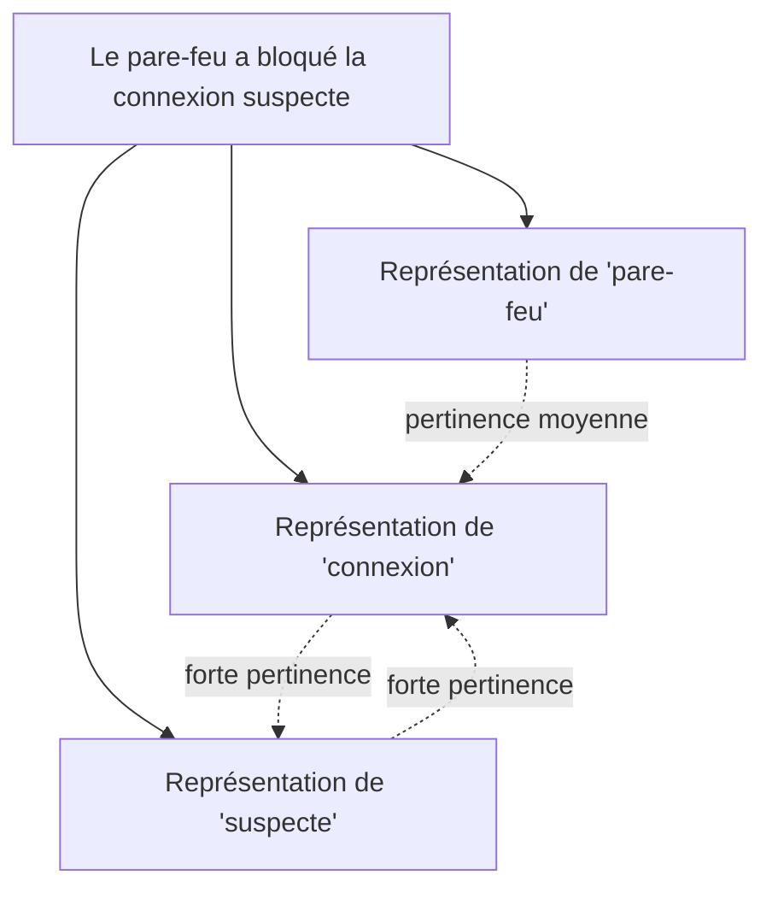
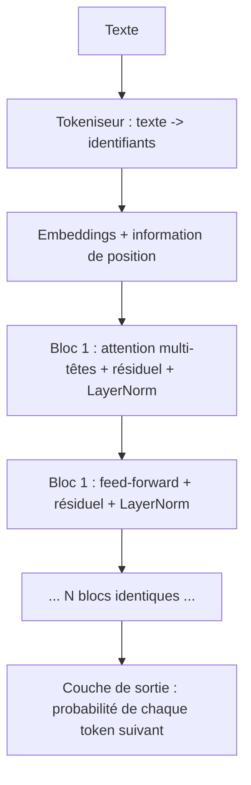

## Introduction

En 2017, une équipe de Google publie l'article *Attention Is All You Need*, qui propose une architecture nommée **Transformer**. Son idée centrale est radicale : abandonner complètement la récurrence des RNN et des LSTM du chapitre 4, et ne garder qu'un mécanisme, l'**attention**, qui permet à chaque élément d'une séquence de regarder directement tous les autres. En quelques années, cette architecture a supplanté les RNN pour le texte, puis gagné la vision, l'audio, le code et la biologie. Tous les grands modèles de langage actuels, les **LLM** (Large Language Models), sont des Transformers.

Pour un professionnel de la sécurité, comprendre l'intérieur d'un Transformer n'est plus optionnel. Les LLM sont intégrés aux SOC pour résumer des alertes, aux outils de développement pour écrire du code, aux messageries pour filtrer le phishing. Ils sont aussi utilisés par les attaquants. Et leurs failles spécifiques, comme les hallucinations ou le prompt injection, découlent directement de leur fonctionnement : un modèle qui prédit le mot suivant à partir de tout son contexte ne distingue pas, structurellement, les instructions de son opérateur des données qu'on lui fait lire.

À la fin de ce chapitre, tu sauras calculer une attention à la main, décrire un bloc Transformer, expliquer la différence entre BERT et GPT, et résumer comment un LLM est construit.

## La limite séquentielle des RNN et des LSTM

Un RNN ou un LSTM traite une séquence **élément par élément, dans l'ordre**. Pour calculer l'état caché de l'étape 100, il faut avoir calculé celui de l'étape 99, qui dépend de l'étape 98, et ainsi de suite. Cette contrainte séquentielle **empêche la parallélisation** du calcul sur la séquence entière. Or un GPU est performant justement quand il peut effectuer des milliers d'opérations en même temps. Entraîner un RNN sur des milliards de mots est donc extrêmement lent.

Deuxième limite : toute l'information du passé doit transiter par un état caché de taille fixe. Même avec les portes du LSTM, relier deux éléments séparés par des centaines d'étapes reste difficile, car le signal doit traverser toutes les étapes intermédiaires.

## Le mécanisme d'attention

### L'intuition

L'attention permet à un modèle de pondérer directement l'**importance relative** de chaque élément d'une séquence par rapport à tous les autres. Pour chaque mot d'une phrase, elle détermine quels autres mots sont les plus pertinents pour comprendre son sens dans ce contexte précis.

Prends la phrase « Le pare-feu a bloqué la connexion suspecte ». Pour bien représenter le mot « suspecte », le modèle a besoin de savoir à quoi il se rapporte : c'est la connexion qui est suspecte, pas le pare-feu. On s'attend donc à ce que « connexion » et « suspecte » aient une **forte attention mutuelle**. De même, « bloqué » se rapporte à la fois à « pare-feu » (qui bloque) et à « connexion » (ce qui est bloqué).



Contrairement à l'état caché d'un RNN, qui résume progressivement tout le passé en une seule représentation compressée, l'attention permet à chaque élément d'**accéder directement à n'importe quel autre élément**, quelle que soit sa distance. Le chemin entre deux mots, et donc le chemin du gradient, ne comporte qu'une étape. C'est ainsi que l'attention contourne le problème du gradient qui s'évanouit à travers le temps.

### Query, Key et Value

Le mécanisme s'inspire d'une recherche dans une base de données. Chaque élément de la séquence, représenté par un vecteur `x`, est projeté en trois vecteurs par trois matrices de poids apprises :

- la **requête** (Query) `q = x · Wq` exprime ce que cet élément cherche ;
- la **clé** (Key) `k = x · Wk` exprime ce que cet élément offre, ce qui permet de le trouver ;
- la **valeur** (Value) `v = x · Wv` est l'information que l'élément transmet s'il est sélectionné.

Pour un mot donné, on compare sa requête aux clés de tous les mots par un produit scalaire : plus le produit est grand, plus le mot correspondant est pertinent. Ces scores sont normalisés en poids positifs dont la somme vaut 1, puis on calcule la moyenne pondérée des valeurs. Le résultat est une nouvelle représentation du mot, **enrichie par son contexte**.

### La formule

```text
Attention(Q, K, V) = softmax( Q · Kᵀ / √d ) · V

Q, K, V : matrices dont chaque ligne est la requête, la clé ou la valeur d'un élément
d       : dimension des clés
softmax : transforme chaque ligne de scores en poids positifs de somme 1
```

La division par `√d` est la **mise à l'échelle** (scaled dot-product). Sans elle, quand la dimension est grande, les produits scalaires deviennent grands, le softmax sature sur une seule valeur et les gradients deviennent minuscules.

### Exemple chiffré

Représentons trois mots par des vecteurs de dimension 4, et prenons pour la démonstration des matrices `Wq`, `Wk` et `Wv` égales à l'identité, de sorte que `Q = K = V = X`.

```text
              X
pare-feu   : (1, 0, 1, 0)
connexion  : (0, 1, 1, 1)
suspecte   : (1, 1, 0, 1)

Scores Q·Kᵀ :           pare-feu  connexion  suspecte
  pare-feu                 2         1          1
  connexion                1         3          2
  suspecte                 1         2          3

Après division par √4 = 2 et softmax (chaque ligne somme à 1) :
  pare-feu               0.452     0.274      0.274
  connexion              0.186     0.506      0.307
  suspecte               0.186     0.307      0.506
```

Chaque mot s'accorde le plus d'attention à lui-même, ce qui est normal ici puisque sa requête est identique à sa clé. Hors diagonale, « connexion » porte son attention la plus forte sur « suspecte » (0.307) et réciproquement : c'est l'attention mutuelle attendue. La nouvelle représentation de « connexion » est la moyenne pondérée des trois valeurs, soit environ `(0.494, 0.814, 0.693, 0.814)`. Dans un vrai modèle, les matrices de projection sont apprises et la diagonale ne domine pas forcément.

### L'attention multi-têtes

Une seule attention capture un seul type de relation. Le Transformer exécute en parallèle plusieurs attentions, appelées **têtes**, chacune avec ses propres matrices `Wq`, `Wk`, `Wv` de plus petite dimension. Une tête peut apprendre des relations syntaxiques (le sujet et son verbe), une autre des relations de référence (un pronom et ce qu'il désigne). Les sorties des têtes sont concaténées puis projetées par une dernière matrice.

## L'architecture Transformer

### De la phrase aux vecteurs : tokenisation et embeddings

Un Transformer ne lit pas des caractères ni des mots, mais des **tokens**. Un **tokeniseur** découpe le texte en sous-mots fréquents, selon des algorithmes comme BPE (Byte Pair Encoding) : un mot courant est un seul token, un mot rare ou une adresse IP est découpé en plusieurs morceaux. Chaque token reçoit un identifiant entier, puis une couche d'**embedding** lui associe un vecteur appris.

### L'information de position

L'attention, telle quelle, ignore l'ordre : permuter les mots permute les sorties sans rien changer d'autre. Or « l'utilisateur a supprimé le fichier » et « le fichier a supprimé l'utilisateur » n'ont pas le même sens. On ajoute donc une **information de position** : des vecteurs sinusoïdaux dans l'article original, des vecteurs de position appris dans BERT et GPT-2, ou des rotations appliquées aux requêtes et aux clés (RoPE) dans de nombreux LLM récents.

### Le bloc Transformer

Un bloc Transformer enchaîne deux sous-couches, chacune entourée d'une **connexion résiduelle** (on ajoute l'entrée à la sortie, comme dans ResNet) et d'une **normalisation de couche** (LayerNorm) :

1. une **attention multi-têtes**, qui mélange l'information entre les positions ;
2. un **réseau feed-forward**, deux couches denses avec une activation GELU ou une variante, appliqué indépendamment à chaque position.

Le modèle complet empile des dizaines de blocs identiques. Comme pour les CNN, empiler des couches permet de capturer des relations de plus en plus abstraites entre les éléments de la séquence.



Le point décisif est que toutes ces opérations se calculent **en parallèle sur toute la séquence** : ce sont des multiplications de matrices. C'est cette capacité qui a permis d'entraîner des modèles sur des quantités de texte considérablement plus grandes qu'avec des RNN, et qui est à l'origine des LLM modernes.

### Encodeur, décodeur et masque causal

| Famille | Attention | Tâche d'entraînement | Exemples | Usage typique |
| --- | --- | --- | --- | --- |
| Encodeur seul | Bidirectionnelle : chaque token voit toute la phrase | Retrouver des mots masqués | BERT (2018), RoBERTa | Classification, extraction d'entités, embeddings de recherche |
| Décodeur seul | Causale : chaque token ne voit que les précédents | Prédire le token suivant | Famille GPT, la plupart des LLM conversationnels | Génération de texte et de code, assistants |
| Encodeur-décodeur | Encodeur bidirectionnel, décodeur causal | Transformer une séquence en une autre | Transformer original, T5 | Traduction, résumé |

Le **masque causal** d'un décodeur interdit à chaque position de regarder les positions futures : on remplace les scores correspondants par moins l'infini avant le softmax. Sur notre exemple, la première ligne devient `(1, 0, 0)` et la deuxième `(0.269, 0.731, 0)`. Sans ce masque, le modèle tricherait pendant l'entraînement en lisant le mot qu'il doit prédire.

## Des Transformers aux LLM

### Comment un LLM est construit

Un LLM conversationnel est construit en plusieurs étapes :

1. le **pré-entraînement** : un décodeur apprend à prédire le token suivant sur un immense corpus de textes et de code ; il acquiert ainsi des régularités de langue, des connaissances factuelles et des capacités de raisonnement apparent ;
2. l'**ajustement aux instructions** (instruction tuning) : on l'affine sur des exemples de dialogues pour qu'il suive des consignes ;
3. l'**alignement par préférences** : on l'ajuste à partir de comparaisons de réponses, par des méthodes comme RLHF (apprentissage par renforcement à partir de retours humains) ou DPO, pour le rendre plus utile et refuser certaines demandes dangereuses.

À l'usage, le modèle génère sa réponse token par token : à chaque étape, il calcule une distribution de probabilité sur le vocabulaire et en tire un token, contrôlé par des paramètres comme la **température**.

### La fenêtre de contexte et le coût quadratique

L'attention compare chaque token à tous les autres : pour une séquence de `n` tokens, elle calcule `n²` scores. Doubler la longueur du contexte quadruple ce coût. C'est pourquoi la **fenêtre de contexte**, le nombre maximal de tokens qu'un modèle peut traiter en une fois, est une caractéristique importante, et pourquoi de nombreuses optimisations existent : implémentations économes en mémoire comme FlashAttention, mise en cache des clés et valeurs déjà calculées (KV cache) pendant la génération, ou variantes d'attention restreintes.

### Les hallucinations

Un LLM est entraîné à produire une suite **plausible**, pas une suite **vraie**. Quand l'information est absente, rare ou ambiguë dans ses données, il génère quand même un texte fluide et assuré, qui peut être faux : un numéro de CVE inexistant, une option de commande inventée, une référence bibliographique fictive. On parle d'**hallucination**. Un modèle basé sur les Transformers, aussi puissant soit-il, reste un outil statistique, et cette limite est critique en sécurité, où une erreur de précision peut faire clôturer une vraie alerte ou lancer une commande destructrice.

## L'attention avec PyTorch 2.x

PyTorch 2 fournit une fonction optimisée, `torch.nn.functional.scaled_dot_product_attention`, qui choisit automatiquement l'implémentation la plus efficace pour le matériel disponible.

```python
import math
import torch
import torch.nn.functional as F

X = torch.tensor([[1., 0, 1, 0],
                  [0, 1, 1, 1],
                  [1, 1, 0, 1]])
Q = K = V = X.unsqueeze(0)                         # ajout d'une dimension de lot : (1, 3, 4)

manual = torch.softmax(Q @ K.transpose(-2, -1) / math.sqrt(4), dim=-1) @ V
fused = F.scaled_dot_product_attention(Q, K, V)    # même calcul, implémentation optimisée
causal = F.scaled_dot_product_attention(Q, K, V, is_causal=True)

print(torch.allclose(manual, fused, atol=1e-6))
print(fused.round(decimals=3))
```

```text
True
tensor([[[0.7260, 0.5480, 0.7260, 0.5480],
         [0.4940, 0.8140, 0.6930, 0.8140],
         [0.6930, 0.8140, 0.4940, 0.8140]]])
```

Pour un bloc complet, `nn.MultiheadAttention` gère les projections et les têtes, et `nn.TransformerEncoderLayer` assemble attention, feed-forward, résiduels et normalisation. Pour utiliser des modèles pré-entraînés, la bibliothèque `transformers` de Hugging Face est la référence de fait.

## Les Transformers en cybersécurité

<CompareTable
  titleA="Application"
  titleB="Principe"
  rows={[
    { a: "Analyse de logs à grande échelle", b: "Détecter des motifs suspects dans de longues séquences d'événements, sans les limites de mémoire d'un RNN" },
    { a: "Détection de phishing par analyse de texte", b: "Comprendre le contexte complet d'un email pour repérer des tournures d'urgence, d'autorité ou d'usurpation" },
    { a: "Assistants de sécurité conversationnels", b: "Résumer des alertes, expliquer un script suspect, proposer une requête de recherche, sur un contexte étendu" },
    { a: "Analyse de code et de binaires", b: "Repérer des motifs de vulnérabilité, expliquer du code désassemblé ou obfusqué" },
    { a: "Recherche sémantique (RAG)", b: "Encoder des documents de threat intelligence en embeddings pour retrouver les passages pertinents d'une question" },
  ]}
/>

Le revers est tout aussi important. Comme un décodeur traite instructions et données dans un même flux de tokens, un texte malveillant caché dans un email ou une page web peut être interprété comme une consigne par l'assistant qui le lit : c'est le **prompt injection**, première catégorie de l'OWASP Top 10 for LLM Applications 2025, étudié en détail dans le cours IA et Agents en Cybersécurité. La tokenisation crée aussi des angles morts : un filtre qui raisonne sur des mots peut être contourné par un texte découpé autrement en tokens.

<WarningCallout>
Ne copie jamais dans un terminal de production une commande proposée par un LLM sans la comprendre, et ne cite jamais un identifiant de CVE, une version ou une référence produite par un modèle sans la vérifier dans une source primaire (NVD, avis de l'éditeur). Un modèle qui ne sait pas répond quand même, et avec assurance.
</WarningCallout>

<TipCallout>
Pour un problème de classification de texte en sécurité (phishing, tri de tickets), un petit modèle encodeur ajusté sur tes données est souvent plus rapide, moins cher et plus facile à évaluer qu'un grand LLM génératif interrogé par prompt. Réserve les LLM génératifs aux tâches qui exigent vraiment de produire du texte.
</TipCallout>

## Erreurs fréquentes

- **Oublier la mise à l'échelle par √d.** Le softmax sature et l'entraînement devient instable.
- **Oublier le masque causal dans un décodeur.** Le modèle voit le futur pendant l'entraînement et obtient une perte excellente, puis génère n'importe quoi.
- **Croire que l'attention connaît l'ordre des mots.** Sans information de position, un Transformer traite la phrase comme un ensemble de tokens.
- **Confondre BERT et GPT.** L'un est un encodeur bidirectionnel pour comprendre et classer, l'autre un décodeur causal pour générer.
- **Interpréter les poids d'attention comme une explication fiable.** Ils indiquent où le modèle regarde dans une couche donnée, pas pourquoi il décide ; plusieurs couches et têtes se combinent.
- **Envoyer des données sensibles à un LLM hébergé sans évaluer le traitement qui en est fait.** Les journaux, emails et rapports d'incident contiennent souvent des données personnelles et des secrets.

## Lab — Mise en pratique

**Environnement** : Python 3.12 avec `numpy`, puis `torch` pour la dernière étape. Garde la même session Python d'une étape à l'autre.

<Steps steps={[
  { title: "Calculer les scores d'attention bruts", description: "Représente la phrase d'exemple (pare-feu, connexion, suspecte) par des vecteurs, calcule les vecteurs Query, Key et Value, puis les scores Q·Kᵀ entre chaque paire de mots. Tu dois retrouver la matrice 2 1 1 / 1 3 2 / 1 2 3.", code: "import numpy as np\n\n# Representation vectorielle simplifiee de 3 mots (dimension 4)\nmots = ['pare-feu', 'connexion', 'suspecte']\nX = np.array([\n    [1.0, 0.0, 1.0, 0.0],\n    [0.0, 1.0, 1.0, 1.0],\n    [1.0, 1.0, 0.0, 1.0],\n])\n\n# Matrices Query/Key/Value simplifiees (identite pour cette demonstration)\nWq = np.eye(4)\nWk = np.eye(4)\nWv = np.eye(4)\n\nQ = X.dot(Wq)\nK = X.dot(Wk)\nV = X.dot(Wv)\n\n# Scores d'attention bruts : produit scalaire Query . Key pour chaque paire de mots\nscores = Q.dot(K.T)\nprint('Scores attention bruts :')\nprint(scores)" },
  { title: "Normaliser les scores avec un softmax", description: "Transforme les scores en poids d'attention par un softmax mis à l'échelle, puis identifie pour chaque mot l'autre mot qui reçoit le plus d'attention. Vérifie que chaque ligne somme à 1.", code: "def softmax(x):\n    exp = np.exp(x - np.max(x, axis=-1, keepdims=True))\n    return exp / np.sum(exp, axis=-1, keepdims=True)\n\nattention_weights = softmax(scores / np.sqrt(X.shape[1]))\nprint(np.round(attention_weights, 3))\nprint('Sommes des lignes :', attention_weights.sum(axis=1))\n\n# On exclut la diagonale pour reperer le mot le plus pertinent parmi les AUTRES.\nfor i, mot in enumerate(mots):\n    autres = attention_weights[i].copy()\n    autres[i] = -1\n    print(mot, '-> attention la plus forte hors soi-meme sur ->', mots[np.argmax(autres)])" },
  { title: "Vérifier l'attention mutuelle connexion/suspecte", description: "Calcule les représentations contextualisées (moyenne pondérée des Value) et confirme que connexion et suspecte se portent une attention mutuelle de 0.307, la plus forte hors diagonale.", code: "context = attention_weights.dot(V)\nprint('Representations contextualisees :')\nprint(np.round(context, 3))\nprint('Attention connexion -> suspecte :', round(attention_weights[1, 2], 3))\nprint('Attention suspecte -> connexion :', round(attention_weights[2, 1], 3))" },
  { title: "Observer l'effet de la mise à l'échelle", description: "Tire une requête et six clés aléatoires de dimension 512, comme dans un vrai modèle. Les scores bruts ont un écart-type d'environ 23 : sans division par racine de d, le softmax donne tout le poids à une seule clé (1, 0, 0…). Avec la mise à l'échelle, les poids restent répartis, ce qui laisse passer le gradient.", code: "rng = np.random.default_rng(0)\nd = 512\nq = rng.normal(size=d)\nKr = rng.normal(size=(6, d))\ns = Kr.dot(q)\nprint('Ecart-type des scores :', round(s.std(), 1))\nprint('Sans mise a l echelle :', np.round(softmax(s), 3))\nprint('Avec mise a l echelle :', np.round(softmax(s / np.sqrt(d)), 3))" },
  { title: "Appliquer un masque causal", description: "Ajoute un masque qui interdit à chaque mot de regarder les mots suivants. La première ligne doit devenir 1 0 0 et la deuxième environ 0.269 0.731 0 : c'est le fonctionnement d'un décodeur de type GPT.", code: "mask = np.triu(np.ones((3, 3)), k=1) * -1e9\nprint(np.round(softmax(scores / np.sqrt(4) + mask), 3))" },
  { title: "Vérifier l'invariance à l'ordre", description: "Permute l'ordre des mots et recalcule l'attention. Les représentations sont simplement permutées : sans information de position, l'attention ignore l'ordre de la phrase.", code: "perm = [2, 0, 1]\nXp = X[perm]\nctx_p = softmax(Xp.dot(Xp.T) / 2).dot(Xp)\nprint(np.allclose(ctx_p, context[perm]))" },
  { title: "Retrouver le calcul avec PyTorch", description: "Utilise F.scaled_dot_product_attention et vérifie que le résultat est identique à ton calcul numpy. Teste ensuite l'option is_causal=True et compare avec l'étape du masque.", code: "import torch\nimport torch.nn.functional as F\n\nT = torch.tensor(X, dtype=torch.float32).unsqueeze(0)\nout = F.scaled_dot_product_attention(T, T, T)\nprint(out.round(decimals=3))\nprint(np.allclose(out[0].numpy(), context, atol=1e-5))\nprint(F.scaled_dot_product_attention(T, T, T, is_causal=True).round(decimals=3))" },
]} />

## À retenir

- Les RNN et LSTM traitent une séquence élément par élément, ce qui empêche la parallélisation du calcul et rend difficiles les dépendances lointaines.
- L'attention calcule, pour chaque élément, son importance relative par rapport à tous les autres : `softmax(Q·Kᵀ / √d) · V`.
- Les vecteurs Query, Key et Value, obtenus par des projections apprises, servent à calculer les scores d'attention et la nouvelle représentation contextualisée.
- Un bloc Transformer combine attention multi-têtes, réseau feed-forward, connexions résiduelles, normalisation et information de position ; tout se calcule en parallèle sur la séquence.
- Cette parallélisation a permis d'entraîner sur des volumes de texte considérablement plus grands, à l'origine des LLM : pré-entraînement sur le token suivant, ajustement aux instructions, alignement par préférences.
- BERT est un encodeur bidirectionnel adapté à la classification ; GPT est un décodeur causal adapté à la génération.
- En sécurité, les Transformers servent à l'analyse de logs, à la détection de phishing et aux assistants, mais ils hallucinent et sont exposés au prompt injection : leurs sorties doivent être vérifiées.

## Questions de révision

1. Quelle contrainte des RNN et LSTM empêche la parallélisation, et comment l'attention la supprime-t-elle ?
2. Explique le rôle respectif des vecteurs Query, Key et Value avec l'analogie de la recherche dans une base de données.
3. Pourquoi divise-t-on les scores par la racine de la dimension des clés ? Que se passe-t-il sinon ?
4. Dans la phrase « Le pare-feu a bloqué la connexion suspecte », quels mots devraient avoir une forte attention mutuelle, et pourquoi ?
5. Pourquoi un Transformer a-t-il besoin d'une information de position, alors qu'un RNN n'en a pas besoin ?
6. Quelle est la différence entre un encodeur de type BERT et un décodeur de type GPT, et lequel choisirais-tu pour classer des emails de phishing ?
7. Pourquoi un LLM peut-il produire une réponse plausible mais fausse, et quelles précautions imposes-tu à un analyste qui l'utilise en SOC ?
