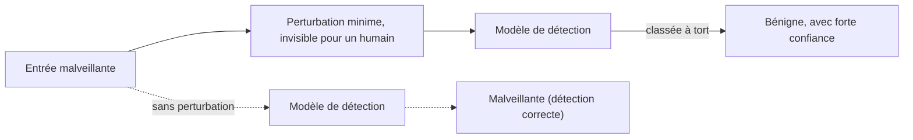
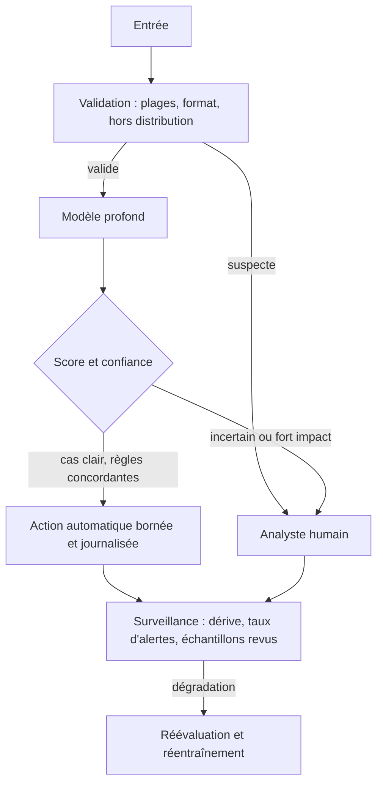

## Introduction

Ce dernier chapitre referme le cours Deep Learning, et avec lui le parcours Machine Learning et Deep Learning. Tu sais désormais comment un réseau apprend, comment fonctionnent les CNN, les RNN et les Transformers, et comment on les entraîne. Reste la question qui compte vraiment pour un professionnel de la sécurité : que se passe-t-il quand on met ce modèle en production, face à des données réelles et à des adversaires qui ont intérêt à le tromper ?

Un modèle de détection n'évolue pas dans un environnement neutre. Le trafic change, les attaquants s'adaptent, et certains d'entre eux étudient précisément le comportement des défenses automatiques pour les contourner. Un modèle qui obtient 99 % de précision sur un jeu de test peut être contourné en production par une modification que personne n'aurait remarquée. Ce chapitre adopte donc un regard critique, indispensable avant d'intégrer le deep learning dans une chaîne de décision sensible.

À la fin de ce chapitre, tu sauras quelles contraintes compliquent le déploiement d'un modèle profond, pourquoi les attaques adversariales fonctionnent, comment évaluer et améliorer la robustesse d'un modèle, quelles autres menaces pèsent sur le cycle de vie d'un modèle, et pourquoi un modèle de deep learning doit rester un outil d'aide à la décision.

## Déployer un modèle de deep learning

### Les principes hérités du machine learning

Le cours Machine Learning a présenté la mise en production : sérialiser le modèle entraîné, l'exposer via une interface stable, versionner modèle et données, et surveiller sa dérive dans le temps. Tout cela s'applique au deep learning, avec une contrainte supplémentaire : la **taille et le coût de calcul** des modèles profonds sont souvent bien plus importants.

<CompareTable
  titleA="Contrainte"
  titleB="Implication pour le déploiement"
  rows={[
    { a: "Taille du modèle (souvent des centaines de Mo à plusieurs Go)", b: "Exige parfois une compression ou une simplification du modèle avant déploiement, surtout sur un poste ou un équipement réseau" },
    { a: "Coût de calcul de l'inférence", b: "Peut nécessiter du matériel spécialisé (GPU) même en production, pas seulement à l'entraînement" },
    { a: "Latence de l'inférence", b: "Un modèle profond peut être trop lent pour une décision en temps réel, comme le blocage instantané d'une connexion réseau" },
    { a: "Dépendances logicielles lourdes", b: "Un framework complet en production élargit la surface d'attaque et complique les mises à jour" },
  ]}
/>

### Réduire la taille et la latence

Plusieurs techniques rendent un modèle déployable :

- la **quantification** stocke les poids, et parfois les calculs, en entiers 8 bits ou moins au lieu de flottants 32 bits, ce qui divise la taille par quatre ou plus, avec une perte de précision souvent faible qu'il faut mesurer ;
- la **distillation** entraîne un petit modèle « élève » à reproduire les sorties d'un grand modèle « professeur » ;
- l'**élagage** (pruning) supprime les poids ou les neurones les moins utiles ;
- l'**export** vers un format d'inférence optimisé : `torch.export` pour capturer le graphe du modèle, ou le format ouvert **ONNX**, exécutable par ONNX Runtime sans PyTorch.

Le choix dépend du budget de latence. Un filtre en ligne qui doit décider en quelques millisecondes pour chaque connexion ne peut pas attendre un grand Transformer ; un système d'analyse a posteriori de pièces jointes, lui, le peut. Une architecture fréquente combine un modèle léger en temps réel et un modèle plus lourd en différé, sur les cas incertains.

### Mesurer la latence

```python
import time
import torch
from torch import nn

model = nn.Sequential(nn.Linear(20, 256), nn.ReLU(), nn.Linear(256, 256), nn.ReLU(), nn.Linear(256, 1)).eval()
x = torch.randn(1, 20)

with torch.inference_mode():          # désactive autograd : plus rapide et moins de mémoire
    for _ in range(10):               # échauffement
        model(x)
    t0 = time.perf_counter()
    for _ in range(1000):
        model(x)
    elapsed = (time.perf_counter() - t0) / 1000
print(f"latence moyenne : {elapsed * 1e6:.0f} µs par prédiction")
```

Les valeurs obtenues dépendent fortement de la machine. Mesure toujours la latence sur le matériel cible, avec des entrées réalistes, et regarde les percentiles élevés (p95, p99), pas seulement la moyenne.

## Les attaques adversariales

### Définition

Une **attaque adversariale** consiste à modifier légèrement une entrée, de façon souvent imperceptible pour un humain, spécifiquement pour tromper un modèle et lui faire produire une prédiction erronée **avec une confiance élevée**. Le phénomène a été mis en évidence en 2013 sur des classifieurs d'images : une photo de panda, imperceptiblement modifiée, était classée comme un gibbon avec une forte confiance. Appliqué à la sécurité, cela signifie qu'une entrée malveillante légèrement retouchée peut être classée comme bénigne par un CNN de détection de malware du chapitre 3.



### Pourquoi ça fonctionne

Un modèle ne connaît pas la véritable frontière entre « malveillant » et « bénin » : il a appris une **frontière de décision** à partir d'exemples, et cette frontière ne coïncide jamais parfaitement avec la réalité. Entre les exemples d'entraînement, il existe d'immenses régions de l'espace des entrées où le modèle n'a jamais rien vu et où sa décision est arbitraire. Une attaque adversariale cherche ces angles morts mathématiques, de la même façon qu'un attaquant cherche les angles morts d'une défense périmétrique.

Une explication proposée en 2014 par Ian Goodfellow et ses coauteurs tient au comportement largement linéaire des réseaux dans le voisinage d'une entrée. Pour un modèle linéaire, si l'on modifie chaque caractéristique d'une quantité minuscule `ε` dans la direction défavorable, la pré-activation varie de `ε` multiplié par la somme des valeurs absolues des poids. Cette somme grandit avec le nombre de caractéristiques. En dimension 2, une perturbation de 1 % ne change presque rien ; sur une image de plus de 150 000 valeurs, la même perturbation de 1 % par pixel, invisible à l'œil, s'accumule et peut faire basculer la décision. Le lab te permet de le mesurer.

C'est aussi pourquoi le gradient est central : le gradient de la sortie par rapport à l'**entrée**, calculé par exactement la même rétropropagation que pendant l'entraînement, indique dans quelle direction modifier l'entrée pour changer le plus vite la décision. La méthode FGSM (Fast Gradient Sign Method) se contente de suivre le signe de ce gradient ; des méthodes itératives comme PGD sont plus puissantes.

### Les contraintes du monde réel

Les attaques en laboratoire modifient librement des pixels ou des caractéristiques numériques. Dans le monde réel, l'attaquant est contraint : un exécutable modifié doit rester exécutable et conserver son comportement malveillant, un email doit rester lisible par sa victime, un flux réseau doit respecter les protocoles. On distingue ainsi l'**espace des caractéristiques**, où l'attaque est facile mais théorique, de l'**espace du problème**, où elle doit produire un objet réel et fonctionnel. Ces contraintes compliquent l'attaque sans l'empêcher : des travaux de recherche ont montré la faisabilité d'évasions réalistes contre des détecteurs de malware fondés sur l'apprentissage. La connaissance de l'attaquant compte aussi : en **boîte blanche**, il connaît le modèle et ses gradients ; en **boîte noire**, il ne peut qu'interroger le modèle et observer ses réponses, ce qui suffit souvent, notamment parce que des exemples adversariaux construits sur un modèle se **transfèrent** fréquemment à d'autres modèles entraînés pour la même tâche.

## Les autres menaces sur le cycle de vie d'un modèle

Les attaques adversariales visent le modèle à l'inférence. D'autres menaces visent l'entraînement ou la confidentialité :

| Menace | Moment | Principe | Conséquence |
| --- | --- | --- | --- |
| Évasion (exemples adversariaux) | Inférence | Modifier une entrée pour tromper le modèle | Détection contournée |
| Empoisonnement de données | Entraînement | Insérer ou altérer des exemples d'entraînement | Modèle dégradé ou biaisé |
| Porte dérobée (backdoor) | Entraînement | Associer un motif déclencheur discret à une classe choisie | Le modèle se comporte normalement sauf en présence du déclencheur |
| Extraction de modèle | Inférence | Interroger massivement le modèle pour en entraîner une copie | Vol de propriété intellectuelle, copie servant à préparer des évasions |
| Inférence d'appartenance | Inférence | Déterminer si une donnée faisait partie de l'entraînement | Fuite de données personnelles ou sensibles |
| Chaîne d'approvisionnement | Avant déploiement | Modèle pré-entraîné ou dépendance compromis | Code malveillant ou porte dérobée héritée |

Ces menaces sont cataloguées par **MITRE ATLAS** (Adversarial Threat Landscape for Artificial-Intelligence Systems), une base de connaissances construite sur le modèle de MITRE ATT&CK, avec des tactiques, des techniques et des études de cas réelles d'attaques contre des systèmes d'IA. Le NIST publie de son côté une taxonomie de l'apprentissage automatique adversarial dans la série NIST AI 100-2.

<AttackDefenseTable rows={[
  { phase: "Évasion", attack: "L'attaquant cherche les angles morts de la frontière de décision pour qu'une entrée malveillante soit classée bénigne", defense: "Entraînement adversarial, validation stricte des entrées, détection d'entrées hors distribution, combinaison avec des règles et des signatures" },
  { phase: "Empoisonnement et porte dérobée", attack: "Des exemples altérés introduits dans les données d'entraînement biaisent le modèle ou y cachent un déclencheur", defense: "Contrôle de provenance et d'intégrité des données, revue des sources contributives, détection d'exemples atypiques, tests sur jeux de référence" },
  { phase: "Extraction et sondage", attack: "Des requêtes nombreuses permettent de reconstruire le modèle ou de cartographier sa frontière", defense: "Authentification, limitation de débit, ne renvoyer qu'une décision plutôt qu'un score précis, surveillance des motifs de requêtes" },
  { phase: "Confidentialité", attack: "L'analyse des sorties révèle si une donnée faisait partie de l'entraînement", defense: "Minimisation des données, régularisation, confidentialité différentielle pour les cas sensibles" },
  { phase: "Chaîne d'approvisionnement", attack: "Un modèle pré-entraîné ou un fichier de poids piégé est intégré au système", defense: "Sources de confiance, vérification des empreintes, format safetensors, chargement isolé, inventaire des modèles" },
]} />

## Se défendre et surveiller

### Défendre le modèle

Se défendre contre les attaques adversariales reste un domaine de recherche actif, et aucune défense n'est définitive. Deux approches complémentaires sont classiques. L'**entraînement adversarial** consiste à inclure volontairement des exemples perturbés, correctement étiquetés, dans l'entraînement : le modèle apprend une frontière plus éloignée des exemples, au prix d'un coût d'entraînement accru et parfois d'une légère baisse de précision sur les données propres. La **détection d'anomalies sur les entrées** elles-mêmes, dans l'esprit de DBSCAN vu dans le cours Machine Learning, signale les entrées qui ne ressemblent pas à la distribution d'entraînement, avant même de faire confiance au score du modèle.

S'y ajoutent des mesures d'ingénierie simples et efficaces : valider que chaque caractéristique reste dans une plage plausible, choisir des caractéristiques difficiles à manipuler pour l'attaquant sans détruire son attaque, ne pas exposer les scores bruts ni les gradients, et combiner plusieurs détecteurs de nature différente.

### Évaluer la robustesse

La robustesse se mesure comme la précision : on calcule la précision du modèle sous perturbation, pour des budgets `ε` croissants, et on trace une **courbe de robustesse**. On peut aussi calculer, pour chaque entrée, la plus petite perturbation qui fait basculer la décision : c'est la **marge de robustesse**. Un modèle dont les entrées malveillantes basculent avec une perturbation de 1 % est fragile, même si sa précision nominale est excellente.

### Expliquer les décisions

Un réseau profond est une boîte largement **opaque** : contrairement à un arbre de décision, il est difficile d'expliquer précisément pourquoi il a pris une décision donnée. Des méthodes d'**explicabilité** atténuent ce problème : cartes de saillance fondées sur le gradient, gradients intégrés, valeurs de Shapley avec SHAP, ou la bibliothèque Captum pour PyTorch. Elles donnent des indices, utiles pour repérer un modèle qui s'appuie sur un artefact (un champ d'en-tête, une plage d'adresses de laboratoire), mais elles ne remplacent pas une véritable interprétabilité.

### Surveiller en production

La **dérive de concept** est la dégradation d'un modèle dans le temps face à des menaces qui évoluent. Un détecteur entraîné sur les familles de malwares de l'an dernier verra arriver des familles nouvelles. Il faut donc surveiller la distribution des entrées et des scores, suivre le taux d'alertes et les retours des analystes, réévaluer régulièrement sur des données récentes étiquetées, et réentraîner selon un processus maîtrisé.



<WarningCallout>
Plus une décision automatique a de conséquences (bloquer un compte, isoler un poste, supprimer un fichier), plus un faux positif coûte cher, et plus un attaquant a intérêt à manipuler le modèle pour la déclencher contre la cible de son choix. Réserve l'automatisation complète aux actions réversibles et à faible impact, et garde une validation humaine pour le reste.
</WarningCallout>

<LegalCallout>
Le règlement européen sur l'IA (AI Act, règlement (UE) 2024/1689) impose aux systèmes d'IA à haut risque un niveau approprié d'exactitude, de robustesse et de cybersécurité, en citant explicitement la résilience face à l'empoisonnement de données, aux exemples adversariaux et aux attaques de confidentialité (article 15), ainsi qu'une supervision humaine effective (article 14). Même hors de cette catégorie, ces exigences constituent une bonne référence de conception.
</LegalCallout>

## Les limites du deep learning en sécurité : synthèse critique

Un modèle de deep learning, aussi performant soit-il sur ses données d'évaluation, cumule quatre limites majeures :

1. **L'opacité.** Il est difficile d'expliquer pourquoi un réseau profond a pris une décision donnée, ce qui le rend plus difficile à auditer qu'un arbre de décision ou une régression.
2. **La vulnérabilité adversariale.** Un modèle peut être délibérément trompé par des entrées conçues pour exploiter les failles de sa frontière de décision.
3. **La dérive de concept.** Les techniques d'attaque évoluent ; un modèle entraîné sur des données anciennes se dégrade avec le temps.
4. **La dépendance à la qualité et au volume des données.** Un modèle profond exige généralement bien plus de données étiquetées qu'un modèle classique, et il reproduit fidèlement leurs biais et leurs artefacts.

Ces limites ne disqualifient pas le deep learning en cybersécurité. Il excelle là où les règles sont impossibles à écrire à la main : données brutes, images, texte, séquences longues. Mais elles imposent de le traiter comme un **outil d'aide à la décision** parmi d'autres, combiné à une supervision humaine, des règles explicites et une surveillance continue, jamais comme une autorité de décision autonome et infaillible.

<CehCallout>
Pour les examens et les entretiens, retiens les catégories d'attaques contre l'IA (évasion, empoisonnement, porte dérobée, extraction, inférence d'appartenance) et les référentiels associés : MITRE ATLAS pour les techniques, l'OWASP Top 10 for LLM Applications 2025 pour les applications à base de LLM, le NIST AI RMF pour la gestion des risques. CEH v13 intègre l'IA dans sa démarche, et ces notions reviennent de plus en plus souvent.
</CehCallout>

## Erreurs fréquentes

- **Confondre précision en test et robustesse.** Un score élevé sur un jeu de test propre ne dit rien du comportement face à un adversaire.
- **Évaluer la robustesse uniquement en boîte blanche avec une attaque faible.** Une défense qui ne résiste qu'à FGSM peut céder à une attaque itérative ou transférée.
- **Exposer les scores de confiance précis à l'extérieur.** Ils facilitent le sondage, l'extraction et la construction d'évasions.
- **Quantifier ou distiller un modèle sans réévaluer** sa précision et sa robustesse sur le jeu de test.
- **Utiliser des modèles pré-entraînés d'origine inconnue** sans vérification d'intégrité ni chargement isolé.
- **Déployer sans surveillance de dérive**, puis découvrir des mois plus tard que le modèle ne détecte plus les nouvelles familles.
- **Prendre une carte de saillance pour une explication complète** et en tirer des conclusions définitives sur le raisonnement du modèle.

## Lab — Mise en pratique

**Environnement** : Python 3.12 avec `numpy`. Ce lab évalue la robustesse d'un modèle jouet que tu possèdes : il ne vise aucun système réel. Garde la même session Python d'une étape à l'autre.

<Steps steps={[
  { title: "Construire un classifieur jouet malveillant/bénin", description: "Reprends un perceptron déjà entraîné (chapitre 1) qui classe un fichier à partir de 2 caractéristiques normalisées entre 0 et 1, et observe sa prédiction initiale : environ 0.750, donc classé malveillant.", code: "import numpy as np\n\ndef sigmoid(z):\n    return 1 / (1 + np.exp(-z))\n\n# Modele jouet deja entraine : classifie un fichier (2 caracteristiques) malveillant/benin\nw = np.array([1.2, -0.8])\nb = 0.1\n\ndef predict(x):\n    return sigmoid(np.dot(w, x) + b)\n\nx = np.array([0.9, 0.1])\nprint('Prediction initiale (proba malveillant) :', predict(x))" },
  { title: "Calculer la direction de plus grande sensibilité", description: "Calcule le gradient de la sortie par rapport à l'entrée et applique une petite perturbation de 0.05 dans la direction qui réduit le score, sur le principe de la méthode FGSM. Le score baisse légèrement, vers 0.731 : en dimension 2, une petite perturbation ne suffit pas.", code: "y_out = predict(x)\ngradient_input = y_out * (1 - y_out) * w\n\nepsilon = 0.05\nx_adv = x - epsilon * np.sign(gradient_input)\n\nprint('Perturbation appliquee :', x_adv - x)\nprint('Nouvelle prediction (proba malveillant) :', predict(x_adv))" },
  { title: "Comparer l'ampleur de la perturbation à celle de la décision", description: "Mesure la norme de la perturbation et le changement de prédiction. Note que le changement de score dépend directement des poids du modèle par rapport à l'entrée.", code: "diff_input = np.linalg.norm(x_adv - x)\ndiff_output = abs(predict(x_adv) - predict(x))\n\nprint('Changement des caracteristiques d entree :', round(diff_input, 4))\nprint('Changement de la prediction du modele    :', round(diff_output, 4))" },
  { title: "Calculer la marge de robustesse", description: "Calcule la plus petite perturbation par caractéristique qui fait passer le score sous 0.5. Pour un modèle linéaire, elle vaut la pré-activation divisée par la somme des valeurs absolues des poids, soit 0.55 ici : une marge confortable sur des caractéristiques entre 0 et 1.", code: "z = np.dot(w, x) + b\nmarge = z / np.abs(w).sum()\nprint('Marge de robustesse :', round(marge, 3))\nfor eps in (0.2, 0.5, 0.6):\n    print(eps, round(predict(x - eps * np.sign(w)), 3))" },
  { title: "Observer l'effet de la dimension", description: "Répète l'expérience avec des modèles linéaires de 2 à 10 000 caractéristiques et une perturbation de seulement 1 % par caractéristique. Le score chute de plus en plus avec la dimension : c'est pourquoi les modèles sur images ou octets bruts sont particulièrement exposés.", code: "rng = np.random.default_rng(1)\nfor d in (2, 100, 1000, 10000):\n    wd = rng.normal(size=d) / np.sqrt(d)\n    xd = rng.uniform(0, 1, size=d)\n    bd = 2.0 - wd @ xd\n    xd_adv = np.clip(xd - 0.01 * np.sign(wd), 0, 1)\n    print(d, round(sigmoid(wd @ xd + bd), 3), '->', round(sigmoid(wd @ xd_adv + bd), 3))" },
  { title: "Ajouter une défense par validation des entrées", description: "Écris une fonction qui refuse de décider seule quand une entrée sort de la plage observée à l'entraînement ou quand le score est proche du seuil, et qui renvoie alors l'entrée vers un analyste. Teste-la sur x, sur x_adv et sur une entrée hors plage.", code: "def decide(x, low=0.0, high=1.0, zone=0.15):\n    if np.any(x < low) or np.any(x > high):\n        return 'analyste (entree hors plage)'\n    p = predict(x)\n    if abs(p - 0.5) < zone:\n        return f'analyste (score incertain {p:.2f})'\n    return 'malveillant' if p > 0.5 else 'benin'\n\nfor entree in (x, x_adv, np.array([0.9, -3.0])):\n    print(entree, '->', decide(entree))" },
]} />

## À retenir

- Déployer un modèle profond reprend les principes du cours Machine Learning, avec des contraintes de taille, de coût de calcul et de latence ; quantification, distillation, élagage et export ONNX les réduisent.
- Une attaque adversariale modifie légèrement une entrée, souvent de façon imperceptible, pour tromper un modèle avec une confiance élevée ; elle exploite les angles morts de la frontière de décision.
- Les petites perturbations s'accumulent avec le nombre de caractéristiques, ce qui rend les modèles sur données brutes particulièrement exposés.
- Empoisonnement, porte dérobée, extraction et inférence d'appartenance complètent le panorama des menaces, cataloguées par MITRE ATLAS.
- L'entraînement adversarial et la détection d'anomalies sur les entrées sont deux défenses complémentaires, aucune n'étant définitive ; la validation des entrées, la limitation de l'exposition et la surveillance de dérive sont indispensables.
- Opacité, vulnérabilité adversariale, dérive de concept et dépendance aux données sont les quatre limites majeures du deep learning en sécurité.
- Un modèle de deep learning est un outil d'aide à la décision, combiné à la supervision humaine et à des règles explicites, jamais une autorité autonome.

## Questions de révision

1. Quelles contraintes propres au deep learning compliquent le déploiement par rapport au machine learning classique, et quelles techniques les atténuent ?
2. Qu'est-ce qu'une attaque adversariale, et pourquoi un modèle peut-il se tromper avec une confiance élevée ?
3. Explique pourquoi une perturbation de 1 % par caractéristique est négligeable en dimension 2 mais dangereuse pour une image.
4. Quelle différence fais-tu entre l'espace des caractéristiques et l'espace du problème pour une attaque contre un détecteur de malware ?
5. Distingue empoisonnement de données et porte dérobée, et propose une défense pour chacun.
6. Pourquoi est-il préférable de ne renvoyer qu'une décision plutôt qu'un score de confiance précis à un client externe ?
7. Pourquoi un modèle de deep learning ne devrait-il jamais constituer une autorité de décision autonome en cybersécurité ? Appuie-toi sur les quatre limites du chapitre.

Félicitations, tu viens de terminer le cours **Deep Learning**, et avec lui le parcours Machine Learning et Deep Learning de Nyx. Des perceptrons aux Transformers, en passant par les CNN et les LSTM, tu disposes désormais d'une compréhension à la fois mathématique et critique de ces technologies, indispensable pour les utiliser judicieusement, et pour en reconnaître les limites, dans un contexte de cybersécurité.
