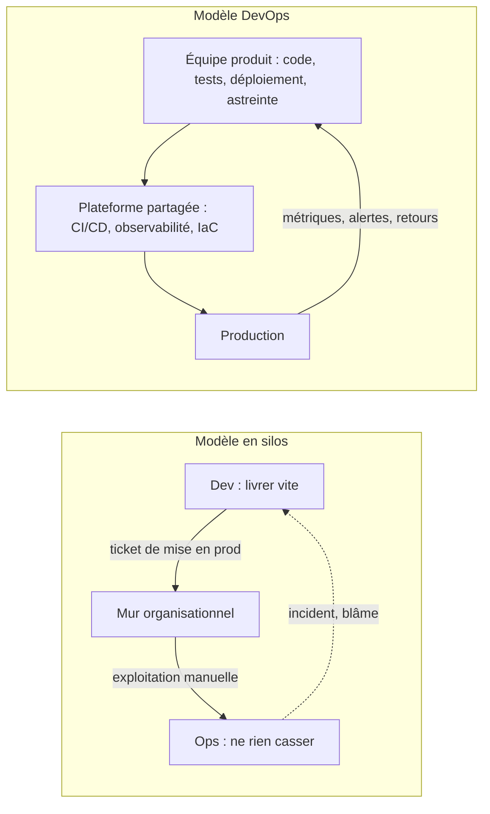
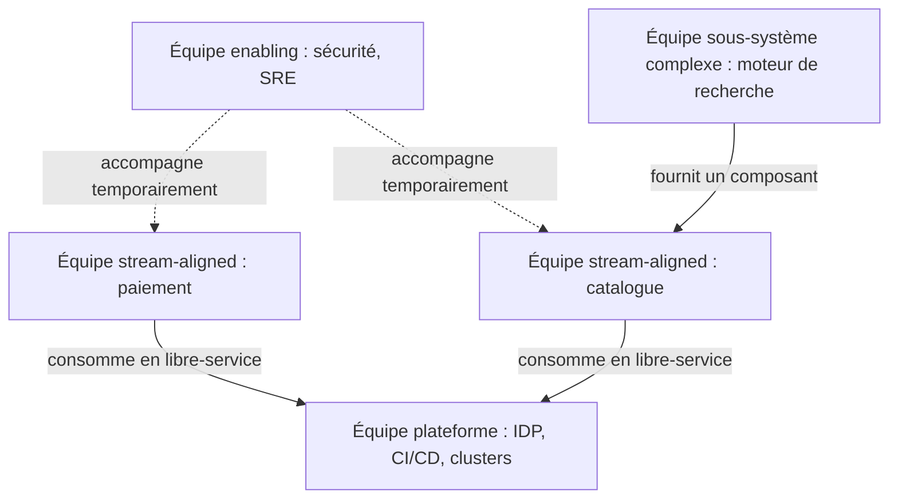
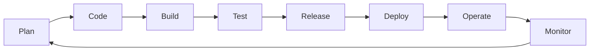

## Introduction

Pendant des décennies, développer un logiciel et le faire tourner en production ont été deux métiers séparés par un mur organisationnel. L'équipe de développement (Dev) livrait du code dont l'objectif était d'ajouter des fonctionnalités le plus vite possible ; l'équipe d'exploitation (Ops) devait garder les systèmes stables, ce qui la poussait naturellement à freiner tout changement. Ce conflit d'intérêts structurel provoquait des mises en production rares, longues, stressantes, et souvent ratées.

Le mouvement DevOps est né au tournant des années 2008-2009 (popularisé notamment par les conférences "devopsdays" initiées par Patrick Debois) comme une réponse directe à ce problème : au lieu d'opposer Dev et Ops, on fusionne leurs responsabilités et leurs outils pour livrer plus vite, plus souvent, et de façon plus fiable. DevOps n'est ni un poste, ni un outil, ni une équipe qu'on ajoute à l'organigramme — c'est une culture et un ensemble de pratiques.

À la fin de ce chapitre, tu sauras expliquer d'où vient DevOps, diagnostiquer une organisation avec la grille CALMS, calculer et interpréter les métriques DORA à partir de données réelles, distinguer DevOps, SRE et platform engineering, et repérer les anti-patterns qui font échouer la plupart des transformations.

Ce premier chapitre pose les fondations théoriques du cours : l'origine du mouvement, le framework CALMS qui structure une transformation DevOps, la boucle infinie qui représente le cycle de vie d'un logiciel, et les métriques DORA qui permettent de mesurer objectivement la performance d'une équipe. Nous verrons aussi, sans nous y attarder, pourquoi la sécurité ne peut pas rester une case cochée en fin de parcours dans cette nouvelle culture — ce sera le cœur du cours "DevSecOps Avancé" qui prolonge celui-ci.

## L'origine du mouvement : sortir des silos

Dans un modèle traditionnel en silos, chaque équipe optimise localement son propre objectif : le Dev est jugé sur la vitesse de livraison de fonctionnalités, l'Ops est jugé sur le nombre d'incidents évités. Ces deux objectifs entrent naturellement en tension, et chaque transfert de responsabilité (le fameux "ça marche sur ma machine") devient un point de friction et de blâme.

```text
Modèle en silos (avant DevOps)
Dev  --------> [mur] --------> Ops
"Livrer vite"              "Ne rien casser"
   → conflits, lenteur, mises en production rares et risquées
```

Le schéma suivant compare les deux modèles. À gauche, chaque transfert est un « lancer par-dessus le mur » ; à droite, une même équipe porte la fonctionnalité du ticket jusqu'à la production, en s'appuyant sur une plateforme commune.



DevOps propose de remplacer ce mur par une responsabilité partagée de bout en bout : l'équipe qui développe une fonctionnalité est aussi responsable de son bon fonctionnement en production. Cela ne signifie pas que les rôles disparaissent, mais que la frontière organisationnelle et le manque de communication qui ralentissaient les livraisons s'effacent au profit d'objectifs communs et d'outils partagés (automatisation, observabilité, déploiement continu).

<TipCallout>
Retiens cette définition simple : DevOps est un ensemble de pratiques culturelles et techniques qui rapprochent développement et exploitation pour livrer du logiciel plus rapidement, plus souvent et plus fiablement — sans sacrifier la stabilité.
</TipCallout>

### Les « trois voies » : le socle théorique

Le livre *The DevOps Handbook* (Gene Kim, Jez Humble, Patrick Debois, John Willis), prolongement du roman *The Phoenix Project*, résume la philosophie DevOps en trois principes appelés les trois voies. La première voie est le **flux** : accélérer le passage du travail de gauche à droite, du développement vers la production, en réduisant la taille des lots et en rendant le travail visible. La deuxième voie est le **feedback** : créer des boucles de retour rapides de droite à gauche, pour que les problèmes de production soient détectés et remontés immédiatement aux personnes qui peuvent les corriger. La troisième voie est l'**apprentissage continu** : instaurer une culture qui encourage l'expérimentation, accepte le risque maîtrisé et transforme chaque incident en amélioration durable.

Ces trois voies se retrouvent partout dans ce cours : l'intégration continue sert le flux, l'observabilité sert le feedback, et les postmortems sans blâme servent l'apprentissage.

## Le framework CALMS

CALMS est l'acronyme le plus utilisé pour structurer une transformation DevOps. Chaque lettre représente une dimension à travailler, et une transformation DevOps réussie doit progresser sur les cinq à la fois — se concentrer uniquement sur l'outillage sans changer la culture est l'échec le plus courant observé dans les entreprises.

<CompareTable
  titleA="Dimension"
  titleB="Ce qu'elle signifie concrètement"
  rows={[
    { a: "Culture", b: "Confiance mutuelle entre Dev et Ops, responsabilité partagée des incidents, droit à l'erreur (blameless postmortem) plutôt que recherche de coupable" },
    { a: "Automation", b: "Automatiser tout ce qui est répétitif et sujet à l'erreur humaine : intégration, tests, provisioning d'infrastructure, déploiement" },
    { a: "Lean", b: "Éliminer le gaspillage (temps d'attente, tâches manuelles inutiles), livrer par petits incréments visibles plutôt que par gros lots risqués" },
    { a: "Measurement", b: "Mesurer objectivement la performance (métriques DORA, taux d'erreur, temps de cycle) plutôt que se fier à des impressions" },
    { a: "Sharing", b: "Partager les connaissances, les outils et les responsabilités entre équipes — casser les silos d'information autant que les silos organisationnels" },
  ]}
/>

<CehCallout>
CALMS n'est pas une checklist à cocher une fois : c'est une grille de lecture permanente. Face à un problème d'organisation, demande-toi systématiquement sur laquelle des cinq dimensions il agit avant de proposer un outil.
</CehCallout>

### Diagnostiquer une organisation avec CALMS

Prenons un cas concret. Une équipe a installé GitHub Actions, Docker et Kubernetes en six mois, mais met toujours deux semaines à livrer un correctif. En appliquant la grille CALMS, on découvre que l'**Automation** est bonne, mais que chaque mise en production exige l'approbation d'un comité hebdomadaire (problème **Lean** : temps d'attente), que personne ne mesure le délai réel entre commit et production (problème **Measurement**), et que les incidents donnent lieu à la recherche d'un responsable (problème **Culture**). Ajouter un nouvel outil n'aurait rien changé : la contrainte est organisationnelle. C'est exactement la leçon du framework : l'outillage n'est qu'une des cinq dimensions.

## DevOps, SRE et platform engineering : qui fait quoi

Trois termes reviennent sans cesse dans les offres d'emploi et les organisations modernes. Ils ne s'opposent pas : ce sont trois façons complémentaires de mettre en œuvre la même philosophie.

Le **SRE** (Site Reliability Engineering) est l'approche formalisée par Google, décrite dans le livre *Site Reliability Engineering* (2016). Google la résume par la formule « class SRE implements interface DevOps » : DevOps décrit le *quoi* (culture, objectifs), le SRE décrit un *comment* concret. Ses outils phares sont les SLO et les error budgets (détaillés au chapitre 7), la réduction du **toil** (travail manuel, répétitif, automatisable et sans valeur durable) et la règle selon laquelle un ingénieur SRE ne doit pas passer plus de la moitié de son temps sur des tâches opérationnelles.

Le **platform engineering** est la réponse à un problème apparu avec le succès de DevOps : demander à chaque équipe produit de maîtriser Kubernetes, Terraform, la CI, l'observabilité et la sécurité crée une charge cognitive énorme. Une équipe plateforme construit donc une **plateforme interne de développement** (IDP, Internal Developer Platform), souvent exposée via un portail comme Backstage (projet open source initié par Spotify et hébergé par la CNCF). La plateforme offre des « chemins balisés » (golden paths) : un modèle de service prêt à l'emploi, avec pipeline, déploiement et monitoring déjà branchés.

Le modèle **Team Topologies** (Matthew Skelton et Manuel Pais, 2019) donne le vocabulaire organisationnel de cette approche. Il distingue quatre types d'équipes : les équipes alignées sur un flux de valeur (stream-aligned), qui livrent les fonctionnalités ; les équipes plateforme, qui fournissent des services internes en libre-service ; les équipes de facilitation (enabling), qui accompagnent temporairement les autres pour monter en compétence ; et les équipes de sous-système complexe, qui portent un composant demandant une expertise rare.



<CompareTable
  titleA="Approche"
  titleB="Question à laquelle elle répond"
  rows={[
    { a: "DevOps", b: "Quelle culture et quelles pratiques adopter pour livrer vite et de façon fiable ?" },
    { a: "SRE", b: "Comment piloter la fiabilité de façon chiffrée (SLO, error budget) et limiter le travail manuel ?" },
    { a: "Platform engineering", b: "Comment réduire la charge cognitive des équipes produit grâce à une plateforme interne en libre-service ?" },
    { a: "Team Topologies", b: "Comment organiser les équipes et leurs interactions pour favoriser le flux ?" },
  ]}
/>

## La boucle infinie DevOps

Le cycle de vie DevOps est traditionnellement représenté par un symbole infini (∞) plutôt que par une ligne droite, pour souligner qu'il n'y a pas de fin : chaque déploiement génère des données de monitoring qui nourrissent immédiatement la planification suivante.



Chaque étape correspond à une phase concrète et souvent à un outil :

```text
Plan     : définir le besoin, planifier le travail (backlog, tickets)
Code     : écrire et versionner le code (Git)
Build    : compiler, packager, construire une image (CI)
Test     : exécuter les tests automatisés (unitaires, intégration)
Release  : préparer et valider une version prête pour la production
Deploy   : déployer la version en production (CD)
Operate  : faire fonctionner le système en conditions réelles
Monitor  : observer les métriques et logs pour détecter anomalies et besoins
   → retour vers Plan
```

La moitié gauche de la boucle (Plan à Release) correspond traditionnellement au monde du Dev, la moitié droite (Deploy à Monitor) au monde de l'Ops. La boucle DevOps visualise justement la fusion de ces deux moitiés en un flux continu et sans rupture — c'est le cœur des chapitres suivants de ce cours, qui détailleront CI/CD, conteneurisation et infrastructure as code.

<WarningCallout>
Une boucle DevOps qui tourne vite sans intégrer de vérifications de sécurité à chaque étape ne fait qu'accélérer la mise en production de vulnérabilités. Nous ne développons pas ce point ici — il fait l'objet complet du cours "DevSecOps Avancé" — mais retiens dès maintenant que la sécurité doit être pensée comme une dimension transversale de la culture CALMS, pas comme une étape ajoutée après coup.
</WarningCallout>

## Mesurer la performance : les quatre métriques DORA

Le DORA (DevOps Research and Assessment), équipe de recherche à l'origine du rapport annuel *State of DevOps*, a identifié quatre métriques qui corrèlent fortement avec la performance organisationnelle globale d'une équipe logicielle. Elles permettent de sortir du débat subjectif ("on livre vite" / "on est stables") pour s'appuyer sur des données mesurables.

<CompareTable
  titleA="Métrique"
  titleB="Définition"
  rows={[
    { a: "Deployment Frequency", b: "À quelle fréquence l'équipe déploie-t-elle en production (plusieurs fois par jour, par semaine, par mois...) " },
    { a: "Lead Time for Changes", b: "Temps écoulé entre le commit d'un changement de code et sa mise en production effective" },
    { a: "MTTR (Mean Time To Recovery)", b: "Temps moyen nécessaire pour restaurer le service après un incident en production" },
    { a: "Change Failure Rate", b: "Pourcentage des déploiements en production qui provoquent une dégradation du service ou nécessitent un correctif immédiat" },
  ]}
/>

Le rapport *State of DevOps* classe chaque année les organisations en quatre catégories de performance (élite, haute, moyenne, faible) selon ces quatre métriques combinées. Les écarts entre catégories sont spectaculaires :

<CompareTable
  titleA="Équipe Elite"
  titleB="Équipe Low Performer"
  rows={[
    { a: "Déploiements à la demande, plusieurs fois par jour", b: "Déploiements une fois par mois, voire moins" },
    { a: "Lead time inférieur à une heure", b: "Lead time de plusieurs mois" },
    { a: "MTTR inférieur à une heure", b: "MTTR de plusieurs jours à une semaine" },
    { a: "Taux d'échec de changement entre 0 et 15%", b: "Taux d'échec de changement entre 46 et 60%" },
  ]}
/>

### L'évolution récente du modèle DORA

Le modèle n'est pas figé, et tu croiseras plusieurs vocabulaires selon l'année des sources. Depuis 2023, DORA parle de **failed deployment recovery time** (temps de restauration après un déploiement en échec) plutôt que de MTTR générique, pour ne mesurer que les incidents causés par un changement et pas, par exemple, une panne du fournisseur cloud. Le rapport 2024 a ajouté une cinquième métrique, le **rework rate** (taux de déploiements non planifiés réalisés pour corriger un problème visible par les utilisateurs), et regroupe désormais les métriques en deux familles : le **débit** (throughput) et l'**instabilité**. Le rapport 2025, consacré au développement logiciel assisté par l'IA, abandonne les quatre catégories figées au profit de profils d'équipes plus nuancés. Les seuils « elite » cités plus haut restent une excellente boussole pédagogique, mais n'en fais pas une vérité absolue.

### Calculer ses métriques DORA : un exemple chiffré

Supposons qu'une équipe ait réalisé, sur un mois de 30 jours, 60 déploiements en production. Quatre d'entre eux ont provoqué un incident nécessitant un correctif ou un rollback. Les temps de restauration de ces quatre incidents ont été de 20, 35, 50 et 15 minutes. Le délai médian entre commit et production, mesuré par l'outil de CI, est de 3 heures.

```text
Deployment frequency : 60 déploiements / 30 jours = 2 par jour        → niveau elite (à la demande)
Lead time for changes : médiane = 3 heures                            → entre un jour et une heure : high/elite
Change failure rate  : 4 / 60 = 6,7 %                                → dans la fourchette elite (0-15 %)
Recovery time        : (20 + 35 + 50 + 15) / 4 = 30 minutes           → moins d'une heure : elite
```

Deux remarques importantes. D'abord, on préfère souvent la **médiane** à la moyenne pour le lead time, car quelques changements bloqués pendant des semaines faussent complètement une moyenne. Ensuite, ces chiffres doivent être collectés automatiquement (événements de déploiement de la CI, tickets d'incident, historique Git) : des métriques saisies à la main sont rarement fiables et vite abandonnées.

<TipCallout>
Le résultat le plus contre-intuitif — et le plus constant d'année en année — du rapport DORA : déployer plus souvent ne rend pas moins stable, bien au contraire. Les équipes qui déploient le plus fréquemment ont aussi le taux d'échec le plus bas, car chaque changement est plus petit, donc plus facile à tester, à revoir et à corriger rapidement s'il échoue.
</TipCallout>

<AuditCallout>
Pour un auditeur ou un responsable de conformité, les métriques DORA sont aussi un signal de maturité de gouvernance : un MTTR élevé associé à un taux d'échec de changement élevé indique souvent une absence de procédure de rollback fiable et un déficit de tests automatisés — deux points qui apparaissent régulièrement dans les référentiels ISO 27001 et SOC 2 relatifs à la gestion du changement.
</AuditCallout>

## Le postmortem sans blâme : transformer un incident en apprentissage

Un **postmortem** est un document rédigé après un incident significatif pour comprendre ce qui s'est passé et éviter que cela se reproduise. Le qualificatif **sans blâme** (blameless) signifie que l'on part du principe que chaque personne a agi au mieux avec les informations dont elle disposait. On cherche des causes systémiques (une alerte absente, une procédure ambiguë, un garde-fou manquant), pas un coupable. Pourquoi ? Parce qu'une organisation qui punit l'erreur obtient des gens qui la cachent, et une erreur cachée se reproduit.

Un postmortem utile suit une structure stable :

```markdown
# Postmortem — Indisponibilité de l'API de paiement (2026-03-14)

## Résumé
API de paiement indisponible 42 minutes ; environ 1 800 transactions refusées.

## Chronologie (UTC)
- 14:02  Déploiement de la version 3.8.0 (migration de schéma incluse)
- 14:05  Alerte : taux d'erreurs HTTP 5xx > 5 % sur /payments
- 14:11  Astreinte prévenue, début d'investigation
- 14:31  Cause identifiée : index supprimé par la migration
- 14:44  Rollback vers 3.7.2 et recréation de l'index, retour à la normale

## Causes contributives
- La migration n'était pas testée sur un volume de données réaliste
- Aucun test de charge dans le pipeline pour ce service

## Ce qui a bien fonctionné
- Alerte déclenchée en 3 minutes ; procédure de rollback documentée

## Actions (avec responsable et échéance)
- Ajouter un jeu de données anonymisé de taille production en staging — équipe paiement — 2026-04-01
- Bloquer les migrations destructives sans revue DBA — équipe plateforme — 2026-03-28
```

Remarque que la chronologie ne nomme personne comme fautif et que chaque action a un responsable et une échéance : un postmortem sans actions suivies n'est qu'un compte rendu.

## Erreurs fréquentes

La première erreur, et la plus répandue, consiste à **créer une « équipe DevOps »** chargée de la CI/CD et des serveurs, isolée entre les développeurs et les opérations. On a simplement ajouté un troisième silo, avec deux murs au lieu d'un. Une équipe plateforme peut être une bonne idée, à condition qu'elle fournisse des services en libre-service et non des tickets à traiter.

La deuxième erreur est de **commencer par les outils**. Acheter une solution ou migrer vers Kubernetes ne règle ni un processus d'approbation interminable, ni une culture du blâme. Commence toujours par cartographier le flux de valeur et identifier la contrainte principale.

La troisième erreur est de **transformer les métriques en objectifs individuels**. C'est la loi de Goodhart : quand une mesure devient une cible, elle cesse d'être une bonne mesure. Une équipe jugée sur sa fréquence de déploiement découpera artificiellement ses livraisons. Les métriques DORA servent à une équipe pour s'améliorer, pas à comparer ou classer des individus.

La quatrième erreur est d'**oublier l'astreinte et le toil**. « You build it, you run it » est un excellent principe, mais si l'équipe se retrouve réveillée chaque nuit sans temps alloué pour corriger les causes, elle s'épuise. Le temps consacré à réduire le travail opérationnel doit être planifié.

Enfin, beaucoup d'organisations **traitent la sécurité comme une étape finale**, avec un audit juste avant la mise en production. C'est incompatible avec des déploiements quotidiens : soit l'audit est contourné, soit il bloque tout.

## Lab — Mise en Pratique

**Environnement** : aucun terminal requis pour ce premier chapitre — exercice d'analyse organisationnelle sur poste personnel (papier, éditeur de texte ou tableur).

<Steps steps={[
  { title: "Cartographier une boucle DevOps existante", description: "Choisis un projet logiciel que tu connais (professionnel, personnel, ou un projet open-source public) et identifie, pour chacune des huit étapes de la boucle infinie, l'outil ou le processus utilisé aujourd'hui (ex: Plan → Trello, Build → GitHub Actions)." },
  { title: "Évaluer les cinq dimensions CALMS", description: "Pour ce même projet, note sur 5 chaque dimension CALMS (Culture, Automation, Lean, Measurement, Sharing) et identifie la dimension la plus faible." },
  { title: "Estimer tes métriques DORA", description: "Estime, même approximativement, la fréquence de déploiement, le lead time, le MTTR et le taux d'échec de changement de ce projet — et classe-le parmi les quatre catégories de performance du rapport State of DevOps." },
  { title: "Mesurer à partir de l'historique Git", description: "Si le projet est sur Git avec des tags de version, compte les releases du dernier trimestre pour estimer la fréquence de déploiement. Observe l'écart de dates entre les tags.", code: "git tag --sort=creatordate --format='%(creatordate:short) %(refname:short)' | tail -20\ngit log --since='3 months ago' --oneline | wc -l" },
  { title: "Identifier un point d'amélioration", description: "À partir de la dimension CALMS la plus faible identifiée à l'étape 2, propose une action concrète et réaliste qui améliorerait au moins une des métriques DORA." },
  { title: "Rédiger un postmortem sans blâme", description: "Choisis un incident réel ou imaginaire (site indisponible, mauvaise configuration déployée) et rédige un postmortem avec résumé, chronologie, causes contributives, ce qui a bien fonctionné et au moins deux actions avec responsable et échéance. Relis-le en vérifiant qu'aucune phrase ne désigne un coupable." },
  { title: "Classer les équipes selon Team Topologies", description: "Pour ton organisation ou un projet open source connu, identifie quelles équipes seraient stream-aligned, plateforme, enabling ou sous-système complexe, et repère les interactions qui créent de l'attente." },
]} />

## À retenir

- DevOps est né pour supprimer le mur organisationnel entre développement (Dev) et exploitation (Ops), qui provoquait des mises en production rares et risquées.
- Le framework CALMS structure une transformation DevOps autour de cinq dimensions à travailler simultanément : Culture, Automation, Lean, Measurement, Sharing.
- La boucle infinie DevOps (plan → code → build → test → release → deploy → operate → monitor → plan) représente un cycle de vie logiciel continu, sans étape finale.
- Les quatre métriques DORA (deployment frequency, lead time for changes, MTTR, change failure rate) permettent de mesurer objectivement la performance d'une équipe et de la situer parmi les catégories elite, haute, moyenne ou faible.
- Une équipe elite déploie plus fréquemment et échoue pourtant moins souvent qu'une équipe low performer — la vitesse et la stabilité ne s'opposent pas quand les changements sont petits et automatisés.
- La sécurité doit s'intégrer dès la culture CALMS plutôt qu'être ajoutée après coup ; ce sujet sera développé en profondeur dans le cours DevSecOps Avancé.
- Le SRE, le platform engineering et les Team Topologies sont des mises en œuvre complémentaires de DevOps : fiabilité chiffrée, plateforme interne en libre-service et organisation des équipes.
- Le modèle DORA évolue : temps de restauration après déploiement en échec depuis 2023, rework rate depuis 2024 ; les métriques servent à l'amélioration d'une équipe, jamais à classer des individus.
- Un postmortem sans blâme cherche des causes systémiques et se termine par des actions suivies, avec un responsable et une échéance.
- Les sept chapitres suivants couvrent Git avancé, l'intégration continue, Docker, Kubernetes, l'infrastructure as code, l'observabilité, puis le déploiement continu et le cloud.

## Questions de Révision

1. Pourquoi le modèle en silos traditionnel Dev/Ops provoquait-il des mises en production rares et risquées ?
2. Cite les cinq dimensions du framework CALMS et donne un exemple concret pour chacune.
3. Pourquoi la boucle DevOps est-elle représentée comme un symbole infini plutôt que comme une ligne droite avec un début et une fin ?
4. Quelles sont les quatre métriques DORA, et laquelle mesure spécifiquement la capacité à se relever d'un incident ?
5. Pourquoi le rapport State of DevOps observe-t-il qu'une fréquence de déploiement élevée est associée à un taux d'échec de changement plus bas, et non l'inverse ?
6. Selon ce chapitre, à quel moment la sécurité doit-elle être intégrée dans une culture DevOps, et pourquoi ce sujet n'est-il pas développé ici ?
7. Une équipe a 120 déploiements par mois dont 18 provoquent un incident. Calcule son change failure rate et explique ce que ce chiffre suggère.
8. Pourquoi créer une « équipe DevOps » isolée est-il considéré comme un anti-pattern, et en quoi une équipe plateforme bien conçue est-elle différente ?
9. Quelle est la différence entre DevOps et SRE, et quel rôle joue l'error budget dans cette relation ?
